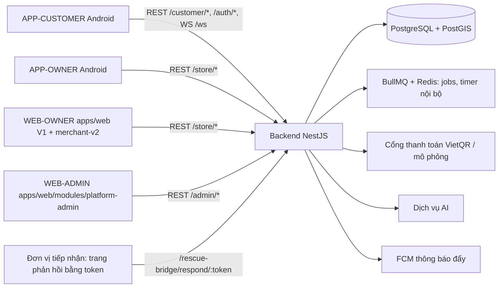
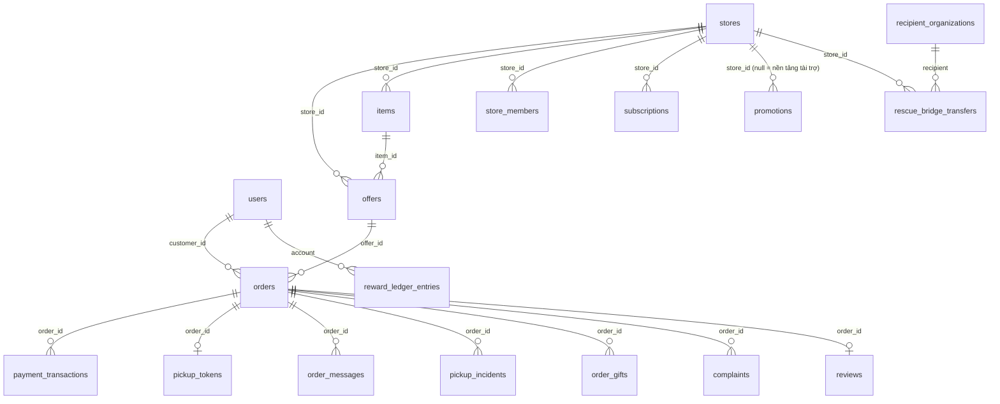
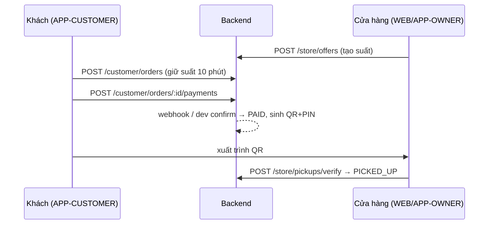

# BRD NGHIỆP VỤ HỆ THỐNG SURPLUSIQ – HIỆN TRẠNG

> Tài liệu mô tả hệ thống **hiện tại** (không phải hệ thống mong muốn). Sinh ngày 21/10/2026 từ: tài liệu trong `D:\SurplusIQ\doc\` và quét mã nguồn trong `apps/`.
> Nhãn nguồn: `[DOC]` tài liệu, `[CODE]` mã nguồn (kèm file:dòng), `[DOC+CODE]` cả hai. Nhãn trạng thái: PASS / PARTIAL / FAIL / NOT IMPLEMENTED / BLOCKED / NEEDS CLARIFICATION.
> Trạng thái `PASS?` nghĩa là *tài liệu đối soát UC–code cũ (19/10/2026) ghi DONE và tôi chưa kiểm chứng lại ở mức màn hình*; chỉ nâng thành PASS khi test tự động (Giai đoạn C) đã chạy.

## 1. Giới thiệu

- **Mục đích:** ghi lại nghiệp vụ hệ thống SurplusIQ (Cứu Món) đang vận hành trong code để làm gốc truy vết kiểm thử.
- **Phạm vi:** 4 ứng dụng (WEB-ADMIN, WEB-OWNER, APP-OWNER, APP-CUSTOMER) + Backend NestJS + PostgreSQL/PostGIS.
- **Nguồn đã đọc:** `SurplusIQ_Thong_ke_man_hinh_theo_vai_tro.md` (đọc đủ mục 1–2 và bảng màn hình), `UC_Mapping_Excel_vs_Code.csv` (220 UC), `BRD_Full_SurplusIQ.md` (chỉ trích bảng BR-), toàn bộ controller, entity, enum của backend (quét tự động), danh sách composable/màn hình của 2 app Android và trang web.
- **Chưa đọc (ghi rõ):** `BBRD_Cuu_Mon_Tinh_Nang_Bo_Sung.md`, `Bộ prompt thiết kế giao diện…`, `SURPLUSIQ_Design_Code_Rules.md`, hai file `.xlsx`, `KhachHang_Nghiep_vu…`, `ChuCuaHang_*`; thân service của đa số module (chỉ đọc có chọn lọc: payments, orders, order-support, rewards, auth); logic từng màn Android chưa mở từng file; không tìm thấy OpenAPI/Swagger file tĩnh (Swagger sinh động từ decorator).
- **Không tìm thấy:** tài liệu ERD riêng; spec đơn vị tiếp nhận ngoài các màn DV01–DV07 trong file thống kê.

## 2. Tổng quan hệ thống

- Backend: **384 endpoint** (quét `@Get/@Post/@Put/@Patch/@Delete`), **76 bảng** (`@Entity`), **62 enum**. Migration: `apps/backend/src/migrations/`. Chạy migration thủ công (`DB_MIGRATIONS_RUN=false`).
- WEB-OWNER có **hai** giao diện song song: V1 (`apps/web/src/pages`, CSS thuần) tại `/` và V2 (`apps/web/src/modules/merchant-v2`, MUI) tại `/merchant-v2`. [CODE] `apps/web/src/main.tsx`.
- Số màn/composable tìm thấy trong code: APP-CUSTOMER=66, APP-OWNER=62, WEB-OWNER-V1=11, WEB-OWNER-V2=10, WEB-ADMIN=11.

## 3. Vai trò và phân quyền

| Mã | Vai trò | Định danh trong code | Ứng dụng |
|---|---|---|---|
| ROLE-CUSTOMER | Khách hàng | `UserRole.CUSTOMER` | APP-CUSTOMER |
| ROLE-OWNER | Chủ cửa hàng | `UserRole.STORE_USER` + `StorePermission.OWNER` | APP-OWNER, WEB-OWNER |
| ROLE-MANAGER | Quản lý | `STORE_USER` + `MANAGER` | APP-OWNER, WEB-OWNER |
| ROLE-COUNTER | Nhân viên quầy | `STORE_USER` + `COUNTER` | APP-OWNER, WEB-OWNER |
| ROLE-ADMIN | Quản trị nền tảng | `UserRole.ADMIN` | WEB-ADMIN |
| ROLE-RECIPIENT | Đơn vị tiếp nhận | không có tài khoản; truy cập bằng token trong liên kết | trang `/rescue-bridge/respond/:token` |

**Cơ chế:** `JwtAuthGuard` → `RolesGuard` (`@Roles`) → `ChannelGuard` (`@Channel`) → `StorePermissionGuard` (`@Permissions`); gói Pro bằng `PlanGuard` + `@RequiresPlan`; trạng thái cửa hàng bằng `StoreStatusGuard`. [CODE] `apps/backend/src/common/guards/`.

Số endpoint theo nhóm tiền tố:

| Nhóm | Số endpoint | Có @Roles | Có @Permissions | Cần gói Pro | Công khai |
|---|---|---|---|---|---|
| /store | 178 | 174 | 172 | 21 | 0 |
| /customer | 128 | 116 | 0 | 0 | 12 |
| /admin | 27 | 27 | 0 | 0 | 0 |
| /jobs | 16 | 0 | 0 | 0 | 0 |
| /auth | 14 | 0 | 0 | 0 | 0 |
| /me | 6 | 0 | 0 | 0 | 0 |
| /rescue-bridge | 4 | 0 | 0 | 0 | 4 |
| /orders | 3 | 3 | 0 | 0 | 0 |
| /realtime | 2 | 0 | 0 | 0 | 0 |
| /seed | 2 | 2 | 0 | 0 | 0 |
| /payments | 1 | 0 | 0 | 0 | 0 |
| /dev | 1 | 0 | 0 | 0 | 0 |
| /platform-settings | 1 | 0 | 0 | 0 | 0 |
| /upload | 1 | 0 | 0 | 0 | 0 |

Ma trận chi tiết quyền chủ cửa hàng (Chủ/Quản lý/Quầy) theo endpoint nằm ở Phụ lục B (cột `perm`).

## 4. Thực thể nghiệp vụ

Bảng (`@Entity`): `action_cards`, `ai_conversations`, `ai_feedback`, `ai_logs`, `ai_messages`, `anomalies`, `donation_records`, `consents`, `customer_profiles`, `deal_alerts`, `dietary_profiles`, `favorite_stores`, `fcm_tokens`, `otp_codes`, `refresh_tokens`, `saved_deals`, `saved_filters`, `saved_places`, `trusted_devices`, `users`, `view_history`, `items`, `offer_events`, `offers`, `surprise_bag_items`, `trustpass_history`, `complaint_attachments`, `complaints`, `reviews`, `support_messages`, `support_tickets`, `violation_reports`, `campaign_deliveries`, `campaigns`, `promotion_wallet`, `promotions`, `notifications`, `order_gifts`, `order_messages`, `pickup_incidents`, `idempotency_keys`, `noshow_records`, `order_locks`, `orders`, `payment_transactions`, `pickup_tokens`, `proxy_pickup_codes`, `daily_actuals`, `forecasts`, `price_proposals`, `special_events`, `statement_lines`, `weekly_statements`, `recipient_organizations`, `rescue_bridge_transfers`, `rescue_lab_scenario_versions`, `rescue_lab_scenarios`, `rescue_pool_registrations`, `rescue_pools`, `rescue_risk_snapshots`, `reward_accounts`, `reward_ledger_entries`, `platform_settings`, `audit_logs`, `customer_notes`, `customer_segments`, `staff_invites`, `store_closures`, `store_members`, `store_settings_history`, `store_settings`, `stores`, `plan_quotas`, `subscription_invoices`, `subscriptions`, `usage_logs`.

Quan hệ trên lấy từ tên cột/khóa ngoại trong entity; chưa đối chiếu từng ràng buộc DB. [CODE]

## 5. Vòng đời trạng thái (ST-)

Giá trị enum lấy từ `apps/backend/src/entities/**`. Chuyển trạng thái hợp lệ chỉ ghi khi đã thấy trong service; còn lại để "chưa xác minh".

| Mã | Thực thể | Giá trị enum | Chuyển trạng thái đã thấy / mô tả | Nơi |
|---|---|---|---|---|
| ST-ORDER-001 | OrderStatus | PENDING_PAYMENT,PAID,PICKED_UP,HOLD_EXPIRED,PICKUP_EXPIRED,CANCELLED,REFUNDED | PENDING_PAYMENT→PAID (webhook/dev confirm/admin xác nhận biên lai); PENDING_PAYMENT→HOLD_EXPIRED (job hết hạn giữ 10 phút); PAID→PICKED_UP (quét QR/mã dự phòng); PAID→PICKUP_EXPIRED (job không đến nhận, trừ khi có sự cố STORE_CLOSED/NOT_READY); PENDING_PAYMENT|PAID→CANCELLED (khách/cửa hàng/hệ thống); CANCELLED→REFUNDED (hoàn tiền) | `orders/orders.service.ts`, `payments/payments.service.ts`, `jobs/jobs.service.ts` |
| ST-OFFER-001 | OfferStatus | DRAFT,OPEN,SOLD_OUT,CLOSED,CANCELLED | DRAFT→OPEN; OPEN→SOLD_OUT (hết tồn); OPEN|SOLD_OUT→CLOSED (đóng sớm/tự đóng); OPEN→CANCELLED (hủy, hoàn 100%) | `offers/offers.service.ts` |
| ST-PAYMENT-001 | PaymentStatus | PENDING_CONFIRM,SUCCEEDED,FAILED,MANUAL_REVIEW | PENDING_CONFIRM→SUCCEEDED|FAILED|MANUAL_REVIEW (sai tiền/đến muộn) | `payments/payments.service.ts` |
| ST-STORE-001 | StoreStatus | PENDING_VERIFY,ACTIVE,SUSPENDED | PENDING_VERIFY→ACTIVE→SUSPENDED (do admin) | `platform-admin/*` |
| ST-COMPLAINT-001 | ComplaintStatus | PENDING_STORE,ACCEPTED,REJECTED,CLOSED | PENDING_STORE→ACCEPTED|REJECTED→CLOSED; hạn xử lý 48 giờ có thể gia hạn | `customer-interactions/*` |
| ST-INCIDENT-001 | IncidentStatus | OPEN,ACKNOWLEDGED,RESOLVED,REJECTED | OPEN→ACKNOWLEDGED→RESOLVED|REJECTED; quá 2 giờ không phản hồi → tự hoàn tiền | `order-support/*` |
| ST-GIFT-001 | GiftStatus | PENDING,ACCEPTED,DECLINED,CANCELLED,EXPIRED | PENDING→ACCEPTED|DECLINED|CANCELLED|EXPIRED | `order-support/order-transfer.service.ts` |
| ST-SUBSCRIPTION-001 | SubscriptionStatus | ACTIVE,PENDING_PAYMENT,EXPIRED,CANCELLED | PENDING_PAYMENT→ACTIVE→EXPIRED|CANCELLED | `subscriptions/*` |
| ST-PROMOTION-001 | PromotionStatus | DRAFT,ACTIVE,PAUSED,ENDED | DRAFT→ACTIVE⇄PAUSED→ENDED | `marketing/*` |
| ST-BRIDGE-001 | RescueBridgeTransferStatus | DRAFT,SENT,ACCEPTED,REJECTED,AWAITING_HANDOVER,HANDED_OVER,PARTIAL,FAILED,CANCELLED | DRAFT→SENT→ACCEPTED|REJECTED→AWAITING_HANDOVER→HANDED_OVER|PARTIAL|FAILED; CANCELLED | `rescue-bridge/*` |
| ST-POOL-001 | RescuePoolStatus | DRAFT,OPEN,AGGREGATING,PENDING_STORE,OFFER_PUBLISHED,ORDERING_OPEN,COMPLETED,INSUFFICIENT,CANCELLED,EXPIRED | DRAFT→OPEN→AGGREGATING→PENDING_STORE→OFFER_PUBLISHED→ORDERING_OPEN→COMPLETED|INSUFFICIENT|CANCELLED|EXPIRED | `rescue-pool/*` |
| ST-USER-001 | UserStatus | PENDING_VERIFY,ACTIVE,PENDING_DELETE,ANONYMIZED,LOCKED | PENDING_VERIFY→ACTIVE⇄LOCKED; →PENDING_DELETE→ANONYMIZED | `auth/*` |

Ghi chú: cột "Chuyển trạng thái" là tổng hợp từ tên enum, comment `BR-`/`R1-`/`R2-` và các luồng tôi đã chạy thật (đặt → thanh toán dev → theo dõi → sự cố → hủy suất → hoàn tiền). Các chuyển còn lại **chưa xác minh bằng đọc service từng dòng** → mã ST- cần được xác nhận ở Giai đoạn C trước khi viết test chặn.

## 6. Danh mục chức năng theo ứng dụng (FR-)

Cột "Mức" lấy từ đối soát UC–code cũ (`UC_Mapping_Excel_vs_Code.csv`) cho các UC gắn với màn; `PASS?` = chưa kiểm chứng lại. Màn không gắn UC có trong CSV được đánh `NEEDS CLARIFICATION`.

### APP-CUSTOMER (Khách hàng)

| Mã FR | Màn | Tên | Nhóm | UC | Mức | Nguồn |
|---|---|---|---|---|---|---|
| FR-APPCUS-K01 | K01 | Đăng nhập | A. Truy cập và vị trí | R1-003 | PASS? | [DOC] |
| FR-APPCUS-K02 | K02 | Đăng ký | A. Truy cập và vị trí | R1-001 | PASS? | [DOC] |
| FR-APPCUS-K03 | K03 | Xác minh OTP | A. Truy cập và vị trí | R1-002,R1-013,R1-006 | PASS? | [DOC] |
| FR-APPCUS-K04 | K04 | Quên mật khẩu | A. Truy cập và vị trí | R1-008 | PASS? | [DOC] |
| FR-APPCUS-K05 | K05 | Đặt mật khẩu mới | A. Truy cập và vị trí | R1-008 | PASS? | [DOC] |
| FR-APPCUS-K06 | K06 | Quyền vị trí và bán kính | A. Truy cập và vị trí | R1-009,R1-012 | PASS? | [DOC] |
| FR-APPCUS-K07 | K07 | Địa điểm của tôi | A. Truy cập và vị trí | R1-015,R1-039 | PASS? | [DOC] |
| FR-APPCUS-K08 | K08 | Ghim vị trí tạm | A. Truy cập và vị trí | R1-039 | PASS? | [DOC] |
| FR-APPCUS-K09 | K09 | Trang chủ danh sách deal | B. Khám phá deal | R1-020,R1-024,R1-025,R1-039,R1-084 | PASS? | [DOC] |
| FR-APPCUS-K10 | K10 | Bản đồ deal | B. Khám phá deal | R1-021 | PASS? | [DOC] |
| FR-APPCUS-K11 | K11 | Tìm kiếm | B. Khám phá deal | R1-022,R1-082 | PASS? | [DOC] |
| FR-APPCUS-K12 | K12 | Bộ lọc và sắp xếp | B. Khám phá deal | R1-023,R1-024,R1-033 | PASS? | [DOC] |
| FR-APPCUS-K13 | K13 | Chi tiết deal | B. Khám phá deal | R1-026,R1-034,R1-037,R1-085,R1-087 | PASS? | [DOC] |
| FR-APPCUS-K14 | K14 | Chi tiết cửa hàng | B. Khám phá deal | R1-027,R1-028,R1-029,R1-038,R1-069 | PARTIAL | [DOC] |
| FR-APPCUS-K15 | K15 | Đánh giá công khai của cửa hàng | B. Khám phá deal | R1-094,R1-064 | NOT IMPLEMENTED | [DOC] |
| FR-APPCUS-K16 | K16 | So sánh deal | B. Khám phá deal | R1-036,R1-086 | NOT IMPLEMENTED | [DOC] |
| FR-APPCUS-K17 | K17 | Deal đã lưu và đã xem | B. Khám phá deal | R1-034,R1-035 | PASS? | [DOC] |
| FR-APPCUS-K18 | K18 | Cửa hàng yêu thích | B. Khám phá deal | R1-028,R1-029 | PASS? | [DOC] |
| FR-APPCUS-K19 | K19 | Danh sách cảnh báo deal | B. Khám phá deal | R1-030,R1-031,R1-032 | NOT IMPLEMENTED | [DOC] |
| FR-APPCUS-K20 | K20 | Tạo hoặc sửa cảnh báo | B. Khám phá deal | R1-030,R1-031,R1-032 | NOT IMPLEMENTED | [DOC] |
| FR-APPCUS-K21 | K21 | Gợi ý dành cho bạn | B. Khám phá deal | R1-084,R1-085,R1-093 | NOT IMPLEMENTED | [DOC] |
| FR-APPCUS-K22 | K22 | Xác nhận đặt | C. Đặt hàng và thanh toán | R1-040,R1-049,R1-050,R1-053 | PARTIAL | [DOC] |
| FR-APPCUS-K23 | K23 | Chọn ưu đãi | C. Đặt hàng và thanh toán | R1-053,R1-079 | PARTIAL | [DOC] |
| FR-APPCUS-K24 | K24 | Thanh toán VietQR | C. Đặt hàng và thanh toán | R1-041,R1-055,R1-056 | PASS? | [DOC] |
| FR-APPCUS-K25 | K25 | Kết quả thanh toán | C. Đặt hàng và thanh toán | R1-041,R1-042,R1-047,R1-056 | PASS? | [DOC] |
| FR-APPCUS-K26 | K26 | Đơn của tôi | C. Đặt hàng và thanh toán | R1-044,R1-045,R1-055 | PASS? | [DOC] |
| FR-APPCUS-K27 | K27 | Chi tiết đơn | C. Đặt hàng và thanh toán | R1-046,R1-043,R1-051,R1-052,R1-060,R1-061,R1-064 | PASS? | [DOC] |
| FR-APPCUS-K28 | K28 | QR nhận hàng | C. Đặt hàng và thanh toán | R1-057 | PASS? | [DOC] |
| FR-APPCUS-K29 | K29 | Mã nhận hộ | C. Đặt hàng và thanh toán | R1-052 | PASS? | [DOC] |
| FR-APPCUS-K30 | K30 | Hủy đơn | C. Đặt hàng và thanh toán | R1-043 | PASS? | [DOC] |
| FR-APPCUS-K31 | K31 | Biên nhận | C. Đặt hàng và thanh toán | R1-054 | PASS? | [DOC] |
| FR-APPCUS-K32 | K32 | Đặt lại món đã mua | C. Đặt hàng và thanh toán | R1-051 | PASS? | [DOC] |
| FR-APPCUS-K33 | K33 | Trạng thái khóa đặt | C. Đặt hàng và thanh toán | R1-048 | PASS? | [DOC] |
| FR-APPCUS-K34 | K34 | Gửi khiếu nại | D. Hậu mãi và hỗ trợ | R1-061,R1-089 | NOT IMPLEMENTED | [DOC] |
| FR-APPCUS-K35 | K35 | Lịch sử khiếu nại | D. Hậu mãi và hỗ trợ | R1-067 | PASS? | [DOC] |
| FR-APPCUS-K36 | K36 | Chi tiết khiếu nại | D. Hậu mãi và hỗ trợ | R1-062,R1-063,R1-068 | PASS? | [DOC] |
| FR-APPCUS-K37 | K37 | Gửi đánh giá | D. Hậu mãi và hỗ trợ | R1-064,R1-065 | PASS? | [DOC] |
| FR-APPCUS-K38 | K38 | Đánh giá của tôi | D. Hậu mãi và hỗ trợ | R1-065,R1-066 | PASS? | [DOC] |
| FR-APPCUS-K39 | K39 | Báo cáo vi phạm | D. Hậu mãi và hỗ trợ | R1-069 | PASS? | [DOC] |
| FR-APPCUS-K40 | K40 | Gửi yêu cầu hỗ trợ | D. Hậu mãi và hỗ trợ | R1-070 | PASS? | [DOC] |
| FR-APPCUS-K41 | K41 | Danh sách hỗ trợ | D. Hậu mãi và hỗ trợ | R1-071 | PASS? | [DOC] |
| FR-APPCUS-K42 | K42 | Chi tiết hỗ trợ | D. Hậu mãi và hỗ trợ | R1-071 | PASS? | [DOC] |
| FR-APPCUS-K43 | K43 | Trung tâm trợ giúp | D. Hậu mãi và hỗ trợ | R1-072 | PASS? | [DOC] |
| FR-APPCUS-K44 | K44 | Bài viết trợ giúp | D. Hậu mãi và hỗ trợ | R1-072 | PASS? | [DOC] |
| FR-APPCUS-K45 | K45 | Thông báo | E. Thông báo, ưu đãi, tác động | R1-073,R1-074,R1-075 | PASS? | [DOC] |
| FR-APPCUS-K46 | K46 | Lịch sử thanh toán và hoàn tiền | E. Thông báo, ưu đãi, tác động | R1-077,R1-047 | PASS? | [DOC] |
| FR-APPCUS-K47 | K47 | Ví ưu đãi | E. Thông báo, ưu đãi, tác động | R1-078,R1-079,R1-080 | NOT IMPLEMENTED | [DOC] |
| FR-APPCUS-K48 | K48 | Tác động cá nhân | E. Thông báo, ưu đãi, tác động | R1-076 | PASS? | [DOC] |
| FR-APPCUS-K49 | K49 | Huy hiệu và chia sẻ | E. Thông báo, ưu đãi, tác động | R1-081 | PASS? | [DOC] |
| FR-APPCUS-K50 | K50 | Trợ lý Cứu Món | F. Trợ lý AI | R1-083,R1-087,R1-088,R1-090,R1-092 | NOT IMPLEMENTED | [DOC] |
| FR-APPCUS-K51 | K51 | Lịch sử hội thoại AI | F. Trợ lý AI | R1-091 | NOT IMPLEMENTED | [DOC] |
| FR-APPCUS-K52 | K52 | Tài khoản của tôi | G. Tài khoản và quyền riêng tư | R1-005,R1-004 | PASS? | [DOC] |
| FR-APPCUS-K53 | K53 | Chỉnh sửa hồ sơ | G. Tài khoản và quyền riêng tư | R1-006 | PASS? | [DOC] |
| FR-APPCUS-K54 | K54 | Đổi mật khẩu | G. Tài khoản và quyền riêng tư | R1-007 | PARTIAL | [DOC] |
| FR-APPCUS-K55 | K55 | Xác thực hai bước | G. Tài khoản và quyền riêng tư | R1-013 | PASS? | [DOC] |
| FR-APPCUS-K56 | K56 | Thiết bị đăng nhập | G. Tài khoản và quyền riêng tư | R1-014 | PASS? | [DOC] |
| FR-APPCUS-K57 | K57 | Cài đặt thông báo | G. Tài khoản và quyền riêng tư | R1-010,R1-093 | NOT IMPLEMENTED | [DOC] |
| FR-APPCUS-K58 | K58 | Hồ sơ ăn uống và dị ứng | G. Tài khoản và quyền riêng tư | R1-016 | PASS? | [DOC] |
| FR-APPCUS-K59 | K59 | Quyền riêng tư và đồng ý | G. Tài khoản và quyền riêng tư | R1-012,R1-017 | PASS? | [DOC] |
| FR-APPCUS-K60 | K60 | Xuất dữ liệu cá nhân | G. Tài khoản và quyền riêng tư | R1-018 | PASS? | [DOC] |
| FR-APPCUS-K61 | K61 | Xóa tài khoản | G. Tài khoản và quyền riêng tư | R1-011,R1-019 | PASS? | [DOC] |
| FR-APPCUS-KC01 | KC01 | Tạo giỏ theo nhu cầu | Rescue Basket | CM-C01 | NEEDS CLARIFICATION | [DOC] |
| FR-APPCUS-KC02 | KC02 | Các phương án giỏ | Rescue Basket | CM-C01 | NEEDS CLARIFICATION | [DOC] |
| FR-APPCUS-KC03 | KC03 | Chi tiết giỏ | Rescue Basket | CM-C01 | NEEDS CLARIFICATION | [DOC] |
| FR-APPCUS-KC04 | KC04 | Xác nhận đặt giỏ | Rescue Basket | CM-C01 | NEEDS CLARIFICATION | [DOC] |
| FR-APPCUS-KC05 | KC05 | Danh sách đợt Pool | Rescue Pool | CM-C02 | NEEDS CLARIFICATION | [DOC] |
| FR-APPCUS-KC06 | KC06 | Chi tiết đợt | Rescue Pool | CM-C02 | NEEDS CLARIFICATION | [DOC] |
| FR-APPCUS-KC07 | KC07 | Đăng ký nhu cầu | Rescue Pool | CM-C02 | NEEDS CLARIFICATION | [DOC] |
| FR-APPCUS-KC08 | KC08 | Nhu cầu của tôi | Rescue Pool | CM-C02 | NEEDS CLARIFICATION | [DOC] |
| FR-APPCUS-KC09 | KC09 | Đề nghị cung ứng | Rescue Pool | CM-C02 | NEEDS CLARIFICATION | [DOC] |
| FR-APPCUS-KC10 | KC10 | Hồ sơ minh bạch món (TrustPass) | TrustPass | CM-C03 | NEEDS CLARIFICATION | [DOC] |
| FR-APPCUS-KC11 | KC11 | Điểm thưởng | Rescue Rewards | CM-C04 | NEEDS CLARIFICATION | [DOC] |
| FR-APPCUS-KC12 | KC12 | Lịch sử điểm | Rescue Rewards | CM-C04 | NEEDS CLARIFICATION | [DOC] |
| FR-APPCUS-KC13 | KC13 | Đổi điểm lấy ưu đãi | Rescue Rewards | CM-C04 | NEEDS CLARIFICATION | [DOC] |
| FR-APPCUS-KC14 | KC14 | Quy tắc chương trình điểm | Rescue Rewards | CM-C04 | NEEDS CLARIFICATION | [DOC] |
| FR-APPCUS-KC15 | KC15 | Thiết lập Radar | Rescue Radar | CM-C05 | NEEDS CLARIFICATION | [DOC] |
| FR-APPCUS-KX01 | KX01 | Tài khoản nhận hoàn và theo dõi hoàn tiền | Đề xuất thêm | N08 | NEEDS CLARIFICATION | [DOC] |
| FR-APPCUS-KX02 | KX02 | Báo đã chuyển khoản và biên lai | Đề xuất thêm | N56 | NEEDS CLARIFICATION | [DOC] |
| FR-APPCUS-KX03 | KX03 | Báo sự cố khi đến nhận | Đề xuất thêm | N10 | NEEDS CLARIFICATION | [DOC] |
| FR-APPCUS-KX04 | KX04 | Xin gia hạn giờ nhận | Đề xuất thêm | N11 | NEEDS CLARIFICATION | [DOC] |
| FR-APPCUS-KX05 | KX05 | Đổi suất hoặc chuyển nhượng đơn | Đề xuất thêm | N64 | NEEDS CLARIFICATION | [DOC] |
| FR-APPCUS-KX06 | KX06 | Danh sách chờ suất đã hết | Đề xuất thêm | N18 | NEEDS CLARIFICATION | [DOC] |
| FR-APPCUS-KX07 | KX07 | Theo dõi giá và lịch sử giá | Đề xuất thêm | N72 | NEEDS CLARIFICATION | [DOC] |
| FR-APPCUS-KX08 | KX08 | Hồ sơ ăn uống nhiều thành viên | Đề xuất thêm | N76 | NEEDS CLARIFICATION | [DOC] |
| FR-APPCUS-KX09 | KX09 | Hành trình khách mới | Đề xuất thêm | N67 | NEEDS CLARIFICATION | [DOC] |
| FR-APPCUS-KX10 | KX10 | Giới thiệu bạn bè | Đề xuất thêm | N20 | NEEDS CLARIFICATION | [DOC] |
| FR-APPCUS-KX11 | KX11 | Chat theo đơn | Đề xuất thêm | N36 | NEEDS CLARIFICATION | [DOC] |
| FR-APPCUS-KX12 | KX12 | Theo dõi đơn trực tiếp | Đề xuất thêm | N71 | NEEDS CLARIFICATION | [DOC] |
| FR-APPCUS-KX13 | KX13 | Danh mục và bộ sưu tập deal | Đề xuất thêm | N34 | NEEDS CLARIFICATION | [DOC] |
| FR-APPCUS-KX14 | KX14 | Chi tiết bộ sưu tập | Đề xuất thêm | N34 | NEEDS CLARIFICATION | [DOC] |
| FR-APPCUS-KX15 | KX15 | Món đã nhận: nhắc dùng và bảo quản | Đề xuất thêm | N74 | NEEDS CLARIFICATION | [DOC] |
| FR-APPCUS-KX16 | KX16 | Chi tiêu và mục tiêu tháng | Đề xuất thêm | N69 | NEEDS CLARIFICATION | [DOC] |
| FR-APPCUS-KX17 | KX17 | Tác động cộng đồng | Đề xuất thêm | N70 | NEEDS CLARIFICATION | [DOC] |
| FR-APPCUS-KX18 | KX18 | Tặng suất | Đề xuất thêm | N77 | NEEDS CLARIFICATION | [DOC] |

Tổng hợp: PASS?=47, PARTIAL=4, NOT IMPLEMENTED=10, NEEDS CLARIFICATION=33

### APP-OWNER / WEB-OWNER (Chủ cửa hàng, 110 màn thiết kế cho app)

| Mã FR | Màn | Tên | Nhóm | UC | Mức | Nguồn |
|---|---|---|---|---|---|---|
| FR-APPOWN-S01 | S01 | Đăng nhập | 1. Truy cập | R2-002 | PASS? | [DOC] |
| FR-APPOWN-S02 | S02 | Đăng ký tài khoản và cửa hàng | 1. Truy cập | R2-001 | PASS? | [DOC] |
| FR-APPOWN-S03 | S03 | Quên và đặt lại mật khẩu | 1. Truy cập | R2-004 | PASS? | [DOC] |
| FR-APPOWN-S04 | S04 | Kích hoạt tài khoản nhân viên | 1. Truy cập | R2-076 | PASS? | [DOC] |
| FR-APPOWN-S05 | S05 | Tài khoản của tôi | 1. Truy cập | R2-003,R2-004 | PASS? | [DOC] |
| FR-APPOWN-S06 | S06 | Bảng điều khiển hôm nay | 2. Tổng quan | R2-061 | PASS? | [DOC] |
| FR-APPOWN-S07 | S07 | Việc cần làm hôm nay | 2. Tổng quan | R2-095,R2-096 | PASS? | [DOC] |
| FR-APPOWN-S08 | S08 | Thông báo | 2. Tổng quan | R2-074 | PASS? | [DOC] |
| FR-APPOWN-S09 | S09 | Hồ sơ cửa hàng | 3. Hồ sơ và vận hành | R2-005,R2-006 | PASS? | [DOC] |
| FR-APPOWN-S10 | S10 | Cài đặt vận hành | 3. Hồ sơ và vận hành | R2-007,R2-008 | PASS? | [DOC] |
| FR-APPOWN-S11 | S11 | Tạm ngưng và mở lại cửa hàng | 3. Hồ sơ và vận hành | R2-009,R2-010 | PASS? | [DOC] |
| FR-APPOWN-S12 | S12 | Lịch cửa hàng | 3. Hồ sơ và vận hành | R2-097 | PASS? | [DOC] |
| FR-APPOWN-S13 | S13 | Quy tắc kinh doanh | 3. Hồ sơ và vận hành | R2-101,R2-102 | PASS? | [DOC] |
| FR-APPOWN-S14 | S14 | Xuất dữ liệu cửa hàng | 3. Hồ sơ và vận hành | R2-103 | PASS? | [DOC] |
| FR-APPOWN-S15 | S15 | Nhật ký hoạt động | 3. Hồ sơ và vận hành | R2-075 | PASS? | [DOC] |
| FR-APPOWN-S16 | S16 | Gói dịch vụ và dùng thử Pro | 4. Gói dịch vụ | R2-011,R2-012,R2-014 | PASS? | [DOC] |
| FR-APPOWN-S17 | S17 | Gia hạn gói Pro | 4. Gói dịch vụ | R2-013 | PASS? | [DOC] |
| FR-APPOWN-S18 | S18 | Hóa đơn gói | 4. Gói dịch vụ | R2-015 | PASS? | [DOC] |
| FR-APPOWN-S19 | S19 | Hạn mức sử dụng | 4. Gói dịch vụ | R2-016 | PASS? | [DOC] |
| FR-APPOWN-S20 | S20 | Danh sách món | 5. Danh mục món | R2-017,R2-018,R2-023,R2-024 | PASS? | [DOC] |
| FR-APPOWN-S21 | S21 | Chi tiết món | 5. Danh mục món | R2-019 | PASS? | [DOC] |
| FR-APPOWN-S22 | S22 | Tạo và sửa món | 5. Danh mục món | R2-020,R2-021,R2-022,R2-119,R2-120 | NOT IMPLEMENTED | [DOC] |
| FR-APPOWN-S23 | S23 | Nhập món từ CSV | 5. Danh mục món | R2-025 | PASS? | [DOC] |
| FR-APPOWN-S24 | S24 | Kiểm tra dữ liệu | 5. Danh mục món | R2-099,R2-100 | PASS? | [DOC] |
| FR-APPOWN-S25 | S25 | Danh sách suất | 6. Suất và tồn kho | R2-026,R2-027,R2-034 | PASS? | [DOC] |
| FR-APPOWN-S26 | S26 | Tạo suất | 6. Suất và tồn kho | R2-028,R2-038 | PASS? | [DOC] |
| FR-APPOWN-S27 | S27 | Nhân bản suất hôm qua | 6. Suất và tồn kho | R2-029 | PASS? | [DOC] |
| FR-APPOWN-S28 | S28 | Chi tiết và chỉnh sửa suất | 6. Suất và tồn kho | R2-030,R2-031,R2-032,R2-033 | PASS? | [DOC] |
| FR-APPOWN-S29 | S29 | Lịch sử thay đổi của suất | 6. Suất và tồn kho | R2-035 | PASS? | [DOC] |
| FR-APPOWN-S30 | S30 | Túi bất ngờ | 6. Suất và tồn kho | R2-091 | PASS? | [DOC] |
| FR-APPOWN-S31 | S31 | Gợi ý tặng phần không bán được | 6. Suất và tồn kho | R2-121 | PASS? | [DOC] |
| FR-APPOWN-S32 | S32 | Dự báo số lượng | 7. Dự báo và định giá | R2-036,R2-037,R2-038,R2-042 | PARTIAL | [DOC] |
| FR-APPOWN-S33 | S33 | Nhập số thực tế cuối ngày | 7. Dự báo và định giá | R2-039 | PASS? | [DOC] |
| FR-APPOWN-S34 | S34 | Sự kiện đặc biệt | 7. Dự báo và định giá | R2-040 | PASS? | [DOC] |
| FR-APPOWN-S35 | S35 | Độ chính xác và xu hướng dự báo | 7. Dự báo và định giá | R2-041,R2-043 | PASS? | [DOC] |
| FR-APPOWN-S36 | S36 | Đề xuất giá giảm theo giờ | 7. Dự báo và định giá | R2-044,R2-045,R2-046,R2-047 | PASS? | [DOC] |
| FR-APPOWN-S37 | S37 | Lịch sử quyết định giá | 7. Dự báo và định giá | R2-048 | PASS? | [DOC] |
| FR-APPOWN-S38 | S38 | Mô phỏng chính sách giá | 7. Dự báo và định giá | R2-104,R2-105 | PARTIAL | [DOC] |
| FR-APPOWN-S39 | S39 | Danh sách đơn | 8. Đơn và nhận hàng | R2-049,R2-050 | PASS? | [DOC] |
| FR-APPOWN-S40 | S40 | Chi tiết đơn | 8. Đơn và nhận hàng | R2-051,R2-053 | PASS? | [DOC] |
| FR-APPOWN-S41 | S41 | Quét QR nhận hàng | 8. Đơn và nhận hàng | R2-052,R1-058 | PASS? | [DOC] |
| FR-APPOWN-S42 | S42 | Lịch hẹn nhận hàng | 8. Đơn và nhận hàng | R2-098 | PASS? | [DOC] |
| FR-APPOWN-S43 | S43 | Danh sách khiếu nại | 9. Khiếu nại và đánh giá | R2-054 | PASS? | [DOC] |
| FR-APPOWN-S44 | S44 | Xử lý khiếu nại | 9. Khiếu nại và đánh giá | R2-054,R2-055,R2-056,R2-059,R2-060,R2-118 | PARTIAL | [DOC] |
| FR-APPOWN-S45 | S45 | Đánh giá của khách | 9. Khiếu nại và đánh giá | R2-057,R2-058,R2-118 | PARTIAL | [DOC] |
| FR-APPOWN-S46 | S46 | Báo cáo hao hụt và thu hồi | 10. Báo cáo và đối soát | R2-062 | PARTIAL | [DOC] |
| FR-APPOWN-S47 | S47 | Doanh thu và đơn | 10. Báo cáo và đối soát | R2-068,R2-072 | PASS? | [DOC] |
| FR-APPOWN-S48 | S48 | Báo cáo theo món | 10. Báo cáo và đối soát | R2-069 | PASS? | [DOC] |
| FR-APPOWN-S49 | S49 | Phân bố bán hàng theo giờ | 10. Báo cáo và đối soát | R2-070 | PASS? | [DOC] |
| FR-APPOWN-S50 | S50 | Hiệu quả đề xuất giá | 10. Báo cáo và đối soát | R2-071 | PASS? | [DOC] |
| FR-APPOWN-S51 | S51 | Đối soát doanh thu và hoa hồng | 10. Báo cáo và đối soát | R2-063 | PASS? | [DOC] |
| FR-APPOWN-S52 | S52 | Sao kê đối soát tuần | 10. Báo cáo và đối soát | R2-066,R2-067 | PASS? | [DOC] |
| FR-APPOWN-S53 | S53 | Xuất báo cáo | 10. Báo cáo và đối soát | R2-064 | PASS? | [DOC] |
| FR-APPOWN-S54 | S54 | Tác động môi trường | 10. Báo cáo và đối soát | R2-073 | PASS? | [DOC] |
| FR-APPOWN-S55 | S55 | Chế độ demo | 10. Báo cáo và đối soát | R2-065 | PASS? | [DOC] |
| FR-APPOWN-S56 | S56 | Khách đã mua | 11. Khách của cửa hàng | R2-082,R2-083,R2-085 | PASS? | [DOC] |
| FR-APPOWN-S57 | S57 | Phân nhóm khách | 11. Khách của cửa hàng | R2-084,R2-087 | PARTIAL | [DOC] |
| FR-APPOWN-S58 | S58 | Khách yêu thích cửa hàng | 11. Khách của cửa hàng | R2-086 | PASS? | [DOC] |
| FR-APPOWN-S59 | S59 | Danh sách ưu đãi | 12. Ưu đãi và chiến dịch | R2-089,R2-090 | PARTIAL | [DOC] |
| FR-APPOWN-S60 | S60 | Tạo ưu đãi | 12. Ưu đãi và chiến dịch | R2-088,R2-090 | PARTIAL | [DOC] |
| FR-APPOWN-S61 | S61 | Chiến dịch thông báo | 12. Ưu đãi và chiến dịch | R2-093,R2-094 | PASS? | [DOC] |
| FR-APPOWN-S62 | S62 | Tạo chiến dịch | 12. Ưu đãi và chiến dịch | R2-092,R2-117,R2-126 | NOT IMPLEMENTED | [DOC] |
| FR-APPOWN-S63 | S63 | Danh sách nhân viên | 13. Nhân viên | R2-077,R2-079,R2-080 | PASS? | [DOC] |
| FR-APPOWN-S64 | S64 | Mời và đổi quyền nhân viên | 13. Nhân viên | R2-076,R2-078 | PASS? | [DOC] |
| FR-APPOWN-S65 | S65 | Hoạt động của nhân viên | 13. Nhân viên | R2-081 | PARTIAL | [DOC] |
| FR-APPOWN-S66 | S66 | Trợ lý cửa hàng | 14. Trợ lý AI và phân tích | R2-108,R2-109 | PASS? | [DOC] |
| FR-APPOWN-S67 | S67 | Lịch sử hội thoại AI | 14. Trợ lý AI và phân tích | R2-110 | PASS? | [DOC] |
| FR-APPOWN-S68 | S68 | Báo cáo tuần thông minh | 14. Trợ lý AI và phân tích | R2-111 | PASS? | [DOC] |
| FR-APPOWN-S69 | S69 | Cảnh báo bất thường và phân tích nguyên nhân | 14. Trợ lý AI và phân tích | R2-112,R2-113 | NOT IMPLEMENTED | [DOC] |
| FR-APPOWN-S70 | S70 | Đề xuất hành động và theo dõi kết quả | 14. Trợ lý AI và phân tích | R2-114,R2-115,R2-116 | PASS? | [DOC] |
| FR-APPOWN-S71 | S71 | Cấu hình AI | 14. Trợ lý AI và phân tích | R2-122 | NOT IMPLEMENTED | [DOC] |
| FR-APPOWN-S72 | S72 | Mức dùng và nhật ký AI | 14. Trợ lý AI và phân tích | R2-123,R2-124,R2-125 | PASS? | [DOC] |
| FR-APPOWN-S73 | S73 | Gửi yêu cầu hỗ trợ | 15. Hỗ trợ nền tảng | R2-106 | PASS? | [DOC] |
| FR-APPOWN-S74 | S74 | Danh sách và trao đổi hỗ trợ | 15. Hỗ trợ nền tảng | R2-107 | PASS? | [DOC] |
| FR-APPOWN-SB01 | SB01 | Danh sách lô theo nguy cơ | Rescue Timeline | CM-B01 | NEEDS CLARIFICATION | [DOC] |
| FR-APPOWN-SB02 | SB02 | Chi tiết lô và hành động | Rescue Timeline | CM-B01 | NEEDS CLARIFICATION | [DOC] |
| FR-APPOWN-SB03 | SB03 | Danh sách đợt Pool | Rescue Pool Manager | CM-B02 | NEEDS CLARIFICATION | [DOC] |
| FR-APPOWN-SB04 | SB04 | Tạo hoặc sửa đợt | Rescue Pool Manager | CM-B02 | NEEDS CLARIFICATION | [DOC] |
| FR-APPOWN-SB05 | SB05 | Nhu cầu tổng hợp | Rescue Pool Manager | CM-B02 | NEEDS CLARIFICATION | [DOC] |
| FR-APPOWN-SB06 | SB06 | Đề nghị cung ứng | Rescue Pool Manager | CM-B02 | NEEDS CLARIFICATION | [DOC] |
| FR-APPOWN-SB07 | SB07 | Kết quả đợt | Rescue Pool Manager | CM-B02 | NEEDS CLARIFICATION | [DOC] |
| FR-APPOWN-SB08 | SB08 | Danh sách bàn giao | Rescue Bridge | CM-B03 | NEEDS CLARIFICATION | [DOC] |
| FR-APPOWN-SB09 | SB09 | Tạo đề nghị bàn giao | Rescue Bridge | CM-B03 | NEEDS CLARIFICATION | [DOC] |
| FR-APPOWN-SB10 | SB10 | Chọn đơn vị tiếp nhận | Rescue Bridge | CM-B03 | NEEDS CLARIFICATION | [DOC] |
| FR-APPOWN-SB11 | SB11 | Theo dõi bàn giao | Rescue Bridge | CM-B03 | NEEDS CLARIFICATION | [DOC] |
| FR-APPOWN-SB12 | SB12 | Xác nhận bàn giao | Rescue Bridge | CM-B03 | NEEDS CLARIFICATION | [DOC] |
| FR-APPOWN-SB13 | SB13 | Danh sách kịch bản | Rescue Lab | CM-B04 | NEEDS CLARIFICATION | [DOC] |
| FR-APPOWN-SB14 | SB14 | Tạo kịch bản | Rescue Lab | CM-B04 | NEEDS CLARIFICATION | [DOC] |
| FR-APPOWN-SB15 | SB15 | Kết quả và so sánh | Rescue Lab | CM-B04 | NEEDS CLARIFICATION | [DOC] |
| FR-APPOWN-SB16 | SB16 | Áp dụng và theo dõi thực tế | Rescue Lab | CM-B04 | NEEDS CLARIFICATION | [DOC] |
| FR-APPOWN-SB17 | SB17 | Danh sách hồ sơ TrustPass | TrustPass Manager | CM-B05 | NEEDS CLARIFICATION | [DOC] |
| FR-APPOWN-SB18 | SB18 | Soạn và công bố hồ sơ | TrustPass Manager | CM-B05 | NEEDS CLARIFICATION | [DOC] |
| FR-APPOWN-SB19 | SB19 | Lịch sử phiên bản hồ sơ | TrustPass Manager | CM-B05 | NEEDS CLARIFICATION | [DOC] |
| FR-APPOWN-SX01 | SX01 | Hồ sơ và giấy tờ xác minh cửa hàng | Đề xuất thêm | N05, N38 | NEEDS CLARIFICATION | [DOC] |
| FR-APPOWN-SX02 | SX02 | Hợp đồng đối tác và điều khoản | Đề xuất thêm | N38 | NEEDS CLARIFICATION | [DOC] |
| FR-APPOWN-SX03 | SX03 | Ví cửa hàng, tài khoản nhận tiền và rút tiền | Đề xuất thêm | N07 | NEEDS CLARIFICATION | [DOC] |
| FR-APPOWN-SX04 | SX04 | Quy trình đóng ca | Đề xuất thêm | N78 | NEEDS CLARIFICATION | [DOC] |
| FR-APPOWN-SX05 | SX05 | Danh sách chuẩn bị và đã đóng gói | Đề xuất thêm | N71 | NEEDS CLARIFICATION | [DOC] |
| FR-APPOWN-SX06 | SX06 | Lịch tạo suất định kỳ | Đề xuất thêm | N22 | NEEDS CLARIFICATION | [DOC] |
| FR-APPOWN-SX07 | SX07 | Tín hiệu nhu cầu | Đề xuất thêm | N81 | NEEDS CLARIFICATION | [DOC] |
| FR-APPOWN-SX08 | SX08 | Checklist kích hoạt cửa hàng mới | Đề xuất thêm | N23 | NEEDS CLARIFICATION | [DOC] |
| FR-APPOWN-SX09 | SX09 | Tạo suất bằng giọng nói hoặc ảnh quầy | Đề xuất thêm | N48, N49 | NEEDS CLARIFICATION | [DOC] |
| FR-APPOWN-SX10 | SX10 | Báo cáo giá trị gói Pro | Đề xuất thêm | N24 | NEEDS CLARIFICATION | [DOC] |
| FR-APPOWN-SX11 | SX11 | Xử lý sự cố nhận hàng và xin gia hạn | Đề xuất thêm | N10, N11 | NEEDS CLARIFICATION | [DOC] |
| FR-APPOWN-SX12 | SX12 | Bán tại quầy và chế độ bận | Đề xuất thêm | N79, N80 | NEEDS CLARIFICATION | [DOC] |
| FR-APPOWN-SA01 | SA01 | Menu Thêm | Riêng của app |  | NEEDS CLARIFICATION | [DOC] |
| FR-APPOWN-SA02 | SA02 | Thiết bị và khóa ứng dụng | Riêng của app |  | NEEDS CLARIFICATION | [DOC] |
| FR-APPOWN-SA03 | SA03 | Cài đặt thông báo và âm báo | Riêng của app |  | NEEDS CLARIFICATION | [DOC] |
| FR-APPOWN-SA04 | SA04 | Chế độ quầy | Riêng của app |  | NEEDS CLARIFICATION | [DOC] |
| FR-APPOWN-SA05 | SA05 | Trung tâm trợ giúp cho cửa hàng | Riêng của app |  | NEEDS CLARIFICATION | [DOC] |

Tổng hợp: PASS?=61, NOT IMPLEMENTED=4, PARTIAL=9, NEEDS CLARIFICATION=36

### WEB-OWNER (thực tế trong code)

Tài liệu gốc chỉ định S01–S110 cho **app**; web chủ cửa hàng không có danh sách màn riêng trong tài liệu → các trang web dưới đây là `[CODE]` và các mã FR-WEBOWN dưới chỉ để truy vết.

| Mã FR | Trang | File | Giao diện |
|---|---|---|---|
| FR-WEBOWN-001 | ComingSoon.tsx | `web/src/pages/ComingSoon.tsx` | V1 |
| FR-WEBOWN-002 | Items.tsx | `web/src/pages/Items.tsx` | V1 |
| FR-WEBOWN-003 | Login.tsx | `web/src/pages/Login.tsx` | V1 |
| FR-WEBOWN-004 | Offers.tsx | `web/src/pages/Offers.tsx` | V1 |
| FR-WEBOWN-005 | Orders.tsx | `web/src/pages/Orders.tsx` | V1 |
| FR-WEBOWN-006 | PickupVerify.tsx | `web/src/pages/PickupVerify.tsx` | V1 |
| FR-WEBOWN-007 | RescueBridge.tsx | `web/src/pages/RescueBridge.tsx` | V1 |
| FR-WEBOWN-008 | RescueLab.tsx | `web/src/pages/RescueLab.tsx` | V1 |
| FR-WEBOWN-009 | RescuePool.tsx | `web/src/pages/RescuePool.tsx` | V1 |
| FR-WEBOWN-010 | RescueTimeline.tsx | `web/src/pages/RescueTimeline.tsx` | V1 |
| FR-WEBOWN-011 | Today.tsx | `web/src/pages/Today.tsx` | V1 |
| FR-WEBOWN-012 | ComingSoonV2Page.tsx | `web/src/modules/merchant-v2/pages/ComingSoonV2Page.tsx` | V2 |
| FR-WEBOWN-013 | LoginV2Page.tsx | `web/src/modules/merchant-v2/pages/auth/LoginV2Page.tsx` | V2 |
| FR-WEBOWN-014 | CustomersV2Page.tsx | `web/src/modules/merchant-v2/pages/growth/CustomersV2Page.tsx` | V2 |
| FR-WEBOWN-015 | MarketingV2Page.tsx | `web/src/modules/merchant-v2/pages/growth/MarketingV2Page.tsx` | V2 |
| FR-WEBOWN-016 | ReportsV2Page.tsx | `web/src/modules/merchant-v2/pages/growth/ReportsV2Page.tsx` | V2 |
| FR-WEBOWN-017 | StaffV2Page.tsx | `web/src/modules/merchant-v2/pages/growth/StaffV2Page.tsx` | V2 |
| FR-WEBOWN-018 | OrdersV2Page.tsx | `web/src/modules/merchant-v2/pages/orders/OrdersV2Page.tsx` | V2 |
| FR-WEBOWN-019 | OffersV2Page.tsx | `web/src/modules/merchant-v2/pages/sales/OffersV2Page.tsx` | V2 |
| FR-WEBOWN-020 | SettingsV2Page.tsx | `web/src/modules/merchant-v2/pages/settings/SettingsV2Page.tsx` | V2 |
| FR-WEBOWN-021 | TodayV2Page.tsx | `web/src/modules/merchant-v2/pages/today/TodayV2Page.tsx` | V2 |

### WEB-ADMIN (thực tế trong code)

Tài liệu gốc: AD23 có prompt, **AD01–AD22 chưa có danh sách** → các mã dưới đây `NEEDS CLARIFICATION` về việc tương ứng AD nào.

| Mã FR | Trang | File |
|---|---|---|
| FR-WEBADM-001 | AdminLoginPage.tsx | `web/src/modules/platform-admin/pages/auth/AdminLoginPage.tsx` |
| FR-WEBADM-002 | AdminProtectedRoute.tsx | `web/src/modules/platform-admin/pages/auth/AdminProtectedRoute.tsx` |
| FR-WEBADM-003 | DisputesPage.tsx | `web/src/modules/platform-admin/pages/disputes/DisputesPage.tsx` |
| FR-WEBADM-004 | MerchantsPage.tsx | `web/src/modules/platform-admin/pages/merchants/MerchantsPage.tsx` |
| FR-WEBADM-005 | OrdersPage.tsx | `web/src/modules/platform-admin/pages/orders/OrdersPage.tsx` |
| FR-WEBADM-006 | OverviewPage.tsx | `web/src/modules/platform-admin/pages/overview/OverviewPage.tsx` |
| FR-WEBADM-007 | PaymentOpsPanel.tsx | `web/src/modules/platform-admin/pages/payments/PaymentOpsPanel.tsx` |
| FR-WEBADM-008 | SettingsPage.tsx | `web/src/modules/platform-admin/pages/settings/SettingsPage.tsx` |
| FR-WEBADM-009 | SettlementPage.tsx | `web/src/modules/platform-admin/pages/settlement/SettlementPage.tsx` |
| FR-WEBADM-010 | SubscriptionsPage.tsx | `web/src/modules/platform-admin/pages/subscriptions/SubscriptionsPage.tsx` |
| FR-WEBADM-011 | UsersPage.tsx | `web/src/modules/platform-admin/pages/users/UsersPage.tsx` |

### Đơn vị tiếp nhận (DV01–DV07)

| Mã FR | Màn | Mô tả | Mức |
|---|---|---|---|
| FR-DV-DV01 | DV01 | Đăng nhập và kích hoạt tài khoản | NEEDS CLARIFICATION (chỉ có trang phản hồi theo token ở `RescueBridge.tsx`; chưa thấy cổng đăng nhập/hồ sơ/báo cáo đơn vị tiếp nhận) |
| FR-DV-DV02 | DV02 | Hồ sơ đơn vị và năng lực tiếp nhận | NEEDS CLARIFICATION (chỉ có trang phản hồi theo token ở `RescueBridge.tsx`; chưa thấy cổng đăng nhập/hồ sơ/báo cáo đơn vị tiếp nhận) |
| FR-DV-DV03 | DV03 | Danh sách đề nghị bàn giao | NEEDS CLARIFICATION (chỉ có trang phản hồi theo token ở `RescueBridge.tsx`; chưa thấy cổng đăng nhập/hồ sơ/báo cáo đơn vị tiếp nhận) |
| FR-DV-DV04 | DV04 | Chi tiết đề nghị và phản hồi | NEEDS CLARIFICATION (chỉ có trang phản hồi theo token ở `RescueBridge.tsx`; chưa thấy cổng đăng nhập/hồ sơ/báo cáo đơn vị tiếp nhận) |
| FR-DV-DV05 | DV05 | Xác nhận nhận hàng | NEEDS CLARIFICATION (chỉ có trang phản hồi theo token ở `RescueBridge.tsx`; chưa thấy cổng đăng nhập/hồ sơ/báo cáo đơn vị tiếp nhận) |
| FR-DV-DV06 | DV06 | Lịch sử và báo cáo | NEEDS CLARIFICATION (chỉ có trang phản hồi theo token ở `RescueBridge.tsx`; chưa thấy cổng đăng nhập/hồ sơ/báo cáo đơn vị tiếp nhận) |
| FR-DV-DV07 | DV07 | Thông báo và tài khoản | NEEDS CLARIFICATION (chỉ có trang phản hồi theo token ở `RescueBridge.tsx`; chưa thấy cổng đăng nhập/hồ sơ/báo cáo đơn vị tiếp nhận) |

## 7. Business rules (BR-)

| Mã BR | Mô tả (từ BRD) | UC | Nơi thực thi trong code (tối đa 3 vị trí) |
|---|---|---|---|
| BR-001 | Mỗi email hoặc SĐT chỉ thuộc một tài khoản, so sánh không phân biệt hoa thường; vai mặc định là Khách và không được tự chọn vai. | R1-001, R1-006 | **không thấy trong code** |
| BR-002 | OTP dài 6 chữ số, hết hạn sau 5 phút, dùng một lần; sai quá 5 lần khóa 15 phút; gửi lại tối đa 3 lần mỗi giờ. | R1-002, R1-008, R1-013 | `modules/auth/auth.controller.ts:58`, `modules/auth/auth.service.ts:626`, `modules/auth/auth.service.ts:647` |
| BR-003 | Sau khi đổi hoặc đặt lại mật khẩu, mọi refresh token khác bị thu hồi; đăng xuất chỉ thu hồi phiên của thiết bị hiện tại. | R1-007, R1-008, R1-004, R1-014 | `modules/auth/auth.controller.ts:136`, `modules/auth/auth.controller.ts:158`, `modules/auth/auth.service.ts:854` |
| BR-004 | Vị trí chính xác chỉ dùng để truy vấn deal, không lưu lịch sử vị trí; từ chối quyền vị trí vẫn dùng được bằng địa chỉ nhập tay. | R1-009, R1-012, R1-015 | `modules/customer-profile/customer-profile.service.ts:132` |
| BR-005 | Dữ liệu ăn uống và dị ứng là dữ liệu nhạy cảm: chỉ lưu khi khách đồng ý, xóa được bất kỳ lúc nào, chỉ dùng để cảnh báo. | R1-016 | `modules/customer-profile/customer-profile.controller.ts:133`, `modules/customer-profile/customer-profile.service.ts:279` |
| BR-006 | Các đồng ý ưu đãi, cá nhân hóa và ghi nhớ ngữ cảnh AI mặc định tắt; tắt cờ nào thì tính năng phụ thuộc cờ đó ngừng dùng dữ liệu tương ứng ngay. | R1-017 | `modules/stores/store-operations.controller.ts:87`, `modules/stores/stores.service.ts:112`, `modules/stores/stores.service.ts:137` |
| BR-007 | Xóa tài khoản bị chặn khi còn đơn Đã thanh toán chưa kết thúc hoặc khiếu nại đang mở; ẩn danh hóa xóa họ tên, định danh, ảnh, FCM token và giữ đơn với mã khách đã băm. | R1-011, R1-019 | `modules/customer-profile/customer-profile.controller.ts:160`, `modules/customer-profile/customer-profile.service.ts:373`, `modules/customer-profile/customer-profile.service.ts:388` |
| BR-008 | Chỉ hiển thị suất ở trạng thái Đang mở, còn tồn, chưa hết khung nhận và thuộc cửa hàng đang hoạt động; số suất còn là số có thể đặt. | R1-020, R1-021, R1-026, R1-027 | **không thấy trong code** |
| BR-009 | Bộ lọc kết hợp theo AND; giá trị ngoài khoảng cho phép được đưa về biên; phân trang bằng cursor ổn định, không lặp deal giữa các trang. | R1-023, R1-025, R1-024 | **không thấy trong code** |
| BR-010 | Thông báo deal bị giới hạn 3 thông báo mỗi ngày cho mỗi khách, không gửi trong khung 22:00 đến 07:00 và mỗi suất chỉ thông báo một lần cho mỗi cảnh báo. | R1-030, R1-031 | **không thấy trong code** |
| BR-011 | Các giới hạn lưu trữ: 50 cửa hàng yêu thích, 50 deal lưu, 10 bộ lọc lưu, 10 cảnh báo bật; vượt thì từ chối với thông báo nhẹ. | R1-028, R1-034, R1-033, R1-031 | `modules/customer-profile/customer-profile.service.ts:451` |
| BR-012 | Khi so sánh, mọi số liệu lấy từ hệ thống; suất hết trong lúc xem bị đánh dấu và loại khỏi bảng; chỉ cho phép 2 đến 3 deal. | R1-036 | **không thấy trong code** |
| BR-013 | Liên kết chia sẻ không chứa dữ liệu cá nhân và hết hiệu lực khi suất hết hạn; chỉ đường chỉ truyền tọa độ cửa hàng, không truyền vị trí của khách. | R1-037, R1-038 | **không thấy trong code** |
| BR-014 | Trừ tồn bằng một câu UPDATE có điều kiện còn_tồn >= số_lượng trong cùng giao dịch; không bán vượt tồn; thất bại thì tồn giữ nguyên. | R1-040 | **không thấy trong code** |
| BR-015 | Mỗi yêu cầu thay đổi dữ liệu tiền hoặc tồn mang khóa idempotency: gửi lặp trả lại cùng kết quả, xác nhận thanh toán lặp không tạo hai lần. | R1-040, R1-041, R1-047 | `common/interceptors/idempotency.interceptor.ts:47`, `common/interceptors/idempotency.interceptor.ts:51`, `common/interceptors/idempotency.interceptor.ts:82` |
| BR-016 | Giá chốt vào đơn tại thời điểm giữ suất; số tiền thanh toán phải khớp chính xác đơn giá chốt nhân số lượng; sai tiền đưa vào đối soát thủ công. | R1-040, R1-041 | `modules/payments/payments-webhook.controller.ts:25`, `modules/payments/payments.service.ts:70`, `modules/payments/payments.service.ts:113` |
| BR-017 | Thời gian giữ suất là 10 phút; hết hạn thì cộng trả tồn trong cùng giao dịch với đổi trạng thái, mỗi đơn xử lý một lần. | R1-042, R1-055 | `modules/ai/ai-gateway.service.ts:834`, `modules/jobs/jobs.constants.ts:40`, `modules/jobs/jobs.controller.ts:14` |
| BR-018 | Hủy đơn đã thanh toán chỉ khi còn tối thiểu 60 phút trước khung nhận (tham số), hoàn 100%, cộng trả tồn, vô hiệu QR ngay. | R1-043 | `modules/settings/settings.constants.ts:31` |
| BR-019 | Mỗi đơn tối đa một ưu đãi, không làm giá thấp hơn giá sàn; điều kiện ưu đãi kiểm tra trên server tại thời điểm giữ suất; hủy hoặc hết hạn giữ thì trả lượt ưu đãi. | R1-053 | `modules/orders/orders.constants.ts:3`, `modules/orders/orders.constants.ts:4`, `modules/orders/orders.service.ts:82` |
| BR-020 | Khách bị khóa đặt hoặc chưa xác minh hoặc chưa đồng ý điều khoản hiện hành thì không giữ được suất; khóa 7 ngày sau 3 lần không đến nhận trong 30 ngày, đơn do lỗi cửa hàng không bị tính. | R1-048, R1-040 | `modules/customer-interactions/customer-interactions.service.ts:491`, `modules/customer-profile/customer-profile.controller.ts:202`, `modules/customer-profile/customer-profile.service.ts:514` |
| BR-021 | Mã nhận hộ: mỗi đơn tối đa một mã hiệu lực, tạo mã mới thu hồi mã cũ, không tạo cho đơn chưa thanh toán, đã nhận hoặc đã hủy. | R1-052 | `modules/customer-interactions/customer-interactions.service.ts:259` |
| BR-022 | QR chỉ hiển thị khi đơn Đã thanh toán và chưa hết khung nhận; token dùng một lần và không chứa dữ liệu cá nhân. | R1-057 | `modules/payments/payments.service.ts:344`, `modules/payments/payments.service.ts:352`, `modules/payments/payments.service.ts:375` |
| BR-023 | Chỉ cửa hàng sở hữu đơn được xác nhận; đánh dấu nguyên tử nên chỉ một lần quét thành công; cho phép trễ tối đa 15 phút (cấu hình). | R1-058 | `modules/orders/orders.constants.ts:8`, `modules/settings/settings.constants.ts:36` |
| BR-024 | Đơn quá hạn nhận không hoàn tiền mặc định, tiền ghi nhận doanh thu cửa hàng trừ hoa hồng, và tính một lần không đến nhận cho khách; riêng lỗi của cửa hàng thì khách được hoàn đủ qua khiếu nại. | R1-059 | `modules/jobs/jobs.constants.ts:44`, `modules/jobs/jobs.controller.ts:25`, `modules/jobs/jobs.service.ts:269` |
| BR-025 | Báo Sắp đến chỉ một lần cho mỗi đơn, chỉ trong khung nhận, không đổi quyền lợi hay thời hạn của đơn. | R1-060 | **không thấy trong code** |
| BR-026 | Chỉ gửi khiếu nại khi đơn Đã nhận và trong 24 giờ kể từ giờ nhận; mỗi đơn một khiếu nại đang mở; chủ cửa hàng chịu trách nhiệm chất lượng. | R1-061 | `modules/settings/settings.constants.ts:86` |
| BR-027 | Bổ sung bằng chứng chỉ khi Chờ cửa hàng, tối đa 2 lần, không đặt lại hạn phản hồi của cửa hàng; rút khiếu nại chỉ khi Chờ cửa hàng và không mở lại. | R1-068, R1-063 | `modules/settings/settings.constants.ts:106` |
| BR-028 | Mỗi đơn một đánh giá, chỉ khi đơn Đã nhận; sửa trong 24 giờ; ẩn đánh giá không xóa vật lý và không tính vào điểm trung bình. | R1-064, R1-065, R1-066 | `modules/settings/settings.constants.ts:111` |
| BR-029 | Một khách chỉ báo cáo một lần cho cùng đối tượng; báo cáo không tự ẩn nội dung ngoài ngưỡng tham số; yêu cầu hỗ trợ đóng rồi không mở lại, chỉ tạo mới có tham chiếu. | R1-069, R1-071 | **không thấy trong code** |
| BR-030 | Mỗi khách tối đa 5 yêu cầu hỗ trợ mở đồng thời; tóm tắt hội thoại AI chỉ gửi kèm khi khách đồng ý. | R1-070 | **không thấy trong code** |
| BR-031 | Thông báo giao dịch (trạng thái đơn, nhắc giờ nhận của đơn đang hoạt động) không tắt được; nhóm khác tắt bật theo cài đặt. | R1-010, R1-075 | **không thấy trong code** |
| BR-032 | Thông báo giữ 90 ngày, chỉ chủ sở hữu thấy; nhắc giờ nhận gửi đúng một lần cho mỗi đơn và không gửi cho đơn đã hủy. | R1-073, R1-075 | **không thấy trong code** |
| BR-033 | Số liệu tác động chỉ tính đơn Đã nhận; món chưa khai báo trọng lượng không tính và có ghi chú. | R1-076 | **không thấy trong code** |
| BR-034 | Chỉ nhận ưu đãi khi khách đồng ý nhận ưu đãi; mỗi khách nhận một lần cho mỗi chiến dịch; hết lượt thì từ chối. | R1-079 | **không thấy trong code** |
| BR-035 | Cột mốc tính từ đơn Đã nhận, không có thông báo thúc giục hay chuỗi ngày bắt buộc. | R1-081 | **không thấy trong code** |
| BR-036 | Bộ lọc do mô hình trả về phải qua kiểm tra schema và giới hạn giá trị; mọi giá, tồn, giờ nhận lấy từ cơ sở dữ liệu. | R1-082 | **không thấy trong code** |
| BR-037 | Trợ lý chỉ truy cập dữ liệu của chính khách và dữ liệu công khai của deal; không đặt, hủy, hoàn tiền; chỉ đưa liên kết để khách tự thao tác. | R1-083, R1-088 | **không thấy trong code** |
| BR-038 | Câu trả lời về thành phần và dị ứng chỉ lấy từ trường cửa hàng khai báo, thiếu thì nói chưa có thông tin; luôn kèm lời nhắc xác nhận trực tiếp với cửa hàng nếu dị ứng nghiêm trọng. | R1-087 | **không thấy trong code** |
| BR-039 | Điểm gợi ý tính bằng công thức xác định, AI không đổi thứ hạng; chỉ chạy khi khách bật cá nhân hóa; dưới 3 đơn dùng gợi ý chung. | R1-084, R1-085 | **không thấy trong code** |
| BR-040 | Mọi con số trong tóm tắt phải khớp dữ liệu bảng, kiểm tra đối chiếu trước khi hiển thị; không khớp thì bỏ phần tóm tắt. | R1-086, R1-094 | **không thấy trong code** |
| BR-041 | Bản nháp khiếu nại chỉ là nháp; khách xác nhận mới tạo khiếu nại; AI không kết luận lỗi thuộc cửa hàng; ảnh chỉ dùng cho khiếu nại đó. | R1-089 | **không thấy trong code** |
| BR-042 | Chuyển tiếp người hỗ trợ khi khách yêu cầu, khi trợ lý từ chối hai lần liên tiếp hoặc chủ đề nhạy cảm (thanh toán, an toàn thực phẩm); tóm tắt chỉ gửi khi khách đồng ý. | R1-090 | **không thấy trong code** |
| BR-043 | Thông báo giờ hay mua là thống kê xác định (cần ít nhất 5 đơn Đã nhận), không dùng mô hình ngôn ngữ; thiếu dữ liệu dùng 11:00 và 17:00. | R1-093 | **không thấy trong code** |
| BR-044 | Cửa hàng chỉ hoạt động sau khi xác minh email; địa chỉ phải geocode được; chủ tự chịu trách nhiệm chất lượng và hạn dùng hàng đăng bán. | R2-001 | **không thấy trong code** |
| BR-045 | Chỉ vai Chủ (và nhân viên được mời) vào web quản trị, vai Khách bị từ chối; sai mật khẩu 5 lần khóa 15 phút; chỉ truy cập dữ liệu cửa hàng của mình. | R2-002, R2-003, R2-004 | **không thấy trong code** |
| BR-046 | Giá sàn mặc định không thấp hơn giá vốn chủ khai báo nếu có; khung nhận phải nằm trong giờ mở cửa; chế độ giá mặc định Duyệt tay, Tự động chỉ ở Pro và luôn tôn trọng giá sàn. | R2-007, R2-008 | `modules/settings/settings.constants.ts:61`, `modules/settings/settings.service.ts:229`, `modules/settings/settings.service.ts:238` |
| BR-047 | Tạm ngưng đóng các suất đang mở và ẩn khỏi bản đồ; suất đóng thủ công không tạo hao hụt giả; mở lại chỉ khi gói còn hiệu lực hoặc đã về Cơ bản. | R2-009, R2-010 | **không thấy trong code** |
| BR-048 | Mỗi cửa hàng dùng thử Pro một lần; hạ gói có hiệu lực cuối kỳ; hủy Pro giữ quyền đến hết kỳ đã trả và không hoàn phí phần còn lại; phí và hoa hồng là tham số cấu hình. | R2-011, R2-012, R2-014 | **không thấy trong code** |
| BR-049 | Gia hạn trước hạn nối tiếp kỳ cũ, sau hạn bắt đầu từ lúc thanh toán; mỗi mã giao dịch chỉ ghi nhận một lần; hóa đơn gói bất biến. | R2-013, R2-015 | `modules/subscriptions/subscriptions.service.ts:146` |
| BR-050 | Số liệu hạn mức tính từ nhật ký sử dụng và đặt lại theo chu kỳ riêng của từng hạn mức. | R2-016 | `modules/subscriptions/quota.service.ts:238` |
| BR-051 | Món chỉ lưu trữ không xóa; món đã lưu trữ ẩn mặc định và không chọn được khi tạo suất; khôi phục đưa về Đang dùng. | R2-023, R2-024, R2-017 | `modules/catalog/catalog.controller.ts:155`, `modules/catalog/catalog.service.ts:318`, `modules/catalog/catalog.service.ts:338` |
| BR-052 | AI không quyết định giá, tồn, hạn dùng; lỗi hoặc quá 10 giây thì bỏ qua và chủ nhập tay; dinh dưỡng gắn nhãn Ước tính. | R2-021 | **không thấy trong code** |
| BR-053 | Nhập CSV bị giới hạn số dòng theo gói; dòng lỗi báo theo dòng và không chặn các dòng hợp lệ (theo Validation của UC). | R2-025 | **không thấy trong code** |
| BR-054 | Giá bán không thấp hơn giá sàn và không cao hơn giá gốc; số suất mở trong ngày bị giới hạn theo gói. | R2-028, R2-029 | `modules/ai/ai-gateway.service.ts:1016`, `modules/ai/ai-gateway.service.ts:1042`, `modules/ai/store-ai.controller.ts:178` |
| BR-055 | Chỉnh sửa suất chỉ khi chưa bán hết và không ảnh hưởng đơn đã giữ hoặc đã thanh toán (đơn giữ giá cũ). | R2-030 | `modules/customer-interactions/customer-interactions.service.ts:936`, `modules/customer-interactions/customer-interactions.service.ts:956`, `modules/customer-interactions/customer-interactions.service.ts:967` |
| BR-056 | Mọi điều chỉnh tồn bắt buộc có lý do và được ghi lịch sử; không cho tồn âm. | R2-031, R2-035 | `modules/ai/ai-gateway.service.ts:1016`, `modules/ai/ai-gateway.service.ts:1044`, `modules/ai/store-ai.controller.ts:178` |
| BR-057 | Hủy suất làm các đơn liên quan bị hủy và hoàn tiền 100%, thông báo cho khách. | R2-033 | `modules/customer-interactions/customer-interactions.service.ts:1003`, `modules/customer-interactions/customer-interactions.service.ts:1014`, `modules/customer-interactions/store-interactions.controller.ts:128` |
| BR-058 | Tác vụ tự đóng suất chạy theo khung nhận và không tạo hao hụt giả. | R2-034 | `modules/jobs/jobs.controller.ts:36`, `modules/jobs/jobs.service.ts:400` |
| BR-059 | Chỉ gói Pro hoặc dùng thử Pro; gói Cơ bản ẩn và gợi ý nâng cấp; hết Pro thì dữ liệu cũ chỉ xem. | R2-036 | **không thấy trong code** |
| BR-060 | Dự báo cần tối thiểu 14 ngày dữ liệu (28 ngày cho xu hướng tuần); thiếu thì dùng số hôm qua có nhãn. | R2-036, R2-043 | `modules/decisions/decisions.service.ts:141`, `modules/jobs/jobs.controller.ts:86`, `modules/jobs/jobs.service.ts:812` |
| BR-061 | Lõi dự báo là mô hình xác định, không dùng mô hình ngôn ngữ và vẫn chạy khi Gemini lỗi; mỗi quyết định lưu thành phần điểm. | R2-037, R2-042 | **không thấy trong code** |
| BR-062 | Số thực tế nhập được đến 48 giờ sau, sau đó khóa; không âm và không nhỏ hơn số đã bán qua app. | R2-039 | **không thấy trong code** |
| BR-063 | Không chồng hai sự kiện cùng loại trong cùng một ngày. | R2-040 | **không thấy trong code** |
| BR-064 | Giá đề xuất không thấp hơn giá sàn, không cao hơn giá hiện tại, làm tròn bội 500, tối đa 3 lần đổi giá trong một suất. | R2-044 | `modules/catalog/catalog.constants.ts:4`, `modules/catalog/catalog.service.ts:159`, `modules/catalog/catalog.service.ts:168` |
| BR-065 | Đề xuất hết hiệu lực sau 15 phút; duyệt cập nhật giá nguyên tử; đơn đã giữ hoặc đã thanh toán giữ giá cũ. | R2-046 | `modules/settings/settings.constants.ts:76` |
| BR-066 | Giá thủ công là bội 500, không thấp hơn giá sàn, không cao hơn giá hiện tại (và không cao hơn giá gốc); ghi nhật ký. | R2-047 | **không thấy trong code** |
| BR-067 | Lõi định giá chạy khi Gemini lỗi; không đủ dữ liệu thì dùng lịch giảm cố định theo giờ do chủ đặt. | R2-044, R2-045 | **không thấy trong code** |
| BR-068 | Chỉ thấy đơn của cửa hàng mình; họ tên khách che thành chữ cái đầu, không hiển thị SĐT; tệp xuất không chứa dữ liệu cá nhân và mỗi lần xuất ghi nhật ký. | R2-049, R2-050, R2-051 | **không thấy trong code** |
| BR-069 | Quét QR hợp lệ khi đơn thuộc cửa hàng, Đã thanh toán, trong khung nhận cộng 15 phút trễ; đánh dấu nguyên tử một lần. | R2-052 | `modules/pickups/pickups.service.ts:89`, `modules/pickups/pickups.service.ts:120`, `modules/pickups/pickups.service.ts:167` |
| BR-070 | Hủy đơn của cửa hàng chỉ khi chưa nhận, hoàn 100% không hoa hồng, tồn cộng trả nếu còn trong khung nhận, bắt buộc có lý do. | R2-053 | **không thấy trong code** |
| BR-071 | Phản hồi khiếu nại trong 48 giờ; quá hạn tự động hoàn đủ 100% tổng đơn không thu hoa hồng (tham số); khiếu nại đã xử lý không bị tác động. | R2-055, R2-060 | `modules/ai/ai-gateway.service.ts:865`, `modules/customer-interactions/customer-interactions.service.ts:477`, `modules/jobs/jobs.controller.ts:46` |
| BR-072 | Số tiền hoàn lớn hơn 0 và không vượt tổng đơn; từ chối cần lý do 10-300 ký tự và khách không mở lại trong MVP. | R2-055, R2-056 | **không thấy trong code** |
| BR-073 | Gia hạn chỉ khi chưa quá hạn 48 giờ và mỗi khiếu nại một lần. | R2-059 | `modules/settings/settings.constants.ts:96` |
| BR-074 | Mỗi đánh giá một phản hồi, sửa trong 24 giờ; báo cáo trùng được gộp. | R2-057, R2-058 | **không thấy trong code** |
| BR-075 | Sau khi chốt, sao kê bất biến; sai sót xử lý bằng bút toán điều chỉnh ở kỳ sau; hoa hồng và phí là tham số cấu hình. | R2-066, R2-067, R2-063 | `modules/jobs/jobs.controller.ts:56`, `modules/jobs/jobs.service.ts:555` |
| BR-076 | Hao hụt bằng tổng suất trừ suất đã nhận; kg ước tính chỉ từ trọng lượng cửa hàng khai báo, thiếu thì không tính và có nhãn. | R2-062, R2-073 | `modules/stores/store-staff.controller.ts:54`, `modules/stores/store-staff.service.ts:99`, `modules/stores/store-staff.service.ts:110` |
| BR-077 | Xuất báo cáo bị giới hạn lượt theo gói và ghi nhật ký; báo cáo hao hụt Cơ bản chỉ 7 ngày gần nhất. | R2-064, R2-062 | **không thấy trong code** |
| BR-078 | Báo cáo hiệu quả giá là so sánh quan sát trước và sau, không phải thí nghiệm có đối chứng; so sánh hai kỳ yêu cầu cùng độ dài. | R2-071, R2-072 | **không thấy trong code** |
| BR-079 | Trang tác động công khai không chứa dữ liệu khách và ghi rõ là ước tính. | R2-073 | **không thấy trong code** |
| BR-080 | Thông báo chỉ của chính người nhận và giữ 90 ngày; nhật ký hoạt động chỉ đọc, không xóa, giữ 12 tháng. | R2-074, R2-075 | `modules/audit/audit-log.service.ts:43`, `modules/audit/audit-log.service.ts:72`, `modules/audit/audit-log.service.ts:79` |
| BR-081 | Chỉ tài khoản Chủ mời, đổi quyền, khóa hoặc gỡ nhân viên; liên kết mời dùng một lần; số nhân viên tối đa theo gói. | R2-076, R2-078, R2-079, R2-080 | **không thấy trong code** |
| BR-082 | Quản lý xem danh sách nhân viên nhưng không xem được thông tin gói và thanh toán. | R2-077 | `modules/marketing/marketing.service.ts:364` |
| BR-083 | Cửa hàng chỉ thấy dữ liệu khách ẩn danh hoặc rút gọn; phân nhóm là thống kê quy tắc tính lại hằng ngày, chỉ xem số lượng và danh sách ẩn danh. | R2-084, R2-082 | `modules/marketing/marketing.controller.ts:95`, `modules/marketing/marketing.service.ts:464`, `modules/stores/stores.service.ts:696` |
| BR-084 | Ưu đãi không làm giá bán thấp hơn giá sàn; giảm phần trăm tối đa 50, giảm tiền tối đa 50% giá bán. | R2-088 | `modules/settings/settings.constants.ts:251` |
| BR-085 | Túi bất ngờ bắt buộc khai báo thành phần và dị ứng có thể có; không hoàn tiền vì nội dung khác kỳ vọng nhưng vẫn khiếu nại được khi hàng không đạt chất lượng. | R2-091 | `modules/marketing/marketing.controller.ts:183`, `modules/marketing/marketing.service.ts:535`, `modules/marketing/marketing.service.ts:547` |
| BR-086 | Chiến dịch chỉ gửi cho khách đã đồng ý nhận ưu đãi, tối đa 2 thông báo mỗi ngày cho mỗi khách từ mọi cửa hàng, không gửi 22:00-07:00, nội dung qua bộ lọc từ ngữ vi phạm. | R2-092, R2-093 | `modules/marketing/marketing.controller.ts:113`, `modules/marketing/marketing.service.ts:327`, `modules/marketing/marketing.service.ts:341` |
| BR-087 | Việc cần làm sinh từ dữ liệu, không do AI tạo; việc hoàn thành tự biến mất; nhân viên chỉ thấy việc thuộc quyền. | R2-095 | **không thấy trong code** |
| BR-088 | Cảnh báo dữ liệu tính bằng quy tắc, không do AI; cập nhật hàng loạt phải xem trước và ghi nhật ký. | R2-099, R2-100 | **không thấy trong code** |
| BR-089 | Chỉ Chủ được cấu hình quy tắc và xuất dữ liệu toàn bộ; mọi thay đổi ghi lịch sử; xuất dữ liệu ghi nhật ký. | R2-101, R2-102, R2-103 | **không thấy trong code** |
| BR-090 | Mô phỏng dùng cùng lõi như chạy thật, cần tối thiểu 14 ngày dữ liệu, chạy bất đồng bộ; kết quả ghi rõ là ước lượng, không phải cam kết. | R2-104, R2-105 | `modules/settings/settings.constants.ts:231` |
| BR-091 | Chỉ chủ và bên xử lý thấy yêu cầu; yêu cầu đã đóng không mở lại. | R2-106, R2-107 | **không thấy trong code** |
| BR-092 | Đặc tả truy vấn phải thuộc danh mục cho phép và ràng buộc theo mã cửa hàng; không sinh SQL tự do; câu hỏi chưa có chỉ số thì nói rõ chưa hỗ trợ. | R2-108, R2-109 | **không thấy trong code** |
| BR-093 | Mọi con số hiển thị lấy từ kết quả truy vấn kèm kỳ và định nghĩa chỉ số; nhân viên chỉ hỏi được trong phạm vi quyền của mình. | R2-108, R2-111 | **không thấy trong code** |
| BR-094 | Hành động do AI đề xuất thuộc danh mục hệ thống hỗ trợ; AI không tạo hành động mới; hành động thay đổi dữ liệu chỉ thực hiện sau khi chủ chấp nhận và qua kiểm tra giá sàn, tồn, tần suất; thẻ có hạn hi | R2-114, R2-126 | **không thấy trong code** |
| BR-095 | Kết luận đo kết quả do quy tắc thống kê xác định, ghi rõ không phải thí nghiệm có đối chứng; thiếu dữ liệu thì Chưa kết luận hoặc gia hạn theo dõi 7 ngày. | R2-115 | **không thấy trong code** |
| BR-096 | Phát hiện bất thường cần 28 ngày dữ liệu, tối đa 1 cảnh báo mỗi chỉ số mỗi ngày, loại ngày nghỉ và sự kiện khỏi đường cơ sở; không dùng mô hình ngôn ngữ. | R2-112 | `modules/decisions/decisions.service.ts:459`, `modules/settings/settings.constants.ts:221` |
| BR-097 | Kiểm tra ảnh và đọc hạn dùng chỉ hỗ trợ: chủ xác nhận trước khi dùng; hạn dùng đọc được phải được chủ xác nhận thủ công. | R2-119, R2-120 | **không thấy trong code** |
| BR-098 | Gợi ý tặng phần không bán được là quy tắc, không dùng mô hình ngôn ngữ; chỉ gợi ý khi còn tối thiểu 3 suất và còn dưới 30 phút; suất Tặng không tính là bán và không tính hoa hồng. | R2-121 | `modules/rescue-bridge/rescue-bridge.service.ts:132`, `modules/settings/settings.constants.ts:236`, `modules/settings/settings.constants.ts:241` |
| BR-099 | Nhật ký AI chỉ đọc, giữ 90 ngày, chỉ Chủ và Quản lý xem, không chứa dữ liệu nhận dạng khách; chủ bật tắt được từng tính năng AI. | R2-124, R2-122, R2-123 | **không thấy trong code** |

**BR có trong BRD nhưng không được nhắc trong code:** 53 / 99 (chưa nghĩa là chưa thực thi: code có thể không ghi chú mã BR). Danh sách: BR-001, BR-008, BR-009, BR-010, BR-012, BR-013, BR-014, BR-025, BR-029, BR-030, BR-031, BR-032, BR-033, BR-034, BR-035, BR-036, BR-037, BR-038, BR-039, BR-040, BR-041, BR-042, BR-043, BR-044, BR-045, BR-047, BR-048, BR-052, BR-053, BR-059, BR-061, BR-062, BR-063, BR-066, BR-067, BR-068, BR-070, BR-072, BR-074, BR-077, BR-078, BR-079, BR-081, BR-087, BR-088, BR-089, BR-091, BR-092, BR-093, BR-094, BR-095, BR-097, BR-099

### Quy tắc nghiệp vụ bổ sung đã thấy trong code (không có mã BR) – cần xác nhận

| Mã | Quy tắc | Nơi |
|---|---|---|
| BR-X01 | Đơn có sự cố STORE_CLOSED/NOT_READY chưa xử lý không bị tính "không đến nhận"; sau 2 giờ cửa hàng không phản hồi hệ thống hoàn tiền. | `order-support.service.ts; jobs.service.ts` |
| BR-X02 | Đổi suất: cùng cửa hàng, giá ≤ giá đã trả, kết thúc nhận ≤ hạn QR, mỗi đơn một lần, không hoàn phần chênh. | `order-transfer.service.ts` |
| BR-X03 | Tặng suất: tối đa 3 lần/ngày, còn ≥30 phút, lời tặng hết hạn ≤24 giờ. | `order-transfer.service.ts` |
| BR-X04 | Chat theo đơn: mở khi đơn PAID và 24 giờ sau khi kết thúc; tối đa 30 tin/giờ. | `order-support.service.ts` |
| BR-X05 | Đổi điểm: giá voucher do máy chủ đặt, tối đa 3 lần/ngày, điểm hết hạn sau 180 ngày (giả định FIFO). | `rewards.service.ts, rewards.constants.ts` |
| BR-X06 | Voucher nền tảng tài trợ: `promotions.store_id` null, `funded_by=PLATFORM`; phần trợ giá tính vào doanh thu gộp của cửa hàng. | `orders.service.ts, order-amounts.ts` |
| BR-X07 | Tài khoản ngân hàng hoàn tiền được mã hóa AES-256-GCM; chi trả hoàn tiền có trạng thái PENDING/PAID do admin xác nhận. | `field-crypto.ts, admin-operations.service.ts` |

## 8. Luồng nghiệp vụ chính (FL-)

| Mã | Luồng | Mô tả | Ứng dụng |
|---|---|---|---|
| FL-001 | Khách đặt và nhận hàng | Khách chọn deal → giữ suất 10 phút (PENDING_PAYMENT) → thanh toán VietQR/giả lập → webhook → PAID, sinh QR+PIN → đến cửa hàng → cửa hàng quét → PICKED_UP | APP-CUSTOMER, APP-OWNER/WEB-OWNER, Backend |
| FL-002 | Hết hạn giữ/không đến nhận | Job hết hạn → HOLD_EXPIRED / PICKUP_EXPIRED; tồn kho được trả | Backend jobs |
| FL-003 | Hủy và hoàn tiền | Khách hủy trước hạn / cửa hàng hủy suất → CANCELLED → giao dịch hoàn → admin chi trả (PENDING→PAID) | APP-CUSTOMER, WEB-OWNER, WEB-ADMIN |
| FL-004 | Báo sự cố khi nhận | Khách báo STORE_CLOSED/NOT_READY… → cửa hàng phản hồi (ACKNOWLEDGE/FIXED/REFUND/REJECT) → quá 2 giờ tự hoàn | APP-CUSTOMER, WEB/APP-OWNER |
| FL-005 | Chat theo đơn | Khách ↔ cửa hàng qua `order_messages` | APP-CUSTOMER, WEB/APP-OWNER |
| FL-006 | Đổi suất / tặng suất | Xem Phụ lục BR-X02/X03 | APP-CUSTOMER |
| FL-007 | Cửa hàng tạo suất → khách thấy | Tạo/đổi giá/tồn kho → `offers` → deal/radar/for-you của khách + WS `deal.stock_updated` | WEB-OWNER, APP-CUSTOMER |
| FL-008 | Đăng ký cửa hàng → admin duyệt | PENDING_VERIFY→ACTIVE (admin) → cửa hàng hiển thị cho khách | WEB-OWNER/APP-OWNER, WEB-ADMIN |
| FL-009 | Điểm thưởng và voucher | Tích điểm khi PICKED_UP → đổi điểm → voucher ví → áp ở đơn | APP-CUSTOMER |
| FL-010 | Khiếu nại 48 giờ | Khách tạo → cửa hàng giải quyết/từ chối/gia hạn → hoàn tiền nếu chấp nhận | APP-CUSTOMER, WEB/APP-OWNER |
| FL-011 | Gói dịch vụ | Basic/Trial/Pro; PlanGuard chặn tính năng Pro; hóa đơn gia hạn VietQR | WEB/APP-OWNER |
| FL-012 | Rescue Bridge | Cửa hàng tạo đề nghị → gửi đơn vị tiếp nhận (token) → chấp nhận/từ chối → bàn giao có ảnh | WEB/APP-OWNER, trang token |
| FL-013 | Rescue Pool | Đợt mua chung: đăng ký nhu cầu → tổng hợp → cửa hàng đề nghị cung ứng → đặt | APP-CUSTOMER, WEB/APP-OWNER |

## 9. Luồng liên ứng dụng

| Dữ liệu | Tạo ở | Xử lý ở | Hiển thị ở |
|---|---|---|---|
| Suất (offer) | WEB/APP-OWNER | Backend (giá sàn, hạn mức theo gói) | APP-CUSTOMER (deal, radar, bản đồ) |
| Đơn | APP-CUSTOMER | Backend (giữ chỗ, thanh toán, job) | APP-CUSTOMER (đơn của tôi), WEB/APP-OWNER (đơn), WEB-ADMIN (đơn) |
| Biên lai chuyển khoản | APP-CUSTOMER (ảnh) | WEB-ADMIN xác nhận/từ chối | APP-CUSTOMER (trạng thái đơn) |
| Chi trả hoàn tiền | Backend khi hủy | WEB-ADMIN (`/admin/refund-payouts`) | APP-CUSTOMER |
| Sự cố/chat theo đơn | APP-CUSTOMER | WEB/APP-OWNER | APP-CUSTOMER |

## 10. Tích hợp ngoài và thông báo

- Thanh toán: VietQR + mô phỏng `PaymentMethod.SIMULATED`; webhook `/payments/webhook`; mô phỏng `/dev/payments/:txnId/confirm` (chỉ khi NODE_ENV≠production). [CODE] `payments/payments-webhook.controller.ts`.
- Thông báo đẩy: bảng `fcm_tokens`; thông báo nội bộ `notifications`. Chưa kiểm chứng gửi FCM thật.
- AI: module `ai` (Trợ lý khách/cửa hàng, nhật ký, đánh giá). Chưa kiểm chứng nhà cung cấp mô hình.
- Realtime: WebSocket `/ws` quảng bá không xác thực (xem Mục 14, RISK-03).

## 11. Yêu cầu phi chức năng đang có

- Xác thực JWT; mã hóa trường AES-256-GCM cho tài khoản ngân hàng hoàn tiền; HMAC-SHA256 cho QR nhận hàng (không chứa PII); khóa idempotency (`Idempotency-Key`, bảng `idempotency_keys`).
- Khóa advisory PostgreSQL cho job định kỳ (710001, 710002). Rate limit chat 30 tin/giờ. Đăng nhập sai nhiều lần khóa tạm (đã thấy "Bạn còn 4 lần thử").
- Giao diện tiếng Việt; chưa thấy đa ngôn ngữ. Web: có dark mode (MUI) ở admin và merchant-v2.

## 12. Đối soát tài liệu – code

(a) **Có trong tài liệu, chưa/không có trong code** (theo `UC_Mapping_Excel_vs_Code.csv`, trạng thái MISSING/PARTIAL – chưa kiểm chứng lại sau 19/10):

| UC | Tên | Mức (CSV) |
|---|---|---|
| R1-007 | Đổi mật khẩu | DONE_BUG |
| R1-030 | Đăng ký nhận thông báo khi có deal quanh khu | MISSING |
| R1-038 | Chỉ đường đến cửa hàng | PARTIAL |
| R1-053 | Áp dụng ưu đãi vào đơn khi đặt | PARTIAL_BUG |
| R1-080 | Xem lịch sử dùng ưu đãi | MISSING |
| R1-083 | [AI] Trò chuyện với trợ lý Cứu Món | PARTIAL |
| R1-086 | [AI] Tóm tắt và so sánh deal giúp lựa chọn | MISSING |
| R1-088 | [AI] Hướng dẫn nhận hàng và theo dõi đơn qua trợ lý | PARTIAL |
| R1-089 | [AI] Soạn khiếu nại từ ảnh và mô tả của khách | MISSING |
| R1-090 | [AI] Chuyển cuộc trò chuyện cho người hỗ trợ khi AI không đủ  | MISSING |
| R1-091 | [AI] Xem và xóa lịch sử trò chuyện với trợ lý | MISSING |
| R1-093 | Nhận thông báo deal vào giờ khách hay mua | MISSING |
| R1-094 | [AI] Tóm tắt đánh giá của cửa hàng | MISSING |
| R2-037 | Xem giải thích dự báo | PARTIAL |
| R2-042 | Xem độ tin cậy dự báo và dự phòng khi dự báo kém | PARTIAL |
| R2-062 | Xem báo cáo hao hụt và thu hồi theo kỳ | PARTIAL |
| R2-081 | Xem hoạt động của từng nhân viên | PARTIAL |
| R2-087 | Xem khách thường không đến nhận | PARTIAL |
| R2-089 | Xem danh sách và hiệu quả ưu đãi | PARTIAL |
| R2-090 | Sửa, tạm dừng hoặc kết thúc ưu đãi | PARTIAL |
| R2-105 | Xem và so sánh kết quả mô phỏng | PARTIAL |
| R2-113 | [AI] Phân tích nguyên nhân có thể của một biến động | MISSING |
| R2-117 | [AI] Soạn mô tả món và nội dung thông báo | PARTIAL |
| R2-118 | [AI] Gợi ý phản hồi khiếu nại và đánh giá của khách | PARTIAL |
| R2-120 | [AI] Đọc hạn dùng từ ảnh nhãn | MISSING |
| R2-122 | Bật tắt từng tính năng AI và cấu hình giọng điệu | MISSING |
| R2-126 | [AI] Đề xuất ưu đãi hoặc chiến dịch phù hợp | MISSING |

(b) **Có trong code, không có trong tài liệu:** số lượng màn web admin = 11 trong khi tài liệu chỉ nêu AD23; trang web chủ cửa hàng (11 V1 + 10 V2) không có danh sách màn trong tài liệu; module order-support (KX03/05/11/12/18), TrustPass, Rewards đã làm sau ngày CSV.

(c) **Có cả hai nhưng khác:** số màn tài liệu 94 (khách) và 110 (chủ) so với số composable tìm thấy 66 và 62 (không so sánh 1-1 vì một màn có thể gồm nhiều composable). Ghi nhận, không kết luận thiếu.

## 13. Chức năng chưa hoàn thiện / dữ liệu giả / hardcode (file:dòng)

| Ứng dụng | file:dòng | Nội dung | Mức |
|---|---|---|---|
| APP-CUSTOMER | `android/app/src/main/java/com/surplusiq/app/data/repository/DiscoveryRepositoryImpl.kt:526` | `storeLogoUrl = "https://images.unsplash.com/photo-1509440159596-0249088772ff?w=150",` | P2 |
| APP-CUSTOMER | `android/app/src/main/java/com/surplusiq/app/data/repository/DiscoveryRepositoryImpl.kt:527` | `coverImageUrl = dto.imageUrl ?: "https://images.unsplash.com/photo-1555396273-367ea4eb4db5?w=800",` | P2 |
| APP-CUSTOMER | `android/app/src/main/java/com/surplusiq/app/ui/screens/postpurchase/CreateComplaintScreen.kt:104` | `"https://images.unsplash.com/photo-1555396273-367ea4eb4db5?w=500",` | P2 |
| APP-CUSTOMER | `android/app/src/main/java/com/surplusiq/app/ui/screens/postpurchase/CreateComplaintScreen.kt:105` | `"https://images.unsplash.com/photo-1509440159596-0249088772ff?w=500",` | P2 |
| APP-CUSTOMER | `android/app/src/main/java/com/surplusiq/app/ui/screens/postpurchase/CreateComplaintScreen.kt:106` | `"https://images.unsplash.com/photo-1546069901-ba9599a7e63c?w=500"` | P2 |
| BACKEND | `backend/src/modules/auth/dto/customer-register.dto.ts:11` | `@ApiPropertyOptional({ example: 'khachhang@example.com' })` | P3 |
| BACKEND | `backend/src/modules/auth/dto/forgot-password.dto.ts:5` | `@ApiProperty({ example: '0901234567 hoặc email@example.com' })` | P3 |
| BACKEND | `backend/src/modules/auth/dto/reset-password.dto.ts:6` | `@ApiProperty({ example: '0901234567 hoặc email@example.com' })` | P3 |
| BACKEND | `backend/src/modules/auth/dto/store-login.dto.ts:5` | `@ApiProperty({ example: 'tiembanh@example.com' })` | P3 |
| BACKEND | `backend/src/modules/auth/dto/store-register.dto.ts:6` | `@ApiProperty({ example: 'tiembanh@example.com' })` | P3 |
| BACKEND | `backend/src/modules/customer-interactions/dto/create-complaint.dto.ts:23` | `example: ['https://example.com/evidence1.jpg'],` | P3 |
| BACKEND | `backend/src/modules/rescue-bridge/dto/rescue-bridge.dto.ts:112` | `example: 'https://cdn.example.com/handover/abc.jpg hoặc số biên bản BB-0012',` | P3 |

Ngoài ra (quét thủ công):

- `JWT_SECRET` có giá trị dự phòng cố định `surplusiq_super_secret_jwt_key_2026` tại `auth/auth.constants.ts:2`, `orders/orders.service.ts:46`, `payments/payments.service.ts:54`, `pickups/pickups.service.ts:51`. Nếu biến môi trường thiếu, token (và QR) ký bằng khóa công khai trong repo. **[RỦI RO P1]**
- Seed dữ liệu demo dùng ảnh Unsplash (`modules/seed/*.ts`): chấp nhận được cho demo, không phải luồng thật.

## 14. Vấn đề cần xác nhận nghiệp vụ và rủi ro

| Mã | Loại | Mô tả | Nguồn | Câu hỏi / phương án |
|---|---|---|---|---|
| RISK-01 | [XÁC NHẬN] P0 | `POST /payments/webhook` không có xác thực/chữ ký. Ai biết mã đơn và số tiền đều có thể đánh dấu đơn PAID mà không trả tiền. | `payments/payments-webhook.controller.ts:21-34`, `payments/payments.service.ts:164-210` | Cần xác nhận cổng thanh toán thật dùng chữ ký/IP/secret nào; đề xuất bắt buộc HMAC header. Tái hiện bằng test API (Giai đoạn C). |
| RISK-02 | [XÁC NHẬN] P1 | `POST /dev/payments/:txnId/confirm` công khai, chỉ chặn khi NODE_ENV=production. | `payments-webhook.controller.ts:37-50` | Xác nhận môi trường staging có đặt NODE_ENV=production không. |
| RISK-03 | [RỦI RO] P1 | WebSocket `/ws` không xác thực; `/realtime/trigger-test` chỉ chặn ở production, `GET /realtime/status` công khai. | `realtime/realtime.controller.ts:24-50` | Xác nhận dữ liệu broadcast có chứa thông tin riêng tư không. |
| RISK-04 | [RỦI RO] P1 | JWT_SECRET dự phòng cố định (xem Mục 13). | `auth/auth.constants.ts:2` … | Đề xuất ném lỗi khi thiếu biến môi trường ở NODE_ENV≠test. |
| RISK-05 | [XÁC NHẬN] P2 | Màn tạo khiếu nại có 3 ảnh mẫu Unsplash cứng làm "bằng chứng" thay vì ảnh người dùng chọn. | `android/.../postpurchase/CreateComplaintScreen.kt:104-106` | Xác nhận đây là placeholder hay luồng chính thức. |
| RISK-06 | [XÁC NHẬN] P2 | `DiscoveryRepositoryImpl` gán logo/ảnh bìa Unsplash cứng khi API không có ảnh. | `android/.../DiscoveryRepositoryImpl.kt:526-527` | Theo nguyên tắc "không dữ liệu giả" nên hiển thị trạng thái rỗng. |
| RISK-07 | [XÁC NHẬN] P0 | `GET/PUT /store/settings` và `GET /store/settings/history` **không có guard nào**: storeId lấy từ header `x-store-id`/query, actor từ `x-user-id`, và cờ gói Pro từ header client `x-is-pro`. Bất kỳ ai không đăng nhập đọc được cấu hình của mọi cửa hàng (đã xác nhận bằng GET thật trả 200) và có thể sửa cấu hình, tự khai báo Pro để bật chế độ giá AUTO. | `settings/settings.controller.ts:27-80`, `settings.service.ts:221-236` | Đề xuất dùng `JwtAuthGuard+RolesGuard+ChannelGuard+StorePermissionGuard`, lấy storeId từ `@CurrentStore()`, và lấy gói từ DB. Chưa chạy PUT thật; sẽ tái hiện ở test baseline trên dữ liệu test. |
| RISK-08 | [RỦI RO] P2 | Hai endpoint `POST /store/pickups/verify` và `/verify-proxy-code` chỉ kiểm vai trò STORE_USER/ADMIN, không kiểm `@Permissions` nên mọi nhân viên (kể cả Quầy) quét được — khớp mô tả "Quầy quét QR" nhưng không có kiểm tra cửa hàng ở decorator (cần đọc service). | `pickups/store-pickups.controller.ts:20-45` | Xác nhận ở test IDOR (quét QR của cửa hàng khác). |
| Q-01 | [CẦN XÁC NHẬN NGHIỆP VỤ] | Hoàn tiền phần chênh khi đổi suất sang suất rẻ hơn: hiện **không hoàn**. | `order-transfer.service.ts` | Giữ nguyên hay hoàn chênh lệch? Test liên quan sẽ BLOCKED. |
| Q-02 | [CẦN XÁC NHẬN NGHIỆP VỤ] | Điểm thưởng hết hạn 180 ngày theo FIFO (giả định). | `rewards.service.ts` | Xác nhận quy tắc hết hạn và cách trừ điểm. |
| Q-03 | [CẦN XÁC NHẬN NGHIỆP VỤ] | Tài liệu nói cổng đơn vị tiếp nhận (DV01–DV07) có đăng nhập, hồ sơ, báo cáo; code chỉ có trang phản hồi theo token. | `pages/RescueBridge.tsx` | Phạm vi bản này có DV không? |
| Q-04 | [CẦN XÁC NHẬN NGHIỆP VỤ] | AD01–AD22 của cổng quản trị chưa có danh sách; web admin hiện có 11 trang. | `modules/platform-admin/pages` | Cần danh sách màn quản trị chính thức để lập FR-WEBADM. |
| Q-06 | [RỦI RO] | Đơn "Đơn của tôi" trong app khách chỉ hiển thị đơn đang mở; lịch sử (đã nhận/hủy) trả từ nguồn nào chưa xác minh (Lịch sử luôn 0 trong lần chạy emulator). | `OrderRepositoryImpl.kt` | Cần xác nhận phạm vi "Lịch sử" ở tài liệu. |
| Q-07 | [RỦI RO] | Gói Cơ bản giới hạn báo cáo 7 ngày; mô tả gói trong BRD gốc chưa đối chiếu. | `reports/overview` → `FORBIDDEN_PLAN` | Đối chiếu bảng quyền lợi gói. |

## Phụ lục A – File đã đọc / quét

- `doc/SurplusIQ_Thong_ke_man_hinh_theo_vai_tro.md`, `doc/UC_Mapping_Excel_vs_Code.csv`, bảng BR trong `doc/BRD_Full_SurplusIQ.md`.
- Quét tự động toàn bộ `apps/backend/src/**/*.controller*.ts`, `entities/**`, và mọi `.kt/.ts/.tsx` trong `apps/` cho từ khóa dữ liệu giả.
- Đọc trực tiếp: `payments-webhook.controller.ts`, `payments.service.ts` (một phần), `realtime.controller.ts`, `order-support/*`, `rewards/*`, `auth/*`, `merchant-v2/*`.

## Phụ lục B – Danh sách API (API-)

| Mã | Method | Path | Roles | Kênh | Quyền cửa hàng | Pro | Công khai | file:dòng |
|---|---|---|---|---|---|---|---|---|
| API-001 | POST | `/customer/ai/search` | CUSTOMER | CUSTOMER |  |  |  | `modules/ai/customer-ai.controller.ts:40` |
| API-002 | GET | `/customer/ai/deals/:id/summary` | CUSTOMER | CUSTOMER |  |  |  | `modules/ai/customer-ai.controller.ts:47` |
| API-003 | POST | `/customer/ai/allergy-check` | CUSTOMER | CUSTOMER |  |  |  | `modules/ai/customer-ai.controller.ts:54` |
| API-004 | GET | `/customer/ai/deals/:id/recipe-ideas` | CUSTOMER | CUSTOMER |  |  |  | `modules/ai/customer-ai.controller.ts:61` |
| API-005 | POST | `/customer/ai/chat` | CUSTOMER | CUSTOMER |  |  |  | `modules/ai/customer-ai.controller.ts:68` |
| API-006 | POST | `/customer/ai/feedback` | CUSTOMER | CUSTOMER |  |  |  | `modules/ai/customer-ai.controller.ts:75` |
| API-007 | GET | `/customer/ai/conversations` | CUSTOMER | CUSTOMER |  |  |  | `modules/ai/customer-ai.controller.ts:84` |
| API-008 | GET | `/customer/ai/conversations/:id/messages` | CUSTOMER | CUSTOMER |  |  |  | `modules/ai/customer-ai.controller.ts:91` |
| API-009 | DELETE | `/customer/ai/conversations/:id` | CUSTOMER | CUSTOMER |  |  |  | `modules/ai/customer-ai.controller.ts:98` |
| API-010 | DELETE | `/customer/ai/conversations` | CUSTOMER | CUSTOMER |  |  |  | `modules/ai/customer-ai.controller.ts:105` |
| API-011 | GET | `/customer/ai/memory-setting` | CUSTOMER | CUSTOMER |  |  |  | `modules/ai/customer-ai.controller.ts:112` |
| API-012 | PUT | `/customer/ai/memory-setting` | CUSTOMER | CUSTOMER |  |  |  | `modules/ai/customer-ai.controller.ts:119` |
| API-013 | GET | `/store/ai/config` | STORE_USER | STORE | OWNER, MANAGER |  |  | `modules/ai/store-ai.controller.ts:55` |
| API-014 | PUT | `/store/ai/config` | STORE_USER | STORE | OWNER |  |  | `modules/ai/store-ai.controller.ts:62` |
| API-015 | GET | `/store/ai/conversations` | STORE_USER | STORE | OWNER, MANAGER |  |  | `modules/ai/store-ai.controller.ts:71` |
| API-016 | GET | `/store/ai/conversations/:id` | STORE_USER | STORE | OWNER, MANAGER |  |  | `modules/ai/store-ai.controller.ts:78` |
| API-017 | DELETE | `/store/ai/conversations/:id` | STORE_USER | STORE | OWNER, MANAGER |  |  | `modules/ai/store-ai.controller.ts:89` |
| API-018 | DELETE | `/store/ai/conversations` | STORE_USER | STORE | OWNER, MANAGER |  |  | `modules/ai/store-ai.controller.ts:100` |
| API-019 | GET | `/store/ai/logs` | STORE_USER | STORE | OWNER |  |  | `modules/ai/store-ai.controller.ts:107` |
| API-020 | POST | `/store/ai/chat` | STORE_USER | STORE | OWNER, MANAGER |  |  | `modules/ai/store-ai.controller.ts:118` |
| API-021 | POST | `/store/ai/describe-item` | STORE_USER | STORE | OWNER, MANAGER |  |  | `modules/ai/store-ai.controller.ts:133` |
| API-022 | POST | `/store/ai/weekly-summary` | STORE_USER | STORE | OWNER, MANAGER | PRO |  | `modules/ai/store-ai.controller.ts:146` |
| API-023 | POST | `/store/ai/draft-review-reply` | STORE_USER | STORE | OWNER, MANAGER |  |  | `modules/ai/store-ai.controller.ts:159` |
| API-024 | POST | `/store/ai/draft-complaint-reply` | STORE_USER | STORE | OWNER, MANAGER |  |  | `modules/ai/store-ai.controller.ts:174` |
| API-025 | POST | `/store/ai/draft-marketing-campaign` | STORE_USER | STORE | OWNER, MANAGER |  |  | `modules/ai/store-ai.controller.ts:189` |
| API-026 | POST | `/store/ai/draft-notification` | STORE_USER | STORE | OWNER, MANAGER |  |  | `modules/ai/store-ai.controller.ts:204` |
| API-027 | POST | `/store/ai/sentiment-analysis` | STORE_USER | STORE | OWNER, MANAGER |  |  | `modules/ai/store-ai.controller.ts:219` |
| API-028 | POST | `/store/ai/suggest-combos` | STORE_USER | STORE | OWNER, MANAGER |  |  | `modules/ai/store-ai.controller.ts:234` |
| API-029 | POST | `/store/ai/feedback` | STORE_USER | STORE | OWNER, MANAGER |  |  | `modules/ai/store-ai.controller.ts:249` |
| API-030 | GET | `/store/audit-logs` | STORE_USER | STORE | OWNER |  |  | `modules/audit/audit-log.controller.ts:24` |
| API-031 | POST | `/auth/customer/register` |  |  |  |  |  | `modules/auth/auth.controller.ts:44` |
| API-032 | POST | `/auth/customer/verify-otp` |  |  |  |  |  | `modules/auth/auth.controller.ts:51` |
| API-033 | POST | `/auth/customer/resend-otp` |  |  |  |  |  | `modules/auth/auth.controller.ts:57` |
| API-034 | POST | `/auth/customer/login` |  |  |  |  |  | `modules/auth/auth.controller.ts:63` |
| API-035 | POST | `/auth/customer/google` |  |  |  |  |  | `modules/auth/auth.controller.ts:69` |
| API-036 | POST | `/auth/store/register` |  |  |  |  |  | `modules/auth/auth.controller.ts:83` |
| API-037 | POST | `/auth/store/verify-email` |  |  |  |  |  | `modules/auth/auth.controller.ts:89` |
| API-038 | POST | `/auth/store/login` |  |  |  |  |  | `modules/auth/auth.controller.ts:95` |
| API-039 | POST | `/auth/admin/login` |  |  |  |  |  | `modules/auth/auth.controller.ts:101` |
| API-040 | POST | `/auth/refresh` |  |  |  |  |  | `modules/auth/auth.controller.ts:111` |
| API-041 | POST | `/auth/logout` |  |  |  |  |  | `modules/auth/auth.controller.ts:117` |
| API-042 | POST | `/auth/password/change` |  |  |  |  |  | `modules/auth/auth.controller.ts:133` |
| API-043 | POST | `/auth/password/forgot` |  |  |  |  |  | `modules/auth/auth.controller.ts:151` |
| API-044 | POST | `/auth/password/reset` |  |  |  |  |  | `modules/auth/auth.controller.ts:157` |
| API-045 | GET | `/me/sessions` |  |  |  |  |  | `modules/auth/auth.controller.ts:167` |
| API-046 | DELETE | `/me/sessions/:id` |  |  |  |  |  | `modules/auth/auth.controller.ts:183` |
| API-047 | GET | `/me/2fa` |  |  |  |  |  | `modules/auth/auth.controller.ts:199` |
| API-048 | POST | `/me/2fa/toggle` |  |  |  |  |  | `modules/auth/auth.controller.ts:214` |
| API-049 | POST | `/me/2fa/enable` |  |  |  |  |  | `modules/auth/auth.controller.ts:231` |
| API-050 | POST | `/me/2fa/disable` |  |  |  |  |  | `modules/auth/auth.controller.ts:248` |
| API-051 | GET | `/store/items` | STORE_USER | STORE | OWNER, MANAGER |  |  | `modules/catalog/catalog.controller.ts:48` |
| API-052 | GET | `/store/items/data-quality-warnings` | STORE_USER | STORE | OWNER, MANAGER |  |  | `modules/catalog/catalog.controller.ts:61` |
| API-053 | POST | `/store/items/batch-update` | STORE_USER | STORE | OWNER, MANAGER |  |  | `modules/catalog/catalog.controller.ts:71` |
| API-054 | GET | `/store/items/:id` | STORE_USER | STORE | OWNER, MANAGER |  |  | `modules/catalog/catalog.controller.ts:85` |
| API-055 | POST | `/store/items` | STORE_USER | STORE | OWNER, MANAGER |  |  | `modules/catalog/catalog.controller.ts:96` |
| API-056 | PATCH | `/store/items/:id` | STORE_USER | STORE | OWNER, MANAGER |  |  | `modules/catalog/catalog.controller.ts:112` |
| API-057 | GET | `/store/items/:id/trustpass-history` | STORE_USER | STORE | OWNER, MANAGER |  |  | `modules/catalog/catalog.controller.ts:129` |
| API-058 | PATCH | `/store/items/:id/trustpass` | STORE_USER | STORE | OWNER, MANAGER |  |  | `modules/catalog/catalog.controller.ts:136` |
| API-059 | POST | `/store/items/:id/archive` | STORE_USER | STORE | OWNER, MANAGER |  |  | `modules/catalog/catalog.controller.ts:152` |
| API-060 | POST | `/store/items/:id/restore` | STORE_USER | STORE | OWNER, MANAGER |  |  | `modules/catalog/catalog.controller.ts:167` |
| API-061 | POST | `/store/items/import-csv` | STORE_USER | STORE | OWNER, MANAGER |  |  | `modules/catalog/catalog.controller.ts:182` |
| API-062 | POST | `/customer/orders/:orderId/complaints` | CUSTOMER | CUSTOMER |  |  |  | `modules/customer-interactions/customer-interactions.controller.ts:43` |
| API-063 | GET | `/customer/complaints` | CUSTOMER | CUSTOMER |  |  |  | `modules/customer-interactions/customer-interactions.controller.ts:61` |
| API-064 | GET | `/customer/complaints/:id` | CUSTOMER | CUSTOMER |  |  |  | `modules/customer-interactions/customer-interactions.controller.ts:70` |
| API-065 | POST | `/customer/orders/:orderId/reviews` | CUSTOMER | CUSTOMER |  |  |  | `modules/customer-interactions/customer-interactions.controller.ts:80` |
| API-066 | POST | `/customer/complaints/:id/withdraw` | CUSTOMER | CUSTOMER |  |  |  | `modules/customer-interactions/customer-interactions.controller.ts:95` |
| API-067 | POST | `/customer/complaints/:id/attachments` | CUSTOMER | CUSTOMER |  |  |  | `modules/customer-interactions/customer-interactions.controller.ts:106` |
| API-068 | PUT | `/customer/reviews/:id` | CUSTOMER | CUSTOMER |  |  |  | `modules/customer-interactions/customer-interactions.controller.ts:121` |
| API-069 | DELETE | `/customer/reviews/:id` | CUSTOMER | CUSTOMER |  |  |  | `modules/customer-interactions/customer-interactions.controller.ts:136` |
| API-070 | GET | `/customer/reviews` | CUSTOMER | CUSTOMER |  |  |  | `modules/customer-interactions/customer-interactions.controller.ts:146` |
| API-071 | POST | `/customer/reports` | CUSTOMER | CUSTOMER |  |  |  | `modules/customer-interactions/customer-interactions.controller.ts:155` |
| API-072 | POST | `/customer/support-tickets` | CUSTOMER | CUSTOMER |  |  |  | `modules/customer-interactions/customer-interactions.controller.ts:168` |
| API-073 | GET | `/customer/support-tickets` | CUSTOMER | CUSTOMER |  |  |  | `modules/customer-interactions/customer-interactions.controller.ts:178` |
| API-074 | GET | `/customer/support-tickets/:id` | CUSTOMER | CUSTOMER |  |  |  | `modules/customer-interactions/customer-interactions.controller.ts:187` |
| API-075 | POST | `/customer/support-tickets/:id/messages` | CUSTOMER | CUSTOMER |  |  |  | `modules/customer-interactions/customer-interactions.controller.ts:197` |
| API-076 | POST | `/customer/support-tickets/:id/close` | CUSTOMER | CUSTOMER |  |  |  | `modules/customer-interactions/customer-interactions.controller.ts:212` |
| API-077 | GET | `/customer/impact` | CUSTOMER | CUSTOMER |  |  |  | `modules/customer-interactions/customer-interactions.controller.ts:222` |
| API-078 | GET | `/customer/impact/badges` | CUSTOMER | CUSTOMER |  |  |  | `modules/customer-interactions/customer-interactions.controller.ts:232` |
| API-079 | GET | `/customer/help-center/faq` | CUSTOMER | CUSTOMER |  |  | PUBLIC | `modules/customer-interactions/customer-interactions.controller.ts:242` |
| API-080 | GET | `/store/complaints` | STORE_USER | STORE | OWNER, MANAGER |  |  | `modules/customer-interactions/store-interactions.controller.ts:48` |
| API-081 | GET | `/store/complaints/:id` | STORE_USER | STORE | OWNER, MANAGER |  |  | `modules/customer-interactions/store-interactions.controller.ts:60` |
| API-082 | POST | `/store/complaints/:id/resolve` | STORE_USER | STORE | OWNER, MANAGER |  |  | `modules/customer-interactions/store-interactions.controller.ts:69` |
| API-083 | POST | `/store/complaints/:id/reject` | STORE_USER | STORE | OWNER, MANAGER |  |  | `modules/customer-interactions/store-interactions.controller.ts:81` |
| API-084 | POST | `/store/complaints/:id/extend` | STORE_USER | STORE | OWNER, MANAGER |  |  | `modules/customer-interactions/store-interactions.controller.ts:93` |
| API-085 | GET | `/store/reviews` | STORE_USER | STORE | OWNER, MANAGER, COUNTER |  |  | `modules/customer-interactions/store-interactions.controller.ts:103` |
| API-086 | POST | `/store/reviews/:id/reply` | STORE_USER | STORE | OWNER, MANAGER |  |  | `modules/customer-interactions/store-interactions.controller.ts:125` |
| API-087 | POST | `/store/support-tickets` | STORE_USER | STORE | OWNER, MANAGER |  |  | `modules/customer-interactions/store-interactions.controller.ts:139` |
| API-088 | GET | `/store/support-tickets` | STORE_USER | STORE | OWNER, MANAGER |  |  | `modules/customer-interactions/store-interactions.controller.ts:150` |
| API-089 | GET | `/store/support-tickets/:id` | STORE_USER | STORE | OWNER, MANAGER |  |  | `modules/customer-interactions/store-interactions.controller.ts:158` |
| API-090 | POST | `/store/support-tickets/:id/messages` | STORE_USER | STORE | OWNER, MANAGER |  |  | `modules/customer-interactions/store-interactions.controller.ts:166` |
| API-091 | POST | `/store/support-tickets/:id/close` | STORE_USER | STORE | OWNER, MANAGER |  |  | `modules/customer-interactions/store-interactions.controller.ts:178` |
| API-092 | GET | `/customer/profile` | CUSTOMER | CUSTOMER |  |  |  | `modules/customer-profile/customer-profile.controller.ts:40` |
| API-093 | PUT | `/customer/profile` | CUSTOMER | CUSTOMER |  |  |  | `modules/customer-profile/customer-profile.controller.ts:50` |
| API-094 | GET | `/customer/saved-places` | CUSTOMER | CUSTOMER |  |  |  | `modules/customer-profile/customer-profile.controller.ts:59` |
| API-095 | POST | `/customer/saved-places` | CUSTOMER | CUSTOMER |  |  |  | `modules/customer-profile/customer-profile.controller.ts:68` |
| API-096 | DELETE | `/customer/saved-places/:id` | CUSTOMER | CUSTOMER |  |  |  | `modules/customer-profile/customer-profile.controller.ts:78` |
| API-097 | GET | `/customer/dietary-profile` | CUSTOMER | CUSTOMER |  |  |  | `modules/customer-profile/customer-profile.controller.ts:87` |
| API-098 | PUT | `/customer/dietary-profile` | CUSTOMER | CUSTOMER |  |  |  | `modules/customer-profile/customer-profile.controller.ts:96` |
| API-099 | POST | `/customer/fcm-token` | CUSTOMER | CUSTOMER |  |  |  | `modules/customer-profile/customer-profile.controller.ts:108` |
| API-100 | DELETE | `/customer/fcm-token/:deviceId` | CUSTOMER | CUSTOMER |  |  |  | `modules/customer-profile/customer-profile.controller.ts:117` |
| API-101 | GET | `/customer/consents` | CUSTOMER | CUSTOMER |  |  |  | `modules/customer-profile/customer-profile.controller.ts:126` |
| API-102 | POST | `/customer/consents` | CUSTOMER | CUSTOMER |  |  |  | `modules/customer-profile/customer-profile.controller.ts:132` |
| API-103 | GET | `/customer/notification-settings` | CUSTOMER | CUSTOMER |  |  |  | `modules/customer-profile/customer-profile.controller.ts:143` |
| API-104 | PUT | `/customer/notification-settings` | CUSTOMER | CUSTOMER |  |  |  | `modules/customer-profile/customer-profile.controller.ts:149` |
| API-105 | POST | `/customer/delete-request` | CUSTOMER | CUSTOMER |  |  |  | `modules/customer-profile/customer-profile.controller.ts:159` |
| API-106 | DELETE | `/customer/delete-request` | CUSTOMER | CUSTOMER |  |  |  | `modules/customer-profile/customer-profile.controller.ts:165` |
| API-107 | POST | `/customer/data-export` | CUSTOMER | CUSTOMER |  |  |  | `modules/customer-profile/customer-profile.controller.ts:171` |
| API-108 | GET | `/customer/favorites` | CUSTOMER | CUSTOMER |  |  |  | `modules/customer-profile/customer-profile.controller.ts:177` |
| API-109 | POST | `/customer/favorites/:storeId` | CUSTOMER | CUSTOMER |  |  |  | `modules/customer-profile/customer-profile.controller.ts:183` |
| API-110 | DELETE | `/customer/favorites/:storeId` | CUSTOMER | CUSTOMER |  |  |  | `modules/customer-profile/customer-profile.controller.ts:189` |
| API-111 | GET | `/customer/transactions` | CUSTOMER | CUSTOMER |  |  |  | `modules/customer-profile/customer-profile.controller.ts:195` |
| API-112 | GET | `/customer/order-lock` | CUSTOMER | CUSTOMER |  |  |  | `modules/customer-profile/customer-profile.controller.ts:201` |
| API-113 | GET | `/customer/promotions/wallet` | CUSTOMER | CUSTOMER |  |  |  | `modules/customer-profile/customer-profile.controller.ts:207` |
| API-114 | POST | `/customer/promotions/:id/claim` | CUSTOMER | CUSTOMER |  |  |  | `modules/customer-profile/customer-profile.controller.ts:213` |
| API-115 | GET | `/customer/refund-bank-account` | CUSTOMER | CUSTOMER |  |  |  | `modules/customer-profile/customer-profile.controller.ts:219` |
| API-116 | PUT | `/customer/refund-bank-account` | CUSTOMER | CUSTOMER |  |  |  | `modules/customer-profile/customer-profile.controller.ts:228` |
| API-117 | GET | `/store/forecast` | STORE_USER | STORE | OWNER, MANAGER | PRO |  | `modules/decisions/decisions.controller.ts:49` |
| API-118 | POST | `/store/forecast/:id/override` | STORE_USER | STORE | OWNER, MANAGER | PRO |  | `modules/decisions/decisions.controller.ts:59` |
| API-119 | POST | `/store/forecast/actuals` | STORE_USER | STORE | OWNER, MANAGER, COUNTER | PRO |  | `modules/decisions/decisions.controller.ts:73` |
| API-120 | GET | `/store/decisions/pricing/proposals` | STORE_USER | STORE | OWNER, MANAGER | PRO |  | `modules/decisions/decisions.controller.ts:83` |
| API-121 | POST | `/store/decisions/pricing/propose/:offerId` | STORE_USER | STORE | OWNER, MANAGER | PRO |  | `modules/decisions/decisions.controller.ts:93` |
| API-122 | POST | `/store/decisions/pricing/proposals/:id/accept` | STORE_USER | STORE | OWNER, MANAGER | PRO |  | `modules/decisions/decisions.controller.ts:103` |
| API-123 | POST | `/store/decisions/pricing/proposals/:id/reject` | STORE_USER | STORE | OWNER, MANAGER | PRO |  | `modules/decisions/decisions.controller.ts:117` |
| API-124 | GET | `/store/special-events` | STORE_USER | STORE | OWNER, MANAGER | PRO |  | `modules/decisions/decisions.controller.ts:131` |
| API-125 | POST | `/store/special-events` | STORE_USER | STORE | OWNER, MANAGER | PRO |  | `modules/decisions/decisions.controller.ts:141` |
| API-126 | DELETE | `/store/special-events/:id` | STORE_USER | STORE | OWNER, MANAGER | PRO |  | `modules/decisions/decisions.controller.ts:151` |
| API-127 | GET | `/store/anomalies` | STORE_USER | STORE | OWNER, MANAGER | PRO |  | `modules/decisions/decisions.controller.ts:161` |
| API-128 | GET | `/store/anomalies/why` | STORE_USER | STORE | OWNER, MANAGER | PRO |  | `modules/decisions/decisions.controller.ts:174` |
| API-129 | GET | `/store/action-cards` | STORE_USER | STORE | OWNER, MANAGER | PRO |  | `modules/decisions/decisions.controller.ts:183` |
| API-130 | POST | `/store/action-cards/:id/apply` | STORE_USER | STORE | OWNER, MANAGER | PRO |  | `modules/decisions/decisions.controller.ts:193` |
| API-131 | POST | `/store/action-cards/:id/dismiss` | STORE_USER | STORE | OWNER, MANAGER | PRO |  | `modules/decisions/decisions.controller.ts:203` |
| API-132 | GET | `/store/donations/suggestions` | STORE_USER | STORE | OWNER, MANAGER, COUNTER |  |  | `modules/decisions/decisions.controller.ts:213` |
| API-133 | GET | `/store/donations` | STORE_USER | STORE | OWNER, MANAGER |  |  | `modules/decisions/decisions.controller.ts:223` |
| API-134 | POST | `/customer/baskets/suggest` |  |  |  |  | PUBLIC | `modules/discovery/customer-baskets.controller.ts:32` |
| API-135 | POST | `/customer/baskets/substitutes` |  |  |  |  | PUBLIC | `modules/discovery/customer-baskets.controller.ts:43` |
| API-136 | POST | `/customer/baskets/checkout` | CUSTOMER | CUSTOMER |  |  |  | `modules/discovery/customer-baskets.controller.ts:57` |
| API-137 | GET | `/customer/deals` |  |  |  |  | PUBLIC | `modules/discovery/customer-deals.controller.ts:37` |
| API-138 | GET | `/customer/deals/map` |  |  |  |  | PUBLIC | `modules/discovery/customer-deals.controller.ts:48` |
| API-139 | GET | `/customer/deals/for-you` | CUSTOMER | CUSTOMER |  |  |  | `modules/discovery/customer-deals.controller.ts:62` |
| API-140 | GET | `/customer/deals/radar` |  |  |  |  | PUBLIC | `modules/discovery/customer-deals.controller.ts:73` |
| API-141 | GET | `/customer/deals/compare` |  |  |  |  | PUBLIC | `modules/discovery/customer-deals.controller.ts:83` |
| API-142 | GET | `/customer/deals/:id` |  |  |  |  | PUBLIC | `modules/discovery/customer-deals.controller.ts:98` |
| API-143 | GET | `/customer/deals/:id/trustpass` |  |  |  |  | PUBLIC | `modules/discovery/customer-deals.controller.ts:109` |
| API-144 | GET | `/customer/deals/:id/share` |  |  |  |  | PUBLIC | `modules/discovery/customer-deals.controller.ts:121` |
| API-145 | POST | `/customer/deals/:id/save` | CUSTOMER | CUSTOMER |  |  |  | `modules/discovery/customer-deals.controller.ts:134` |
| API-146 | DELETE | `/customer/deals/:id/save` | CUSTOMER | CUSTOMER |  |  |  | `modules/discovery/customer-deals.controller.ts:147` |
| API-147 | GET | `/customer/saved-deals` | CUSTOMER | CUSTOMER |  |  |  | `modules/discovery/customer-deals.controller.ts:160` |
| API-148 | POST | `/customer/deal-alerts` | CUSTOMER | CUSTOMER |  |  |  | `modules/discovery/customer-deals.controller.ts:177` |
| API-149 | GET | `/customer/deal-alerts` | CUSTOMER | CUSTOMER |  |  |  | `modules/discovery/customer-deals.controller.ts:191` |
| API-150 | PUT | `/customer/deal-alerts/:id` | CUSTOMER | CUSTOMER |  |  |  | `modules/discovery/customer-deals.controller.ts:204` |
| API-151 | DELETE | `/customer/deal-alerts/:id` | CUSTOMER | CUSTOMER |  |  |  | `modules/discovery/customer-deals.controller.ts:221` |
| API-152 | POST | `/customer/saved-filters` | CUSTOMER | CUSTOMER |  |  |  | `modules/discovery/customer-deals.controller.ts:238` |
| API-153 | GET | `/customer/saved-filters` | CUSTOMER | CUSTOMER |  |  |  | `modules/discovery/customer-deals.controller.ts:252` |
| API-154 | DELETE | `/customer/saved-filters/:id` | CUSTOMER | CUSTOMER |  |  |  | `modules/discovery/customer-deals.controller.ts:265` |
| API-155 | POST | `/customer/view-history/:offerId` | CUSTOMER | CUSTOMER |  |  |  | `modules/discovery/customer-deals.controller.ts:282` |
| API-156 | GET | `/customer/view-history` | CUSTOMER | CUSTOMER |  |  |  | `modules/discovery/customer-deals.controller.ts:295` |
| API-157 | DELETE | `/customer/view-history` | CUSTOMER | CUSTOMER |  |  |  | `modules/discovery/customer-deals.controller.ts:308` |
| API-158 | POST | `/customer/deals/:id/back-in-stock` | CUSTOMER | CUSTOMER |  |  |  | `modules/discovery/customer-deals.controller.ts:321` |
| API-159 | GET | `/customer/deals/:id/back-in-stock` | CUSTOMER | CUSTOMER |  |  |  | `modules/discovery/customer-deals.controller.ts:334` |
| API-160 | GET | `/customer/deals/:id/price-history` |  |  |  |  |  | `modules/discovery/customer-deals.controller.ts:343` |
| API-161 | GET | `/customer/stores/:id` |  |  |  |  | PUBLIC | `modules/discovery/customer-stores.controller.ts:14` |
| API-162 | GET | `/customer/stores/:id/reviews` |  |  |  |  | PUBLIC | `modules/discovery/customer-stores.controller.ts:25` |
| API-163 | POST | `/jobs/release-holds` |  |  |  |  |  | `modules/jobs/jobs.controller.ts:10` |
| API-164 | POST | `/jobs/pickup-expire` |  |  |  |  |  | `modules/jobs/jobs.controller.ts:21` |
| API-165 | POST | `/jobs/auto-close-offers` |  |  |  |  |  | `modules/jobs/jobs.controller.ts:32` |
| API-166 | POST | `/jobs/complaints-auto-accept` |  |  |  |  |  | `modules/jobs/jobs.controller.ts:43` |
| API-167 | POST | `/jobs/statements-close-week` |  |  |  |  |  | `modules/jobs/jobs.controller.ts:53` |
| API-168 | POST | `/jobs/subscription-lifecycle` |  |  |  |  |  | `modules/jobs/jobs.controller.ts:63` |
| API-169 | POST | `/jobs/payments-recheck` |  |  |  |  |  | `modules/jobs/jobs.controller.ts:73` |
| API-170 | POST | `/jobs/forecast-daily` |  |  |  |  |  | `modules/jobs/jobs.controller.ts:83` |
| API-171 | POST | `/jobs/price-proposals` |  |  |  |  |  | `modules/jobs/jobs.controller.ts:93` |
| API-172 | POST | `/jobs/notify-pickup-reminder` |  |  |  |  |  | `modules/jobs/jobs.controller.ts:103` |
| API-173 | POST | `/jobs/retention-cleanup` |  |  |  |  |  | `modules/jobs/jobs.controller.ts:113` |
| API-174 | POST | `/jobs/account-anonymize` |  |  |  |  |  | `modules/jobs/jobs.controller.ts:123` |
| API-175 | POST | `/jobs/rescue-timeline-recalculate` |  |  |  |  |  | `modules/jobs/jobs.controller.ts:133` |
| API-176 | POST | `/jobs/rescue-pool-deadlines` |  |  |  |  |  | `modules/jobs/jobs.controller.ts:146` |
| API-177 | POST | `/jobs/rescue-bridge-deadlines` |  |  |  |  |  | `modules/jobs/jobs.controller.ts:156` |
| API-178 | POST | `/jobs/run-all` |  |  |  |  |  | `modules/jobs/jobs.controller.ts:166` |
| API-179 | GET | `/store/marketing/promotions` | STORE_USER | STORE | OWNER, MANAGER |  |  | `modules/marketing/marketing.controller.ts:47` |
| API-180 | POST | `/store/marketing/promotions` | STORE_USER | STORE | OWNER, MANAGER |  |  | `modules/marketing/marketing.controller.ts:57` |
| API-181 | PATCH | `/store/marketing/promotions/:id` | STORE_USER | STORE | OWNER, MANAGER |  |  | `modules/marketing/marketing.controller.ts:67` |
| API-182 | PUT | `/store/marketing/promotions/:id` | STORE_USER | STORE | OWNER, MANAGER |  |  | `modules/marketing/marketing.controller.ts:68` |
| API-183 | PATCH | `/store/marketing/promotions/:id/status` | STORE_USER | STORE | OWNER, MANAGER |  |  | `modules/marketing/marketing.controller.ts:80` |
| API-184 | GET | `/store/marketing/frequent-noshow` | STORE_USER | STORE | OWNER, MANAGER |  |  | `modules/marketing/marketing.controller.ts:92` |
| API-185 | GET | `/store/marketing/campaigns` | STORE_USER | STORE | OWNER, MANAGER |  |  | `modules/marketing/marketing.controller.ts:102` |
| API-186 | POST | `/store/marketing/campaigns` | STORE_USER | STORE | OWNER, MANAGER |  |  | `modules/marketing/marketing.controller.ts:110` |
| API-187 | PATCH | `/store/marketing/campaigns/:id` | STORE_USER | STORE | OWNER, MANAGER |  |  | `modules/marketing/marketing.controller.ts:120` |
| API-188 | GET | `/store/marketing/campaigns/:id/analytics` | STORE_USER | STORE | OWNER, MANAGER |  |  | `modules/marketing/marketing.controller.ts:139` |
| API-189 | GET | `/store/marketing/segment-config` | STORE_USER | STORE | OWNER, MANAGER | PRO |  | `modules/marketing/marketing.controller.ts:150` |
| API-190 | PUT | `/store/marketing/segment-config` | STORE_USER | STORE | OWNER | PRO |  | `modules/marketing/marketing.controller.ts:159` |
| API-191 | GET | `/store/marketing/segments` | STORE_USER | STORE | OWNER, MANAGER | PRO |  | `modules/marketing/marketing.controller.ts:168` |
| API-192 | POST | `/store/marketing/surprise-bags` | STORE_USER | STORE | OWNER, MANAGER |  |  | `modules/marketing/marketing.controller.ts:180` |
| API-193 | GET | `/store/marketing/surprise-bags` | STORE_USER | STORE | OWNER, MANAGER, COUNTER |  |  | `modules/marketing/marketing.controller.ts:190` |
| API-194 | GET | `/customer/notifications` | CUSTOMER | CUSTOMER |  |  |  | `modules/notifications/customer-notifications.controller.ts:34` |
| API-195 | PATCH | `/customer/notifications/:id/read` | CUSTOMER | CUSTOMER |  |  |  | `modules/notifications/customer-notifications.controller.ts:43` |
| API-196 | PATCH | `/customer/notifications/read-all` | CUSTOMER | CUSTOMER |  |  |  | `modules/notifications/customer-notifications.controller.ts:50` |
| API-197 | PUT | `/customer/notification-settings` | CUSTOMER | CUSTOMER |  |  |  | `modules/notifications/customer-notifications.controller.ts:57` |
| API-198 | GET | `/store/notifications` | STORE_USER | STORE | OWNER, MANAGER, COUNTER |  |  | `modules/notifications/store-notifications.controller.ts:35` |
| API-199 | PATCH | `/store/notifications/:id/read` | STORE_USER | STORE | OWNER, MANAGER, COUNTER |  |  | `modules/notifications/store-notifications.controller.ts:43` |
| API-200 | PATCH | `/store/notifications/read-all` | STORE_USER | STORE | OWNER, MANAGER |  |  | `modules/notifications/store-notifications.controller.ts:51` |
| API-201 | GET | `/store/offers` | STORE_USER | STORE | OWNER, MANAGER |  |  | `modules/offers/offers.controller.ts:49` |
| API-202 | POST | `/store/offers` | STORE_USER | STORE | OWNER, MANAGER |  |  | `modules/offers/offers.controller.ts:60` |
| API-203 | POST | `/store/offers/clone-yesterday` | STORE_USER | STORE | OWNER, MANAGER |  |  | `modules/offers/offers.controller.ts:75` |
| API-204 | GET | `/store/offers/:id` | STORE_USER | STORE | OWNER, MANAGER |  |  | `modules/offers/offers.controller.ts:89` |
| API-205 | PATCH | `/store/offers/:id` | STORE_USER | STORE | OWNER, MANAGER |  |  | `modules/offers/offers.controller.ts:100` |
| API-206 | POST | `/store/offers/:id/adjust-stock` | STORE_USER | STORE | OWNER, MANAGER |  |  | `modules/offers/offers.controller.ts:119` |
| API-207 | POST | `/store/offers/:id/close` | STORE_USER | STORE | OWNER, MANAGER |  |  | `modules/offers/offers.controller.ts:135` |
| API-208 | POST | `/store/offers/:id/cancel` | STORE_USER | STORE | OWNER, MANAGER |  |  | `modules/offers/offers.controller.ts:150` |
| API-209 | GET | `/store/offers/:id/history` | STORE_USER | STORE | OWNER, MANAGER |  |  | `modules/offers/offers.controller.ts:165` |
| API-210 | GET | `/store/offers/:id/pricing-recommendation` | STORE_USER | STORE | OWNER, MANAGER |  |  | `modules/offers/offers.controller.ts:175` |
| API-211 | POST | `/store/offers/:id/apply-pricing` | STORE_USER | STORE | OWNER, MANAGER |  |  | `modules/offers/offers.controller.ts:185` |
| API-212 | GET | `/customer/orders/:orderId/tracking` | CUSTOMER | CUSTOMER |  |  |  | `modules/order-support/order-support.controllers.ts:52` |
| API-213 | POST | `/customer/orders/:orderId/incidents` | CUSTOMER | CUSTOMER |  |  |  | `modules/order-support/order-support.controllers.ts:60` |
| API-214 | GET | `/customer/orders/:orderId/incidents` | CUSTOMER | CUSTOMER |  |  |  | `modules/order-support/order-support.controllers.ts:70` |
| API-215 | GET | `/customer/orders/:orderId/messages` | CUSTOMER | CUSTOMER |  |  |  | `modules/order-support/order-support.controllers.ts:76` |
| API-216 | POST | `/customer/orders/:orderId/messages` | CUSTOMER | CUSTOMER |  |  |  | `modules/order-support/order-support.controllers.ts:91` |
| API-217 | GET | `/customer/orders/:orderId/swap-options` | CUSTOMER | CUSTOMER |  |  |  | `modules/order-support/order-support.controllers.ts:101` |
| API-218 | POST | `/customer/orders/:orderId/swap` | CUSTOMER | CUSTOMER |  |  |  | `modules/order-support/order-support.controllers.ts:107` |
| API-219 | POST | `/customer/orders/:orderId/gift` | CUSTOMER | CUSTOMER |  |  |  | `modules/order-support/order-support.controllers.ts:117` |
| API-220 | GET | `/customer/gifts` | CUSTOMER | CUSTOMER |  |  |  | `modules/order-support/order-support.controllers.ts:127` |
| API-221 | POST | `/customer/gifts/:id/accept` | CUSTOMER | CUSTOMER |  |  |  | `modules/order-support/order-support.controllers.ts:133` |
| API-222 | POST | `/customer/gifts/:id/decline` | CUSTOMER | CUSTOMER |  |  |  | `modules/order-support/order-support.controllers.ts:139` |
| API-223 | POST | `/customer/gifts/:id/cancel` | CUSTOMER | CUSTOMER |  |  |  | `modules/order-support/order-support.controllers.ts:145` |
| API-224 | GET | `/store/incidents` | STORE_USER | STORE | OWNER, MANAGER, COUNTER |  |  | `modules/order-support/order-support.controllers.ts:162` |
| API-225 | POST | `/store/incidents/:id/respond` | STORE_USER | STORE | OWNER, MANAGER, COUNTER |  |  | `modules/order-support/order-support.controllers.ts:170` |
| API-226 | GET | `/store/orders/:orderId/messages` | STORE_USER | STORE | OWNER, MANAGER, COUNTER |  |  | `modules/order-support/order-support.controllers.ts:184` |
| API-227 | POST | `/store/orders/:orderId/messages` | STORE_USER | STORE | OWNER, MANAGER, COUNTER |  |  | `modules/order-support/order-support.controllers.ts:195` |
| API-228 | POST | `/customer/orders` | CUSTOMER | CUSTOMER |  |  |  | `modules/orders/customer-orders.controller.ts:42` |
| API-229 | GET | `/customer/orders` | CUSTOMER | CUSTOMER |  |  |  | `modules/orders/customer-orders.controller.ts:58` |
| API-230 | GET | `/customer/orders/active` | CUSTOMER | CUSTOMER |  |  |  | `modules/orders/customer-orders.controller.ts:67` |
| API-231 | GET | `/customer/orders/:id` | CUSTOMER | CUSTOMER |  |  |  | `modules/orders/customer-orders.controller.ts:76` |
| API-232 | POST | `/customer/orders/:id/cancel` | CUSTOMER | CUSTOMER |  |  |  | `modules/orders/customer-orders.controller.ts:86` |
| API-233 | POST | `/customer/orders/:id/arriving` | CUSTOMER | CUSTOMER |  |  |  | `modules/orders/customer-orders.controller.ts:103` |
| API-234 | POST | `/customer/orders/:id/proxy-code` | CUSTOMER | CUSTOMER |  |  |  | `modules/orders/customer-orders.controller.ts:112` |
| API-235 | GET | `/customer/orders/:id/proxy-code` | CUSTOMER | CUSTOMER |  |  |  | `modules/orders/customer-orders.controller.ts:122` |
| API-236 | DELETE | `/customer/orders/:id/proxy-code` | CUSTOMER | CUSTOMER |  |  |  | `modules/orders/customer-orders.controller.ts:131` |
| API-237 | PATCH | `/customer/orders/:id/pickup-slot` | CUSTOMER | CUSTOMER |  |  |  | `modules/orders/customer-orders.controller.ts:140` |
| API-238 | GET | `/customer/orders/:id/receipt` | CUSTOMER | CUSTOMER |  |  |  | `modules/orders/customer-orders.controller.ts:154` |
| API-239 | POST | `/customer/orders/reorder/:oldOrderId` | CUSTOMER | CUSTOMER |  |  |  | `modules/orders/customer-orders.controller.ts:164` |
| API-240 | POST | `/customer/orders/:id/payment-proof` | CUSTOMER | CUSTOMER |  |  |  | `modules/orders/customer-orders.controller.ts:174` |
| API-241 | GET | `/store/orders` | STORE_USER | STORE | OWNER, MANAGER, COUNTER |  |  | `modules/orders/store-orders.controller.ts:40` |
| API-242 | GET | `/store/orders/:id` | STORE_USER | STORE | OWNER, MANAGER, COUNTER |  |  | `modules/orders/store-orders.controller.ts:50` |
| API-243 | POST | `/store/orders/:id/cancel` | STORE_USER | STORE | OWNER, MANAGER |  |  | `modules/orders/store-orders.controller.ts:61` |
| API-244 | POST | `/customer/orders/:orderId/payments` | CUSTOMER | CUSTOMER |  |  |  | `modules/payments/customer-payments.controller.ts:32` |
| API-245 | POST | `/customer/orders/:orderId/payments/recheck` | CUSTOMER | CUSTOMER |  |  |  | `modules/payments/customer-payments.controller.ts:53` |
| API-246 | GET | `/customer/orders/:orderId/payments` | CUSTOMER | CUSTOMER |  |  |  | `modules/payments/customer-payments.controller.ts:64` |
| API-247 | POST | `/orders/:orderId/payments` | CUSTOMER | CUSTOMER |  |  |  | `modules/payments/orders-payments.controller.ts:32` |
| API-248 | POST | `/orders/:orderId/payments/recheck` | CUSTOMER | CUSTOMER |  |  |  | `modules/payments/orders-payments.controller.ts:45` |
| API-249 | GET | `/orders/:orderId/payments` | CUSTOMER | CUSTOMER |  |  |  | `modules/payments/orders-payments.controller.ts:54` |
| API-250 | POST | `/payments/webhook` |  |  |  |  |  | `modules/payments/payments-webhook.controller.ts:21` |
| API-251 | POST | `/dev/payments/:txnId/confirm` |  |  |  |  |  | `modules/payments/payments-webhook.controller.ts:37` |
| API-252 | GET | `/customer/orders/:orderId/pickup-pass` | CUSTOMER | CUSTOMER |  |  |  | `modules/pickups/customer-pickups.controller.ts:22` |
| API-253 | POST | `/store/pickups/verify` | STORE_USER, ADMIN | STORE |  |  |  | `modules/pickups/store-pickups.controller.ts:31` |
| API-254 | POST | `/store/pickups/verify-proxy-code` | STORE_USER, ADMIN | STORE |  |  |  | `modules/pickups/store-pickups.controller.ts:52` |
| API-255 | POST | `/admin/users` | ADMIN |  |  |  |  | `modules/platform-admin/admin-directory.controller.ts:33` |
| API-256 | PATCH | `/admin/users/:id` | ADMIN |  |  |  |  | `modules/platform-admin/admin-directory.controller.ts:38` |
| API-257 | DELETE | `/admin/users/:id` | ADMIN |  |  |  |  | `modules/platform-admin/admin-directory.controller.ts:47` |
| API-258 | POST | `/admin/stores` | ADMIN |  |  |  |  | `modules/platform-admin/admin-directory.controller.ts:52` |
| API-259 | PATCH | `/admin/stores/:id` | ADMIN |  |  |  |  | `modules/platform-admin/admin-directory.controller.ts:57` |
| API-260 | DELETE | `/admin/stores/:id` | ADMIN |  |  |  |  | `modules/platform-admin/admin-directory.controller.ts:66` |
| API-261 | GET | `/admin/payment-proofs` | ADMIN |  |  |  |  | `modules/platform-admin/admin-operations.controller.ts:43` |
| API-262 | GET | `/admin/refund-payouts` | ADMIN |  |  |  |  | `modules/platform-admin/admin-operations.controller.ts:49` |
| API-263 | POST | `/admin/refund-payouts/:id/paid` | ADMIN |  |  |  |  | `modules/platform-admin/admin-operations.controller.ts:55` |
| API-264 | POST | `/admin/orders/:id/payment-proof/confirm` | ADMIN |  |  |  |  | `modules/platform-admin/admin-operations.controller.ts:65` |
| API-265 | POST | `/admin/orders/:id/payment-proof/reject` | ADMIN |  |  |  |  | `modules/platform-admin/admin-operations.controller.ts:74` |
| API-266 | POST | `/admin/complaints/:id/resolve` | ADMIN |  |  |  |  | `modules/platform-admin/admin-operations.controller.ts:84` |
| API-267 | PATCH | `/admin/violations/:id` | ADMIN |  |  |  |  | `modules/platform-admin/admin-operations.controller.ts:96` |
| API-268 | PATCH | `/admin/reviews/:id` | ADMIN |  |  |  |  | `modules/platform-admin/admin-operations.controller.ts:105` |
| API-269 | DELETE | `/admin/reviews/:id` | ADMIN |  |  |  |  | `modules/platform-admin/admin-operations.controller.ts:114` |
| API-270 | PUT | `/admin/stores/:id/settings` | ADMIN |  |  |  |  | `modules/platform-admin/admin-operations.controller.ts:120` |
| API-271 | POST | `/admin/stores/:id/subscription/:action` | ADMIN |  |  |  |  | `modules/platform-admin/admin-operations.controller.ts:129` |
| API-272 | POST | `/admin/quotas` | ADMIN |  |  |  |  | `modules/platform-admin/admin-operations.controller.ts:142` |
| API-273 | PATCH | `/admin/quotas/:id` | ADMIN |  |  |  |  | `modules/platform-admin/admin-operations.controller.ts:147` |
| API-274 | DELETE | `/admin/quotas/:id` | ADMIN |  |  |  |  | `modules/platform-admin/admin-operations.controller.ts:156` |
| API-275 | GET | `/admin/snapshot` | ADMIN |  |  |  |  | `modules/platform-admin/admin-snapshot.controller.ts:17` |
| API-276 | GET | `/admin/collections/:key` | ADMIN |  |  |  |  | `modules/platform-admin/admin-snapshot.controller.ts:22` |
| API-277 | GET | `/realtime/status` |  |  |  |  |  | `modules/realtime/realtime.controller.ts:24` |
| API-278 | POST | `/realtime/trigger-test` |  |  |  |  |  | `modules/realtime/realtime.controller.ts:35` |
| API-279 | POST | `/admin/rescue-bridge/recipient-orgs` | ADMIN |  |  |  |  | `modules/rescue-bridge/admin-rescue-bridge.controller.ts:36` |
| API-280 | GET | `/admin/rescue-bridge/recipient-orgs` | ADMIN |  |  |  |  | `modules/rescue-bridge/admin-rescue-bridge.controller.ts:42` |
| API-281 | PATCH | `/admin/rescue-bridge/recipient-orgs/:id` | ADMIN |  |  |  |  | `modules/rescue-bridge/admin-rescue-bridge.controller.ts:48` |
| API-282 | GET | `/admin/rescue-bridge/disputes` | ADMIN |  |  |  |  | `modules/rescue-bridge/admin-rescue-bridge.controller.ts:58` |
| API-283 | POST | `/admin/rescue-bridge/transfers/:id/resolve-dispute` | ADMIN |  |  |  |  | `modules/rescue-bridge/admin-rescue-bridge.controller.ts:64` |
| API-284 | GET | `/rescue-bridge/respond/:token` |  |  |  |  | PUBLIC | `modules/rescue-bridge/recipient-rescue-bridge.controller.ts:23` |
| API-285 | POST | `/rescue-bridge/respond/:token/accept` |  |  |  |  | PUBLIC | `modules/rescue-bridge/recipient-rescue-bridge.controller.ts:30` |
| API-286 | POST | `/rescue-bridge/respond/:token/reject` |  |  |  |  | PUBLIC | `modules/rescue-bridge/recipient-rescue-bridge.controller.ts:38` |
| API-287 | POST | `/rescue-bridge/respond/:token/confirm-handover` |  |  |  |  | PUBLIC | `modules/rescue-bridge/recipient-rescue-bridge.controller.ts:44` |
| API-288 | GET | `/store/rescue-bridge/eligible-offers` | STORE_USER | STORE | OWNER, MANAGER |  |  | `modules/rescue-bridge/store-rescue-bridge.controller.ts:52` |
| API-289 | POST | `/store/rescue-bridge/transfers` | STORE_USER | STORE | OWNER, MANAGER |  |  | `modules/rescue-bridge/store-rescue-bridge.controller.ts:59` |
| API-290 | GET | `/store/rescue-bridge/transfers` | STORE_USER | STORE | OWNER, MANAGER, COUNTER |  |  | `modules/rescue-bridge/store-rescue-bridge.controller.ts:71` |
| API-291 | GET | `/store/rescue-bridge/transfers/:id` | STORE_USER | STORE | OWNER, MANAGER, COUNTER |  |  | `modules/rescue-bridge/store-rescue-bridge.controller.ts:78` |
| API-292 | GET | `/store/rescue-bridge/transfers/:id/matches` | STORE_USER | STORE | OWNER, MANAGER |  |  | `modules/rescue-bridge/store-rescue-bridge.controller.ts:87` |
| API-293 | POST | `/store/rescue-bridge/transfers/:id/send` | STORE_USER | STORE | OWNER, MANAGER |  |  | `modules/rescue-bridge/store-rescue-bridge.controller.ts:96` |
| API-294 | POST | `/store/rescue-bridge/transfers/:id/response-link` | STORE_USER | STORE | OWNER, MANAGER |  |  | `modules/rescue-bridge/store-rescue-bridge.controller.ts:110` |
| API-295 | POST | `/store/rescue-bridge/transfers/:id/confirm-agreement` | STORE_USER | STORE | OWNER, MANAGER |  |  | `modules/rescue-bridge/store-rescue-bridge.controller.ts:121` |
| API-296 | POST | `/store/rescue-bridge/transfers/:id/confirm-handover` | STORE_USER | STORE | OWNER, MANAGER, COUNTER |  |  | `modules/rescue-bridge/store-rescue-bridge.controller.ts:135` |
| API-297 | POST | `/store/rescue-bridge/transfers/:id/fail` | STORE_USER | STORE | OWNER, MANAGER |  |  | `modules/rescue-bridge/store-rescue-bridge.controller.ts:150` |
| API-298 | POST | `/store/rescue-bridge/transfers/:id/cancel` | STORE_USER | STORE | OWNER, MANAGER |  |  | `modules/rescue-bridge/store-rescue-bridge.controller.ts:162` |
| API-299 | GET | `/store/rescue-bridge/report` | STORE_USER | STORE | OWNER, MANAGER |  |  | `modules/rescue-bridge/store-rescue-bridge.controller.ts:174` |
| API-300 | GET | `/store/rescue-lab/metric-definitions` | STORE_USER | STORE | OWNER, MANAGER |  |  | `modules/rescue-lab/rescue-lab.controller.ts:59` |
| API-301 | GET | `/store/rescue-lab/scenarios` | STORE_USER | STORE | OWNER, MANAGER |  |  | `modules/rescue-lab/rescue-lab.controller.ts:67` |
| API-302 | POST | `/store/rescue-lab/scenarios` | STORE_USER | STORE | OWNER, MANAGER |  |  | `modules/rescue-lab/rescue-lab.controller.ts:73` |
| API-303 | GET | `/store/rescue-lab/scenarios/:id` | STORE_USER | STORE | OWNER, MANAGER |  |  | `modules/rescue-lab/rescue-lab.controller.ts:89` |
| API-304 | POST | `/store/rescue-lab/scenarios/:id/versions` | STORE_USER | STORE | OWNER, MANAGER |  |  | `modules/rescue-lab/rescue-lab.controller.ts:97` |
| API-305 | GET | `/store/rescue-lab/versions/:versionId` | STORE_USER | STORE | OWNER, MANAGER |  |  | `modules/rescue-lab/rescue-lab.controller.ts:110` |
| API-306 | POST | `/store/rescue-lab/versions/:versionId/run` | STORE_USER | STORE | OWNER, MANAGER |  |  | `modules/rescue-lab/rescue-lab.controller.ts:119` |
| API-307 | POST | `/store/rescue-lab/versions/:versionId/apply` | STORE_USER | STORE | OWNER, MANAGER |  |  | `modules/rescue-lab/rescue-lab.controller.ts:135` |
| API-308 | GET | `/store/rescue-lab/versions/:versionId/observation` | STORE_USER | STORE | OWNER, MANAGER |  |  | `modules/rescue-lab/rescue-lab.controller.ts:157` |
| API-309 | POST | `/store/rescue-lab/compare` | STORE_USER | STORE | OWNER, MANAGER |  |  | `modules/rescue-lab/rescue-lab.controller.ts:169` |
| API-310 | GET | `/customer/rescue-pools` | CUSTOMER | CUSTOMER |  |  |  | `modules/rescue-pool/customer-rescue-pool.controller.ts:46` |
| API-311 | GET | `/customer/rescue-pools/:id` | CUSTOMER | CUSTOMER |  |  |  | `modules/rescue-pool/customer-rescue-pool.controller.ts:55` |
| API-312 | POST | `/customer/rescue-pools/:id/register` | CUSTOMER | CUSTOMER |  |  |  | `modules/rescue-pool/customer-rescue-pool.controller.ts:61` |
| API-313 | PATCH | `/customer/rescue-pools/:id/registration` | CUSTOMER | CUSTOMER |  |  |  | `modules/rescue-pool/customer-rescue-pool.controller.ts:74` |
| API-314 | DELETE | `/customer/rescue-pools/:id/registration` | CUSTOMER | CUSTOMER |  |  |  | `modules/rescue-pool/customer-rescue-pool.controller.ts:84` |
| API-315 | POST | `/customer/rescue-pools/:id/confirm-offer` | CUSTOMER | CUSTOMER |  |  |  | `modules/rescue-pool/customer-rescue-pool.controller.ts:98` |
| API-316 | POST | `/store/rescue-pools` | STORE_USER | STORE | OWNER, MANAGER |  |  | `modules/rescue-pool/store-rescue-pool.controller.ts:49` |
| API-317 | GET | `/store/rescue-pools` | STORE_USER | STORE | OWNER, MANAGER |  |  | `modules/rescue-pool/store-rescue-pool.controller.ts:61` |
| API-318 | GET | `/store/rescue-pools/:id` | STORE_USER | STORE | OWNER, MANAGER |  |  | `modules/rescue-pool/store-rescue-pool.controller.ts:68` |
| API-319 | PATCH | `/store/rescue-pools/:id/open` | STORE_USER | STORE | OWNER, MANAGER |  |  | `modules/rescue-pool/store-rescue-pool.controller.ts:78` |
| API-320 | POST | `/store/rescue-pools/:id/close-registration` | STORE_USER | STORE | OWNER, MANAGER |  |  | `modules/rescue-pool/store-rescue-pool.controller.ts:90` |
| API-321 | PATCH | `/store/rescue-pools/:id/supply-offer` | STORE_USER | STORE | OWNER, MANAGER |  |  | `modules/rescue-pool/store-rescue-pool.controller.ts:105` |
| API-322 | POST | `/store/rescue-pools/:id/close` | STORE_USER | STORE | OWNER, MANAGER |  |  | `modules/rescue-pool/store-rescue-pool.controller.ts:124` |
| API-323 | GET | `/store/rescue-pools/:id/report` | STORE_USER | STORE | OWNER, MANAGER |  |  | `modules/rescue-pool/store-rescue-pool.controller.ts:139` |
| API-324 | GET | `/store/rescue-timeline` | STORE_USER | STORE | OWNER, MANAGER, COUNTER |  |  | `modules/rescue-timeline/rescue-timeline.controller.ts:47` |
| API-325 | POST | `/store/rescue-timeline/refresh` | STORE_USER | STORE | OWNER, MANAGER, COUNTER |  |  | `modules/rescue-timeline/rescue-timeline.controller.ts:60` |
| API-326 | GET | `/store/rescue-timeline/:lotId` | STORE_USER | STORE | OWNER, MANAGER, COUNTER |  |  | `modules/rescue-timeline/rescue-timeline.controller.ts:69` |
| API-327 | POST | `/store/rescue-timeline/:lotId/action` | STORE_USER | STORE | OWNER, MANAGER, COUNTER |  |  | `modules/rescue-timeline/rescue-timeline.controller.ts:83` |
| API-328 | GET | `/customer/rewards/balance` | CUSTOMER | CUSTOMER |  |  |  | `modules/rewards/rewards.controller.ts:23` |
| API-329 | GET | `/customer/rewards/history` | CUSTOMER | CUSTOMER |  |  |  | `modules/rewards/rewards.controller.ts:30` |
| API-330 | GET | `/customer/rewards/catalog` | CUSTOMER | CUSTOMER |  |  |  | `modules/rewards/rewards.controller.ts:37` |
| API-331 | GET | `/customer/rewards/rules` | CUSTOMER | CUSTOMER |  |  |  | `modules/rewards/rewards.controller.ts:43` |
| API-332 | POST | `/customer/rewards/redeem` | CUSTOMER | CUSTOMER |  |  |  | `modules/rewards/rewards.controller.ts:51` |
| API-333 | GET | `/seed/demo-data` | ADMIN |  |  |  |  | `modules/seed/seed.controller.ts:17` |
| API-334 | POST | `/seed/demo-data` | ADMIN |  |  |  |  | `modules/seed/seed.controller.ts:23` |
| API-335 | GET | `/platform-settings` |  |  |  |  |  | `modules/settings/settings.controller.ts:20` |
| API-336 | GET | `/store/settings` |  |  |  |  |  | `modules/settings/settings.controller.ts:27` |
| API-337 | PUT | `/store/settings` |  |  |  |  |  | `modules/settings/settings.controller.ts:42` |
| API-338 | GET | `/store/settings/history` |  |  |  |  |  | `modules/settings/settings.controller.ts:64` |
| API-339 | GET | `/store/profile` | STORE_USER | STORE | OWNER, MANAGER, COUNTER |  |  | `modules/stores/store-operations.controller.ts:69` |
| API-340 | PUT | `/store/profile` | STORE_USER | STORE | OWNER, MANAGER |  |  | `modules/stores/store-operations.controller.ts:77` |
| API-341 | POST | `/store/pause-today` | STORE_USER | STORE | OWNER, MANAGER |  |  | `modules/stores/store-operations.controller.ts:85` |
| API-342 | POST | `/store/resume-today` | STORE_USER | STORE | OWNER, MANAGER |  |  | `modules/stores/store-operations.controller.ts:93` |
| API-343 | GET | `/store/daily-overview` | STORE_USER | STORE | OWNER, MANAGER, COUNTER |  |  | `modules/stores/store-operations.controller.ts:101` |
| API-344 | GET | `/store/pickup-schedule` | STORE_USER | STORE | OWNER, MANAGER, COUNTER |  |  | `modules/stores/store-operations.controller.ts:109` |
| API-345 | GET | `/store/reports/overview` | STORE_USER | STORE | OWNER, MANAGER |  |  | `modules/stores/store-operations.controller.ts:117` |
| API-346 | GET | `/store/reports/reconciliation` | STORE_USER | STORE | OWNER |  |  | `modules/stores/store-operations.controller.ts:128` |
| API-347 | GET | `/store/statements` | STORE_USER | STORE | OWNER |  |  | `modules/stores/store-operations.controller.ts:138` |
| API-348 | GET | `/store/statements/:id` | STORE_USER | STORE | OWNER |  |  | `modules/stores/store-operations.controller.ts:146` |
| API-349 | GET | `/store/statements/:id/pdf` | STORE_USER | STORE | OWNER |  |  | `modules/stores/store-operations.controller.ts:156` |
| API-350 | GET | `/store/statements/:id/csv` | STORE_USER | STORE | OWNER |  |  | `modules/stores/store-operations.controller.ts:164` |
| API-351 | GET | `/store/export/orders` | STORE_USER | STORE | OWNER, MANAGER |  |  | `modules/stores/store-operations.controller.ts:172` |
| API-352 | GET | `/store/export/accounting` | STORE_USER | STORE | OWNER |  |  | `modules/stores/store-operations.controller.ts:180` |
| API-353 | GET | `/store/demo/virtual-clock` | STORE_USER | STORE | OWNER, MANAGER |  |  | `modules/stores/store-operations.controller.ts:188` |
| API-354 | POST | `/store/demo/virtual-clock` | STORE_USER | STORE | OWNER |  |  | `modules/stores/store-operations.controller.ts:196` |
| API-355 | GET | `/store/customers` | STORE_USER | STORE | OWNER, MANAGER |  |  | `modules/stores/store-operations.controller.ts:204` |
| API-356 | GET | `/store/customers/:customerId/detail` | STORE_USER | STORE | OWNER, MANAGER |  |  | `modules/stores/store-operations.controller.ts:212` |
| API-357 | GET | `/store/customers/:customerId/notes` | STORE_USER | STORE | OWNER, MANAGER, COUNTER |  |  | `modules/stores/store-operations.controller.ts:224` |
| API-358 | POST | `/store/customers/:customerId/notes` | STORE_USER | STORE | OWNER, MANAGER |  |  | `modules/stores/store-operations.controller.ts:232` |
| API-359 | GET | `/store/closures` | STORE_USER | STORE | OWNER, MANAGER |  |  | `modules/stores/store-operations.controller.ts:246` |
| API-360 | POST | `/store/closures` | STORE_USER | STORE | OWNER, MANAGER |  |  | `modules/stores/store-operations.controller.ts:254` |
| API-361 | DELETE | `/store/closures/:id` | STORE_USER | STORE | OWNER, MANAGER |  |  | `modules/stores/store-operations.controller.ts:262` |
| API-362 | GET | `/store/tasks/today` | STORE_USER | STORE | OWNER, MANAGER, COUNTER |  |  | `modules/stores/store-operations.controller.ts:270` |
| API-363 | PUT | `/store/tasks/reminders` | STORE_USER | STORE | OWNER, MANAGER |  |  | `modules/stores/store-operations.controller.ts:278` |
| API-364 | GET | `/store/reports/items` | STORE_USER | STORE | OWNER, MANAGER |  |  | `modules/stores/store-operations.controller.ts:286` |
| API-365 | GET | `/store/reports/hourly-distribution` | STORE_USER | STORE | OWNER, MANAGER | PRO |  | `modules/stores/store-operations.controller.ts:299` |
| API-366 | GET | `/store/reports/pricing-efficacy` | STORE_USER | STORE | OWNER, MANAGER | PRO |  | `modules/stores/store-operations.controller.ts:313` |
| API-367 | POST | `/store/reports/compare-periods` | STORE_USER | STORE | OWNER, MANAGER |  |  | `modules/stores/store-operations.controller.ts:326` |
| API-368 | POST | `/store/reports/public-impact-link` | STORE_USER | STORE | OWNER, MANAGER |  |  | `modules/stores/store-operations.controller.ts:337` |
| API-369 | GET | `/store/favorites-count` | STORE_USER | STORE | OWNER, MANAGER, COUNTER |  |  | `modules/stores/store-operations.controller.ts:347` |
| API-370 | GET | `/store/staff` | STORE_USER | STORE | OWNER |  |  | `modules/stores/store-staff.controller.ts:38` |
| API-371 | POST | `/store/staff/invitations` | STORE_USER | STORE | OWNER |  |  | `modules/stores/store-staff.controller.ts:49` |
| API-372 | PATCH | `/store/staff/:id` | STORE_USER | STORE | OWNER |  |  | `modules/stores/store-staff.controller.ts:60` |
| API-373 | DELETE | `/store/staff/:id` | STORE_USER | STORE | OWNER |  |  | `modules/stores/store-staff.controller.ts:76` |
| API-374 | POST | `/store/staff/accept-invite` |  |  |  |  |  | `modules/stores/store-staff.controller.ts:87` |
| API-375 | GET | `/store/subscription/current` | STORE_USER | STORE | OWNER, MANAGER |  |  | `modules/subscriptions/subscriptions.controller.ts:38` |
| API-376 | GET | `/store/subscription/catalog` | STORE_USER | STORE | OWNER, MANAGER |  |  | `modules/subscriptions/subscriptions.controller.ts:46` |
| API-377 | GET | `/store/subscription/quotas` | STORE_USER | STORE | OWNER, MANAGER |  |  | `modules/subscriptions/subscriptions.controller.ts:86` |
| API-378 | POST | `/store/subscription/upgrade` | STORE_USER | STORE | OWNER |  |  | `modules/subscriptions/subscriptions.controller.ts:96` |
| API-379 | POST | `/store/subscription/renew` | STORE_USER | STORE | OWNER |  |  | `modules/subscriptions/subscriptions.controller.ts:104` |
| API-380 | POST | `/store/subscription/downgrade` | STORE_USER | STORE | OWNER |  |  | `modules/subscriptions/subscriptions.controller.ts:112` |
| API-381 | GET | `/store/subscription/invoices` | STORE_USER | STORE | OWNER |  |  | `modules/subscriptions/subscriptions.controller.ts:122` |
| API-382 | GET | `/store/subscription/invoices/:id/pdf` | STORE_USER | STORE | OWNER |  |  | `modules/subscriptions/subscriptions.controller.ts:130` |
| API-383 | POST | `/upload/image` |  |  |  |  |  | `modules/upload/upload.controller.ts:24` |
| API-384 | POST | `/store/uploads/image` | STORE_USER | STORE | OWNER, MANAGER |  |  | `modules/uploads/uploads.controller.ts:32` |

---

## Phụ lục: Quyết định nghiệp vụ đã chốt sau kiểm thử (D-01 đến D-06)

Xem bảng đầy đủ trong `CAP_NHAT_SO_LOI_VA_QUYET_DINH.md`. Tóm tắt: (D-01) cấu hình cửa hàng xem OWNER/MANAGER/COUNTER, sửa chỉ OWNER; (D-02) webhook thanh toán bắt buộc khóa xác thực, production xác nhận thủ công; (D-03) khách chờ xóa đăng nhập được với phiên giới hạn, chặn xóa khi còn đơn; (D-04) lịch sử giá công khai cho suất đang mở, giới hạn tần suất; (D-05) cửa hàng hủy đơn đã thanh toán thì hoàn tiền, thu hồi vé, không trả tồn kho; (D-06) tiền đến cho đơn không còn chờ thanh toán thì hoàn 100%, sai số tiền thì lưu đối soát thủ công.
