# BRD - Tài liệu yêu cầu nghiệp vụ SurplusIQ (Vừa Đủ)

| Thuộc tính | Giá trị |
|---|---|
| Sản phẩm | SurplusIQ (Vừa Đủ): nền tảng bán suất hàng dư cuối ngày của tiệm bánh |
| Mô hình | B2B2C: chủ cửa hàng trả phí, khách chỉ trả tiền hàng |
| Kênh | App Android (Khách hàng), web (Chủ cửa hàng và nhân viên) |
| Nguồn yêu cầu | SurplusIQ_Dac_ta_nghiep_vu.xlsx (3 sheet) |
| Phạm vi | 94 UC vai Khách hàng, 126 UC vai Chủ cửa hàng, 4 gói, 11 quy tắc vòng đời gói |
| Phiên bản | 1.0, ngày 12/10/2026 |

## Mục lục

- 1. Tổng quan dự án
- 2. Tổng quan hệ thống và kiến trúc nghiệp vụ
- 3. Các bên liên quan và vai trò người dùng
- 4. Danh mục yêu cầu và truy vết UC
- 5. Phân tích nghiệp vụ chi tiết theo phân hệ (5.1 đến 5.26)
- 6. Đặc tả nghiệp vụ AI
- 7. Mô hình dữ liệu và trạng thái nghiệp vụ
- 8. Gói dịch vụ, quyền lợi và hạn mức
- 9. Quy tắc hệ thống và yêu cầu phi chức năng
- 10. Thông báo và các sự kiện nghiệp vụ
- 11. Yêu cầu tích hợp và phụ thuộc
- 12. Tiêu chí nghiệm thu nghiệp vụ
- 13. Giả định, phụ thuộc và các quyết định đã chốt
- 14. Phụ lục

# 1. Tổng quan dự án

## 1.1. Mục đích tài liệu

Tài liệu Business Requirements Document (BRD) này mô tả đầy đủ yêu cầu nghiệp vụ của sản phẩm **SurplusIQ (tên thương mại dự kiến: Vừa Đủ)**, nền tảng kết nối tiệm bánh còn hàng dư cuối ngày với khách hàng ở gần. Nguồn duy nhất của yêu cầu là file Excel `SurplusIQ_Dac_ta_nghiep_vu.xlsx` gồm ba sheet: `01_Features_Role_1` (94 UC của vai Khách hàng), `02_Features_Role_2` (126 UC của vai Chủ cửa hàng) và `03_Service_Packages` (danh mục gói, ma trận gói - tính năng, quy tắc vòng đời gói). Tổng cộng 220 UC đã được đối chiếu một-một vào chương 5.

Tài liệu phục vụ các nhóm sau:

| Đối tượng | Dùng tài liệu để |
|---|---|
| Product Owner | Kiểm soát phạm vi, tính nhất quán, các giả định cần xác nhận (chương 1.4, 13) |
| Business Analyst | Làm nền tảng cho đặc tả chi tiết, màn hình, API (chương 4, 5) |
| UI/UX Designer | Hiểu hành trình, trạng thái, điều kiện hiển thị (chương 5, 7.3) |
| Backend Developer | Nắm quy tắc xử lý, vòng đời dữ liệu, giao dịch, hạn mức (chương 5, 7, 8) |
| Frontend Developer | Nắm luồng thao tác, validation, phản hồi lỗi (chương 5) |
| Kiểm thử | Xây test case từ luồng, quy tắc, ngoại lệ, tiêu chí nghiệm thu (chương 5, 12) |

**Quy ước nguồn thông tin.** Mỗi khối nội dung trong chương 5 mang một nhãn:

- *[Xác định trong Excel]*: có căn cứ trực tiếp trong một ô của file Excel.
- *[Tổng hợp]*: suy ra hợp lý từ nhiều ô hoặc nhiều UC có liên quan, không thêm số liệu mới.
- *[Đề xuất hoàn thiện]*: cần thiết để hệ thống chạy đúng nhưng Excel chưa nêu; không phải yêu cầu đã được phê duyệt.
- *Giả định*: phụ thuộc quyết định kinh doanh chưa có; tập trung ở chương 13.

## 1.2. Bối cảnh và vấn đề nghiệp vụ

Các nội dung dưới đây đến từ ý tưởng sản phẩm và các UC trong Excel. Tài liệu **không** có số liệu khảo sát hay số liệu thị trường; mọi con số tham số (hoa hồng, giá gói, hạn mức) là giả định cấu hình và được liệt kê ở chương 13.

**Vấn đề của cửa hàng (tiệm bánh, cà phê - bánh).** Cuối ngày cửa hàng thường còn bánh chưa bán. Quyết định làm bao nhiêu cho ngày mai dựa vào cảm tính nên vừa có ngày hết hàng sớm vừa có ngày thừa. Phần thừa bị bỏ hoặc giảm giá thủ công không có công cụ biết giảm bao nhiêu, lúc nào, và hiệu quả ra sao. Các UC dự báo, định giá động, báo cáo hao hụt và đối soát (chương 5.12, 5.13, 5.16) giải quyết nhóm vấn đề này.

**Vấn đề của khách hàng.** Khách muốn mua bánh chất lượng với giá tốt vào cuối ngày nhưng không biết cửa hàng nào gần mình còn hàng, giá bao nhiêu, nhận lúc nào, và thiếu bảo đảm nếu hàng không đạt. Các UC khám phá deal, đặt hàng - thanh toán, nhận hàng bằng QR, khiếu nại và hoàn tiền (chương 5.2 đến 5.5) trả lời nhóm vấn đề này.

**Vấn đề của mô hình hai phía.** Mô hình là B2B2C: **chủ cửa hàng là bên trả tiền cho nền tảng** (thuê bao gói Pro và hoa hồng đơn), **khách chỉ trả tiền hàng**. Nền tảng phải duy trì cả hai phía cùng có lợi: cửa hàng thu hồi doanh thu và giảm hao hụt, khách tiết kiệm có kiểm soát. Gói dịch vụ, hạn mức và đối soát (chương 8, 5.9, 5.16) hiện thực hóa mô hình này.

**Vấn đề khi dùng AI.** AI dễ bịa số liệu hoặc khẳng định sai về thành phần và dị ứng. Excel quy định AI chỉ chuyển câu chữ thành truy vấn có kiểm soát hoặc diễn đạt số liệu do hệ thống tính, và không tự thực hiện hành động quan trọng. Chương 6 tổng hợp các cơ chế kiểm soát.

## 1.3. Mục tiêu sản phẩm

| STT | Mục tiêu | Năng lực hệ thống tương ứng | UC tiêu biểu |
|---|---|---|---|
| 1 | Khách tìm và mua đúng suất gần mình, không bị bán vượt tồn | Truy vấn không gian trong bán kính, giữ suất 10 phút, trừ tồn nguyên tử, giá chốt vào đơn | R1-020, R1-040 |
| 2 | Giao dịch tiền chính xác và nhất quán | Thanh toán idempotent, khớp số tiền, hoàn tiền tự động khi đến muộn, hủy đơn có hoàn tiền, đối soát tuần bất biến | R1-041, R1-047, R2-066 |
| 3 | Nhận hàng đúng người, đúng đơn, một lần | QR token ký dùng một lần, mã dự phòng, xử lý đơn quá hạn | R1-057, R2-052 |
| 4 | Bảo vệ khách khi hàng không đạt và bảo vệ cửa hàng khỏi lạm dụng | Khiếu nại 24 giờ, phản hồi 48 giờ, tự hoàn khi quá hạn, khóa đặt sau 3 lần không đến nhận trong 30 ngày | R1-061, R2-060 |
| 5 | Giảm hao hụt cho cửa hàng | Dự báo số lượng, định giá theo giờ trong giá sàn, báo cáo hao hụt, chiến dịch và túi bất ngờ | R2-036, R2-044 |
| 6 | Cho cửa hàng vận hành theo nhóm quyền và hiểu khách của mình | Nhân viên và phân quyền, khách của cửa hàng, ưu đãi và chiến dịch có giới hạn | R2-076, R2-084, R2-092 |
| 7 | Đưa AI vào vòng đời kinh doanh một cách có kiểm soát | 13 UC AI-related cho khách và 20 UC AI-related cho chủ; lõi nghiệp vụ độc lập với AI | R1-082, R2-108 |
| 8 | Mô hình doanh thu minh bạch theo gói | Ba gói và một gói khách, ma trận quyền lợi - hạn mức - vòng đời gói | R2-012, R2-016 |

## 1.4. Phạm vi sản phẩm

**Trong phạm vi (đã xác định trong Excel).** Toàn bộ 220 UC ở hai vai trò, cộng ma trận gói, danh mục gói và 11 quy tắc vòng đời gói. Nền tảng gồm hai kênh: ứng dụng Android cho Khách hàng và ứng dụng web cho Chủ cửa hàng (kèm nhân viên được mời); phía máy chủ cung cấp dịch vụ chung. Chi tiết theo phân hệ ở chương 2.2.

**Được đề xuất bổ sung trong tài liệu này (hoàn thiện nghiệp vụ, không phải yêu cầu đã phê duyệt).**

- Điều kiện tiên quyết chung theo vai trò và nhóm quyền cho từng UC (tổng hợp từ UC phân quyền nhân viên).
- Ngoại lệ chung: không đủ quyền, lỗi giữa chừng, khóa chống trùng khi áp dụng (đánh dấu *[Đề xuất hoàn thiện]* trong từng UC).
- Bảng quy tắc nghiệp vụ dùng chung có mã BR-xxx (phụ lục 14.2) và danh mục sự kiện thông báo (chương 10).

**Chưa xác định hoặc ngoài phiên bản hiện tại.** Thanh toán thật qua cổng của tổ chức tín dụng (MVP dùng VietQR hoặc giả lập); giao hàng tận nơi; đăng nhập mạng xã hội; nhiều cửa hàng trên một tài khoản chủ; tự động gia hạn gói; tranh chấp ngoài hệ thống sau khi khiếu nại bị từ chối; chính sách hoàn tiền cuối cùng theo quy định tiêu dùng (chưa tra cứu); hóa đơn thuế điện tử; hoa hồng và giá gói chính thức.

## 1.5. Giá trị mang lại

| Đối tượng | Giá trị |
|---|---|
| Khách hàng | Tiết kiệm so với giá gốc có tính được (UC xem thống kê tác động cá nhân), mua gần nhà, nhận hàng bằng QR, được hoàn tiền khi hàng không đạt hoặc thanh toán đến muộn, kiểm soát dữ liệu cá nhân và đồng ý |
| Chủ cửa hàng | Thu hồi doanh thu từ hàng dư, giảm hao hụt nhờ dự báo và định giá có giải thích, đối soát tuần minh bạch, công cụ ưu đãi - chiến dịch có giới hạn, trợ lý AI cho phân tích và soạn nội dung |
| Nền tảng và vận hành | Doanh thu từ thuê bao Pro và hoa hồng (tham số), nhật ký và truy vết đầy đủ, hạn mức AI kiểm soát chi phí, chống lạm dụng bằng khóa đặt |
| Phát triển sản phẩm | Lõi xác định tách khỏi AI nên có thể kiểm thử và đo hiệu quả riêng; vòng phản hồi chất lượng AI và đo kết quả đề xuất |

## 1.6. Thuật ngữ và quy ước

| Thuật ngữ | Giải thích |
|---|---|
| UC (Use Case) | Một chức năng nghiệp vụ độc lập. Mã **R1-nnn** thuộc vai Khách hàng, **R2-nnn** thuộc vai Chủ cửa hàng; mã giữ nguyên từ Excel. |
| BR (Business Rule) | Quy tắc nghiệp vụ dùng chung có mã BR-nnn, liệt kê tại mục 5.x.7 của từng phân hệ và phụ lục 14.2. |
| Món | Sản phẩm gốc trong danh mục của cửa hàng (ví dụ một loại bánh). |
| Suất | Một lần đăng bán một món với số lượng, giá bán, khung giờ nhận cụ thể. Trạng thái: Nháp, Đang mở, Hết suất, Đã đóng, Đã hủy. |
| Deal | Cách khách gọi một suất đang mở trên app. |
| Giữ suất | Trừ tồn và tạo đơn Chờ thanh toán trong 10 phút để khách thanh toán. |
| Giá gốc, giá bán, giá sàn, giá chốt | Giá gốc của món; giá đang bán của suất; mức thấp nhất cửa hàng cho phép (mặc định 40% giá gốc); giá khóa vào đơn lúc giữ suất. |
| Khung nhận | Khoảng giờ khách đến cửa hàng nhận hàng; QR hợp lệ trong khung này cộng tối đa 15 phút trễ (cấu hình). |
| QR nhận hàng | Mã chứa token ký dùng một lần; kèm mã dự phòng 6 ký tự. |
| Idempotency (chống thực hiện trùng) | Cơ chế gắn khóa vào yêu cầu để gửi lặp chỉ cho một kết quả. |
| Hao hụt, doanh thu thu hồi | Hao hụt = tổng suất trừ suất đã nhận. Doanh thu thu hồi là tiền thu từ hàng dư nhờ nền tảng. |
| Hoa hồng | Phần phí nền tảng thu trên đơn đã nhận; 10% là giả định cấu hình. |
| Đối soát, sao kê tuần | Đối chiếu đơn, giao dịch, hoàn tiền, phí gói theo tuần thứ hai đến chủ nhật, chốt thành sao kê bất biến. |
| Gói Cơ bản, Pro, Pro dùng thử, Khách hàng | GOI-CB, GOI-PRO, GOI-DT, GOI-KH; chi tiết chương 8. |
| Hạn mức | Giới hạn số lần hoặc số lượng của một tính năng theo gói và chu kỳ đặt lại. |
| Nhóm quyền | Chủ (toàn quyền), Quản lý, Nhân viên quầy; Quản lý và Nhân viên quầy là nhân viên thuộc vai Chủ cửa hàng ở phạm vi giới hạn. |
| AI, mô hình ngôn ngữ, Gemini | Trong tài liệu, AI chỉ dịch vụ mô hình ngôn ngữ Gemini gọi từ máy chủ; thống kê và quy tắc xác định không gọi là AI sinh ngôn ngữ dù nằm trong nhóm chức năng AI. |
| OTP, 2FA | Mã dùng một lần 6 chữ số; xác thực hai bước. |
| FCM, push | Dịch vụ đẩy thông báo tới thiết bị Android. |
| Geocode | Chuyển địa chỉ thành tọa độ. |
| MVP | Phiên bản khả dụng tối thiểu hiện tại. |
| VietQR, cổng giả lập | Hình thức thanh toán trong MVP: mã QR chuyển khoản hoặc cổng mô phỏng. |

# 2. Tổng quan hệ thống và kiến trúc nghiệp vụ

## 2.1. Bức tranh tổng thể

Hệ thống gồm hai ứng dụng phía người dùng và một lõi nghiệp vụ dùng chung. Khách hàng dùng app Android để tìm, đặt, thanh toán, nhận hàng và hậu mãi. Chủ cửa hàng dùng web để chuẩn bị hàng, đăng suất, xác nhận nhận hàng, xử lý khiếu nại, xem báo cáo và đối soát. Lõi nghiệp vụ gồm ba khối: **giao dịch** (suất, đơn, thanh toán, hoàn tiền), **quyết định có giải thích** (dự báo, định giá, phân nhóm khách, phát hiện bất thường; đều xác định và đo được), và **AI sinh ngôn ngữ** (tìm kiếm, hỏi đáp, tóm tắt, soạn thảo; luôn đứng sau dữ liệu thật).

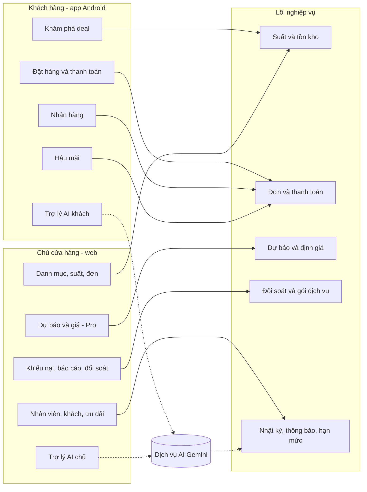

## 2.2. Phân hệ nghiệp vụ

Excel tổ chức chức năng thành 26 nhóm cấp 1; mỗi nhóm là một phân hệ. Bảng sau tóm tắt từng phân hệ; mục 5.x của chương 5 đặc tả đầy đủ.

| Mục | Phân hệ | Vai trò | Số UC | UC liên quan | Mục tiêu | Phân hệ phụ thuộc |
|---|---|---|---|---|---|---|
| 5.1 | Tài khoản và hồ sơ | Khách hàng | 19 | R1-001 đến R1-019 | Cho phép khách tạo danh tính duy nhất, đăng nhập an toàn trên app Android, kiểm soát dữ liệu cá nhân (hồ sơ, vị trí, hồ sơ ăn uống, các đồng ý) và rời hệ thống khi muốn. | Là điều kiện của Khám phá deal (vị trí, bán kính), Đặt hàng (trạng thái tài khoản, đồng ý điều khoản), Trợ lý AI (cờ cá nhân hóa) và Thông báo (nhóm thông báo, FCM... |
| 5.2 | Khám phá deal | Khách hàng | 20 | R1-020 đến R1-039 | Giúp khách tìm đúng suất cần mua trong bán kính của mình với số liệu chính xác (giá, tồn, khung nhận), theo dõi cửa hàng và deal quan tâm, và nhận thông báo đúng lúc mà không bị làm phiền. | Phụ thuộc Tài khoản và hồ sơ (vị trí, bán kính, đồng ý cá nhân hóa) và Suất và tồn kho của cửa hàng. Cung cấp suất được chọn cho Đặt hàng và thanh toán. |
| 5.3 | Đặt hàng và thanh toán | Khách hàng | 17 | R1-040 đến R1-056 | Biến lựa chọn của khách thành một đơn hợp lệ không bán vượt tồn, thu tiền chính xác, xử lý đúng các tình huống bất thường (thanh toán đến muộn, thoát app giữa chừng, trạng thái chưa xác định) và cho khách quản lý, hủy, đặt lại đơn của mình. | Phụ thuộc Khám phá deal (suất), Tài khoản (trạng thái, điều khoản), Ưu đãi (ví), Chống lạm dụng (khóa đặt). Cung cấp đơn đã thanh toán cho Nhận hàng, và dữ liệu đơn cho... |
| 5.4 | Nhận hàng | Khách hàng | 4 | R1-057 đến R1-060 | Bảo đảm khách nhận đúng hàng đúng đơn một lần duy nhất tại cửa hàng, đồng thời ghi nhận chính xác các đơn không được nhận để doanh thu và chống lạm dụng nhất quán. | Phụ thuộc Đặt hàng và thanh toán (đơn Đã thanh toán). Cung cấp trạng thái Đã nhận cho Hậu mãi (khiếu nại, đánh giá), Báo cáo (doanh thu thu hồi) và Chống lạm dụng (khóa... |
| 5.5 | Hậu mãi | Khách hàng | 12 | R1-061 đến R1-072 | Bảo vệ khách khi hàng không đạt chất lượng và tạo vòng phản hồi cho cửa hàng: khiếu nại có bằng chứng, đánh giá, báo cáo vi phạm và hỗ trợ từ người thật. | Phụ thuộc Nhận hàng (đơn Đã nhận) và Đặt hàng (giao dịch hoàn). Kết quả hiển thị ở phân hệ Khiếu nại và đánh giá của cửa hàng. |
| 5.6 | Thông báo và tác động | Khách hàng | 5 | R1-073 đến R1-077 | Giữ khách được thông tin về đơn và deal, cho khách tra cứu lịch sử tiền bạc, và cho thấy tác động cá nhân (tiền tiết kiệm, khối lượng thực phẩm cứu được) bằng số liệu có căn cứ, không dùng cơ chế gây nghiện. | Phụ thuộc mọi phân hệ phát sinh sự kiện cho khách; phụ thuộc Tài khoản (nhóm thông báo, FCM token). |
| 5.7 | Ưu đãi và tác động | Khách hàng | 4 | R1-078 đến R1-081 | Cho khách nhận, theo dõi và dùng ưu đãi do cửa hàng cấp, và ghi nhận thành tích tác động một cách trung thực. | Phụ thuộc Tài khoản (đồng ý ưu đãi) và Ưu đãi và chiến dịch của cửa hàng; cung cấp ưu đãi cho Đặt hàng. |
| 5.8 | Trợ lý AI cho khách hàng | Khách hàng | 13 | R1-082 đến R1-094 | Rút ngắn thời gian từ ý định đến đơn hàng đúng nhu cầu và giảm tải hỗ trợ, bằng bộ năng lực AI tách rời khỏi lõi giao dịch: tìm deal bằng câu tự nhiên, trò chuyện, cá nhân hóa có giải thích, so sánh, hỏi thành phần dị ứng, hướng dẫn nhận hàng, soạn khiếu nại và chuyển người hỗ trợ. | Phụ thuộc Tài khoản (đồng ý cá nhân hóa, ghi nhớ ngữ cảnh), Khám phá deal, Đặt hàng, Hậu mãi. Không phân hệ nào khác phụ thuộc vào AI để chạy. |
| 5.9 | Tài khoản và cửa hàng | Chủ cửa hàng | 16 | R2-001 đến R2-016 | Quản lý danh tính của Chủ cửa hàng, hồ sơ và trạng thái vận hành của cửa hàng, cùng toàn bộ vòng đời gói dịch vụ (dùng thử, nâng cấp, gia hạn, hủy, hạn mức). | Cung cấp trạng thái cửa hàng, gói và hạn mức cho tất cả phân hệ web; đọc nhật ký sử dụng từ các UC có hạn mức. |
| 5.10 | Danh mục món | Chủ cửa hàng | 9 | R2-017 đến R2-025 | Quản lý danh mục sản phẩm gốc mà các suất bán ra tham chiếu: thông tin món, thành phần và dị ứng, hạn dùng chuẩn, trọng lượng; nhập hàng loạt từ CSV và điền nhanh từ ảnh bằng AI. | Cung cấp món cho Suất và tồn kho; dữ liệu thành phần và trọng lượng được dùng bởi Khám phá deal (dị ứng), Báo cáo (kg), Chất lượng dữ liệu. |
| 5.11 | Suất và tồn kho trong ngày | Chủ cửa hàng | 10 | R2-026 đến R2-035 | Cho cửa hàng biến hàng dư cuối ngày thành các suất có giá, số lượng và khung giờ nhận cụ thể để khách đặt, đồng thời bảo toàn tính đúng của tồn kho trong mọi điều chỉnh (sửa, đóng sớm, hủy). | Phụ thuộc Danh mục món, Tài khoản (khung nhận, giá sàn, trạng thái cửa hàng, gói). Cung cấp suất cho Khám phá deal, Đặt hàng, Dự báo và Định giá. |
| 5.12 | Dự báo số lượng (Pro) | Chủ cửa hàng | 8 | R2-036 đến R2-043 | Giúp chủ quyết định nên làm bao nhiêu mỗi món cho ngày mai (và xu hướng tuần tới) để giảm hao hụt và hết hàng sớm, bằng mô hình thống kê xác định có giải thích, đo được sai số và có phương án dự phòng. | Phụ thuộc Suất và tồn kho (số bán qua app), Tài khoản (gói). Cung cấp số lượng mặc định cho Tạo suất, dữ liệu cho Giải thích AI, Phát hiện bất thường và Mô phỏng. |
| 5.13 | Định giá động (Pro) | Chủ cửa hàng | 5 | R2-044 đến R2-048 | Tăng khả năng bán hết trước khi hết khung nhận bằng đề xuất giá giảm theo giờ, trong ràng buộc giá sàn và số lần đổi giá, với quyền quyết định thuộc về chủ (hoặc chế độ Tự động do chủ chọn). | Phụ thuộc Suất và tồn kho, Tài khoản (giá sàn, chế độ), Gói. Dữ liệu quyết định dùng cho báo cáo hiệu quả giá và Giải thích AI. |
| 5.14 | Đơn hàng và nhận hàng | Chủ cửa hàng | 5 | R2-049 đến R2-053 | Cho cửa hàng thấy đúng đơn cần chuẩn bị, xác nhận khách nhận hàng chính xác một lần, và xử lý hủy đơn do cửa hàng với hoàn tiền đúng quy tắc. | Phụ thuộc Đặt hàng và thanh toán, Nhận hàng của khách; cung cấp doanh thu thu hồi cho Báo cáo và đối soát. |
| 5.15 | Khiếu nại và đánh giá | Chủ cửa hàng | 7 | R2-054 đến R2-060 | Cho cửa hàng xử lý khiếu nại của khách trong thời hạn rõ ràng với trách nhiệm tài chính minh bạch và quản lý danh tiếng bằng phản hồi công khai và báo cáo đánh giá vi phạm. | Phụ thuộc Hậu mãi của khách (khiếu nại, đánh giá), Đơn hàng. Ảnh hưởng đối soát (hoàn tiền) và Thông báo. |
| 5.16 | Báo cáo và đối soát | Chủ cửa hàng | 13 | R2-061 đến R2-073 | Cho chủ thấy tình hình trong ngày, hao hụt và thu hồi, doanh thu, hiệu quả giá, so sánh kỳ, tác động môi trường, và đối soát tiền thu, hoa hồng, hoàn tiền, phí gói với sao kê tuần bất biến. | Đọc dữ liệu từ Đơn hàng, Suất, Khiếu nại, Gói dịch vụ, Định giá; cung cấp số liệu cho Trợ lý AI (hỏi đáp, tóm tắt, phát hiện bất thường). |
| 5.17 | Thông báo và nhật ký | Chủ cửa hàng | 2 | R2-074 đến R2-075 | Đưa các sự kiện cần hành động đến chủ đúng lúc và lưu vết các thao tác nhạy cảm của cửa hàng phục vụ kiểm soát nội bộ. | Nhận sự kiện từ hầu hết phân hệ; cung cấp truy vết cho Cấu hình và Nhân viên. |
| 5.18 | Nhân viên và phân quyền | Chủ cửa hàng | 6 | R2-076 đến R2-081 | Cho chủ ủy quyền vận hành cho người khác mà không chia sẻ mật khẩu, theo ba nhóm quyền rõ ràng, và giám sát hoạt động của từng người. | Quyền của nhóm được tất cả phân hệ web áp dụng; hạn mức số nhân viên lấy từ Gói dịch vụ. |
| 5.19 | Khách hàng của cửa hàng | Chủ cửa hàng | 6 | R2-082 đến R2-087 | Cho cửa hàng hiểu tệp khách quen của mình ở mức ẩn danh vừa đủ để chăm sóc (khách thường mua, nhóm khách theo quy tắc, khách hay không đến nhận), mà không xâm phạm dữ liệu cá nhân của khách. | Đọc đơn, yêu thích, bộ đếm không đến nhận; cung cấp tệp mục tiêu cho Chiến dịch. |
| 5.20 | Ưu đãi và chiến dịch | Chủ cửa hàng | 7 | R2-088 đến R2-094 | Cho cửa hàng chủ động kích cầu có kiểm soát: ưu đãi giảm giá cho khách, túi bất ngờ bán hết hàng cuối ngày, và chiến dịch thông báo đến khách yêu thích có đo hiệu quả. | Phụ thuộc Khách hàng của cửa hàng (đối tượng), Gói (hạn mức), Tài khoản (giá sàn). Cung cấp ưu đãi cho Ví ưu đãi và Đặt hàng của khách. |
| 5.21 | Công việc và lịch | Chủ cửa hàng | 4 | R2-095 đến R2-098 | Giúp cửa hàng không bỏ sót việc theo ngày (nhập số cuối ngày, đề xuất giá chờ duyệt, đơn sắp đến hạn nhận) và quản lý ngày nghỉ, giờ mở cửa đặc biệt. | Đọc dữ liệu từ Đơn hàng, Dự báo, Định giá; ngày nghỉ ảnh hưởng Suất, Dự báo và hiển thị trên app. |
| 5.22 | Chất lượng dữ liệu | Chủ cửa hàng | 2 | R2-099 đến R2-100 | Phát hiện dữ liệu danh mục thiếu hoặc bất thường (thiếu thành phần, trọng lượng, hạn dùng chuẩn) ảnh hưởng đến cảnh báo dị ứng, tính kg và dự báo, và cho phép sửa hàng loạt an toàn. | Đọc Danh mục món; kết quả cải thiện Khám phá deal, Báo cáo, Dự báo. |
| 5.23 | Cấu hình và quy tắc kinh doanh | Chủ cửa hàng | 3 | R2-101 đến R2-103 | Cho chủ điều chỉnh quy tắc kinh doanh cấp cửa hàng trong biên cho phép, truy vết mọi thay đổi cấu hình và xuất toàn bộ dữ liệu cửa hàng khi cần. | Quy tắc được các phân hệ Suất, Định giá, Đơn hàng áp dụng. |
| 5.24 | Mô phỏng chính sách | Chủ cửa hàng | 2 | R2-104 đến R2-105 | Cho chủ thử chính sách giá trên dữ liệu lịch sử trước khi áp dụng thật, với kết quả được nêu rõ là ước lượng dựa trên giả định. | Dùng lõi Định giá động và dữ liệu Đơn hàng; chỉ Pro. |
| 5.25 | Hỗ trợ nền tảng | Chủ cửa hàng | 2 | R2-106 đến R2-107 | Cho cửa hàng gửi và theo dõi yêu cầu hỗ trợ tới nền tảng với luồng trao đổi có trạng thái. | Độc lập với các phân hệ khác; có thể tham chiếu đơn hoặc khiếu nại. |
| 5.26 | Trợ lý AI và phân tích | Chủ cửa hàng | 19 | R2-108 đến R2-126 | Đưa AI vào toàn bộ vòng đời kinh doanh của cửa hàng: hiểu số liệu (hỏi đáp, tóm tắt tuần), phát hiện vấn đề (bất thường), tìm nguyên nhân, đề xuất và theo dõi hành động, giải thích quyết định của hệ thống, hỗ trợ soạn nội dung và đọc ảnh, đồng thời quản trị AI (bật tắt, hạn mức, nhật ký, chất lượng). | Đọc dữ liệu từ Báo cáo, Dự báo, Định giá, Khiếu nại, Ưu đãi; không phân hệ nào phụ thuộc AI để vận hành lõi. |

Dữ liệu vào và ra, chức năng chính và kết quả nghiệp vụ của từng phân hệ nằm ở các mục 5.x.4 và 5.x.5. Phân hệ không có sơ đồ riêng thì luồng đã được mô tả bằng văn bản ở 5.x.5.

## 2.3. Quan hệ giữa các phân hệ

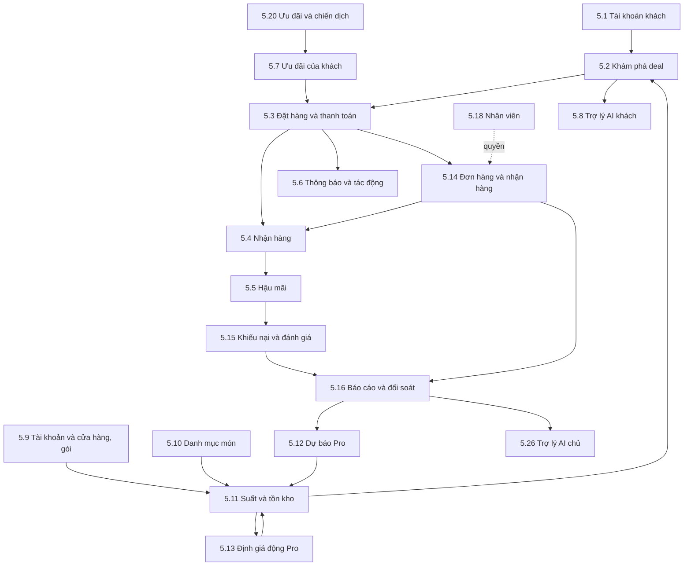

Bảng luồng dữ liệu chính giữa các phân hệ:

| Từ | Đến | Dữ liệu / sự kiện | Ý nghĩa nghiệp vụ |
|---|---|---|---|
| 5.10 Danh mục món | 5.11 Suất và tồn kho | Món, giá gốc, hạn dùng chuẩn, thành phần, trọng lượng | Suất chỉ tạo từ món đang dùng; thành phần và trọng lượng đi theo suất xuống khách |
| 5.9 Tài khoản và cửa hàng | 5.11, 5.12, 5.13 | Giá sàn, khung nhận mặc định, chế độ giá, gói và hạn mức | Giới hạn giá và khóa tính năng theo gói |
| 5.11 Suất và tồn kho | 5.2 Khám phá deal | Suất Đang mở, tồn còn, giá, khung nhận | Nguồn duy nhất của danh sách deal |
| 5.3 Đặt hàng và thanh toán | 5.11 Suất và tồn kho | Trừ tồn khi giữ suất, cộng trả tồn khi hết hạn giữ hoặc hủy | Bảo toàn tồn |
| 5.3 Đặt hàng và thanh toán | 5.14 Đơn hàng và nhận hàng | Đơn Đã thanh toán, giờ hẹn, ghi chú | Cửa hàng thấy đơn cần chuẩn bị |
| 5.14 Đơn hàng và nhận hàng | 5.4 Nhận hàng | Kết quả quét QR: Đã nhận | Mở đánh giá, khiếu nại; ghi nhận doanh thu |
| 5.4 Nhận hàng | 5.3 Đặt hàng và thanh toán | Bộ đếm không đến nhận, khóa đặt | Chống lạm dụng |
| 5.5 Hậu mãi | 5.15 Khiếu nại và đánh giá | Khiếu nại, đánh giá, báo cáo vi phạm | Cửa hàng xử lý trong thời hạn |
| 5.15 Khiếu nại và đánh giá | 5.16 Báo cáo và đối soát | Hoàn tiền không thu hoa hồng | Sao kê tuần phản ánh hoàn tiền |
| 5.14, 5.15, 5.9 | 5.16 Báo cáo và đối soát | Đơn, hoàn tiền, phí gói, hoa hồng | Chốt sao kê tuần bất biến |
| 5.16, 5.11 | 5.12 Dự báo (Pro) | Số thực tế, số bán qua app, sự kiện | Nuôi dự báo và đo sai số |
| 5.12 Dự báo (Pro) | 5.11 Suất và tồn kho | Số lượng mặc định khi tạo suất | Giảm nhập tay |
| 5.13 Định giá (Pro) | 5.11 Suất và tồn kho | Giá mới của suất sau duyệt | Đổi giá nguyên tử; đơn đã giữ giữ giá cũ |
| 5.19 Khách của cửa hàng, 5.1 | 5.20 Ưu đãi và chiến dịch | Khách yêu thích đã đồng ý nhận ưu đãi | Đối tượng chiến dịch |
| 5.20 Ưu đãi và chiến dịch | 5.7 Ưu đãi khách, 5.3 | Ưu đãi vào ví, áp dụng khi đặt | Giảm giá không thấp hơn giá sàn |
| 5.16, 5.12, 5.13 | 5.26 Trợ lý AI chủ | Số liệu báo cáo, dự báo, quyết định giá | Nguồn số liệu cho hỏi đáp, tóm tắt, bất thường, đề xuất |
| 5.2, 5.3, 5.5 | 5.8 Trợ lý AI khách | Suất, đơn của chính khách, đánh giá công khai | Nguồn dữ liệu cho tìm kiếm thông minh, hướng dẫn, tóm tắt |
| Mọi phân hệ | 5.6, 5.17 Thông báo và nhật ký | Sự kiện nghiệp vụ | Thông báo và truy vết (chương 10) |

## 2.4. Nguyên tắc vận hành tổng thể

| Nguyên tắc | Nội dung |
|---|---|
| Quyền theo ba lớp | Quyền thực tế của một thao tác bằng giao của ba lớp: quyền theo vai trò và nhóm quyền, quyền theo gói dịch vụ và hạn mức, và trạng thái tài khoản hoặc cửa hàng (ví dụ cửa hàng Tạm ngưng không đăng suất, khách bị khóa đặt không giữ suất). Ma trận ở sheet 03 thể hiện đúng nguyên tắc này. |
| Phạm vi dữ liệu theo chủ sở hữu | Khách chỉ thấy dữ liệu của mình; cửa hàng chỉ thấy đơn, khiếu nại, báo cáo của cửa hàng mình và thông tin khách ẩn danh hoặc rút gọn (tên chữ cái đầu, không SĐT, không email). |
| Giao dịch nguyên tử và chống trùng | Trừ tồn, đổi trạng thái đơn, hoàn tiền, đánh dấu Đã nhận đều là thao tác nguyên tử; thao tác tiền và tồn có khóa idempotency; mỗi mã giao dịch chỉ xử lý một lần. |
| Trạng thái là nguồn sự thật | Mọi UC chỉ được thao tác khi đối tượng đang ở trạng thái cho phép (xem 7.3). Thao tác sai trạng thái bị từ chối kèm lý do. |
| Lịch sử và bất biến | Dữ liệu giao dịch không bị xóa vật lý; dữ liệu chốt (sao kê, hóa đơn gói) bất biến và sai sót sửa bằng bút toán điều chỉnh kỳ sau; điều chỉnh tồn, đổi giá, đổi cấu hình đều ghi lịch sử. |
| Lõi xác định, AI hỗ trợ | Dự báo, định giá, phân nhóm, bất thường, việc cần làm, cảnh báo dữ liệu đều chạy bằng quy tắc hoặc thống kê và vẫn chạy khi dịch vụ AI lỗi. AI chỉ chuyển câu chữ thành truy vấn hợp lệ hoặc diễn đạt số liệu hệ thống tính. |
| Tham số cấu hình | Các con số như 10 phút giữ suất, 60 phút hủy, 3 lần không đến nhận, 48 giờ phản hồi, hoa hồng 10%, giá Pro đều là tham số có thể đổi mà không đổi nghiệp vụ; giá trị hiện tại là giả định (chương 13). |
| Thông báo có kiểm soát | Giới hạn tần suất, không gửi 22:00 đến 07:00 với thông báo tiếp thị, thông báo giao dịch không tắt được. |

Tài liệu không áp đặt kiến trúc kỹ thuật chi tiết; các nhắc đến Gemini, FCM, VietQR, bản đồ là các tích hợp được nêu trong Excel (chương 11).

# 3. Các bên liên quan và vai trò người dùng

## 3.1. Danh sách vai trò

| Vai trò | Kênh | Số UC | Mô tả |
|---|---|---|---|
| Khách hàng | App Android | 94 | Người mua suất cuối ngày; chỉ trả tiền hàng; không phải trả phí nền tảng |
| Chủ cửa hàng | Web quản trị | 126 | Chủ tiệm bánh; trả thuê bao và hoa hồng; toàn quyền cửa hàng của mình (mỗi tài khoản chủ một cửa hàng trong MVP) |
| Quản lý (nhóm quyền của nhân viên) | Web quản trị | dùng UC của vai Chủ | Do chủ mời; toàn quyền vận hành trừ gói, thanh toán, nhân viên, cấu hình quy tắc kinh doanh và xuất dữ liệu toàn bộ |
| Nhân viên quầy (nhóm quyền của nhân viên) | Web quản trị | dùng UC của vai Chủ | Do chủ mời; chỉ quét QR, xem đơn trong ngày, nhập số thực tế, xem lịch hẹn nhận |
| Hệ thống | Tác vụ nền | 9 UC tác vụ | Nhả suất, hoàn tiền tự động, đóng suất, nhắc giờ nhận, chốt đối soát, thông báo giờ hay mua, phát hiện bất thường, xử lý đơn quá hạn, tự hoàn khi quá hạn khiếu nại |
| Dịch vụ AI (Gemini) | Từ máy chủ | tham gia UC AI | Chuyển câu chữ thành cấu trúc có kiểm soát hoặc diễn đạt số liệu; không có quyền ghi dữ liệu |
| Bên hỗ trợ nền tảng | Ngoài sheet | nhận yêu cầu hỗ trợ và báo cáo vi phạm | Không có UC riêng trong Excel; quy trình xử lý nằm ngoài hệ thống |

## 3.2. Mục tiêu và trách nhiệm của từng vai trò

### 3.2.1. Khách hàng

- **Mục tiêu:** mua suất đúng nhu cầu, giá tốt, nhận hàng thuận tiện, được bảo vệ khi có sự cố.
- **Nhiệm vụ chính:** tìm deal, đặt và thanh toán, nhận hàng bằng QR, khiếu nại, đánh giá, quản lý đồng ý và dữ liệu cá nhân.
- **Dữ liệu được truy cập:** hồ sơ, đơn, giao dịch, khiếu nại, ưu đãi, hội thoại AI của chính mình; dữ liệu công khai của deal và cửa hàng.
- **Thao tác bị giới hạn:** không đặt khi tài khoản chưa xác minh, chưa đồng ý điều khoản hiện hành hoặc bị khóa đặt; không hủy đơn khi còn dưới 60 phút trước khung nhận; khiếu nại trong 24 giờ; tối đa 5 suất mỗi đơn.
- **Điều kiện đặc biệt:** quyền vị trí tùy chọn; AI chỉ dùng lịch sử khi bật cá nhân hóa.
- **Quan hệ:** tương tác gián tiếp với cửa hàng qua đơn, khiếu nại, đánh giá; không thấy dữ liệu khách khác.

### 3.2.2. Chủ cửa hàng

- **Mục tiêu:** bán hết hàng dư, giảm hao hụt, hiểu doanh thu và đối soát.
- **Nhiệm vụ chính:** quản lý hồ sơ và gói, danh mục món, đăng suất, nhận hàng, khiếu nại, báo cáo, nhân viên, ưu đãi, AI.
- **Dữ liệu được truy cập:** toàn bộ dữ liệu cửa hàng mình; thông tin khách ở mức rút gọn.
- **Thao tác chỉ chủ mới có:** gói, thanh toán, nhân viên, cấu hình quy tắc kinh doanh, xuất dữ liệu toàn bộ.
- **Giới hạn:** theo gói (xem chương 8); cửa hàng Tạm ngưng không nhận đơn; không hủy đơn đã nhận.
- **Quan hệ:** nhận khiếu nại và đánh giá từ khách; trả hoa hồng và phí gói cho nền tảng.

### 3.2.3. Quản lý và Nhân viên quầy

Hai nhóm quyền này không phải vai trò độc lập trong Excel mà là **nhóm quyền của nhân viên thuộc vai Chủ cửa hàng**. Phạm vi lấy nguyên văn từ UC phân quyền: Quản lý toàn quyền vận hành trừ gói, thanh toán, nhân viên, cấu hình quy tắc kinh doanh và xuất dữ liệu toàn bộ; Nhân viên quầy quét QR, xem đơn trong ngày, nhập số thực tế, xem lịch hẹn nhận. Quản lý xem danh sách nhân viên nhưng không xem được thông tin gói và thanh toán. Nhân viên chỉ hỏi AI trong phạm vi quyền của mình và chỉ thấy việc cần làm thuộc quyền.

*[Đề xuất hoàn thiện]* Với UC mà Excel không nêu rõ phạm vi của Quản lý, chương 5 áp quy tắc: UC thuộc nhóm gói, thanh toán, nhân viên, cấu hình, xuất dữ liệu toàn bộ chỉ dành cho Chủ; bốn thao tác quầy dành cho cả ba nhóm; còn lại dành cho Chủ và Quản lý. Đối soát doanh thu và hoa hồng chưa được Excel xếp rõ vào nhóm thanh toán nên được liệt kê ở chương 13.

## 3.3. Ma trận quyền nghiệp vụ

Ký hiệu: X = xem, T = tạo hoặc gửi, S = sửa hoặc cấu hình, H = hủy hoặc xóa hoặc chuyển trạng thái, D = duyệt hoặc quyết định, - = không có quyền. Cột Gói cho biết gói tối thiểu theo ma trận.

| Nhóm chức năng | Khách | Chủ | Quản lý | Nhân viên quầy | Gói tối thiểu |
|---|---|---|---|---|---|
| Tài khoản cá nhân, đăng nhập, mật khẩu | X T S H | X T S | X T S | X T S | Mọi gói |
| Hồ sơ cửa hàng, trạng thái cửa hàng | - | X S H | X | - | Mọi gói |
| Gói, thanh toán gói, hóa đơn, hạn mức | - | X T S H | - | - | Mọi gói |
| Nhân viên và phân quyền | - | X T S H | - | - | Cơ bản 1, Pro 5 nhân viên |
| Danh mục món | X (qua deal) | X T S H | X T S H | - | Mọi gói; CSV 100/500 dòng |
| Suất và tồn kho | X (suất mở) | X T S H | X T S H | - | Mọi gói; 20/100 suất mở mỗi ngày |
| Dự báo, sự kiện, số thực tế | - | X T S D | X T S D | T (nhập số thực tế) | Pro hoặc dùng thử |
| Định giá động | - | X D S | X D S | - | Pro hoặc dùng thử |
| Đặt đơn, thanh toán, hủy đơn đã thanh toán | X T H | - | - | - | Khách |
| Đơn của cửa hàng, quét QR | X (đơn của mình) | X H | X H | X (đơn trong ngày), quét QR | Mọi gói; xuất đơn 5/60 lần mỗi tháng |
| Khiếu nại | T X H (rút) | X D | X D | - | Mọi gói |
| Đánh giá | T S H (ẩn) | X T (phản hồi) | X T | - | Mọi gói |
| Báo cáo hao hụt, doanh thu, đối soát | - | X | X | - | Hao hụt 7 ngày Cơ bản, 365 ngày Pro |
| Báo cáo chuyên sâu (phân bố theo giờ, hiệu quả giá) | - | X | X | - | Pro |
| Xuất báo cáo, xuất dữ liệu toàn bộ | T (dữ liệu cá nhân) | T | T (xuất báo cáo; không xuất toàn bộ) | - | Báo cáo 3/30 lần mỗi tháng |
| Khách của cửa hàng, ghi chú, phân nhóm | - | X T S | X T S | - | Phân nhóm: Pro |
| Ưu đãi, túi bất ngờ, chiến dịch | X (ví), nhận | X T S H | X T S H | - | Ưu đãi 2/10, chiến dịch 4/30 mỗi tháng |
| Công việc, lịch, chất lượng dữ liệu | - | X S | X S | X (việc thuộc quyền, lịch hẹn) | Mọi gói |
| Cấu hình quy tắc kinh doanh | - | X S | - | - | Mọi gói |
| Mô phỏng chính sách | - | T X | T X | - | Pro |
| Hỗ trợ nền tảng | T X | T X | T X | - | Mọi gói |
| AI cho khách (tìm, trò chuyện, gợi ý, soạn khiếu nại) | T X H (xóa lịch sử) | - | - | - | Khách; 30 lượt mỗi ngày |
| AI cho chủ: hỏi đáp, soạn nội dung, đọc ảnh | - | T X S | T X | - | Cơ bản 10/10/20, Pro 300/200/300 lượt mỗi tháng |
| AI cho chủ: bất thường, nguyên nhân, đề xuất, theo dõi, tóm tắt tuần | - | X D | X D | - | Pro |
| Cấu hình, hạn mức và nhật ký AI | - | X S | X (nhật ký) | - | Mọi gói |

Quyền của nhóm Quản lý trong bảng là tổng hợp theo nguyên tắc ở 3.2.3; các ô liên quan đối soát và xem nhật ký AI là đề xuất cần xác nhận (chương 13). Không có vai trò nào được cấp quyền quản trị nền tảng trong tài liệu này.

# 4. Danh mục yêu cầu và truy vết UC

## 4.1. Danh mục UC toàn hệ thống

Bảng liệt kê **220 UC** (Khách hàng 94, Chủ cửa hàng 126). Cột *Phụ thuộc* nêu UC phải thực hiện hoặc tạo sự kiện trước, dựa trên danh mục quan hệ ở 4.2; dấu - nghĩa là UC độc lập hoặc chỉ phụ thuộc đăng nhập chung.

### 4.1.1. Vai trò Khách hàng

| Mã UC | Tên UC | Phân hệ | Mục tiêu | Phụ thuộc |
|---|---|---|---|---|
| R1-001 | Đăng ký tài khoản khách hàng | 5.1 Tài khoản và hồ sơ | Khách mới nhập email hoặc số điện thoại, họ tên, mật khẩu và đồng ý điều khoản trên app | - |
| R1-002 | Xác minh tài khoản bằng OTP | 5.1 Tài khoản và hồ sơ | Khách nhập mã OTP 6 số nhận qua email/SMS | R1-001 |
| R1-003 | Đăng nhập | 5.1 Tài khoản và hồ sơ | Khách đăng nhập bằng email/SĐT và mật khẩu; server cấp JWT access token ngắn hạn và refresh token | R1-002 |
| R1-004 | Đăng xuất | 5.1 Tài khoản và hồ sơ | Khách chọn đăng xuất; app xóa token cục bộ và gọi server thu hồi refresh token của thiết bị hiện tại, hủy đăng ký FCM... | - |
| R1-005 | Xem hồ sơ cá nhân | 5.1 Tài khoản và hồ sơ | Khách xem họ tên, email/SĐT, ảnh đại diện, ngày tham gia, số lần không đến nhận trong 30 ngày gần nhất và trạng thái... | - |
| R1-006 | Chỉnh sửa hồ sơ cá nhân | 5.1 Tài khoản và hồ sơ | Khách đổi họ tên và ảnh đại diện | - |
| R1-007 | Đổi mật khẩu | 5.1 Tài khoản và hồ sơ | Khách nhập mật khẩu hiện tại và mật khẩu mới | - |
| R1-008 | Đặt lại mật khẩu khi quên | 5.1 Tài khoản và hồ sơ | Khách yêu cầu OTP qua email/SĐT, nhập OTP và mật khẩu mới | - |
| R1-009 | Cấp quyền vị trí và chọn bán kính tìm deal | 5.1 Tài khoản và hồ sơ | Khách cho phép app lấy vị trí hoặc nhập địa chỉ thủ công; chọn bán kính tìm deal | - |
| R1-010 | Bật tắt nhóm thông báo | 5.1 Tài khoản và hồ sơ | Khách bật/tắt riêng từng nhóm thông báo: deal mới ở gần, nhắc giờ nhận, trạng thái đơn, khiếu nại | - |
| R1-011 | Yêu cầu xóa tài khoản | 5.1 Tài khoản và hồ sơ | Khách yêu cầu xóa tài khoản | - |
| R1-012 | Xem và quản lý đồng ý điều khoản và dữ liệu vị trí | 5.1 Tài khoản và hồ sơ | Khách xem phiên bản điều khoản đã đồng ý, thời điểm đồng ý và bật/tắt quyền dùng vị trí | - |
| R1-013 | Bật hoặc tắt xác thực hai bước | 5.1 Tài khoản và hồ sơ | Khách bật xác thực hai bước bằng OTP gửi qua email/SMS mỗi khi đăng nhập trên thiết bị lạ | - |
| R1-014 | Xem và đăng xuất các thiết bị đăng nhập | 5.1 Tài khoản và hồ sơ | Khách xem danh sách thiết bị đang đăng nhập (tên thiết bị, thời điểm, vị trí gần đúng theo IP) và đăng xuất từ xa từng... | - |
| R1-015 | Lưu địa điểm quen thuộc (nhà, nơi làm việc) | 5.1 Tài khoản và hồ sơ | Khách lưu tối đa 5 địa điểm để tìm deal nhanh theo từng nơi, không cần bật vị trí liên tục | - |
| R1-016 | Thiết lập hồ sơ ăn uống và dị ứng | 5.1 Tài khoản và hồ sơ | Khách khai báo tùy chọn các nhóm dị ứng và món không ăn để app cảnh báo và ẩn deal chứa thành phần đó | - |
| R1-017 | Quản lý đồng ý nhận ưu đãi và cá nhân hóa | 5.1 Tài khoản và hồ sơ | Khách bật/tắt riêng từng mục: nhận ưu đãi từ cửa hàng, cá nhân hóa đề xuất theo lịch sử, cho phép trợ lý AI ghi nhớ ngữ... | - |
| R1-018 | Xuất bản sao dữ liệu cá nhân | 5.1 Tài khoản và hồ sơ | Khách yêu cầu tải về tệp dữ liệu cá nhân (hồ sơ, đơn, đánh giá, khiếu nại, đồng ý) | - |
| R1-019 | Hủy yêu cầu xóa tài khoản | 5.1 Tài khoản và hồ sơ | Trong thời gian chờ 7 ngày, khách hủy yêu cầu xóa và khôi phục tài khoản | - |
| R1-020 | Xem danh sách deal gần | 5.2 Khám phá deal | App gửi vị trí và bán kính; server dùng PostGIS trả danh sách suất đang mở của các cửa hàng trong bán kính, sắp theo... | R1-009 |
| R1-021 | Xem bản đồ deal | 5.2 Khám phá deal | Hiển thị các cửa hàng có deal lên bản đồ (Maps Compose); chạm vào ghim để xem tóm tắt và mở chi tiết | - |
| R1-022 | Tìm kiếm deal | 5.2 Khám phá deal | Khách nhập từ khóa tên món hoặc tên cửa hàng | - |
| R1-023 | Lọc deal | 5.2 Khám phá deal | Lọc theo loại món, khoảng giá, mức giảm tối thiểu, khung giờ nhận | - |
| R1-024 | Sắp xếp deal | 5.2 Khám phá deal | Sắp theo khoảng cách (mặc định), giá thấp, mức giảm cao, sắp hết hạn nhận | - |
| R1-025 | Cuộn tải thêm (phân trang) | 5.2 Khám phá deal | Tải theo trang 20 deal khi cuộn đến cuối danh sách (cursor pagination) | - |
| R1-026 | Xem chi tiết deal | 5.2 Khám phá deal | Hiển thị ảnh, mô tả, thành phần/dị ứng cửa hàng khai báo, hạn dùng, giá, số suất còn, khung giờ và địa chỉ nhận, đánh... | - |
| R1-027 | Xem chi tiết cửa hàng | 5.2 Khám phá deal | Xem tên, địa chỉ, giờ mở cửa, các deal đang mở và điểm đánh giá | R2-009 |
| R1-028 | Thêm cửa hàng yêu thích | 5.2 Khám phá deal | Khách đánh dấu cửa hàng để nhận thông báo khi cửa hàng đó có deal mới | - |
| R1-029 | Bỏ cửa hàng yêu thích | 5.2 Khám phá deal | Khách bỏ đánh dấu một cửa hàng | - |
| R1-030 | Đăng ký nhận thông báo khi có deal quanh khu | 5.2 Khám phá deal | Khi khu vực chưa có deal, khách đăng ký để được báo khi có deal mới trong bán kính | - |
| R1-031 | Tạo cảnh báo deal theo điều kiện mong muốn | 5.2 Khám phá deal | Khách tạo cảnh báo: loại món hoặc cửa hàng, giá tối đa, mức giảm tối thiểu, khung giờ; hệ thống báo khi có suất phù hợp | - |
| R1-032 | Xem, sửa và xóa cảnh báo deal | 5.2 Khám phá deal | Khách xem danh sách cảnh báo, số lần đã kích hoạt, bật/tắt, sửa điều kiện hoặc xóa | - |
| R1-033 | Lưu bộ lọc tìm kiếm thường dùng | 5.2 Khám phá deal | Khách đặt tên và lưu tổ hợp bộ lọc để áp dụng lại bằng một chạm | - |
| R1-034 | Lưu deal để xem sau | 5.2 Khám phá deal | Khách lưu suất vào danh sách xem sau; suất hết hạn tự đánh dấu Đã hết | - |
| R1-035 | Xem lịch sử deal đã xem gần đây | 5.2 Khám phá deal | App hiển thị 20 deal khách đã xem gần nhất để quay lại nhanh | - |
| R1-036 | So sánh các deal cạnh nhau | 5.2 Khám phá deal | Khách chọn 2 đến 3 deal để so sánh giá, mức giảm, khoảng cách, khung giờ nhận, thành phần, đánh giá cửa hàng | - |
| R1-037 | Chia sẻ deal qua liên kết | 5.2 Khám phá deal | Khách tạo liên kết mở thẳng chi tiết deal trong app hoặc trang web đơn giản; liên kết không chứa dữ liệu cá nhân | - |
| R1-038 | Chỉ đường đến cửa hàng | 5.2 Khám phá deal | Khách mở ứng dụng bản đồ bên ngoài với địa chỉ nhận hàng để di chuyển | - |
| R1-039 | Xem deal tại một vị trí khác | 5.2 Khám phá deal | Khách chọn địa điểm đã lưu hoặc ghim vị trí tạm để xem deal ở nơi chưa đến | - |
| R1-040 | Chọn số lượng và giữ suất | 5.3 Đặt hàng và thanh toán | Khách chọn số lượng và nhấn Đặt | R1-026, R1-048 |
| R1-041 | Thanh toán đơn bằng VietQR hoặc cổng giả lập | 5.3 Đặt hàng và thanh toán | App hiển thị mã VietQR/số tiền hoặc cổng giả lập (MVP) | R1-040 |
| R1-042 | Tự động nhả suất khi hết hạn giữ (hệ thống) | 5.3 Đặt hàng và thanh toán | Tác vụ định kỳ (BullMQ) tìm đơn Chờ thanh toán quá 10 phút, chuyển Hết hạn giữ và cộng trả tồn | R1-040 |
| R1-043 | Hủy đơn đã thanh toán | 5.3 Đặt hàng và thanh toán | Khách hủy đơn Đã thanh toán trước giờ bắt đầu khung nhận một khoảng cấu hình, nhận hoàn tiền đủ | - |
| R1-044 | Xem danh sách đơn của tôi | 5.3 Đặt hàng và thanh toán | Danh sách đơn của khách theo thời gian mới nhất trước | - |
| R1-045 | Lọc và tìm đơn | 5.3 Đặt hàng và thanh toán | Lọc theo trạng thái và khoảng ngày; tìm theo mã đơn/tên cửa hàng | - |
| R1-046 | Xem chi tiết đơn | 5.3 Đặt hàng và thanh toán | Xem đầy đủ đơn: món, số lượng, giá chốt, tổng tiền, trạng thái, mốc thời gian, QR (khi hợp lệ), trạng thái hoàn tiền,... | - |
| R1-047 | Hoàn tiền tự động khi thanh toán đến muộn (hệ thống) | 5.3 Đặt hàng và thanh toán | Khi xác nhận thanh toán đến sau thời điểm đơn đã Hết hạn giữ hoặc suất đã hết, hệ thống tạo lệnh hoàn tiền đầy đủ cho... | R1-042 |
| R1-048 | Xem trạng thái khóa đặt và ngày hết khóa | 5.3 Đặt hàng và thanh toán | Khách xem số lần không đến nhận trong 30 ngày, trạng thái khóa đặt và ngày được đặt lại | R1-059 |
| R1-049 | Chọn giờ hẹn nhận trong khung nhận | 5.3 Đặt hàng và thanh toán | Khách chọn mốc 15 phút trong khung nhận để cửa hàng chuẩn bị đúng lúc | - |
| R1-050 | Gửi ghi chú cho cửa hàng khi đặt | 5.3 Đặt hàng và thanh toán | Khách nhập ghi chú ngắn (ví dụ để riêng phần sốt) hiển thị cho cửa hàng trên đơn | - |
| R1-051 | Đặt lại món đã mua | 5.3 Đặt hàng và thanh toán | Từ đơn cũ, khách xem các suất đang mở của cùng món ở cùng cửa hàng và đặt nhanh | - |
| R1-052 | Tạo mã nhận hộ cho người khác | 5.3 Đặt hàng và thanh toán | Khách tạo mã nhận hộ dùng một lần để người thân nhận thay; mã gắn với đơn và hết hạn theo khung nhận | - |
| R1-053 | Áp dụng ưu đãi vào đơn khi đặt | 5.3 Đặt hàng và thanh toán | Khách chọn ưu đãi trong ví hoặc nhập mã để giảm thêm; hệ thống tính lại tổng tiền | R1-079 |
| R1-054 | Xem và tải biên nhận của đơn | 5.3 Đặt hàng và thanh toán | Khách xem biên nhận đơn đã thanh toán và tải PDF | - |
| R1-055 | Tiếp tục thanh toán đơn đang giữ | 5.3 Đặt hàng và thanh toán | Khi khách thoát app giữa chừng, app hiển thị đơn Chờ thanh toán còn thời gian giữ để tiếp tục | - |
| R1-056 | Kiểm tra lại trạng thái thanh toán chưa xác định | 5.3 Đặt hàng và thanh toán | Khi đã chuyển tiền nhưng chưa thấy xác nhận, khách yêu cầu hệ thống kiểm tra lại với cổng thanh toán | - |
| R1-057 | Xem mã QR nhận hàng | 5.4 Nhận hàng | Khách mở QR của đơn Đã thanh toán để đưa cho cửa hàng quét | R1-041 |
| R1-058 | Nhận hàng (chủ quét QR) | 5.4 Nhận hàng | Chủ cửa hàng quét QR trên web; hệ thống kiểm tra và đánh dấu Đã nhận; app khách cập nhật trạng thái | - |
| R1-059 | Đơn quá hạn không đến nhận (hệ thống) | 5.4 Nhận hàng | Hết khung nhận cộng thời gian trễ, đơn Đã thanh toán chưa nhận chuyển Hết hạn nhận; tính 1 lần không đến | - |
| R1-060 | Báo cho cửa hàng là sắp đến | 5.4 Nhận hàng | Khách bấm Sắp đến để cửa hàng biết chuẩn bị, tối đa một lần cho mỗi đơn | - |
| R1-061 | Gửi khiếu nại chất lượng đơn | 5.5 Hậu mãi | Khách gửi khiếu nại cho đơn Đã nhận trong thời hạn, kèm mô tả và tối đa 3 ảnh | R2-052 |
| R1-062 | Xem trạng thái và phản hồi khiếu nại | 5.5 Hậu mãi | Khách xem trạng thái (Chờ cửa hàng, Đã chấp nhận hoàn tiền, Bị từ chối, Đã đóng) và phản hồi | R2-055 |
| R1-063 | Rút khiếu nại | 5.5 Hậu mãi | Khách rút khiếu nại khi chưa được xử lý | - |
| R1-064 | Gửi đánh giá cửa hàng | 5.5 Hậu mãi | Khách chấm 1-5 sao và nhận xét cho đơn Đã nhận | R2-052 |
| R1-065 | Sửa đánh giá | 5.5 Hậu mãi | Khách sửa số sao/nhận xét trong 24 giờ sau khi gửi | - |
| R1-066 | Ẩn đánh giá của tôi | 5.5 Hậu mãi | Khách ẩn đánh giá đã gửi; hệ thống không xóa vật lý | - |
| R1-067 | Xem lịch sử các khiếu nại | 5.5 Hậu mãi | Khách xem toàn bộ khiếu nại đã gửi, lọc theo trạng thái | - |
| R1-068 | Bổ sung bằng chứng cho khiếu nại | 5.5 Hậu mãi | Khách bổ sung ảnh hoặc mô tả khi cửa hàng yêu cầu thêm thông tin | - |
| R1-069 | Báo cáo cửa hàng hoặc nội dung vi phạm | 5.5 Hậu mãi | Khách báo cáo cửa hàng có mô tả sai, đánh giá vi phạm hoặc hành vi đáng ngờ | - |
| R1-070 | Gửi yêu cầu hỗ trợ cho người thật | 5.5 Hậu mãi | Khách gửi yêu cầu hỗ trợ về đơn, thanh toán, tài khoản; yêu cầu liên quan đơn được gửi tới cửa hàng, yêu cầu liên quan... | R1-090 |
| R1-071 | Xem trạng thái và trao đổi trong yêu cầu hỗ trợ | 5.5 Hậu mãi | Khách theo dõi trạng thái, đọc và trả lời trong luồng yêu cầu hỗ trợ | - |
| R1-072 | Xem trung tâm trợ giúp và câu hỏi thường gặp | 5.5 Hậu mãi | Khách đọc hướng dẫn nhận hàng, hoàn tiền, thanh toán, cách dùng QR | - |
| R1-073 | Xem danh sách thông báo | 5.6 Thông báo và tác động | Khách xem thông báo trong app: deal mới, đơn, nhắc giờ nhận, khiếu nại | - |
| R1-074 | Đánh dấu đã đọc | 5.6 Thông báo và tác động | Khách đánh dấu một hoặc tất cả thông báo đã đọc | - |
| R1-075 | Nhắc giờ nhận hàng (hệ thống) | 5.6 Thông báo và tác động | Hệ thống gửi push trước khung nhận 30 phút cho đơn Đã thanh toán chưa nhận | - |
| R1-076 | Xem thống kê tác động cá nhân | 5.6 Thông báo và tác động | Khách xem số đơn đã nhận, tiền tiết kiệm so với giá gốc và khối lượng thực phẩm cứu được ước tính | - |
| R1-077 | Xem lịch sử thanh toán và hoàn tiền | 5.6 Thông báo và tác động | Khách xem các giao dịch thanh toán, hoàn tiền kèm trạng thái | R1-043, R2-053, R2-033 |
| R1-078 | Xem ví ưu đãi | 5.7 Ưu đãi và tác động | Khách xem ưu đãi đang có, điều kiện, hạn dùng | - |
| R1-079 | Nhận ưu đãi từ cửa hàng | 5.7 Ưu đãi và tác động | Khách nhận ưu đãi từ chiến dịch của cửa hàng yêu thích hoặc nhập mã nhận | R2-088, R1-017 |
| R1-080 | Xem lịch sử dùng ưu đãi | 5.7 Ưu đãi và tác động | Khách xem ưu đãi đã dùng và số tiền tiết kiệm | - |
| R1-081 | Xem huy hiệu và chia sẻ thành tích tác động | 5.7 Ưu đãi và tác động | Khách xem cột mốc dựa trên số đơn đã nhận và kg thực phẩm đã cứu; chia sẻ ảnh thành tích không chứa dữ liệu cá nhân | - |
| R1-082 | [AI] Tìm deal bằng câu hỏi tự nhiên | 5.8 Trợ lý AI cho khách hàng | Khách gõ câu như bánh ngọt dưới 30 nghìn gần chỗ làm sau 19 giờ | - |
| R1-083 | [AI] Trò chuyện với trợ lý Cứu Món | 5.8 Trợ lý AI cho khách hàng | Khách hỏi đáp nhiều lượt với trợ lý về deal quanh mình, cách nhận hàng, trạng thái đơn của chính mình | - |
| R1-084 | [AI] Gợi ý deal cá nhân hóa kèm lý do | 5.8 Trợ lý AI cho khách hàng | Hệ thống xếp hạng deal theo lịch sử đơn, cửa hàng yêu thích, giờ hay mua và hồ sơ ăn uống bằng điểm có thể giải thích;... | R1-017 |
| R1-085 | [AI] Xem lý do gợi ý và điều chỉnh sở thích | 5.8 Trợ lý AI cho khách hàng | Khách xem vì sao một deal được gợi ý, bấm Không quan tâm theo cửa hàng hoặc loại món, hoặc tắt cá nhân hóa | - |
| R1-086 | [AI] Tóm tắt và so sánh deal giúp lựa chọn | 5.8 Trợ lý AI cho khách hàng | Khách chọn 2 đến 3 deal; hệ thống lập bảng so sánh bằng dữ liệu thật và mô hình viết đoạn tóm tắt nêu điểm khác biệt... | - |
| R1-087 | [AI] Hỏi về thành phần và dị ứng của món | 5.8 Trợ lý AI cho khách hàng | Khách hỏi món có chứa thành phần nào | - |
| R1-088 | [AI] Hướng dẫn nhận hàng và theo dõi đơn qua trợ lý | 5.8 Trợ lý AI cho khách hàng | Khách hỏi đơn của mình đã sẵn sàng chưa, khi nào nhận, dùng QR thế nào | - |
| R1-089 | [AI] Soạn khiếu nại từ ảnh và mô tả của khách | 5.8 Trợ lý AI cho khách hàng | Khách chụp ảnh sản phẩm và mô tả ngắn; mô hình gợi ý loại khiếu nại và viết lại nội dung rõ ràng | - |
| R1-090 | [AI] Chuyển cuộc trò chuyện cho người hỗ trợ khi AI không đủ khả năng | 5.8 Trợ lý AI cho khách hàng | Trợ lý nhận ra câu hỏi ngoài phạm vi, khiếu nại phức tạp hoặc khách yêu cầu gặp người thật, rồi tạo yêu cầu hỗ trợ kèm... | - |
| R1-091 | [AI] Xem và xóa lịch sử trò chuyện với trợ lý | 5.8 Trợ lý AI cho khách hàng | Khách xem các hội thoại đã lưu, xóa từng hội thoại hoặc toàn bộ, và chọn ghi nhớ ngữ cảnh hay không | - |
| R1-092 | [AI] Đánh giá chất lượng câu trả lời và gợi ý của AI | 5.8 Trợ lý AI cho khách hàng | Khách bấm hữu ích hoặc không hữu ích và chọn lý do sau mỗi câu trả lời hoặc gợi ý | - |
| R1-093 | Nhận thông báo deal vào giờ khách hay mua | 5.8 Trợ lý AI cho khách hàng | Hệ thống học giờ khách thường đặt (thống kê đơn đã nhận) và gửi thông báo deal phù hợp vào khoảng đó; đây là thống kê... | R1-017 |
| R1-094 | [AI] Tóm tắt đánh giá của cửa hàng | 5.8 Trợ lý AI cho khách hàng | Mô hình tóm tắt các đánh giá công khai gần đây của một cửa hàng thành vài ý chính (chất lượng, đúng giờ, thái độ), kèm... | - |

### 4.1.2. Vai trò Chủ cửa hàng

| Mã UC | Tên UC | Phân hệ | Mục tiêu | Phụ thuộc |
|---|---|---|---|---|
| R2-001 | Đăng ký tài khoản và cửa hàng | 5.9 Tài khoản và cửa hàng | Chủ tiệm đăng ký trên web bằng email, mật khẩu và thông tin cửa hàng; hệ thống tạo user vai Chủ và một cửa hàng, gửi... | - |
| R2-002 | Đăng nhập | 5.9 Tài khoản và cửa hàng | Chủ đăng nhập web bằng email và mật khẩu; server cấp JWT | - |
| R2-003 | Đăng xuất | 5.9 Tài khoản và cửa hàng | Chủ đăng xuất, thu hồi refresh token phiên hiện tại | - |
| R2-004 | Đổi mật khẩu và đặt lại mật khẩu | 5.9 Tài khoản và cửa hàng | Chủ đổi mật khẩu bằng mật khẩu hiện tại hoặc đặt lại qua email; thu hồi phiên khác | - |
| R2-005 | Xem hồ sơ cửa hàng | 5.9 Tài khoản và cửa hàng | Chủ xem thông tin cửa hàng, trạng thái hoạt động, gói hiện tại và hạn gói | - |
| R2-006 | Chỉnh sửa hồ sơ cửa hàng | 5.9 Tài khoản và cửa hàng | Chủ sửa tên, địa chỉ, SĐT, giờ mở cửa, logo | - |
| R2-007 | Thiết lập khung giờ nhận mặc định và giá sàn | 5.9 Tài khoản và cửa hàng | Chủ đặt khung giờ nhận mặc định, tỉ lệ giá sàn trên giá gốc và mức giảm tối đa để dùng khi tạo suất | - |
| R2-008 | Chọn chế độ định giá: duyệt tay hoặc tự động | 5.9 Tài khoản và cửa hàng | Chủ chọn để hệ thống chỉ đề xuất giá (duyệt tay) hoặc tự áp dụng giá đề xuất trong ràng buộc giá sàn | - |
| R2-009 | Tạm ngưng cửa hàng | 5.9 Tài khoản và cửa hàng | Chủ tạm ngưng nhận đơn khi nghỉ; suất đang mở bị đóng và ẩn khỏi bản đồ | - |
| R2-010 | Mở lại cửa hàng | 5.9 Tài khoản và cửa hàng | Chủ mở lại cửa hàng sau khi tạm ngưng | - |
| R2-011 | Xem gói và dùng thử Pro | 5.9 Tài khoản và cửa hàng | Chủ xem gói Cơ bản/Pro, quyền lợi, hạn dùng thử và mức phí giả thuyết | - |
| R2-012 | Nâng cấp lên Pro hoặc hạ về Cơ bản | 5.9 Tài khoản và cửa hàng | Chủ đăng ký Pro (MVP: ghi nhận giả lập) hoặc hạ về Cơ bản khi hết kỳ | - |
| R2-013 | Gia hạn gói Pro | 5.9 Tài khoản và cửa hàng | Chủ thanh toán gia hạn gói Pro trước hoặc sau ngày hết hạn; MVP thanh toán VietQR hoặc giả lập, không tự động gia hạn | - |
| R2-014 | Hủy gói Pro | 5.9 Tài khoản và cửa hàng | Chủ hủy gia hạn gói Pro; quyền lợi giữ đến hết kỳ đã trả | - |
| R2-015 | Xem hóa đơn và lịch sử thanh toán gói | 5.9 Tài khoản và cửa hàng | Chủ xem và tải hóa đơn các kỳ thanh toán gói | R2-013 |
| R2-016 | Xem hạn mức sử dụng của gói | 5.9 Tài khoản và cửa hàng | Chủ xem mức đã dùng và còn lại của các hạn mức: suất mở, lượt AI, xuất báo cáo, nhập CSV, chiến dịch, nhân viên | - |
| R2-017 | Xem danh sách món | 5.10 Danh mục món | Danh sách món của cửa hàng, mặc định ẩn món đã lưu trữ | - |
| R2-018 | Tìm kiếm, lọc và sắp xếp món | 5.10 Danh mục món | Tìm theo tên; lọc theo loại, trạng thái; sắp theo tên hoặc ngày tạo | - |
| R2-019 | Xem chi tiết món | 5.10 Danh mục món | Xem đầy đủ thuộc tính món, lịch sử các suất đã tạo từ món và tổng đã bán | - |
| R2-020 | Tạo món mới | 5.10 Danh mục món | Chủ tạo món bằng cách nhập tay hoặc chụp ảnh để AI gợi ý rồi xác nhận | - |
| R2-021 | Gợi ý thông tin món từ ảnh bằng AI | 5.10 Danh mục món | Chủ chụp/tải ảnh; backend gọi Gemini trả về tên gợi ý, mô tả, ước tính dinh dưỡng | - |
| R2-022 | Chỉnh sửa món | 5.10 Danh mục món | Chủ sửa thuộc tính món | - |
| R2-023 | Lưu trữ món | 5.10 Danh mục món | Chủ lưu trữ món không bán nữa | - |
| R2-024 | Khôi phục món | 5.10 Danh mục món | Chủ khôi phục món đã lưu trữ | - |
| R2-025 | Nhập danh mục món từ CSV | 5.10 Danh mục món | Chủ tải tệp CSV danh sách món; hệ thống kiểm tra từng dòng và báo kết quả | - |
| R2-026 | Xem danh sách suất hôm nay và các ngày | 5.11 Suất và tồn kho trong ngày | Xem suất theo ngày kèm tồn còn, số đã giữ, đã bán, trạng thái | - |
| R2-027 | Lọc và tìm suất | 5.11 Suất và tồn kho trong ngày | Lọc theo ngày, trạng thái, món | - |
| R2-028 | Tạo suất | 5.11 Suất và tồn kho trong ngày | Chủ chọn món, số lượng, giá bán, khung nhận và hạn dùng; lưu nháp hoặc mở bán | R2-007, R2-020, R2-016 |
| R2-029 | Nhân bản suất của hôm qua | 5.11 Suất và tồn kho trong ngày | Chủ chọn các suất hôm qua để tạo nhanh suất hôm nay với số lượng và giá gợi ý | - |
| R2-030 | Chỉnh sửa suất chưa bán hết | 5.11 Suất và tồn kho trong ngày | Chủ sửa số lượng tổng, giá, khung nhận khi suất Nháp hoặc Đang mở | - |
| R2-031 | Điều chỉnh tồn kho có lý do | 5.11 Suất và tồn kho trong ngày | Chủ tăng/giảm số suất khi phát sinh thực tế (làm thêm, hỏng, bán tại quầy) | - |
| R2-032 | Đóng suất sớm | 5.11 Suất và tồn kho trong ngày | Chủ đóng suất không bán thêm (hết nguyên liệu, đóng cửa) | - |
| R2-033 | Hủy suất và hoàn tiền các đơn | 5.11 Suất và tồn kho trong ngày | Chủ hủy suất khi không thể giao; hệ thống hủy mọi đơn Đã thanh toán và hoàn tiền đủ | - |
| R2-034 | Tự động đóng suất hết khung nhận (hệ thống) | 5.11 Suất và tồn kho trong ngày | Tác vụ định kỳ chuyển suất hết khung nhận sang Đã đóng và tính hao hụt = tổng - đã nhận - đã bán chờ | - |
| R2-035 | Xem lịch sử thay đổi của suất | 5.11 Suất và tồn kho trong ngày | Xem ai đổi gì: giá, số lượng, trạng thái, điều chỉnh tồn | - |
| R2-036 | Xem dự báo số lượng nên làm cho ngày mai | 5.12 Dự báo số lượng (Pro) | Hệ thống hiển thị số lượng khuyến nghị cho từng món, khoảng tin cậy và thời điểm tính (tối đa 22:00 mỗi ngày) | R2-039, R2-012 |
| R2-037 | Xem giải thích dự báo | 5.12 Dự báo số lượng (Pro) | Xem lý do: các thành phần (trung bình thứ, hiệu chỉnh thời tiết/sự kiện) và dữ liệu ngày dùng | - |
| R2-038 | Chấp nhận hoặc ghi đè số lượng khuyến nghị | 5.12 Dự báo số lượng (Pro) | Chủ chấp nhận số khuyến nghị hoặc nhập số khác kèm lý do; số này làm mặc định khi tạo suất | R2-036 |
| R2-039 | Nhập số thực tế cuối ngày | 5.12 Dự báo số lượng (Pro) | Chủ nhập số làm ra, bán ngoài app, hết hàng sớm lúc nào; hệ thống tự cộng số bán qua app | - |
| R2-040 | Khai báo sự kiện đặc biệt | 5.12 Dự báo số lượng (Pro) | Chủ khai báo ngày lễ, khuyến mãi, sự kiện địa phương ảnh hưởng nhu cầu | - |
| R2-041 | Xem độ chính xác dự báo | 5.12 Dự báo số lượng (Pro) | So sánh dự báo với thực tế và với cách Nấu như hôm qua theo tuần/tháng | - |
| R2-042 | Xem độ tin cậy dự báo và dự phòng khi dự báo kém | 5.12 Dự báo số lượng (Pro) | Mỗi dự báo kèm độ tin cậy Thấp/Vừa/Cao | - |
| R2-043 | Xem dự báo xu hướng nhu cầu cho tuần tới | 5.12 Dự báo số lượng (Pro) | Hệ thống tính xu hướng bán theo thứ cho 7 ngày tới bằng mô hình thống kê đơn giản (trung bình theo thứ có hiệu chỉnh xu... | - |
| R2-044 | Xem đề xuất giá giảm theo giờ | 5.13 Định giá động (Pro) | Hệ thống đề xuất giá mới cho suất đang mở dựa trên giờ còn lại, tốc độ bán, hạn dùng, tồn còn | R2-007, R2-012 |
| R2-045 | Xem giải thích đề xuất giá | 5.13 Định giá động (Pro) | Hiển thị lý do bằng câu giải thích và thành phần điểm | - |
| R2-046 | Duyệt đề xuất giá | 5.13 Định giá động (Pro) | Chủ duyệt đề xuất; giá suất đổi ngay và khách thấy giá mới | R2-008, R2-044 |
| R2-047 | Từ chối đề xuất hoặc đặt giá thủ công | 5.13 Định giá động (Pro) | Chủ từ chối đề xuất hoặc nhập giá khác | - |
| R2-048 | Xem lịch sử quyết định giá | 5.13 Định giá động (Pro) | Xem các lần đổi giá, ai duyệt (chủ hoặc tự động), kết quả bán sau đổi | R2-046 |
| R2-049 | Xem danh sách đơn của cửa hàng | 5.14 Đơn hàng và nhận hàng | Xem đơn theo ngày và trạng thái; đơn hôm nay ở đầu | R1-041 |
| R2-050 | Lọc, tìm và xuất đơn | 5.14 Đơn hàng và nhận hàng | Lọc theo ngày, trạng thái, món; tìm theo mã đơn; xuất CSV | - |
| R2-051 | Xem chi tiết đơn | 5.14 Đơn hàng và nhận hàng | Xem trạng thái, mốc thời gian, hoa hồng, khiếu nại liên quan | - |
| R2-052 | Quét QR xác nhận khách nhận hàng | 5.14 Đơn hàng và nhận hàng | Chủ quét QR bằng camera trình duyệt hoặc nhập mã dự phòng; hệ thống xác nhận và chuyển đơn Đã nhận | R1-057 |
| R2-053 | Hủy đơn do cửa hàng | 5.14 Đơn hàng và nhận hàng | Chủ hủy một đơn Đã thanh toán khi không thể giao và hoàn tiền | - |
| R2-054 | Xem danh sách và chi tiết khiếu nại | 5.15 Khiếu nại và đánh giá | Chủ xem khiếu nại của đơn, kèm ảnh và hạn phản hồi | R1-061 |
| R2-055 | Chấp nhận khiếu nại và hoàn tiền | 5.15 Khiếu nại và đánh giá | Chủ chấp nhận toàn bộ hoặc một phần; hệ thống hoàn tiền cho khách | R2-054 |
| R2-056 | Từ chối khiếu nại | 5.15 Khiếu nại và đánh giá | Chủ từ chối kèm lý do bắt buộc | - |
| R2-057 | Xem và phản hồi đánh giá | 5.15 Khiếu nại và đánh giá | Chủ xem đánh giá của khách và gửi một phản hồi công khai cho mỗi đánh giá | - |
| R2-058 | Báo cáo đánh giá vi phạm | 5.15 Khiếu nại và đánh giá | Chủ báo cáo đánh giá có nội dung xúc phạm/sai sự thật | - |
| R2-059 | Đề nghị gia hạn thời gian phản hồi khiếu nại | 5.15 Khiếu nại và đánh giá | Chủ đề nghị gia hạn thêm 24 giờ cho một khiếu nại, tối đa một lần mỗi khiếu nại | - |
| R2-060 | Tự động hoàn tiền khi quá hạn phản hồi khiếu nại (hệ thống) | 5.15 Khiếu nại và đánh giá | Tác vụ định kỳ tìm khiếu nại Chờ cửa hàng đã quá hạn phản hồi, chuyển Đã chấp nhận và hoàn đủ tiền cho khách | R2-059 |
| R2-061 | Xem bảng điều khiển hôm nay | 5.16 Báo cáo và đối soát | Hiển thị số suất, đã bán, còn, doanh thu, đơn chờ nhận, đề xuất giá chờ duyệt | - |
| R2-062 | Xem báo cáo hao hụt và thu hồi theo kỳ | 5.16 Báo cáo và đối soát | Báo cáo ngày/tuần/tháng: hàng làm, bán, bỏ, tiền thu hồi, số kg cứu được | - |
| R2-063 | Xem đối soát doanh thu và hoa hồng | 5.16 Báo cáo và đối soát | Danh sách đơn đã nhận/không đến nhận, tiền thu, hoa hồng, thuê bao, số phải thanh toán cho cửa hàng | - |
| R2-064 | Xuất báo cáo CSV hoặc PDF | 5.16 Báo cáo và đối soát | Xuất báo cáo hao hụt hoặc đối soát | - |
| R2-065 | Chế độ demo tua nhanh thời gian | 5.16 Báo cáo và đối soát | Chủ bật chế độ mô phỏng một ngày trong 2 phút trên dữ liệu mẫu để xem vòng lặp dự báo, giá, bán | - |
| R2-066 | Chốt đối soát tuần (hệ thống) | 5.16 Báo cáo và đối soát | Cuối mỗi tuần hệ thống chốt số liệu đơn, hoa hồng, hoàn tiền, phí thuê bao và tạo bản sao kê bất biến | - |
| R2-067 | Xem sao kê đối soát tuần đã chốt | 5.16 Báo cáo và đối soát | Chủ xem và tải sao kê các tuần đã chốt, kèm danh sách đơn thuộc kỳ | R2-066 |
| R2-068 | Xem báo cáo doanh thu và đơn theo kỳ | 5.16 Báo cáo và đối soát | Chủ xem doanh thu, số đơn, giá trị trung bình, doanh thu thu hồi, hoàn tiền theo ngày/tuần/tháng | - |
| R2-069 | Xem báo cáo theo món: bán chạy và hao hụt | 5.16 Báo cáo và đối soát | Chủ xem món bán chạy, món hao hụt nhiều, tỷ lệ bán hết | - |
| R2-070 | Xem phân bố bán hàng theo giờ | 5.16 Báo cáo và đối soát | Chủ xem lượng đơn theo giờ trong ngày và theo thứ để chọn khung nhận và thời điểm giảm giá | - |
| R2-071 | Đo hiệu quả đề xuất giá | 5.16 Báo cáo và đối soát | Chủ xem tỷ lệ chấp nhận đề xuất giá, doanh thu thu hồi so với nhóm không giảm và số suất bán thêm | - |
| R2-072 | So sánh hai kỳ | 5.16 Báo cáo và đối soát | Chủ chọn hai kỳ để so sánh doanh thu, hao hụt, đơn, tỷ lệ bán hết | - |
| R2-073 | Xem và chia sẻ báo cáo tác động môi trường | 5.16 Báo cáo và đối soát | Chủ xem số suất cứu được, kg thực phẩm ước tính, tiền thu hồi, và xuất bản trang tác động công khai tùy chọn | - |
| R2-074 | Xem và đánh dấu đã đọc thông báo | 5.17 Thông báo và nhật ký | Thông báo trên web: đơn mới, đơn hủy, khiếu nại, đề xuất giá, nhắc nhập số cuối ngày | R1-060 |
| R2-075 | Xem nhật ký hoạt động cửa hàng | 5.17 Thông báo và nhật ký | Xem các thao tác quan trọng: đổi giá, hủy suất, điều chỉnh tồn, xuất dữ liệu, đổi hồ sơ | - |
| R2-076 | Mời nhân viên vào cửa hàng | 5.18 Nhân viên và phân quyền | Chủ mời nhân viên bằng email; nhân viên đặt mật khẩu qua liên kết và có tài khoản thuộc cửa hàng với quyền được phân | - |
| R2-077 | Xem danh sách và chi tiết nhân viên | 5.18 Nhân viên và phân quyền | Chủ xem nhân viên, nhóm quyền, trạng thái, lần hoạt động cuối | - |
| R2-078 | Đổi nhóm quyền của nhân viên | 5.18 Nhân viên và phân quyền | Chủ đổi nhóm quyền | R2-076 |
| R2-079 | Tạm khóa và mở khóa nhân viên | 5.18 Nhân viên và phân quyền | Chủ tạm khóa nhân viên khi nghi ngờ hoặc nghỉ việc tạm thời, và mở khóa lại | - |
| R2-080 | Gỡ nhân viên khỏi cửa hàng | 5.18 Nhân viên và phân quyền | Chủ gỡ nhân viên; tài khoản bị vô hiệu hóa mềm, lịch sử thao tác giữ lại dưới tên đã gỡ | - |
| R2-081 | Xem hoạt động của từng nhân viên | 5.18 Nhân viên và phân quyền | Chủ xem các thao tác quan trọng theo nhân viên: quét QR, đổi giá, hủy suất, điều chỉnh tồn | - |
| R2-082 | Xem danh sách khách đã mua | 5.19 Khách hàng của cửa hàng | Chủ xem khách đã mua ở cửa hàng dưới dạng ẩn danh: chữ cái đầu của tên, số đơn, tổng chi tiêu, lần mua cuối, số lần... | - |
| R2-083 | Xem lịch sử mua của một khách | 5.19 Khách hàng của cửa hàng | Chủ xem các đơn của một khách tại cửa hàng và xu hướng món hay mua | - |
| R2-084 | Xem phân nhóm khách theo quy tắc | 5.19 Khách hàng của cửa hàng | Hệ thống phân khách thành Mới, Thân thiết, Có nguy cơ rời, Hay không đến nhận bằng quy tắc xác định (số đơn, khoảng... | - |
| R2-085 | Ghi chú nội bộ về khách | 5.19 Khách hàng của cửa hàng | Chủ ghi chú nội bộ (ví dụ hay đặt bánh mì) gắn với mã khách rút gọn | - |
| R2-086 | Xem số khách yêu thích cửa hàng | 5.19 Khách hàng của cửa hàng | Chủ xem số khách đã yêu thích cửa hàng và xu hướng theo tuần | - |
| R2-087 | Xem khách thường không đến nhận | 5.19 Khách hàng của cửa hàng | Chủ xem danh sách ẩn danh khách có tỷ lệ không đến nhận cao để cân nhắc quy tắc đặt | - |
| R2-088 | Tạo ưu đãi cho khách | 5.20 Ưu đãi và chiến dịch | Chủ tạo ưu đãi giảm thêm theo số tiền hoặc phần trăm cho nhóm khách chọn, trong thời hạn và số lượt giới hạn | - |
| R2-089 | Xem danh sách và hiệu quả ưu đãi | 5.20 Ưu đãi và chiến dịch | Chủ xem ưu đãi, số lượt đã dùng, doanh thu từ đơn dùng ưu đãi | R1-053 |
| R2-090 | Sửa, tạm dừng hoặc kết thúc ưu đãi | 5.20 Ưu đãi và chiến dịch | Chủ sửa ưu đãi chưa có lượt dùng, tạm dừng hoặc kết thúc sớm ưu đãi đang chạy | - |
| R2-091 | Tạo túi bất ngờ để bán hết hàng cuối ngày | 5.20 Ưu đãi và chiến dịch | Chủ gộp nhiều món dư thành túi bất ngờ giá cố định, khách chỉ biết loại và giá trị tối thiểu, mô tả chung nội dung | - |
| R2-092 | Tạo chiến dịch thông báo đến khách yêu thích | 5.20 Ưu đãi và chiến dịch | Chủ soạn thông báo (ví dụ có bánh mới giảm sâu) gửi cho khách yêu thích cửa hàng và đã đồng ý nhận ưu đãi, đặt lịch gửi | R1-028 |
| R2-093 | Hủy hoặc đổi lịch chiến dịch | 5.20 Ưu đãi và chiến dịch | Chủ hủy hoặc đổi lịch chiến dịch chưa gửi | - |
| R2-094 | Xem hiệu quả chiến dịch thông báo | 5.20 Ưu đãi và chiến dịch | Chủ xem số người nhận, tỷ lệ mở, số đơn phát sinh trong 24 giờ sau khi gửi | R2-092 |
| R2-095 | Xem bảng việc cần làm hôm nay | 5.21 Công việc và lịch | Hệ thống tổng hợp việc cần chủ xử lý: đề xuất giá chờ duyệt, khiếu nại sắp hết hạn, nhập số thực tế, suất chưa mở, dữ... | - |
| R2-096 | Cấu hình nhắc việc | 5.21 Công việc và lịch | Chủ chọn loại việc cần nhắc, thời điểm và kênh (web, email) | - |
| R2-097 | Khai báo ngày nghỉ và giờ mở cửa đặc biệt | 5.21 Công việc và lịch | Chủ khai báo ngày nghỉ hoặc giờ mở cửa khác thường để suất và dự báo không tính nhầm | - |
| R2-098 | Xem lịch hẹn nhận hàng trong ngày | 5.21 Công việc và lịch | Chủ và nhân viên quầy xem lịch giờ hẹn nhận theo mốc 15 phút để chuẩn bị hàng | - |
| R2-099 | Xem cảnh báo dữ liệu thiếu hoặc bất thường | 5.22 Chất lượng dữ liệu | Hệ thống quét bằng quy tắc: món thiếu trọng lượng, giá vốn, thành phần; ngày không nhập số thực tế; số nhập bất thường... | - |
| R2-100 | Cập nhật hàng loạt thuộc tính món | 5.22 Chất lượng dữ liệu | Chủ chọn nhiều món để cập nhật cùng lúc trọng lượng, hạn dùng chuẩn, loại | - |
| R2-101 | Thiết lập quy tắc kinh doanh của cửa hàng | 5.23 Cấu hình và quy tắc kinh doanh | Chủ đặt các quy tắc riêng trong khung nền tảng cho phép: số suất tối đa mỗi đơn, thời gian trễ cho phép khi nhận, nhận... | - |
| R2-102 | Xem lịch sử thay đổi cấu hình | 5.23 Cấu hình và quy tắc kinh doanh | Chủ xem ai đổi cấu hình nào, giá trị cũ và mới | - |
| R2-103 | Xuất toàn bộ dữ liệu cửa hàng | 5.23 Cấu hình và quy tắc kinh doanh | Chủ yêu cầu tệp dữ liệu cửa hàng: món, suất, đơn (ẩn danh khách), báo cáo, sao kê | - |
| R2-104 | Chạy mô phỏng chính sách giá trên dữ liệu lịch sử | 5.24 Mô phỏng chính sách | Chủ chọn kịch bản giá (ví dụ giảm cố định 30% cuối ngày so với đề xuất động) và chạy lại trên dữ liệu bán của cửa hàng... | - |
| R2-105 | Xem và so sánh kết quả mô phỏng | 5.24 Mô phỏng chính sách | Chủ xem các lần mô phỏng đã chạy và so sánh kịch bản | - |
| R2-106 | Gửi yêu cầu hỗ trợ cho nền tảng | 5.25 Hỗ trợ nền tảng | Chủ gửi yêu cầu về thanh toán gói, lỗi hệ thống, khiếu nại tranh chấp, báo cáo vi phạm | - |
| R2-107 | Xem trạng thái và trao đổi trong yêu cầu hỗ trợ | 5.25 Hỗ trợ nền tảng | Chủ theo dõi và trả lời trong luồng hỗ trợ | - |
| R2-108 | [AI] Hỏi đáp dữ liệu kinh doanh bằng ngôn ngữ tự nhiên | 5.26 Trợ lý AI và phân tích | Chủ hỏi như tuần này bánh nào hao hụt nhiều nhất | R2-122 |
| R2-109 | [AI] Trò chuyện với trợ lý cửa hàng nhiều lượt | 5.26 Trợ lý AI và phân tích | Chủ trao đổi nhiều lượt: hỏi tiếp, so sánh kỳ, yêu cầu giải thích | - |
| R2-110 | [AI] Xem và xóa lịch sử trò chuyện với trợ lý | 5.26 Trợ lý AI và phân tích | Chủ xem các hội thoại với trợ lý, xóa từng hội thoại hoặc toàn bộ | - |
| R2-111 | [AI] Tóm tắt và giải thích báo cáo tuần | 5.26 Trợ lý AI và phân tích | Cuối tuần hệ thống tính các chỉ số chính bằng truy vấn xác định; mô hình viết bản tóm tắt dễ hiểu nêu điểm nổi bật và... | - |
| R2-112 | Phát hiện biến động bất thường của doanh thu, đơn và hao hụt | 5.26 Trợ lý AI và phân tích | Hệ thống so sánh chỉ số hằng ngày với mức kỳ vọng theo thứ trong tuần bằng thống kê xác định (độ lệch bền vững), và... | - |
| R2-113 | [AI] Phân tích nguyên nhân có thể của một biến động | 5.26 Trợ lý AI và phân tích | Từ một cảnh báo hoặc câu hỏi vì sao, hệ thống tính các yếu tố có thể liên quan bằng thống kê (ngày trong tuần, giá... | R2-112 |
| R2-114 | [AI] Đề xuất hành động cải thiện kinh doanh | 5.26 Trợ lý AI và phân tích | Hệ thống tạo các thẻ đề xuất cụ thể (đổi khung nhận, giảm số lượng món A, mở túi bất ngờ, gửi chiến dịch đến nhóm có... | R2-113 |
| R2-115 | [AI] Theo dõi thực hiện và đo kết quả của đề xuất | 5.26 Trợ lý AI và phân tích | Với mỗi thẻ đã chấp nhận, hệ thống ghi mốc trước, theo dõi chỉ số liên quan trong 7 ngày và báo kết quả so sánh quan sát | R2-114 |
| R2-116 | [AI] Giải thích vì sao hệ thống đề xuất số lượng hoặc giá này | 5.26 Trợ lý AI và phân tích | Chủ bấm Vì sao trên đề xuất dự báo hoặc giá; hệ thống đọc bảng decisions (thành phần điểm) và mô hình diễn đạt lại bằng... | - |
| R2-117 | [AI] Soạn mô tả món và nội dung thông báo | 5.26 Trợ lý AI và phân tích | Chủ nhập ý chính hoặc chọn món; mô hình soạn mô tả món hoặc nội dung thông báo chiến dịch theo giọng chọn | - |
| R2-118 | [AI] Gợi ý phản hồi khiếu nại và đánh giá của khách | 5.26 Trợ lý AI và phân tích | Mô hình soạn bản nháp phản hồi lịch sự dựa trên nội dung khiếu nại hoặc đánh giá; quyết định chấp nhận, từ chối hay... | - |
| R2-119 | [AI] Kiểm tra ảnh món trước khi đăng | 5.26 Trợ lý AI và phân tích | Mô hình xem ảnh và cảnh báo ảnh quá mờ, tối, không giống loại món đã chọn hoặc chứa thông tin nhạy cảm; chủ quyết định... | - |
| R2-120 | [AI] Đọc hạn dùng từ ảnh nhãn | 5.26 Trợ lý AI và phân tích | Chủ chụp nhãn hoặc ghi chú hạn dùng; mô hình trích ngày hạn dùng và điền vào suất để chủ xác nhận | - |
| R2-121 | Gợi ý tặng phần không bán được cho nơi nhận hỗ trợ | 5.26 Trợ lý AI và phân tích | Gần cuối khung nhận, hệ thống phát hiện suất còn tồn và nhắc chủ cân nhắc tặng cho tổ chức mà chủ đã lưu; việc tặng do... | - |
| R2-122 | Bật tắt từng tính năng AI và cấu hình giọng điệu | 5.26 Trợ lý AI và phân tích | Chủ bật hoặc tắt từng nhóm tính năng AI, chọn giọng điệu mặc định và quyền dùng AI của nhân viên | - |
| R2-123 | Xem mức dùng và hạn mức AI | 5.26 Trợ lý AI và phân tích | Chủ xem số lượt AI đã dùng theo tính năng và còn lại trong chu kỳ | - |
| R2-124 | Xem nhật ký AI để truy vết | 5.26 Trợ lý AI và phân tích | Chủ xem lịch sử các lượt AI của cửa hàng: ai hỏi, tính năng, phạm vi dữ liệu, kết quả và phản hồi | - |
| R2-125 | [AI] Đánh giá chất lượng kết quả của AI | 5.26 Trợ lý AI và phân tích | Chủ đánh dấu kết quả AI là hữu ích hoặc sai kèm lý do để cải thiện | - |
| R2-126 | [AI] Đề xuất ưu đãi hoặc chiến dịch phù hợp | 5.26 Trợ lý AI và phân tích | Dựa trên phân nhóm khách, giờ bán chậm và hàng tồn cuối ngày, hệ thống đề xuất ưu đãi hoặc chiến dịch cụ thể (đối... | - |

## 4.2. Quan hệ giữa UC

Phân loại quan hệ: **Điều kiện trước** (A phải xong thì B mới thực hiện được), **Tạo sự kiện** (A làm phát sinh sự kiện hoặc trạng thái B xử lý), **Dùng chung dữ liệu**, và **Cùng quy trình** (nêu ở bảng luồng 2.3). Tài liệu không dùng khái niệm include hoặc extend của UML vì Excel không đủ căn cứ.

| STT | Loại | UC trước / nguồn | UC sau / nhận | Giải thích |
|---|---|---|---|---|
| 1 | Điều kiện trước | R1-001 | R1-002 | Đăng ký tạo tài khoản Chờ xác minh; OTP chuyển sang Hoạt động |
| 2 | Điều kiện trước | R1-002 | R1-003 | Chỉ tài khoản đã xác minh vào hệ thống đầy đủ |
| 3 | Điều kiện trước | R1-009 | R1-020 | Vị trí và bán kính quyết định kết quả truy vấn |
| 4 | Dùng chung dữ liệu | R1-016 | R1-026 | Cảnh báo dị ứng trên deal |
| 5 | Dùng chung dữ liệu | R2-020 | R1-087 | Thành phần và dị ứng do cửa hàng khai báo là nguồn duy nhất của câu trả lời |
| 6 | Tạo dữ liệu | R2-028 | R1-020 | Suất Đang mở xuất hiện trên danh sách và bản đồ |
| 7 | Điều kiện trước | R1-026 | R1-040 | Khách chọn suất từ chi tiết deal |
| 8 | Điều kiện trước | R1-040 | R1-041 | Cần đơn Chờ thanh toán còn trong 10 phút |
| 9 | Tạo sự kiện | R1-040 | R1-042 | Đơn quá 10 phút bị xử lý |
| 10 | Tạo sự kiện | R1-042 | R1-047 | Thanh toán đến sau hết hạn giữ phải hoàn |
| 11 | Tạo sự kiện | R1-041 | R2-049 | Đơn Đã thanh toán xuất hiện ở cửa hàng |
| 12 | Điều kiện trước | R1-041 | R1-057 | QR chỉ sinh sau khi Đã thanh toán |
| 13 | Điều kiện trước | R1-057 | R2-052 | Cửa hàng quét QR của khách |
| 14 | Tạo sự kiện | R2-052 | R1-064 | Đơn Đã nhận mở quyền đánh giá |
| 15 | Tạo sự kiện | R2-052 | R1-061 | Khiếu nại chỉ khi Đã nhận trong 24 giờ |
| 16 | Tạo sự kiện | R1-059 | R1-048 | Cập nhật bộ đếm không đến nhận |
| 17 | Điều kiện trước | R1-048 | R1-040 | Khách bị khóa không giữ được suất |
| 18 | Tạo sự kiện | R1-043 | R1-077 | Lệnh hoàn tạo giao dịch hoàn |
| 19 | Tạo sự kiện | R2-053 | R1-077 | Hoàn 100% khi cửa hàng hủy |
| 20 | Tạo sự kiện | R2-033 | R1-077 | Hủy suất làm các đơn bị hủy và hoàn |
| 21 | Điều kiện trước | R1-061 | R2-054 | Cửa hàng nhận khiếu nại |
| 22 | Điều kiện trước | R2-054 | R2-055 | Cửa hàng quyết định sau khi xem chi tiết |
| 23 | Tạo sự kiện | R2-059 | R2-060 | Hạn phản hồi cộng 24 giờ ảnh hưởng thời điểm tự hoàn |
| 24 | Tạo sự kiện | R2-055 | R1-062 | Khách thấy kết quả và số tiền hoàn |
| 25 | Điều kiện trước | R2-039 | R2-036 | Số thực tế nuôi dự báo |
| 26 | Dùng chung dữ liệu | R2-040 | R2-043 | Sự kiện là hệ số hiệu chỉnh |
| 27 | Điều kiện trước | R2-036 | R2-038 | Chủ quyết định trên khuyến nghị |
| 28 | Dùng chung dữ liệu | R2-038 | R2-028 | Số lượng mặc định khi tạo suất |
| 29 | Điều kiện trước | R2-007 | R2-028 | Khung nhận và giá sàn áp dụng cho suất mới |
| 30 | Điều kiện trước | R2-020 | R2-028 | Suất tạo từ món đang dùng |
| 31 | Điều kiện trước | R2-007 | R2-044 | Giá sàn chặn dưới đề xuất |
| 32 | Điều kiện trước | R2-008 | R2-046 | Chế độ Tự động bỏ bước duyệt tay |
| 33 | Điều kiện trước | R2-044 | R2-046 | Duyệt trong 15 phút |
| 34 | Tạo sự kiện | R2-046 | R2-048 | Mỗi quyết định ghi lịch sử |
| 35 | Dùng chung dữ liệu | R2-048 | R2-071 | Báo cáo hiệu quả dựa trên lịch sử quyết định |
| 36 | Điều kiện trước | R2-076 | R2-078 | Phải có nhân viên mới đổi quyền |
| 37 | Điều kiện trước | R2-012 | R2-036 | Pro mở khóa dự báo |
| 38 | Điều kiện trước | R2-012 | R2-044 | Pro mở khóa định giá |
| 39 | Tạo sự kiện | R2-013 | R2-015 | Gia hạn thành công tạo hóa đơn |
| 40 | Tạo sự kiện | R2-066 | R2-067 | Chốt tạo sao kê |
| 41 | Điều kiện trước | R2-088 | R1-079 | Ưu đãi do cửa hàng tạo |
| 42 | Điều kiện trước | R1-017 | R1-079 | Chỉ nhận khi khách đồng ý |
| 43 | Điều kiện trước | R1-079 | R1-053 | Ưu đãi phải nằm trong ví |
| 44 | Tạo sự kiện | R1-053 | R2-089 | Hiệu quả ưu đãi tính từ đơn áp dụng |
| 45 | Điều kiện trước | R1-028 | R2-092 | Đối tượng chiến dịch là khách yêu thích đã đồng ý |
| 46 | Tạo sự kiện | R2-092 | R2-094 | Đo kết quả chiến dịch |
| 47 | Điều kiện trước | R1-017 | R1-084 | Chỉ chạy khi bật cá nhân hóa |
| 48 | Điều kiện trước | R1-017 | R1-093 | Chỉ chạy khi bật cá nhân hóa |
| 49 | Tạo sự kiện | R1-090 | R1-070 | Chuyển tiếp tạo yêu cầu hỗ trợ kèm tóm tắt |
| 50 | Dùng chung dữ liệu | R1-064 | R1-094 | Tóm tắt dựa trên đánh giá công khai |
| 51 | Dùng chung dữ liệu | R1-064 | R2-057 | Cửa hàng phản hồi đánh giá của khách |
| 52 | Tạo sự kiện | R2-112 | R2-113 | Phân tích dựa trên cảnh báo bất thường |
| 53 | Tạo sự kiện | R2-113 | R2-114 | Nguyên nhân làm căn cứ đề xuất |
| 54 | Tạo sự kiện | R2-114 | R2-115 | Hành động được chấp nhận thì được đo |
| 55 | Điều kiện trước | R2-122 | R2-108 | Tính năng AI bị tắt thì không chạy |
| 56 | Dùng chung dữ liệu | R2-123 | R2-124 | Cùng nguồn nhật ký AI |
| 57 | Dùng chung dữ liệu | R2-062 | R2-111 | Tóm tắt dựa trên số liệu báo cáo |
| 58 | Tạo sự kiện | R2-009 | R1-027 | Cửa hàng không khả dụng với khách |
| 59 | Dùng chung dữ liệu | R1-049 | R2-098 | Giờ hẹn hiển thị cho cửa hàng |
| 60 | Tạo sự kiện | R1-060 | R2-074 | Cửa hàng nhận thông báo web |
| 61 | Dùng chung dữ liệu | R2-104 | R2-105 | Kết quả của lượt chạy |
| 62 | Điều kiện trước | R2-016 | R2-028 | Hạn mức suất mở theo gói |

**Quan hệ chung.** Mọi UC trừ nhóm đăng ký, đăng nhập, đặt lại mật khẩu đều yêu cầu phiên đăng nhập hợp lệ (R1-003 cho khách, R2-002 cho chủ). Mọi UC của web yêu cầu quyền nhóm phù hợp (3.3) và gói phù hợp (chương 8).

**Thao tác làm UC khác mất hiệu lực.** Tạm ngưng cửa hàng chặn tạo suất; hạ về Cơ bản chặn dự báo và định giá mới; suất Hết suất hoặc Đã đóng chặn giữ suất; đơn Đã nhận chặn hủy đơn; khách bị khóa đặt bị chặn giữ suất; AI bị tắt chặn các UC AI tương ứng.

## 4.3. Bảng truy vết

Cột *Sheet và dòng* là vị trí trong Excel (dòng 1 là tiêu đề). Cột *Mục BRD* là mục đặc tả UC trong chương 5. Trạng thái truy vết: **Đã đặc tả** nghĩa là UC có đủ các khối yêu cầu; **Cần xác nhận** nghĩa là Excel chưa nêu Validation riêng hoặc quy tắc đủ cho một khối và BRD đã bổ sung bằng đề xuất hoàn thiện.

| Mã UC | Sheet và dòng | Mục BRD | Trạng thái | Ghi chú thiếu thông tin |
|---|---|---|---|---|
| R1-001 | 01_Features_Role_1, dòng 2 | 5.1.6 | Đã đặc tả | - |
| R1-002 | 01_Features_Role_1, dòng 3 | 5.1.6 | Đã đặc tả | - |
| R1-003 | 01_Features_Role_1, dòng 4 | 5.1.6 | Đã đặc tả | - |
| R1-004 | 01_Features_Role_1, dòng 5 | 5.1.6 | Đã đặc tả | - |
| R1-005 | 01_Features_Role_1, dòng 6 | 5.1.6 | Đã đặc tả | - |
| R1-006 | 01_Features_Role_1, dòng 7 | 5.1.6 | Đã đặc tả | - |
| R1-007 | 01_Features_Role_1, dòng 8 | 5.1.6 | Đã đặc tả | - |
| R1-008 | 01_Features_Role_1, dòng 9 | 5.1.6 | Đã đặc tả | - |
| R1-009 | 01_Features_Role_1, dòng 10 | 5.1.6 | Đã đặc tả | - |
| R1-010 | 01_Features_Role_1, dòng 11 | 5.1.6 | Đã đặc tả | - |
| R1-011 | 01_Features_Role_1, dòng 12 | 5.1.6 | Đã đặc tả | - |
| R1-012 | 01_Features_Role_1, dòng 13 | 5.1.6 | Đã đặc tả | - |
| R1-013 | 01_Features_Role_1, dòng 14 | 5.1.6 | Đã đặc tả | - |
| R1-014 | 01_Features_Role_1, dòng 15 | 5.1.6 | Đã đặc tả | - |
| R1-015 | 01_Features_Role_1, dòng 16 | 5.1.6 | Đã đặc tả | - |
| R1-016 | 01_Features_Role_1, dòng 17 | 5.1.6 | Đã đặc tả | - |
| R1-017 | 01_Features_Role_1, dòng 18 | 5.1.6 | Cần xác nhận | Excel chưa nêu validation riêng |
| R1-018 | 01_Features_Role_1, dòng 19 | 5.1.6 | Đã đặc tả | - |
| R1-019 | 01_Features_Role_1, dòng 20 | 5.1.6 | Đã đặc tả | - |
| R1-020 | 01_Features_Role_1, dòng 21 | 5.2.6 | Cần xác nhận | Excel chưa nêu validation riêng |
| R1-021 | 01_Features_Role_1, dòng 22 | 5.2.6 | Đã đặc tả | - |
| R1-022 | 01_Features_Role_1, dòng 23 | 5.2.6 | Đã đặc tả | - |
| R1-023 | 01_Features_Role_1, dòng 24 | 5.2.6 | Đã đặc tả | - |
| R1-024 | 01_Features_Role_1, dòng 25 | 5.2.6 | Cần xác nhận | Excel chưa nêu validation riêng |
| R1-025 | 01_Features_Role_1, dòng 26 | 5.2.6 | Đã đặc tả | - |
| R1-026 | 01_Features_Role_1, dòng 27 | 5.2.6 | Đã đặc tả | - |
| R1-027 | 01_Features_Role_1, dòng 28 | 5.2.6 | Đã đặc tả | - |
| R1-028 | 01_Features_Role_1, dòng 29 | 5.2.6 | Đã đặc tả | - |
| R1-029 | 01_Features_Role_1, dòng 30 | 5.2.6 | Đã đặc tả | - |
| R1-030 | 01_Features_Role_1, dòng 31 | 5.2.6 | Đã đặc tả | - |
| R1-031 | 01_Features_Role_1, dòng 32 | 5.2.6 | Đã đặc tả | - |
| R1-032 | 01_Features_Role_1, dòng 33 | 5.2.6 | Đã đặc tả | - |
| R1-033 | 01_Features_Role_1, dòng 34 | 5.2.6 | Đã đặc tả | - |
| R1-034 | 01_Features_Role_1, dòng 35 | 5.2.6 | Đã đặc tả | - |
| R1-035 | 01_Features_Role_1, dòng 36 | 5.2.6 | Đã đặc tả | - |
| R1-036 | 01_Features_Role_1, dòng 37 | 5.2.6 | Đã đặc tả | - |
| R1-037 | 01_Features_Role_1, dòng 38 | 5.2.6 | Đã đặc tả | - |
| R1-038 | 01_Features_Role_1, dòng 39 | 5.2.6 | Cần xác nhận | Excel chưa nêu validation riêng |
| R1-039 | 01_Features_Role_1, dòng 40 | 5.2.6 | Đã đặc tả | - |
| R1-040 | 01_Features_Role_1, dòng 41 | 5.3.6 | Đã đặc tả | - |
| R1-041 | 01_Features_Role_1, dòng 42 | 5.3.6 | Đã đặc tả | - |
| R1-042 | 01_Features_Role_1, dòng 43 | 5.3.6 | Đã đặc tả | - |
| R1-043 | 01_Features_Role_1, dòng 44 | 5.3.6 | Đã đặc tả | - |
| R1-044 | 01_Features_Role_1, dòng 45 | 5.3.6 | Đã đặc tả | - |
| R1-045 | 01_Features_Role_1, dòng 46 | 5.3.6 | Đã đặc tả | - |
| R1-046 | 01_Features_Role_1, dòng 47 | 5.3.6 | Đã đặc tả | - |
| R1-047 | 01_Features_Role_1, dòng 48 | 5.3.6 | Đã đặc tả | - |
| R1-048 | 01_Features_Role_1, dòng 49 | 5.3.6 | Đã đặc tả | - |
| R1-049 | 01_Features_Role_1, dòng 50 | 5.3.6 | Đã đặc tả | - |
| R1-050 | 01_Features_Role_1, dòng 51 | 5.3.6 | Đã đặc tả | - |
| R1-051 | 01_Features_Role_1, dòng 52 | 5.3.6 | Cần xác nhận | Excel chưa nêu validation riêng |
| R1-052 | 01_Features_Role_1, dòng 53 | 5.3.6 | Đã đặc tả | - |
| R1-053 | 01_Features_Role_1, dòng 54 | 5.3.6 | Đã đặc tả | - |
| R1-054 | 01_Features_Role_1, dòng 55 | 5.3.6 | Đã đặc tả | - |
| R1-055 | 01_Features_Role_1, dòng 56 | 5.3.6 | Đã đặc tả | - |
| R1-056 | 01_Features_Role_1, dòng 57 | 5.3.6 | Đã đặc tả | - |
| R1-057 | 01_Features_Role_1, dòng 58 | 5.4.6 | Đã đặc tả | - |
| R1-058 | 01_Features_Role_1, dòng 59 | 5.4.6 | Đã đặc tả | - |
| R1-059 | 01_Features_Role_1, dòng 60 | 5.4.6 | Đã đặc tả | - |
| R1-060 | 01_Features_Role_1, dòng 61 | 5.4.6 | Đã đặc tả | - |
| R1-061 | 01_Features_Role_1, dòng 62 | 5.5.6 | Đã đặc tả | - |
| R1-062 | 01_Features_Role_1, dòng 63 | 5.5.6 | Cần xác nhận | Excel chưa nêu validation riêng |
| R1-063 | 01_Features_Role_1, dòng 64 | 5.5.6 | Đã đặc tả | - |
| R1-064 | 01_Features_Role_1, dòng 65 | 5.5.6 | Đã đặc tả | - |
| R1-065 | 01_Features_Role_1, dòng 66 | 5.5.6 | Đã đặc tả | - |
| R1-066 | 01_Features_Role_1, dòng 67 | 5.5.6 | Cần xác nhận | Excel chưa nêu validation riêng |
| R1-067 | 01_Features_Role_1, dòng 68 | 5.5.6 | Cần xác nhận | Excel chưa nêu validation riêng |
| R1-068 | 01_Features_Role_1, dòng 69 | 5.5.6 | Đã đặc tả | - |
| R1-069 | 01_Features_Role_1, dòng 70 | 5.5.6 | Đã đặc tả | - |
| R1-070 | 01_Features_Role_1, dòng 71 | 5.5.6 | Đã đặc tả | - |
| R1-071 | 01_Features_Role_1, dòng 72 | 5.5.6 | Đã đặc tả | - |
| R1-072 | 01_Features_Role_1, dòng 73 | 5.5.6 | Cần xác nhận | Excel chưa nêu validation riêng |
| R1-073 | 01_Features_Role_1, dòng 74 | 5.6.6 | Cần xác nhận | Excel chưa nêu validation riêng |
| R1-074 | 01_Features_Role_1, dòng 75 | 5.6.6 | Đã đặc tả | - |
| R1-075 | 01_Features_Role_1, dòng 76 | 5.6.6 | Đã đặc tả | - |
| R1-076 | 01_Features_Role_1, dòng 77 | 5.6.6 | Đã đặc tả | - |
| R1-077 | 01_Features_Role_1, dòng 78 | 5.6.6 | Cần xác nhận | Excel chưa nêu validation riêng |
| R1-078 | 01_Features_Role_1, dòng 79 | 5.7.6 | Cần xác nhận | Excel chưa nêu validation riêng |
| R1-079 | 01_Features_Role_1, dòng 80 | 5.7.6 | Đã đặc tả | - |
| R1-080 | 01_Features_Role_1, dòng 81 | 5.7.6 | Cần xác nhận | Excel chưa nêu validation riêng |
| R1-081 | 01_Features_Role_1, dòng 82 | 5.7.6 | Đã đặc tả | - |
| R1-082 | 01_Features_Role_1, dòng 83 | 5.8.6 | Đã đặc tả | - |
| R1-083 | 01_Features_Role_1, dòng 84 | 5.8.6 | Đã đặc tả | - |
| R1-084 | 01_Features_Role_1, dòng 85 | 5.8.6 | Đã đặc tả | - |
| R1-085 | 01_Features_Role_1, dòng 86 | 5.8.6 | Đã đặc tả | - |
| R1-086 | 01_Features_Role_1, dòng 87 | 5.8.6 | Đã đặc tả | - |
| R1-087 | 01_Features_Role_1, dòng 88 | 5.8.6 | Đã đặc tả | - |
| R1-088 | 01_Features_Role_1, dòng 89 | 5.8.6 | Đã đặc tả | - |
| R1-089 | 01_Features_Role_1, dòng 90 | 5.8.6 | Đã đặc tả | - |
| R1-090 | 01_Features_Role_1, dòng 91 | 5.8.6 | Đã đặc tả | - |
| R1-091 | 01_Features_Role_1, dòng 92 | 5.8.6 | Đã đặc tả | - |
| R1-092 | 01_Features_Role_1, dòng 93 | 5.8.6 | Đã đặc tả | - |
| R1-093 | 01_Features_Role_1, dòng 94 | 5.8.6 | Đã đặc tả | - |
| R1-094 | 01_Features_Role_1, dòng 95 | 5.8.6 | Đã đặc tả | - |
| R2-001 | 02_Features_Role_2, dòng 2 | 5.9.6 | Đã đặc tả | - |
| R2-002 | 02_Features_Role_2, dòng 3 | 5.9.6 | Đã đặc tả | - |
| R2-003 | 02_Features_Role_2, dòng 4 | 5.9.6 | Đã đặc tả | - |
| R2-004 | 02_Features_Role_2, dòng 5 | 5.9.6 | Đã đặc tả | - |
| R2-005 | 02_Features_Role_2, dòng 6 | 5.9.6 | Cần xác nhận | Excel chưa nêu validation riêng |
| R2-006 | 02_Features_Role_2, dòng 7 | 5.9.6 | Đã đặc tả | - |
| R2-007 | 02_Features_Role_2, dòng 8 | 5.9.6 | Đã đặc tả | - |
| R2-008 | 02_Features_Role_2, dòng 9 | 5.9.6 | Đã đặc tả | - |
| R2-009 | 02_Features_Role_2, dòng 10 | 5.9.6 | Đã đặc tả | - |
| R2-010 | 02_Features_Role_2, dòng 11 | 5.9.6 | Cần xác nhận | Excel chưa nêu validation riêng |
| R2-011 | 02_Features_Role_2, dòng 12 | 5.9.6 | Cần xác nhận | Excel chưa nêu validation riêng |
| R2-012 | 02_Features_Role_2, dòng 13 | 5.9.6 | Đã đặc tả | - |
| R2-013 | 02_Features_Role_2, dòng 14 | 5.9.6 | Đã đặc tả | - |
| R2-014 | 02_Features_Role_2, dòng 15 | 5.9.6 | Đã đặc tả | - |
| R2-015 | 02_Features_Role_2, dòng 16 | 5.9.6 | Cần xác nhận | Excel chưa nêu validation riêng |
| R2-016 | 02_Features_Role_2, dòng 17 | 5.9.6 | Cần xác nhận | Excel chưa nêu validation riêng |
| R2-017 | 02_Features_Role_2, dòng 18 | 5.10.6 | Cần xác nhận | Excel chưa nêu validation riêng |
| R2-018 | 02_Features_Role_2, dòng 19 | 5.10.6 | Cần xác nhận | Excel chưa nêu validation riêng |
| R2-019 | 02_Features_Role_2, dòng 20 | 5.10.6 | Đã đặc tả | - |
| R2-020 | 02_Features_Role_2, dòng 21 | 5.10.6 | Đã đặc tả | - |
| R2-021 | 02_Features_Role_2, dòng 22 | 5.10.6 | Đã đặc tả | - |
| R2-022 | 02_Features_Role_2, dòng 23 | 5.10.6 | Đã đặc tả | - |
| R2-023 | 02_Features_Role_2, dòng 24 | 5.10.6 | Đã đặc tả | - |
| R2-024 | 02_Features_Role_2, dòng 25 | 5.10.6 | Đã đặc tả | - |
| R2-025 | 02_Features_Role_2, dòng 26 | 5.10.6 | Đã đặc tả | - |
| R2-026 | 02_Features_Role_2, dòng 27 | 5.11.6 | Cần xác nhận | Excel chưa nêu validation riêng |
| R2-027 | 02_Features_Role_2, dòng 28 | 5.11.6 | Đã đặc tả | - |
| R2-028 | 02_Features_Role_2, dòng 29 | 5.11.6 | Đã đặc tả | - |
| R2-029 | 02_Features_Role_2, dòng 30 | 5.11.6 | Đã đặc tả | - |
| R2-030 | 02_Features_Role_2, dòng 31 | 5.11.6 | Đã đặc tả | - |
| R2-031 | 02_Features_Role_2, dòng 32 | 5.11.6 | Đã đặc tả | - |
| R2-032 | 02_Features_Role_2, dòng 33 | 5.11.6 | Đã đặc tả | - |
| R2-033 | 02_Features_Role_2, dòng 34 | 5.11.6 | Đã đặc tả | - |
| R2-034 | 02_Features_Role_2, dòng 35 | 5.11.6 | Đã đặc tả | - |
| R2-035 | 02_Features_Role_2, dòng 36 | 5.11.6 | Cần xác nhận | Excel chưa nêu validation riêng |
| R2-036 | 02_Features_Role_2, dòng 37 | 5.12.6 | Đã đặc tả | - |
| R2-037 | 02_Features_Role_2, dòng 38 | 5.12.6 | Cần xác nhận | Excel chưa nêu validation riêng |
| R2-038 | 02_Features_Role_2, dòng 39 | 5.12.6 | Đã đặc tả | - |
| R2-039 | 02_Features_Role_2, dòng 40 | 5.12.6 | Đã đặc tả | - |
| R2-040 | 02_Features_Role_2, dòng 41 | 5.12.6 | Đã đặc tả | - |
| R2-041 | 02_Features_Role_2, dòng 42 | 5.12.6 | Đã đặc tả | - |
| R2-042 | 02_Features_Role_2, dòng 43 | 5.12.6 | Cần xác nhận | Excel chưa nêu validation riêng |
| R2-043 | 02_Features_Role_2, dòng 44 | 5.12.6 | Đã đặc tả | - |
| R2-044 | 02_Features_Role_2, dòng 45 | 5.13.6 | Đã đặc tả | - |
| R2-045 | 02_Features_Role_2, dòng 46 | 5.13.6 | Cần xác nhận | Excel chưa nêu validation riêng |
| R2-046 | 02_Features_Role_2, dòng 47 | 5.13.6 | Đã đặc tả | - |
| R2-047 | 02_Features_Role_2, dòng 48 | 5.13.6 | Đã đặc tả | - |
| R2-048 | 02_Features_Role_2, dòng 49 | 5.13.6 | Cần xác nhận | Excel chưa nêu validation riêng |
| R2-049 | 02_Features_Role_2, dòng 50 | 5.14.6 | Cần xác nhận | Excel chưa nêu validation riêng |
| R2-050 | 02_Features_Role_2, dòng 51 | 5.14.6 | Đã đặc tả | - |
| R2-051 | 02_Features_Role_2, dòng 52 | 5.14.6 | Cần xác nhận | Excel chưa nêu validation riêng |
| R2-052 | 02_Features_Role_2, dòng 53 | 5.14.6 | Đã đặc tả | - |
| R2-053 | 02_Features_Role_2, dòng 54 | 5.14.6 | Đã đặc tả | - |
| R2-054 | 02_Features_Role_2, dòng 55 | 5.15.6 | Cần xác nhận | Excel chưa nêu validation riêng |
| R2-055 | 02_Features_Role_2, dòng 56 | 5.15.6 | Đã đặc tả | - |
| R2-056 | 02_Features_Role_2, dòng 57 | 5.15.6 | Đã đặc tả | - |
| R2-057 | 02_Features_Role_2, dòng 58 | 5.15.6 | Đã đặc tả | - |
| R2-058 | 02_Features_Role_2, dòng 59 | 5.15.6 | Đã đặc tả | - |
| R2-059 | 02_Features_Role_2, dòng 60 | 5.15.6 | Đã đặc tả | - |
| R2-060 | 02_Features_Role_2, dòng 61 | 5.15.6 | Đã đặc tả | - |
| R2-061 | 02_Features_Role_2, dòng 62 | 5.16.6 | Cần xác nhận | Excel chưa nêu validation riêng |
| R2-062 | 02_Features_Role_2, dòng 63 | 5.16.6 | Đã đặc tả | - |
| R2-063 | 02_Features_Role_2, dòng 64 | 5.16.6 | Đã đặc tả | - |
| R2-064 | 02_Features_Role_2, dòng 65 | 5.16.6 | Đã đặc tả | - |
| R2-065 | 02_Features_Role_2, dòng 66 | 5.16.6 | Cần xác nhận | Excel chưa nêu validation riêng |
| R2-066 | 02_Features_Role_2, dòng 67 | 5.16.6 | Đã đặc tả | - |
| R2-067 | 02_Features_Role_2, dòng 68 | 5.16.6 | Đã đặc tả | - |
| R2-068 | 02_Features_Role_2, dòng 69 | 5.16.6 | Đã đặc tả | - |
| R2-069 | 02_Features_Role_2, dòng 70 | 5.16.6 | Cần xác nhận | Excel chưa nêu validation riêng |
| R2-070 | 02_Features_Role_2, dòng 71 | 5.16.6 | Đã đặc tả | - |
| R2-071 | 02_Features_Role_2, dòng 72 | 5.16.6 | Đã đặc tả | - |
| R2-072 | 02_Features_Role_2, dòng 73 | 5.16.6 | Đã đặc tả | - |
| R2-073 | 02_Features_Role_2, dòng 74 | 5.16.6 | Đã đặc tả | - |
| R2-074 | 02_Features_Role_2, dòng 75 | 5.17.6 | Cần xác nhận | Excel chưa nêu validation riêng |
| R2-075 | 02_Features_Role_2, dòng 76 | 5.17.6 | Cần xác nhận | Excel chưa nêu validation riêng |
| R2-076 | 02_Features_Role_2, dòng 77 | 5.18.6 | Đã đặc tả | - |
| R2-077 | 02_Features_Role_2, dòng 78 | 5.18.6 | Cần xác nhận | Excel chưa nêu validation riêng |
| R2-078 | 02_Features_Role_2, dòng 79 | 5.18.6 | Đã đặc tả | - |
| R2-079 | 02_Features_Role_2, dòng 80 | 5.18.6 | Đã đặc tả | - |
| R2-080 | 02_Features_Role_2, dòng 81 | 5.18.6 | Đã đặc tả | - |
| R2-081 | 02_Features_Role_2, dòng 82 | 5.18.6 | Đã đặc tả | - |
| R2-082 | 02_Features_Role_2, dòng 83 | 5.19.6 | Cần xác nhận | Excel chưa nêu validation riêng |
| R2-083 | 02_Features_Role_2, dòng 84 | 5.19.6 | Đã đặc tả | - |
| R2-084 | 02_Features_Role_2, dòng 85 | 5.19.6 | Đã đặc tả | - |
| R2-085 | 02_Features_Role_2, dòng 86 | 5.19.6 | Đã đặc tả | - |
| R2-086 | 02_Features_Role_2, dòng 87 | 5.19.6 | Cần xác nhận | Excel chưa nêu validation riêng |
| R2-087 | 02_Features_Role_2, dòng 88 | 5.19.6 | Cần xác nhận | Excel chưa nêu validation riêng |
| R2-088 | 02_Features_Role_2, dòng 89 | 5.20.6 | Đã đặc tả | - |
| R2-089 | 02_Features_Role_2, dòng 90 | 5.20.6 | Cần xác nhận | Excel chưa nêu validation riêng |
| R2-090 | 02_Features_Role_2, dòng 91 | 5.20.6 | Đã đặc tả | - |
| R2-091 | 02_Features_Role_2, dòng 92 | 5.20.6 | Đã đặc tả | - |
| R2-092 | 02_Features_Role_2, dòng 93 | 5.20.6 | Đã đặc tả | - |
| R2-093 | 02_Features_Role_2, dòng 94 | 5.20.6 | Đã đặc tả | - |
| R2-094 | 02_Features_Role_2, dòng 95 | 5.20.6 | Đã đặc tả | - |
| R2-095 | 02_Features_Role_2, dòng 96 | 5.21.6 | Cần xác nhận | Excel chưa nêu validation riêng |
| R2-096 | 02_Features_Role_2, dòng 97 | 5.21.6 | Đã đặc tả | - |
| R2-097 | 02_Features_Role_2, dòng 98 | 5.21.6 | Đã đặc tả | - |
| R2-098 | 02_Features_Role_2, dòng 99 | 5.21.6 | Cần xác nhận | Excel chưa nêu validation riêng |
| R2-099 | 02_Features_Role_2, dòng 100 | 5.22.6 | Cần xác nhận | Excel chưa nêu validation riêng |
| R2-100 | 02_Features_Role_2, dòng 101 | 5.22.6 | Đã đặc tả | - |
| R2-101 | 02_Features_Role_2, dòng 102 | 5.23.6 | Đã đặc tả | - |
| R2-102 | 02_Features_Role_2, dòng 103 | 5.23.6 | Cần xác nhận | Excel chưa nêu validation riêng |
| R2-103 | 02_Features_Role_2, dòng 104 | 5.23.6 | Đã đặc tả | - |
| R2-104 | 02_Features_Role_2, dòng 105 | 5.24.6 | Đã đặc tả | - |
| R2-105 | 02_Features_Role_2, dòng 106 | 5.24.6 | Cần xác nhận | Excel chưa nêu validation riêng |
| R2-106 | 02_Features_Role_2, dòng 107 | 5.25.6 | Đã đặc tả | - |
| R2-107 | 02_Features_Role_2, dòng 108 | 5.25.6 | Đã đặc tả | - |
| R2-108 | 02_Features_Role_2, dòng 109 | 5.26.6 | Đã đặc tả | - |
| R2-109 | 02_Features_Role_2, dòng 110 | 5.26.6 | Đã đặc tả | - |
| R2-110 | 02_Features_Role_2, dòng 111 | 5.26.6 | Đã đặc tả | - |
| R2-111 | 02_Features_Role_2, dòng 112 | 5.26.6 | Đã đặc tả | - |
| R2-112 | 02_Features_Role_2, dòng 113 | 5.26.6 | Đã đặc tả | - |
| R2-113 | 02_Features_Role_2, dòng 114 | 5.26.6 | Đã đặc tả | - |
| R2-114 | 02_Features_Role_2, dòng 115 | 5.26.6 | Đã đặc tả | - |
| R2-115 | 02_Features_Role_2, dòng 116 | 5.26.6 | Đã đặc tả | - |
| R2-116 | 02_Features_Role_2, dòng 117 | 5.26.6 | Đã đặc tả | - |
| R2-117 | 02_Features_Role_2, dòng 118 | 5.26.6 | Đã đặc tả | - |
| R2-118 | 02_Features_Role_2, dòng 119 | 5.26.6 | Đã đặc tả | - |
| R2-119 | 02_Features_Role_2, dòng 120 | 5.26.6 | Đã đặc tả | - |
| R2-120 | 02_Features_Role_2, dòng 121 | 5.26.6 | Đã đặc tả | - |
| R2-121 | 02_Features_Role_2, dòng 122 | 5.26.6 | Đã đặc tả | - |
| R2-122 | 02_Features_Role_2, dòng 123 | 5.26.6 | Đã đặc tả | - |
| R2-123 | 02_Features_Role_2, dòng 124 | 5.26.6 | Đã đặc tả | - |
| R2-124 | 02_Features_Role_2, dòng 125 | 5.26.6 | Đã đặc tả | - |
| R2-125 | 02_Features_Role_2, dòng 126 | 5.26.6 | Đã đặc tả | - |
| R2-126 | 02_Features_Role_2, dòng 127 | 5.26.6 | Đã đặc tả | - |

# 5. Phân tích nghiệp vụ chi tiết theo phân hệ

Chương này đặc tả 26 phân hệ (5.1 đến 5.8 cho vai Khách hàng, 5.9 đến 5.26 cho vai Chủ cửa hàng). Mỗi phân hệ có các mục 5.x.1 đến 5.x.8; mục 5.x.6 chứa đặc tả từng UC theo đúng mã trong Excel. Nhãn trong ngoặc ở mỗi khối cho biết nguồn thông tin (xem 1.1).

## 5.1. Tài khoản và hồ sơ

*Vai trò: Khách hàng (app Android) · 19 UC: R1-001 đến R1-019*

### 5.1.1. Mục tiêu nghiệp vụ

Cho phép khách tạo danh tính duy nhất, đăng nhập an toàn trên app Android, kiểm soát dữ liệu cá nhân (hồ sơ, vị trí, hồ sơ ăn uống, các đồng ý) và rời hệ thống khi muốn. Phân hệ là điều kiện đầu vào của mọi hành vi đặt hàng: tài khoản chưa xác minh, chưa đồng ý điều khoản hiện hành hoặc bị khóa thì không đặt được đơn.

### 5.1.2. Phạm vi

**Thuộc phân hệ:** Đăng ký; Phiên đăng nhập; Hồ sơ cá nhân; Bảo mật tài khoản; Cài đặt; Xóa tài khoản; Quyền riêng tư; Hồ sơ ăn uống.

**Danh sách UC:** R1-001 Đăng ký tài khoản khách hàng; R1-002 Xác minh tài khoản bằng OTP; R1-003 Đăng nhập; R1-004 Đăng xuất; R1-005 Xem hồ sơ cá nhân; R1-006 Chỉnh sửa hồ sơ cá nhân; R1-007 Đổi mật khẩu; R1-008 Đặt lại mật khẩu khi quên; R1-009 Cấp quyền vị trí và chọn bán kính tìm deal; R1-010 Bật tắt nhóm thông báo; R1-011 Yêu cầu xóa tài khoản; R1-012 Xem và quản lý đồng ý điều khoản và dữ liệu vị trí; R1-013 Bật hoặc tắt xác thực hai bước; R1-014 Xem và đăng xuất các thiết bị đăng nhập; R1-015 Lưu địa điểm quen thuộc (nhà, nơi làm việc); R1-016 Thiết lập hồ sơ ăn uống và dị ứng; R1-017 Quản lý đồng ý nhận ưu đãi và cá nhân hóa; R1-018 Xuất bản sao dữ liệu cá nhân; R1-019 Hủy yêu cầu xóa tài khoản.

**Nằm ngoài phạm vi:** Đăng nhập bằng mạng xã hội, quản lý nhiều vai trò trên một tài khoản và đăng nhập của Chủ cửa hàng trên app (tài khoản vai Chủ bị từ chối trên app, đăng nhập ở web). Các nội dung này không có trong Excel.

### 5.1.3. Tác nhân và quyền hạn

Khách hàng (app Android). Hệ thống gửi OTP qua email hoặc SMS. Không có vai trò nào khác đọc hồ sơ của khách; cửa hàng chỉ thấy tên rút gọn trên đơn.

### 5.1.4. Dữ liệu nghiệp vụ

| Thực thể | Ý nghĩa, nguồn hình thành và ảnh hưởng đến quyết định nghiệp vụ |
|---|---|
| Tài khoản khách | Họ tên, email hoặc SĐT (duy nhất, không phân biệt hoa thường), mật khẩu đã băm, trạng thái (Chờ xác minh, Hoạt động, Chờ xóa, Đã ẩn danh). Trạng thái quyết định khách có đặt đơn, đăng nhập được hay không. |
| Phiên và thiết bị | Refresh token theo thiết bị, FCM token, tên thiết bị, IP rút gọn. Dùng để đăng xuất từ xa, thu hồi phiên khi đổi mật khẩu và gửi push. |
| Cài đặt và đồng ý | Bán kính tìm deal, địa điểm quen thuộc (tối đa 5), nhóm thông báo, cờ đồng ý ưu đãi, cá nhân hóa, ghi nhớ ngữ cảnh AI, phiên bản điều khoản và thời điểm đồng ý. Các cờ này quyết định tính năng cá nhân hóa và AI có được chạy hay không. |
| Hồ sơ ăn uống | Nhóm dị ứng và món không ăn; dữ liệu nhạy cảm chỉ lưu khi khách đồng ý, dùng để cảnh báo trên deal, không dùng để khẳng định món an toàn. |
| Yêu cầu xóa và xuất dữ liệu | Yêu cầu xóa có thời gian chờ 7 ngày; yêu cầu xuất dữ liệu tạo tệp có liên kết hết hạn sau 24 giờ. |

### 5.1.5. Quy trình nghiệp vụ tổng thể

1. Khách đăng ký, nhận OTP, xác minh để chuyển tài khoản sang Hoạt động và nhận token (đăng ký, xác minh OTP).
2. Khách đăng nhập; sai mật khẩu 5 lần thì khóa 15 phút; bật xác thực hai bước thì thiết bị lạ cần thêm OTP.
3. Khách đặt bán kính, quyền vị trí, địa điểm quen thuộc, hồ sơ ăn uống và các đồng ý; các cài đặt này có hiệu lực ngay và được các phân hệ khác tôn trọng.
4. Khi muốn rời hệ thống, khách yêu cầu xóa: hệ thống chặn nếu còn đơn Đã thanh toán chưa kết thúc hoặc khiếu nại mở; nếu hợp lệ, tài khoản sang Chờ xóa 7 ngày rồi Đã ẩn danh, đơn được giữ dưới dạng không định danh cho đối soát.

**Phân hệ phụ thuộc và liên kết:** Là điều kiện của Khám phá deal (vị trí, bán kính), Đặt hàng (trạng thái tài khoản, đồng ý điều khoản), Trợ lý AI (cờ cá nhân hóa) và Thông báo (nhóm thông báo, FCM token).

### 5.1.6. Đặc tả từng UC

##### R1-001 - Đăng ký tài khoản khách hàng

**Mã UC:** R1-001  
**Tên UC:** Đăng ký tài khoản khách hàng  
**Nhóm:** Tài khoản và hồ sơ / Đăng ký · **Loại:** Tạo mới  
**Mục tiêu:** Khách mới nhập email hoặc số điện thoại, họ tên, mật khẩu và đồng ý điều khoản trên app. Server tạo user vai khách, gửi mã xác minh OTP/email, chưa cho đặt hàng đến khi xác minh. *[Xác định trong Excel]*  
**Tác nhân:** Khách hàng (app Android)  

**Điều kiện tiên quyết** *[Tổng hợp từ ma trận gói và vai trò]*
- Không yêu cầu phiên đăng nhập; thực hiện trên app Android trước khi vào hệ thống.
- Gói dịch vụ: Vai Khách, không phụ thuộc gói trả phí (GOI-KH); không có hạn mức riêng.

**Dữ liệu đầu vào và hiển thị** *[Xác định trong Excel]*
- Họ tên (text, bắt buộc, 2-60 ký tự)
- Email hoặc SĐT (text, bắt buộc, một trong hai, duy nhất)
- Mật khẩu (text, bắt buộc, từ 8 ký tự gồm chữ và số)
- Đồng ý điều khoản (boolean, bắt buộc = true)

**Luồng xử lý chính** *[Tổng hợp từ mô tả, quy tắc và kết quả]*
1. Người dùng chọn chức năng "Đăng ký tài khoản khách hàng" trên app Android.
2. Người dùng nhập hoặc chọn: Họ tên, Email hoặc SĐT, Mật khẩu, Đồng ý điều khoản.
3. Hệ thống xác thực phiên, kiểm tra quyền, phạm vi dữ liệu, gói dịch vụ và hạn mức (nếu có).
4. Hệ thống kiểm tra từng điều kiện ở mục Validation; sai thì trả lỗi tại trường tương ứng và không tạo dữ liệu.
5. Xử lý nghiệp vụ: Khách mới nhập email hoặc số điện thoại, họ tên, mật khẩu và đồng ý điều khoản trên app. Server tạo user vai khách, gửi mã xác minh OTP/email, chưa cho đặt hàng đến khi xác minh.
6. Hệ thống lưu dữ liệu, cập nhật các đối tượng liên quan và phản hồi: Tạo user trạng thái Chờ xác minh; gửi OTP; sau xác minh chuyển Hoạt động và vào màn hình deal. Thất bại: không tạo user, hiển thị lỗi.

**Business Rules** *[Xác định trong Excel]*
1. Vai mặc định là Khách, không cho tự chọn vai.
2. Email/SĐT duy nhất toàn hệ thống, không phân biệt hoa thường.
3. Mật khẩu lưu dạng băm, không lưu bản rõ.
4. Tài khoản chưa xác minh không được đặt đơn.

**Validation** *[Xác định trong Excel]*
1. Thiếu trường bắt buộc: báo lỗi từng trường.
2. Sai định dạng email/SĐT: báo lỗi định dạng.
3. Email/SĐT đã tồn tại: báo đã được dùng, gợi ý đăng nhập.
4. Giới hạn 5 lần đăng ký/giờ/thiết bị (rate limit).

**Luồng thay thế và ngoại lệ**
- Mọi trường hợp không hợp lệ nêu ở mục Validation là luồng ngoại lệ của UC này và được xử lý đúng như mô tả tại đó. *[Xác định]*
- Người dùng không có quyền hoặc đối tượng không thuộc phạm vi dữ liệu của mình: từ chối, không tiết lộ sự tồn tại của dữ liệu thuộc người khác (đề xuất hoàn thiện).
- Mất kết nối hoặc lỗi hệ thống giữa chừng: thao tác không được ghi nhận một phần; người dùng được thông báo và thử lại, thao tác thay đổi dữ liệu dùng khóa chống trùng khi áp dụng (đề xuất hoàn thiện).

**Dữ liệu thay đổi** *[Tổng hợp]*  
Theo kết quả đã xác định: Tạo user trạng thái Chờ xác minh; gửi OTP; sau xác minh chuyển Hoạt động và vào màn hình deal. Khi thất bại: không tạo user, hiển thị lỗi.

**Chuyển trạng thái** *[Tổng hợp]*
- Tạo user trạng thái Chờ xác minh.
- sau xác minh chuyển Hoạt động và vào màn hình deal.

**Kết quả** *[Xác định trong Excel]*  
Tạo user trạng thái Chờ xác minh; gửi OTP; sau xác minh chuyển Hoạt động và vào màn hình deal. Thất bại: không tạo user, hiển thị lỗi.

**Tác động liên phân hệ** *[Tổng hợp]*  
Dữ liệu hoặc quy tắc của UC liên quan đến: Đơn hàng.

**Điều kiện hoàn thành** *[Tổng hợp]*  
Thành công khi: Tạo user trạng thái Chờ xác minh; gửi OTP; sau xác minh chuyển Hoạt động và vào màn hình deal. Khi thất bại: không tạo user, hiển thị lỗi; thao tác không được coi là hoàn tất.

**Tiêu chí nghiệm thu** *[Tổng hợp, kiểm tra được]*
1. Given khách đủ điều kiện tiên quyết và dữ liệu hợp lệ, When thực hiện "Đăng ký tài khoản khách hàng", Then kết quả đạt được là: tạo user trạng thái Chờ xác minh; gửi OTP; sau xác minh chuyển Hoạt động và vào màn hình deal.
2. Given thiếu trường bắt buộc, When thực hiện "Đăng ký tài khoản khách hàng", Then báo lỗi từng trường.
3. Given sai định dạng email/SĐT, When thực hiện "Đăng ký tài khoản khách hàng", Then báo lỗi định dạng.
4. Given thao tác "Đăng ký tài khoản khách hàng" được thực hiện, When hệ thống áp dụng quy tắc "Vai mặc định là Khách, không cho tự chọn vai", Then kết quả không được vi phạm quy tắc này.

##### R1-002 - Xác minh tài khoản bằng OTP

**Mã UC:** R1-002  
**Tên UC:** Xác minh tài khoản bằng OTP  
**Nhóm:** Tài khoản và hồ sơ / Đăng ký · **Loại:** Thao tác nghiệp vụ  
**Mục tiêu:** Khách nhập mã OTP 6 số nhận qua email/SMS. Hệ thống đối chiếu mã, hạn dùng và số lần thử. *[Xác định trong Excel]*  
**Tác nhân:** Khách hàng (app Android)  

**Điều kiện tiên quyết** *[Tổng hợp từ ma trận gói và vai trò]*
- Không yêu cầu phiên đăng nhập; thực hiện trên app Android trước khi vào hệ thống.
- Gói dịch vụ: Vai Khách, không phụ thuộc gói trả phí (GOI-KH); không có hạn mức riêng.

**Dữ liệu đầu vào và hiển thị** *[Xác định trong Excel]*
- Mã OTP (text, bắt buộc, 6 chữ số)
- Định danh (email/SĐT, lấy từ phiên đăng ký)

**Luồng xử lý chính** *[Tổng hợp từ mô tả, quy tắc và kết quả]*
1. Người dùng kích hoạt "Xác minh tài khoản bằng OTP" trên app Android với dữ liệu: Mã OTP, Định danh.
2. Hệ thống xác thực phiên, kiểm tra quyền, trạng thái đối tượng và điều kiện thời gian.
3. Hệ thống kiểm tra các điều kiện ở mục Validation và áp dụng Business Rules theo thứ tự.
4. Xử lý nghiệp vụ: Khách nhập mã OTP 6 số nhận qua email/SMS. Hệ thống đối chiếu mã, hạn dùng và số lần thử.
5. Hệ thống ghi nhận kết quả, cập nhật dữ liệu và phản hồi: User chuyển trạng thái Hoạt động; phát hành access token và refresh token.

**Business Rules** *[Xác định trong Excel]*
1. OTP hết hạn sau 5 phút, dùng một lần.
2. Sai quá 5 lần thì khóa xác minh 15 phút.
3. Cho gửi lại OTP tối đa 3 lần/giờ.

**Validation** *[Xác định trong Excel]*
1. Mã sai/hết hạn: báo lỗi, giữ trạng thái chờ.
2. Vượt số lần thử: báo thời gian chờ còn lại.

**Luồng thay thế và ngoại lệ**
- Mọi trường hợp không hợp lệ nêu ở mục Validation là luồng ngoại lệ của UC này và được xử lý đúng như mô tả tại đó. *[Xác định]*
- Người dùng không có quyền hoặc đối tượng không thuộc phạm vi dữ liệu của mình: từ chối, không tiết lộ sự tồn tại của dữ liệu thuộc người khác (đề xuất hoàn thiện).
- Mất kết nối hoặc lỗi hệ thống giữa chừng: thao tác không được ghi nhận một phần; người dùng được thông báo và thử lại, thao tác thay đổi dữ liệu dùng khóa chống trùng khi áp dụng (đề xuất hoàn thiện).

**Dữ liệu thay đổi** *[Tổng hợp]*  
Theo kết quả đã xác định: User chuyển trạng thái Hoạt động; phát hành access token và refresh token.

**Chuyển trạng thái** *[Tổng hợp]*
- User chuyển trạng thái Hoạt động.

**Kết quả** *[Xác định trong Excel]*  
User chuyển trạng thái Hoạt động; phát hành access token và refresh token.

**Tác động liên phân hệ** *[Tổng hợp]*  
Không phát sinh tác động đáng kể ngoài phân hệ; dữ liệu chỉ dùng trong phạm vi chức năng.

**Điều kiện hoàn thành** *[Tổng hợp]*  
Thành công khi: User chuyển trạng thái Hoạt động; phát hành access token và refresh token. Không hoàn tất khi bất kỳ điều kiện Validation nào không đạt hoặc dịch vụ liên quan lỗi; dữ liệu giữ nguyên trạng thái trước thao tác.

**Tiêu chí nghiệm thu** *[Tổng hợp, kiểm tra được]*
1. Given khách đủ điều kiện tiên quyết và dữ liệu hợp lệ, When thực hiện "Xác minh tài khoản bằng OTP", Then kết quả đạt được là: user chuyển trạng thái Hoạt động; phát hành access token và refresh token.
2. Given mã sai/hết hạn, When thực hiện "Xác minh tài khoản bằng OTP", Then báo lỗi, giữ trạng thái chờ.
3. Given vượt số lần thử, When thực hiện "Xác minh tài khoản bằng OTP", Then báo thời gian chờ còn lại.
4. Given thao tác "Xác minh tài khoản bằng OTP" được thực hiện, When hệ thống áp dụng quy tắc "OTP hết hạn sau 5 phút, dùng một lần", Then kết quả không được vi phạm quy tắc này.

##### R1-003 - Đăng nhập

**Mã UC:** R1-003  
**Tên UC:** Đăng nhập  
**Nhóm:** Tài khoản và hồ sơ / Phiên đăng nhập · **Loại:** Thao tác nghiệp vụ  
**Mục tiêu:** Khách đăng nhập bằng email/SĐT và mật khẩu; server cấp JWT access token ngắn hạn và refresh token. *[Xác định trong Excel]*  
**Tác nhân:** Khách hàng (app Android)  

**Điều kiện tiên quyết** *[Tổng hợp từ ma trận gói và vai trò]*
- Không yêu cầu phiên đăng nhập; thực hiện trên app Android trước khi vào hệ thống.
- Gói dịch vụ: Vai Khách, không phụ thuộc gói trả phí (GOI-KH); không có hạn mức riêng.

**Dữ liệu đầu vào và hiển thị** *[Xác định trong Excel]*
- Email/SĐT (bắt buộc)
- Mật khẩu (bắt buộc)

**Luồng xử lý chính** *[Tổng hợp từ mô tả, quy tắc và kết quả]*
1. Người dùng kích hoạt "Đăng nhập" trên app Android với dữ liệu: Email/SĐT, Mật khẩu.
2. Hệ thống xác thực phiên, kiểm tra quyền, trạng thái đối tượng và điều kiện thời gian.
3. Hệ thống kiểm tra các điều kiện ở mục Validation và áp dụng Business Rules theo thứ tự.
4. Xử lý nghiệp vụ: Khách đăng nhập bằng email/SĐT và mật khẩu; server cấp JWT access token ngắn hạn và refresh token.
5. Hệ thống ghi nhận kết quả, cập nhật dữ liệu và phản hồi: Trả về token; lưu phiên; mở màn hình danh sách deal. Thất bại: ở lại màn hình đăng nhập.

**Business Rules** *[Xác định trong Excel]*
1. Chỉ user vai Khách được đăng nhập trên app; tài khoản vai Chủ đăng nhập bị từ chối trên app.
2. Sai mật khẩu 5 lần liên tiếp khóa đăng nhập 15 phút.
3. Tài khoản đã khóa hoặc đã xóa không đăng nhập được.

**Validation** *[Xác định trong Excel]*
1. Sai thông tin: thông báo chung, không tiết lộ email có tồn tại hay không.
2. Chưa xác minh: chuyển sang màn hình OTP.

**Luồng thay thế và ngoại lệ**
- Mọi trường hợp không hợp lệ nêu ở mục Validation là luồng ngoại lệ của UC này và được xử lý đúng như mô tả tại đó. *[Xác định]*
- Người dùng không có quyền hoặc đối tượng không thuộc phạm vi dữ liệu của mình: từ chối, không tiết lộ sự tồn tại của dữ liệu thuộc người khác (đề xuất hoàn thiện).
- Mất kết nối hoặc lỗi hệ thống giữa chừng: thao tác không được ghi nhận một phần; người dùng được thông báo và thử lại, thao tác thay đổi dữ liệu dùng khóa chống trùng khi áp dụng (đề xuất hoàn thiện).

**Dữ liệu thay đổi** *[Tổng hợp]*  
Theo kết quả đã xác định: Trả về token; lưu phiên; mở màn hình danh sách deal. Khi thất bại: ở lại màn hình đăng nhập.

**Chuyển trạng thái** *[Tổng hợp]*
- Excel không nêu chuyển trạng thái riêng cho UC này; đối tượng giữ trạng thái hiện tại trừ phần được nêu ở mục Kết quả.

**Kết quả** *[Xác định trong Excel]*  
Trả về token; lưu phiên; mở màn hình danh sách deal. Thất bại: ở lại màn hình đăng nhập.

**Tác động liên phân hệ** *[Tổng hợp]*  
Không phát sinh tác động đáng kể ngoài phân hệ; dữ liệu chỉ dùng trong phạm vi chức năng.

**Điều kiện hoàn thành** *[Tổng hợp]*  
Thành công khi: Trả về token; lưu phiên; mở màn hình danh sách deal. Khi thất bại: ở lại màn hình đăng nhập; thao tác không được coi là hoàn tất.

**Tiêu chí nghiệm thu** *[Tổng hợp, kiểm tra được]*
1. Given khách đủ điều kiện tiên quyết và dữ liệu hợp lệ, When thực hiện "Đăng nhập", Then kết quả đạt được là: trả về token; lưu phiên; mở màn hình danh sách deal.
2. Given sai thông tin, When thực hiện "Đăng nhập", Then thông báo chung, không tiết lộ email có tồn tại hay không.
3. Given chưa xác minh, When thực hiện "Đăng nhập", Then chuyển sang màn hình OTP.
4. Given thao tác "Đăng nhập" được thực hiện, When hệ thống áp dụng quy tắc "Chỉ user vai Khách được đăng nhập trên app; tài khoản vai Chủ đăng nhập bị từ chối trên app", Then kết quả không được vi phạm quy tắc này.

##### R1-004 - Đăng xuất

**Mã UC:** R1-004  
**Tên UC:** Đăng xuất  
**Nhóm:** Tài khoản và hồ sơ / Phiên đăng nhập · **Loại:** Chuyển trạng thái  
**Mục tiêu:** Khách chọn đăng xuất; app xóa token cục bộ và gọi server thu hồi refresh token của thiết bị hiện tại, hủy đăng ký FCM token của thiết bị đó. *[Xác định trong Excel]*  
**Tác nhân:** Khách hàng (app Android)  

**Điều kiện tiên quyết** *[Tổng hợp từ ma trận gói và vai trò]*
- Khách đã đăng nhập trên app Android, tài khoản ở trạng thái Hoạt động (đã xác minh), phiên còn hiệu lực.
- Gói dịch vụ: Vai Khách, không phụ thuộc gói trả phí (GOI-KH); không có hạn mức riêng.

**Dữ liệu đầu vào và hiển thị** *[Xác định trong Excel]*
- Refresh token (hệ thống)
- FCM token (hệ thống)

**Luồng xử lý chính** *[Tổng hợp từ mô tả, quy tắc và kết quả]*
1. Người dùng chọn đối tượng cần xử lý và thao tác "Đăng xuất" trên app Android.
2. Người dùng cung cấp thêm: Refresh token, FCM token.
3. Hệ thống kiểm tra trạng thái hiện tại có cho phép chuyển trạng thái này không, cùng quyền của người thực hiện.
4. Xử lý nghiệp vụ: Khách chọn đăng xuất; app xóa token cục bộ và gọi server thu hồi refresh token của thiết bị hiện tại, hủy đăng ký FCM token của thiết bị đó.
5. Trạng thái, tồn kho, tiền hoặc thông báo liên quan được cập nhật trong cùng giao dịch; kết quả: Về màn hình đăng nhập; thiết bị ngừng nhận thông báo đẩy.

**Business Rules** *[Xác định trong Excel]*
1. Chỉ thu hồi phiên của thiết bị hiện tại.
2. Đơn đang hoạt động và QR không bị ảnh hưởng.

**Validation** *[Xác định trong Excel]*
1. Mất mạng: app vẫn xóa token cục bộ, server tự thu hồi khi refresh token hết hạn.

**Luồng thay thế và ngoại lệ**
- Mọi trường hợp không hợp lệ nêu ở mục Validation là luồng ngoại lệ của UC này và được xử lý đúng như mô tả tại đó. *[Xác định]*
- Người dùng không có quyền hoặc đối tượng không thuộc phạm vi dữ liệu của mình: từ chối, không tiết lộ sự tồn tại của dữ liệu thuộc người khác (đề xuất hoàn thiện).
- Mất kết nối hoặc lỗi hệ thống giữa chừng: thao tác không được ghi nhận một phần; người dùng được thông báo và thử lại, thao tác thay đổi dữ liệu dùng khóa chống trùng khi áp dụng (đề xuất hoàn thiện).

**Dữ liệu thay đổi** *[Tổng hợp]*  
Theo kết quả đã xác định: Về màn hình đăng nhập; thiết bị ngừng nhận thông báo đẩy.

**Chuyển trạng thái** *[Tổng hợp]*
- Excel không nêu chuyển trạng thái riêng cho UC này; đối tượng giữ trạng thái hiện tại trừ phần được nêu ở mục Kết quả.

**Kết quả** *[Xác định trong Excel]*  
Về màn hình đăng nhập; thiết bị ngừng nhận thông báo đẩy.

**Tác động liên phân hệ** *[Tổng hợp]*  
Dữ liệu hoặc quy tắc của UC liên quan đến: Đơn hàng; Thông báo; Nhận hàng bằng QR.

**Điều kiện hoàn thành** *[Tổng hợp]*  
Thành công khi: Về màn hình đăng nhập; thiết bị ngừng nhận thông báo đẩy. Không hoàn tất khi bất kỳ điều kiện Validation nào không đạt hoặc dịch vụ liên quan lỗi; dữ liệu giữ nguyên trạng thái trước thao tác.

**Tiêu chí nghiệm thu** *[Tổng hợp, kiểm tra được]*
1. Given khách đủ điều kiện tiên quyết và dữ liệu hợp lệ, When thực hiện "Đăng xuất", Then kết quả đạt được là: về màn hình đăng nhập; thiết bị ngừng nhận thông báo đẩy.
2. Given mất mạng, When thực hiện "Đăng xuất", Then app vẫn xóa token cục bộ, server tự thu hồi khi refresh token hết hạn.
3. Given thao tác "Đăng xuất" được thực hiện, When hệ thống áp dụng quy tắc "Chỉ thu hồi phiên của thiết bị hiện tại", Then kết quả không được vi phạm quy tắc này.

##### R1-005 - Xem hồ sơ cá nhân

**Mã UC:** R1-005  
**Tên UC:** Xem hồ sơ cá nhân  
**Nhóm:** Tài khoản và hồ sơ / Hồ sơ cá nhân · **Loại:** Truy vấn và hiển thị  
**Mục tiêu:** Khách xem họ tên, email/SĐT, ảnh đại diện, ngày tham gia, số lần không đến nhận trong 30 ngày gần nhất và trạng thái khóa đặt nếu có. *[Xác định trong Excel]*  
**Tác nhân:** Khách hàng (app Android)  

**Điều kiện tiên quyết** *[Tổng hợp từ ma trận gói và vai trò]*
- Khách đã đăng nhập trên app Android, tài khoản ở trạng thái Hoạt động (đã xác minh), phiên còn hiệu lực.
- Gói dịch vụ: Vai Khách, không phụ thuộc gói trả phí (GOI-KH); không có hạn mức riêng.

**Dữ liệu hiển thị (UC không có trường nhập)** *[Xác định trong Excel]*
- Hiển thị: họ tên, email/SĐT (che một phần), ảnh, ngày tham gia, số lần không đến nhận 30 ngày, ngày hết khóa đặt

**Luồng xử lý chính** *[Tổng hợp từ mô tả, quy tắc và kết quả]*
1. Người dùng mở màn hình "Xem hồ sơ cá nhân" trên app Android.
2. Hệ thống xác thực phiên, xác định phạm vi dữ liệu của người dùng và áp các quy tắc hiển thị của UC.
3. Truy vấn dữ liệu: Khách xem họ tên, email/SĐT, ảnh đại diện, ngày tham gia, số lần không đến nhận trong 30 ngày gần nhất và trạng thái khóa đặt nếu có.
4. Hiển thị các thuộc tính: họ tên, email/SĐT (che một phần), ảnh, ngày tham gia, số lần không đến nhận 30 ngày, ngày hết khóa đặt.
5. Trường hợp không có dữ liệu hoặc không hợp lệ được xử lý theo mục Validation; không thay đổi dữ liệu nghiệp vụ.

**Business Rules** *[Xác định trong Excel]*
1. Khách chỉ xem được hồ sơ của chính mình.

**Validation** *[Xác định trong Excel]*
1. Không thấy dữ liệu của người khác; token hết hạn thì tự làm mới hoặc yêu cầu đăng nhập lại.

**Luồng thay thế và ngoại lệ**
- Mọi trường hợp không hợp lệ nêu ở mục Validation là luồng ngoại lệ của UC này và được xử lý đúng như mô tả tại đó. *[Xác định]*
- Người dùng không có quyền hoặc đối tượng không thuộc phạm vi dữ liệu của mình: từ chối, không tiết lộ sự tồn tại của dữ liệu thuộc người khác (đề xuất hoàn thiện).
- Mất kết nối hoặc lỗi hệ thống giữa chừng: thao tác không được ghi nhận một phần; người dùng được thông báo và thử lại, thao tác thay đổi dữ liệu dùng khóa chống trùng khi áp dụng (đề xuất hoàn thiện).

**Dữ liệu thay đổi** *[Tổng hợp]*  
Không tạo hoặc thay đổi dữ liệu nghiệp vụ; chỉ đọc theo phạm vi của người dùng.

**Chuyển trạng thái** *[Tổng hợp]*
- Không chuyển trạng thái của đối tượng nghiệp vụ.

**Kết quả** *[Xác định trong Excel]*  
Hiển thị hồ sơ.

**Tác động liên phân hệ** *[Tổng hợp]*  
Dữ liệu hoặc quy tắc của UC liên quan đến: Chống lạm dụng đặt hàng.

**Điều kiện hoàn thành** *[Tổng hợp]*  
Thành công khi: Hiển thị hồ sơ. Không hoàn tất khi bất kỳ điều kiện Validation nào không đạt hoặc dịch vụ liên quan lỗi; dữ liệu giữ nguyên trạng thái trước thao tác.

**Tiêu chí nghiệm thu** *[Tổng hợp, kiểm tra được]*
1. Given khách đủ điều kiện tiên quyết và dữ liệu hợp lệ, When thực hiện "Xem hồ sơ cá nhân", Then kết quả đạt được là: hiển thị hồ sơ.
2. Given thao tác "Xem hồ sơ cá nhân" được thực hiện, When hệ thống áp dụng quy tắc "Khách chỉ xem được hồ sơ của chính mình", Then kết quả không được vi phạm quy tắc này.

##### R1-006 - Chỉnh sửa hồ sơ cá nhân

**Mã UC:** R1-006  
**Tên UC:** Chỉnh sửa hồ sơ cá nhân  
**Nhóm:** Tài khoản và hồ sơ / Hồ sơ cá nhân · **Loại:** Cập nhật  
**Mục tiêu:** Khách đổi họ tên và ảnh đại diện. Đổi email/SĐT phải xác minh lại bằng OTP gửi tới định danh mới. *[Xác định trong Excel]*  
**Tác nhân:** Khách hàng (app Android)  

**Điều kiện tiên quyết** *[Tổng hợp từ ma trận gói và vai trò]*
- Khách đã đăng nhập trên app Android, tài khoản ở trạng thái Hoạt động (đã xác minh), phiên còn hiệu lực.
- Gói dịch vụ: Vai Khách, không phụ thuộc gói trả phí (GOI-KH); không có hạn mức riêng.

**Dữ liệu đầu vào và hiển thị** *[Xác định trong Excel]*
- Họ tên (text, 2-60 ký tự)
- Ảnh đại diện (JPG/PNG, tối đa 2 MB)
- Email/SĐT mới (duy nhất, cần OTP)

**Luồng xử lý chính** *[Tổng hợp từ mô tả, quy tắc và kết quả]*
1. Người dùng mở "Chỉnh sửa hồ sơ cá nhân" trên app Android; hệ thống nạp giá trị hiện tại.
2. Người dùng thay đổi: Họ tên, Ảnh đại diện, Email/SĐT mới.
3. Hệ thống kiểm tra quyền, trạng thái hiện tại của đối tượng và điều kiện ở mục Validation.
4. Xử lý nghiệp vụ: Khách đổi họ tên và ảnh đại diện. Đổi email/SĐT phải xác minh lại bằng OTP gửi tới định danh mới.
5. Hệ thống lưu giá trị mới, ghi lịch sử hoặc nhật ký nếu quy tắc yêu cầu và phản hồi: Hồ sơ cập nhật; thông báo thành công. Thất bại: giữ nguyên dữ liệu cũ.

**Business Rules** *[Xác định trong Excel]*
1. Định danh cũ giữ hiệu lực đến khi OTP định danh mới được xác nhận.
2. Ghi nhật ký thay đổi định danh.

**Validation** *[Xác định trong Excel]*
1. Ảnh quá lớn/sai định dạng: từ chối.
2. Định danh mới trùng: báo đã được dùng.

**Luồng thay thế và ngoại lệ**
- Mọi trường hợp không hợp lệ nêu ở mục Validation là luồng ngoại lệ của UC này và được xử lý đúng như mô tả tại đó. *[Xác định]*
- Người dùng không có quyền hoặc đối tượng không thuộc phạm vi dữ liệu của mình: từ chối, không tiết lộ sự tồn tại của dữ liệu thuộc người khác (đề xuất hoàn thiện).
- Mất kết nối hoặc lỗi hệ thống giữa chừng: thao tác không được ghi nhận một phần; người dùng được thông báo và thử lại, thao tác thay đổi dữ liệu dùng khóa chống trùng khi áp dụng (đề xuất hoàn thiện).

**Dữ liệu thay đổi** *[Tổng hợp]*  
Theo kết quả đã xác định: Hồ sơ cập nhật; thông báo thành công. Khi thất bại: giữ nguyên dữ liệu cũ.

**Chuyển trạng thái** *[Tổng hợp]*
- Excel không nêu chuyển trạng thái riêng cho UC này; đối tượng giữ trạng thái hiện tại trừ phần được nêu ở mục Kết quả.

**Kết quả** *[Xác định trong Excel]*  
Hồ sơ cập nhật; thông báo thành công. Thất bại: giữ nguyên dữ liệu cũ.

**Tác động liên phân hệ** *[Tổng hợp]*  
Dữ liệu hoặc quy tắc của UC liên quan đến: Thông báo; Nhật ký hoạt động.

**Điều kiện hoàn thành** *[Tổng hợp]*  
Thành công khi: Hồ sơ cập nhật; thông báo thành công. Khi thất bại: giữ nguyên dữ liệu cũ; thao tác không được coi là hoàn tất.

**Tiêu chí nghiệm thu** *[Tổng hợp, kiểm tra được]*
1. Given khách đủ điều kiện tiên quyết và dữ liệu hợp lệ, When thực hiện "Chỉnh sửa hồ sơ cá nhân", Then kết quả đạt được là: hồ sơ cập nhật; thông báo thành công.
2. Given ảnh quá lớn/sai định dạng, When thực hiện "Chỉnh sửa hồ sơ cá nhân", Then từ chối.
3. Given định danh mới trùng, When thực hiện "Chỉnh sửa hồ sơ cá nhân", Then báo đã được dùng.
4. Given thao tác "Chỉnh sửa hồ sơ cá nhân" được thực hiện, When hệ thống áp dụng quy tắc "Định danh cũ giữ hiệu lực đến khi OTP định danh mới được xác nhận", Then kết quả không được vi phạm quy tắc này.

##### R1-007 - Đổi mật khẩu

**Mã UC:** R1-007  
**Tên UC:** Đổi mật khẩu  
**Nhóm:** Tài khoản và hồ sơ / Bảo mật tài khoản · **Loại:** Cập nhật  
**Mục tiêu:** Khách nhập mật khẩu hiện tại và mật khẩu mới. Sau khi đổi, các phiên ở thiết bị khác bị thu hồi. *[Xác định trong Excel]*  
**Tác nhân:** Khách hàng (app Android)  

**Điều kiện tiên quyết** *[Tổng hợp từ ma trận gói và vai trò]*
- Khách đã đăng nhập trên app Android, tài khoản ở trạng thái Hoạt động (đã xác minh), phiên còn hiệu lực.
- Gói dịch vụ: Vai Khách, không phụ thuộc gói trả phí (GOI-KH); không có hạn mức riêng.

**Dữ liệu đầu vào và hiển thị** *[Xác định trong Excel]*
- Mật khẩu hiện tại (bắt buộc)
- Mật khẩu mới (bắt buộc, từ 8 ký tự gồm chữ và số, khác mật khẩu cũ)

**Luồng xử lý chính** *[Tổng hợp từ mô tả, quy tắc và kết quả]*
1. Người dùng mở "Đổi mật khẩu" trên app Android; hệ thống nạp giá trị hiện tại.
2. Người dùng thay đổi: Mật khẩu hiện tại, Mật khẩu mới.
3. Hệ thống kiểm tra quyền, trạng thái hiện tại của đối tượng và điều kiện ở mục Validation.
4. Xử lý nghiệp vụ: Khách nhập mật khẩu hiện tại và mật khẩu mới. Sau khi đổi, các phiên ở thiết bị khác bị thu hồi.
5. Hệ thống lưu giá trị mới, ghi lịch sử hoặc nhật ký nếu quy tắc yêu cầu và phản hồi: Mật khẩu đổi; thông báo qua email/SĐT; phiên hiện tại giữ nguyên.

**Business Rules** *[Xác định trong Excel]*
1. Phải đúng mật khẩu hiện tại.
2. Thu hồi toàn bộ refresh token khác sau khi đổi.

**Validation** *[Xác định trong Excel]*
1. Sai mật khẩu hiện tại hoặc mật khẩu mới trùng cũ: báo lỗi.

**Luồng thay thế và ngoại lệ**
- Mọi trường hợp không hợp lệ nêu ở mục Validation là luồng ngoại lệ của UC này và được xử lý đúng như mô tả tại đó. *[Xác định]*
- Người dùng không có quyền hoặc đối tượng không thuộc phạm vi dữ liệu của mình: từ chối, không tiết lộ sự tồn tại của dữ liệu thuộc người khác (đề xuất hoàn thiện).
- Mất kết nối hoặc lỗi hệ thống giữa chừng: thao tác không được ghi nhận một phần; người dùng được thông báo và thử lại, thao tác thay đổi dữ liệu dùng khóa chống trùng khi áp dụng (đề xuất hoàn thiện).

**Dữ liệu thay đổi** *[Tổng hợp]*  
Theo kết quả đã xác định: Mật khẩu đổi; thông báo qua email/SĐT; phiên hiện tại giữ nguyên.

**Chuyển trạng thái** *[Tổng hợp]*
- Excel không nêu chuyển trạng thái riêng cho UC này; đối tượng giữ trạng thái hiện tại trừ phần được nêu ở mục Kết quả.

**Kết quả** *[Xác định trong Excel]*  
Mật khẩu đổi; thông báo qua email/SĐT; phiên hiện tại giữ nguyên.

**Tác động liên phân hệ** *[Tổng hợp]*  
Dữ liệu hoặc quy tắc của UC liên quan đến: Thông báo.

**Điều kiện hoàn thành** *[Tổng hợp]*  
Thành công khi: Mật khẩu đổi; thông báo qua email/SĐT; phiên hiện tại giữ nguyên. Không hoàn tất khi bất kỳ điều kiện Validation nào không đạt hoặc dịch vụ liên quan lỗi; dữ liệu giữ nguyên trạng thái trước thao tác.

**Tiêu chí nghiệm thu** *[Tổng hợp, kiểm tra được]*
1. Given khách đủ điều kiện tiên quyết và dữ liệu hợp lệ, When thực hiện "Đổi mật khẩu", Then kết quả đạt được là: mật khẩu đổi; thông báo qua email/SĐT; phiên hiện tại giữ nguyên.
2. Given sai mật khẩu hiện tại hoặc mật khẩu mới trùng cũ, When thực hiện "Đổi mật khẩu", Then báo lỗi.
3. Given thao tác "Đổi mật khẩu" được thực hiện, When hệ thống áp dụng quy tắc "Phải đúng mật khẩu hiện tại", Then kết quả không được vi phạm quy tắc này.

##### R1-008 - Đặt lại mật khẩu khi quên

**Mã UC:** R1-008  
**Tên UC:** Đặt lại mật khẩu khi quên  
**Nhóm:** Tài khoản và hồ sơ / Bảo mật tài khoản · **Loại:** Thao tác nghiệp vụ  
**Mục tiêu:** Khách yêu cầu OTP qua email/SĐT, nhập OTP và mật khẩu mới. *[Xác định trong Excel]*  
**Tác nhân:** Khách hàng (app Android)  

**Điều kiện tiên quyết** *[Tổng hợp từ ma trận gói và vai trò]*
- Không yêu cầu phiên đăng nhập; thực hiện trên app Android trước khi vào hệ thống.
- Gói dịch vụ: Vai Khách, không phụ thuộc gói trả phí (GOI-KH); không có hạn mức riêng.

**Dữ liệu đầu vào và hiển thị** *[Xác định trong Excel]*
- Email/SĐT, OTP 6 số, mật khẩu mới

**Luồng xử lý chính** *[Tổng hợp từ mô tả, quy tắc và kết quả]*
1. Người dùng kích hoạt "Đặt lại mật khẩu khi quên" trên app Android với dữ liệu: Email/SĐT, OTP 6 số, mật khẩu mới.
2. Hệ thống xác thực phiên, kiểm tra quyền, trạng thái đối tượng và điều kiện thời gian.
3. Hệ thống kiểm tra các điều kiện ở mục Validation và áp dụng Business Rules theo thứ tự.
4. Xử lý nghiệp vụ: Khách yêu cầu OTP qua email/SĐT, nhập OTP và mật khẩu mới.
5. Hệ thống ghi nhận kết quả, cập nhật dữ liệu và phản hồi: Mật khẩu mới có hiệu lực; yêu cầu đăng nhập lại.

**Business Rules** *[Xác định trong Excel]*
1. Phản hồi giống nhau dù định danh có tồn tại hay không.
2. OTP hết hạn 5 phút, dùng một lần.
3. Thu hồi mọi phiên sau khi đặt lại.

**Validation** *[Xác định trong Excel]*
1. OTP sai/hết hạn, mật khẩu yếu: báo lỗi từng trường; rate limit 3 yêu cầu/giờ.

**Luồng thay thế và ngoại lệ**
- Mọi trường hợp không hợp lệ nêu ở mục Validation là luồng ngoại lệ của UC này và được xử lý đúng như mô tả tại đó. *[Xác định]*
- Người dùng không có quyền hoặc đối tượng không thuộc phạm vi dữ liệu của mình: từ chối, không tiết lộ sự tồn tại của dữ liệu thuộc người khác (đề xuất hoàn thiện).
- Mất kết nối hoặc lỗi hệ thống giữa chừng: thao tác không được ghi nhận một phần; người dùng được thông báo và thử lại, thao tác thay đổi dữ liệu dùng khóa chống trùng khi áp dụng (đề xuất hoàn thiện).

**Dữ liệu thay đổi** *[Tổng hợp]*  
Theo kết quả đã xác định: Mật khẩu mới có hiệu lực; yêu cầu đăng nhập lại.

**Chuyển trạng thái** *[Tổng hợp]*
- Excel không nêu chuyển trạng thái riêng cho UC này; đối tượng giữ trạng thái hiện tại trừ phần được nêu ở mục Kết quả.

**Kết quả** *[Xác định trong Excel]*  
Mật khẩu mới có hiệu lực; yêu cầu đăng nhập lại.

**Tác động liên phân hệ** *[Tổng hợp]*  
Dữ liệu hoặc quy tắc của UC liên quan đến: Suất và tồn kho trong ngày.

**Điều kiện hoàn thành** *[Tổng hợp]*  
Thành công khi: Mật khẩu mới có hiệu lực; yêu cầu đăng nhập lại. Không hoàn tất khi bất kỳ điều kiện Validation nào không đạt hoặc dịch vụ liên quan lỗi; dữ liệu giữ nguyên trạng thái trước thao tác.

**Tiêu chí nghiệm thu** *[Tổng hợp, kiểm tra được]*
1. Given khách đủ điều kiện tiên quyết và dữ liệu hợp lệ, When thực hiện "Đặt lại mật khẩu khi quên", Then kết quả đạt được là: mật khẩu mới có hiệu lực; yêu cầu đăng nhập lại.
2. Given oTP sai/hết hạn, mật khẩu yếu, When thực hiện "Đặt lại mật khẩu khi quên", Then báo lỗi từng trường; rate limit 3 yêu cầu/giờ.
3. Given thao tác "Đặt lại mật khẩu khi quên" được thực hiện, When hệ thống áp dụng quy tắc "Phản hồi giống nhau dù định danh có tồn tại hay không", Then kết quả không được vi phạm quy tắc này.

##### R1-009 - Cấp quyền vị trí và chọn bán kính tìm deal

**Mã UC:** R1-009  
**Tên UC:** Cấp quyền vị trí và chọn bán kính tìm deal  
**Nhóm:** Tài khoản và hồ sơ / Cài đặt · **Loại:** Cập nhật  
**Mục tiêu:** Khách cho phép app lấy vị trí hoặc nhập địa chỉ thủ công; chọn bán kính tìm deal. *[Xác định trong Excel]*  
**Tác nhân:** Khách hàng (app Android)  

**Điều kiện tiên quyết** *[Tổng hợp từ ma trận gói và vai trò]*
- Khách đã đăng nhập trên app Android, tài khoản ở trạng thái Hoạt động (đã xác minh), phiên còn hiệu lực.
- Gói dịch vụ: Vai Khách, không phụ thuộc gói trả phí (GOI-KH); không có hạn mức riêng.

**Dữ liệu đầu vào và hiển thị** *[Xác định trong Excel]*
- Quyền vị trí (hệ điều hành)
- Bán kính (số km, mặc định 2, cho phép 0,5 đến 10)
- Địa chỉ nhập tay (text, tùy chọn)

**Luồng xử lý chính** *[Tổng hợp từ mô tả, quy tắc và kết quả]*
1. Người dùng mở "Cấp quyền vị trí và chọn bán kính tìm deal" trên app Android; hệ thống nạp giá trị hiện tại.
2. Người dùng thay đổi: Quyền vị trí, Bán kính, Địa chỉ nhập tay.
3. Hệ thống kiểm tra quyền, trạng thái hiện tại của đối tượng và điều kiện ở mục Validation.
4. Xử lý nghiệp vụ: Khách cho phép app lấy vị trí hoặc nhập địa chỉ thủ công; chọn bán kính tìm deal.
5. Hệ thống lưu giá trị mới, ghi lịch sử hoặc nhật ký nếu quy tắc yêu cầu và phản hồi: Danh sách và bản đồ deal tính theo vị trí/bán kính mới.

**Business Rules** *[Xác định trong Excel]*
1. Vị trí chính xác chỉ dùng để truy vấn, không lưu lịch sử vị trí.
2. Từ chối quyền vẫn dùng được bằng địa chỉ nhập tay.

**Validation** *[Xác định trong Excel]*
1. Bán kính ngoài khoảng cho phép thì tự đưa về giá trị biên.

**Luồng thay thế và ngoại lệ**
- Mọi trường hợp không hợp lệ nêu ở mục Validation là luồng ngoại lệ của UC này và được xử lý đúng như mô tả tại đó. *[Xác định]*
- Người dùng không có quyền hoặc đối tượng không thuộc phạm vi dữ liệu của mình: từ chối, không tiết lộ sự tồn tại của dữ liệu thuộc người khác (đề xuất hoàn thiện).
- Mất kết nối hoặc lỗi hệ thống giữa chừng: thao tác không được ghi nhận một phần; người dùng được thông báo và thử lại, thao tác thay đổi dữ liệu dùng khóa chống trùng khi áp dụng (đề xuất hoàn thiện).

**Dữ liệu thay đổi** *[Tổng hợp]*  
Theo kết quả đã xác định: Danh sách và bản đồ deal tính theo vị trí/bán kính mới.

**Chuyển trạng thái** *[Tổng hợp]*
- Excel không nêu chuyển trạng thái riêng cho UC này; đối tượng giữ trạng thái hiện tại trừ phần được nêu ở mục Kết quả.

**Kết quả** *[Xác định trong Excel]*  
Danh sách và bản đồ deal tính theo vị trí/bán kính mới.

**Tác động liên phân hệ** *[Tổng hợp]*  
Không phát sinh tác động đáng kể ngoài phân hệ; dữ liệu chỉ dùng trong phạm vi chức năng.

**Điều kiện hoàn thành** *[Tổng hợp]*  
Thành công khi: Danh sách và bản đồ deal tính theo vị trí/bán kính mới. Không hoàn tất khi bất kỳ điều kiện Validation nào không đạt hoặc dịch vụ liên quan lỗi; dữ liệu giữ nguyên trạng thái trước thao tác.

**Tiêu chí nghiệm thu** *[Tổng hợp, kiểm tra được]*
1. Given khách đủ điều kiện tiên quyết và dữ liệu hợp lệ, When thực hiện "Cấp quyền vị trí và chọn bán kính tìm deal", Then kết quả đạt được là: danh sách và bản đồ deal tính theo vị trí/bán kính mới.
2. Given thao tác "Cấp quyền vị trí và chọn bán kính tìm deal" được thực hiện, When hệ thống áp dụng quy tắc "Vị trí chính xác chỉ dùng để truy vấn, không lưu lịch sử vị trí", Then kết quả không được vi phạm quy tắc này.

##### R1-010 - Bật tắt nhóm thông báo

**Mã UC:** R1-010  
**Tên UC:** Bật tắt nhóm thông báo  
**Nhóm:** Tài khoản và hồ sơ / Cài đặt · **Loại:** Cập nhật  
**Mục tiêu:** Khách bật/tắt riêng từng nhóm thông báo: deal mới ở gần, nhắc giờ nhận, trạng thái đơn, khiếu nại. *[Xác định trong Excel]*  
**Tác nhân:** Khách hàng (app Android)  

**Điều kiện tiên quyết** *[Tổng hợp từ ma trận gói và vai trò]*
- Khách đã đăng nhập trên app Android, tài khoản ở trạng thái Hoạt động (đã xác minh), phiên còn hiệu lực.
- Gói dịch vụ: Vai Khách, không phụ thuộc gói trả phí (GOI-KH); không có hạn mức riêng.

**Dữ liệu đầu vào và hiển thị** *[Xác định trong Excel]*
- Nhóm thông báo (boolean mỗi nhóm)

**Luồng xử lý chính** *[Tổng hợp từ mô tả, quy tắc và kết quả]*
1. Người dùng mở "Bật tắt nhóm thông báo" trên app Android; hệ thống nạp giá trị hiện tại.
2. Người dùng thay đổi: Nhóm thông báo.
3. Hệ thống kiểm tra quyền, trạng thái hiện tại của đối tượng và điều kiện ở mục Validation.
4. Xử lý nghiệp vụ: Khách bật/tắt riêng từng nhóm thông báo: deal mới ở gần, nhắc giờ nhận, trạng thái đơn, khiếu nại.
5. Hệ thống lưu giá trị mới, ghi lịch sử hoặc nhật ký nếu quy tắc yêu cầu và phản hồi: Cài đặt lưu theo tài khoản và áp dụng ngay.

**Business Rules** *[Xác định trong Excel]*
1. Thông báo trạng thái đơn và nhắc giờ nhận của đơn đang hoạt động là thông báo giao dịch, không tắt được.

**Validation** *[Xác định trong Excel]*
1. Tắt nhóm bắt buộc: từ chối, giải thích lý do.

**Luồng thay thế và ngoại lệ**
- Mọi trường hợp không hợp lệ nêu ở mục Validation là luồng ngoại lệ của UC này và được xử lý đúng như mô tả tại đó. *[Xác định]*
- Người dùng không có quyền hoặc đối tượng không thuộc phạm vi dữ liệu của mình: từ chối, không tiết lộ sự tồn tại của dữ liệu thuộc người khác (đề xuất hoàn thiện).
- Mất kết nối hoặc lỗi hệ thống giữa chừng: thao tác không được ghi nhận một phần; người dùng được thông báo và thử lại, thao tác thay đổi dữ liệu dùng khóa chống trùng khi áp dụng (đề xuất hoàn thiện).

**Dữ liệu thay đổi** *[Tổng hợp]*  
Theo kết quả đã xác định: Cài đặt lưu theo tài khoản và áp dụng ngay.

**Chuyển trạng thái** *[Tổng hợp]*
- Thông báo trạng thái đơn và nhắc giờ nhận của đơn đang hoạt động là thông báo giao dịch, không tắt được.

**Kết quả** *[Xác định trong Excel]*  
Cài đặt lưu theo tài khoản và áp dụng ngay.

**Tác động liên phân hệ** *[Tổng hợp]*  
Dữ liệu hoặc quy tắc của UC liên quan đến: Đơn hàng; Thanh toán và hoàn tiền; Thông báo; Khiếu nại.

**Điều kiện hoàn thành** *[Tổng hợp]*  
Thành công khi: Cài đặt lưu theo tài khoản và áp dụng ngay. Không hoàn tất khi bất kỳ điều kiện Validation nào không đạt hoặc dịch vụ liên quan lỗi; dữ liệu giữ nguyên trạng thái trước thao tác.

**Tiêu chí nghiệm thu** *[Tổng hợp, kiểm tra được]*
1. Given khách đủ điều kiện tiên quyết và dữ liệu hợp lệ, When thực hiện "Bật tắt nhóm thông báo", Then kết quả đạt được là: cài đặt lưu theo tài khoản và áp dụng ngay.
2. Given tắt nhóm bắt buộc, When thực hiện "Bật tắt nhóm thông báo", Then từ chối, giải thích lý do.
3. Given thao tác "Bật tắt nhóm thông báo" được thực hiện, When hệ thống áp dụng quy tắc "Thông báo trạng thái đơn và nhắc giờ nhận của đơn đang hoạt động là thông báo giao dịch, không tắt được", Then kết quả không được vi phạm quy tắc này.

##### R1-011 - Yêu cầu xóa tài khoản

**Mã UC:** R1-011  
**Tên UC:** Yêu cầu xóa tài khoản  
**Nhóm:** Tài khoản và hồ sơ / Xóa tài khoản · **Loại:** Tạo mới  
**Mục tiêu:** Khách yêu cầu xóa tài khoản. Hệ thống ẩn danh hóa dữ liệu cá nhân nhưng giữ đơn hàng dưới dạng không định danh để đối soát. *[Xác định trong Excel]*  
**Tác nhân:** Khách hàng (app Android)  

**Điều kiện tiên quyết** *[Tổng hợp từ ma trận gói và vai trò]*
- Khách đã đăng nhập trên app Android, tài khoản ở trạng thái Hoạt động (đã xác minh), phiên còn hiệu lực.
- Gói dịch vụ: Vai Khách, không phụ thuộc gói trả phí (GOI-KH); không có hạn mức riêng.

**Dữ liệu đầu vào và hiển thị** *[Xác định trong Excel]*
- Mật khẩu xác nhận (bắt buộc)
- Lý do (text, tùy chọn)

**Luồng xử lý chính** *[Tổng hợp từ mô tả, quy tắc và kết quả]*
1. Người dùng chọn chức năng "Yêu cầu xóa tài khoản" trên app Android.
2. Người dùng nhập hoặc chọn: Mật khẩu xác nhận, Lý do.
3. Hệ thống xác thực phiên, kiểm tra quyền, phạm vi dữ liệu, gói dịch vụ và hạn mức (nếu có).
4. Hệ thống kiểm tra từng điều kiện ở mục Validation; sai thì trả lỗi tại trường tương ứng và không tạo dữ liệu.
5. Xử lý nghiệp vụ: Khách yêu cầu xóa tài khoản. Hệ thống ẩn danh hóa dữ liệu cá nhân nhưng giữ đơn hàng dưới dạng không định danh để đối soát.
6. Hệ thống lưu dữ liệu, cập nhật các đối tượng liên quan và phản hồi: Tài khoản chuyển Chờ xóa rồi Đã ẩn danh; không đăng nhập lại được.

**Business Rules** *[Xác định trong Excel]*
1. Không xóa khi còn đơn Đã thanh toán chưa kết thúc hoặc khiếu nại đang mở.
2. Ẩn danh hóa: xóa họ tên, email/SĐT, ảnh, FCM token; giữ bản ghi đơn với mã khách đã băm.
3. Cấu hình thời gian chờ 7 ngày trước khi xóa có hiệu lực, trong thời gian đó đăng nhập lại sẽ hủy yêu cầu.

**Validation** *[Xác định trong Excel]*
1. Còn đơn hoạt động: từ chối, liệt kê đơn.

**Luồng thay thế và ngoại lệ**
- Mọi trường hợp không hợp lệ nêu ở mục Validation là luồng ngoại lệ của UC này và được xử lý đúng như mô tả tại đó. *[Xác định]*
- Người dùng không có quyền hoặc đối tượng không thuộc phạm vi dữ liệu của mình: từ chối, không tiết lộ sự tồn tại của dữ liệu thuộc người khác (đề xuất hoàn thiện).
- Mất kết nối hoặc lỗi hệ thống giữa chừng: thao tác không được ghi nhận một phần; người dùng được thông báo và thử lại, thao tác thay đổi dữ liệu dùng khóa chống trùng khi áp dụng (đề xuất hoàn thiện).

**Dữ liệu thay đổi** *[Tổng hợp]*  
Theo kết quả đã xác định: Tài khoản chuyển Chờ xóa rồi Đã ẩn danh; không đăng nhập lại được.

**Chuyển trạng thái** *[Tổng hợp]*
- Tài khoản chuyển Chờ xóa rồi Đã ẩn danh.

**Kết quả** *[Xác định trong Excel]*  
Tài khoản chuyển Chờ xóa rồi Đã ẩn danh; không đăng nhập lại được.

**Tác động liên phân hệ** *[Tổng hợp]*  
Dữ liệu hoặc quy tắc của UC liên quan đến: Đơn hàng; Thanh toán và hoàn tiền; Thông báo; Khiếu nại; Báo cáo và đối soát.

**Điều kiện hoàn thành** *[Tổng hợp]*  
Thành công khi: Tài khoản chuyển Chờ xóa rồi Đã ẩn danh; không đăng nhập lại được. Không hoàn tất khi bất kỳ điều kiện Validation nào không đạt hoặc dịch vụ liên quan lỗi; dữ liệu giữ nguyên trạng thái trước thao tác.

**Tiêu chí nghiệm thu** *[Tổng hợp, kiểm tra được]*
1. Given khách đủ điều kiện tiên quyết và dữ liệu hợp lệ, When thực hiện "Yêu cầu xóa tài khoản", Then kết quả đạt được là: tài khoản chuyển Chờ xóa rồi Đã ẩn danh; không đăng nhập lại được.
2. Given còn đơn hoạt động, When thực hiện "Yêu cầu xóa tài khoản", Then từ chối, liệt kê đơn.
3. Given thao tác "Yêu cầu xóa tài khoản" được thực hiện, When hệ thống áp dụng quy tắc "Không xóa khi còn đơn Đã thanh toán chưa kết thúc hoặc khiếu nại đang mở", Then kết quả không được vi phạm quy tắc này.

##### R1-012 - Xem và quản lý đồng ý điều khoản và dữ liệu vị trí

**Mã UC:** R1-012  
**Tên UC:** Xem và quản lý đồng ý điều khoản và dữ liệu vị trí  
**Nhóm:** Tài khoản và hồ sơ / Quyền riêng tư · **Loại:** Truy vấn kèm thao tác  
**Mục tiêu:** Khách xem phiên bản điều khoản đã đồng ý, thời điểm đồng ý và bật/tắt quyền dùng vị trí. Thu hồi đồng ý vị trí thì app chuyển sang tìm deal bằng địa chỉ nhập tay. *[Xác định trong Excel]*  
**Tác nhân:** Khách hàng (app Android)  

**Điều kiện tiên quyết** *[Tổng hợp từ ma trận gói và vai trò]*
- Khách đã đăng nhập trên app Android, tài khoản ở trạng thái Hoạt động (đã xác minh), phiên còn hiệu lực.
- Gói dịch vụ: Vai Khách, không phụ thuộc gói trả phí (GOI-KH); không có hạn mức riêng.

**Dữ liệu đầu vào và hiển thị** *[Xác định trong Excel]*
- Hiển thị: phiên bản điều khoản, thời điểm đồng ý, trạng thái đồng ý vị trí
- Cờ đồng ý vị trí (boolean)

**Luồng xử lý chính** *[Tổng hợp từ mô tả, quy tắc và kết quả]*
1. Người dùng mở "Xem và quản lý đồng ý điều khoản và dữ liệu vị trí" trên app Android.
2. Hệ thống xác thực phiên và giới hạn dữ liệu theo chủ sở hữu.
3. Hiển thị thông tin: phiên bản điều khoản, thời điểm đồng ý, trạng thái đồng ý vị trí.
4. Người dùng chọn thao tác bổ sung trên đối tượng đang xem với dữ liệu: Cờ đồng ý vị trí.
5. Xử lý theo mô tả nghiệp vụ: Khách xem phiên bản điều khoản đã đồng ý, thời điểm đồng ý và bật/tắt quyền dùng vị trí. Thu hồi đồng ý vị trí thì app chuyển sang tìm deal bằng địa chỉ nhập tay.
6. Hệ thống kiểm tra Business Rules và Validation, ghi nhận thay đổi và làm mới màn hình: Cờ đồng ý cập nhật; có bản ghi lịch sử đồng ý.

**Business Rules** *[Xác định trong Excel]*
1. Hệ thống lưu thời điểm và phiên bản điều khoản mỗi lần đồng ý.
2. Vị trí chỉ dùng để truy vấn deal, không lưu lịch sử vị trí.
3. Điều khoản mới phát hành bắt buộc khách đồng ý lại trước khi đặt đơn mới.

**Validation** *[Xác định trong Excel]*
1. Chưa đồng ý điều khoản phiên bản hiện hành: chặn đặt đơn, hiện màn hình đồng ý.

**Luồng thay thế và ngoại lệ**
- Mọi trường hợp không hợp lệ nêu ở mục Validation là luồng ngoại lệ của UC này và được xử lý đúng như mô tả tại đó. *[Xác định]*
- Người dùng không có quyền hoặc đối tượng không thuộc phạm vi dữ liệu của mình: từ chối, không tiết lộ sự tồn tại của dữ liệu thuộc người khác (đề xuất hoàn thiện).
- Mất kết nối hoặc lỗi hệ thống giữa chừng: thao tác không được ghi nhận một phần; người dùng được thông báo và thử lại, thao tác thay đổi dữ liệu dùng khóa chống trùng khi áp dụng (đề xuất hoàn thiện).

**Dữ liệu thay đổi** *[Tổng hợp]*  
Theo kết quả đã xác định: Cờ đồng ý cập nhật; có bản ghi lịch sử đồng ý.

**Chuyển trạng thái** *[Tổng hợp]*
- Excel không nêu chuyển trạng thái riêng cho UC này; đối tượng giữ trạng thái hiện tại trừ phần được nêu ở mục Kết quả.

**Kết quả** *[Xác định trong Excel]*  
Cờ đồng ý cập nhật; có bản ghi lịch sử đồng ý.

**Tác động liên phân hệ** *[Tổng hợp]*  
Dữ liệu hoặc quy tắc của UC liên quan đến: Đơn hàng.

**Điều kiện hoàn thành** *[Tổng hợp]*  
Thành công khi: Cờ đồng ý cập nhật; có bản ghi lịch sử đồng ý. Không hoàn tất khi bất kỳ điều kiện Validation nào không đạt hoặc dịch vụ liên quan lỗi; dữ liệu giữ nguyên trạng thái trước thao tác.

**Tiêu chí nghiệm thu** *[Tổng hợp, kiểm tra được]*
1. Given khách đủ điều kiện tiên quyết và dữ liệu hợp lệ, When thực hiện "Xem và quản lý đồng ý điều khoản và dữ liệu vị trí", Then kết quả đạt được là: cờ đồng ý cập nhật; có bản ghi lịch sử đồng ý.
2. Given chưa đồng ý điều khoản phiên bản hiện hành, When thực hiện "Xem và quản lý đồng ý điều khoản và dữ liệu vị trí", Then chặn đặt đơn, hiện màn hình đồng ý.
3. Given thao tác "Xem và quản lý đồng ý điều khoản và dữ liệu vị trí" được thực hiện, When hệ thống áp dụng quy tắc "Hệ thống lưu thời điểm và phiên bản điều khoản mỗi lần đồng ý", Then kết quả không được vi phạm quy tắc này.

##### R1-013 - Bật hoặc tắt xác thực hai bước

**Mã UC:** R1-013  
**Tên UC:** Bật hoặc tắt xác thực hai bước  
**Nhóm:** Tài khoản và hồ sơ / Bảo mật tài khoản · **Loại:** Cập nhật  
**Mục tiêu:** Khách bật xác thực hai bước bằng OTP gửi qua email/SMS mỗi khi đăng nhập trên thiết bị lạ. *[Xác định trong Excel]*  
**Tác nhân:** Khách hàng (app Android)  

**Điều kiện tiên quyết** *[Tổng hợp từ ma trận gói và vai trò]*
- Khách đã đăng nhập trên app Android, tài khoản ở trạng thái Hoạt động (đã xác minh), phiên còn hiệu lực.
- Gói dịch vụ: Vai Khách, không phụ thuộc gói trả phí (GOI-KH); không có hạn mức riêng.

**Dữ liệu đầu vào và hiển thị** *[Xác định trong Excel]*
- Trạng thái 2FA (boolean)
- Kênh nhận OTP (email/SĐT đã xác minh)
- OTP 6 số

**Luồng xử lý chính** *[Tổng hợp từ mô tả, quy tắc và kết quả]*
1. Người dùng mở "Bật hoặc tắt xác thực hai bước" trên app Android; hệ thống nạp giá trị hiện tại.
2. Người dùng thay đổi: Trạng thái 2FA, Kênh nhận OTP, OTP 6 số.
3. Hệ thống kiểm tra quyền, trạng thái hiện tại của đối tượng và điều kiện ở mục Validation.
4. Xử lý nghiệp vụ: Khách bật xác thực hai bước bằng OTP gửi qua email/SMS mỗi khi đăng nhập trên thiết bị lạ.
5. Hệ thống lưu giá trị mới, ghi lịch sử hoặc nhật ký nếu quy tắc yêu cầu và phản hồi: 2FA được bật/tắt; ghi nhật ký bảo mật; gửi thông báo cho khách.

**Business Rules** *[Xác định trong Excel]*
1. Tắt 2FA yêu cầu nhập mật khẩu và OTP.
2. Thiết bị đã tin cậy được ghi nhớ 30 ngày.
3. Khóa OTP 15 phút sau 5 lần sai.

**Validation** *[Xác định trong Excel]*
1. Chưa có kênh xác minh: yêu cầu xác minh trước khi bật.

**Luồng thay thế và ngoại lệ**
- Mọi trường hợp không hợp lệ nêu ở mục Validation là luồng ngoại lệ của UC này và được xử lý đúng như mô tả tại đó. *[Xác định]*
- Người dùng không có quyền hoặc đối tượng không thuộc phạm vi dữ liệu của mình: từ chối, không tiết lộ sự tồn tại của dữ liệu thuộc người khác (đề xuất hoàn thiện).
- Mất kết nối hoặc lỗi hệ thống giữa chừng: thao tác không được ghi nhận một phần; người dùng được thông báo và thử lại, thao tác thay đổi dữ liệu dùng khóa chống trùng khi áp dụng (đề xuất hoàn thiện).

**Dữ liệu thay đổi** *[Tổng hợp]*  
Theo kết quả đã xác định: 2FA được bật/tắt; ghi nhật ký bảo mật; gửi thông báo cho khách.

**Chuyển trạng thái** *[Tổng hợp]*
- Excel không nêu chuyển trạng thái riêng cho UC này; đối tượng giữ trạng thái hiện tại trừ phần được nêu ở mục Kết quả.

**Kết quả** *[Xác định trong Excel]*  
2FA được bật/tắt; ghi nhật ký bảo mật; gửi thông báo cho khách.

**Tác động liên phân hệ** *[Tổng hợp]*  
Dữ liệu hoặc quy tắc của UC liên quan đến: Thông báo; Nhật ký hoạt động.

**Điều kiện hoàn thành** *[Tổng hợp]*  
Thành công khi: 2FA được bật/tắt; ghi nhật ký bảo mật; gửi thông báo cho khách. Không hoàn tất khi bất kỳ điều kiện Validation nào không đạt hoặc dịch vụ liên quan lỗi; dữ liệu giữ nguyên trạng thái trước thao tác.

**Tiêu chí nghiệm thu** *[Tổng hợp, kiểm tra được]*
1. Given khách đủ điều kiện tiên quyết và dữ liệu hợp lệ, When thực hiện "Bật hoặc tắt xác thực hai bước", Then kết quả đạt được là: 2FA được bật/tắt; ghi nhật ký bảo mật; gửi thông báo cho khách.
2. Given chưa có kênh xác minh, When thực hiện "Bật hoặc tắt xác thực hai bước", Then yêu cầu xác minh trước khi bật.
3. Given thao tác "Bật hoặc tắt xác thực hai bước" được thực hiện, When hệ thống áp dụng quy tắc "Tắt 2FA yêu cầu nhập mật khẩu và OTP", Then kết quả không được vi phạm quy tắc này.

##### R1-014 - Xem và đăng xuất các thiết bị đăng nhập

**Mã UC:** R1-014  
**Tên UC:** Xem và đăng xuất các thiết bị đăng nhập  
**Nhóm:** Tài khoản và hồ sơ / Bảo mật tài khoản · **Loại:** Truy vấn kèm thao tác  
**Mục tiêu:** Khách xem danh sách thiết bị đang đăng nhập (tên thiết bị, thời điểm, vị trí gần đúng theo IP) và đăng xuất từ xa từng thiết bị. *[Xác định trong Excel]*  
**Tác nhân:** Khách hàng (app Android)  

**Điều kiện tiên quyết** *[Tổng hợp từ ma trận gói và vai trò]*
- Khách đã đăng nhập trên app Android, tài khoản ở trạng thái Hoạt động (đã xác minh), phiên còn hiệu lực.
- Gói dịch vụ: Vai Khách, không phụ thuộc gói trả phí (GOI-KH); không có hạn mức riêng.

**Dữ liệu hiển thị (UC không có trường nhập)** *[Xác định trong Excel]*
- Hiển thị: mã phiên, tên thiết bị, lần hoạt động cuối, địa chỉ IP rút gọn

**Luồng xử lý chính** *[Tổng hợp từ mô tả, quy tắc và kết quả]*
1. Người dùng mở "Xem và đăng xuất các thiết bị đăng nhập" trên app Android.
2. Hệ thống xác thực phiên và giới hạn dữ liệu theo chủ sở hữu.
3. Hiển thị thông tin: mã phiên, tên thiết bị, lần hoạt động cuối, địa chỉ IP rút gọn.
4. Người dùng chọn thao tác bổ sung trên đối tượng đang xem.
5. Xử lý theo mô tả nghiệp vụ: Khách xem danh sách thiết bị đang đăng nhập (tên thiết bị, thời điểm, vị trí gần đúng theo IP) và đăng xuất từ xa từng thiết bị.
6. Hệ thống kiểm tra Business Rules và Validation, ghi nhận thay đổi và làm mới màn hình: Phiên bị thu hồi; thiết bị đó phải đăng nhập lại.

**Business Rules** *[Xác định trong Excel]*
1. Đăng xuất từ xa thu hồi refresh token của phiên đó.
2. Không đăng xuất được phiên hiện tại bằng chức năng này.
3. Ghi nhật ký bảo mật.

**Validation** *[Xác định trong Excel]*
1. Phiên không tồn tại hoặc không thuộc khách: từ chối.

**Luồng thay thế và ngoại lệ**
- Mọi trường hợp không hợp lệ nêu ở mục Validation là luồng ngoại lệ của UC này và được xử lý đúng như mô tả tại đó. *[Xác định]*
- Người dùng không có quyền hoặc đối tượng không thuộc phạm vi dữ liệu của mình: từ chối, không tiết lộ sự tồn tại của dữ liệu thuộc người khác (đề xuất hoàn thiện).
- Mất kết nối hoặc lỗi hệ thống giữa chừng: thao tác không được ghi nhận một phần; người dùng được thông báo và thử lại, thao tác thay đổi dữ liệu dùng khóa chống trùng khi áp dụng (đề xuất hoàn thiện).

**Dữ liệu thay đổi** *[Tổng hợp]*  
Theo kết quả đã xác định: Phiên bị thu hồi; thiết bị đó phải đăng nhập lại.

**Chuyển trạng thái** *[Tổng hợp]*
- Excel không nêu chuyển trạng thái riêng cho UC này; đối tượng giữ trạng thái hiện tại trừ phần được nêu ở mục Kết quả.

**Kết quả** *[Xác định trong Excel]*  
Phiên bị thu hồi; thiết bị đó phải đăng nhập lại.

**Tác động liên phân hệ** *[Tổng hợp]*  
Dữ liệu hoặc quy tắc của UC liên quan đến: Nhật ký hoạt động.

**Điều kiện hoàn thành** *[Tổng hợp]*  
Thành công khi: Phiên bị thu hồi; thiết bị đó phải đăng nhập lại. Không hoàn tất khi bất kỳ điều kiện Validation nào không đạt hoặc dịch vụ liên quan lỗi; dữ liệu giữ nguyên trạng thái trước thao tác.

**Tiêu chí nghiệm thu** *[Tổng hợp, kiểm tra được]*
1. Given khách đủ điều kiện tiên quyết và dữ liệu hợp lệ, When thực hiện "Xem và đăng xuất các thiết bị đăng nhập", Then kết quả đạt được là: phiên bị thu hồi; thiết bị đó phải đăng nhập lại.
2. Given phiên không tồn tại hoặc không thuộc khách, When thực hiện "Xem và đăng xuất các thiết bị đăng nhập", Then từ chối.
3. Given thao tác "Xem và đăng xuất các thiết bị đăng nhập" được thực hiện, When hệ thống áp dụng quy tắc "Đăng xuất từ xa thu hồi refresh token của phiên đó", Then kết quả không được vi phạm quy tắc này.

##### R1-015 - Lưu địa điểm quen thuộc (nhà, nơi làm việc)

**Mã UC:** R1-015  
**Tên UC:** Lưu địa điểm quen thuộc (nhà, nơi làm việc)  
**Nhóm:** Tài khoản và hồ sơ / Cài đặt · **Loại:** Tạo mới  
**Mục tiêu:** Khách lưu tối đa 5 địa điểm để tìm deal nhanh theo từng nơi, không cần bật vị trí liên tục. *[Xác định trong Excel]*  
**Tác nhân:** Khách hàng (app Android)  

**Điều kiện tiên quyết** *[Tổng hợp từ ma trận gói và vai trò]*
- Khách đã đăng nhập trên app Android, tài khoản ở trạng thái Hoạt động (đã xác minh), phiên còn hiệu lực.
- Gói dịch vụ: Vai Khách, không phụ thuộc gói trả phí (GOI-KH); không có hạn mức riêng.

**Dữ liệu đầu vào và hiển thị** *[Xác định trong Excel]*
- Tên nhãn (text 1-30)
- Địa chỉ hoặc tọa độ (bắt buộc)
- Bán kính riêng (km, tùy chọn)

**Luồng xử lý chính** *[Tổng hợp từ mô tả, quy tắc và kết quả]*
1. Người dùng chọn chức năng "Lưu địa điểm quen thuộc (nhà, nơi làm việc)" trên app Android.
2. Người dùng nhập hoặc chọn: Tên nhãn, Địa chỉ hoặc tọa độ, Bán kính riêng.
3. Hệ thống xác thực phiên, kiểm tra quyền, phạm vi dữ liệu, gói dịch vụ và hạn mức (nếu có).
4. Hệ thống kiểm tra từng điều kiện ở mục Validation; sai thì trả lỗi tại trường tương ứng và không tạo dữ liệu.
5. Xử lý nghiệp vụ: Khách lưu tối đa 5 địa điểm để tìm deal nhanh theo từng nơi, không cần bật vị trí liên tục.
6. Hệ thống lưu dữ liệu, cập nhật các đối tượng liên quan và phản hồi: Địa điểm xuất hiện trong bộ chọn vị trí của màn hình deal.

**Business Rules** *[Xác định trong Excel]*
1. Tối đa 5 địa điểm.
2. Địa điểm lưu là dữ liệu của khách, chỉ khách xem được.
3. Xóa địa điểm là xóa vật lý vì không phải dữ liệu giao dịch.

**Validation** *[Xác định trong Excel]*
1. Địa chỉ không xác định được vị trí: yêu cầu ghim bản đồ; vượt 5: từ chối.

**Luồng thay thế và ngoại lệ**
- Mọi trường hợp không hợp lệ nêu ở mục Validation là luồng ngoại lệ của UC này và được xử lý đúng như mô tả tại đó. *[Xác định]*
- Người dùng không có quyền hoặc đối tượng không thuộc phạm vi dữ liệu của mình: từ chối, không tiết lộ sự tồn tại của dữ liệu thuộc người khác (đề xuất hoàn thiện).
- Mất kết nối hoặc lỗi hệ thống giữa chừng: thao tác không được ghi nhận một phần; người dùng được thông báo và thử lại, thao tác thay đổi dữ liệu dùng khóa chống trùng khi áp dụng (đề xuất hoàn thiện).

**Dữ liệu thay đổi** *[Tổng hợp]*  
Theo kết quả đã xác định: Địa điểm xuất hiện trong bộ chọn vị trí của màn hình deal.

**Chuyển trạng thái** *[Tổng hợp]*
- Excel không nêu chuyển trạng thái riêng cho UC này; đối tượng giữ trạng thái hiện tại trừ phần được nêu ở mục Kết quả.

**Kết quả** *[Xác định trong Excel]*  
Địa điểm xuất hiện trong bộ chọn vị trí của màn hình deal.

**Tác động liên phân hệ** *[Tổng hợp]*  
Dữ liệu hoặc quy tắc của UC liên quan đến: Thanh toán và hoàn tiền.

**Điều kiện hoàn thành** *[Tổng hợp]*  
Thành công khi: Địa điểm xuất hiện trong bộ chọn vị trí của màn hình deal. Không hoàn tất khi bất kỳ điều kiện Validation nào không đạt hoặc dịch vụ liên quan lỗi; dữ liệu giữ nguyên trạng thái trước thao tác.

**Tiêu chí nghiệm thu** *[Tổng hợp, kiểm tra được]*
1. Given khách đủ điều kiện tiên quyết và dữ liệu hợp lệ, When thực hiện "Lưu địa điểm quen thuộc (nhà, nơi làm việc)", Then kết quả đạt được là: địa điểm xuất hiện trong bộ chọn vị trí của màn hình deal.
2. Given địa chỉ không xác định được vị trí, When thực hiện "Lưu địa điểm quen thuộc (nhà, nơi làm việc)", Then yêu cầu ghim bản đồ; vượt 5: từ chối.
3. Given thao tác "Lưu địa điểm quen thuộc (nhà, nơi làm việc)" được thực hiện, When hệ thống áp dụng quy tắc "Tối đa 5 địa điểm", Then kết quả không được vi phạm quy tắc này.

##### R1-016 - Thiết lập hồ sơ ăn uống và dị ứng

**Mã UC:** R1-016  
**Tên UC:** Thiết lập hồ sơ ăn uống và dị ứng  
**Nhóm:** Tài khoản và hồ sơ / Hồ sơ ăn uống · **Loại:** Cập nhật  
**Mục tiêu:** Khách khai báo tùy chọn các nhóm dị ứng và món không ăn để app cảnh báo và ẩn deal chứa thành phần đó. *[Xác định trong Excel]*  
**Tác nhân:** Khách hàng (app Android)  

**Điều kiện tiên quyết** *[Tổng hợp từ ma trận gói và vai trò]*
- Khách đã đăng nhập trên app Android, tài khoản ở trạng thái Hoạt động (đã xác minh), phiên còn hiệu lực.
- Gói dịch vụ: Vai Khách, không phụ thuộc gói trả phí (GOI-KH); không có hạn mức riêng.

**Dữ liệu đầu vào và hiển thị** *[Xác định trong Excel]*
- Danh sách dị ứng (gluten, sữa, trứng, hạt, hải sản, khác)
- Món không ăn (chọn nhiều)
- Đồng ý lưu dữ liệu ăn uống (boolean, bắt buộc để lưu)

**Luồng xử lý chính** *[Tổng hợp từ mô tả, quy tắc và kết quả]*
1. Người dùng mở "Thiết lập hồ sơ ăn uống và dị ứng" trên app Android; hệ thống nạp giá trị hiện tại.
2. Người dùng thay đổi: Danh sách dị ứng, Món không ăn, Đồng ý lưu dữ liệu ăn uống.
3. Hệ thống kiểm tra quyền, trạng thái hiện tại của đối tượng và điều kiện ở mục Validation.
4. Xử lý nghiệp vụ: Khách khai báo tùy chọn các nhóm dị ứng và món không ăn để app cảnh báo và ẩn deal chứa thành phần đó.
5. Hệ thống lưu giá trị mới, ghi lịch sử hoặc nhật ký nếu quy tắc yêu cầu và phản hồi: Deal có thành phần trùng bị gắn cảnh báo; có thể bật ẩn deal có cảnh báo.

**Business Rules** *[Xác định trong Excel]*
1. Dữ liệu ăn uống là dữ liệu nhạy cảm: chỉ lưu khi khách đồng ý, xóa được bất kỳ lúc nào.
2. Hồ sơ chỉ dùng để cảnh báo, không dùng để khẳng định món an toàn.
3. Cảnh báo dựa trên thành phần cửa hàng khai báo; thiếu khai báo thì hiện Chưa có thông tin.

**Validation** *[Xác định trong Excel]*
1. Không đồng ý lưu: không lưu hồ sơ.

**Luồng thay thế và ngoại lệ**
- Mọi trường hợp không hợp lệ nêu ở mục Validation là luồng ngoại lệ của UC này và được xử lý đúng như mô tả tại đó. *[Xác định]*
- Người dùng không có quyền hoặc đối tượng không thuộc phạm vi dữ liệu của mình: từ chối, không tiết lộ sự tồn tại của dữ liệu thuộc người khác (đề xuất hoàn thiện).
- Mất kết nối hoặc lỗi hệ thống giữa chừng: thao tác không được ghi nhận một phần; người dùng được thông báo và thử lại, thao tác thay đổi dữ liệu dùng khóa chống trùng khi áp dụng (đề xuất hoàn thiện).

**Dữ liệu thay đổi** *[Tổng hợp]*  
Theo kết quả đã xác định: Deal có thành phần trùng bị gắn cảnh báo; có thể bật ẩn deal có cảnh báo.

**Chuyển trạng thái** *[Tổng hợp]*
- Excel không nêu chuyển trạng thái riêng cho UC này; đối tượng giữ trạng thái hiện tại trừ phần được nêu ở mục Kết quả.

**Kết quả** *[Xác định trong Excel]*  
Deal có thành phần trùng bị gắn cảnh báo; có thể bật ẩn deal có cảnh báo.

**Tác động liên phân hệ** *[Tổng hợp]*  
Dữ liệu hoặc quy tắc của UC liên quan đến: Thành phần và dị ứng của món.

**Điều kiện hoàn thành** *[Tổng hợp]*  
Thành công khi: Deal có thành phần trùng bị gắn cảnh báo; có thể bật ẩn deal có cảnh báo. Không hoàn tất khi bất kỳ điều kiện Validation nào không đạt hoặc dịch vụ liên quan lỗi; dữ liệu giữ nguyên trạng thái trước thao tác.

**Tiêu chí nghiệm thu** *[Tổng hợp, kiểm tra được]*
1. Given khách đủ điều kiện tiên quyết và dữ liệu hợp lệ, When thực hiện "Thiết lập hồ sơ ăn uống và dị ứng", Then kết quả đạt được là: deal có thành phần trùng bị gắn cảnh báo; có thể bật ẩn deal có cảnh báo.
2. Given không đồng ý lưu, When thực hiện "Thiết lập hồ sơ ăn uống và dị ứng", Then không lưu hồ sơ.
3. Given thao tác "Thiết lập hồ sơ ăn uống và dị ứng" được thực hiện, When hệ thống áp dụng quy tắc "Dữ liệu ăn uống là dữ liệu nhạy cảm: chỉ lưu khi khách đồng ý, xóa được bất kỳ lúc nào", Then kết quả không được vi phạm quy tắc này.

##### R1-017 - Quản lý đồng ý nhận ưu đãi và cá nhân hóa

**Mã UC:** R1-017  
**Tên UC:** Quản lý đồng ý nhận ưu đãi và cá nhân hóa  
**Nhóm:** Tài khoản và hồ sơ / Quyền riêng tư · **Loại:** Cập nhật  
**Mục tiêu:** Khách bật/tắt riêng từng mục: nhận ưu đãi từ cửa hàng, cá nhân hóa đề xuất theo lịch sử, cho phép trợ lý AI ghi nhớ ngữ cảnh. *[Xác định trong Excel]*  
**Tác nhân:** Khách hàng (app Android)  

**Điều kiện tiên quyết** *[Tổng hợp từ ma trận gói và vai trò]*
- Khách đã đăng nhập trên app Android, tài khoản ở trạng thái Hoạt động (đã xác minh), phiên còn hiệu lực.
- Gói dịch vụ: Vai Khách, không phụ thuộc gói trả phí (GOI-KH); không có hạn mức riêng.

**Dữ liệu đầu vào và hiển thị** *[Xác định trong Excel]*
- Cờ đồng ý ưu đãi, cá nhân hóa, ghi nhớ ngữ cảnh AI (boolean mỗi mục)
- Thời điểm đổi

**Luồng xử lý chính** *[Tổng hợp từ mô tả, quy tắc và kết quả]*
1. Người dùng mở "Quản lý đồng ý nhận ưu đãi và cá nhân hóa" trên app Android; hệ thống nạp giá trị hiện tại.
2. Người dùng thay đổi: Cờ đồng ý ưu đãi, cá nhân hóa, ghi nhớ ngữ cảnh AI, Thời điểm đổi.
3. Hệ thống kiểm tra quyền, trạng thái hiện tại của đối tượng và điều kiện ở mục Validation.
4. Xử lý nghiệp vụ: Khách bật/tắt riêng từng mục: nhận ưu đãi từ cửa hàng, cá nhân hóa đề xuất theo lịch sử, cho phép trợ lý AI ghi nhớ ngữ cảnh.
5. Hệ thống lưu giá trị mới, ghi lịch sử hoặc nhật ký nếu quy tắc yêu cầu và phản hồi: Tùy chọn có hiệu lực ngay; mọi tính năng liên quan tôn trọng cờ.

**Business Rules** *[Xác định trong Excel]*
1. Mặc định tất cả tắt cho đến khi khách bật.
2. Tắt cá nhân hóa thì không dùng lịch sử để đề xuất.
3. Tắt ghi nhớ ngữ cảnh thì hội thoại AI không lưu sau phiên.
4. Lưu lịch sử thay đổi đồng ý.

**Validation** *[Xác định trong Excel]*
1. Không có.

**Luồng thay thế và ngoại lệ**
- Người dùng không có quyền hoặc đối tượng không thuộc phạm vi dữ liệu của mình: từ chối, không tiết lộ sự tồn tại của dữ liệu thuộc người khác (đề xuất hoàn thiện).
- Mất kết nối hoặc lỗi hệ thống giữa chừng: thao tác không được ghi nhận một phần; người dùng được thông báo và thử lại, thao tác thay đổi dữ liệu dùng khóa chống trùng khi áp dụng (đề xuất hoàn thiện).

**Dữ liệu thay đổi** *[Tổng hợp]*  
Theo kết quả đã xác định: Tùy chọn có hiệu lực ngay; mọi tính năng liên quan tôn trọng cờ.

**Chuyển trạng thái** *[Tổng hợp]*
- Excel không nêu chuyển trạng thái riêng cho UC này; đối tượng giữ trạng thái hiện tại trừ phần được nêu ở mục Kết quả.

**Kết quả** *[Xác định trong Excel]*  
Tùy chọn có hiệu lực ngay; mọi tính năng liên quan tôn trọng cờ.

**Tác động liên phân hệ** *[Tổng hợp]*  
Dữ liệu hoặc quy tắc của UC liên quan đến: Ưu đãi và chiến dịch.

**Điều kiện hoàn thành** *[Tổng hợp]*  
Thành công khi: Tùy chọn có hiệu lực ngay; mọi tính năng liên quan tôn trọng cờ. Không hoàn tất khi bất kỳ điều kiện Validation nào không đạt hoặc dịch vụ liên quan lỗi; dữ liệu giữ nguyên trạng thái trước thao tác.

**Tiêu chí nghiệm thu** *[Tổng hợp, kiểm tra được]*
1. Given khách đủ điều kiện tiên quyết và dữ liệu hợp lệ, When thực hiện "Quản lý đồng ý nhận ưu đãi và cá nhân hóa", Then kết quả đạt được là: tùy chọn có hiệu lực ngay; mọi tính năng liên quan tôn trọng cờ.
2. Given thao tác "Quản lý đồng ý nhận ưu đãi và cá nhân hóa" được thực hiện, When hệ thống áp dụng quy tắc "Mặc định tất cả tắt cho đến khi khách bật", Then kết quả không được vi phạm quy tắc này.

##### R1-018 - Xuất bản sao dữ liệu cá nhân

**Mã UC:** R1-018  
**Tên UC:** Xuất bản sao dữ liệu cá nhân  
**Nhóm:** Tài khoản và hồ sơ / Quyền riêng tư · **Loại:** Tạo mới  
**Mục tiêu:** Khách yêu cầu tải về tệp dữ liệu cá nhân (hồ sơ, đơn, đánh giá, khiếu nại, đồng ý). *[Xác định trong Excel]*  
**Tác nhân:** Khách hàng (app Android)  

**Điều kiện tiên quyết** *[Tổng hợp từ ma trận gói và vai trò]*
- Khách đã đăng nhập trên app Android, tài khoản ở trạng thái Hoạt động (đã xác minh), phiên còn hiệu lực.
- Gói dịch vụ: Vai Khách, không phụ thuộc gói trả phí (GOI-KH); không có hạn mức riêng.

**Dữ liệu đầu vào và hiển thị** *[Xác định trong Excel]*
- Phạm vi dữ liệu (chọn)
- Định dạng (JSON/CSV)
- Liên kết tải (hệ thống, hết hạn 24 giờ)

**Luồng xử lý chính** *[Tổng hợp từ mô tả, quy tắc và kết quả]*
1. Người dùng chọn chức năng "Xuất bản sao dữ liệu cá nhân" trên app Android.
2. Người dùng nhập hoặc chọn: Phạm vi dữ liệu, Định dạng, Liên kết tải.
3. Hệ thống xác thực phiên, kiểm tra quyền, phạm vi dữ liệu, gói dịch vụ và hạn mức (nếu có).
4. Hệ thống kiểm tra từng điều kiện ở mục Validation; sai thì trả lỗi tại trường tương ứng và không tạo dữ liệu.
5. Xử lý nghiệp vụ: Khách yêu cầu tải về tệp dữ liệu cá nhân (hồ sơ, đơn, đánh giá, khiếu nại, đồng ý).
6. Hệ thống lưu dữ liệu, cập nhật các đối tượng liên quan và phản hồi: Tệp tạo ra, liên kết hết hạn sau 24 giờ; ghi nhật ký.

**Business Rules** *[Xác định trong Excel]*
1. Chỉ dữ liệu của chính khách.
2. Yêu cầu xác thực lại bằng mật khẩu.
3. Tối đa 1 yêu cầu/ngày; xử lý bất đồng bộ; gửi thông báo khi sẵn sàng.

**Validation** *[Xác định trong Excel]*
1. Vượt giới hạn: từ chối kèm thời điểm được yêu cầu lại.

**Luồng thay thế và ngoại lệ**
- Mọi trường hợp không hợp lệ nêu ở mục Validation là luồng ngoại lệ của UC này và được xử lý đúng như mô tả tại đó. *[Xác định]*
- Người dùng không có quyền hoặc đối tượng không thuộc phạm vi dữ liệu của mình: từ chối, không tiết lộ sự tồn tại của dữ liệu thuộc người khác (đề xuất hoàn thiện).
- Mất kết nối hoặc lỗi hệ thống giữa chừng: thao tác không được ghi nhận một phần; người dùng được thông báo và thử lại, thao tác thay đổi dữ liệu dùng khóa chống trùng khi áp dụng (đề xuất hoàn thiện).

**Dữ liệu thay đổi** *[Tổng hợp]*  
Theo kết quả đã xác định: Tệp tạo ra, liên kết hết hạn sau 24 giờ; ghi nhật ký.

**Chuyển trạng thái** *[Tổng hợp]*
- Excel không nêu chuyển trạng thái riêng cho UC này; đối tượng giữ trạng thái hiện tại trừ phần được nêu ở mục Kết quả.

**Kết quả** *[Xác định trong Excel]*  
Tệp tạo ra, liên kết hết hạn sau 24 giờ; ghi nhật ký.

**Tác động liên phân hệ** *[Tổng hợp]*  
Dữ liệu hoặc quy tắc của UC liên quan đến: Đơn hàng; Thông báo; Khiếu nại; Đánh giá; Nhật ký hoạt động.

**Điều kiện hoàn thành** *[Tổng hợp]*  
Thành công khi: Tệp tạo ra, liên kết hết hạn sau 24 giờ; ghi nhật ký. Không hoàn tất khi bất kỳ điều kiện Validation nào không đạt hoặc dịch vụ liên quan lỗi; dữ liệu giữ nguyên trạng thái trước thao tác.

**Tiêu chí nghiệm thu** *[Tổng hợp, kiểm tra được]*
1. Given khách đủ điều kiện tiên quyết và dữ liệu hợp lệ, When thực hiện "Xuất bản sao dữ liệu cá nhân", Then kết quả đạt được là: tệp tạo ra, liên kết hết hạn sau 24 giờ; ghi nhật ký.
2. Given vượt giới hạn, When thực hiện "Xuất bản sao dữ liệu cá nhân", Then từ chối kèm thời điểm được yêu cầu lại.
3. Given thao tác "Xuất bản sao dữ liệu cá nhân" được thực hiện, When hệ thống áp dụng quy tắc "Chỉ dữ liệu của chính khách", Then kết quả không được vi phạm quy tắc này.

##### R1-019 - Hủy yêu cầu xóa tài khoản

**Mã UC:** R1-019  
**Tên UC:** Hủy yêu cầu xóa tài khoản  
**Nhóm:** Tài khoản và hồ sơ / Xóa tài khoản · **Loại:** Chuyển trạng thái  
**Mục tiêu:** Trong thời gian chờ 7 ngày, khách hủy yêu cầu xóa và khôi phục tài khoản. *[Xác định trong Excel]*  
**Tác nhân:** Khách hàng (app Android)  

**Điều kiện tiên quyết** *[Tổng hợp từ ma trận gói và vai trò]*
- Khách đã đăng nhập trên app Android, tài khoản ở trạng thái Hoạt động (đã xác minh), phiên còn hiệu lực.
- Gói dịch vụ: Vai Khách, không phụ thuộc gói trả phí (GOI-KH); không có hạn mức riêng.

**Dữ liệu đầu vào và hiển thị** *[Xác định trong Excel]*
- Mật khẩu xác nhận

**Luồng xử lý chính** *[Tổng hợp từ mô tả, quy tắc và kết quả]*
1. Người dùng chọn đối tượng cần xử lý và thao tác "Hủy yêu cầu xóa tài khoản" trên app Android.
2. Người dùng cung cấp thêm: Mật khẩu xác nhận.
3. Hệ thống kiểm tra trạng thái hiện tại có cho phép chuyển trạng thái này không, cùng quyền của người thực hiện.
4. Xử lý nghiệp vụ: Trong thời gian chờ 7 ngày, khách hủy yêu cầu xóa và khôi phục tài khoản.
5. Trạng thái, tồn kho, tiền hoặc thông báo liên quan được cập nhật trong cùng giao dịch; kết quả: Tài khoản về Hoạt động; thông báo xác nhận.

**Business Rules** *[Xác định trong Excel]*
1. Chỉ hủy được khi trạng thái Chờ xóa; sau khi ẩn danh hóa không khôi phục.

**Validation** *[Xác định trong Excel]*
1. Quá thời gian chờ: từ chối.

**Luồng thay thế và ngoại lệ**
- Mọi trường hợp không hợp lệ nêu ở mục Validation là luồng ngoại lệ của UC này và được xử lý đúng như mô tả tại đó. *[Xác định]*
- Người dùng không có quyền hoặc đối tượng không thuộc phạm vi dữ liệu của mình: từ chối, không tiết lộ sự tồn tại của dữ liệu thuộc người khác (đề xuất hoàn thiện).
- Mất kết nối hoặc lỗi hệ thống giữa chừng: thao tác không được ghi nhận một phần; người dùng được thông báo và thử lại, thao tác thay đổi dữ liệu dùng khóa chống trùng khi áp dụng (đề xuất hoàn thiện).

**Dữ liệu thay đổi** *[Tổng hợp]*  
Theo kết quả đã xác định: Tài khoản về Hoạt động; thông báo xác nhận.

**Chuyển trạng thái** *[Tổng hợp]*
- Tài khoản về Hoạt động.
- Chỉ hủy được khi trạng thái Chờ xóa; sau khi ẩn danh hóa không khôi phục.

**Kết quả** *[Xác định trong Excel]*  
Tài khoản về Hoạt động; thông báo xác nhận.

**Tác động liên phân hệ** *[Tổng hợp]*  
Dữ liệu hoặc quy tắc của UC liên quan đến: Thông báo.

**Điều kiện hoàn thành** *[Tổng hợp]*  
Thành công khi: Tài khoản về Hoạt động; thông báo xác nhận. Không hoàn tất khi bất kỳ điều kiện Validation nào không đạt hoặc dịch vụ liên quan lỗi; dữ liệu giữ nguyên trạng thái trước thao tác.

**Tiêu chí nghiệm thu** *[Tổng hợp, kiểm tra được]*
1. Given khách đủ điều kiện tiên quyết và dữ liệu hợp lệ, When thực hiện "Hủy yêu cầu xóa tài khoản", Then kết quả đạt được là: tài khoản về Hoạt động; thông báo xác nhận.
2. Given quá thời gian chờ, When thực hiện "Hủy yêu cầu xóa tài khoản", Then từ chối.
3. Given thao tác "Hủy yêu cầu xóa tài khoản" được thực hiện, When hệ thống áp dụng quy tắc "Chỉ hủy được khi trạng thái Chờ xóa; sau khi ẩn danh hóa không khôi phục", Then kết quả không được vi phạm quy tắc này.

### 5.1.7. Các quy tắc nghiệp vụ dùng chung

| Mã BR | Quy tắc | UC chịu ảnh hưởng |
|---|---|---|
| BR-001 | Mỗi email hoặc SĐT chỉ thuộc một tài khoản, so sánh không phân biệt hoa thường; vai mặc định là Khách và không được tự chọn vai. | R1-001, R1-006 |
| BR-002 | OTP dài 6 chữ số, hết hạn sau 5 phút, dùng một lần; sai quá 5 lần khóa 15 phút; gửi lại tối đa 3 lần mỗi giờ. | R1-002, R1-008, R1-013 |
| BR-003 | Sau khi đổi hoặc đặt lại mật khẩu, mọi refresh token khác bị thu hồi; đăng xuất chỉ thu hồi phiên của thiết bị hiện tại. | R1-007, R1-008, R1-004, R1-014 |
| BR-004 | Vị trí chính xác chỉ dùng để truy vấn deal, không lưu lịch sử vị trí; từ chối quyền vị trí vẫn dùng được bằng địa chỉ nhập tay. | R1-009, R1-012, R1-015 |
| BR-005 | Dữ liệu ăn uống và dị ứng là dữ liệu nhạy cảm: chỉ lưu khi khách đồng ý, xóa được bất kỳ lúc nào, chỉ dùng để cảnh báo. | R1-016 |
| BR-006 | Các đồng ý ưu đãi, cá nhân hóa và ghi nhớ ngữ cảnh AI mặc định tắt; tắt cờ nào thì tính năng phụ thuộc cờ đó ngừng dùng dữ liệu tương ứng ngay. | R1-017 |
| BR-007 | Xóa tài khoản bị chặn khi còn đơn Đã thanh toán chưa kết thúc hoặc khiếu nại đang mở; ẩn danh hóa xóa họ tên, định danh, ảnh, FCM token và giữ đơn với mã khách đã băm. | R1-011, R1-019 |

### 5.1.8. Sơ đồ quy trình

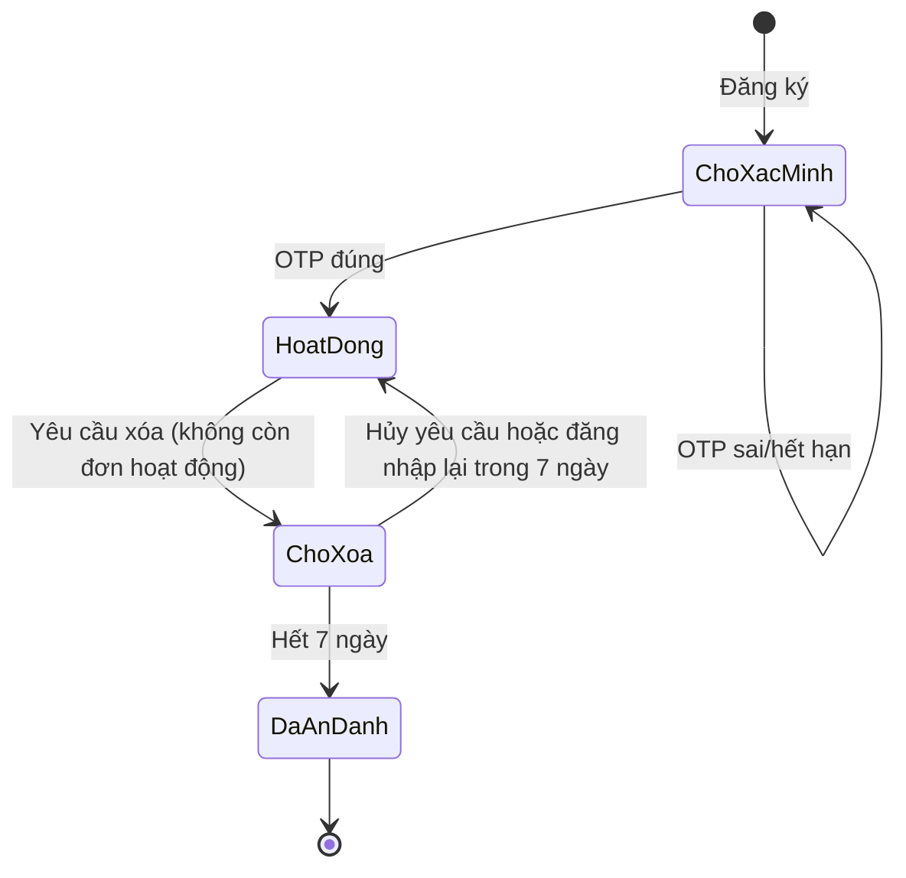

## 5.2. Khám phá deal

*Vai trò: Khách hàng (app Android) · 20 UC: R1-020 đến R1-039*

### 5.2.1. Mục tiêu nghiệp vụ

Giúp khách tìm đúng suất cần mua trong bán kính của mình với số liệu chính xác (giá, tồn, khung nhận), theo dõi cửa hàng và deal quan tâm, và nhận thông báo đúng lúc mà không bị làm phiền. Phân hệ chuyển dữ liệu suất của cửa hàng thành trải nghiệm tìm kiếm, so sánh và ra quyết định, nhưng không tạo ra dữ liệu giao dịch.

### 5.2.2. Phạm vi

**Thuộc phân hệ:** Danh sách deal; Chi tiết deal; Cửa hàng; Cửa hàng yêu thích; Thông báo deal; Theo dõi deal; Tìm kiếm và lọc; Lưu và so sánh; Chia sẻ; Chi tiết cửa hàng.

**Danh sách UC:** R1-020 Xem danh sách deal gần; R1-021 Xem bản đồ deal; R1-022 Tìm kiếm deal; R1-023 Lọc deal; R1-024 Sắp xếp deal; R1-025 Cuộn tải thêm (phân trang); R1-026 Xem chi tiết deal; R1-027 Xem chi tiết cửa hàng; R1-028 Thêm cửa hàng yêu thích; R1-029 Bỏ cửa hàng yêu thích; R1-030 Đăng ký nhận thông báo khi có deal quanh khu; R1-031 Tạo cảnh báo deal theo điều kiện mong muốn; R1-032 Xem, sửa và xóa cảnh báo deal; R1-033 Lưu bộ lọc tìm kiếm thường dùng; R1-034 Lưu deal để xem sau; R1-035 Xem lịch sử deal đã xem gần đây; R1-036 So sánh các deal cạnh nhau; R1-037 Chia sẻ deal qua liên kết; R1-038 Chỉ đường đến cửa hàng; R1-039 Xem deal tại một vị trí khác.

**Nằm ngoài phạm vi:** Thanh toán, giữ suất và đặt hàng (thuộc phân hệ Đặt hàng và thanh toán); gợi ý bằng AI và tìm bằng câu hỏi tự nhiên (thuộc Trợ lý AI cho khách hàng).

### 5.2.3. Tác nhân và quyền hạn

Khách hàng (app Android). Dữ liệu nguồn do Chủ cửa hàng tạo ở Suất và tồn kho; hệ thống tính khoảng cách bằng dữ liệu không gian của cửa hàng.

### 5.2.4. Dữ liệu nghiệp vụ

| Thực thể | Ý nghĩa, nguồn hình thành và ảnh hưởng đến quyết định nghiệp vụ |
|---|---|
| Suất đang mở | Bản ghi suất của cửa hàng ở trạng thái Đang mở, còn tồn, chưa hết khung nhận; số suất còn hiển thị đã trừ suất đang được giữ. Đây là nguồn duy nhất của danh sách, bản đồ, so sánh và chi tiết deal. |
| Bộ lọc và địa điểm lưu | Bộ lọc đã lưu (tối đa 10), cảnh báo deal (tối đa 10 đang bật), danh sách xem sau (tối đa 50), cửa hàng yêu thích (tối đa 50), lịch sử xem 20 deal (chỉ khi bật cá nhân hóa). |
| Cảnh báo deal | Điều kiện loại món hoặc cửa hàng, giá tối đa, % giảm tối thiểu, khung giờ, bán kính; mỗi suất chỉ thông báo một lần cho mỗi cảnh báo, tối đa 3 thông báo deal mỗi ngày, không gửi 22:00 đến 07:00. |

### 5.2.5. Quy trình nghiệp vụ tổng thể

1. Khách mở app, hệ thống lấy vị trí hoặc địa điểm quen thuộc và bán kính (mặc định 2 km), trả danh sách deal có phân trang 20 và bản đồ.
2. Khách thu hẹp bằng từ khóa (không phân biệt dấu), bộ lọc kết hợp AND và sắp xếp (khoảng cách, giá thấp, giảm cao, sắp hết hạn nhận).
3. Khách mở chi tiết deal, chi tiết cửa hàng, lưu, so sánh 2 đến 3 deal, chia sẻ liên kết hoặc chỉ đường đến cửa hàng.
4. Khi khu vực chưa có deal, khách đăng ký thông báo hoặc tạo cảnh báo theo điều kiện; hệ thống gửi push khi có suất khớp, gộp trong hạn mức 3 thông báo mỗi ngày.
5. Khách quyết định đặt: chuyển sang phân hệ Đặt hàng, nơi tồn và giá được kiểm tra lại một lần nữa.

**Phân hệ phụ thuộc và liên kết:** Phụ thuộc Tài khoản và hồ sơ (vị trí, bán kính, đồng ý cá nhân hóa) và Suất và tồn kho của cửa hàng. Cung cấp suất được chọn cho Đặt hàng và thanh toán.

### 5.2.6. Đặc tả từng UC

##### R1-020 - Xem danh sách deal gần

**Mã UC:** R1-020  
**Tên UC:** Xem danh sách deal gần  
**Nhóm:** Khám phá deal / Danh sách deal · **Loại:** Truy vấn và hiển thị  
**Mục tiêu:** App gửi vị trí và bán kính; server dùng PostGIS trả danh sách suất đang mở của các cửa hàng trong bán kính, sắp theo khoảng cách mặc định. *[Xác định trong Excel]*  
**Tác nhân:** Khách hàng (app Android)  

**Điều kiện tiên quyết** *[Tổng hợp từ ma trận gói và vai trò]*
- Khách đã đăng nhập trên app Android, tài khoản ở trạng thái Hoạt động (đã xác minh), phiên còn hiệu lực.
- Gói dịch vụ: Vai Khách, không phụ thuộc gói trả phí (GOI-KH); không có hạn mức riêng.

**Dữ liệu hiển thị (UC không có trường nhập)** *[Xác định trong Excel]*
- Hiển thị: ảnh món, tên món, tên cửa hàng, giá gốc, giá bán, % giảm, số suất còn, khung giờ nhận, khoảng cách

**Luồng xử lý chính** *[Tổng hợp từ mô tả, quy tắc và kết quả]*
1. Người dùng mở màn hình "Xem danh sách deal gần" trên app Android.
2. Hệ thống xác thực phiên, xác định phạm vi dữ liệu của người dùng và áp các quy tắc hiển thị của UC.
3. Truy vấn dữ liệu: App gửi vị trí và bán kính; server dùng PostGIS trả danh sách suất đang mở của các cửa hàng trong bán kính, sắp theo khoảng cách mặc định.
4. Hiển thị các thuộc tính: ảnh món, tên món, tên cửa hàng, giá gốc, giá bán, % giảm, số suất còn, khung giờ nhận, khoảng cách.
5. Trường hợp không có dữ liệu hoặc không hợp lệ được xử lý theo mục Validation; không thay đổi dữ liệu nghiệp vụ.

**Business Rules** *[Xác định trong Excel]*
1. Chỉ hiện suất trạng thái Đang mở, còn tồn, chưa hết khung nhận, thuộc cửa hàng đang hoạt động.
2. Không hiện suất của cửa hàng bị tạm ngưng.
3. Số suất còn hiển thị là số có thể đặt (đã trừ suất đang giữ).

**Validation** *[Xác định trong Excel]*
1. Không có deal: hiện màn hình trống và gợi ý tăng bán kính/đăng ký nhận thông báo.
2. Không có vị trí: yêu cầu nhập địa chỉ.

**Luồng thay thế và ngoại lệ**
- Người dùng không có quyền hoặc đối tượng không thuộc phạm vi dữ liệu của mình: từ chối, không tiết lộ sự tồn tại của dữ liệu thuộc người khác (đề xuất hoàn thiện).
- Mất kết nối hoặc lỗi hệ thống giữa chừng: thao tác không được ghi nhận một phần; người dùng được thông báo và thử lại, thao tác thay đổi dữ liệu dùng khóa chống trùng khi áp dụng (đề xuất hoàn thiện).

**Dữ liệu thay đổi** *[Tổng hợp]*  
Không tạo hoặc thay đổi dữ liệu nghiệp vụ; chỉ đọc theo phạm vi của người dùng.

**Chuyển trạng thái** *[Tổng hợp]*
- Chỉ hiện suất trạng thái Đang mở, còn tồn, chưa hết khung nhận, thuộc cửa hàng đang hoạt động.

**Kết quả** *[Xác định trong Excel]*  
Danh sách cập nhật theo thời gian; kéo để làm mới.

**Tác động liên phân hệ** *[Tổng hợp]*  
Dữ liệu hoặc quy tắc của UC liên quan đến: Suất và tồn kho trong ngày.

**Điều kiện hoàn thành** *[Tổng hợp]*  
Thành công khi: Danh sách cập nhật theo thời gian; kéo để làm mới. Không hoàn tất khi bất kỳ điều kiện Validation nào không đạt hoặc dịch vụ liên quan lỗi; dữ liệu giữ nguyên trạng thái trước thao tác.

**Tiêu chí nghiệm thu** *[Tổng hợp, kiểm tra được]*
1. Given khách đủ điều kiện tiên quyết và dữ liệu hợp lệ, When thực hiện "Xem danh sách deal gần", Then kết quả đạt được là: danh sách cập nhật theo thời gian; kéo để làm mới.
2. Given thao tác "Xem danh sách deal gần" được thực hiện, When hệ thống áp dụng quy tắc "Chỉ hiện suất trạng thái Đang mở, còn tồn, chưa hết khung nhận, thuộc cửa hàng đang hoạt động", Then kết quả không được vi phạm quy tắc này.

##### R1-021 - Xem bản đồ deal

**Mã UC:** R1-021  
**Tên UC:** Xem bản đồ deal  
**Nhóm:** Khám phá deal / Danh sách deal · **Loại:** Truy vấn và hiển thị  
**Mục tiêu:** Hiển thị các cửa hàng có deal lên bản đồ (Maps Compose); chạm vào ghim để xem tóm tắt và mở chi tiết. *[Xác định trong Excel]*  
**Tác nhân:** Khách hàng (app Android)  

**Điều kiện tiên quyết** *[Tổng hợp từ ma trận gói và vai trò]*
- Khách đã đăng nhập trên app Android, tài khoản ở trạng thái Hoạt động (đã xác minh), phiên còn hiệu lực.
- Gói dịch vụ: Vai Khách, không phụ thuộc gói trả phí (GOI-KH); không có hạn mức riêng.

**Dữ liệu hiển thị (UC không có trường nhập)** *[Xác định trong Excel]*
- Hiển thị: vị trí cửa hàng, số deal, giá thấp nhất

**Luồng xử lý chính** *[Tổng hợp từ mô tả, quy tắc và kết quả]*
1. Người dùng mở màn hình "Xem bản đồ deal" trên app Android.
2. Hệ thống xác thực phiên, xác định phạm vi dữ liệu của người dùng và áp các quy tắc hiển thị của UC.
3. Truy vấn dữ liệu: Hiển thị các cửa hàng có deal lên bản đồ (Maps Compose); chạm vào ghim để xem tóm tắt và mở chi tiết.
4. Hiển thị các thuộc tính: vị trí cửa hàng, số deal, giá thấp nhất.
5. Trường hợp không có dữ liệu hoặc không hợp lệ được xử lý theo mục Validation; không thay đổi dữ liệu nghiệp vụ.

**Business Rules** *[Xác định trong Excel]*
1. Chỉ hiện cửa hàng trong bán kính có ít nhất một suất đang mở.

**Validation** *[Xác định trong Excel]*
1. Không tải được bản đồ: quay lại chế độ danh sách.

**Luồng thay thế và ngoại lệ**
- Mọi trường hợp không hợp lệ nêu ở mục Validation là luồng ngoại lệ của UC này và được xử lý đúng như mô tả tại đó. *[Xác định]*
- Người dùng không có quyền hoặc đối tượng không thuộc phạm vi dữ liệu của mình: từ chối, không tiết lộ sự tồn tại của dữ liệu thuộc người khác (đề xuất hoàn thiện).
- Mất kết nối hoặc lỗi hệ thống giữa chừng: thao tác không được ghi nhận một phần; người dùng được thông báo và thử lại, thao tác thay đổi dữ liệu dùng khóa chống trùng khi áp dụng (đề xuất hoàn thiện).

**Dữ liệu thay đổi** *[Tổng hợp]*  
Không tạo hoặc thay đổi dữ liệu nghiệp vụ; chỉ đọc theo phạm vi của người dùng.

**Chuyển trạng thái** *[Tổng hợp]*
- Không chuyển trạng thái của đối tượng nghiệp vụ.

**Kết quả** *[Xác định trong Excel]*  
Ghim cập nhật cùng dữ liệu danh sách.

**Tác động liên phân hệ** *[Tổng hợp]*  
Dữ liệu hoặc quy tắc của UC liên quan đến: Suất và tồn kho trong ngày.

**Điều kiện hoàn thành** *[Tổng hợp]*  
Thành công khi: Ghim cập nhật cùng dữ liệu danh sách. Không hoàn tất khi bất kỳ điều kiện Validation nào không đạt hoặc dịch vụ liên quan lỗi; dữ liệu giữ nguyên trạng thái trước thao tác.

**Tiêu chí nghiệm thu** *[Tổng hợp, kiểm tra được]*
1. Given khách đủ điều kiện tiên quyết và dữ liệu hợp lệ, When thực hiện "Xem bản đồ deal", Then kết quả đạt được là: ghim cập nhật cùng dữ liệu danh sách.
2. Given không tải được bản đồ, When thực hiện "Xem bản đồ deal", Then quay lại chế độ danh sách.
3. Given thao tác "Xem bản đồ deal" được thực hiện, When hệ thống áp dụng quy tắc "Chỉ hiện cửa hàng trong bán kính có ít nhất một suất đang mở", Then kết quả không được vi phạm quy tắc này.

##### R1-022 - Tìm kiếm deal

**Mã UC:** R1-022  
**Tên UC:** Tìm kiếm deal  
**Nhóm:** Khám phá deal / Danh sách deal · **Loại:** Truy vấn và hiển thị  
**Mục tiêu:** Khách nhập từ khóa tên món hoặc tên cửa hàng. *[Xác định trong Excel]*  
**Tác nhân:** Khách hàng (app Android)  

**Điều kiện tiên quyết** *[Tổng hợp từ ma trận gói và vai trò]*
- Khách đã đăng nhập trên app Android, tài khoản ở trạng thái Hoạt động (đã xác minh), phiên còn hiệu lực.
- Gói dịch vụ: Vai Khách, không phụ thuộc gói trả phí (GOI-KH); không có hạn mức riêng.

**Dữ liệu đầu vào và hiển thị** *[Xác định trong Excel]*
- Từ khóa (text, 1-50 ký tự)

**Luồng xử lý chính** *[Tổng hợp từ mô tả, quy tắc và kết quả]*
1. Người dùng mở màn hình "Tìm kiếm deal" trên app Android và đặt điều kiện: Từ khóa.
2. Hệ thống xác thực phiên, xác định phạm vi dữ liệu của người dùng và áp các quy tắc hiển thị của UC.
3. Truy vấn dữ liệu: Khách nhập từ khóa tên món hoặc tên cửa hàng.
4. Hiển thị kết quả theo định dạng của màn hình.
5. Trường hợp không có dữ liệu hoặc không hợp lệ được xử lý theo mục Validation; không thay đổi dữ liệu nghiệp vụ.

**Business Rules** *[Xác định trong Excel]*
1. Tìm không phân biệt hoa thường và dấu tiếng Việt, trong phạm vi bán kính đã chọn.

**Validation** *[Xác định trong Excel]*
1. Từ khóa rỗng thì hiện lại toàn bộ; không có kết quả: báo rõ.

**Luồng thay thế và ngoại lệ**
- Mọi trường hợp không hợp lệ nêu ở mục Validation là luồng ngoại lệ của UC này và được xử lý đúng như mô tả tại đó. *[Xác định]*
- Người dùng không có quyền hoặc đối tượng không thuộc phạm vi dữ liệu của mình: từ chối, không tiết lộ sự tồn tại của dữ liệu thuộc người khác (đề xuất hoàn thiện).
- Mất kết nối hoặc lỗi hệ thống giữa chừng: thao tác không được ghi nhận một phần; người dùng được thông báo và thử lại, thao tác thay đổi dữ liệu dùng khóa chống trùng khi áp dụng (đề xuất hoàn thiện).

**Dữ liệu thay đổi** *[Tổng hợp]*  
Không tạo hoặc thay đổi dữ liệu nghiệp vụ; chỉ đọc theo phạm vi của người dùng.

**Chuyển trạng thái** *[Tổng hợp]*
- Không chuyển trạng thái của đối tượng nghiệp vụ.

**Kết quả** *[Xác định trong Excel]*  
Danh sách rút gọn theo từ khóa.

**Tác động liên phân hệ** *[Tổng hợp]*  
Không phát sinh tác động đáng kể ngoài phân hệ; dữ liệu chỉ dùng trong phạm vi chức năng.

**Điều kiện hoàn thành** *[Tổng hợp]*  
Thành công khi: Danh sách rút gọn theo từ khóa. Không hoàn tất khi bất kỳ điều kiện Validation nào không đạt hoặc dịch vụ liên quan lỗi; dữ liệu giữ nguyên trạng thái trước thao tác.

**Tiêu chí nghiệm thu** *[Tổng hợp, kiểm tra được]*
1. Given khách đủ điều kiện tiên quyết và dữ liệu hợp lệ, When thực hiện "Tìm kiếm deal", Then kết quả đạt được là: danh sách rút gọn theo từ khóa.
2. Given từ khóa rỗng thì hiện lại toàn bộ; không có kết quả, When thực hiện "Tìm kiếm deal", Then báo rõ.
3. Given thao tác "Tìm kiếm deal" được thực hiện, When hệ thống áp dụng quy tắc "Tìm không phân biệt hoa thường và dấu tiếng Việt, trong phạm vi bán kính đã chọn", Then kết quả không được vi phạm quy tắc này.

##### R1-023 - Lọc deal

**Mã UC:** R1-023  
**Tên UC:** Lọc deal  
**Nhóm:** Khám phá deal / Danh sách deal · **Loại:** Truy vấn và hiển thị  
**Mục tiêu:** Lọc theo loại món, khoảng giá, mức giảm tối thiểu, khung giờ nhận. *[Xác định trong Excel]*  
**Tác nhân:** Khách hàng (app Android)  

**Điều kiện tiên quyết** *[Tổng hợp từ ma trận gói và vai trò]*
- Khách đã đăng nhập trên app Android, tài khoản ở trạng thái Hoạt động (đã xác minh), phiên còn hiệu lực.
- Gói dịch vụ: Vai Khách, không phụ thuộc gói trả phí (GOI-KH); không có hạn mức riêng.

**Dữ liệu đầu vào và hiển thị** *[Xác định trong Excel]*
- Loại món (chọn nhiều)
- Giá tối đa (số)
- % giảm tối thiểu (số 0-90)
- Khung giờ nhận (chọn)

**Luồng xử lý chính** *[Tổng hợp từ mô tả, quy tắc và kết quả]*
1. Người dùng mở màn hình "Lọc deal" trên app Android và đặt điều kiện: Loại món, Giá tối đa, % giảm tối thiểu, Khung giờ nhận.
2. Hệ thống xác thực phiên, xác định phạm vi dữ liệu của người dùng và áp các quy tắc hiển thị của UC.
3. Truy vấn dữ liệu: Lọc theo loại món, khoảng giá, mức giảm tối thiểu, khung giờ nhận.
4. Hiển thị kết quả theo định dạng của màn hình.
5. Trường hợp không có dữ liệu hoặc không hợp lệ được xử lý theo mục Validation; không thay đổi dữ liệu nghiệp vụ.

**Business Rules** *[Xác định trong Excel]*
1. Bộ lọc kết hợp theo điều kiện AND.

**Validation** *[Xác định trong Excel]*
1. Giá trị ngoài khoảng: đưa về biên.

**Luồng thay thế và ngoại lệ**
- Mọi trường hợp không hợp lệ nêu ở mục Validation là luồng ngoại lệ của UC này và được xử lý đúng như mô tả tại đó. *[Xác định]*
- Người dùng không có quyền hoặc đối tượng không thuộc phạm vi dữ liệu của mình: từ chối, không tiết lộ sự tồn tại của dữ liệu thuộc người khác (đề xuất hoàn thiện).
- Mất kết nối hoặc lỗi hệ thống giữa chừng: thao tác không được ghi nhận một phần; người dùng được thông báo và thử lại, thao tác thay đổi dữ liệu dùng khóa chống trùng khi áp dụng (đề xuất hoàn thiện).

**Dữ liệu thay đổi** *[Tổng hợp]*  
Không tạo hoặc thay đổi dữ liệu nghiệp vụ; chỉ đọc theo phạm vi của người dùng.

**Chuyển trạng thái** *[Tổng hợp]*
- Không chuyển trạng thái của đối tượng nghiệp vụ.

**Kết quả** *[Xác định trong Excel]*  
Danh sách theo bộ lọc; hiện số bộ lọc đang bật.

**Tác động liên phân hệ** *[Tổng hợp]*  
Không phát sinh tác động đáng kể ngoài phân hệ; dữ liệu chỉ dùng trong phạm vi chức năng.

**Điều kiện hoàn thành** *[Tổng hợp]*  
Thành công khi: Danh sách theo bộ lọc; hiện số bộ lọc đang bật. Không hoàn tất khi bất kỳ điều kiện Validation nào không đạt hoặc dịch vụ liên quan lỗi; dữ liệu giữ nguyên trạng thái trước thao tác.

**Tiêu chí nghiệm thu** *[Tổng hợp, kiểm tra được]*
1. Given khách đủ điều kiện tiên quyết và dữ liệu hợp lệ, When thực hiện "Lọc deal", Then kết quả đạt được là: danh sách theo bộ lọc; hiện số bộ lọc đang bật.
2. Given giá trị ngoài khoảng, When thực hiện "Lọc deal", Then đưa về biên.
3. Given thao tác "Lọc deal" được thực hiện, When hệ thống áp dụng quy tắc "Bộ lọc kết hợp theo điều kiện AND", Then kết quả không được vi phạm quy tắc này.

##### R1-024 - Sắp xếp deal

**Mã UC:** R1-024  
**Tên UC:** Sắp xếp deal  
**Nhóm:** Khám phá deal / Danh sách deal · **Loại:** Truy vấn và hiển thị  
**Mục tiêu:** Sắp theo khoảng cách (mặc định), giá thấp, mức giảm cao, sắp hết hạn nhận. *[Xác định trong Excel]*  
**Tác nhân:** Khách hàng (app Android)  

**Điều kiện tiên quyết** *[Tổng hợp từ ma trận gói và vai trò]*
- Khách đã đăng nhập trên app Android, tài khoản ở trạng thái Hoạt động (đã xác minh), phiên còn hiệu lực.
- Gói dịch vụ: Vai Khách, không phụ thuộc gói trả phí (GOI-KH); không có hạn mức riêng.

**Dữ liệu đầu vào và hiển thị** *[Xác định trong Excel]*
- Tiêu chí sắp xếp (chọn một)

**Luồng xử lý chính** *[Tổng hợp từ mô tả, quy tắc và kết quả]*
1. Người dùng mở màn hình "Sắp xếp deal" trên app Android và đặt điều kiện: Tiêu chí sắp xếp.
2. Hệ thống xác thực phiên, xác định phạm vi dữ liệu của người dùng và áp các quy tắc hiển thị của UC.
3. Truy vấn dữ liệu: Sắp theo khoảng cách (mặc định), giá thấp, mức giảm cao, sắp hết hạn nhận.
4. Hiển thị kết quả theo định dạng của màn hình.
5. Trường hợp không có dữ liệu hoặc không hợp lệ được xử lý theo mục Validation; không thay đổi dữ liệu nghiệp vụ.

**Business Rules** *[Xác định trong Excel]*
1. Nếu bằng nhau thì xếp theo khoảng cách rồi theo thời điểm tạo.

**Validation** *[Xác định trong Excel]*
1. Không có.

**Luồng thay thế và ngoại lệ**
- Người dùng không có quyền hoặc đối tượng không thuộc phạm vi dữ liệu của mình: từ chối, không tiết lộ sự tồn tại của dữ liệu thuộc người khác (đề xuất hoàn thiện).
- Mất kết nối hoặc lỗi hệ thống giữa chừng: thao tác không được ghi nhận một phần; người dùng được thông báo và thử lại, thao tác thay đổi dữ liệu dùng khóa chống trùng khi áp dụng (đề xuất hoàn thiện).

**Dữ liệu thay đổi** *[Tổng hợp]*  
Không tạo hoặc thay đổi dữ liệu nghiệp vụ; chỉ đọc theo phạm vi của người dùng.

**Chuyển trạng thái** *[Tổng hợp]*
- Không chuyển trạng thái của đối tượng nghiệp vụ.

**Kết quả** *[Xác định trong Excel]*  
Danh sách sắp xếp lại.

**Tác động liên phân hệ** *[Tổng hợp]*  
Không phát sinh tác động đáng kể ngoài phân hệ; dữ liệu chỉ dùng trong phạm vi chức năng.

**Điều kiện hoàn thành** *[Tổng hợp]*  
Thành công khi: Danh sách sắp xếp lại. Không hoàn tất khi bất kỳ điều kiện Validation nào không đạt hoặc dịch vụ liên quan lỗi; dữ liệu giữ nguyên trạng thái trước thao tác.

**Tiêu chí nghiệm thu** *[Tổng hợp, kiểm tra được]*
1. Given khách đủ điều kiện tiên quyết và dữ liệu hợp lệ, When thực hiện "Sắp xếp deal", Then kết quả đạt được là: danh sách sắp xếp lại.
2. Given thao tác "Sắp xếp deal" được thực hiện, When hệ thống áp dụng quy tắc "Nếu bằng nhau thì xếp theo khoảng cách rồi theo thời điểm tạo", Then kết quả không được vi phạm quy tắc này.

##### R1-025 - Cuộn tải thêm (phân trang)

**Mã UC:** R1-025  
**Tên UC:** Cuộn tải thêm (phân trang)  
**Nhóm:** Khám phá deal / Danh sách deal · **Loại:** Truy vấn và hiển thị  
**Mục tiêu:** Tải theo trang 20 deal khi cuộn đến cuối danh sách (cursor pagination). *[Xác định trong Excel]*  
**Tác nhân:** Khách hàng (app Android)  

**Điều kiện tiên quyết** *[Tổng hợp từ ma trận gói và vai trò]*
- Khách đã đăng nhập trên app Android, tài khoản ở trạng thái Hoạt động (đã xác minh), phiên còn hiệu lực.
- Gói dịch vụ: Vai Khách, không phụ thuộc gói trả phí (GOI-KH); không có hạn mức riêng.

**Dữ liệu đầu vào và hiển thị** *[Xác định trong Excel]*
- Trang/cursor (hệ thống)

**Luồng xử lý chính** *[Tổng hợp từ mô tả, quy tắc và kết quả]*
1. Người dùng mở màn hình "Cuộn tải thêm (phân trang)" trên app Android và đặt điều kiện: Trang/cursor.
2. Hệ thống xác thực phiên, xác định phạm vi dữ liệu của người dùng và áp các quy tắc hiển thị của UC.
3. Truy vấn dữ liệu: Tải theo trang 20 deal khi cuộn đến cuối danh sách (cursor pagination).
4. Hiển thị kết quả theo định dạng của màn hình.
5. Trường hợp không có dữ liệu hoặc không hợp lệ được xử lý theo mục Validation; không thay đổi dữ liệu nghiệp vụ.

**Business Rules** *[Xác định trong Excel]*
1. Cursor ổn định khi danh sách thay đổi, không lặp deal giữa các trang.

**Validation** *[Xác định trong Excel]*
1. Lỗi mạng: hiện nút thử lại, giữ danh sách đã tải.

**Luồng thay thế và ngoại lệ**
- Mọi trường hợp không hợp lệ nêu ở mục Validation là luồng ngoại lệ của UC này và được xử lý đúng như mô tả tại đó. *[Xác định]*
- Người dùng không có quyền hoặc đối tượng không thuộc phạm vi dữ liệu của mình: từ chối, không tiết lộ sự tồn tại của dữ liệu thuộc người khác (đề xuất hoàn thiện).
- Mất kết nối hoặc lỗi hệ thống giữa chừng: thao tác không được ghi nhận một phần; người dùng được thông báo và thử lại, thao tác thay đổi dữ liệu dùng khóa chống trùng khi áp dụng (đề xuất hoàn thiện).

**Dữ liệu thay đổi** *[Tổng hợp]*  
Không tạo hoặc thay đổi dữ liệu nghiệp vụ; chỉ đọc theo phạm vi của người dùng.

**Chuyển trạng thái** *[Tổng hợp]*
- Không chuyển trạng thái của đối tượng nghiệp vụ.

**Kết quả** *[Xác định trong Excel]*  
Thêm 20 deal vào cuối danh sách.

**Tác động liên phân hệ** *[Tổng hợp]*  
Không phát sinh tác động đáng kể ngoài phân hệ; dữ liệu chỉ dùng trong phạm vi chức năng.

**Điều kiện hoàn thành** *[Tổng hợp]*  
Thành công khi: Thêm 20 deal vào cuối danh sách. Không hoàn tất khi bất kỳ điều kiện Validation nào không đạt hoặc dịch vụ liên quan lỗi; dữ liệu giữ nguyên trạng thái trước thao tác.

**Tiêu chí nghiệm thu** *[Tổng hợp, kiểm tra được]*
1. Given khách đủ điều kiện tiên quyết và dữ liệu hợp lệ, When thực hiện "Cuộn tải thêm (phân trang)", Then kết quả đạt được là: thêm 20 deal vào cuối danh sách.
2. Given lỗi mạng, When thực hiện "Cuộn tải thêm (phân trang)", Then hiện nút thử lại, giữ danh sách đã tải.
3. Given thao tác "Cuộn tải thêm (phân trang)" được thực hiện, When hệ thống áp dụng quy tắc "Cursor ổn định khi danh sách thay đổi, không lặp deal giữa các trang", Then kết quả không được vi phạm quy tắc này.

##### R1-026 - Xem chi tiết deal

**Mã UC:** R1-026  
**Tên UC:** Xem chi tiết deal  
**Nhóm:** Khám phá deal / Chi tiết deal · **Loại:** Truy vấn và hiển thị  
**Mục tiêu:** Hiển thị ảnh, mô tả, thành phần/dị ứng cửa hàng khai báo, hạn dùng, giá, số suất còn, khung giờ và địa chỉ nhận, đánh giá của cửa hàng. *[Xác định trong Excel]*  
**Tác nhân:** Khách hàng (app Android)  

**Điều kiện tiên quyết** *[Tổng hợp từ ma trận gói và vai trò]*
- Khách đã đăng nhập trên app Android, tài khoản ở trạng thái Hoạt động (đã xác minh), phiên còn hiệu lực.
- Gói dịch vụ: Vai Khách, không phụ thuộc gói trả phí (GOI-KH); không có hạn mức riêng.

**Dữ liệu hiển thị (UC không có trường nhập)** *[Xác định trong Excel]*
- Hiển thị: ảnh, tên, mô tả, thành phần, hạn dùng, giá gốc, giá bán, tồn còn, khung giờ nhận, địa chỉ, điểm đánh giá

**Luồng xử lý chính** *[Tổng hợp từ mô tả, quy tắc và kết quả]*
1. Người dùng mở màn hình "Xem chi tiết deal" trên app Android.
2. Hệ thống xác thực phiên, xác định phạm vi dữ liệu của người dùng và áp các quy tắc hiển thị của UC.
3. Truy vấn dữ liệu: Hiển thị ảnh, mô tả, thành phần/dị ứng cửa hàng khai báo, hạn dùng, giá, số suất còn, khung giờ và địa chỉ nhận, đánh giá của cửa hàng.
4. Hiển thị các thuộc tính: ảnh, tên, mô tả, thành phần, hạn dùng, giá gốc, giá bán, tồn còn, khung giờ nhận, địa chỉ, điểm đánh giá.
5. Trường hợp không có dữ liệu hoặc không hợp lệ được xử lý theo mục Validation; không thay đổi dữ liệu nghiệp vụ.

**Business Rules** *[Xác định trong Excel]*
1. Giá hiển thị là giá hiện hành, cập nhật khi cửa hàng đổi giá.
2. Deal hết suất hoặc hết giờ hiện trạng thái Đã hết, không cho đặt.

**Validation** *[Xác định trong Excel]*
1. Suất không tồn tại hoặc đã đóng: thông báo và quay lại danh sách.

**Luồng thay thế và ngoại lệ**
- Mọi trường hợp không hợp lệ nêu ở mục Validation là luồng ngoại lệ của UC này và được xử lý đúng như mô tả tại đó. *[Xác định]*
- Người dùng không có quyền hoặc đối tượng không thuộc phạm vi dữ liệu của mình: từ chối, không tiết lộ sự tồn tại của dữ liệu thuộc người khác (đề xuất hoàn thiện).
- Mất kết nối hoặc lỗi hệ thống giữa chừng: thao tác không được ghi nhận một phần; người dùng được thông báo và thử lại, thao tác thay đổi dữ liệu dùng khóa chống trùng khi áp dụng (đề xuất hoàn thiện).

**Dữ liệu thay đổi** *[Tổng hợp]*  
Không tạo hoặc thay đổi dữ liệu nghiệp vụ; chỉ đọc theo phạm vi của người dùng.

**Chuyển trạng thái** *[Tổng hợp]*
- Deal hết suất hoặc hết giờ hiện trạng thái Đã hết, không cho đặt.

**Kết quả** *[Xác định trong Excel]*  
Hiển thị chi tiết và nút Đặt khi còn suất.

**Tác động liên phân hệ** *[Tổng hợp]*  
Dữ liệu hoặc quy tắc của UC liên quan đến: Suất và tồn kho trong ngày; Đánh giá; Thành phần và dị ứng của món.

**Điều kiện hoàn thành** *[Tổng hợp]*  
Thành công khi: Hiển thị chi tiết và nút Đặt khi còn suất. Không hoàn tất khi bất kỳ điều kiện Validation nào không đạt hoặc dịch vụ liên quan lỗi; dữ liệu giữ nguyên trạng thái trước thao tác.

**Tiêu chí nghiệm thu** *[Tổng hợp, kiểm tra được]*
1. Given khách đủ điều kiện tiên quyết và dữ liệu hợp lệ, When thực hiện "Xem chi tiết deal", Then kết quả đạt được là: hiển thị chi tiết và nút Đặt khi còn suất.
2. Given suất không tồn tại hoặc đã đóng, When thực hiện "Xem chi tiết deal", Then thông báo và quay lại danh sách.
3. Given thao tác "Xem chi tiết deal" được thực hiện, When hệ thống áp dụng quy tắc "Giá hiển thị là giá hiện hành, cập nhật khi cửa hàng đổi giá", Then kết quả không được vi phạm quy tắc này.

##### R1-027 - Xem chi tiết cửa hàng

**Mã UC:** R1-027  
**Tên UC:** Xem chi tiết cửa hàng  
**Nhóm:** Khám phá deal / Cửa hàng · **Loại:** Truy vấn và hiển thị  
**Mục tiêu:** Xem tên, địa chỉ, giờ mở cửa, các deal đang mở và điểm đánh giá. *[Xác định trong Excel]*  
**Tác nhân:** Khách hàng (app Android)  

**Điều kiện tiên quyết** *[Tổng hợp từ ma trận gói và vai trò]*
- Khách đã đăng nhập trên app Android, tài khoản ở trạng thái Hoạt động (đã xác minh), phiên còn hiệu lực.
- Gói dịch vụ: Vai Khách, không phụ thuộc gói trả phí (GOI-KH); không có hạn mức riêng.

**Dữ liệu hiển thị (UC không có trường nhập)** *[Xác định trong Excel]*
- Hiển thị: tên, địa chỉ, giờ mở cửa, deal đang mở, điểm đánh giá trung bình, số đánh giá

**Luồng xử lý chính** *[Tổng hợp từ mô tả, quy tắc và kết quả]*
1. Người dùng mở màn hình "Xem chi tiết cửa hàng" trên app Android.
2. Hệ thống xác thực phiên, xác định phạm vi dữ liệu của người dùng và áp các quy tắc hiển thị của UC.
3. Truy vấn dữ liệu: Xem tên, địa chỉ, giờ mở cửa, các deal đang mở và điểm đánh giá.
4. Hiển thị các thuộc tính: tên, địa chỉ, giờ mở cửa, deal đang mở, điểm đánh giá trung bình, số đánh giá.
5. Trường hợp không có dữ liệu hoặc không hợp lệ được xử lý theo mục Validation; không thay đổi dữ liệu nghiệp vụ.

**Business Rules** *[Xác định trong Excel]*
1. Chỉ hiện cửa hàng đang hoạt động.

**Validation** *[Xác định trong Excel]*
1. Cửa hàng tạm ngưng: thông báo không khả dụng.

**Luồng thay thế và ngoại lệ**
- Mọi trường hợp không hợp lệ nêu ở mục Validation là luồng ngoại lệ của UC này và được xử lý đúng như mô tả tại đó. *[Xác định]*
- Người dùng không có quyền hoặc đối tượng không thuộc phạm vi dữ liệu của mình: từ chối, không tiết lộ sự tồn tại của dữ liệu thuộc người khác (đề xuất hoàn thiện).
- Mất kết nối hoặc lỗi hệ thống giữa chừng: thao tác không được ghi nhận một phần; người dùng được thông báo và thử lại, thao tác thay đổi dữ liệu dùng khóa chống trùng khi áp dụng (đề xuất hoàn thiện).

**Dữ liệu thay đổi** *[Tổng hợp]*  
Không tạo hoặc thay đổi dữ liệu nghiệp vụ; chỉ đọc theo phạm vi của người dùng.

**Chuyển trạng thái** *[Tổng hợp]*
- Không chuyển trạng thái của đối tượng nghiệp vụ.

**Kết quả** *[Xác định trong Excel]*  
Hiển thị trang cửa hàng.

**Tác động liên phân hệ** *[Tổng hợp]*  
Dữ liệu hoặc quy tắc của UC liên quan đến: Đánh giá.

**Điều kiện hoàn thành** *[Tổng hợp]*  
Thành công khi: Hiển thị trang cửa hàng. Không hoàn tất khi bất kỳ điều kiện Validation nào không đạt hoặc dịch vụ liên quan lỗi; dữ liệu giữ nguyên trạng thái trước thao tác.

**Tiêu chí nghiệm thu** *[Tổng hợp, kiểm tra được]*
1. Given khách đủ điều kiện tiên quyết và dữ liệu hợp lệ, When thực hiện "Xem chi tiết cửa hàng", Then kết quả đạt được là: hiển thị trang cửa hàng.
2. Given cửa hàng tạm ngưng, When thực hiện "Xem chi tiết cửa hàng", Then thông báo không khả dụng.
3. Given thao tác "Xem chi tiết cửa hàng" được thực hiện, When hệ thống áp dụng quy tắc "Chỉ hiện cửa hàng đang hoạt động", Then kết quả không được vi phạm quy tắc này.

##### R1-028 - Thêm cửa hàng yêu thích

**Mã UC:** R1-028  
**Tên UC:** Thêm cửa hàng yêu thích  
**Nhóm:** Khám phá deal / Cửa hàng yêu thích · **Loại:** Tạo mới  
**Mục tiêu:** Khách đánh dấu cửa hàng để nhận thông báo khi cửa hàng đó có deal mới. *[Xác định trong Excel]*  
**Tác nhân:** Khách hàng (app Android)  

**Điều kiện tiên quyết** *[Tổng hợp từ ma trận gói và vai trò]*
- Khách đã đăng nhập trên app Android, tài khoản ở trạng thái Hoạt động (đã xác minh), phiên còn hiệu lực.
- Gói dịch vụ: Vai Khách, không phụ thuộc gói trả phí (GOI-KH); không có hạn mức riêng.

**Dữ liệu đầu vào và hiển thị** *[Xác định trong Excel]*
- Mã cửa hàng (hệ thống)

**Luồng xử lý chính** *[Tổng hợp từ mô tả, quy tắc và kết quả]*
1. Người dùng chọn chức năng "Thêm cửa hàng yêu thích" trên app Android.
2. Người dùng nhập hoặc chọn: Mã cửa hàng.
3. Hệ thống xác thực phiên, kiểm tra quyền, phạm vi dữ liệu, gói dịch vụ và hạn mức (nếu có).
4. Hệ thống kiểm tra từng điều kiện ở mục Validation; sai thì trả lỗi tại trường tương ứng và không tạo dữ liệu.
5. Xử lý nghiệp vụ: Khách đánh dấu cửa hàng để nhận thông báo khi cửa hàng đó có deal mới.
6. Hệ thống lưu dữ liệu, cập nhật các đối tượng liên quan và phản hồi: Cửa hàng vào danh sách yêu thích.

**Business Rules** *[Xác định trong Excel]*
1. Mỗi khách tối đa 50 cửa hàng yêu thích.
2. Không thêm trùng.

**Validation** *[Xác định trong Excel]*
1. Vượt giới hạn hoặc đã thêm: báo lỗi nhẹ.

**Luồng thay thế và ngoại lệ**
- Mọi trường hợp không hợp lệ nêu ở mục Validation là luồng ngoại lệ của UC này và được xử lý đúng như mô tả tại đó. *[Xác định]*
- Người dùng không có quyền hoặc đối tượng không thuộc phạm vi dữ liệu của mình: từ chối, không tiết lộ sự tồn tại của dữ liệu thuộc người khác (đề xuất hoàn thiện).
- Mất kết nối hoặc lỗi hệ thống giữa chừng: thao tác không được ghi nhận một phần; người dùng được thông báo và thử lại, thao tác thay đổi dữ liệu dùng khóa chống trùng khi áp dụng (đề xuất hoàn thiện).

**Dữ liệu thay đổi** *[Tổng hợp]*  
Theo kết quả đã xác định: Cửa hàng vào danh sách yêu thích.

**Chuyển trạng thái** *[Tổng hợp]*
- Excel không nêu chuyển trạng thái riêng cho UC này; đối tượng giữ trạng thái hiện tại trừ phần được nêu ở mục Kết quả.

**Kết quả** *[Xác định trong Excel]*  
Cửa hàng vào danh sách yêu thích.

**Tác động liên phân hệ** *[Tổng hợp]*  
Dữ liệu hoặc quy tắc của UC liên quan đến: Thông báo; Cửa hàng yêu thích.

**Điều kiện hoàn thành** *[Tổng hợp]*  
Thành công khi: Cửa hàng vào danh sách yêu thích. Không hoàn tất khi bất kỳ điều kiện Validation nào không đạt hoặc dịch vụ liên quan lỗi; dữ liệu giữ nguyên trạng thái trước thao tác.

**Tiêu chí nghiệm thu** *[Tổng hợp, kiểm tra được]*
1. Given khách đủ điều kiện tiên quyết và dữ liệu hợp lệ, When thực hiện "Thêm cửa hàng yêu thích", Then kết quả đạt được là: cửa hàng vào danh sách yêu thích.
2. Given vượt giới hạn hoặc đã thêm, When thực hiện "Thêm cửa hàng yêu thích", Then báo lỗi nhẹ.
3. Given thao tác "Thêm cửa hàng yêu thích" được thực hiện, When hệ thống áp dụng quy tắc "Mỗi khách tối đa 50 cửa hàng yêu thích", Then kết quả không được vi phạm quy tắc này.

##### R1-029 - Bỏ cửa hàng yêu thích

**Mã UC:** R1-029  
**Tên UC:** Bỏ cửa hàng yêu thích  
**Nhóm:** Khám phá deal / Cửa hàng yêu thích · **Loại:** Chuyển trạng thái  
**Mục tiêu:** Khách bỏ đánh dấu một cửa hàng. *[Xác định trong Excel]*  
**Tác nhân:** Khách hàng (app Android)  

**Điều kiện tiên quyết** *[Tổng hợp từ ma trận gói và vai trò]*
- Khách đã đăng nhập trên app Android, tài khoản ở trạng thái Hoạt động (đã xác minh), phiên còn hiệu lực.
- Gói dịch vụ: Vai Khách, không phụ thuộc gói trả phí (GOI-KH); không có hạn mức riêng.

**Dữ liệu đầu vào và hiển thị** *[Xác định trong Excel]*
- Mã cửa hàng (hệ thống)

**Luồng xử lý chính** *[Tổng hợp từ mô tả, quy tắc và kết quả]*
1. Người dùng chọn đối tượng cần xử lý và thao tác "Bỏ cửa hàng yêu thích" trên app Android.
2. Người dùng cung cấp thêm: Mã cửa hàng.
3. Hệ thống kiểm tra trạng thái hiện tại có cho phép chuyển trạng thái này không, cùng quyền của người thực hiện.
4. Xử lý nghiệp vụ: Khách bỏ đánh dấu một cửa hàng.
5. Trạng thái, tồn kho, tiền hoặc thông báo liên quan được cập nhật trong cùng giao dịch; kết quả: Cửa hàng rời danh sách yêu thích.

**Business Rules** *[Xác định trong Excel]*
1. Bỏ yêu thích dừng ngay thông báo deal mới của cửa hàng đó.

**Validation** *[Xác định trong Excel]*
1. Cửa hàng không còn trong danh sách: bỏ qua, báo thành công.

**Luồng thay thế và ngoại lệ**
- Mọi trường hợp không hợp lệ nêu ở mục Validation là luồng ngoại lệ của UC này và được xử lý đúng như mô tả tại đó. *[Xác định]*
- Người dùng không có quyền hoặc đối tượng không thuộc phạm vi dữ liệu của mình: từ chối, không tiết lộ sự tồn tại của dữ liệu thuộc người khác (đề xuất hoàn thiện).
- Mất kết nối hoặc lỗi hệ thống giữa chừng: thao tác không được ghi nhận một phần; người dùng được thông báo và thử lại, thao tác thay đổi dữ liệu dùng khóa chống trùng khi áp dụng (đề xuất hoàn thiện).

**Dữ liệu thay đổi** *[Tổng hợp]*  
Theo kết quả đã xác định: Cửa hàng rời danh sách yêu thích.

**Chuyển trạng thái** *[Tổng hợp]*
- Excel không nêu chuyển trạng thái riêng cho UC này; đối tượng giữ trạng thái hiện tại trừ phần được nêu ở mục Kết quả.

**Kết quả** *[Xác định trong Excel]*  
Cửa hàng rời danh sách yêu thích.

**Tác động liên phân hệ** *[Tổng hợp]*  
Dữ liệu hoặc quy tắc của UC liên quan đến: Thông báo; Cửa hàng yêu thích.

**Điều kiện hoàn thành** *[Tổng hợp]*  
Thành công khi: Cửa hàng rời danh sách yêu thích. Không hoàn tất khi bất kỳ điều kiện Validation nào không đạt hoặc dịch vụ liên quan lỗi; dữ liệu giữ nguyên trạng thái trước thao tác.

**Tiêu chí nghiệm thu** *[Tổng hợp, kiểm tra được]*
1. Given khách đủ điều kiện tiên quyết và dữ liệu hợp lệ, When thực hiện "Bỏ cửa hàng yêu thích", Then kết quả đạt được là: cửa hàng rời danh sách yêu thích.
2. Given cửa hàng không còn trong danh sách, When thực hiện "Bỏ cửa hàng yêu thích", Then bỏ qua, báo thành công.
3. Given thao tác "Bỏ cửa hàng yêu thích" được thực hiện, When hệ thống áp dụng quy tắc "Bỏ yêu thích dừng ngay thông báo deal mới của cửa hàng đó", Then kết quả không được vi phạm quy tắc này.

##### R1-030 - Đăng ký nhận thông báo khi có deal quanh khu

**Mã UC:** R1-030  
**Tên UC:** Đăng ký nhận thông báo khi có deal quanh khu  
**Nhóm:** Khám phá deal / Thông báo deal · **Loại:** Tạo mới  
**Mục tiêu:** Khi khu vực chưa có deal, khách đăng ký để được báo khi có deal mới trong bán kính. *[Xác định trong Excel]*  
**Tác nhân:** Khách hàng (app Android)  

**Điều kiện tiên quyết** *[Tổng hợp từ ma trận gói và vai trò]*
- Không yêu cầu phiên đăng nhập; thực hiện trên app Android trước khi vào hệ thống.
- Gói dịch vụ: Vai Khách, không phụ thuộc gói trả phí (GOI-KH); không có hạn mức riêng.

**Dữ liệu đầu vào và hiển thị** *[Xác định trong Excel]*
- Vị trí và bán kính (từ cài đặt)
- Khung giờ nhận thông báo (tùy chọn)

**Luồng xử lý chính** *[Tổng hợp từ mô tả, quy tắc và kết quả]*
1. Người dùng chọn chức năng "Đăng ký nhận thông báo khi có deal quanh khu" trên app Android.
2. Người dùng nhập hoặc chọn: Vị trí và bán kính, Khung giờ nhận thông báo.
3. Hệ thống xác thực phiên, kiểm tra quyền, phạm vi dữ liệu, gói dịch vụ và hạn mức (nếu có).
4. Hệ thống kiểm tra từng điều kiện ở mục Validation; sai thì trả lỗi tại trường tương ứng và không tạo dữ liệu.
5. Xử lý nghiệp vụ: Khi khu vực chưa có deal, khách đăng ký để được báo khi có deal mới trong bán kính.
6. Hệ thống lưu dữ liệu, cập nhật các đối tượng liên quan và phản hồi: Khách nhận push khi có deal phù hợp.

**Business Rules** *[Xác định trong Excel]*
1. Tối đa 3 thông báo deal mới mỗi ngày mỗi khách.
2. Không gửi trong khung 22:00-07:00 theo cấu hình.

**Validation** *[Xác định trong Excel]*
1. Chưa cấp quyền thông báo: nhắc cấp quyền.

**Luồng thay thế và ngoại lệ**
- Mọi trường hợp không hợp lệ nêu ở mục Validation là luồng ngoại lệ của UC này và được xử lý đúng như mô tả tại đó. *[Xác định]*
- Người dùng không có quyền hoặc đối tượng không thuộc phạm vi dữ liệu của mình: từ chối, không tiết lộ sự tồn tại của dữ liệu thuộc người khác (đề xuất hoàn thiện).
- Mất kết nối hoặc lỗi hệ thống giữa chừng: thao tác không được ghi nhận một phần; người dùng được thông báo và thử lại, thao tác thay đổi dữ liệu dùng khóa chống trùng khi áp dụng (đề xuất hoàn thiện).

**Dữ liệu thay đổi** *[Tổng hợp]*  
Theo kết quả đã xác định: Khách nhận push khi có deal phù hợp.

**Chuyển trạng thái** *[Tổng hợp]*
- Excel không nêu chuyển trạng thái riêng cho UC này; đối tượng giữ trạng thái hiện tại trừ phần được nêu ở mục Kết quả.

**Kết quả** *[Xác định trong Excel]*  
Khách nhận push khi có deal phù hợp.

**Tác động liên phân hệ** *[Tổng hợp]*  
Dữ liệu hoặc quy tắc của UC liên quan đến: Thông báo.

**Điều kiện hoàn thành** *[Tổng hợp]*  
Thành công khi: Khách nhận push khi có deal phù hợp. Không hoàn tất khi bất kỳ điều kiện Validation nào không đạt hoặc dịch vụ liên quan lỗi; dữ liệu giữ nguyên trạng thái trước thao tác.

**Tiêu chí nghiệm thu** *[Tổng hợp, kiểm tra được]*
1. Given khách đủ điều kiện tiên quyết và dữ liệu hợp lệ, When thực hiện "Đăng ký nhận thông báo khi có deal quanh khu", Then kết quả đạt được là: khách nhận push khi có deal phù hợp.
2. Given chưa cấp quyền thông báo, When thực hiện "Đăng ký nhận thông báo khi có deal quanh khu", Then nhắc cấp quyền.
3. Given thao tác "Đăng ký nhận thông báo khi có deal quanh khu" được thực hiện, When hệ thống áp dụng quy tắc "Tối đa 3 thông báo deal mới mỗi ngày mỗi khách", Then kết quả không được vi phạm quy tắc này.

##### R1-031 - Tạo cảnh báo deal theo điều kiện mong muốn

**Mã UC:** R1-031  
**Tên UC:** Tạo cảnh báo deal theo điều kiện mong muốn  
**Nhóm:** Khám phá deal / Theo dõi deal · **Loại:** Tạo mới  
**Mục tiêu:** Khách tạo cảnh báo: loại món hoặc cửa hàng, giá tối đa, mức giảm tối thiểu, khung giờ; hệ thống báo khi có suất phù hợp. *[Xác định trong Excel]*  
**Tác nhân:** Khách hàng (app Android)  

**Điều kiện tiên quyết** *[Tổng hợp từ ma trận gói và vai trò]*
- Khách đã đăng nhập trên app Android, tài khoản ở trạng thái Hoạt động (đã xác minh), phiên còn hiệu lực.
- Gói dịch vụ: Vai Khách, không phụ thuộc gói trả phí (GOI-KH); không có hạn mức riêng.

**Dữ liệu đầu vào và hiển thị** *[Xác định trong Excel]*
- Loại món/cửa hàng, giá tối đa, % giảm tối thiểu, khung giờ, bán kính
- Trạng thái (Bật/Tắt)

**Luồng xử lý chính** *[Tổng hợp từ mô tả, quy tắc và kết quả]*
1. Người dùng chọn chức năng "Tạo cảnh báo deal theo điều kiện mong muốn" trên app Android.
2. Người dùng nhập hoặc chọn: Loại món/cửa hàng, giá tối đa, % giảm tối thiểu, khung giờ, bán kính, Trạng thái.
3. Hệ thống xác thực phiên, kiểm tra quyền, phạm vi dữ liệu, gói dịch vụ và hạn mức (nếu có).
4. Hệ thống kiểm tra từng điều kiện ở mục Validation; sai thì trả lỗi tại trường tương ứng và không tạo dữ liệu.
5. Xử lý nghiệp vụ: Khách tạo cảnh báo: loại món hoặc cửa hàng, giá tối đa, mức giảm tối thiểu, khung giờ; hệ thống báo khi có suất phù hợp.
6. Hệ thống lưu dữ liệu, cập nhật các đối tượng liên quan và phản hồi: Cảnh báo lưu; khách nhận push khi có suất khớp.

**Business Rules** *[Xác định trong Excel]*
1. Tối đa 10 cảnh báo đang bật.
2. Tối đa 3 thông báo deal/ngày cho toàn bộ cảnh báo (gộp).
3. Không gửi thông báo trong khung 22:00-07:00.
4. Mỗi suất chỉ thông báo một lần cho mỗi cảnh báo.

**Validation** *[Xác định trong Excel]*
1. Điều kiện rỗng hoặc quá rộng (không có tiêu chí nào): từ chối.

**Luồng thay thế và ngoại lệ**
- Mọi trường hợp không hợp lệ nêu ở mục Validation là luồng ngoại lệ của UC này và được xử lý đúng như mô tả tại đó. *[Xác định]*
- Người dùng không có quyền hoặc đối tượng không thuộc phạm vi dữ liệu của mình: từ chối, không tiết lộ sự tồn tại của dữ liệu thuộc người khác (đề xuất hoàn thiện).
- Mất kết nối hoặc lỗi hệ thống giữa chừng: thao tác không được ghi nhận một phần; người dùng được thông báo và thử lại, thao tác thay đổi dữ liệu dùng khóa chống trùng khi áp dụng (đề xuất hoàn thiện).

**Dữ liệu thay đổi** *[Tổng hợp]*  
Theo kết quả đã xác định: Cảnh báo lưu; khách nhận push khi có suất khớp.

**Chuyển trạng thái** *[Tổng hợp]*
- Excel không nêu chuyển trạng thái riêng cho UC này; đối tượng giữ trạng thái hiện tại trừ phần được nêu ở mục Kết quả.

**Kết quả** *[Xác định trong Excel]*  
Cảnh báo lưu; khách nhận push khi có suất khớp.

**Tác động liên phân hệ** *[Tổng hợp]*  
Dữ liệu hoặc quy tắc của UC liên quan đến: Suất và tồn kho trong ngày; Thông báo.

**Điều kiện hoàn thành** *[Tổng hợp]*  
Thành công khi: Cảnh báo lưu; khách nhận push khi có suất khớp. Không hoàn tất khi bất kỳ điều kiện Validation nào không đạt hoặc dịch vụ liên quan lỗi; dữ liệu giữ nguyên trạng thái trước thao tác.

**Tiêu chí nghiệm thu** *[Tổng hợp, kiểm tra được]*
1. Given khách đủ điều kiện tiên quyết và dữ liệu hợp lệ, When thực hiện "Tạo cảnh báo deal theo điều kiện mong muốn", Then kết quả đạt được là: cảnh báo lưu; khách nhận push khi có suất khớp.
2. Given điều kiện rỗng hoặc quá rộng (không có tiêu chí nào), When thực hiện "Tạo cảnh báo deal theo điều kiện mong muốn", Then từ chối.
3. Given thao tác "Tạo cảnh báo deal theo điều kiện mong muốn" được thực hiện, When hệ thống áp dụng quy tắc "Tối đa 10 cảnh báo đang bật", Then kết quả không được vi phạm quy tắc này.

##### R1-032 - Xem, sửa và xóa cảnh báo deal

**Mã UC:** R1-032  
**Tên UC:** Xem, sửa và xóa cảnh báo deal  
**Nhóm:** Khám phá deal / Theo dõi deal · **Loại:** Truy vấn kèm thao tác  
**Mục tiêu:** Khách xem danh sách cảnh báo, số lần đã kích hoạt, bật/tắt, sửa điều kiện hoặc xóa. *[Xác định trong Excel]*  
**Tác nhân:** Khách hàng (app Android)  

**Điều kiện tiên quyết** *[Tổng hợp từ ma trận gói và vai trò]*
- Khách đã đăng nhập trên app Android, tài khoản ở trạng thái Hoạt động (đã xác minh), phiên còn hiệu lực.
- Gói dịch vụ: Vai Khách, không phụ thuộc gói trả phí (GOI-KH); không có hạn mức riêng.

**Dữ liệu đầu vào và hiển thị** *[Xác định trong Excel]*
- Hiển thị: điều kiện, trạng thái, số lần kích hoạt, lần cuối
- Có thể sửa: mọi điều kiện

**Luồng xử lý chính** *[Tổng hợp từ mô tả, quy tắc và kết quả]*
1. Người dùng mở "Xem, sửa và xóa cảnh báo deal" trên app Android.
2. Hệ thống xác thực phiên và giới hạn dữ liệu theo chủ sở hữu.
3. Hiển thị thông tin: điều kiện, trạng thái, số lần kích hoạt, lần cuối.
4. Người dùng chọn thao tác bổ sung trên đối tượng đang xem với dữ liệu: Có thể sửa.
5. Xử lý theo mô tả nghiệp vụ: Khách xem danh sách cảnh báo, số lần đã kích hoạt, bật/tắt, sửa điều kiện hoặc xóa.
6. Hệ thống kiểm tra Business Rules và Validation, ghi nhận thay đổi và làm mới màn hình: Danh sách cảnh báo cập nhật.

**Business Rules** *[Xác định trong Excel]*
1. Xóa vật lý được vì cảnh báo không phải dữ liệu giao dịch; lịch sử kích hoạt giữ ẩn danh cho thống kê.

**Validation** *[Xác định trong Excel]*
1. Cảnh báo không thuộc khách: từ chối.

**Luồng thay thế và ngoại lệ**
- Mọi trường hợp không hợp lệ nêu ở mục Validation là luồng ngoại lệ của UC này và được xử lý đúng như mô tả tại đó. *[Xác định]*
- Người dùng không có quyền hoặc đối tượng không thuộc phạm vi dữ liệu của mình: từ chối, không tiết lộ sự tồn tại của dữ liệu thuộc người khác (đề xuất hoàn thiện).
- Mất kết nối hoặc lỗi hệ thống giữa chừng: thao tác không được ghi nhận một phần; người dùng được thông báo và thử lại, thao tác thay đổi dữ liệu dùng khóa chống trùng khi áp dụng (đề xuất hoàn thiện).

**Dữ liệu thay đổi** *[Tổng hợp]*  
Theo kết quả đã xác định: Danh sách cảnh báo cập nhật.

**Chuyển trạng thái** *[Tổng hợp]*
- Excel không nêu chuyển trạng thái riêng cho UC này; đối tượng giữ trạng thái hiện tại trừ phần được nêu ở mục Kết quả.

**Kết quả** *[Xác định trong Excel]*  
Danh sách cảnh báo cập nhật.

**Tác động liên phân hệ** *[Tổng hợp]*  
Dữ liệu hoặc quy tắc của UC liên quan đến: Thanh toán và hoàn tiền.

**Điều kiện hoàn thành** *[Tổng hợp]*  
Thành công khi: Danh sách cảnh báo cập nhật. Không hoàn tất khi bất kỳ điều kiện Validation nào không đạt hoặc dịch vụ liên quan lỗi; dữ liệu giữ nguyên trạng thái trước thao tác.

**Tiêu chí nghiệm thu** *[Tổng hợp, kiểm tra được]*
1. Given khách đủ điều kiện tiên quyết và dữ liệu hợp lệ, When thực hiện "Xem, sửa và xóa cảnh báo deal", Then kết quả đạt được là: danh sách cảnh báo cập nhật.
2. Given cảnh báo không thuộc khách, When thực hiện "Xem, sửa và xóa cảnh báo deal", Then từ chối.
3. Given thao tác "Xem, sửa và xóa cảnh báo deal" được thực hiện, When hệ thống áp dụng quy tắc "Xóa vật lý được vì cảnh báo không phải dữ liệu giao dịch; lịch sử kích hoạt giữ ẩn danh cho thống kê", Then kết quả không được vi phạm quy tắc này.

##### R1-033 - Lưu bộ lọc tìm kiếm thường dùng

**Mã UC:** R1-033  
**Tên UC:** Lưu bộ lọc tìm kiếm thường dùng  
**Nhóm:** Khám phá deal / Tìm kiếm và lọc · **Loại:** Tạo mới  
**Mục tiêu:** Khách đặt tên và lưu tổ hợp bộ lọc để áp dụng lại bằng một chạm. *[Xác định trong Excel]*  
**Tác nhân:** Khách hàng (app Android)  

**Điều kiện tiên quyết** *[Tổng hợp từ ma trận gói và vai trò]*
- Khách đã đăng nhập trên app Android, tài khoản ở trạng thái Hoạt động (đã xác minh), phiên còn hiệu lực.
- Gói dịch vụ: Vai Khách, không phụ thuộc gói trả phí (GOI-KH); không có hạn mức riêng.

**Dữ liệu đầu vào và hiển thị** *[Xác định trong Excel]*
- Tên bộ lọc (1-30)
- Giá trị bộ lọc

**Luồng xử lý chính** *[Tổng hợp từ mô tả, quy tắc và kết quả]*
1. Người dùng chọn chức năng "Lưu bộ lọc tìm kiếm thường dùng" trên app Android.
2. Người dùng nhập hoặc chọn: Tên bộ lọc, Giá trị bộ lọc.
3. Hệ thống xác thực phiên, kiểm tra quyền, phạm vi dữ liệu, gói dịch vụ và hạn mức (nếu có).
4. Hệ thống kiểm tra từng điều kiện ở mục Validation; sai thì trả lỗi tại trường tương ứng và không tạo dữ liệu.
5. Xử lý nghiệp vụ: Khách đặt tên và lưu tổ hợp bộ lọc để áp dụng lại bằng một chạm.
6. Hệ thống lưu dữ liệu, cập nhật các đối tượng liên quan và phản hồi: Bộ lọc xuất hiện ở đầu màn hình tìm kiếm.

**Business Rules** *[Xác định trong Excel]*
1. Tối đa 10 bộ lọc đã lưu; tên không trùng.

**Validation** *[Xác định trong Excel]*
1. Tên trùng hoặc vượt giới hạn: báo lỗi.

**Luồng thay thế và ngoại lệ**
- Mọi trường hợp không hợp lệ nêu ở mục Validation là luồng ngoại lệ của UC này và được xử lý đúng như mô tả tại đó. *[Xác định]*
- Người dùng không có quyền hoặc đối tượng không thuộc phạm vi dữ liệu của mình: từ chối, không tiết lộ sự tồn tại của dữ liệu thuộc người khác (đề xuất hoàn thiện).
- Mất kết nối hoặc lỗi hệ thống giữa chừng: thao tác không được ghi nhận một phần; người dùng được thông báo và thử lại, thao tác thay đổi dữ liệu dùng khóa chống trùng khi áp dụng (đề xuất hoàn thiện).

**Dữ liệu thay đổi** *[Tổng hợp]*  
Theo kết quả đã xác định: Bộ lọc xuất hiện ở đầu màn hình tìm kiếm.

**Chuyển trạng thái** *[Tổng hợp]*
- Excel không nêu chuyển trạng thái riêng cho UC này; đối tượng giữ trạng thái hiện tại trừ phần được nêu ở mục Kết quả.

**Kết quả** *[Xác định trong Excel]*  
Bộ lọc xuất hiện ở đầu màn hình tìm kiếm.

**Tác động liên phân hệ** *[Tổng hợp]*  
Không phát sinh tác động đáng kể ngoài phân hệ; dữ liệu chỉ dùng trong phạm vi chức năng.

**Điều kiện hoàn thành** *[Tổng hợp]*  
Thành công khi: Bộ lọc xuất hiện ở đầu màn hình tìm kiếm. Không hoàn tất khi bất kỳ điều kiện Validation nào không đạt hoặc dịch vụ liên quan lỗi; dữ liệu giữ nguyên trạng thái trước thao tác.

**Tiêu chí nghiệm thu** *[Tổng hợp, kiểm tra được]*
1. Given khách đủ điều kiện tiên quyết và dữ liệu hợp lệ, When thực hiện "Lưu bộ lọc tìm kiếm thường dùng", Then kết quả đạt được là: bộ lọc xuất hiện ở đầu màn hình tìm kiếm.
2. Given tên trùng hoặc vượt giới hạn, When thực hiện "Lưu bộ lọc tìm kiếm thường dùng", Then báo lỗi.
3. Given thao tác "Lưu bộ lọc tìm kiếm thường dùng" được thực hiện, When hệ thống áp dụng quy tắc "Tối đa 10 bộ lọc đã lưu; tên không trùng", Then kết quả không được vi phạm quy tắc này.

##### R1-034 - Lưu deal để xem sau

**Mã UC:** R1-034  
**Tên UC:** Lưu deal để xem sau  
**Nhóm:** Khám phá deal / Lưu và so sánh · **Loại:** Tạo mới  
**Mục tiêu:** Khách lưu suất vào danh sách xem sau; suất hết hạn tự đánh dấu Đã hết. *[Xác định trong Excel]*  
**Tác nhân:** Khách hàng (app Android)  

**Điều kiện tiên quyết** *[Tổng hợp từ ma trận gói và vai trò]*
- Khách đã đăng nhập trên app Android, tài khoản ở trạng thái Hoạt động (đã xác minh), phiên còn hiệu lực.
- Gói dịch vụ: Vai Khách, không phụ thuộc gói trả phí (GOI-KH); không có hạn mức riêng.

**Dữ liệu đầu vào và hiển thị** *[Xác định trong Excel]*
- Mã suất
- Thời điểm lưu

**Luồng xử lý chính** *[Tổng hợp từ mô tả, quy tắc và kết quả]*
1. Người dùng chọn chức năng "Lưu deal để xem sau" trên app Android.
2. Người dùng nhập hoặc chọn: Mã suất, Thời điểm lưu.
3. Hệ thống xác thực phiên, kiểm tra quyền, phạm vi dữ liệu, gói dịch vụ và hạn mức (nếu có).
4. Hệ thống kiểm tra từng điều kiện ở mục Validation; sai thì trả lỗi tại trường tương ứng và không tạo dữ liệu.
5. Xử lý nghiệp vụ: Khách lưu suất vào danh sách xem sau; suất hết hạn tự đánh dấu Đã hết.
6. Hệ thống lưu dữ liệu, cập nhật các đối tượng liên quan và phản hồi: Suất nằm trong danh sách lưu.

**Business Rules** *[Xác định trong Excel]*
1. Tối đa 50 suất lưu.
2. Suất hết hạn nhận bị đánh dấu và tự dọn sau 7 ngày.
3. Bấm đặt từ danh sách vẫn kiểm tra tồn như mọi đơn.

**Validation** *[Xác định trong Excel]*
1. Suất không còn: đánh dấu Đã hết.

**Luồng thay thế và ngoại lệ**
- Mọi trường hợp không hợp lệ nêu ở mục Validation là luồng ngoại lệ của UC này và được xử lý đúng như mô tả tại đó. *[Xác định]*
- Người dùng không có quyền hoặc đối tượng không thuộc phạm vi dữ liệu của mình: từ chối, không tiết lộ sự tồn tại của dữ liệu thuộc người khác (đề xuất hoàn thiện).
- Mất kết nối hoặc lỗi hệ thống giữa chừng: thao tác không được ghi nhận một phần; người dùng được thông báo và thử lại, thao tác thay đổi dữ liệu dùng khóa chống trùng khi áp dụng (đề xuất hoàn thiện).

**Dữ liệu thay đổi** *[Tổng hợp]*  
Theo kết quả đã xác định: Suất nằm trong danh sách lưu.

**Chuyển trạng thái** *[Tổng hợp]*
- Excel không nêu chuyển trạng thái riêng cho UC này; đối tượng giữ trạng thái hiện tại trừ phần được nêu ở mục Kết quả.

**Kết quả** *[Xác định trong Excel]*  
Suất nằm trong danh sách lưu.

**Tác động liên phân hệ** *[Tổng hợp]*  
Dữ liệu hoặc quy tắc của UC liên quan đến: Suất và tồn kho trong ngày; Đơn hàng.

**Điều kiện hoàn thành** *[Tổng hợp]*  
Thành công khi: Suất nằm trong danh sách lưu. Không hoàn tất khi bất kỳ điều kiện Validation nào không đạt hoặc dịch vụ liên quan lỗi; dữ liệu giữ nguyên trạng thái trước thao tác.

**Tiêu chí nghiệm thu** *[Tổng hợp, kiểm tra được]*
1. Given khách đủ điều kiện tiên quyết và dữ liệu hợp lệ, When thực hiện "Lưu deal để xem sau", Then kết quả đạt được là: suất nằm trong danh sách lưu.
2. Given suất không còn, When thực hiện "Lưu deal để xem sau", Then đánh dấu Đã hết.
3. Given thao tác "Lưu deal để xem sau" được thực hiện, When hệ thống áp dụng quy tắc "Tối đa 50 suất lưu", Then kết quả không được vi phạm quy tắc này.

##### R1-035 - Xem lịch sử deal đã xem gần đây

**Mã UC:** R1-035  
**Tên UC:** Xem lịch sử deal đã xem gần đây  
**Nhóm:** Khám phá deal / Lưu và so sánh · **Loại:** Truy vấn và hiển thị  
**Mục tiêu:** App hiển thị 20 deal khách đã xem gần nhất để quay lại nhanh. *[Xác định trong Excel]*  
**Tác nhân:** Khách hàng (app Android)  

**Điều kiện tiên quyết** *[Tổng hợp từ ma trận gói và vai trò]*
- Khách đã đăng nhập trên app Android, tài khoản ở trạng thái Hoạt động (đã xác minh), phiên còn hiệu lực.
- Gói dịch vụ: Vai Khách, không phụ thuộc gói trả phí (GOI-KH); không có hạn mức riêng.

**Dữ liệu hiển thị (UC không có trường nhập)** *[Xác định trong Excel]*
- Hiển thị: deal, thời điểm xem, trạng thái còn/hết

**Luồng xử lý chính** *[Tổng hợp từ mô tả, quy tắc và kết quả]*
1. Người dùng mở màn hình "Xem lịch sử deal đã xem gần đây" trên app Android.
2. Hệ thống xác thực phiên, xác định phạm vi dữ liệu của người dùng và áp các quy tắc hiển thị của UC.
3. Truy vấn dữ liệu: App hiển thị 20 deal khách đã xem gần nhất để quay lại nhanh.
4. Hiển thị các thuộc tính: deal, thời điểm xem, trạng thái còn/hết.
5. Trường hợp không có dữ liệu hoặc không hợp lệ được xử lý theo mục Validation; không thay đổi dữ liệu nghiệp vụ.

**Business Rules** *[Xác định trong Excel]*
1. Chỉ lưu khi khách bật cá nhân hóa.
2. Khách xóa được từng mục hoặc toàn bộ.
3. Giữ tối đa 30 ngày.

**Validation** *[Xác định trong Excel]*
1. Cá nhân hóa đang tắt: không có dữ liệu, hiện thông báo.

**Luồng thay thế và ngoại lệ**
- Mọi trường hợp không hợp lệ nêu ở mục Validation là luồng ngoại lệ của UC này và được xử lý đúng như mô tả tại đó. *[Xác định]*
- Người dùng không có quyền hoặc đối tượng không thuộc phạm vi dữ liệu của mình: từ chối, không tiết lộ sự tồn tại của dữ liệu thuộc người khác (đề xuất hoàn thiện).
- Mất kết nối hoặc lỗi hệ thống giữa chừng: thao tác không được ghi nhận một phần; người dùng được thông báo và thử lại, thao tác thay đổi dữ liệu dùng khóa chống trùng khi áp dụng (đề xuất hoàn thiện).

**Dữ liệu thay đổi** *[Tổng hợp]*  
Không tạo hoặc thay đổi dữ liệu nghiệp vụ; chỉ đọc theo phạm vi của người dùng.

**Chuyển trạng thái** *[Tổng hợp]*
- Không chuyển trạng thái của đối tượng nghiệp vụ.

**Kết quả** *[Xác định trong Excel]*  
Danh sách xem gần đây.

**Tác động liên phân hệ** *[Tổng hợp]*  
Không phát sinh tác động đáng kể ngoài phân hệ; dữ liệu chỉ dùng trong phạm vi chức năng.

**Điều kiện hoàn thành** *[Tổng hợp]*  
Thành công khi: Danh sách xem gần đây. Không hoàn tất khi bất kỳ điều kiện Validation nào không đạt hoặc dịch vụ liên quan lỗi; dữ liệu giữ nguyên trạng thái trước thao tác.

**Tiêu chí nghiệm thu** *[Tổng hợp, kiểm tra được]*
1. Given khách đủ điều kiện tiên quyết và dữ liệu hợp lệ, When thực hiện "Xem lịch sử deal đã xem gần đây", Then kết quả đạt được là: danh sách xem gần đây.
2. Given cá nhân hóa đang tắt, When thực hiện "Xem lịch sử deal đã xem gần đây", Then không có dữ liệu, hiện thông báo.
3. Given thao tác "Xem lịch sử deal đã xem gần đây" được thực hiện, When hệ thống áp dụng quy tắc "Chỉ lưu khi khách bật cá nhân hóa", Then kết quả không được vi phạm quy tắc này.

##### R1-036 - So sánh các deal cạnh nhau

**Mã UC:** R1-036  
**Tên UC:** So sánh các deal cạnh nhau  
**Nhóm:** Khám phá deal / Lưu và so sánh · **Loại:** Truy vấn và hiển thị  
**Mục tiêu:** Khách chọn 2 đến 3 deal để so sánh giá, mức giảm, khoảng cách, khung giờ nhận, thành phần, đánh giá cửa hàng. *[Xác định trong Excel]*  
**Tác nhân:** Khách hàng (app Android)  

**Điều kiện tiên quyết** *[Tổng hợp từ ma trận gói và vai trò]*
- Khách đã đăng nhập trên app Android, tài khoản ở trạng thái Hoạt động (đã xác minh), phiên còn hiệu lực.
- Gói dịch vụ: Vai Khách, không phụ thuộc gói trả phí (GOI-KH); không có hạn mức riêng.

**Dữ liệu đầu vào và hiển thị** *[Xác định trong Excel]*
- Danh sách mã suất (2-3)
- Hiển thị: thuộc tính so sánh lấy từ dữ liệu hệ thống

**Luồng xử lý chính** *[Tổng hợp từ mô tả, quy tắc và kết quả]*
1. Người dùng mở màn hình "So sánh các deal cạnh nhau" trên app Android và đặt điều kiện: Danh sách mã suất.
2. Hệ thống xác thực phiên, xác định phạm vi dữ liệu của người dùng và áp các quy tắc hiển thị của UC.
3. Truy vấn dữ liệu: Khách chọn 2 đến 3 deal để so sánh giá, mức giảm, khoảng cách, khung giờ nhận, thành phần, đánh giá cửa hàng.
4. Hiển thị các thuộc tính: thuộc tính so sánh lấy từ dữ liệu hệ thống.
5. Trường hợp không có dữ liệu hoặc không hợp lệ được xử lý theo mục Validation; không thay đổi dữ liệu nghiệp vụ.

**Business Rules** *[Xác định trong Excel]*
1. Toàn bộ số liệu lấy từ hệ thống, không do AI tạo.
2. Suất hết trong lúc xem thì đánh dấu và loại khỏi bảng.

**Validation** *[Xác định trong Excel]*
1. Chọn dưới 2 hoặc trên 3 suất: từ chối.

**Luồng thay thế và ngoại lệ**
- Mọi trường hợp không hợp lệ nêu ở mục Validation là luồng ngoại lệ của UC này và được xử lý đúng như mô tả tại đó. *[Xác định]*
- Người dùng không có quyền hoặc đối tượng không thuộc phạm vi dữ liệu của mình: từ chối, không tiết lộ sự tồn tại của dữ liệu thuộc người khác (đề xuất hoàn thiện).
- Mất kết nối hoặc lỗi hệ thống giữa chừng: thao tác không được ghi nhận một phần; người dùng được thông báo và thử lại, thao tác thay đổi dữ liệu dùng khóa chống trùng khi áp dụng (đề xuất hoàn thiện).

**Dữ liệu thay đổi** *[Tổng hợp]*  
Không tạo hoặc thay đổi dữ liệu nghiệp vụ; chỉ đọc theo phạm vi của người dùng.

**Chuyển trạng thái** *[Tổng hợp]*
- Không chuyển trạng thái của đối tượng nghiệp vụ.

**Kết quả** *[Xác định trong Excel]*  
Bảng so sánh hiển thị.

**Tác động liên phân hệ** *[Tổng hợp]*  
Dữ liệu hoặc quy tắc của UC liên quan đến: Suất và tồn kho trong ngày; Đánh giá; Thành phần và dị ứng của món.

**Điều kiện hoàn thành** *[Tổng hợp]*  
Thành công khi: Bảng so sánh hiển thị. Không hoàn tất khi bất kỳ điều kiện Validation nào không đạt hoặc dịch vụ liên quan lỗi; dữ liệu giữ nguyên trạng thái trước thao tác.

**Tiêu chí nghiệm thu** *[Tổng hợp, kiểm tra được]*
1. Given khách đủ điều kiện tiên quyết và dữ liệu hợp lệ, When thực hiện "So sánh các deal cạnh nhau", Then kết quả đạt được là: bảng so sánh hiển thị.
2. Given chọn dưới 2 hoặc trên 3 suất, When thực hiện "So sánh các deal cạnh nhau", Then từ chối.
3. Given thao tác "So sánh các deal cạnh nhau" được thực hiện, When hệ thống áp dụng quy tắc "Toàn bộ số liệu lấy từ hệ thống, không do AI tạo", Then kết quả không được vi phạm quy tắc này.

##### R1-037 - Chia sẻ deal qua liên kết

**Mã UC:** R1-037  
**Tên UC:** Chia sẻ deal qua liên kết  
**Nhóm:** Khám phá deal / Chia sẻ · **Loại:** Thao tác nghiệp vụ  
**Mục tiêu:** Khách tạo liên kết mở thẳng chi tiết deal trong app hoặc trang web đơn giản; liên kết không chứa dữ liệu cá nhân. *[Xác định trong Excel]*  
**Tác nhân:** Khách hàng (app Android)  

**Điều kiện tiên quyết** *[Tổng hợp từ ma trận gói và vai trò]*
- Khách đã đăng nhập trên app Android, tài khoản ở trạng thái Hoạt động (đã xác minh), phiên còn hiệu lực.
- Gói dịch vụ: Vai Khách, không phụ thuộc gói trả phí (GOI-KH); không có hạn mức riêng.

**Dữ liệu đầu vào và hiển thị** *[Xác định trong Excel]*
- Mã suất
- Liên kết rút gọn (hệ thống)

**Luồng xử lý chính** *[Tổng hợp từ mô tả, quy tắc và kết quả]*
1. Người dùng kích hoạt "Chia sẻ deal qua liên kết" trên app Android với dữ liệu: Mã suất, Liên kết rút gọn.
2. Hệ thống xác thực phiên, kiểm tra quyền, trạng thái đối tượng và điều kiện thời gian.
3. Hệ thống kiểm tra các điều kiện ở mục Validation và áp dụng Business Rules theo thứ tự.
4. Xử lý nghiệp vụ: Khách tạo liên kết mở thẳng chi tiết deal trong app hoặc trang web đơn giản; liên kết không chứa dữ liệu cá nhân.
5. Hệ thống ghi nhận kết quả, cập nhật dữ liệu và phản hồi: Liên kết sao chép hoặc chia sẻ qua ứng dụng khác.

**Business Rules** *[Xác định trong Excel]*
1. Liên kết hết hiệu lực khi suất hết hạn.
2. Không gắn thông tin người chia sẻ.

**Validation** *[Xác định trong Excel]*
1. Suất hết: liên kết hiện thông báo Đã hết và deal tương tự gần đó.

**Luồng thay thế và ngoại lệ**
- Mọi trường hợp không hợp lệ nêu ở mục Validation là luồng ngoại lệ của UC này và được xử lý đúng như mô tả tại đó. *[Xác định]*
- Người dùng không có quyền hoặc đối tượng không thuộc phạm vi dữ liệu của mình: từ chối, không tiết lộ sự tồn tại của dữ liệu thuộc người khác (đề xuất hoàn thiện).
- Mất kết nối hoặc lỗi hệ thống giữa chừng: thao tác không được ghi nhận một phần; người dùng được thông báo và thử lại, thao tác thay đổi dữ liệu dùng khóa chống trùng khi áp dụng (đề xuất hoàn thiện).

**Dữ liệu thay đổi** *[Tổng hợp]*  
Theo kết quả đã xác định: Liên kết sao chép hoặc chia sẻ qua ứng dụng khác.

**Chuyển trạng thái** *[Tổng hợp]*
- Excel không nêu chuyển trạng thái riêng cho UC này; đối tượng giữ trạng thái hiện tại trừ phần được nêu ở mục Kết quả.

**Kết quả** *[Xác định trong Excel]*  
Liên kết sao chép hoặc chia sẻ qua ứng dụng khác.

**Tác động liên phân hệ** *[Tổng hợp]*  
Dữ liệu hoặc quy tắc của UC liên quan đến: Suất và tồn kho trong ngày; Đơn hàng.

**Điều kiện hoàn thành** *[Tổng hợp]*  
Thành công khi: Liên kết sao chép hoặc chia sẻ qua ứng dụng khác. Không hoàn tất khi bất kỳ điều kiện Validation nào không đạt hoặc dịch vụ liên quan lỗi; dữ liệu giữ nguyên trạng thái trước thao tác.

**Tiêu chí nghiệm thu** *[Tổng hợp, kiểm tra được]*
1. Given khách đủ điều kiện tiên quyết và dữ liệu hợp lệ, When thực hiện "Chia sẻ deal qua liên kết", Then kết quả đạt được là: liên kết sao chép hoặc chia sẻ qua ứng dụng khác.
2. Given suất hết, When thực hiện "Chia sẻ deal qua liên kết", Then liên kết hiện thông báo Đã hết và deal tương tự gần đó.
3. Given thao tác "Chia sẻ deal qua liên kết" được thực hiện, When hệ thống áp dụng quy tắc "Liên kết hết hiệu lực khi suất hết hạn", Then kết quả không được vi phạm quy tắc này.

##### R1-038 - Chỉ đường đến cửa hàng

**Mã UC:** R1-038  
**Tên UC:** Chỉ đường đến cửa hàng  
**Nhóm:** Khám phá deal / Chi tiết cửa hàng · **Loại:** Thao tác nghiệp vụ  
**Mục tiêu:** Khách mở ứng dụng bản đồ bên ngoài với địa chỉ nhận hàng để di chuyển. *[Xác định trong Excel]*  
**Tác nhân:** Khách hàng (app Android)  

**Điều kiện tiên quyết** *[Tổng hợp từ ma trận gói và vai trò]*
- Khách đã đăng nhập trên app Android, tài khoản ở trạng thái Hoạt động (đã xác minh), phiên còn hiệu lực.
- Gói dịch vụ: Vai Khách, không phụ thuộc gói trả phí (GOI-KH); không có hạn mức riêng.

**Dữ liệu đầu vào và hiển thị** *[Xác định trong Excel]*
- Tọa độ và địa chỉ cửa hàng (hệ thống)

**Luồng xử lý chính** *[Tổng hợp từ mô tả, quy tắc và kết quả]*
1. Người dùng kích hoạt "Chỉ đường đến cửa hàng" trên app Android với dữ liệu: Tọa độ và địa chỉ cửa hàng.
2. Hệ thống xác thực phiên, kiểm tra quyền, trạng thái đối tượng và điều kiện thời gian.
3. Hệ thống kiểm tra các điều kiện ở mục Validation và áp dụng Business Rules theo thứ tự.
4. Xử lý nghiệp vụ: Khách mở ứng dụng bản đồ bên ngoài với địa chỉ nhận hàng để di chuyển.
5. Hệ thống ghi nhận kết quả, cập nhật dữ liệu và phản hồi: Mở ứng dụng bản đồ.

**Business Rules** *[Xác định trong Excel]*
1. Chỉ truyền tọa độ cửa hàng, không truyền vị trí khách cho dịch vụ nào của nền tảng.

**Validation** *[Xác định trong Excel]*
1. Không có ứng dụng bản đồ: hiện địa chỉ để sao chép.

**Luồng thay thế và ngoại lệ**
- Người dùng không có quyền hoặc đối tượng không thuộc phạm vi dữ liệu của mình: từ chối, không tiết lộ sự tồn tại của dữ liệu thuộc người khác (đề xuất hoàn thiện).
- Mất kết nối hoặc lỗi hệ thống giữa chừng: thao tác không được ghi nhận một phần; người dùng được thông báo và thử lại, thao tác thay đổi dữ liệu dùng khóa chống trùng khi áp dụng (đề xuất hoàn thiện).

**Dữ liệu thay đổi** *[Tổng hợp]*  
Theo kết quả đã xác định: Mở ứng dụng bản đồ.

**Chuyển trạng thái** *[Tổng hợp]*
- Excel không nêu chuyển trạng thái riêng cho UC này; đối tượng giữ trạng thái hiện tại trừ phần được nêu ở mục Kết quả.

**Kết quả** *[Xác định trong Excel]*  
Mở ứng dụng bản đồ.

**Tác động liên phân hệ** *[Tổng hợp]*  
Không phát sinh tác động đáng kể ngoài phân hệ; dữ liệu chỉ dùng trong phạm vi chức năng.

**Điều kiện hoàn thành** *[Tổng hợp]*  
Thành công khi: Mở ứng dụng bản đồ. Không hoàn tất khi bất kỳ điều kiện Validation nào không đạt hoặc dịch vụ liên quan lỗi; dữ liệu giữ nguyên trạng thái trước thao tác.

**Tiêu chí nghiệm thu** *[Tổng hợp, kiểm tra được]*
1. Given khách đủ điều kiện tiên quyết và dữ liệu hợp lệ, When thực hiện "Chỉ đường đến cửa hàng", Then kết quả đạt được là: mở ứng dụng bản đồ.
2. Given thao tác "Chỉ đường đến cửa hàng" được thực hiện, When hệ thống áp dụng quy tắc "Chỉ truyền tọa độ cửa hàng, không truyền vị trí khách cho dịch vụ nào của nền tảng", Then kết quả không được vi phạm quy tắc này.

##### R1-039 - Xem deal tại một vị trí khác

**Mã UC:** R1-039  
**Tên UC:** Xem deal tại một vị trí khác  
**Nhóm:** Khám phá deal / Danh sách deal · **Loại:** Truy vấn và hiển thị  
**Mục tiêu:** Khách chọn địa điểm đã lưu hoặc ghim vị trí tạm để xem deal ở nơi chưa đến. *[Xác định trong Excel]*  
**Tác nhân:** Khách hàng (app Android)  

**Điều kiện tiên quyết** *[Tổng hợp từ ma trận gói và vai trò]*
- Khách đã đăng nhập trên app Android, tài khoản ở trạng thái Hoạt động (đã xác minh), phiên còn hiệu lực.
- Gói dịch vụ: Vai Khách, không phụ thuộc gói trả phí (GOI-KH); không có hạn mức riêng.

**Dữ liệu đầu vào và hiển thị** *[Xác định trong Excel]*
- Địa điểm đã lưu hoặc tọa độ tạm
- Bán kính

**Luồng xử lý chính** *[Tổng hợp từ mô tả, quy tắc và kết quả]*
1. Người dùng mở màn hình "Xem deal tại một vị trí khác" trên app Android và đặt điều kiện: Địa điểm đã lưu hoặc tọa độ tạm, Bán kính.
2. Hệ thống xác thực phiên, xác định phạm vi dữ liệu của người dùng và áp các quy tắc hiển thị của UC.
3. Truy vấn dữ liệu: Khách chọn địa điểm đã lưu hoặc ghim vị trí tạm để xem deal ở nơi chưa đến.
4. Hiển thị kết quả theo định dạng của màn hình.
5. Trường hợp không có dữ liệu hoặc không hợp lệ được xử lý theo mục Validation; không thay đổi dữ liệu nghiệp vụ.

**Business Rules** *[Xác định trong Excel]*
1. Vị trí tạm không được lưu lại nếu khách không chọn Lưu địa điểm.

**Validation** *[Xác định trong Excel]*
1. Tọa độ ngoài vùng hỗ trợ: báo chưa hỗ trợ khu vực.

**Luồng thay thế và ngoại lệ**
- Mọi trường hợp không hợp lệ nêu ở mục Validation là luồng ngoại lệ của UC này và được xử lý đúng như mô tả tại đó. *[Xác định]*
- Người dùng không có quyền hoặc đối tượng không thuộc phạm vi dữ liệu của mình: từ chối, không tiết lộ sự tồn tại của dữ liệu thuộc người khác (đề xuất hoàn thiện).
- Mất kết nối hoặc lỗi hệ thống giữa chừng: thao tác không được ghi nhận một phần; người dùng được thông báo và thử lại, thao tác thay đổi dữ liệu dùng khóa chống trùng khi áp dụng (đề xuất hoàn thiện).

**Dữ liệu thay đổi** *[Tổng hợp]*  
Không tạo hoặc thay đổi dữ liệu nghiệp vụ; chỉ đọc theo phạm vi của người dùng.

**Chuyển trạng thái** *[Tổng hợp]*
- Không chuyển trạng thái của đối tượng nghiệp vụ.

**Kết quả** *[Xác định trong Excel]*  
Danh sách deal tại vị trí chọn.

**Tác động liên phân hệ** *[Tổng hợp]*  
Không phát sinh tác động đáng kể ngoài phân hệ; dữ liệu chỉ dùng trong phạm vi chức năng.

**Điều kiện hoàn thành** *[Tổng hợp]*  
Thành công khi: Danh sách deal tại vị trí chọn. Không hoàn tất khi bất kỳ điều kiện Validation nào không đạt hoặc dịch vụ liên quan lỗi; dữ liệu giữ nguyên trạng thái trước thao tác.

**Tiêu chí nghiệm thu** *[Tổng hợp, kiểm tra được]*
1. Given khách đủ điều kiện tiên quyết và dữ liệu hợp lệ, When thực hiện "Xem deal tại một vị trí khác", Then kết quả đạt được là: danh sách deal tại vị trí chọn.
2. Given tọa độ ngoài vùng hỗ trợ, When thực hiện "Xem deal tại một vị trí khác", Then báo chưa hỗ trợ khu vực.
3. Given thao tác "Xem deal tại một vị trí khác" được thực hiện, When hệ thống áp dụng quy tắc "Vị trí tạm không được lưu lại nếu khách không chọn Lưu địa điểm", Then kết quả không được vi phạm quy tắc này.

### 5.2.7. Các quy tắc nghiệp vụ dùng chung

| Mã BR | Quy tắc | UC chịu ảnh hưởng |
|---|---|---|
| BR-008 | Chỉ hiển thị suất ở trạng thái Đang mở, còn tồn, chưa hết khung nhận và thuộc cửa hàng đang hoạt động; số suất còn là số có thể đặt. | R1-020, R1-021, R1-026, R1-027 |
| BR-009 | Bộ lọc kết hợp theo AND; giá trị ngoài khoảng cho phép được đưa về biên; phân trang bằng cursor ổn định, không lặp deal giữa các trang. | R1-023, R1-025, R1-024 |
| BR-010 | Thông báo deal bị giới hạn 3 thông báo mỗi ngày cho mỗi khách, không gửi trong khung 22:00 đến 07:00 và mỗi suất chỉ thông báo một lần cho mỗi cảnh báo. | R1-030, R1-031 |
| BR-011 | Các giới hạn lưu trữ: 50 cửa hàng yêu thích, 50 deal lưu, 10 bộ lọc lưu, 10 cảnh báo bật; vượt thì từ chối với thông báo nhẹ. | R1-028, R1-034, R1-033, R1-031 |
| BR-012 | Khi so sánh, mọi số liệu lấy từ hệ thống; suất hết trong lúc xem bị đánh dấu và loại khỏi bảng; chỉ cho phép 2 đến 3 deal. | R1-036 |
| BR-013 | Liên kết chia sẻ không chứa dữ liệu cá nhân và hết hiệu lực khi suất hết hạn; chỉ đường chỉ truyền tọa độ cửa hàng, không truyền vị trí của khách. | R1-037, R1-038 |

### 5.2.8. Sơ đồ quy trình

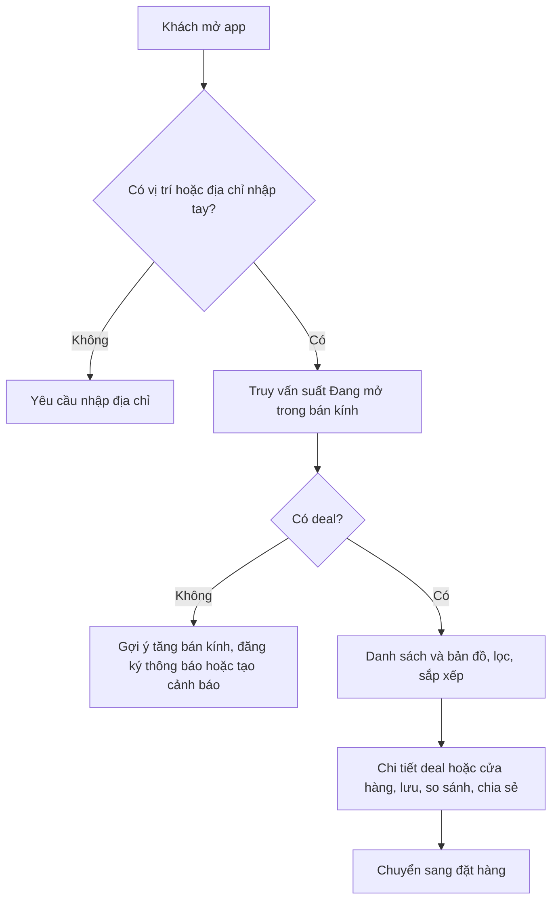

## 5.3. Đặt hàng và thanh toán

*Vai trò: Khách hàng (app Android) · 17 UC: R1-040 đến R1-056*

### 5.3.1. Mục tiêu nghiệp vụ

Biến lựa chọn của khách thành một đơn hợp lệ không bán vượt tồn, thu tiền chính xác, xử lý đúng các tình huống bất thường (thanh toán đến muộn, thoát app giữa chừng, trạng thái chưa xác định) và cho khách quản lý, hủy, đặt lại đơn của mình. Đây là phân hệ có rủi ro tài chính cao nhất của vai Khách.

### 5.3.2. Phạm vi

**Thuộc phân hệ:** Giữ suất; Thanh toán; Quản lý đơn; Chống lạm dụng; Ưu đãi; Khôi phục giao dịch.

**Danh sách UC:** R1-040 Chọn số lượng và giữ suất; R1-041 Thanh toán đơn bằng VietQR hoặc cổng giả lập; R1-042 Tự động nhả suất khi hết hạn giữ (hệ thống); R1-043 Hủy đơn đã thanh toán; R1-044 Xem danh sách đơn của tôi; R1-045 Lọc và tìm đơn; R1-046 Xem chi tiết đơn; R1-047 Hoàn tiền tự động khi thanh toán đến muộn (hệ thống); R1-048 Xem trạng thái khóa đặt và ngày hết khóa; R1-049 Chọn giờ hẹn nhận trong khung nhận; R1-050 Gửi ghi chú cho cửa hàng khi đặt; R1-051 Đặt lại món đã mua; R1-052 Tạo mã nhận hộ cho người khác; R1-053 Áp dụng ưu đãi vào đơn khi đặt; R1-054 Xem và tải biên nhận của đơn; R1-055 Tiếp tục thanh toán đơn đang giữ; R1-056 Kiểm tra lại trạng thái thanh toán chưa xác định.

**Nằm ngoài phạm vi:** Nhận hàng bằng QR (phân hệ Nhận hàng), khiếu nại sau nhận (Hậu mãi), hoàn tiền do cửa hàng hủy hoặc khiếu nại (xử lý ở phân hệ của cửa hàng nhưng khách thấy kết quả tại lịch sử giao dịch). Thanh toán thật qua cổng tổ chức tín dụng chưa nằm trong MVP: dùng VietQR hoặc cổng giả lập.

### 5.3.3. Tác nhân và quyền hạn

Khách hàng (app Android); hệ thống (tác vụ nhả suất, hoàn tiền tự động); cổng thanh toán VietQR hoặc giả lập; cửa hàng chỉ nhận thông báo đơn mới.

### 5.3.4. Dữ liệu nghiệp vụ

| Thực thể | Ý nghĩa, nguồn hình thành và ảnh hưởng đến quyết định nghiệp vụ |
|---|---|
| Đơn | Mã đơn, suất, số lượng, giá chốt tại thời điểm giữ suất, ưu đãi áp dụng, tổng tiền, giờ hẹn, ghi chú, trạng thái, mốc thời gian. Giá chốt không đổi dù cửa hàng đổi giá sau đó. |
| Tồn kho của suất | Số còn lại của suất, bị trừ nguyên tử khi giữ suất và cộng trả khi đơn hết hạn giữ hoặc bị hủy. |
| Giao dịch thanh toán và hoàn tiền | Mã giao dịch, số tiền, loại, trạng thái; mỗi mã giao dịch chỉ xử lý một lần và chỉ tạo một lệnh hoàn. |
| Bộ đếm không đến nhận | Số đơn Hết hạn nhận trong 30 ngày trượt; đạt 3 thì khóa đặt 7 ngày (tham số cấu hình). |
| Mã nhận hộ | Mã 8 ký tự dùng một lần, mỗi đơn tối đa một mã hiệu lực. |

### 5.3.5. Quy trình nghiệp vụ tổng thể

1. Khách chọn số lượng (1 đến min(5, tồn)); server trừ tồn bằng một câu UPDATE có điều kiện và tạo đơn Chờ thanh toán giữ 10 phút. Gửi lặp cùng khóa idempotency trả đúng một đơn.
2. Khách có thể chọn giờ hẹn, gửi ghi chú, áp dụng một ưu đãi hợp lệ trước khi thanh toán.
3. Khách thanh toán bằng VietQR hoặc cổng giả lập; xác nhận khớp số tiền thì đơn sang Đã thanh toán và sinh QR nhận hàng.
4. Hết 10 phút mà chưa thanh toán, tác vụ chạy mỗi phút chuyển đơn sang Hết hạn giữ và cộng trả tồn; nếu xác nhận thanh toán đến sau thì hoàn tiền tự động toàn bộ.
5. Khách có thể hủy đơn Đã thanh toán trước khung nhận ít nhất 60 phút để được hoàn 100% và QR bị vô hiệu.
6. Khi thoát app giữa chừng hoặc thanh toán chưa xác định, khách tiếp tục thanh toán hoặc yêu cầu kiểm tra lại (tối đa 1 lần mỗi phút; sau 24 giờ chưa xác nhận thì đóng Thất bại và hoàn nếu tiền đã vào).

**Phân hệ phụ thuộc và liên kết:** Phụ thuộc Khám phá deal (suất), Tài khoản (trạng thái, điều khoản), Ưu đãi (ví), Chống lạm dụng (khóa đặt). Cung cấp đơn đã thanh toán cho Nhận hàng, và dữ liệu đơn cho Báo cáo và đối soát của cửa hàng.

### 5.3.6. Đặc tả từng UC

##### R1-040 - Chọn số lượng và giữ suất

**Mã UC:** R1-040  
**Tên UC:** Chọn số lượng và giữ suất  
**Nhóm:** Đặt hàng và thanh toán / Giữ suất · **Loại:** Tạo mới  
**Mục tiêu:** Khách chọn số lượng và nhấn Đặt. Server trừ tồn kho nguyên tử và tạo đơn Chờ thanh toán, giữ suất 10 phút. *[Xác định trong Excel]*  
**Tác nhân:** Khách hàng (app Android)  

**Điều kiện tiên quyết** *[Tổng hợp từ ma trận gói và vai trò]*
- Khách đã đăng nhập trên app Android, tài khoản ở trạng thái Hoạt động (đã xác minh), phiên còn hiệu lực.
- Gói dịch vụ: Vai Khách, không phụ thuộc gói trả phí (GOI-KH); không có hạn mức riêng.

**Dữ liệu đầu vào và hiển thị** *[Xác định trong Excel]*
- Mã suất (hệ thống)
- Số lượng (số nguyên, bắt buộc, 1 đến min(5, tồn còn))
- Khóa idempotency (hệ thống)

**Luồng xử lý chính** *[Tổng hợp từ mô tả, quy tắc và kết quả]*
1. Người dùng chọn chức năng "Chọn số lượng và giữ suất" trên app Android.
2. Người dùng nhập hoặc chọn: Mã suất, Số lượng, Khóa idempotency.
3. Hệ thống xác thực phiên, kiểm tra quyền, phạm vi dữ liệu, gói dịch vụ và hạn mức (nếu có).
4. Hệ thống kiểm tra từng điều kiện ở mục Validation; sai thì trả lỗi tại trường tương ứng và không tạo dữ liệu.
5. Xử lý nghiệp vụ: Khách chọn số lượng và nhấn Đặt. Server trừ tồn kho nguyên tử và tạo đơn Chờ thanh toán, giữ suất 10 phút.
6. Hệ thống lưu dữ liệu, cập nhật các đối tượng liên quan và phản hồi: Tạo đơn Chờ thanh toán, đồng hồ đếm 10 phút; tồn kho giảm tương ứng. Thất bại: tồn giữ nguyên.

**Business Rules** *[Xác định trong Excel]*
1. Trừ tồn bằng một câu UPDATE có điều kiện còn_tồn >= số_lượng trong giao dịch; không bán vượt tồn.
2. Một khách chỉ có một đơn Chờ thanh toán trên mỗi suất.
3. Khách đang bị khóa đặt không được giữ suất.
4. Giá chốt vào đơn tại thời điểm giữ suất.
5. Gửi lặp cùng khóa idempotency trả lại cùng một đơn.

**Validation** *[Xác định trong Excel]*
1. Hết suất giữa chừng: báo Đã hết, không tạo đơn.
2. Số lượng vượt giới hạn: báo lỗi và số tối đa.
3. Khung nhận đã kết thúc: từ chối.
4. Tài khoản chưa xác minh: yêu cầu xác minh.

**Luồng thay thế và ngoại lệ**
- Mọi trường hợp không hợp lệ nêu ở mục Validation là luồng ngoại lệ của UC này và được xử lý đúng như mô tả tại đó. *[Xác định]*
- Người dùng không có quyền hoặc đối tượng không thuộc phạm vi dữ liệu của mình: từ chối, không tiết lộ sự tồn tại của dữ liệu thuộc người khác (đề xuất hoàn thiện).
- Mất kết nối hoặc lỗi hệ thống giữa chừng: thao tác không được ghi nhận một phần; người dùng được thông báo và thử lại, thao tác thay đổi dữ liệu dùng khóa chống trùng khi áp dụng (đề xuất hoàn thiện).

**Dữ liệu thay đổi** *[Tổng hợp]*  
Theo kết quả đã xác định: Tạo đơn Chờ thanh toán, đồng hồ đếm 10 phút; tồn kho giảm tương ứng. Khi thất bại: tồn giữ nguyên.

**Chuyển trạng thái** *[Tổng hợp]*
- Tạo đơn Chờ thanh toán, đồng hồ đếm 10 phút.

**Kết quả** *[Xác định trong Excel]*  
Tạo đơn Chờ thanh toán, đồng hồ đếm 10 phút; tồn kho giảm tương ứng. Thất bại: tồn giữ nguyên.

**Tác động liên phân hệ** *[Tổng hợp]*  
Dữ liệu hoặc quy tắc của UC liên quan đến: Suất và tồn kho trong ngày; Đơn hàng; Thanh toán và hoàn tiền; Chống lạm dụng đặt hàng.

**Điều kiện hoàn thành** *[Tổng hợp]*  
Thành công khi: Tạo đơn Chờ thanh toán, đồng hồ đếm 10 phút; tồn kho giảm tương ứng. Khi thất bại: tồn giữ nguyên; thao tác không được coi là hoàn tất.

**Tiêu chí nghiệm thu** *[Tổng hợp, kiểm tra được]*
1. Given khách đủ điều kiện tiên quyết và dữ liệu hợp lệ, When thực hiện "Chọn số lượng và giữ suất", Then kết quả đạt được là: tạo đơn Chờ thanh toán, đồng hồ đếm 10 phút; tồn kho giảm tương ứng.
2. Given hết suất giữa chừng, When thực hiện "Chọn số lượng và giữ suất", Then báo Đã hết, không tạo đơn.
3. Given số lượng vượt giới hạn, When thực hiện "Chọn số lượng và giữ suất", Then báo lỗi và số tối đa.
4. Given thao tác "Chọn số lượng và giữ suất" được thực hiện, When hệ thống áp dụng quy tắc "Trừ tồn bằng một câu UPDATE có điều kiện còn_tồn >= số_lượng trong giao dịch; không bán vượt tồn", Then kết quả không được vi phạm quy tắc này.

##### R1-041 - Thanh toán đơn bằng VietQR hoặc cổng giả lập

**Mã UC:** R1-041  
**Tên UC:** Thanh toán đơn bằng VietQR hoặc cổng giả lập  
**Nhóm:** Đặt hàng và thanh toán / Thanh toán · **Loại:** Thao tác nghiệp vụ  
**Mục tiêu:** App hiển thị mã VietQR/số tiền hoặc cổng giả lập (MVP). Khi nhận xác nhận thanh toán, đơn chuyển Đã thanh toán và sinh QR nhận hàng. *[Xác định trong Excel]*  
**Tác nhân:** Khách hàng (app Android)  

**Điều kiện tiên quyết** *[Tổng hợp từ ma trận gói và vai trò]*
- Khách đã đăng nhập trên app Android, tài khoản ở trạng thái Hoạt động (đã xác minh), phiên còn hiệu lực.
- Gói dịch vụ: Vai Khách, không phụ thuộc gói trả phí (GOI-KH); không có hạn mức riêng.

**Dữ liệu đầu vào và hiển thị** *[Xác định trong Excel]*
- Mã đơn (hệ thống)
- Số tiền = đơn giá chốt x số lượng (hệ thống)
- Phương thức (VietQR/Giả lập)

**Luồng xử lý chính** *[Tổng hợp từ mô tả, quy tắc và kết quả]*
1. Người dùng kích hoạt "Thanh toán đơn bằng VietQR hoặc cổng giả lập" trên app Android với dữ liệu: Mã đơn, Số tiền = đơn giá chốt x số lượng, Phương thức.
2. Hệ thống xác thực phiên, kiểm tra quyền, trạng thái đối tượng và điều kiện thời gian.
3. Hệ thống kiểm tra các điều kiện ở mục Validation và áp dụng Business Rules theo thứ tự.
4. Xử lý nghiệp vụ: App hiển thị mã VietQR/số tiền hoặc cổng giả lập (MVP). Khi nhận xác nhận thanh toán, đơn chuyển Đã thanh toán và sinh QR nhận hàng.
5. Hệ thống ghi nhận kết quả, cập nhật dữ liệu và phản hồi: Đơn Đã thanh toán; QR hiển thị; cửa hàng thấy đơn mới. Thất bại: đơn giữ nguyên đến hết hạn giữ.

**Business Rules** *[Xác định trong Excel]*
1. Chỉ thanh toán khi đơn Chờ thanh toán và còn trong 10 phút giữ.
2. Số tiền phải khớp chính xác.
3. Xác nhận thanh toán xử lý idempotent; thanh toán lặp không tạo hai lần.
4. Chỉ sinh QR sau khi Đã thanh toán.

**Validation** *[Xác định trong Excel]*
1. Hết thời gian giữ: đơn Hết hạn giữ, tồn trả lại; nếu tiền đã vào thì hoàn tiền tự động.
2. Số tiền sai: đưa vào đối soát thủ công.
3. Lỗi cổng: giữ đơn đến hết hạn, cho thử lại.

**Luồng thay thế và ngoại lệ**
- Mọi trường hợp không hợp lệ nêu ở mục Validation là luồng ngoại lệ của UC này và được xử lý đúng như mô tả tại đó. *[Xác định]*
- Người dùng không có quyền hoặc đối tượng không thuộc phạm vi dữ liệu của mình: từ chối, không tiết lộ sự tồn tại của dữ liệu thuộc người khác (đề xuất hoàn thiện).
- Mất kết nối hoặc lỗi hệ thống giữa chừng: thao tác không được ghi nhận một phần; người dùng được thông báo và thử lại, thao tác thay đổi dữ liệu dùng khóa chống trùng khi áp dụng (đề xuất hoàn thiện).

**Dữ liệu thay đổi** *[Tổng hợp]*  
Theo kết quả đã xác định: Đơn Đã thanh toán; QR hiển thị; cửa hàng thấy đơn mới. Khi thất bại: đơn giữ nguyên đến hết hạn giữ.

**Chuyển trạng thái** *[Tổng hợp]*
- Đơn Đã thanh toán.

**Kết quả** *[Xác định trong Excel]*  
Đơn Đã thanh toán; QR hiển thị; cửa hàng thấy đơn mới. Thất bại: đơn giữ nguyên đến hết hạn giữ.

**Tác động liên phân hệ** *[Tổng hợp]*  
Dữ liệu hoặc quy tắc của UC liên quan đến: Đơn hàng; Thanh toán và hoàn tiền; Nhận hàng bằng QR.

**Điều kiện hoàn thành** *[Tổng hợp]*  
Thành công khi: Đơn Đã thanh toán; QR hiển thị; cửa hàng thấy đơn mới. Khi thất bại: đơn giữ nguyên đến hết hạn giữ; thao tác không được coi là hoàn tất.

**Tiêu chí nghiệm thu** *[Tổng hợp, kiểm tra được]*
1. Given khách đủ điều kiện tiên quyết và dữ liệu hợp lệ, When thực hiện "Thanh toán đơn bằng VietQR hoặc cổng giả lập", Then kết quả đạt được là: đơn Đã thanh toán; QR hiển thị; cửa hàng thấy đơn mới.
2. Given hết thời gian giữ, When thực hiện "Thanh toán đơn bằng VietQR hoặc cổng giả lập", Then đơn Hết hạn giữ, tồn trả lại; nếu tiền đã vào thì hoàn tiền tự động.
3. Given số tiền sai, When thực hiện "Thanh toán đơn bằng VietQR hoặc cổng giả lập", Then đưa vào đối soát thủ công.
4. Given thao tác "Thanh toán đơn bằng VietQR hoặc cổng giả lập" được thực hiện, When hệ thống áp dụng quy tắc "Chỉ thanh toán khi đơn Chờ thanh toán và còn trong 10 phút giữ", Then kết quả không được vi phạm quy tắc này.

##### R1-042 - Tự động nhả suất khi hết hạn giữ (hệ thống)

**Mã UC:** R1-042  
**Tên UC:** Tự động nhả suất khi hết hạn giữ (hệ thống)  
**Nhóm:** Đặt hàng và thanh toán / Thanh toán · **Loại:** Tác vụ hệ thống  
**Mục tiêu:** Tác vụ định kỳ (BullMQ) tìm đơn Chờ thanh toán quá 10 phút, chuyển Hết hạn giữ và cộng trả tồn. *[Xác định trong Excel]*  
**Tác nhân:** Hệ thống (tác vụ nền); đối tượng chịu tác động: Khách hàng (app Android)  

**Điều kiện tiên quyết** *[Tổng hợp từ ma trận gói và vai trò]*
- Tác vụ hệ thống chạy theo lịch hoặc theo sự kiện; không cần người dùng đăng nhập tại thời điểm chạy.
- Gói dịch vụ: Vai Khách, không phụ thuộc gói trả phí (GOI-KH); không có hạn mức riêng.

**Dữ liệu đầu vào và hiển thị** *[Xác định trong Excel]*
- Mã đơn, thời điểm giữ (hệ thống)

**Luồng xử lý chính** *[Tổng hợp từ mô tả, quy tắc và kết quả]*
1. Bộ lập lịch hoặc sự kiện nghiệp vụ kích hoạt tác vụ "Tự động nhả suất khi hết hạn giữ (hệ thống)".
2. Hệ thống lọc đối tượng thuộc phạm vi xử lý bằng điều kiện trạng thái và thời gian của dữ liệu.
3. Xử lý theo mô tả nghiệp vụ: Tác vụ định kỳ (BullMQ) tìm đơn Chờ thanh toán quá 10 phút, chuyển Hết hạn giữ và cộng trả tồn.
4. Mỗi đối tượng chỉ được xử lý một lần; thay đổi dữ liệu và trạng thái nằm trong cùng một giao dịch để tránh trạng thái nửa chừng.
5. Hệ thống ghi nhận kết quả, gửi thông báo liên quan nếu có và để lại nhật ký chạy: Suất được trả lại cho người khác; khách nhận thông báo Đơn hết hạn.

**Business Rules** *[Xác định trong Excel]*
1. Chạy mỗi phút, xử lý mỗi đơn một lần.
2. Cộng trả tồn trong cùng giao dịch với đổi trạng thái.
3. Nếu có xác nhận thanh toán đến sau, chuyển sang quy trình hoàn tiền.

**Validation** *[Xác định trong Excel]*
1. Tác vụ lỗi: thử lại; nhật ký cảnh báo nếu quá 3 lần.

**Luồng thay thế và ngoại lệ**
- Mọi trường hợp không hợp lệ nêu ở mục Validation là luồng ngoại lệ của UC này và được xử lý đúng như mô tả tại đó. *[Xác định]*
- Lần chạy bị gián đoạn: lần chạy sau xử lý lại các đối tượng chưa xử lý; đối tượng đã xử lý không bị xử lý lần hai (đề xuất hoàn thiện).

**Dữ liệu thay đổi** *[Tổng hợp]*  
Theo kết quả đã xác định: Suất được trả lại cho người khác; khách nhận thông báo Đơn hết hạn.

**Chuyển trạng thái** *[Tổng hợp]*
- Cộng trả tồn trong cùng giao dịch với đổi trạng thái.
- Nếu có xác nhận thanh toán đến sau, chuyển sang quy trình hoàn tiền.

**Kết quả** *[Xác định trong Excel]*  
Suất được trả lại cho người khác; khách nhận thông báo Đơn hết hạn.

**Tác động liên phân hệ** *[Tổng hợp]*  
Dữ liệu hoặc quy tắc của UC liên quan đến: Suất và tồn kho trong ngày; Đơn hàng; Thanh toán và hoàn tiền; Thông báo.

**Điều kiện hoàn thành** *[Tổng hợp]*  
Thành công khi: Suất được trả lại cho người khác; khách nhận thông báo Đơn hết hạn. Không hoàn tất khi bất kỳ điều kiện Validation nào không đạt hoặc dịch vụ liên quan lỗi; dữ liệu giữ nguyên trạng thái trước thao tác.

**Tiêu chí nghiệm thu** *[Tổng hợp, kiểm tra được]*
1. Given có đối tượng thuộc phạm vi xử lý của tác vụ, When tác vụ "Tự động nhả suất khi hết hạn giữ (hệ thống)" chạy, Then kết quả đạt được là: suất được trả lại cho người khác; khách nhận thông báo Đơn hết hạn.
2. Given tác vụ lỗi, When thực hiện "Tự động nhả suất khi hết hạn giữ (hệ thống)", Then thử lại; nhật ký cảnh báo nếu quá 3 lần.
3. Given thao tác "Tự động nhả suất khi hết hạn giữ (hệ thống)" được thực hiện, When hệ thống áp dụng quy tắc "Chạy mỗi phút, xử lý mỗi đơn một lần", Then kết quả không được vi phạm quy tắc này.

##### R1-043 - Hủy đơn đã thanh toán

**Mã UC:** R1-043  
**Tên UC:** Hủy đơn đã thanh toán  
**Nhóm:** Đặt hàng và thanh toán / Quản lý đơn · **Loại:** Chuyển trạng thái  
**Mục tiêu:** Khách hủy đơn Đã thanh toán trước giờ bắt đầu khung nhận một khoảng cấu hình, nhận hoàn tiền đủ. *[Xác định trong Excel]*  
**Tác nhân:** Khách hàng (app Android)  

**Điều kiện tiên quyết** *[Tổng hợp từ ma trận gói và vai trò]*
- Khách đã đăng nhập trên app Android, tài khoản ở trạng thái Hoạt động (đã xác minh), phiên còn hiệu lực.
- Gói dịch vụ: Vai Khách, không phụ thuộc gói trả phí (GOI-KH); không có hạn mức riêng.

**Dữ liệu đầu vào và hiển thị** *[Xác định trong Excel]*
- Mã đơn (hệ thống)
- Lý do (chọn/tùy chọn)

**Luồng xử lý chính** *[Tổng hợp từ mô tả, quy tắc và kết quả]*
1. Người dùng chọn đối tượng cần xử lý và thao tác "Hủy đơn đã thanh toán" trên app Android.
2. Người dùng cung cấp thêm: Mã đơn, Lý do.
3. Hệ thống kiểm tra trạng thái hiện tại có cho phép chuyển trạng thái này không, cùng quyền của người thực hiện.
4. Xử lý nghiệp vụ: Khách hủy đơn Đã thanh toán trước giờ bắt đầu khung nhận một khoảng cấu hình, nhận hoàn tiền đủ.
5. Trạng thái, tồn kho, tiền hoặc thông báo liên quan được cập nhật trong cùng giao dịch; kết quả: Đơn Đã hủy rồi Đã hoàn tiền; QR vô hiệu; cửa hàng được báo.

**Business Rules** *[Xác định trong Excel]*
1. Chỉ hủy khi còn tối thiểu 60 phút trước khung nhận (tham số cấu hình).
2. Hoàn 100% số tiền; tồn được cộng trả.
3. Không hủy đơn đã nhận hoặc đã quá hạn nhận.
4. QR bị vô hiệu ngay.

**Validation** *[Xác định trong Excel]*
1. Quá hạn hủy: báo lý do, hướng dẫn gửi khiếu nại nếu có vấn đề.

**Luồng thay thế và ngoại lệ**
- Mọi trường hợp không hợp lệ nêu ở mục Validation là luồng ngoại lệ của UC này và được xử lý đúng như mô tả tại đó. *[Xác định]*
- Người dùng không có quyền hoặc đối tượng không thuộc phạm vi dữ liệu của mình: từ chối, không tiết lộ sự tồn tại của dữ liệu thuộc người khác (đề xuất hoàn thiện).
- Mất kết nối hoặc lỗi hệ thống giữa chừng: thao tác không được ghi nhận một phần; người dùng được thông báo và thử lại, thao tác thay đổi dữ liệu dùng khóa chống trùng khi áp dụng (đề xuất hoàn thiện).

**Dữ liệu thay đổi** *[Tổng hợp]*  
Theo kết quả đã xác định: Đơn Đã hủy rồi Đã hoàn tiền; QR vô hiệu; cửa hàng được báo.

**Chuyển trạng thái** *[Tổng hợp]*
- Đơn Đã hủy rồi Đã hoàn tiền.

**Kết quả** *[Xác định trong Excel]*  
Đơn Đã hủy rồi Đã hoàn tiền; QR vô hiệu; cửa hàng được báo.

**Tác động liên phân hệ** *[Tổng hợp]*  
Dữ liệu hoặc quy tắc của UC liên quan đến: Suất và tồn kho trong ngày; Đơn hàng; Thanh toán và hoàn tiền; Nhận hàng bằng QR.

**Điều kiện hoàn thành** *[Tổng hợp]*  
Thành công khi: Đơn Đã hủy rồi Đã hoàn tiền; QR vô hiệu; cửa hàng được báo. Không hoàn tất khi bất kỳ điều kiện Validation nào không đạt hoặc dịch vụ liên quan lỗi; dữ liệu giữ nguyên trạng thái trước thao tác.

**Tiêu chí nghiệm thu** *[Tổng hợp, kiểm tra được]*
1. Given khách đủ điều kiện tiên quyết và dữ liệu hợp lệ, When thực hiện "Hủy đơn đã thanh toán", Then kết quả đạt được là: đơn Đã hủy rồi Đã hoàn tiền; QR vô hiệu; cửa hàng được báo.
2. Given quá hạn hủy, When thực hiện "Hủy đơn đã thanh toán", Then báo lý do, hướng dẫn gửi khiếu nại nếu có vấn đề.
3. Given thao tác "Hủy đơn đã thanh toán" được thực hiện, When hệ thống áp dụng quy tắc "Chỉ hủy khi còn tối thiểu 60 phút trước khung nhận (tham số cấu hình)", Then kết quả không được vi phạm quy tắc này.

##### R1-044 - Xem danh sách đơn của tôi

**Mã UC:** R1-044  
**Tên UC:** Xem danh sách đơn của tôi  
**Nhóm:** Đặt hàng và thanh toán / Quản lý đơn · **Loại:** Truy vấn và hiển thị  
**Mục tiêu:** Danh sách đơn của khách theo thời gian mới nhất trước. *[Xác định trong Excel]*  
**Tác nhân:** Khách hàng (app Android)  

**Điều kiện tiên quyết** *[Tổng hợp từ ma trận gói và vai trò]*
- Khách đã đăng nhập trên app Android, tài khoản ở trạng thái Hoạt động (đã xác minh), phiên còn hiệu lực.
- Gói dịch vụ: Vai Khách, không phụ thuộc gói trả phí (GOI-KH); không có hạn mức riêng.

**Dữ liệu hiển thị (UC không có trường nhập)** *[Xác định trong Excel]*
- Hiển thị: mã đơn, tên món, cửa hàng, số lượng, tổng tiền, trạng thái, khung nhận

**Luồng xử lý chính** *[Tổng hợp từ mô tả, quy tắc và kết quả]*
1. Người dùng mở màn hình "Xem danh sách đơn của tôi" trên app Android.
2. Hệ thống xác thực phiên, xác định phạm vi dữ liệu của người dùng và áp các quy tắc hiển thị của UC.
3. Truy vấn dữ liệu: Danh sách đơn của khách theo thời gian mới nhất trước.
4. Hiển thị các thuộc tính: mã đơn, tên món, cửa hàng, số lượng, tổng tiền, trạng thái, khung nhận.
5. Trường hợp không có dữ liệu hoặc không hợp lệ được xử lý theo mục Validation; không thay đổi dữ liệu nghiệp vụ.

**Business Rules** *[Xác định trong Excel]*
1. Chỉ thấy đơn của chính mình.

**Validation** *[Xác định trong Excel]*
1. Chưa có đơn: màn hình trống kèm lối đi tới deal.

**Luồng thay thế và ngoại lệ**
- Mọi trường hợp không hợp lệ nêu ở mục Validation là luồng ngoại lệ của UC này và được xử lý đúng như mô tả tại đó. *[Xác định]*
- Người dùng không có quyền hoặc đối tượng không thuộc phạm vi dữ liệu của mình: từ chối, không tiết lộ sự tồn tại của dữ liệu thuộc người khác (đề xuất hoàn thiện).
- Mất kết nối hoặc lỗi hệ thống giữa chừng: thao tác không được ghi nhận một phần; người dùng được thông báo và thử lại, thao tác thay đổi dữ liệu dùng khóa chống trùng khi áp dụng (đề xuất hoàn thiện).

**Dữ liệu thay đổi** *[Tổng hợp]*  
Không tạo hoặc thay đổi dữ liệu nghiệp vụ; chỉ đọc theo phạm vi của người dùng.

**Chuyển trạng thái** *[Tổng hợp]*
- Không chuyển trạng thái của đối tượng nghiệp vụ.

**Kết quả** *[Xác định trong Excel]*  
Danh sách đơn.

**Tác động liên phân hệ** *[Tổng hợp]*  
Dữ liệu hoặc quy tắc của UC liên quan đến: Đơn hàng.

**Điều kiện hoàn thành** *[Tổng hợp]*  
Thành công khi: Danh sách đơn. Không hoàn tất khi bất kỳ điều kiện Validation nào không đạt hoặc dịch vụ liên quan lỗi; dữ liệu giữ nguyên trạng thái trước thao tác.

**Tiêu chí nghiệm thu** *[Tổng hợp, kiểm tra được]*
1. Given khách đủ điều kiện tiên quyết và dữ liệu hợp lệ, When thực hiện "Xem danh sách đơn của tôi", Then kết quả đạt được là: danh sách đơn.
2. Given chưa có đơn, When thực hiện "Xem danh sách đơn của tôi", Then màn hình trống kèm lối đi tới deal.
3. Given thao tác "Xem danh sách đơn của tôi" được thực hiện, When hệ thống áp dụng quy tắc "Chỉ thấy đơn của chính mình", Then kết quả không được vi phạm quy tắc này.

##### R1-045 - Lọc và tìm đơn

**Mã UC:** R1-045  
**Tên UC:** Lọc và tìm đơn  
**Nhóm:** Đặt hàng và thanh toán / Quản lý đơn · **Loại:** Truy vấn và hiển thị  
**Mục tiêu:** Lọc theo trạng thái và khoảng ngày; tìm theo mã đơn/tên cửa hàng. *[Xác định trong Excel]*  
**Tác nhân:** Khách hàng (app Android)  

**Điều kiện tiên quyết** *[Tổng hợp từ ma trận gói và vai trò]*
- Khách đã đăng nhập trên app Android, tài khoản ở trạng thái Hoạt động (đã xác minh), phiên còn hiệu lực.
- Gói dịch vụ: Vai Khách, không phụ thuộc gói trả phí (GOI-KH); không có hạn mức riêng.

**Dữ liệu đầu vào và hiển thị** *[Xác định trong Excel]*
- Trạng thái (chọn nhiều)
- Từ ngày, đến ngày (ngày, đến ≥ từ)
- Từ khóa

**Luồng xử lý chính** *[Tổng hợp từ mô tả, quy tắc và kết quả]*
1. Người dùng mở màn hình "Lọc và tìm đơn" trên app Android và đặt điều kiện: Trạng thái, Từ ngày, đến ngày, Từ khóa.
2. Hệ thống xác thực phiên, xác định phạm vi dữ liệu của người dùng và áp các quy tắc hiển thị của UC.
3. Truy vấn dữ liệu: Lọc theo trạng thái và khoảng ngày; tìm theo mã đơn/tên cửa hàng.
4. Hiển thị kết quả theo định dạng của màn hình.
5. Trường hợp không có dữ liệu hoặc không hợp lệ được xử lý theo mục Validation; không thay đổi dữ liệu nghiệp vụ.

**Business Rules** *[Xác định trong Excel]*
1. Khoảng ngày tối đa 12 tháng.

**Validation** *[Xác định trong Excel]*
1. Ngày sai thứ tự: báo lỗi.

**Luồng thay thế và ngoại lệ**
- Mọi trường hợp không hợp lệ nêu ở mục Validation là luồng ngoại lệ của UC này và được xử lý đúng như mô tả tại đó. *[Xác định]*
- Người dùng không có quyền hoặc đối tượng không thuộc phạm vi dữ liệu của mình: từ chối, không tiết lộ sự tồn tại của dữ liệu thuộc người khác (đề xuất hoàn thiện).
- Mất kết nối hoặc lỗi hệ thống giữa chừng: thao tác không được ghi nhận một phần; người dùng được thông báo và thử lại, thao tác thay đổi dữ liệu dùng khóa chống trùng khi áp dụng (đề xuất hoàn thiện).

**Dữ liệu thay đổi** *[Tổng hợp]*  
Không tạo hoặc thay đổi dữ liệu nghiệp vụ; chỉ đọc theo phạm vi của người dùng.

**Chuyển trạng thái** *[Tổng hợp]*
- Không chuyển trạng thái của đối tượng nghiệp vụ.

**Kết quả** *[Xác định trong Excel]*  
Danh sách theo điều kiện.

**Tác động liên phân hệ** *[Tổng hợp]*  
Dữ liệu hoặc quy tắc của UC liên quan đến: Đơn hàng.

**Điều kiện hoàn thành** *[Tổng hợp]*  
Thành công khi: Danh sách theo điều kiện. Không hoàn tất khi bất kỳ điều kiện Validation nào không đạt hoặc dịch vụ liên quan lỗi; dữ liệu giữ nguyên trạng thái trước thao tác.

**Tiêu chí nghiệm thu** *[Tổng hợp, kiểm tra được]*
1. Given khách đủ điều kiện tiên quyết và dữ liệu hợp lệ, When thực hiện "Lọc và tìm đơn", Then kết quả đạt được là: danh sách theo điều kiện.
2. Given ngày sai thứ tự, When thực hiện "Lọc và tìm đơn", Then báo lỗi.
3. Given thao tác "Lọc và tìm đơn" được thực hiện, When hệ thống áp dụng quy tắc "Khoảng ngày tối đa 12 tháng", Then kết quả không được vi phạm quy tắc này.

##### R1-046 - Xem chi tiết đơn

**Mã UC:** R1-046  
**Tên UC:** Xem chi tiết đơn  
**Nhóm:** Đặt hàng và thanh toán / Quản lý đơn · **Loại:** Truy vấn và hiển thị  
**Mục tiêu:** Xem đầy đủ đơn: món, số lượng, giá chốt, tổng tiền, trạng thái, mốc thời gian, QR (khi hợp lệ), trạng thái hoàn tiền, khiếu nại liên quan. *[Xác định trong Excel]*  
**Tác nhân:** Khách hàng (app Android)  

**Điều kiện tiên quyết** *[Tổng hợp từ ma trận gói và vai trò]*
- Khách đã đăng nhập trên app Android, tài khoản ở trạng thái Hoạt động (đã xác minh), phiên còn hiệu lực.
- Gói dịch vụ: Vai Khách, không phụ thuộc gói trả phí (GOI-KH); không có hạn mức riêng.

**Dữ liệu hiển thị (UC không có trường nhập)** *[Xác định trong Excel]*
- Hiển thị: toàn bộ thuộc tính đơn, lịch sử trạng thái, mã giao dịch

**Luồng xử lý chính** *[Tổng hợp từ mô tả, quy tắc và kết quả]*
1. Người dùng mở màn hình "Xem chi tiết đơn" trên app Android.
2. Hệ thống xác thực phiên, xác định phạm vi dữ liệu của người dùng và áp các quy tắc hiển thị của UC.
3. Truy vấn dữ liệu: Xem đầy đủ đơn: món, số lượng, giá chốt, tổng tiền, trạng thái, mốc thời gian, QR (khi hợp lệ), trạng thái hoàn tiền, khiếu nại liên quan.
4. Hiển thị các thuộc tính: toàn bộ thuộc tính đơn, lịch sử trạng thái, mã giao dịch.
5. Trường hợp không có dữ liệu hoặc không hợp lệ được xử lý theo mục Validation; không thay đổi dữ liệu nghiệp vụ.

**Business Rules** *[Xác định trong Excel]*
1. Chỉ thấy đơn của mình; QR chỉ hiện khi đơn Đã thanh toán và chưa hết khung nhận.

**Validation** *[Xác định trong Excel]*
1. Đơn không tồn tại hoặc không thuộc khách: báo không tìm thấy.

**Luồng thay thế và ngoại lệ**
- Mọi trường hợp không hợp lệ nêu ở mục Validation là luồng ngoại lệ của UC này và được xử lý đúng như mô tả tại đó. *[Xác định]*
- Người dùng không có quyền hoặc đối tượng không thuộc phạm vi dữ liệu của mình: từ chối, không tiết lộ sự tồn tại của dữ liệu thuộc người khác (đề xuất hoàn thiện).
- Mất kết nối hoặc lỗi hệ thống giữa chừng: thao tác không được ghi nhận một phần; người dùng được thông báo và thử lại, thao tác thay đổi dữ liệu dùng khóa chống trùng khi áp dụng (đề xuất hoàn thiện).

**Dữ liệu thay đổi** *[Tổng hợp]*  
Không tạo hoặc thay đổi dữ liệu nghiệp vụ; chỉ đọc theo phạm vi của người dùng.

**Chuyển trạng thái** *[Tổng hợp]*
- Không chuyển trạng thái của đối tượng nghiệp vụ.

**Kết quả** *[Xác định trong Excel]*  
Hiển thị chi tiết đơn.

**Tác động liên phân hệ** *[Tổng hợp]*  
Dữ liệu hoặc quy tắc của UC liên quan đến: Đơn hàng; Thanh toán và hoàn tiền; Khiếu nại; Nhận hàng bằng QR.

**Điều kiện hoàn thành** *[Tổng hợp]*  
Thành công khi: Hiển thị chi tiết đơn. Không hoàn tất khi bất kỳ điều kiện Validation nào không đạt hoặc dịch vụ liên quan lỗi; dữ liệu giữ nguyên trạng thái trước thao tác.

**Tiêu chí nghiệm thu** *[Tổng hợp, kiểm tra được]*
1. Given khách đủ điều kiện tiên quyết và dữ liệu hợp lệ, When thực hiện "Xem chi tiết đơn", Then kết quả đạt được là: hiển thị chi tiết đơn.
2. Given đơn không tồn tại hoặc không thuộc khách, When thực hiện "Xem chi tiết đơn", Then báo không tìm thấy.
3. Given thao tác "Xem chi tiết đơn" được thực hiện, When hệ thống áp dụng quy tắc "Chỉ thấy đơn của mình; QR chỉ hiện khi đơn Đã thanh toán và chưa hết khung nhận", Then kết quả không được vi phạm quy tắc này.

##### R1-047 - Hoàn tiền tự động khi thanh toán đến muộn (hệ thống)

**Mã UC:** R1-047  
**Tên UC:** Hoàn tiền tự động khi thanh toán đến muộn (hệ thống)  
**Nhóm:** Đặt hàng và thanh toán / Thanh toán · **Loại:** Tác vụ hệ thống  
**Mục tiêu:** Khi xác nhận thanh toán đến sau thời điểm đơn đã Hết hạn giữ hoặc suất đã hết, hệ thống tạo lệnh hoàn tiền đầy đủ cho khách và thông báo. *[Xác định trong Excel]*  
**Tác nhân:** Hệ thống (tác vụ nền); đối tượng chịu tác động: Khách hàng (app Android)  

**Điều kiện tiên quyết** *[Tổng hợp từ ma trận gói và vai trò]*
- Tác vụ hệ thống chạy theo lịch hoặc theo sự kiện; không cần người dùng đăng nhập tại thời điểm chạy.
- Gói dịch vụ: Vai Khách, không phụ thuộc gói trả phí (GOI-KH); không có hạn mức riêng.

**Dữ liệu đầu vào và hiển thị** *[Xác định trong Excel]*
- Mã đơn, mã giao dịch, số tiền (hệ thống)
- Trạng thái hoàn tiền (Chờ/Hoàn thành/Lỗi)

**Luồng xử lý chính** *[Tổng hợp từ mô tả, quy tắc và kết quả]*
1. Bộ lập lịch hoặc sự kiện nghiệp vụ kích hoạt tác vụ "Hoàn tiền tự động khi thanh toán đến muộn (hệ thống)".
2. Hệ thống lọc đối tượng thuộc phạm vi xử lý bằng điều kiện trạng thái và thời gian của dữ liệu.
3. Xử lý theo mô tả nghiệp vụ: Khi xác nhận thanh toán đến sau thời điểm đơn đã Hết hạn giữ hoặc suất đã hết, hệ thống tạo lệnh hoàn tiền đầy đủ cho khách và thông báo.
4. Mỗi đối tượng chỉ được xử lý một lần; thay đổi dữ liệu và trạng thái nằm trong cùng một giao dịch để tránh trạng thái nửa chừng.
5. Hệ thống ghi nhận kết quả, gửi thông báo liên quan nếu có và để lại nhật ký chạy: Khách nhận tiền hoàn và thông báo; có bản ghi giao dịch hoàn.

**Business Rules** *[Xác định trong Excel]*
1. Hoàn 100% số tiền đã nhận, không tính hoa hồng.
2. Mỗi mã giao dịch chỉ tạo một lệnh hoàn (chống hoàn trùng).
3. Đơn giữ nguyên trạng thái Hết hạn giữ.

**Validation** *[Xác định trong Excel]*
1. Lệnh hoàn thất bại: thử lại tối đa 3 lần rồi đưa vào danh sách đối soát thủ công.

**Luồng thay thế và ngoại lệ**
- Mọi trường hợp không hợp lệ nêu ở mục Validation là luồng ngoại lệ của UC này và được xử lý đúng như mô tả tại đó. *[Xác định]*
- Lần chạy bị gián đoạn: lần chạy sau xử lý lại các đối tượng chưa xử lý; đối tượng đã xử lý không bị xử lý lần hai (đề xuất hoàn thiện).

**Dữ liệu thay đổi** *[Tổng hợp]*  
Theo kết quả đã xác định: Khách nhận tiền hoàn và thông báo; có bản ghi giao dịch hoàn.

**Chuyển trạng thái** *[Tổng hợp]*
- Đơn giữ nguyên trạng thái Hết hạn giữ.

**Kết quả** *[Xác định trong Excel]*  
Khách nhận tiền hoàn và thông báo; có bản ghi giao dịch hoàn.

**Tác động liên phân hệ** *[Tổng hợp]*  
Dữ liệu hoặc quy tắc của UC liên quan đến: Suất và tồn kho trong ngày; Đơn hàng; Thanh toán và hoàn tiền; Thông báo; Báo cáo và đối soát.

**Điều kiện hoàn thành** *[Tổng hợp]*  
Thành công khi: Khách nhận tiền hoàn và thông báo; có bản ghi giao dịch hoàn. Không hoàn tất khi bất kỳ điều kiện Validation nào không đạt hoặc dịch vụ liên quan lỗi; dữ liệu giữ nguyên trạng thái trước thao tác.

**Tiêu chí nghiệm thu** *[Tổng hợp, kiểm tra được]*
1. Given có đối tượng thuộc phạm vi xử lý của tác vụ, When tác vụ "Hoàn tiền tự động khi thanh toán đến muộn (hệ thống)" chạy, Then kết quả đạt được là: khách nhận tiền hoàn và thông báo; có bản ghi giao dịch hoàn.
2. Given lệnh hoàn thất bại, When thực hiện "Hoàn tiền tự động khi thanh toán đến muộn (hệ thống)", Then thử lại tối đa 3 lần rồi đưa vào danh sách đối soát thủ công.
3. Given thao tác "Hoàn tiền tự động khi thanh toán đến muộn (hệ thống)" được thực hiện, When hệ thống áp dụng quy tắc "Hoàn 100% số tiền đã nhận, không tính hoa hồng", Then kết quả không được vi phạm quy tắc này.

##### R1-048 - Xem trạng thái khóa đặt và ngày hết khóa

**Mã UC:** R1-048  
**Tên UC:** Xem trạng thái khóa đặt và ngày hết khóa  
**Nhóm:** Đặt hàng và thanh toán / Chống lạm dụng · **Loại:** Truy vấn và hiển thị  
**Mục tiêu:** Khách xem số lần không đến nhận trong 30 ngày, trạng thái khóa đặt và ngày được đặt lại. *[Xác định trong Excel]*  
**Tác nhân:** Khách hàng (app Android)  

**Điều kiện tiên quyết** *[Tổng hợp từ ma trận gói và vai trò]*
- Khách đã đăng nhập trên app Android, tài khoản ở trạng thái Hoạt động (đã xác minh), phiên còn hiệu lực.
- Gói dịch vụ: Vai Khách, không phụ thuộc gói trả phí (GOI-KH); không có hạn mức riêng.

**Dữ liệu hiển thị (UC không có trường nhập)** *[Xác định trong Excel]*
- Hiển thị: số lần không đến nhận 30 ngày, ngày hết khóa, danh sách đơn bị tính

**Luồng xử lý chính** *[Tổng hợp từ mô tả, quy tắc và kết quả]*
1. Người dùng mở màn hình "Xem trạng thái khóa đặt và ngày hết khóa" trên app Android.
2. Hệ thống xác thực phiên, xác định phạm vi dữ liệu của người dùng và áp các quy tắc hiển thị của UC.
3. Truy vấn dữ liệu: Khách xem số lần không đến nhận trong 30 ngày, trạng thái khóa đặt và ngày được đặt lại.
4. Hiển thị các thuộc tính: số lần không đến nhận 30 ngày, ngày hết khóa, danh sách đơn bị tính.
5. Trường hợp không có dữ liệu hoặc không hợp lệ được xử lý theo mục Validation; không thay đổi dữ liệu nghiệp vụ.

**Business Rules** *[Xác định trong Excel]*
1. Bộ đếm tính trượt theo cửa sổ 30 ngày.
2. Đơn do lỗi của cửa hàng không bị tính.
3. Đạt ngưỡng 3 lần thì khóa đặt 7 ngày (tham số cấu hình).

**Validation** *[Xác định trong Excel]*
1. Khách chỉ xem dữ liệu của mình.

**Luồng thay thế và ngoại lệ**
- Mọi trường hợp không hợp lệ nêu ở mục Validation là luồng ngoại lệ của UC này và được xử lý đúng như mô tả tại đó. *[Xác định]*
- Người dùng không có quyền hoặc đối tượng không thuộc phạm vi dữ liệu của mình: từ chối, không tiết lộ sự tồn tại của dữ liệu thuộc người khác (đề xuất hoàn thiện).
- Mất kết nối hoặc lỗi hệ thống giữa chừng: thao tác không được ghi nhận một phần; người dùng được thông báo và thử lại, thao tác thay đổi dữ liệu dùng khóa chống trùng khi áp dụng (đề xuất hoàn thiện).

**Dữ liệu thay đổi** *[Tổng hợp]*  
Không tạo hoặc thay đổi dữ liệu nghiệp vụ; chỉ đọc theo phạm vi của người dùng.

**Chuyển trạng thái** *[Tổng hợp]*
- Không chuyển trạng thái của đối tượng nghiệp vụ.

**Kết quả** *[Xác định trong Excel]*  
Khách biết lý do và thời điểm được đặt trở lại.

**Tác động liên phân hệ** *[Tổng hợp]*  
Dữ liệu hoặc quy tắc của UC liên quan đến: Đơn hàng; Chống lạm dụng đặt hàng.

**Điều kiện hoàn thành** *[Tổng hợp]*  
Thành công khi: Khách biết lý do và thời điểm được đặt trở lại. Không hoàn tất khi bất kỳ điều kiện Validation nào không đạt hoặc dịch vụ liên quan lỗi; dữ liệu giữ nguyên trạng thái trước thao tác.

**Tiêu chí nghiệm thu** *[Tổng hợp, kiểm tra được]*
1. Given khách đủ điều kiện tiên quyết và dữ liệu hợp lệ, When thực hiện "Xem trạng thái khóa đặt và ngày hết khóa", Then kết quả đạt được là: khách biết lý do và thời điểm được đặt trở lại.
2. Given thao tác "Xem trạng thái khóa đặt và ngày hết khóa" được thực hiện, When hệ thống áp dụng quy tắc "Bộ đếm tính trượt theo cửa sổ 30 ngày", Then kết quả không được vi phạm quy tắc này.

##### R1-049 - Chọn giờ hẹn nhận trong khung nhận

**Mã UC:** R1-049  
**Tên UC:** Chọn giờ hẹn nhận trong khung nhận  
**Nhóm:** Đặt hàng và thanh toán / Giữ suất · **Loại:** Cập nhật  
**Mục tiêu:** Khách chọn mốc 15 phút trong khung nhận để cửa hàng chuẩn bị đúng lúc. *[Xác định trong Excel]*  
**Tác nhân:** Khách hàng (app Android)  

**Điều kiện tiên quyết** *[Tổng hợp từ ma trận gói và vai trò]*
- Khách đã đăng nhập trên app Android, tài khoản ở trạng thái Hoạt động (đã xác minh), phiên còn hiệu lực.
- Gói dịch vụ: Vai Khách, không phụ thuộc gói trả phí (GOI-KH); không có hạn mức riêng.

**Dữ liệu đầu vào và hiển thị** *[Xác định trong Excel]*
- Mốc giờ hẹn (nằm trong khung nhận)
- Mã đơn

**Luồng xử lý chính** *[Tổng hợp từ mô tả, quy tắc và kết quả]*
1. Người dùng mở "Chọn giờ hẹn nhận trong khung nhận" trên app Android; hệ thống nạp giá trị hiện tại.
2. Người dùng thay đổi: Mốc giờ hẹn, Mã đơn.
3. Hệ thống kiểm tra quyền, trạng thái hiện tại của đối tượng và điều kiện ở mục Validation.
4. Xử lý nghiệp vụ: Khách chọn mốc 15 phút trong khung nhận để cửa hàng chuẩn bị đúng lúc.
5. Hệ thống lưu giá trị mới, ghi lịch sử hoặc nhật ký nếu quy tắc yêu cầu và phản hồi: Đơn lưu giờ hẹn; web chủ tiệm hiển thị trong lịch hẹn nhận.

**Business Rules** *[Xác định trong Excel]*
1. Giờ hẹn là gợi ý cho cửa hàng, không thay đổi khung nhận hiệu lực của QR.
2. Sửa giờ hẹn được đến 30 phút trước mốc đã chọn.
3. Giờ hẹn không ảnh hưởng tồn kho.

**Validation** *[Xác định trong Excel]*
1. Mốc ngoài khung nhận hoặc đã qua: từ chối.

**Luồng thay thế và ngoại lệ**
- Mọi trường hợp không hợp lệ nêu ở mục Validation là luồng ngoại lệ của UC này và được xử lý đúng như mô tả tại đó. *[Xác định]*
- Người dùng không có quyền hoặc đối tượng không thuộc phạm vi dữ liệu của mình: từ chối, không tiết lộ sự tồn tại của dữ liệu thuộc người khác (đề xuất hoàn thiện).
- Mất kết nối hoặc lỗi hệ thống giữa chừng: thao tác không được ghi nhận một phần; người dùng được thông báo và thử lại, thao tác thay đổi dữ liệu dùng khóa chống trùng khi áp dụng (đề xuất hoàn thiện).

**Dữ liệu thay đổi** *[Tổng hợp]*  
Theo kết quả đã xác định: Đơn lưu giờ hẹn; web chủ tiệm hiển thị trong lịch hẹn nhận.

**Chuyển trạng thái** *[Tổng hợp]*
- Excel không nêu chuyển trạng thái riêng cho UC này; đối tượng giữ trạng thái hiện tại trừ phần được nêu ở mục Kết quả.

**Kết quả** *[Xác định trong Excel]*  
Đơn lưu giờ hẹn; web chủ tiệm hiển thị trong lịch hẹn nhận.

**Tác động liên phân hệ** *[Tổng hợp]*  
Dữ liệu hoặc quy tắc của UC liên quan đến: Suất và tồn kho trong ngày; Đơn hàng; Nhận hàng bằng QR.

**Điều kiện hoàn thành** *[Tổng hợp]*  
Thành công khi: Đơn lưu giờ hẹn; web chủ tiệm hiển thị trong lịch hẹn nhận. Không hoàn tất khi bất kỳ điều kiện Validation nào không đạt hoặc dịch vụ liên quan lỗi; dữ liệu giữ nguyên trạng thái trước thao tác.

**Tiêu chí nghiệm thu** *[Tổng hợp, kiểm tra được]*
1. Given khách đủ điều kiện tiên quyết và dữ liệu hợp lệ, When thực hiện "Chọn giờ hẹn nhận trong khung nhận", Then kết quả đạt được là: đơn lưu giờ hẹn; web chủ tiệm hiển thị trong lịch hẹn nhận.
2. Given mốc ngoài khung nhận hoặc đã qua, When thực hiện "Chọn giờ hẹn nhận trong khung nhận", Then từ chối.
3. Given thao tác "Chọn giờ hẹn nhận trong khung nhận" được thực hiện, When hệ thống áp dụng quy tắc "Giờ hẹn là gợi ý cho cửa hàng, không thay đổi khung nhận hiệu lực của QR", Then kết quả không được vi phạm quy tắc này.

##### R1-050 - Gửi ghi chú cho cửa hàng khi đặt

**Mã UC:** R1-050  
**Tên UC:** Gửi ghi chú cho cửa hàng khi đặt  
**Nhóm:** Đặt hàng và thanh toán / Giữ suất · **Loại:** Tạo mới  
**Mục tiêu:** Khách nhập ghi chú ngắn (ví dụ để riêng phần sốt) hiển thị cho cửa hàng trên đơn. *[Xác định trong Excel]*  
**Tác nhân:** Khách hàng (app Android)  

**Điều kiện tiên quyết** *[Tổng hợp từ ma trận gói và vai trò]*
- Khách đã đăng nhập trên app Android, tài khoản ở trạng thái Hoạt động (đã xác minh), phiên còn hiệu lực.
- Gói dịch vụ: Vai Khách, không phụ thuộc gói trả phí (GOI-KH); không có hạn mức riêng.

**Dữ liệu đầu vào và hiển thị** *[Xác định trong Excel]*
- Ghi chú (0-150 ký tự)

**Luồng xử lý chính** *[Tổng hợp từ mô tả, quy tắc và kết quả]*
1. Người dùng chọn chức năng "Gửi ghi chú cho cửa hàng khi đặt" trên app Android.
2. Người dùng nhập hoặc chọn: Ghi chú.
3. Hệ thống xác thực phiên, kiểm tra quyền, phạm vi dữ liệu, gói dịch vụ và hạn mức (nếu có).
4. Hệ thống kiểm tra từng điều kiện ở mục Validation; sai thì trả lỗi tại trường tương ứng và không tạo dữ liệu.
5. Xử lý nghiệp vụ: Khách nhập ghi chú ngắn (ví dụ để riêng phần sốt) hiển thị cho cửa hàng trên đơn.
6. Hệ thống lưu dữ liệu, cập nhật các đối tượng liên quan và phản hồi: Ghi chú lưu vào đơn và hiển thị cho cửa hàng.

**Business Rules** *[Xác định trong Excel]*
1. Ghi chú chỉ để thông tin, không làm thay đổi giá hoặc điều kiện đơn.
2. Lọc từ ngữ vi phạm.
3. Không sửa sau khi thanh toán.

**Validation** *[Xác định trong Excel]*
1. Ghi chú quá dài hoặc có nội dung vi phạm: từ chối.

**Luồng thay thế và ngoại lệ**
- Mọi trường hợp không hợp lệ nêu ở mục Validation là luồng ngoại lệ của UC này và được xử lý đúng như mô tả tại đó. *[Xác định]*
- Người dùng không có quyền hoặc đối tượng không thuộc phạm vi dữ liệu của mình: từ chối, không tiết lộ sự tồn tại của dữ liệu thuộc người khác (đề xuất hoàn thiện).
- Mất kết nối hoặc lỗi hệ thống giữa chừng: thao tác không được ghi nhận một phần; người dùng được thông báo và thử lại, thao tác thay đổi dữ liệu dùng khóa chống trùng khi áp dụng (đề xuất hoàn thiện).

**Dữ liệu thay đổi** *[Tổng hợp]*  
Theo kết quả đã xác định: Ghi chú lưu vào đơn và hiển thị cho cửa hàng.

**Chuyển trạng thái** *[Tổng hợp]*
- Excel không nêu chuyển trạng thái riêng cho UC này; đối tượng giữ trạng thái hiện tại trừ phần được nêu ở mục Kết quả.

**Kết quả** *[Xác định trong Excel]*  
Ghi chú lưu vào đơn và hiển thị cho cửa hàng.

**Tác động liên phân hệ** *[Tổng hợp]*  
Dữ liệu hoặc quy tắc của UC liên quan đến: Đơn hàng; Thanh toán và hoàn tiền.

**Điều kiện hoàn thành** *[Tổng hợp]*  
Thành công khi: Ghi chú lưu vào đơn và hiển thị cho cửa hàng. Không hoàn tất khi bất kỳ điều kiện Validation nào không đạt hoặc dịch vụ liên quan lỗi; dữ liệu giữ nguyên trạng thái trước thao tác.

**Tiêu chí nghiệm thu** *[Tổng hợp, kiểm tra được]*
1. Given khách đủ điều kiện tiên quyết và dữ liệu hợp lệ, When thực hiện "Gửi ghi chú cho cửa hàng khi đặt", Then kết quả đạt được là: ghi chú lưu vào đơn và hiển thị cho cửa hàng.
2. Given ghi chú quá dài hoặc có nội dung vi phạm, When thực hiện "Gửi ghi chú cho cửa hàng khi đặt", Then từ chối.
3. Given thao tác "Gửi ghi chú cho cửa hàng khi đặt" được thực hiện, When hệ thống áp dụng quy tắc "Ghi chú chỉ để thông tin, không làm thay đổi giá hoặc điều kiện đơn", Then kết quả không được vi phạm quy tắc này.

##### R1-051 - Đặt lại món đã mua

**Mã UC:** R1-051  
**Tên UC:** Đặt lại món đã mua  
**Nhóm:** Đặt hàng và thanh toán / Quản lý đơn · **Loại:** Tạo mới  
**Mục tiêu:** Từ đơn cũ, khách xem các suất đang mở của cùng món ở cùng cửa hàng và đặt nhanh. *[Xác định trong Excel]*  
**Tác nhân:** Khách hàng (app Android)  

**Điều kiện tiên quyết** *[Tổng hợp từ ma trận gói và vai trò]*
- Khách đã đăng nhập trên app Android, tài khoản ở trạng thái Hoạt động (đã xác minh), phiên còn hiệu lực.
- Gói dịch vụ: Vai Khách, không phụ thuộc gói trả phí (GOI-KH); không có hạn mức riêng.

**Dữ liệu đầu vào và hiển thị** *[Xác định trong Excel]*
- Mã đơn cũ
- Danh sách suất đang mở cùng món

**Luồng xử lý chính** *[Tổng hợp từ mô tả, quy tắc và kết quả]*
1. Người dùng chọn chức năng "Đặt lại món đã mua" trên app Android.
2. Người dùng nhập hoặc chọn: Mã đơn cũ, Danh sách suất đang mở cùng món.
3. Hệ thống xác thực phiên, kiểm tra quyền, phạm vi dữ liệu, gói dịch vụ và hạn mức (nếu có).
4. Hệ thống kiểm tra từng điều kiện ở mục Validation; sai thì trả lỗi tại trường tương ứng và không tạo dữ liệu.
5. Xử lý nghiệp vụ: Từ đơn cũ, khách xem các suất đang mở của cùng món ở cùng cửa hàng và đặt nhanh.
6. Hệ thống lưu dữ liệu, cập nhật các đối tượng liên quan và phản hồi: Chuyển sang màn hình đặt với suất hiện hành.

**Business Rules** *[Xác định trong Excel]*
1. Chỉ gợi ý suất thật đang mở; không sao chép giá cũ.
2. Đặt lại đi qua đầy đủ kiểm tra tồn, giá chốt và khóa đặt như đơn mới.

**Validation** *[Xác định trong Excel]*
1. Không có suất tương ứng: hiện thông báo và gợi ý đăng ký cảnh báo deal.

**Luồng thay thế và ngoại lệ**
- Người dùng không có quyền hoặc đối tượng không thuộc phạm vi dữ liệu của mình: từ chối, không tiết lộ sự tồn tại của dữ liệu thuộc người khác (đề xuất hoàn thiện).
- Mất kết nối hoặc lỗi hệ thống giữa chừng: thao tác không được ghi nhận một phần; người dùng được thông báo và thử lại, thao tác thay đổi dữ liệu dùng khóa chống trùng khi áp dụng (đề xuất hoàn thiện).

**Dữ liệu thay đổi** *[Tổng hợp]*  
Theo kết quả đã xác định: Chuyển sang màn hình đặt với suất hiện hành.

**Chuyển trạng thái** *[Tổng hợp]*
- Excel không nêu chuyển trạng thái riêng cho UC này; đối tượng giữ trạng thái hiện tại trừ phần được nêu ở mục Kết quả.

**Kết quả** *[Xác định trong Excel]*  
Chuyển sang màn hình đặt với suất hiện hành.

**Tác động liên phân hệ** *[Tổng hợp]*  
Dữ liệu hoặc quy tắc của UC liên quan đến: Suất và tồn kho trong ngày; Đơn hàng; Chống lạm dụng đặt hàng.

**Điều kiện hoàn thành** *[Tổng hợp]*  
Thành công khi: Chuyển sang màn hình đặt với suất hiện hành. Không hoàn tất khi bất kỳ điều kiện Validation nào không đạt hoặc dịch vụ liên quan lỗi; dữ liệu giữ nguyên trạng thái trước thao tác.

**Tiêu chí nghiệm thu** *[Tổng hợp, kiểm tra được]*
1. Given khách đủ điều kiện tiên quyết và dữ liệu hợp lệ, When thực hiện "Đặt lại món đã mua", Then kết quả đạt được là: chuyển sang màn hình đặt với suất hiện hành.
2. Given thao tác "Đặt lại món đã mua" được thực hiện, When hệ thống áp dụng quy tắc "Chỉ gợi ý suất thật đang mở; không sao chép giá cũ", Then kết quả không được vi phạm quy tắc này.

##### R1-052 - Tạo mã nhận hộ cho người khác

**Mã UC:** R1-052  
**Tên UC:** Tạo mã nhận hộ cho người khác  
**Nhóm:** Đặt hàng và thanh toán / Quản lý đơn · **Loại:** Tạo mới  
**Mục tiêu:** Khách tạo mã nhận hộ dùng một lần để người thân nhận thay; mã gắn với đơn và hết hạn theo khung nhận. *[Xác định trong Excel]*  
**Tác nhân:** Khách hàng (app Android)  

**Điều kiện tiên quyết** *[Tổng hợp từ ma trận gói và vai trò]*
- Khách đã đăng nhập trên app Android, tài khoản ở trạng thái Hoạt động (đã xác minh), phiên còn hiệu lực.
- Gói dịch vụ: Vai Khách, không phụ thuộc gói trả phí (GOI-KH); không có hạn mức riêng.

**Dữ liệu đầu vào và hiển thị** *[Xác định trong Excel]*
- Mã đơn
- Mã nhận hộ (hệ thống, 8 ký tự)
- Trạng thái (Chưa dùng/Đã dùng/Thu hồi)

**Luồng xử lý chính** *[Tổng hợp từ mô tả, quy tắc và kết quả]*
1. Người dùng chọn chức năng "Tạo mã nhận hộ cho người khác" trên app Android.
2. Người dùng nhập hoặc chọn: Mã đơn, Mã nhận hộ, Trạng thái.
3. Hệ thống xác thực phiên, kiểm tra quyền, phạm vi dữ liệu, gói dịch vụ và hạn mức (nếu có).
4. Hệ thống kiểm tra từng điều kiện ở mục Validation; sai thì trả lỗi tại trường tương ứng và không tạo dữ liệu.
5. Xử lý nghiệp vụ: Khách tạo mã nhận hộ dùng một lần để người thân nhận thay; mã gắn với đơn và hết hạn theo khung nhận.
6. Hệ thống lưu dữ liệu, cập nhật các đối tượng liên quan và phản hồi: Mã tạo ra; khi dùng, đơn chuyển Đã nhận và ghi nhận nhận hộ.

**Business Rules** *[Xác định trong Excel]*
1. Mỗi đơn tối đa 1 mã nhận hộ hiệu lực; tạo mã mới thu hồi mã cũ.
2. Mã dùng một lần, cửa hàng nhập hoặc quét giống QR.
3. Khách thu hồi được khi chưa dùng.

**Validation** *[Xác định trong Excel]*
1. Đơn chưa thanh toán, đã nhận hoặc đã hủy: không tạo.

**Luồng thay thế và ngoại lệ**
- Mọi trường hợp không hợp lệ nêu ở mục Validation là luồng ngoại lệ của UC này và được xử lý đúng như mô tả tại đó. *[Xác định]*
- Người dùng không có quyền hoặc đối tượng không thuộc phạm vi dữ liệu của mình: từ chối, không tiết lộ sự tồn tại của dữ liệu thuộc người khác (đề xuất hoàn thiện).
- Mất kết nối hoặc lỗi hệ thống giữa chừng: thao tác không được ghi nhận một phần; người dùng được thông báo và thử lại, thao tác thay đổi dữ liệu dùng khóa chống trùng khi áp dụng (đề xuất hoàn thiện).

**Dữ liệu thay đổi** *[Tổng hợp]*  
Theo kết quả đã xác định: Mã tạo ra; khi dùng, đơn chuyển Đã nhận và ghi nhận nhận hộ.

**Chuyển trạng thái** *[Tổng hợp]*
- khi dùng, đơn chuyển Đã nhận và ghi nhận nhận hộ.

**Kết quả** *[Xác định trong Excel]*  
Mã tạo ra; khi dùng, đơn chuyển Đã nhận và ghi nhận nhận hộ.

**Tác động liên phân hệ** *[Tổng hợp]*  
Dữ liệu hoặc quy tắc của UC liên quan đến: Đơn hàng; Nhận hàng bằng QR.

**Điều kiện hoàn thành** *[Tổng hợp]*  
Thành công khi: Mã tạo ra; khi dùng, đơn chuyển Đã nhận và ghi nhận nhận hộ. Không hoàn tất khi bất kỳ điều kiện Validation nào không đạt hoặc dịch vụ liên quan lỗi; dữ liệu giữ nguyên trạng thái trước thao tác.

**Tiêu chí nghiệm thu** *[Tổng hợp, kiểm tra được]*
1. Given khách đủ điều kiện tiên quyết và dữ liệu hợp lệ, When thực hiện "Tạo mã nhận hộ cho người khác", Then kết quả đạt được là: mã tạo ra; khi dùng, đơn chuyển Đã nhận và ghi nhận nhận hộ.
2. Given đơn chưa thanh toán, đã nhận hoặc đã hủy, When thực hiện "Tạo mã nhận hộ cho người khác", Then không tạo.
3. Given thao tác "Tạo mã nhận hộ cho người khác" được thực hiện, When hệ thống áp dụng quy tắc "Mỗi đơn tối đa 1 mã nhận hộ hiệu lực; tạo mã mới thu hồi mã cũ", Then kết quả không được vi phạm quy tắc này.

##### R1-053 - Áp dụng ưu đãi vào đơn khi đặt

**Mã UC:** R1-053  
**Tên UC:** Áp dụng ưu đãi vào đơn khi đặt  
**Nhóm:** Đặt hàng và thanh toán / Ưu đãi · **Loại:** Cập nhật  
**Mục tiêu:** Khách chọn ưu đãi trong ví hoặc nhập mã để giảm thêm; hệ thống tính lại tổng tiền. *[Xác định trong Excel]*  
**Tác nhân:** Khách hàng (app Android)  

**Điều kiện tiên quyết** *[Tổng hợp từ ma trận gói và vai trò]*
- Khách đã đăng nhập trên app Android, tài khoản ở trạng thái Hoạt động (đã xác minh), phiên còn hiệu lực.
- Gói dịch vụ: Vai Khách, không phụ thuộc gói trả phí (GOI-KH); không có hạn mức riêng.

**Dữ liệu đầu vào và hiển thị** *[Xác định trong Excel]*
- Mã ưu đãi hoặc chọn từ ví
- Tổng tiền sau ưu đãi (hệ thống)

**Luồng xử lý chính** *[Tổng hợp từ mô tả, quy tắc và kết quả]*
1. Người dùng mở "Áp dụng ưu đãi vào đơn khi đặt" trên app Android; hệ thống nạp giá trị hiện tại.
2. Người dùng thay đổi: Mã ưu đãi hoặc chọn từ ví, Tổng tiền sau ưu đãi.
3. Hệ thống kiểm tra quyền, trạng thái hiện tại của đối tượng và điều kiện ở mục Validation.
4. Xử lý nghiệp vụ: Khách chọn ưu đãi trong ví hoặc nhập mã để giảm thêm; hệ thống tính lại tổng tiền.
5. Hệ thống lưu giá trị mới, ghi lịch sử hoặc nhật ký nếu quy tắc yêu cầu và phản hồi: Đơn lưu giá chốt sau ưu đãi và mã ưu đãi.

**Business Rules** *[Xác định trong Excel]*
1. Mỗi đơn tối đa 1 ưu đãi; ưu đãi không làm giá thấp hơn giá sàn của cửa hàng.
2. Điều kiện ưu đãi (cửa hàng, thời hạn, tối thiểu, giới hạn lượt) kiểm tra trên server tại thời điểm giữ suất.
3. Ưu đãi chỉ được dùng một lần cho mỗi khách, trừ khi ưu đãi cho phép nhiều lần.
4. Hủy hoặc hết hạn giữ suất thì trả lượt ưu đãi.

**Validation** *[Xác định trong Excel]*
1. Ưu đãi hết hạn, hết lượt, không đủ điều kiện: từ chối kèm lý do.

**Luồng thay thế và ngoại lệ**
- Mọi trường hợp không hợp lệ nêu ở mục Validation là luồng ngoại lệ của UC này và được xử lý đúng như mô tả tại đó. *[Xác định]*
- Người dùng không có quyền hoặc đối tượng không thuộc phạm vi dữ liệu của mình: từ chối, không tiết lộ sự tồn tại của dữ liệu thuộc người khác (đề xuất hoàn thiện).
- Mất kết nối hoặc lỗi hệ thống giữa chừng: thao tác không được ghi nhận một phần; người dùng được thông báo và thử lại, thao tác thay đổi dữ liệu dùng khóa chống trùng khi áp dụng (đề xuất hoàn thiện).

**Dữ liệu thay đổi** *[Tổng hợp]*  
Theo kết quả đã xác định: Đơn lưu giá chốt sau ưu đãi và mã ưu đãi.

**Chuyển trạng thái** *[Tổng hợp]*
- Excel không nêu chuyển trạng thái riêng cho UC này; đối tượng giữ trạng thái hiện tại trừ phần được nêu ở mục Kết quả.

**Kết quả** *[Xác định trong Excel]*  
Đơn lưu giá chốt sau ưu đãi và mã ưu đãi.

**Tác động liên phân hệ** *[Tổng hợp]*  
Dữ liệu hoặc quy tắc của UC liên quan đến: Suất và tồn kho trong ngày; Đơn hàng; Ưu đãi và chiến dịch; Định giá động.

**Điều kiện hoàn thành** *[Tổng hợp]*  
Thành công khi: Đơn lưu giá chốt sau ưu đãi và mã ưu đãi. Không hoàn tất khi bất kỳ điều kiện Validation nào không đạt hoặc dịch vụ liên quan lỗi; dữ liệu giữ nguyên trạng thái trước thao tác.

**Tiêu chí nghiệm thu** *[Tổng hợp, kiểm tra được]*
1. Given khách đủ điều kiện tiên quyết và dữ liệu hợp lệ, When thực hiện "Áp dụng ưu đãi vào đơn khi đặt", Then kết quả đạt được là: đơn lưu giá chốt sau ưu đãi và mã ưu đãi.
2. Given ưu đãi hết hạn, hết lượt, không đủ điều kiện, When thực hiện "Áp dụng ưu đãi vào đơn khi đặt", Then từ chối kèm lý do.
3. Given thao tác "Áp dụng ưu đãi vào đơn khi đặt" được thực hiện, When hệ thống áp dụng quy tắc "Mỗi đơn tối đa 1 ưu đãi; ưu đãi không làm giá thấp hơn giá sàn của cửa hàng", Then kết quả không được vi phạm quy tắc này.

##### R1-054 - Xem và tải biên nhận của đơn

**Mã UC:** R1-054  
**Tên UC:** Xem và tải biên nhận của đơn  
**Nhóm:** Đặt hàng và thanh toán / Quản lý đơn · **Loại:** Truy vấn kèm thao tác  
**Mục tiêu:** Khách xem biên nhận đơn đã thanh toán và tải PDF. *[Xác định trong Excel]*  
**Tác nhân:** Khách hàng (app Android)  

**Điều kiện tiên quyết** *[Tổng hợp từ ma trận gói và vai trò]*
- Khách đã đăng nhập trên app Android, tài khoản ở trạng thái Hoạt động (đã xác minh), phiên còn hiệu lực.
- Gói dịch vụ: Vai Khách, không phụ thuộc gói trả phí (GOI-KH); không có hạn mức riêng.

**Dữ liệu hiển thị (UC không có trường nhập)** *[Xác định trong Excel]*
- Hiển thị: mã đơn, món, số lượng, giá chốt, ưu đãi, tổng tiền, thời gian thanh toán, mã giao dịch

**Luồng xử lý chính** *[Tổng hợp từ mô tả, quy tắc và kết quả]*
1. Người dùng mở "Xem và tải biên nhận của đơn" trên app Android.
2. Hệ thống xác thực phiên và giới hạn dữ liệu theo chủ sở hữu.
3. Hiển thị thông tin: mã đơn, món, số lượng, giá chốt, ưu đãi, tổng tiền, thời gian thanh toán, mã giao dịch.
4. Người dùng chọn thao tác bổ sung trên đối tượng đang xem.
5. Xử lý theo mô tả nghiệp vụ: Khách xem biên nhận đơn đã thanh toán và tải PDF.
6. Hệ thống kiểm tra Business Rules và Validation, ghi nhận thay đổi và làm mới màn hình: Biên nhận hiển thị và tải được.

**Business Rules** *[Xác định trong Excel]*
1. Biên nhận chỉ cho đơn Đã thanh toán trở đi; biên nhận không phải hóa đơn thuế.

**Validation** *[Xác định trong Excel]*
1. Đơn chưa thanh toán: không có biên nhận.

**Luồng thay thế và ngoại lệ**
- Mọi trường hợp không hợp lệ nêu ở mục Validation là luồng ngoại lệ của UC này và được xử lý đúng như mô tả tại đó. *[Xác định]*
- Người dùng không có quyền hoặc đối tượng không thuộc phạm vi dữ liệu của mình: từ chối, không tiết lộ sự tồn tại của dữ liệu thuộc người khác (đề xuất hoàn thiện).
- Mất kết nối hoặc lỗi hệ thống giữa chừng: thao tác không được ghi nhận một phần; người dùng được thông báo và thử lại, thao tác thay đổi dữ liệu dùng khóa chống trùng khi áp dụng (đề xuất hoàn thiện).

**Dữ liệu thay đổi** *[Tổng hợp]*  
Theo kết quả đã xác định: Biên nhận hiển thị và tải được.

**Chuyển trạng thái** *[Tổng hợp]*
- Excel không nêu chuyển trạng thái riêng cho UC này; đối tượng giữ trạng thái hiện tại trừ phần được nêu ở mục Kết quả.

**Kết quả** *[Xác định trong Excel]*  
Biên nhận hiển thị và tải được.

**Tác động liên phân hệ** *[Tổng hợp]*  
Dữ liệu hoặc quy tắc của UC liên quan đến: Đơn hàng; Thanh toán và hoàn tiền.

**Điều kiện hoàn thành** *[Tổng hợp]*  
Thành công khi: Biên nhận hiển thị và tải được. Không hoàn tất khi bất kỳ điều kiện Validation nào không đạt hoặc dịch vụ liên quan lỗi; dữ liệu giữ nguyên trạng thái trước thao tác.

**Tiêu chí nghiệm thu** *[Tổng hợp, kiểm tra được]*
1. Given khách đủ điều kiện tiên quyết và dữ liệu hợp lệ, When thực hiện "Xem và tải biên nhận của đơn", Then kết quả đạt được là: biên nhận hiển thị và tải được.
2. Given đơn chưa thanh toán, When thực hiện "Xem và tải biên nhận của đơn", Then không có biên nhận.
3. Given thao tác "Xem và tải biên nhận của đơn" được thực hiện, When hệ thống áp dụng quy tắc "Biên nhận chỉ cho đơn Đã thanh toán trở đi; biên nhận không phải hóa đơn thuế", Then kết quả không được vi phạm quy tắc này.

##### R1-055 - Tiếp tục thanh toán đơn đang giữ

**Mã UC:** R1-055  
**Tên UC:** Tiếp tục thanh toán đơn đang giữ  
**Nhóm:** Đặt hàng và thanh toán / Khôi phục giao dịch · **Loại:** Thao tác nghiệp vụ  
**Mục tiêu:** Khi khách thoát app giữa chừng, app hiển thị đơn Chờ thanh toán còn thời gian giữ để tiếp tục. *[Xác định trong Excel]*  
**Tác nhân:** Khách hàng (app Android)  

**Điều kiện tiên quyết** *[Tổng hợp từ ma trận gói và vai trò]*
- Khách đã đăng nhập trên app Android, tài khoản ở trạng thái Hoạt động (đã xác minh), phiên còn hiệu lực.
- Gói dịch vụ: Vai Khách, không phụ thuộc gói trả phí (GOI-KH); không có hạn mức riêng.

**Dữ liệu đầu vào và hiển thị** *[Xác định trong Excel]*
- Đơn Chờ thanh toán, thời gian giữ còn lại

**Luồng xử lý chính** *[Tổng hợp từ mô tả, quy tắc và kết quả]*
1. Người dùng kích hoạt "Tiếp tục thanh toán đơn đang giữ" trên app Android với dữ liệu: Đơn Chờ thanh toán, thời gian giữ còn lại.
2. Hệ thống xác thực phiên, kiểm tra quyền, trạng thái đối tượng và điều kiện thời gian.
3. Hệ thống kiểm tra các điều kiện ở mục Validation và áp dụng Business Rules theo thứ tự.
4. Xử lý nghiệp vụ: Khi khách thoát app giữa chừng, app hiển thị đơn Chờ thanh toán còn thời gian giữ để tiếp tục.
5. Hệ thống ghi nhận kết quả, cập nhật dữ liệu và phản hồi: Khách vào lại màn hình thanh toán đúng đơn.

**Business Rules** *[Xác định trong Excel]*
1. Chỉ tiếp tục được khi còn trong thời gian giữ; hết giờ thì đơn tự Hết hạn giữ.

**Validation** *[Xác định trong Excel]*
1. Đơn đã hết hạn: báo và gợi ý đặt lại.

**Luồng thay thế và ngoại lệ**
- Mọi trường hợp không hợp lệ nêu ở mục Validation là luồng ngoại lệ của UC này và được xử lý đúng như mô tả tại đó. *[Xác định]*
- Người dùng không có quyền hoặc đối tượng không thuộc phạm vi dữ liệu của mình: từ chối, không tiết lộ sự tồn tại của dữ liệu thuộc người khác (đề xuất hoàn thiện).
- Mất kết nối hoặc lỗi hệ thống giữa chừng: thao tác không được ghi nhận một phần; người dùng được thông báo và thử lại, thao tác thay đổi dữ liệu dùng khóa chống trùng khi áp dụng (đề xuất hoàn thiện).

**Dữ liệu thay đổi** *[Tổng hợp]*  
Theo kết quả đã xác định: Khách vào lại màn hình thanh toán đúng đơn.

**Chuyển trạng thái** *[Tổng hợp]*
- Excel không nêu chuyển trạng thái riêng cho UC này; đối tượng giữ trạng thái hiện tại trừ phần được nêu ở mục Kết quả.

**Kết quả** *[Xác định trong Excel]*  
Khách vào lại màn hình thanh toán đúng đơn.

**Tác động liên phân hệ** *[Tổng hợp]*  
Dữ liệu hoặc quy tắc của UC liên quan đến: Đơn hàng; Thanh toán và hoàn tiền.

**Điều kiện hoàn thành** *[Tổng hợp]*  
Thành công khi: Khách vào lại màn hình thanh toán đúng đơn. Không hoàn tất khi bất kỳ điều kiện Validation nào không đạt hoặc dịch vụ liên quan lỗi; dữ liệu giữ nguyên trạng thái trước thao tác.

**Tiêu chí nghiệm thu** *[Tổng hợp, kiểm tra được]*
1. Given khách đủ điều kiện tiên quyết và dữ liệu hợp lệ, When thực hiện "Tiếp tục thanh toán đơn đang giữ", Then kết quả đạt được là: khách vào lại màn hình thanh toán đúng đơn.
2. Given đơn đã hết hạn, When thực hiện "Tiếp tục thanh toán đơn đang giữ", Then báo và gợi ý đặt lại.
3. Given thao tác "Tiếp tục thanh toán đơn đang giữ" được thực hiện, When hệ thống áp dụng quy tắc "Chỉ tiếp tục được khi còn trong thời gian giữ; hết giờ thì đơn tự Hết hạn giữ", Then kết quả không được vi phạm quy tắc này.

##### R1-056 - Kiểm tra lại trạng thái thanh toán chưa xác định

**Mã UC:** R1-056  
**Tên UC:** Kiểm tra lại trạng thái thanh toán chưa xác định  
**Nhóm:** Đặt hàng và thanh toán / Khôi phục giao dịch · **Loại:** Thao tác nghiệp vụ  
**Mục tiêu:** Khi đã chuyển tiền nhưng chưa thấy xác nhận, khách yêu cầu hệ thống kiểm tra lại với cổng thanh toán. *[Xác định trong Excel]*  
**Tác nhân:** Khách hàng (app Android)  

**Điều kiện tiên quyết** *[Tổng hợp từ ma trận gói và vai trò]*
- Khách đã đăng nhập trên app Android, tài khoản ở trạng thái Hoạt động (đã xác minh), phiên còn hiệu lực.
- Gói dịch vụ: Vai Khách, không phụ thuộc gói trả phí (GOI-KH); không có hạn mức riêng.

**Dữ liệu đầu vào và hiển thị** *[Xác định trong Excel]*
- Mã đơn
- Mã giao dịch (nếu có)
- Trạng thái kiểm tra

**Luồng xử lý chính** *[Tổng hợp từ mô tả, quy tắc và kết quả]*
1. Người dùng kích hoạt "Kiểm tra lại trạng thái thanh toán chưa xác định" trên app Android với dữ liệu: Mã đơn, Mã giao dịch, Trạng thái kiểm tra.
2. Hệ thống xác thực phiên, kiểm tra quyền, trạng thái đối tượng và điều kiện thời gian.
3. Hệ thống kiểm tra các điều kiện ở mục Validation và áp dụng Business Rules theo thứ tự.
4. Xử lý nghiệp vụ: Khi đã chuyển tiền nhưng chưa thấy xác nhận, khách yêu cầu hệ thống kiểm tra lại với cổng thanh toán.
5. Hệ thống ghi nhận kết quả, cập nhật dữ liệu và phản hồi: Trạng thái cập nhật; khách nhận thông báo kết quả.

**Business Rules** *[Xác định trong Excel]*
1. Mỗi đơn kiểm tra tối đa 1 lần/phút.
2. Xác nhận thành công thì xử lý như thanh toán bình thường; nếu đơn đã hết hạn giữ thì hoàn tiền tự động.
3. Quá 24 giờ chưa xác nhận: đóng giao dịch là Thất bại và hoàn nếu tiền đã vào.

**Validation** *[Xác định trong Excel]*
1. Gọi quá nhanh: từ chối kèm thời gian chờ.

**Luồng thay thế và ngoại lệ**
- Mọi trường hợp không hợp lệ nêu ở mục Validation là luồng ngoại lệ của UC này và được xử lý đúng như mô tả tại đó. *[Xác định]*
- Người dùng không có quyền hoặc đối tượng không thuộc phạm vi dữ liệu của mình: từ chối, không tiết lộ sự tồn tại của dữ liệu thuộc người khác (đề xuất hoàn thiện).
- Mất kết nối hoặc lỗi hệ thống giữa chừng: thao tác không được ghi nhận một phần; người dùng được thông báo và thử lại, thao tác thay đổi dữ liệu dùng khóa chống trùng khi áp dụng (đề xuất hoàn thiện).

**Dữ liệu thay đổi** *[Tổng hợp]*  
Theo kết quả đã xác định: Trạng thái cập nhật; khách nhận thông báo kết quả.

**Chuyển trạng thái** *[Tổng hợp]*
- Excel không nêu chuyển trạng thái riêng cho UC này; đối tượng giữ trạng thái hiện tại trừ phần được nêu ở mục Kết quả.

**Kết quả** *[Xác định trong Excel]*  
Trạng thái cập nhật; khách nhận thông báo kết quả.

**Tác động liên phân hệ** *[Tổng hợp]*  
Dữ liệu hoặc quy tắc của UC liên quan đến: Đơn hàng; Thanh toán và hoàn tiền; Thông báo.

**Điều kiện hoàn thành** *[Tổng hợp]*  
Thành công khi: Trạng thái cập nhật; khách nhận thông báo kết quả. Không hoàn tất khi bất kỳ điều kiện Validation nào không đạt hoặc dịch vụ liên quan lỗi; dữ liệu giữ nguyên trạng thái trước thao tác.

**Tiêu chí nghiệm thu** *[Tổng hợp, kiểm tra được]*
1. Given khách đủ điều kiện tiên quyết và dữ liệu hợp lệ, When thực hiện "Kiểm tra lại trạng thái thanh toán chưa xác định", Then kết quả đạt được là: trạng thái cập nhật; khách nhận thông báo kết quả.
2. Given gọi quá nhanh, When thực hiện "Kiểm tra lại trạng thái thanh toán chưa xác định", Then từ chối kèm thời gian chờ.
3. Given thao tác "Kiểm tra lại trạng thái thanh toán chưa xác định" được thực hiện, When hệ thống áp dụng quy tắc "Mỗi đơn kiểm tra tối đa 1 lần/phút", Then kết quả không được vi phạm quy tắc này.

### 5.3.7. Các quy tắc nghiệp vụ dùng chung

| Mã BR | Quy tắc | UC chịu ảnh hưởng |
|---|---|---|
| BR-014 | Trừ tồn bằng một câu UPDATE có điều kiện còn_tồn >= số_lượng trong cùng giao dịch; không bán vượt tồn; thất bại thì tồn giữ nguyên. | R1-040 |
| BR-015 | Mỗi yêu cầu thay đổi dữ liệu tiền hoặc tồn mang khóa idempotency: gửi lặp trả lại cùng kết quả, xác nhận thanh toán lặp không tạo hai lần. | R1-040, R1-041, R1-047 |
| BR-016 | Giá chốt vào đơn tại thời điểm giữ suất; số tiền thanh toán phải khớp chính xác đơn giá chốt nhân số lượng; sai tiền đưa vào đối soát thủ công. | R1-040, R1-041 |
| BR-017 | Thời gian giữ suất là 10 phút; hết hạn thì cộng trả tồn trong cùng giao dịch với đổi trạng thái, mỗi đơn xử lý một lần. | R1-042, R1-055 |
| BR-018 | Hủy đơn đã thanh toán chỉ khi còn tối thiểu 60 phút trước khung nhận (tham số), hoàn 100%, cộng trả tồn, vô hiệu QR ngay. | R1-043 |
| BR-019 | Mỗi đơn tối đa một ưu đãi, không làm giá thấp hơn giá sàn; điều kiện ưu đãi kiểm tra trên server tại thời điểm giữ suất; hủy hoặc hết hạn giữ thì trả lượt ưu đãi. | R1-053 |
| BR-020 | Khách bị khóa đặt hoặc chưa xác minh hoặc chưa đồng ý điều khoản hiện hành thì không giữ được suất; khóa 7 ngày sau 3 lần không đến nhận trong 30 ngày, đơn do lỗi cửa hàng không bị tính. | R1-048, R1-040 |
| BR-021 | Mã nhận hộ: mỗi đơn tối đa một mã hiệu lực, tạo mã mới thu hồi mã cũ, không tạo cho đơn chưa thanh toán, đã nhận hoặc đã hủy. | R1-052 |

### 5.3.8. Sơ đồ quy trình

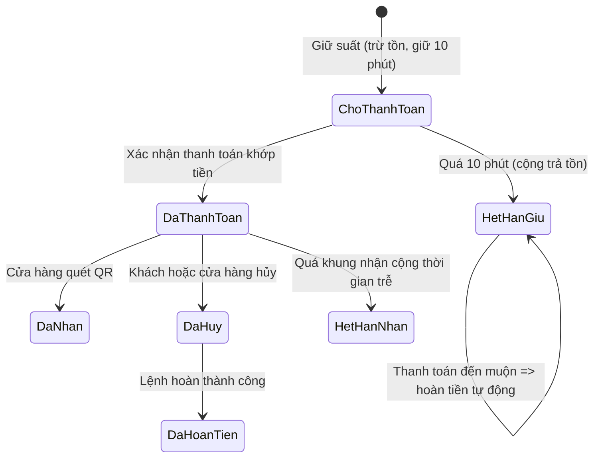

## 5.4. Nhận hàng

*Vai trò: Khách hàng (app Android) · 4 UC: R1-057 đến R1-060*

### 5.4.1. Mục tiêu nghiệp vụ

Bảo đảm khách nhận đúng hàng đúng đơn một lần duy nhất tại cửa hàng, đồng thời ghi nhận chính xác các đơn không được nhận để doanh thu và chống lạm dụng nhất quán. Phân hệ nối giữa tiền đã thu (Đặt hàng) và doanh thu thu hồi (Báo cáo).

### 5.4.2. Phạm vi

**Thuộc phân hệ:** QR nhận hàng; Xác nhận nhận; Trước khi nhận.

**Danh sách UC:** R1-057 Xem mã QR nhận hàng; R1-058 Nhận hàng (chủ quét QR); R1-059 Đơn quá hạn không đến nhận (hệ thống); R1-060 Báo cho cửa hàng là sắp đến.

**Nằm ngoài phạm vi:** Giao hàng tận nơi (không có trong Excel); hoàn tiền khi không nhận được hàng do lỗi cửa hàng (xử lý qua khiếu nại).

### 5.4.3. Tác nhân và quyền hạn

Khách hàng (xem QR, báo sắp đến); Chủ cửa hàng hoặc nhân viên quầy (quét QR ở phân hệ Đơn hàng và nhận hàng); hệ thống (xử lý đơn quá hạn).

### 5.4.4. Dữ liệu nghiệp vụ

| Thực thể | Ý nghĩa, nguồn hình thành và ảnh hưởng đến quyết định nghiệp vụ |
|---|---|
| Token QR | JWT ký HMAC chứa mã đơn, jti và thời điểm hết hạn, không chứa dữ liệu cá nhân; trạng thái dùng một lần lưu ở cơ sở dữ liệu. Mã dự phòng 6 ký tự thay QR khi camera lỗi. |
| Khung nhận | Khoảng thời gian cửa hàng đặt trên suất; QR hợp lệ trong khung nhận cộng tối đa 15 phút trễ (cấu hình). |
| Bộ đếm không đến nhận | Cập nhật khi đơn chuyển Hết hạn nhận. |

### 5.4.5. Quy trình nghiệp vụ tổng thể

1. Khi đơn Đã thanh toán, khách mở QR (hoặc mã dự phòng) và đưa cho cửa hàng; hệ thống nhắc 30 phút trước khung nhận.
2. Khách có thể bấm Sắp đến một lần cho mỗi đơn để cửa hàng chuẩn bị.
3. Cửa hàng quét QR: hệ thống kiểm tra đơn thuộc cửa hàng, Đã thanh toán, trong khung nhận cộng trễ, rồi đánh dấu Đã nhận nguyên tử một lần; khách được thông báo và mở được đánh giá.
4. Hết khung nhận cộng trễ mà chưa nhận, tác vụ hệ thống chuyển đơn sang Hết hạn nhận, cộng một vào bộ đếm không đến nhận và ghi nhận doanh thu cho cửa hàng (trừ hoa hồng) theo cấu hình mặc định không hoàn tiền.

**Phân hệ phụ thuộc và liên kết:** Phụ thuộc Đặt hàng và thanh toán (đơn Đã thanh toán). Cung cấp trạng thái Đã nhận cho Hậu mãi (khiếu nại, đánh giá), Báo cáo (doanh thu thu hồi) và Chống lạm dụng (khóa đặt).

### 5.4.6. Đặc tả từng UC

##### R1-057 - Xem mã QR nhận hàng

**Mã UC:** R1-057  
**Tên UC:** Xem mã QR nhận hàng  
**Nhóm:** Nhận hàng / QR nhận hàng · **Loại:** Truy vấn và hiển thị  
**Mục tiêu:** Khách mở QR của đơn Đã thanh toán để đưa cho cửa hàng quét. QR chứa token ký, không chứa dữ liệu cá nhân. *[Xác định trong Excel]*  
**Tác nhân:** Khách hàng (app Android)  

**Điều kiện tiên quyết** *[Tổng hợp từ ma trận gói và vai trò]*
- Khách đã đăng nhập trên app Android, tài khoản ở trạng thái Hoạt động (đã xác minh), phiên còn hiệu lực.
- Gói dịch vụ: Vai Khách, không phụ thuộc gói trả phí (GOI-KH); không có hạn mức riêng.

**Dữ liệu đầu vào và hiển thị** *[Xác định trong Excel]*
- Token QR (JWT ký HMAC: mã đơn, jti, hết hạn)
- Mã dự phòng 6 ký tự

**Luồng xử lý chính** *[Tổng hợp từ mô tả, quy tắc và kết quả]*
1. Người dùng mở màn hình "Xem mã QR nhận hàng" trên app Android và đặt điều kiện: Token QR, Mã dự phòng 6 ký tự.
2. Hệ thống xác thực phiên, xác định phạm vi dữ liệu của người dùng và áp các quy tắc hiển thị của UC.
3. Truy vấn dữ liệu: Khách mở QR của đơn Đã thanh toán để đưa cho cửa hàng quét. QR chứa token ký, không chứa dữ liệu cá nhân.
4. Hiển thị kết quả theo định dạng của màn hình.
5. Trường hợp không có dữ liệu hoặc không hợp lệ được xử lý theo mục Validation; không thay đổi dữ liệu nghiệp vụ.

**Business Rules** *[Xác định trong Excel]*
1. QR hết hạn khi kết thúc khung nhận.
2. Token dùng một lần, trạng thái lưu trong DB.
3. Mã dự phòng dùng khi camera lỗi.

**Validation** *[Xác định trong Excel]*
1. Đơn chưa thanh toán/đã hủy/đã nhận: không hiện QR, báo trạng thái.

**Luồng thay thế và ngoại lệ**
- Mọi trường hợp không hợp lệ nêu ở mục Validation là luồng ngoại lệ của UC này và được xử lý đúng như mô tả tại đó. *[Xác định]*
- Người dùng không có quyền hoặc đối tượng không thuộc phạm vi dữ liệu của mình: từ chối, không tiết lộ sự tồn tại của dữ liệu thuộc người khác (đề xuất hoàn thiện).
- Mất kết nối hoặc lỗi hệ thống giữa chừng: thao tác không được ghi nhận một phần; người dùng được thông báo và thử lại, thao tác thay đổi dữ liệu dùng khóa chống trùng khi áp dụng (đề xuất hoàn thiện).

**Dữ liệu thay đổi** *[Tổng hợp]*  
Không tạo hoặc thay đổi dữ liệu nghiệp vụ; chỉ đọc theo phạm vi của người dùng.

**Chuyển trạng thái** *[Tổng hợp]*
- Token dùng một lần, trạng thái lưu trong DB.

**Kết quả** *[Xác định trong Excel]*  
QR hiển thị, sáng màn hình tối đa.

**Tác động liên phân hệ** *[Tổng hợp]*  
Dữ liệu hoặc quy tắc của UC liên quan đến: Đơn hàng; Thanh toán và hoàn tiền; Nhận hàng bằng QR.

**Điều kiện hoàn thành** *[Tổng hợp]*  
Thành công khi: QR hiển thị, sáng màn hình tối đa. Không hoàn tất khi bất kỳ điều kiện Validation nào không đạt hoặc dịch vụ liên quan lỗi; dữ liệu giữ nguyên trạng thái trước thao tác.

**Tiêu chí nghiệm thu** *[Tổng hợp, kiểm tra được]*
1. Given khách đủ điều kiện tiên quyết và dữ liệu hợp lệ, When thực hiện "Xem mã QR nhận hàng", Then kết quả đạt được là: qR hiển thị, sáng màn hình tối đa.
2. Given đơn chưa thanh toán/đã hủy/đã nhận, When thực hiện "Xem mã QR nhận hàng", Then không hiện QR, báo trạng thái.
3. Given thao tác "Xem mã QR nhận hàng" được thực hiện, When hệ thống áp dụng quy tắc "QR hết hạn khi kết thúc khung nhận", Then kết quả không được vi phạm quy tắc này.

##### R1-058 - Nhận hàng (chủ quét QR)

**Mã UC:** R1-058  
**Tên UC:** Nhận hàng (chủ quét QR)  
**Nhóm:** Nhận hàng / Xác nhận nhận · **Loại:** Thao tác nghiệp vụ  
**Mục tiêu:** Chủ cửa hàng quét QR trên web; hệ thống kiểm tra và đánh dấu Đã nhận; app khách cập nhật trạng thái. *[Xác định trong Excel]*  
**Tác nhân:** Khách hàng (app Android)  

**Điều kiện tiên quyết** *[Tổng hợp từ ma trận gói và vai trò]*
- Khách đã đăng nhập trên app Android, tài khoản ở trạng thái Hoạt động (đã xác minh), phiên còn hiệu lực.
- Gói dịch vụ: Vai Khách, không phụ thuộc gói trả phí (GOI-KH); không có hạn mức riêng.

**Dữ liệu đầu vào và hiển thị** *[Xác định trong Excel]*
- Token QR (hệ thống)
- Mã cửa hàng của người quét (hệ thống)

**Luồng xử lý chính** *[Tổng hợp từ mô tả, quy tắc và kết quả]*
1. Người dùng kích hoạt "Nhận hàng (chủ quét QR)" trên app Android với dữ liệu: Token QR, Mã cửa hàng của người quét.
2. Hệ thống xác thực phiên, kiểm tra quyền, trạng thái đối tượng và điều kiện thời gian.
3. Hệ thống kiểm tra các điều kiện ở mục Validation và áp dụng Business Rules theo thứ tự.
4. Xử lý nghiệp vụ: Chủ cửa hàng quét QR trên web; hệ thống kiểm tra và đánh dấu Đã nhận; app khách cập nhật trạng thái.
5. Hệ thống ghi nhận kết quả, cập nhật dữ liệu và phản hồi: Đơn Đã nhận; khách nhận thông báo; mở được đánh giá.

**Business Rules** *[Xác định trong Excel]*
1. Chỉ cửa hàng sở hữu đơn được xác nhận.
2. Đánh dấu nguyên tử: chỉ một lần quét thành công.
3. Trong khung nhận hoặc sau tối đa 15 phút cho phép trễ (cấu hình).

**Validation** *[Xác định trong Excel]*
1. QR đã dùng/hết hạn/sai cửa hàng: từ chối với lý do.

**Luồng thay thế và ngoại lệ**
- Mọi trường hợp không hợp lệ nêu ở mục Validation là luồng ngoại lệ của UC này và được xử lý đúng như mô tả tại đó. *[Xác định]*
- Người dùng không có quyền hoặc đối tượng không thuộc phạm vi dữ liệu của mình: từ chối, không tiết lộ sự tồn tại của dữ liệu thuộc người khác (đề xuất hoàn thiện).
- Mất kết nối hoặc lỗi hệ thống giữa chừng: thao tác không được ghi nhận một phần; người dùng được thông báo và thử lại, thao tác thay đổi dữ liệu dùng khóa chống trùng khi áp dụng (đề xuất hoàn thiện).

**Dữ liệu thay đổi** *[Tổng hợp]*  
Theo kết quả đã xác định: Đơn Đã nhận; khách nhận thông báo; mở được đánh giá.

**Chuyển trạng thái** *[Tổng hợp]*
- Đơn Đã nhận.

**Kết quả** *[Xác định trong Excel]*  
Đơn Đã nhận; khách nhận thông báo; mở được đánh giá.

**Tác động liên phân hệ** *[Tổng hợp]*  
Dữ liệu hoặc quy tắc của UC liên quan đến: Đơn hàng; Thông báo; Đánh giá; Nhận hàng bằng QR.

**Điều kiện hoàn thành** *[Tổng hợp]*  
Thành công khi: Đơn Đã nhận; khách nhận thông báo; mở được đánh giá. Không hoàn tất khi bất kỳ điều kiện Validation nào không đạt hoặc dịch vụ liên quan lỗi; dữ liệu giữ nguyên trạng thái trước thao tác.

**Tiêu chí nghiệm thu** *[Tổng hợp, kiểm tra được]*
1. Given khách đủ điều kiện tiên quyết và dữ liệu hợp lệ, When thực hiện "Nhận hàng (chủ quét QR)", Then kết quả đạt được là: đơn Đã nhận; khách nhận thông báo; mở được đánh giá.
2. Given qR đã dùng/hết hạn/sai cửa hàng, When thực hiện "Nhận hàng (chủ quét QR)", Then từ chối với lý do.
3. Given thao tác "Nhận hàng (chủ quét QR)" được thực hiện, When hệ thống áp dụng quy tắc "Chỉ cửa hàng sở hữu đơn được xác nhận", Then kết quả không được vi phạm quy tắc này.

##### R1-059 - Đơn quá hạn không đến nhận (hệ thống)

**Mã UC:** R1-059  
**Tên UC:** Đơn quá hạn không đến nhận (hệ thống)  
**Nhóm:** Nhận hàng / Xác nhận nhận · **Loại:** Tác vụ hệ thống  
**Mục tiêu:** Hết khung nhận cộng thời gian trễ, đơn Đã thanh toán chưa nhận chuyển Hết hạn nhận; tính 1 lần không đến. *[Xác định trong Excel]*  
**Tác nhân:** Hệ thống (tác vụ nền); đối tượng chịu tác động: Khách hàng (app Android)  

**Điều kiện tiên quyết** *[Tổng hợp từ ma trận gói và vai trò]*
- Tác vụ hệ thống chạy theo lịch hoặc theo sự kiện; không cần người dùng đăng nhập tại thời điểm chạy.
- Gói dịch vụ: Vai Khách, không phụ thuộc gói trả phí (GOI-KH); không có hạn mức riêng.

**Dữ liệu đầu vào và hiển thị** *[Xác định trong Excel]*
- Mã đơn, khung nhận (hệ thống)

**Luồng xử lý chính** *[Tổng hợp từ mô tả, quy tắc và kết quả]*
1. Bộ lập lịch hoặc sự kiện nghiệp vụ kích hoạt tác vụ "Đơn quá hạn không đến nhận (hệ thống)".
2. Hệ thống lọc đối tượng thuộc phạm vi xử lý bằng điều kiện trạng thái và thời gian của dữ liệu.
3. Xử lý theo mô tả nghiệp vụ: Hết khung nhận cộng thời gian trễ, đơn Đã thanh toán chưa nhận chuyển Hết hạn nhận; tính 1 lần không đến.
4. Mỗi đối tượng chỉ được xử lý một lần; thay đổi dữ liệu và trạng thái nằm trong cùng một giao dịch để tránh trạng thái nửa chừng.
5. Hệ thống ghi nhận kết quả, gửi thông báo liên quan nếu có và để lại nhật ký chạy: Đơn Hết hạn nhận; khách nhận cảnh báo; bộ đếm cập nhật.

**Business Rules** *[Xác định trong Excel]*
1. Không hoàn tiền mặc định (tham số cấu hình).
2. Cộng 1 vào bộ đếm không đến nhận 30 ngày; đủ 3 lần thì khóa đặt 7 ngày.
3. Tiền được ghi nhận doanh thu cho cửa hàng trừ hoa hồng.

**Validation** *[Xác định trong Excel]*
1. Cửa hàng xác nhận đóng cửa/lỗi của cửa hàng: được hoàn đủ theo khiếu nại.

**Luồng thay thế và ngoại lệ**
- Mọi trường hợp không hợp lệ nêu ở mục Validation là luồng ngoại lệ của UC này và được xử lý đúng như mô tả tại đó. *[Xác định]*
- Lần chạy bị gián đoạn: lần chạy sau xử lý lại các đối tượng chưa xử lý; đối tượng đã xử lý không bị xử lý lần hai (đề xuất hoàn thiện).

**Dữ liệu thay đổi** *[Tổng hợp]*  
Theo kết quả đã xác định: Đơn Hết hạn nhận; khách nhận cảnh báo; bộ đếm cập nhật.

**Chuyển trạng thái** *[Tổng hợp]*
- Đơn Hết hạn nhận.

**Kết quả** *[Xác định trong Excel]*  
Đơn Hết hạn nhận; khách nhận cảnh báo; bộ đếm cập nhật.

**Tác động liên phân hệ** *[Tổng hợp]*  
Dữ liệu hoặc quy tắc của UC liên quan đến: Đơn hàng; Thanh toán và hoàn tiền; Báo cáo và đối soát; Chống lạm dụng đặt hàng.

**Điều kiện hoàn thành** *[Tổng hợp]*  
Thành công khi: Đơn Hết hạn nhận; khách nhận cảnh báo; bộ đếm cập nhật. Không hoàn tất khi bất kỳ điều kiện Validation nào không đạt hoặc dịch vụ liên quan lỗi; dữ liệu giữ nguyên trạng thái trước thao tác.

**Tiêu chí nghiệm thu** *[Tổng hợp, kiểm tra được]*
1. Given có đối tượng thuộc phạm vi xử lý của tác vụ, When tác vụ "Đơn quá hạn không đến nhận (hệ thống)" chạy, Then kết quả đạt được là: đơn Hết hạn nhận; khách nhận cảnh báo; bộ đếm cập nhật.
2. Given cửa hàng xác nhận đóng cửa/lỗi của cửa hàng, When thực hiện "Đơn quá hạn không đến nhận (hệ thống)", Then được hoàn đủ theo khiếu nại.
3. Given thao tác "Đơn quá hạn không đến nhận (hệ thống)" được thực hiện, When hệ thống áp dụng quy tắc "Không hoàn tiền mặc định (tham số cấu hình)", Then kết quả không được vi phạm quy tắc này.

##### R1-060 - Báo cho cửa hàng là sắp đến

**Mã UC:** R1-060  
**Tên UC:** Báo cho cửa hàng là sắp đến  
**Nhóm:** Nhận hàng / Trước khi nhận · **Loại:** Chuyển trạng thái  
**Mục tiêu:** Khách bấm Sắp đến để cửa hàng biết chuẩn bị, tối đa một lần cho mỗi đơn. *[Xác định trong Excel]*  
**Tác nhân:** Khách hàng (app Android)  

**Điều kiện tiên quyết** *[Tổng hợp từ ma trận gói và vai trò]*
- Khách đã đăng nhập trên app Android, tài khoản ở trạng thái Hoạt động (đã xác minh), phiên còn hiệu lực.
- Gói dịch vụ: Vai Khách, không phụ thuộc gói trả phí (GOI-KH); không có hạn mức riêng.

**Dữ liệu đầu vào và hiển thị** *[Xác định trong Excel]*
- Mã đơn
- Thời điểm báo

**Luồng xử lý chính** *[Tổng hợp từ mô tả, quy tắc và kết quả]*
1. Người dùng chọn đối tượng cần xử lý và thao tác "Báo cho cửa hàng là sắp đến" trên app Android.
2. Người dùng cung cấp thêm: Mã đơn, Thời điểm báo.
3. Hệ thống kiểm tra trạng thái hiện tại có cho phép chuyển trạng thái này không, cùng quyền của người thực hiện.
4. Xử lý nghiệp vụ: Khách bấm Sắp đến để cửa hàng biết chuẩn bị, tối đa một lần cho mỗi đơn.
5. Trạng thái, tồn kho, tiền hoặc thông báo liên quan được cập nhật trong cùng giao dịch; kết quả: Cửa hàng nhận thông báo trên web.

**Business Rules** *[Xác định trong Excel]*
1. Chỉ cho đơn Đã thanh toán trong khung nhận.
2. Không thay đổi quyền lợi hay thời hạn của đơn.

**Validation** *[Xác định trong Excel]*
1. Đã báo hoặc ngoài khung nhận: từ chối.

**Luồng thay thế và ngoại lệ**
- Mọi trường hợp không hợp lệ nêu ở mục Validation là luồng ngoại lệ của UC này và được xử lý đúng như mô tả tại đó. *[Xác định]*
- Người dùng không có quyền hoặc đối tượng không thuộc phạm vi dữ liệu của mình: từ chối, không tiết lộ sự tồn tại của dữ liệu thuộc người khác (đề xuất hoàn thiện).
- Mất kết nối hoặc lỗi hệ thống giữa chừng: thao tác không được ghi nhận một phần; người dùng được thông báo và thử lại, thao tác thay đổi dữ liệu dùng khóa chống trùng khi áp dụng (đề xuất hoàn thiện).

**Dữ liệu thay đổi** *[Tổng hợp]*  
Theo kết quả đã xác định: Cửa hàng nhận thông báo trên web.

**Chuyển trạng thái** *[Tổng hợp]*
- Excel không nêu chuyển trạng thái riêng cho UC này; đối tượng giữ trạng thái hiện tại trừ phần được nêu ở mục Kết quả.

**Kết quả** *[Xác định trong Excel]*  
Cửa hàng nhận thông báo trên web.

**Tác động liên phân hệ** *[Tổng hợp]*  
Dữ liệu hoặc quy tắc của UC liên quan đến: Đơn hàng; Thanh toán và hoàn tiền; Thông báo.

**Điều kiện hoàn thành** *[Tổng hợp]*  
Thành công khi: Cửa hàng nhận thông báo trên web. Không hoàn tất khi bất kỳ điều kiện Validation nào không đạt hoặc dịch vụ liên quan lỗi; dữ liệu giữ nguyên trạng thái trước thao tác.

**Tiêu chí nghiệm thu** *[Tổng hợp, kiểm tra được]*
1. Given khách đủ điều kiện tiên quyết và dữ liệu hợp lệ, When thực hiện "Báo cho cửa hàng là sắp đến", Then kết quả đạt được là: cửa hàng nhận thông báo trên web.
2. Given đã báo hoặc ngoài khung nhận, When thực hiện "Báo cho cửa hàng là sắp đến", Then từ chối.
3. Given thao tác "Báo cho cửa hàng là sắp đến" được thực hiện, When hệ thống áp dụng quy tắc "Chỉ cho đơn Đã thanh toán trong khung nhận", Then kết quả không được vi phạm quy tắc này.

### 5.4.7. Các quy tắc nghiệp vụ dùng chung

| Mã BR | Quy tắc | UC chịu ảnh hưởng |
|---|---|---|
| BR-022 | QR chỉ hiển thị khi đơn Đã thanh toán và chưa hết khung nhận; token dùng một lần và không chứa dữ liệu cá nhân. | R1-057 |
| BR-023 | Chỉ cửa hàng sở hữu đơn được xác nhận; đánh dấu nguyên tử nên chỉ một lần quét thành công; cho phép trễ tối đa 15 phút (cấu hình). | R1-058 |
| BR-024 | Đơn quá hạn nhận không hoàn tiền mặc định, tiền ghi nhận doanh thu cửa hàng trừ hoa hồng, và tính một lần không đến nhận cho khách; riêng lỗi của cửa hàng thì khách được hoàn đủ qua khiếu nại. | R1-059 |
| BR-025 | Báo Sắp đến chỉ một lần cho mỗi đơn, chỉ trong khung nhận, không đổi quyền lợi hay thời hạn của đơn. | R1-060 |

### 5.4.8. Sơ đồ quy trình

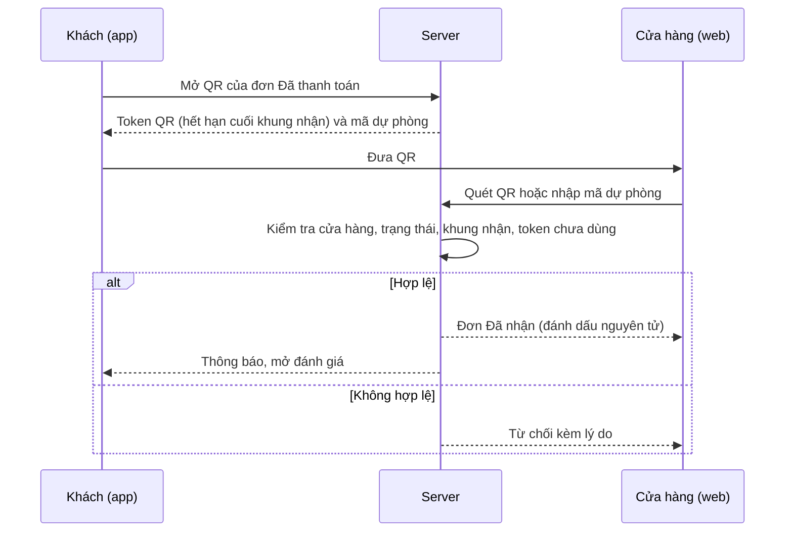

## 5.5. Hậu mãi

*Vai trò: Khách hàng (app Android) · 12 UC: R1-061 đến R1-072*

### 5.5.1. Mục tiêu nghiệp vụ

Bảo vệ khách khi hàng không đạt chất lượng và tạo vòng phản hồi cho cửa hàng: khiếu nại có bằng chứng, đánh giá, báo cáo vi phạm và hỗ trợ từ người thật. Phân hệ cũng giữ cân bằng với cửa hàng bằng thời hạn gửi 24 giờ và giới hạn mỗi đơn một khiếu nại mở.

### 5.5.2. Phạm vi

**Thuộc phân hệ:** Khiếu nại; Đánh giá; Báo cáo vi phạm; Hỗ trợ.

**Danh sách UC:** R1-061 Gửi khiếu nại chất lượng đơn; R1-062 Xem trạng thái và phản hồi khiếu nại; R1-063 Rút khiếu nại; R1-064 Gửi đánh giá cửa hàng; R1-065 Sửa đánh giá; R1-066 Ẩn đánh giá của tôi; R1-067 Xem lịch sử các khiếu nại; R1-068 Bổ sung bằng chứng cho khiếu nại; R1-069 Báo cáo cửa hàng hoặc nội dung vi phạm; R1-070 Gửi yêu cầu hỗ trợ cho người thật; R1-071 Xem trạng thái và trao đổi trong yêu cầu hỗ trợ; R1-072 Xem trung tâm trợ giúp và câu hỏi thường gặp.

**Nằm ngoài phạm vi:** Tranh chấp ngoài hệ thống sau khi cửa hàng từ chối (MVP chỉ khiếu nại ngoài hệ thống); xử lý nội bộ của đội vận hành nền tảng đối với báo cáo vi phạm.

### 5.5.3. Tác nhân và quyền hạn

Khách hàng (app Android); Chủ cửa hàng (phản hồi khiếu nại, đánh giá ở web); bên hỗ trợ nền tảng (yêu cầu hỗ trợ liên quan nền tảng); hệ thống (tự hoàn khi quá hạn phản hồi).

### 5.5.4. Dữ liệu nghiệp vụ

| Thực thể | Ý nghĩa, nguồn hình thành và ảnh hưởng đến quyết định nghiệp vụ |
|---|---|
| Khiếu nại | Đơn, loại (Hàng hỏng, Sai món, Thiếu hàng, Khác), mô tả 10-500 ký tự, tối đa 3 ảnh mỗi ảnh 5 MB, trạng thái Chờ cửa hàng, Đã chấp nhận hoàn tiền, Bị từ chối, Đã đóng, hạn phản hồi, số tiền hoàn. |
| Đánh giá | Số sao 1-5, nhận xét tối đa 300 ký tự, mỗi đơn một đánh giá, lịch sử bản sửa, cờ ẩn. |
| Yêu cầu hỗ trợ | Loại, mã đơn, nội dung, trạng thái Mở, Đang xử lý, Đã trả lời, Đã đóng; tối đa 5 yêu cầu mở đồng thời. |
| Báo cáo vi phạm | Đối tượng (cửa hàng, deal, đánh giá), lý do, mô tả; gộp báo cáo trùng, ngưỡng ẩn tạm 5 báo cáo khác nhau trong 24 giờ. |

### 5.5.5. Quy trình nghiệp vụ tổng thể

1. Sau khi đơn Đã nhận, khách có 24 giờ gửi khiếu nại; mỗi đơn một khiếu nại mở; khách theo dõi tiến trình, bổ sung bằng chứng tối đa 2 lần hoặc rút khi còn Chờ cửa hàng.
2. Cửa hàng chấp nhận (toàn bộ hoặc một phần), từ chối kèm lý do, hoặc không phản hồi: quá 48 giờ (cộng 24 giờ nếu được gia hạn) hệ thống tự chấp nhận và hoàn đủ.
3. Khách đánh giá cửa hàng sau khi nhận, sửa trong 24 giờ hoặc ẩn đánh giá của mình.
4. Khi gặp vấn đề ngoài khiếu nại, khách gửi yêu cầu hỗ trợ và theo dõi trao đổi; đọc câu hỏi thường gặp để tự xử lý.

**Phân hệ phụ thuộc và liên kết:** Phụ thuộc Nhận hàng (đơn Đã nhận) và Đặt hàng (giao dịch hoàn). Kết quả hiển thị ở phân hệ Khiếu nại và đánh giá của cửa hàng.

### 5.5.6. Đặc tả từng UC

##### R1-061 - Gửi khiếu nại chất lượng đơn

**Mã UC:** R1-061  
**Tên UC:** Gửi khiếu nại chất lượng đơn  
**Nhóm:** Hậu mãi / Khiếu nại · **Loại:** Tạo mới  
**Mục tiêu:** Khách gửi khiếu nại cho đơn Đã nhận trong thời hạn, kèm mô tả và tối đa 3 ảnh. *[Xác định trong Excel]*  
**Tác nhân:** Khách hàng (app Android)  

**Điều kiện tiên quyết** *[Tổng hợp từ ma trận gói và vai trò]*
- Khách đã đăng nhập trên app Android, tài khoản ở trạng thái Hoạt động (đã xác minh), phiên còn hiệu lực.
- Gói dịch vụ: Vai Khách, không phụ thuộc gói trả phí (GOI-KH); không có hạn mức riêng.

**Dữ liệu đầu vào và hiển thị** *[Xác định trong Excel]*
- Mã đơn (hệ thống)
- Loại (Hàng hỏng/Sai món/Thiếu hàng/Khác)
- Mô tả (10-500 ký tự)
- Ảnh (0-3 ảnh, mỗi ảnh tối đa 5 MB)

**Luồng xử lý chính** *[Tổng hợp từ mô tả, quy tắc và kết quả]*
1. Người dùng chọn chức năng "Gửi khiếu nại chất lượng đơn" trên app Android.
2. Người dùng nhập hoặc chọn: Mã đơn, Loại, Mô tả, Ảnh.
3. Hệ thống xác thực phiên, kiểm tra quyền, phạm vi dữ liệu, gói dịch vụ và hạn mức (nếu có).
4. Hệ thống kiểm tra từng điều kiện ở mục Validation; sai thì trả lỗi tại trường tương ứng và không tạo dữ liệu.
5. Xử lý nghiệp vụ: Khách gửi khiếu nại cho đơn Đã nhận trong thời hạn, kèm mô tả và tối đa 3 ảnh.
6. Hệ thống lưu dữ liệu, cập nhật các đối tượng liên quan và phản hồi: Khiếu nại trạng thái Chờ cửa hàng; cửa hàng nhận thông báo.

**Business Rules** *[Xác định trong Excel]*
1. Chỉ gửi khi đơn Đã nhận và trong 24 giờ kể từ giờ nhận.
2. Mỗi đơn một khiếu nại đang mở.
3. Chủ cửa hàng chịu trách nhiệm chất lượng.

**Validation** *[Xác định trong Excel]*
1. Quá hạn hoặc đã có khiếu nại: từ chối, nêu lý do.

**Luồng thay thế và ngoại lệ**
- Mọi trường hợp không hợp lệ nêu ở mục Validation là luồng ngoại lệ của UC này và được xử lý đúng như mô tả tại đó. *[Xác định]*
- Người dùng không có quyền hoặc đối tượng không thuộc phạm vi dữ liệu của mình: từ chối, không tiết lộ sự tồn tại của dữ liệu thuộc người khác (đề xuất hoàn thiện).
- Mất kết nối hoặc lỗi hệ thống giữa chừng: thao tác không được ghi nhận một phần; người dùng được thông báo và thử lại, thao tác thay đổi dữ liệu dùng khóa chống trùng khi áp dụng (đề xuất hoàn thiện).

**Dữ liệu thay đổi** *[Tổng hợp]*  
Theo kết quả đã xác định: Khiếu nại trạng thái Chờ cửa hàng; cửa hàng nhận thông báo.

**Chuyển trạng thái** *[Tổng hợp]*
- Khiếu nại trạng thái Chờ cửa hàng.

**Kết quả** *[Xác định trong Excel]*  
Khiếu nại trạng thái Chờ cửa hàng; cửa hàng nhận thông báo.

**Tác động liên phân hệ** *[Tổng hợp]*  
Dữ liệu hoặc quy tắc của UC liên quan đến: Đơn hàng; Thông báo; Khiếu nại.

**Điều kiện hoàn thành** *[Tổng hợp]*  
Thành công khi: Khiếu nại trạng thái Chờ cửa hàng; cửa hàng nhận thông báo. Không hoàn tất khi bất kỳ điều kiện Validation nào không đạt hoặc dịch vụ liên quan lỗi; dữ liệu giữ nguyên trạng thái trước thao tác.

**Tiêu chí nghiệm thu** *[Tổng hợp, kiểm tra được]*
1. Given khách đủ điều kiện tiên quyết và dữ liệu hợp lệ, When thực hiện "Gửi khiếu nại chất lượng đơn", Then kết quả đạt được là: khiếu nại trạng thái Chờ cửa hàng; cửa hàng nhận thông báo.
2. Given quá hạn hoặc đã có khiếu nại, When thực hiện "Gửi khiếu nại chất lượng đơn", Then từ chối, nêu lý do.
3. Given thao tác "Gửi khiếu nại chất lượng đơn" được thực hiện, When hệ thống áp dụng quy tắc "Chỉ gửi khi đơn Đã nhận và trong 24 giờ kể từ giờ nhận", Then kết quả không được vi phạm quy tắc này.

##### R1-062 - Xem trạng thái và phản hồi khiếu nại

**Mã UC:** R1-062  
**Tên UC:** Xem trạng thái và phản hồi khiếu nại  
**Nhóm:** Hậu mãi / Khiếu nại · **Loại:** Truy vấn kèm thao tác  
**Mục tiêu:** Khách xem trạng thái (Chờ cửa hàng, Đã chấp nhận hoàn tiền, Bị từ chối, Đã đóng) và phản hồi. *[Xác định trong Excel]*  
**Tác nhân:** Khách hàng (app Android)  

**Điều kiện tiên quyết** *[Tổng hợp từ ma trận gói và vai trò]*
- Khách đã đăng nhập trên app Android, tài khoản ở trạng thái Hoạt động (đã xác minh), phiên còn hiệu lực.
- Gói dịch vụ: Vai Khách, không phụ thuộc gói trả phí (GOI-KH); không có hạn mức riêng.

**Dữ liệu hiển thị (UC không có trường nhập)** *[Xác định trong Excel]*
- Hiển thị: loại, mô tả, ảnh, trạng thái, phản hồi, số tiền hoàn

**Luồng xử lý chính** *[Tổng hợp từ mô tả, quy tắc và kết quả]*
1. Người dùng mở "Xem trạng thái và phản hồi khiếu nại" trên app Android.
2. Hệ thống xác thực phiên và giới hạn dữ liệu theo chủ sở hữu.
3. Hiển thị thông tin: loại, mô tả, ảnh, trạng thái, phản hồi, số tiền hoàn.
4. Người dùng chọn thao tác bổ sung trên đối tượng đang xem.
5. Xử lý theo mô tả nghiệp vụ: Khách xem trạng thái (Chờ cửa hàng, Đã chấp nhận hoàn tiền, Bị từ chối, Đã đóng) và phản hồi.
6. Hệ thống kiểm tra Business Rules và Validation, ghi nhận thay đổi và làm mới màn hình: Hiển thị tiến trình khiếu nại.

**Business Rules** *[Xác định trong Excel]*
1. Chỉ xem khiếu nại của mình.

**Validation** *[Xác định trong Excel]*
1. Không có.

**Luồng thay thế và ngoại lệ**
- Người dùng không có quyền hoặc đối tượng không thuộc phạm vi dữ liệu của mình: từ chối, không tiết lộ sự tồn tại của dữ liệu thuộc người khác (đề xuất hoàn thiện).
- Mất kết nối hoặc lỗi hệ thống giữa chừng: thao tác không được ghi nhận một phần; người dùng được thông báo và thử lại, thao tác thay đổi dữ liệu dùng khóa chống trùng khi áp dụng (đề xuất hoàn thiện).

**Dữ liệu thay đổi** *[Tổng hợp]*  
Theo kết quả đã xác định: Hiển thị tiến trình khiếu nại.

**Chuyển trạng thái** *[Tổng hợp]*
- Excel không nêu chuyển trạng thái riêng cho UC này; đối tượng giữ trạng thái hiện tại trừ phần được nêu ở mục Kết quả.

**Kết quả** *[Xác định trong Excel]*  
Hiển thị tiến trình khiếu nại.

**Tác động liên phân hệ** *[Tổng hợp]*  
Dữ liệu hoặc quy tắc của UC liên quan đến: Thanh toán và hoàn tiền; Khiếu nại.

**Điều kiện hoàn thành** *[Tổng hợp]*  
Thành công khi: Hiển thị tiến trình khiếu nại. Không hoàn tất khi bất kỳ điều kiện Validation nào không đạt hoặc dịch vụ liên quan lỗi; dữ liệu giữ nguyên trạng thái trước thao tác.

**Tiêu chí nghiệm thu** *[Tổng hợp, kiểm tra được]*
1. Given khách đủ điều kiện tiên quyết và dữ liệu hợp lệ, When thực hiện "Xem trạng thái và phản hồi khiếu nại", Then kết quả đạt được là: hiển thị tiến trình khiếu nại.
2. Given thao tác "Xem trạng thái và phản hồi khiếu nại" được thực hiện, When hệ thống áp dụng quy tắc "Chỉ xem khiếu nại của mình", Then kết quả không được vi phạm quy tắc này.

##### R1-063 - Rút khiếu nại

**Mã UC:** R1-063  
**Tên UC:** Rút khiếu nại  
**Nhóm:** Hậu mãi / Khiếu nại · **Loại:** Chuyển trạng thái  
**Mục tiêu:** Khách rút khiếu nại khi chưa được xử lý. *[Xác định trong Excel]*  
**Tác nhân:** Khách hàng (app Android)  

**Điều kiện tiên quyết** *[Tổng hợp từ ma trận gói và vai trò]*
- Khách đã đăng nhập trên app Android, tài khoản ở trạng thái Hoạt động (đã xác minh), phiên còn hiệu lực.
- Gói dịch vụ: Vai Khách, không phụ thuộc gói trả phí (GOI-KH); không có hạn mức riêng.

**Dữ liệu đầu vào và hiển thị** *[Xác định trong Excel]*
- Mã khiếu nại (hệ thống)

**Luồng xử lý chính** *[Tổng hợp từ mô tả, quy tắc và kết quả]*
1. Người dùng chọn đối tượng cần xử lý và thao tác "Rút khiếu nại" trên app Android.
2. Người dùng cung cấp thêm: Mã khiếu nại.
3. Hệ thống kiểm tra trạng thái hiện tại có cho phép chuyển trạng thái này không, cùng quyền của người thực hiện.
4. Xử lý nghiệp vụ: Khách rút khiếu nại khi chưa được xử lý.
5. Trạng thái, tồn kho, tiền hoặc thông báo liên quan được cập nhật trong cùng giao dịch; kết quả: Khiếu nại Đã đóng.

**Business Rules** *[Xác định trong Excel]*
1. Chỉ rút khi trạng thái Chờ cửa hàng; không mở lại sau khi rút.

**Validation** *[Xác định trong Excel]*
1. Đã xử lý: không rút.

**Luồng thay thế và ngoại lệ**
- Mọi trường hợp không hợp lệ nêu ở mục Validation là luồng ngoại lệ của UC này và được xử lý đúng như mô tả tại đó. *[Xác định]*
- Người dùng không có quyền hoặc đối tượng không thuộc phạm vi dữ liệu của mình: từ chối, không tiết lộ sự tồn tại của dữ liệu thuộc người khác (đề xuất hoàn thiện).
- Mất kết nối hoặc lỗi hệ thống giữa chừng: thao tác không được ghi nhận một phần; người dùng được thông báo và thử lại, thao tác thay đổi dữ liệu dùng khóa chống trùng khi áp dụng (đề xuất hoàn thiện).

**Dữ liệu thay đổi** *[Tổng hợp]*  
Theo kết quả đã xác định: Khiếu nại Đã đóng.

**Chuyển trạng thái** *[Tổng hợp]*
- Khiếu nại Đã đóng.
- Chỉ rút khi trạng thái Chờ cửa hàng; không mở lại sau khi rút.

**Kết quả** *[Xác định trong Excel]*  
Khiếu nại Đã đóng.

**Tác động liên phân hệ** *[Tổng hợp]*  
Dữ liệu hoặc quy tắc của UC liên quan đến: Khiếu nại.

**Điều kiện hoàn thành** *[Tổng hợp]*  
Thành công khi: Khiếu nại Đã đóng. Không hoàn tất khi bất kỳ điều kiện Validation nào không đạt hoặc dịch vụ liên quan lỗi; dữ liệu giữ nguyên trạng thái trước thao tác.

**Tiêu chí nghiệm thu** *[Tổng hợp, kiểm tra được]*
1. Given khách đủ điều kiện tiên quyết và dữ liệu hợp lệ, When thực hiện "Rút khiếu nại", Then kết quả đạt được là: khiếu nại Đã đóng.
2. Given đã xử lý, When thực hiện "Rút khiếu nại", Then không rút.
3. Given thao tác "Rút khiếu nại" được thực hiện, When hệ thống áp dụng quy tắc "Chỉ rút khi trạng thái Chờ cửa hàng; không mở lại sau khi rút", Then kết quả không được vi phạm quy tắc này.

##### R1-064 - Gửi đánh giá cửa hàng

**Mã UC:** R1-064  
**Tên UC:** Gửi đánh giá cửa hàng  
**Nhóm:** Hậu mãi / Đánh giá · **Loại:** Tạo mới  
**Mục tiêu:** Khách chấm 1-5 sao và nhận xét cho đơn Đã nhận. *[Xác định trong Excel]*  
**Tác nhân:** Khách hàng (app Android)  

**Điều kiện tiên quyết** *[Tổng hợp từ ma trận gói và vai trò]*
- Khách đã đăng nhập trên app Android, tài khoản ở trạng thái Hoạt động (đã xác minh), phiên còn hiệu lực.
- Gói dịch vụ: Vai Khách, không phụ thuộc gói trả phí (GOI-KH); không có hạn mức riêng.

**Dữ liệu đầu vào và hiển thị** *[Xác định trong Excel]*
- Mã đơn (hệ thống)
- Số sao (1-5, bắt buộc)
- Nhận xét (0-300 ký tự)

**Luồng xử lý chính** *[Tổng hợp từ mô tả, quy tắc và kết quả]*
1. Người dùng chọn chức năng "Gửi đánh giá cửa hàng" trên app Android.
2. Người dùng nhập hoặc chọn: Mã đơn, Số sao, Nhận xét.
3. Hệ thống xác thực phiên, kiểm tra quyền, phạm vi dữ liệu, gói dịch vụ và hạn mức (nếu có).
4. Hệ thống kiểm tra từng điều kiện ở mục Validation; sai thì trả lỗi tại trường tương ứng và không tạo dữ liệu.
5. Xử lý nghiệp vụ: Khách chấm 1-5 sao và nhận xét cho đơn Đã nhận.
6. Hệ thống lưu dữ liệu, cập nhật các đối tượng liên quan và phản hồi: Điểm trung bình cửa hàng cập nhật.

**Business Rules** *[Xác định trong Excel]*
1. Mỗi đơn một đánh giá.
2. Chỉ khi đơn Đã nhận.
3. Lọc từ ngữ vi phạm cơ bản.

**Validation** *[Xác định trong Excel]*
1. Đã đánh giá: từ chối; nội dung vi phạm: từ chối kèm lý do.

**Luồng thay thế và ngoại lệ**
- Mọi trường hợp không hợp lệ nêu ở mục Validation là luồng ngoại lệ của UC này và được xử lý đúng như mô tả tại đó. *[Xác định]*
- Người dùng không có quyền hoặc đối tượng không thuộc phạm vi dữ liệu của mình: từ chối, không tiết lộ sự tồn tại của dữ liệu thuộc người khác (đề xuất hoàn thiện).
- Mất kết nối hoặc lỗi hệ thống giữa chừng: thao tác không được ghi nhận một phần; người dùng được thông báo và thử lại, thao tác thay đổi dữ liệu dùng khóa chống trùng khi áp dụng (đề xuất hoàn thiện).

**Dữ liệu thay đổi** *[Tổng hợp]*  
Theo kết quả đã xác định: Điểm trung bình cửa hàng cập nhật.

**Chuyển trạng thái** *[Tổng hợp]*
- Excel không nêu chuyển trạng thái riêng cho UC này; đối tượng giữ trạng thái hiện tại trừ phần được nêu ở mục Kết quả.

**Kết quả** *[Xác định trong Excel]*  
Điểm trung bình cửa hàng cập nhật.

**Tác động liên phân hệ** *[Tổng hợp]*  
Dữ liệu hoặc quy tắc của UC liên quan đến: Đơn hàng; Đánh giá.

**Điều kiện hoàn thành** *[Tổng hợp]*  
Thành công khi: Điểm trung bình cửa hàng cập nhật. Không hoàn tất khi bất kỳ điều kiện Validation nào không đạt hoặc dịch vụ liên quan lỗi; dữ liệu giữ nguyên trạng thái trước thao tác.

**Tiêu chí nghiệm thu** *[Tổng hợp, kiểm tra được]*
1. Given khách đủ điều kiện tiên quyết và dữ liệu hợp lệ, When thực hiện "Gửi đánh giá cửa hàng", Then kết quả đạt được là: điểm trung bình cửa hàng cập nhật.
2. Given đã đánh giá, When thực hiện "Gửi đánh giá cửa hàng", Then từ chối; nội dung vi phạm: từ chối kèm lý do.
3. Given thao tác "Gửi đánh giá cửa hàng" được thực hiện, When hệ thống áp dụng quy tắc "Mỗi đơn một đánh giá", Then kết quả không được vi phạm quy tắc này.

##### R1-065 - Sửa đánh giá

**Mã UC:** R1-065  
**Tên UC:** Sửa đánh giá  
**Nhóm:** Hậu mãi / Đánh giá · **Loại:** Cập nhật  
**Mục tiêu:** Khách sửa số sao/nhận xét trong 24 giờ sau khi gửi. *[Xác định trong Excel]*  
**Tác nhân:** Khách hàng (app Android)  

**Điều kiện tiên quyết** *[Tổng hợp từ ma trận gói và vai trò]*
- Khách đã đăng nhập trên app Android, tài khoản ở trạng thái Hoạt động (đã xác minh), phiên còn hiệu lực.
- Gói dịch vụ: Vai Khách, không phụ thuộc gói trả phí (GOI-KH); không có hạn mức riêng.

**Dữ liệu đầu vào và hiển thị** *[Xác định trong Excel]*
- Số sao, nhận xét như khi tạo

**Luồng xử lý chính** *[Tổng hợp từ mô tả, quy tắc và kết quả]*
1. Người dùng mở "Sửa đánh giá" trên app Android; hệ thống nạp giá trị hiện tại.
2. Người dùng thay đổi: Số sao, nhận xét như khi tạo.
3. Hệ thống kiểm tra quyền, trạng thái hiện tại của đối tượng và điều kiện ở mục Validation.
4. Xử lý nghiệp vụ: Khách sửa số sao/nhận xét trong 24 giờ sau khi gửi.
5. Hệ thống lưu giá trị mới, ghi lịch sử hoặc nhật ký nếu quy tắc yêu cầu và phản hồi: Đánh giá cập nhật, điểm trung bình tính lại.

**Business Rules** *[Xác định trong Excel]*
1. Sau 24 giờ khóa sửa; lưu lịch sử bản sửa.

**Validation** *[Xác định trong Excel]*
1. Quá hạn: từ chối.

**Luồng thay thế và ngoại lệ**
- Mọi trường hợp không hợp lệ nêu ở mục Validation là luồng ngoại lệ của UC này và được xử lý đúng như mô tả tại đó. *[Xác định]*
- Người dùng không có quyền hoặc đối tượng không thuộc phạm vi dữ liệu của mình: từ chối, không tiết lộ sự tồn tại của dữ liệu thuộc người khác (đề xuất hoàn thiện).
- Mất kết nối hoặc lỗi hệ thống giữa chừng: thao tác không được ghi nhận một phần; người dùng được thông báo và thử lại, thao tác thay đổi dữ liệu dùng khóa chống trùng khi áp dụng (đề xuất hoàn thiện).

**Dữ liệu thay đổi** *[Tổng hợp]*  
Theo kết quả đã xác định: Đánh giá cập nhật, điểm trung bình tính lại.

**Chuyển trạng thái** *[Tổng hợp]*
- Excel không nêu chuyển trạng thái riêng cho UC này; đối tượng giữ trạng thái hiện tại trừ phần được nêu ở mục Kết quả.

**Kết quả** *[Xác định trong Excel]*  
Đánh giá cập nhật, điểm trung bình tính lại.

**Tác động liên phân hệ** *[Tổng hợp]*  
Dữ liệu hoặc quy tắc của UC liên quan đến: Đánh giá.

**Điều kiện hoàn thành** *[Tổng hợp]*  
Thành công khi: Đánh giá cập nhật, điểm trung bình tính lại. Không hoàn tất khi bất kỳ điều kiện Validation nào không đạt hoặc dịch vụ liên quan lỗi; dữ liệu giữ nguyên trạng thái trước thao tác.

**Tiêu chí nghiệm thu** *[Tổng hợp, kiểm tra được]*
1. Given khách đủ điều kiện tiên quyết và dữ liệu hợp lệ, When thực hiện "Sửa đánh giá", Then kết quả đạt được là: đánh giá cập nhật, điểm trung bình tính lại.
2. Given quá hạn, When thực hiện "Sửa đánh giá", Then từ chối.
3. Given thao tác "Sửa đánh giá" được thực hiện, When hệ thống áp dụng quy tắc "Sau 24 giờ khóa sửa; lưu lịch sử bản sửa", Then kết quả không được vi phạm quy tắc này.

##### R1-066 - Ẩn đánh giá của tôi

**Mã UC:** R1-066  
**Tên UC:** Ẩn đánh giá của tôi  
**Nhóm:** Hậu mãi / Đánh giá · **Loại:** Chuyển trạng thái  
**Mục tiêu:** Khách ẩn đánh giá đã gửi; hệ thống không xóa vật lý. *[Xác định trong Excel]*  
**Tác nhân:** Khách hàng (app Android)  

**Điều kiện tiên quyết** *[Tổng hợp từ ma trận gói và vai trò]*
- Khách đã đăng nhập trên app Android, tài khoản ở trạng thái Hoạt động (đã xác minh), phiên còn hiệu lực.
- Gói dịch vụ: Vai Khách, không phụ thuộc gói trả phí (GOI-KH); không có hạn mức riêng.

**Dữ liệu đầu vào và hiển thị** *[Xác định trong Excel]*
- Mã đánh giá (hệ thống)

**Luồng xử lý chính** *[Tổng hợp từ mô tả, quy tắc và kết quả]*
1. Người dùng chọn đối tượng cần xử lý và thao tác "Ẩn đánh giá của tôi" trên app Android.
2. Người dùng cung cấp thêm: Mã đánh giá.
3. Hệ thống kiểm tra trạng thái hiện tại có cho phép chuyển trạng thái này không, cùng quyền của người thực hiện.
4. Xử lý nghiệp vụ: Khách ẩn đánh giá đã gửi; hệ thống không xóa vật lý.
5. Trạng thái, tồn kho, tiền hoặc thông báo liên quan được cập nhật trong cùng giao dịch; kết quả: Đánh giá ẩn khỏi công khai.

**Business Rules** *[Xác định trong Excel]*
1. Đánh giá bị ẩn không tính vào điểm trung bình; giữ bản ghi để đối chiếu.

**Validation** *[Xác định trong Excel]*
1. Không có.

**Luồng thay thế và ngoại lệ**
- Người dùng không có quyền hoặc đối tượng không thuộc phạm vi dữ liệu của mình: từ chối, không tiết lộ sự tồn tại của dữ liệu thuộc người khác (đề xuất hoàn thiện).
- Mất kết nối hoặc lỗi hệ thống giữa chừng: thao tác không được ghi nhận một phần; người dùng được thông báo và thử lại, thao tác thay đổi dữ liệu dùng khóa chống trùng khi áp dụng (đề xuất hoàn thiện).

**Dữ liệu thay đổi** *[Tổng hợp]*  
Theo kết quả đã xác định: Đánh giá ẩn khỏi công khai.

**Chuyển trạng thái** *[Tổng hợp]*
- Excel không nêu chuyển trạng thái riêng cho UC này; đối tượng giữ trạng thái hiện tại trừ phần được nêu ở mục Kết quả.

**Kết quả** *[Xác định trong Excel]*  
Đánh giá ẩn khỏi công khai.

**Tác động liên phân hệ** *[Tổng hợp]*  
Dữ liệu hoặc quy tắc của UC liên quan đến: Đánh giá.

**Điều kiện hoàn thành** *[Tổng hợp]*  
Thành công khi: Đánh giá ẩn khỏi công khai. Không hoàn tất khi bất kỳ điều kiện Validation nào không đạt hoặc dịch vụ liên quan lỗi; dữ liệu giữ nguyên trạng thái trước thao tác.

**Tiêu chí nghiệm thu** *[Tổng hợp, kiểm tra được]*
1. Given khách đủ điều kiện tiên quyết và dữ liệu hợp lệ, When thực hiện "Ẩn đánh giá của tôi", Then kết quả đạt được là: đánh giá ẩn khỏi công khai.
2. Given thao tác "Ẩn đánh giá của tôi" được thực hiện, When hệ thống áp dụng quy tắc "Đánh giá bị ẩn không tính vào điểm trung bình; giữ bản ghi để đối chiếu", Then kết quả không được vi phạm quy tắc này.

##### R1-067 - Xem lịch sử các khiếu nại

**Mã UC:** R1-067  
**Tên UC:** Xem lịch sử các khiếu nại  
**Nhóm:** Hậu mãi / Khiếu nại · **Loại:** Truy vấn và hiển thị  
**Mục tiêu:** Khách xem toàn bộ khiếu nại đã gửi, lọc theo trạng thái. *[Xác định trong Excel]*  
**Tác nhân:** Khách hàng (app Android)  

**Điều kiện tiên quyết** *[Tổng hợp từ ma trận gói và vai trò]*
- Khách đã đăng nhập trên app Android, tài khoản ở trạng thái Hoạt động (đã xác minh), phiên còn hiệu lực.
- Gói dịch vụ: Vai Khách, không phụ thuộc gói trả phí (GOI-KH); không có hạn mức riêng.

**Dữ liệu hiển thị (UC không có trường nhập)** *[Xác định trong Excel]*
- Hiển thị: đơn, loại, trạng thái, ngày gửi, ngày xử lý, số tiền hoàn

**Luồng xử lý chính** *[Tổng hợp từ mô tả, quy tắc và kết quả]*
1. Người dùng mở màn hình "Xem lịch sử các khiếu nại" trên app Android.
2. Hệ thống xác thực phiên, xác định phạm vi dữ liệu của người dùng và áp các quy tắc hiển thị của UC.
3. Truy vấn dữ liệu: Khách xem toàn bộ khiếu nại đã gửi, lọc theo trạng thái.
4. Hiển thị các thuộc tính: đơn, loại, trạng thái, ngày gửi, ngày xử lý, số tiền hoàn.
5. Trường hợp không có dữ liệu hoặc không hợp lệ được xử lý theo mục Validation; không thay đổi dữ liệu nghiệp vụ.

**Business Rules** *[Xác định trong Excel]*
1. Chỉ thấy khiếu nại của mình; không xóa.

**Validation** *[Xác định trong Excel]*
1. Không có.

**Luồng thay thế và ngoại lệ**
- Người dùng không có quyền hoặc đối tượng không thuộc phạm vi dữ liệu của mình: từ chối, không tiết lộ sự tồn tại của dữ liệu thuộc người khác (đề xuất hoàn thiện).
- Mất kết nối hoặc lỗi hệ thống giữa chừng: thao tác không được ghi nhận một phần; người dùng được thông báo và thử lại, thao tác thay đổi dữ liệu dùng khóa chống trùng khi áp dụng (đề xuất hoàn thiện).

**Dữ liệu thay đổi** *[Tổng hợp]*  
Không tạo hoặc thay đổi dữ liệu nghiệp vụ; chỉ đọc theo phạm vi của người dùng.

**Chuyển trạng thái** *[Tổng hợp]*
- Không chuyển trạng thái của đối tượng nghiệp vụ.

**Kết quả** *[Xác định trong Excel]*  
Danh sách khiếu nại.

**Tác động liên phân hệ** *[Tổng hợp]*  
Dữ liệu hoặc quy tắc của UC liên quan đến: Khiếu nại.

**Điều kiện hoàn thành** *[Tổng hợp]*  
Thành công khi: Danh sách khiếu nại. Không hoàn tất khi bất kỳ điều kiện Validation nào không đạt hoặc dịch vụ liên quan lỗi; dữ liệu giữ nguyên trạng thái trước thao tác.

**Tiêu chí nghiệm thu** *[Tổng hợp, kiểm tra được]*
1. Given khách đủ điều kiện tiên quyết và dữ liệu hợp lệ, When thực hiện "Xem lịch sử các khiếu nại", Then kết quả đạt được là: danh sách khiếu nại.
2. Given thao tác "Xem lịch sử các khiếu nại" được thực hiện, When hệ thống áp dụng quy tắc "Chỉ thấy khiếu nại của mình; không xóa", Then kết quả không được vi phạm quy tắc này.

##### R1-068 - Bổ sung bằng chứng cho khiếu nại

**Mã UC:** R1-068  
**Tên UC:** Bổ sung bằng chứng cho khiếu nại  
**Nhóm:** Hậu mãi / Khiếu nại · **Loại:** Tạo mới  
**Mục tiêu:** Khách bổ sung ảnh hoặc mô tả khi cửa hàng yêu cầu thêm thông tin. *[Xác định trong Excel]*  
**Tác nhân:** Khách hàng (app Android)  

**Điều kiện tiên quyết** *[Tổng hợp từ ma trận gói và vai trò]*
- Khách đã đăng nhập trên app Android, tài khoản ở trạng thái Hoạt động (đã xác minh), phiên còn hiệu lực.
- Gói dịch vụ: Vai Khách, không phụ thuộc gói trả phí (GOI-KH); không có hạn mức riêng.

**Dữ liệu đầu vào và hiển thị** *[Xác định trong Excel]*
- Ảnh bổ sung (tối đa 3, mỗi ảnh 5 MB)
- Mô tả bổ sung (0-300)

**Luồng xử lý chính** *[Tổng hợp từ mô tả, quy tắc và kết quả]*
1. Người dùng chọn chức năng "Bổ sung bằng chứng cho khiếu nại" trên app Android.
2. Người dùng nhập hoặc chọn: Ảnh bổ sung, Mô tả bổ sung.
3. Hệ thống xác thực phiên, kiểm tra quyền, phạm vi dữ liệu, gói dịch vụ và hạn mức (nếu có).
4. Hệ thống kiểm tra từng điều kiện ở mục Validation; sai thì trả lỗi tại trường tương ứng và không tạo dữ liệu.
5. Xử lý nghiệp vụ: Khách bổ sung ảnh hoặc mô tả khi cửa hàng yêu cầu thêm thông tin.
6. Hệ thống lưu dữ liệu, cập nhật các đối tượng liên quan và phản hồi: Bằng chứng gắn vào khiếu nại; cửa hàng được thông báo.

**Business Rules** *[Xác định trong Excel]*
1. Chỉ bổ sung khi khiếu nại ở trạng thái Chờ cửa hàng.
2. Tối đa 2 lần bổ sung; hạn phản hồi của cửa hàng không bị đặt lại.

**Validation** *[Xác định trong Excel]*
1. Khiếu nại đã xử lý: từ chối.

**Luồng thay thế và ngoại lệ**
- Mọi trường hợp không hợp lệ nêu ở mục Validation là luồng ngoại lệ của UC này và được xử lý đúng như mô tả tại đó. *[Xác định]*
- Người dùng không có quyền hoặc đối tượng không thuộc phạm vi dữ liệu của mình: từ chối, không tiết lộ sự tồn tại của dữ liệu thuộc người khác (đề xuất hoàn thiện).
- Mất kết nối hoặc lỗi hệ thống giữa chừng: thao tác không được ghi nhận một phần; người dùng được thông báo và thử lại, thao tác thay đổi dữ liệu dùng khóa chống trùng khi áp dụng (đề xuất hoàn thiện).

**Dữ liệu thay đổi** *[Tổng hợp]*  
Theo kết quả đã xác định: Bằng chứng gắn vào khiếu nại; cửa hàng được thông báo.

**Chuyển trạng thái** *[Tổng hợp]*
- Chỉ bổ sung khi khiếu nại ở trạng thái Chờ cửa hàng.

**Kết quả** *[Xác định trong Excel]*  
Bằng chứng gắn vào khiếu nại; cửa hàng được thông báo.

**Tác động liên phân hệ** *[Tổng hợp]*  
Dữ liệu hoặc quy tắc của UC liên quan đến: Thông báo; Khiếu nại.

**Điều kiện hoàn thành** *[Tổng hợp]*  
Thành công khi: Bằng chứng gắn vào khiếu nại; cửa hàng được thông báo. Không hoàn tất khi bất kỳ điều kiện Validation nào không đạt hoặc dịch vụ liên quan lỗi; dữ liệu giữ nguyên trạng thái trước thao tác.

**Tiêu chí nghiệm thu** *[Tổng hợp, kiểm tra được]*
1. Given khách đủ điều kiện tiên quyết và dữ liệu hợp lệ, When thực hiện "Bổ sung bằng chứng cho khiếu nại", Then kết quả đạt được là: bằng chứng gắn vào khiếu nại; cửa hàng được thông báo.
2. Given khiếu nại đã xử lý, When thực hiện "Bổ sung bằng chứng cho khiếu nại", Then từ chối.
3. Given thao tác "Bổ sung bằng chứng cho khiếu nại" được thực hiện, When hệ thống áp dụng quy tắc "Chỉ bổ sung khi khiếu nại ở trạng thái Chờ cửa hàng", Then kết quả không được vi phạm quy tắc này.

##### R1-069 - Báo cáo cửa hàng hoặc nội dung vi phạm

**Mã UC:** R1-069  
**Tên UC:** Báo cáo cửa hàng hoặc nội dung vi phạm  
**Nhóm:** Hậu mãi / Báo cáo vi phạm · **Loại:** Chuyển trạng thái  
**Mục tiêu:** Khách báo cáo cửa hàng có mô tả sai, đánh giá vi phạm hoặc hành vi đáng ngờ. *[Xác định trong Excel]*  
**Tác nhân:** Khách hàng (app Android)  

**Điều kiện tiên quyết** *[Tổng hợp từ ma trận gói và vai trò]*
- Khách đã đăng nhập trên app Android, tài khoản ở trạng thái Hoạt động (đã xác minh), phiên còn hiệu lực.
- Gói dịch vụ: Vai Khách, không phụ thuộc gói trả phí (GOI-KH); không có hạn mức riêng.

**Dữ liệu đầu vào và hiển thị** *[Xác định trong Excel]*
- Đối tượng (cửa hàng/deal/đánh giá)
- Lý do (chọn)
- Mô tả (0-300)
- Ảnh (tùy chọn)

**Luồng xử lý chính** *[Tổng hợp từ mô tả, quy tắc và kết quả]*
1. Người dùng chọn đối tượng cần xử lý và thao tác "Báo cáo cửa hàng hoặc nội dung vi phạm" trên app Android.
2. Người dùng cung cấp thêm: Đối tượng, Lý do, Mô tả, Ảnh.
3. Hệ thống kiểm tra trạng thái hiện tại có cho phép chuyển trạng thái này không, cùng quyền của người thực hiện.
4. Xử lý nghiệp vụ: Khách báo cáo cửa hàng có mô tả sai, đánh giá vi phạm hoặc hành vi đáng ngờ.
5. Trạng thái, tồn kho, tiền hoặc thông báo liên quan được cập nhật trong cùng giao dịch; kết quả: Ghi nhận báo cáo, tạo yêu cầu hỗ trợ nội bộ.

**Business Rules** *[Xác định trong Excel]*
1. Một khách chỉ báo cáo một lần cho cùng đối tượng.
2. Báo cáo không tự ẩn nội dung; xử lý qua quy trình hỗ trợ.
3. Ngưỡng tự động ẩn tạm: 5 báo cáo khác nhau trong 24 giờ (tham số).

**Validation** *[Xác định trong Excel]*
1. Báo cáo trùng: gộp và thông báo đã ghi nhận.

**Luồng thay thế và ngoại lệ**
- Mọi trường hợp không hợp lệ nêu ở mục Validation là luồng ngoại lệ của UC này và được xử lý đúng như mô tả tại đó. *[Xác định]*
- Người dùng không có quyền hoặc đối tượng không thuộc phạm vi dữ liệu của mình: từ chối, không tiết lộ sự tồn tại của dữ liệu thuộc người khác (đề xuất hoàn thiện).
- Mất kết nối hoặc lỗi hệ thống giữa chừng: thao tác không được ghi nhận một phần; người dùng được thông báo và thử lại, thao tác thay đổi dữ liệu dùng khóa chống trùng khi áp dụng (đề xuất hoàn thiện).

**Dữ liệu thay đổi** *[Tổng hợp]*  
Theo kết quả đã xác định: Ghi nhận báo cáo, tạo yêu cầu hỗ trợ nội bộ.

**Chuyển trạng thái** *[Tổng hợp]*
- Excel không nêu chuyển trạng thái riêng cho UC này; đối tượng giữ trạng thái hiện tại trừ phần được nêu ở mục Kết quả.

**Kết quả** *[Xác định trong Excel]*  
Ghi nhận báo cáo, tạo yêu cầu hỗ trợ nội bộ.

**Tác động liên phân hệ** *[Tổng hợp]*  
Dữ liệu hoặc quy tắc của UC liên quan đến: Đánh giá; Báo cáo và đối soát.

**Điều kiện hoàn thành** *[Tổng hợp]*  
Thành công khi: Ghi nhận báo cáo, tạo yêu cầu hỗ trợ nội bộ. Không hoàn tất khi bất kỳ điều kiện Validation nào không đạt hoặc dịch vụ liên quan lỗi; dữ liệu giữ nguyên trạng thái trước thao tác.

**Tiêu chí nghiệm thu** *[Tổng hợp, kiểm tra được]*
1. Given khách đủ điều kiện tiên quyết và dữ liệu hợp lệ, When thực hiện "Báo cáo cửa hàng hoặc nội dung vi phạm", Then kết quả đạt được là: ghi nhận báo cáo, tạo yêu cầu hỗ trợ nội bộ.
2. Given báo cáo trùng, When thực hiện "Báo cáo cửa hàng hoặc nội dung vi phạm", Then gộp và thông báo đã ghi nhận.
3. Given thao tác "Báo cáo cửa hàng hoặc nội dung vi phạm" được thực hiện, When hệ thống áp dụng quy tắc "Một khách chỉ báo cáo một lần cho cùng đối tượng", Then kết quả không được vi phạm quy tắc này.

##### R1-070 - Gửi yêu cầu hỗ trợ cho người thật

**Mã UC:** R1-070  
**Tên UC:** Gửi yêu cầu hỗ trợ cho người thật  
**Nhóm:** Hậu mãi / Hỗ trợ · **Loại:** Tạo mới  
**Mục tiêu:** Khách gửi yêu cầu hỗ trợ về đơn, thanh toán, tài khoản; yêu cầu liên quan đơn được gửi tới cửa hàng, yêu cầu liên quan nền tảng chuyển hàng đợi hỗ trợ. *[Xác định trong Excel]*  
**Tác nhân:** Khách hàng (app Android)  

**Điều kiện tiên quyết** *[Tổng hợp từ ma trận gói và vai trò]*
- Khách đã đăng nhập trên app Android, tài khoản ở trạng thái Hoạt động (đã xác minh), phiên còn hiệu lực.
- Gói dịch vụ: Vai Khách, không phụ thuộc gói trả phí (GOI-KH); không có hạn mức riêng.

**Dữ liệu đầu vào và hiển thị** *[Xác định trong Excel]*
- Loại (Đơn/Thanh toán/Tài khoản/Khác)
- Mã đơn (tùy chọn)
- Nội dung (10-1000)
- Ảnh (0-3)

**Luồng xử lý chính** *[Tổng hợp từ mô tả, quy tắc và kết quả]*
1. Người dùng chọn chức năng "Gửi yêu cầu hỗ trợ cho người thật" trên app Android.
2. Người dùng nhập hoặc chọn: Loại, Mã đơn, Nội dung, Ảnh.
3. Hệ thống xác thực phiên, kiểm tra quyền, phạm vi dữ liệu, gói dịch vụ và hạn mức (nếu có).
4. Hệ thống kiểm tra từng điều kiện ở mục Validation; sai thì trả lỗi tại trường tương ứng và không tạo dữ liệu.
5. Xử lý nghiệp vụ: Khách gửi yêu cầu hỗ trợ về đơn, thanh toán, tài khoản; yêu cầu liên quan đơn được gửi tới cửa hàng, yêu cầu liên quan nền tảng chuyển hàng đợi hỗ trợ.
6. Hệ thống lưu dữ liệu, cập nhật các đối tượng liên quan và phản hồi: Yêu cầu tạo, khách nhận mã tra cứu.

**Business Rules** *[Xác định trong Excel]*
1. Mỗi yêu cầu có mã và trạng thái Mở, Đang xử lý, Đã trả lời, Đã đóng.
2. Yêu cầu gửi kèm tóm tắt hội thoại AI nếu khách đồng ý.
3. Tối đa 5 yêu cầu mở đồng thời.

**Validation** *[Xác định trong Excel]*
1. Vượt giới hạn: yêu cầu đóng bớt; thiếu nội dung: báo lỗi.

**Luồng thay thế và ngoại lệ**
- Mọi trường hợp không hợp lệ nêu ở mục Validation là luồng ngoại lệ của UC này và được xử lý đúng như mô tả tại đó. *[Xác định]*
- Người dùng không có quyền hoặc đối tượng không thuộc phạm vi dữ liệu của mình: từ chối, không tiết lộ sự tồn tại của dữ liệu thuộc người khác (đề xuất hoàn thiện).
- Mất kết nối hoặc lỗi hệ thống giữa chừng: thao tác không được ghi nhận một phần; người dùng được thông báo và thử lại, thao tác thay đổi dữ liệu dùng khóa chống trùng khi áp dụng (đề xuất hoàn thiện).

**Dữ liệu thay đổi** *[Tổng hợp]*  
Theo kết quả đã xác định: Yêu cầu tạo, khách nhận mã tra cứu.

**Chuyển trạng thái** *[Tổng hợp]*
- Mỗi yêu cầu có mã và trạng thái Mở, Đang xử lý, Đã trả lời, Đã đóng.

**Kết quả** *[Xác định trong Excel]*  
Yêu cầu tạo, khách nhận mã tra cứu.

**Tác động liên phân hệ** *[Tổng hợp]*  
Dữ liệu hoặc quy tắc của UC liên quan đến: Đơn hàng; Thanh toán và hoàn tiền.

**Điều kiện hoàn thành** *[Tổng hợp]*  
Thành công khi: Yêu cầu tạo, khách nhận mã tra cứu. Không hoàn tất khi bất kỳ điều kiện Validation nào không đạt hoặc dịch vụ liên quan lỗi; dữ liệu giữ nguyên trạng thái trước thao tác.

**Tiêu chí nghiệm thu** *[Tổng hợp, kiểm tra được]*
1. Given khách đủ điều kiện tiên quyết và dữ liệu hợp lệ, When thực hiện "Gửi yêu cầu hỗ trợ cho người thật", Then kết quả đạt được là: yêu cầu tạo, khách nhận mã tra cứu.
2. Given vượt giới hạn, When thực hiện "Gửi yêu cầu hỗ trợ cho người thật", Then yêu cầu đóng bớt; thiếu nội dung: báo lỗi.
3. Given thao tác "Gửi yêu cầu hỗ trợ cho người thật" được thực hiện, When hệ thống áp dụng quy tắc "Mỗi yêu cầu có mã và trạng thái Mở, Đang xử lý, Đã trả lời, Đã đóng", Then kết quả không được vi phạm quy tắc này.

##### R1-071 - Xem trạng thái và trao đổi trong yêu cầu hỗ trợ

**Mã UC:** R1-071  
**Tên UC:** Xem trạng thái và trao đổi trong yêu cầu hỗ trợ  
**Nhóm:** Hậu mãi / Hỗ trợ · **Loại:** Truy vấn và hiển thị  
**Mục tiêu:** Khách theo dõi trạng thái, đọc và trả lời trong luồng yêu cầu hỗ trợ. *[Xác định trong Excel]*  
**Tác nhân:** Khách hàng (app Android)  

**Điều kiện tiên quyết** *[Tổng hợp từ ma trận gói và vai trò]*
- Khách đã đăng nhập trên app Android, tài khoản ở trạng thái Hoạt động (đã xác minh), phiên còn hiệu lực.
- Gói dịch vụ: Vai Khách, không phụ thuộc gói trả phí (GOI-KH); không có hạn mức riêng.

**Dữ liệu đầu vào và hiển thị** *[Xác định trong Excel]*
- Hiển thị: trạng thái, nội dung trao đổi, tệp đính kèm
- Trả lời (1-1000)

**Luồng xử lý chính** *[Tổng hợp từ mô tả, quy tắc và kết quả]*
1. Người dùng mở màn hình "Xem trạng thái và trao đổi trong yêu cầu hỗ trợ" trên app Android và đặt điều kiện: Trả lời.
2. Hệ thống xác thực phiên, xác định phạm vi dữ liệu của người dùng và áp các quy tắc hiển thị của UC.
3. Truy vấn dữ liệu: Khách theo dõi trạng thái, đọc và trả lời trong luồng yêu cầu hỗ trợ.
4. Hiển thị các thuộc tính: trạng thái, nội dung trao đổi, tệp đính kèm.
5. Trường hợp không có dữ liệu hoặc không hợp lệ được xử lý theo mục Validation; không thay đổi dữ liệu nghiệp vụ.

**Business Rules** *[Xác định trong Excel]*
1. Chỉ khách và bên xử lý thấy; khách đóng yêu cầu được; yêu cầu Đã đóng không mở lại, chỉ tạo mới có tham chiếu.

**Validation** *[Xác định trong Excel]*
1. Yêu cầu đã đóng: không gửi thêm.

**Luồng thay thế và ngoại lệ**
- Mọi trường hợp không hợp lệ nêu ở mục Validation là luồng ngoại lệ của UC này và được xử lý đúng như mô tả tại đó. *[Xác định]*
- Người dùng không có quyền hoặc đối tượng không thuộc phạm vi dữ liệu của mình: từ chối, không tiết lộ sự tồn tại của dữ liệu thuộc người khác (đề xuất hoàn thiện).
- Mất kết nối hoặc lỗi hệ thống giữa chừng: thao tác không được ghi nhận một phần; người dùng được thông báo và thử lại, thao tác thay đổi dữ liệu dùng khóa chống trùng khi áp dụng (đề xuất hoàn thiện).

**Dữ liệu thay đổi** *[Tổng hợp]*  
Không tạo hoặc thay đổi dữ liệu nghiệp vụ; chỉ đọc theo phạm vi của người dùng.

**Chuyển trạng thái** *[Tổng hợp]*
- Không chuyển trạng thái của đối tượng nghiệp vụ.

**Kết quả** *[Xác định trong Excel]*  
Luồng trao đổi cập nhật; thông báo cho bên xử lý.

**Tác động liên phân hệ** *[Tổng hợp]*  
Dữ liệu hoặc quy tắc của UC liên quan đến: Thông báo.

**Điều kiện hoàn thành** *[Tổng hợp]*  
Thành công khi: Luồng trao đổi cập nhật; thông báo cho bên xử lý. Không hoàn tất khi bất kỳ điều kiện Validation nào không đạt hoặc dịch vụ liên quan lỗi; dữ liệu giữ nguyên trạng thái trước thao tác.

**Tiêu chí nghiệm thu** *[Tổng hợp, kiểm tra được]*
1. Given khách đủ điều kiện tiên quyết và dữ liệu hợp lệ, When thực hiện "Xem trạng thái và trao đổi trong yêu cầu hỗ trợ", Then kết quả đạt được là: luồng trao đổi cập nhật; thông báo cho bên xử lý.
2. Given yêu cầu đã đóng, When thực hiện "Xem trạng thái và trao đổi trong yêu cầu hỗ trợ", Then không gửi thêm.
3. Given thao tác "Xem trạng thái và trao đổi trong yêu cầu hỗ trợ" được thực hiện, When hệ thống áp dụng quy tắc "Chỉ khách và bên xử lý thấy; khách đóng yêu cầu được; yêu cầu Đã đóng không mở lại, chỉ tạo mới có tham chiếu", Then kết quả không được vi phạm quy tắc này.

##### R1-072 - Xem trung tâm trợ giúp và câu hỏi thường gặp

**Mã UC:** R1-072  
**Tên UC:** Xem trung tâm trợ giúp và câu hỏi thường gặp  
**Nhóm:** Hậu mãi / Hỗ trợ · **Loại:** Truy vấn và hiển thị  
**Mục tiêu:** Khách đọc hướng dẫn nhận hàng, hoàn tiền, thanh toán, cách dùng QR. *[Xác định trong Excel]*  
**Tác nhân:** Khách hàng (app Android)  

**Điều kiện tiên quyết** *[Tổng hợp từ ma trận gói và vai trò]*
- Khách đã đăng nhập trên app Android, tài khoản ở trạng thái Hoạt động (đã xác minh), phiên còn hiệu lực.
- Gói dịch vụ: Vai Khách, không phụ thuộc gói trả phí (GOI-KH); không có hạn mức riêng.

**Dữ liệu hiển thị (UC không có trường nhập)** *[Xác định trong Excel]*
- Hiển thị: nhóm chủ đề, bài viết

**Luồng xử lý chính** *[Tổng hợp từ mô tả, quy tắc và kết quả]*
1. Người dùng mở màn hình "Xem trung tâm trợ giúp và câu hỏi thường gặp" trên app Android.
2. Hệ thống xác thực phiên, xác định phạm vi dữ liệu của người dùng và áp các quy tắc hiển thị của UC.
3. Truy vấn dữ liệu: Khách đọc hướng dẫn nhận hàng, hoàn tiền, thanh toán, cách dùng QR.
4. Hiển thị các thuộc tính: nhóm chủ đề, bài viết.
5. Trường hợp không có dữ liệu hoặc không hợp lệ được xử lý theo mục Validation; không thay đổi dữ liệu nghiệp vụ.

**Business Rules** *[Xác định trong Excel]*
1. Nội dung do nền tảng quản lý, hiển thị theo ngôn ngữ của khách.

**Validation** *[Xác định trong Excel]*
1. Không có.

**Luồng thay thế và ngoại lệ**
- Người dùng không có quyền hoặc đối tượng không thuộc phạm vi dữ liệu của mình: từ chối, không tiết lộ sự tồn tại của dữ liệu thuộc người khác (đề xuất hoàn thiện).
- Mất kết nối hoặc lỗi hệ thống giữa chừng: thao tác không được ghi nhận một phần; người dùng được thông báo và thử lại, thao tác thay đổi dữ liệu dùng khóa chống trùng khi áp dụng (đề xuất hoàn thiện).

**Dữ liệu thay đổi** *[Tổng hợp]*  
Không tạo hoặc thay đổi dữ liệu nghiệp vụ; chỉ đọc theo phạm vi của người dùng.

**Chuyển trạng thái** *[Tổng hợp]*
- Không chuyển trạng thái của đối tượng nghiệp vụ.

**Kết quả** *[Xác định trong Excel]*  
Bài viết hiển thị.

**Tác động liên phân hệ** *[Tổng hợp]*  
Dữ liệu hoặc quy tắc của UC liên quan đến: Thanh toán và hoàn tiền; Nhận hàng bằng QR.

**Điều kiện hoàn thành** *[Tổng hợp]*  
Thành công khi: Bài viết hiển thị. Không hoàn tất khi bất kỳ điều kiện Validation nào không đạt hoặc dịch vụ liên quan lỗi; dữ liệu giữ nguyên trạng thái trước thao tác.

**Tiêu chí nghiệm thu** *[Tổng hợp, kiểm tra được]*
1. Given khách đủ điều kiện tiên quyết và dữ liệu hợp lệ, When thực hiện "Xem trung tâm trợ giúp và câu hỏi thường gặp", Then kết quả đạt được là: bài viết hiển thị.
2. Given thao tác "Xem trung tâm trợ giúp và câu hỏi thường gặp" được thực hiện, When hệ thống áp dụng quy tắc "Nội dung do nền tảng quản lý, hiển thị theo ngôn ngữ của khách", Then kết quả không được vi phạm quy tắc này.

### 5.5.7. Các quy tắc nghiệp vụ dùng chung

| Mã BR | Quy tắc | UC chịu ảnh hưởng |
|---|---|---|
| BR-026 | Chỉ gửi khiếu nại khi đơn Đã nhận và trong 24 giờ kể từ giờ nhận; mỗi đơn một khiếu nại đang mở; chủ cửa hàng chịu trách nhiệm chất lượng. | R1-061 |
| BR-027 | Bổ sung bằng chứng chỉ khi Chờ cửa hàng, tối đa 2 lần, không đặt lại hạn phản hồi của cửa hàng; rút khiếu nại chỉ khi Chờ cửa hàng và không mở lại. | R1-068, R1-063 |
| BR-028 | Mỗi đơn một đánh giá, chỉ khi đơn Đã nhận; sửa trong 24 giờ; ẩn đánh giá không xóa vật lý và không tính vào điểm trung bình. | R1-064, R1-065, R1-066 |
| BR-029 | Một khách chỉ báo cáo một lần cho cùng đối tượng; báo cáo không tự ẩn nội dung ngoài ngưỡng tham số; yêu cầu hỗ trợ đóng rồi không mở lại, chỉ tạo mới có tham chiếu. | R1-069, R1-071 |
| BR-030 | Mỗi khách tối đa 5 yêu cầu hỗ trợ mở đồng thời; tóm tắt hội thoại AI chỉ gửi kèm khi khách đồng ý. | R1-070 |

### 5.5.8. Sơ đồ quy trình

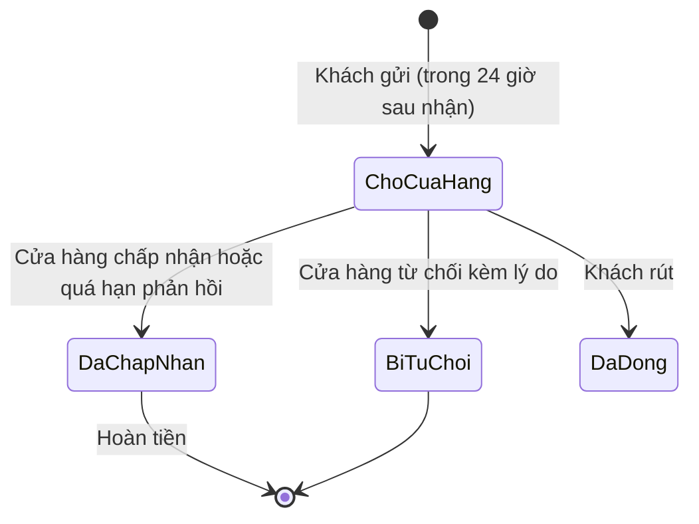

## 5.6. Thông báo và tác động

*Vai trò: Khách hàng (app Android) · 5 UC: R1-073 đến R1-077*

### 5.6.1. Mục tiêu nghiệp vụ

Giữ khách được thông tin về đơn và deal, cho khách tra cứu lịch sử tiền bạc, và cho thấy tác động cá nhân (tiền tiết kiệm, khối lượng thực phẩm cứu được) bằng số liệu có căn cứ, không dùng cơ chế gây nghiện.

### 5.6.2. Phạm vi

**Thuộc phân hệ:** Thông báo; Tác động cá nhân; Thanh toán đã qua.

**Danh sách UC:** R1-073 Xem danh sách thông báo; R1-074 Đánh dấu đã đọc; R1-075 Nhắc giờ nhận hàng (hệ thống); R1-076 Xem thống kê tác động cá nhân; R1-077 Xem lịch sử thanh toán và hoàn tiền.

**Nằm ngoài phạm vi:** Gửi thông báo qua email hoặc SMS ngoài OTP; xếp hạng người dùng.

### 5.6.3. Tác nhân và quyền hạn

Khách hàng (app Android); hệ thống gửi push qua FCM.

### 5.6.4. Dữ liệu nghiệp vụ

| Thực thể | Ý nghĩa, nguồn hình thành và ảnh hưởng đến quyết định nghiệp vụ |
|---|---|
| Thông báo trong app | Tiêu đề, nội dung, thời gian, trạng thái đọc, liên kết đến đối tượng; giữ 90 ngày. |
| Giao dịch của khách | Thanh toán và hoàn tiền kèm trạng thái, chỉ xem, không xóa. |
| Chỉ số tác động | Số đơn Đã nhận, tiền tiết kiệm = tổng (giá gốc trừ giá bán) nhân số lượng, khối lượng ước tính theo trọng lượng cửa hàng khai báo. |

### 5.6.5. Quy trình nghiệp vụ tổng thể

1. Mỗi sự kiện nghiệp vụ (nhắc giờ nhận, đơn hết hạn, khiếu nại) tạo thông báo trong app và đẩy FCM; nếu FCM lỗi thì thông báo vẫn nằm trong app.
2. Khách xem danh sách, đánh dấu đã đọc từng cái hoặc tất cả, xem lịch sử giao dịch và thống kê tác động của mình.

**Phân hệ phụ thuộc và liên kết:** Phụ thuộc mọi phân hệ phát sinh sự kiện cho khách; phụ thuộc Tài khoản (nhóm thông báo, FCM token).

### 5.6.6. Đặc tả từng UC

##### R1-073 - Xem danh sách thông báo

**Mã UC:** R1-073  
**Tên UC:** Xem danh sách thông báo  
**Nhóm:** Thông báo và tác động / Thông báo · **Loại:** Truy vấn và hiển thị  
**Mục tiêu:** Khách xem thông báo trong app: deal mới, đơn, nhắc giờ nhận, khiếu nại. *[Xác định trong Excel]*  
**Tác nhân:** Khách hàng (app Android)  

**Điều kiện tiên quyết** *[Tổng hợp từ ma trận gói và vai trò]*
- Khách đã đăng nhập trên app Android, tài khoản ở trạng thái Hoạt động (đã xác minh), phiên còn hiệu lực.
- Gói dịch vụ: Vai Khách, không phụ thuộc gói trả phí (GOI-KH); không có hạn mức riêng.

**Dữ liệu hiển thị (UC không có trường nhập)** *[Xác định trong Excel]*
- Hiển thị: tiêu đề, nội dung, thời gian, trạng thái đọc, liên kết

**Luồng xử lý chính** *[Tổng hợp từ mô tả, quy tắc và kết quả]*
1. Người dùng mở màn hình "Xem danh sách thông báo" trên app Android.
2. Hệ thống xác thực phiên, xác định phạm vi dữ liệu của người dùng và áp các quy tắc hiển thị của UC.
3. Truy vấn dữ liệu: Khách xem thông báo trong app: deal mới, đơn, nhắc giờ nhận, khiếu nại.
4. Hiển thị các thuộc tính: tiêu đề, nội dung, thời gian, trạng thái đọc, liên kết.
5. Trường hợp không có dữ liệu hoặc không hợp lệ được xử lý theo mục Validation; không thay đổi dữ liệu nghiệp vụ.

**Business Rules** *[Xác định trong Excel]*
1. Giữ 90 ngày; chỉ thấy thông báo của mình.

**Validation** *[Xác định trong Excel]*
1. Không có.

**Luồng thay thế và ngoại lệ**
- Người dùng không có quyền hoặc đối tượng không thuộc phạm vi dữ liệu của mình: từ chối, không tiết lộ sự tồn tại của dữ liệu thuộc người khác (đề xuất hoàn thiện).
- Mất kết nối hoặc lỗi hệ thống giữa chừng: thao tác không được ghi nhận một phần; người dùng được thông báo và thử lại, thao tác thay đổi dữ liệu dùng khóa chống trùng khi áp dụng (đề xuất hoàn thiện).

**Dữ liệu thay đổi** *[Tổng hợp]*  
Không tạo hoặc thay đổi dữ liệu nghiệp vụ; chỉ đọc theo phạm vi của người dùng.

**Chuyển trạng thái** *[Tổng hợp]*
- Không chuyển trạng thái của đối tượng nghiệp vụ.

**Kết quả** *[Xác định trong Excel]*  
Danh sách thông báo.

**Tác động liên phân hệ** *[Tổng hợp]*  
Dữ liệu hoặc quy tắc của UC liên quan đến: Đơn hàng; Khiếu nại.

**Điều kiện hoàn thành** *[Tổng hợp]*  
Thành công khi: Danh sách thông báo. Không hoàn tất khi bất kỳ điều kiện Validation nào không đạt hoặc dịch vụ liên quan lỗi; dữ liệu giữ nguyên trạng thái trước thao tác.

**Tiêu chí nghiệm thu** *[Tổng hợp, kiểm tra được]*
1. Given khách đủ điều kiện tiên quyết và dữ liệu hợp lệ, When thực hiện "Xem danh sách thông báo", Then kết quả đạt được là: danh sách thông báo.
2. Given thao tác "Xem danh sách thông báo" được thực hiện, When hệ thống áp dụng quy tắc "Giữ 90 ngày; chỉ thấy thông báo của mình", Then kết quả không được vi phạm quy tắc này.

##### R1-074 - Đánh dấu đã đọc

**Mã UC:** R1-074  
**Tên UC:** Đánh dấu đã đọc  
**Nhóm:** Thông báo và tác động / Thông báo · **Loại:** Cập nhật  
**Mục tiêu:** Khách đánh dấu một hoặc tất cả thông báo đã đọc. *[Xác định trong Excel]*  
**Tác nhân:** Khách hàng (app Android)  

**Điều kiện tiên quyết** *[Tổng hợp từ ma trận gói và vai trò]*
- Khách đã đăng nhập trên app Android, tài khoản ở trạng thái Hoạt động (đã xác minh), phiên còn hiệu lực.
- Gói dịch vụ: Vai Khách, không phụ thuộc gói trả phí (GOI-KH); không có hạn mức riêng.

**Dữ liệu đầu vào và hiển thị** *[Xác định trong Excel]*
- Mã thông báo (hệ thống)

**Luồng xử lý chính** *[Tổng hợp từ mô tả, quy tắc và kết quả]*
1. Người dùng mở "Đánh dấu đã đọc" trên app Android; hệ thống nạp giá trị hiện tại.
2. Người dùng thay đổi: Mã thông báo.
3. Hệ thống kiểm tra quyền, trạng thái hiện tại của đối tượng và điều kiện ở mục Validation.
4. Xử lý nghiệp vụ: Khách đánh dấu một hoặc tất cả thông báo đã đọc.
5. Hệ thống lưu giá trị mới, ghi lịch sử hoặc nhật ký nếu quy tắc yêu cầu và phản hồi: Số chưa đọc cập nhật.

**Business Rules** *[Xác định trong Excel]*
1. Chỉ đánh dấu thông báo của mình.

**Validation** *[Xác định trong Excel]*
1. Mã không tồn tại: bỏ qua.

**Luồng thay thế và ngoại lệ**
- Mọi trường hợp không hợp lệ nêu ở mục Validation là luồng ngoại lệ của UC này và được xử lý đúng như mô tả tại đó. *[Xác định]*
- Người dùng không có quyền hoặc đối tượng không thuộc phạm vi dữ liệu của mình: từ chối, không tiết lộ sự tồn tại của dữ liệu thuộc người khác (đề xuất hoàn thiện).
- Mất kết nối hoặc lỗi hệ thống giữa chừng: thao tác không được ghi nhận một phần; người dùng được thông báo và thử lại, thao tác thay đổi dữ liệu dùng khóa chống trùng khi áp dụng (đề xuất hoàn thiện).

**Dữ liệu thay đổi** *[Tổng hợp]*  
Theo kết quả đã xác định: Số chưa đọc cập nhật.

**Chuyển trạng thái** *[Tổng hợp]*
- Excel không nêu chuyển trạng thái riêng cho UC này; đối tượng giữ trạng thái hiện tại trừ phần được nêu ở mục Kết quả.

**Kết quả** *[Xác định trong Excel]*  
Số chưa đọc cập nhật.

**Tác động liên phân hệ** *[Tổng hợp]*  
Không phát sinh tác động đáng kể ngoài phân hệ; dữ liệu chỉ dùng trong phạm vi chức năng.

**Điều kiện hoàn thành** *[Tổng hợp]*  
Thành công khi: Số chưa đọc cập nhật. Không hoàn tất khi bất kỳ điều kiện Validation nào không đạt hoặc dịch vụ liên quan lỗi; dữ liệu giữ nguyên trạng thái trước thao tác.

**Tiêu chí nghiệm thu** *[Tổng hợp, kiểm tra được]*
1. Given khách đủ điều kiện tiên quyết và dữ liệu hợp lệ, When thực hiện "Đánh dấu đã đọc", Then kết quả đạt được là: số chưa đọc cập nhật.
2. Given mã không tồn tại, When thực hiện "Đánh dấu đã đọc", Then bỏ qua.
3. Given thao tác "Đánh dấu đã đọc" được thực hiện, When hệ thống áp dụng quy tắc "Chỉ đánh dấu thông báo của mình", Then kết quả không được vi phạm quy tắc này.

##### R1-075 - Nhắc giờ nhận hàng (hệ thống)

**Mã UC:** R1-075  
**Tên UC:** Nhắc giờ nhận hàng (hệ thống)  
**Nhóm:** Thông báo và tác động / Thông báo · **Loại:** Tác vụ hệ thống  
**Mục tiêu:** Hệ thống gửi push trước khung nhận 30 phút cho đơn Đã thanh toán chưa nhận. *[Xác định trong Excel]*  
**Tác nhân:** Hệ thống (tác vụ nền); đối tượng chịu tác động: Khách hàng (app Android)  

**Điều kiện tiên quyết** *[Tổng hợp từ ma trận gói và vai trò]*
- Tác vụ hệ thống chạy theo lịch hoặc theo sự kiện; không cần người dùng đăng nhập tại thời điểm chạy.
- Gói dịch vụ: Vai Khách, không phụ thuộc gói trả phí (GOI-KH); không có hạn mức riêng.

**Dữ liệu đầu vào và hiển thị** *[Xác định trong Excel]*
- Mã đơn, khung nhận (hệ thống)

**Luồng xử lý chính** *[Tổng hợp từ mô tả, quy tắc và kết quả]*
1. Bộ lập lịch hoặc sự kiện nghiệp vụ kích hoạt tác vụ "Nhắc giờ nhận hàng (hệ thống)".
2. Hệ thống lọc đối tượng thuộc phạm vi xử lý bằng điều kiện trạng thái và thời gian của dữ liệu.
3. Xử lý theo mô tả nghiệp vụ: Hệ thống gửi push trước khung nhận 30 phút cho đơn Đã thanh toán chưa nhận.
4. Mỗi đối tượng chỉ được xử lý một lần; thay đổi dữ liệu và trạng thái nằm trong cùng một giao dịch để tránh trạng thái nửa chừng.
5. Hệ thống ghi nhận kết quả, gửi thông báo liên quan nếu có và để lại nhật ký chạy: Khách nhận thông báo nhắc.

**Business Rules** *[Xác định trong Excel]*
1. Gửi một lần mỗi đơn; không gửi cho đơn đã hủy.

**Validation** *[Xác định trong Excel]*
1. FCM lỗi: lưu thông báo trong app.

**Luồng thay thế và ngoại lệ**
- Mọi trường hợp không hợp lệ nêu ở mục Validation là luồng ngoại lệ của UC này và được xử lý đúng như mô tả tại đó. *[Xác định]*
- Lần chạy bị gián đoạn: lần chạy sau xử lý lại các đối tượng chưa xử lý; đối tượng đã xử lý không bị xử lý lần hai (đề xuất hoàn thiện).

**Dữ liệu thay đổi** *[Tổng hợp]*  
Theo kết quả đã xác định: Khách nhận thông báo nhắc.

**Chuyển trạng thái** *[Tổng hợp]*
- Excel không nêu chuyển trạng thái riêng cho UC này; đối tượng giữ trạng thái hiện tại trừ phần được nêu ở mục Kết quả.

**Kết quả** *[Xác định trong Excel]*  
Khách nhận thông báo nhắc.

**Tác động liên phân hệ** *[Tổng hợp]*  
Dữ liệu hoặc quy tắc của UC liên quan đến: Đơn hàng; Thanh toán và hoàn tiền.

**Điều kiện hoàn thành** *[Tổng hợp]*  
Thành công khi: Khách nhận thông báo nhắc. Không hoàn tất khi bất kỳ điều kiện Validation nào không đạt hoặc dịch vụ liên quan lỗi; dữ liệu giữ nguyên trạng thái trước thao tác.

**Tiêu chí nghiệm thu** *[Tổng hợp, kiểm tra được]*
1. Given có đối tượng thuộc phạm vi xử lý của tác vụ, When tác vụ "Nhắc giờ nhận hàng (hệ thống)" chạy, Then kết quả đạt được là: khách nhận thông báo nhắc.
2. Given fCM lỗi, When thực hiện "Nhắc giờ nhận hàng (hệ thống)", Then lưu thông báo trong app.
3. Given thao tác "Nhắc giờ nhận hàng (hệ thống)" được thực hiện, When hệ thống áp dụng quy tắc "Gửi một lần mỗi đơn; không gửi cho đơn đã hủy", Then kết quả không được vi phạm quy tắc này.

##### R1-076 - Xem thống kê tác động cá nhân

**Mã UC:** R1-076  
**Tên UC:** Xem thống kê tác động cá nhân  
**Nhóm:** Thông báo và tác động / Tác động cá nhân · **Loại:** Truy vấn và hiển thị  
**Mục tiêu:** Khách xem số đơn đã nhận, tiền tiết kiệm so với giá gốc và khối lượng thực phẩm cứu được ước tính. *[Xác định trong Excel]*  
**Tác nhân:** Khách hàng (app Android)  

**Điều kiện tiên quyết** *[Tổng hợp từ ma trận gói và vai trò]*
- Khách đã đăng nhập trên app Android, tài khoản ở trạng thái Hoạt động (đã xác minh), phiên còn hiệu lực.
- Gói dịch vụ: Vai Khách, không phụ thuộc gói trả phí (GOI-KH); không có hạn mức riêng.

**Dữ liệu hiển thị (UC không có trường nhập)** *[Xác định trong Excel]*
- Hiển thị: số đơn nhận, tiền tiết kiệm = tổng(giá gốc - giá bán) x số lượng, khối lượng ước tính (kg)

**Luồng xử lý chính** *[Tổng hợp từ mô tả, quy tắc và kết quả]*
1. Người dùng mở màn hình "Xem thống kê tác động cá nhân" trên app Android.
2. Hệ thống xác thực phiên, xác định phạm vi dữ liệu của người dùng và áp các quy tắc hiển thị của UC.
3. Truy vấn dữ liệu: Khách xem số đơn đã nhận, tiền tiết kiệm so với giá gốc và khối lượng thực phẩm cứu được ước tính.
4. Hiển thị các thuộc tính: số đơn nhận, tiền tiết kiệm = tổng(giá gốc - giá bán) x số lượng, khối lượng ước tính (kg).
5. Trường hợp không có dữ liệu hoặc không hợp lệ được xử lý theo mục Validation; không thay đổi dữ liệu nghiệp vụ.

**Business Rules** *[Xác định trong Excel]*
1. Chỉ tính đơn Đã nhận.
2. Khối lượng ước tính theo trọng lượng cửa hàng khai báo cho từng món; món chưa khai báo không tính và có ghi chú.

**Validation** *[Xác định trong Excel]*
1. Chưa có đơn: hiện 0.

**Luồng thay thế và ngoại lệ**
- Mọi trường hợp không hợp lệ nêu ở mục Validation là luồng ngoại lệ của UC này và được xử lý đúng như mô tả tại đó. *[Xác định]*
- Người dùng không có quyền hoặc đối tượng không thuộc phạm vi dữ liệu của mình: từ chối, không tiết lộ sự tồn tại của dữ liệu thuộc người khác (đề xuất hoàn thiện).
- Mất kết nối hoặc lỗi hệ thống giữa chừng: thao tác không được ghi nhận một phần; người dùng được thông báo và thử lại, thao tác thay đổi dữ liệu dùng khóa chống trùng khi áp dụng (đề xuất hoàn thiện).

**Dữ liệu thay đổi** *[Tổng hợp]*  
Không tạo hoặc thay đổi dữ liệu nghiệp vụ; chỉ đọc theo phạm vi của người dùng.

**Chuyển trạng thái** *[Tổng hợp]*
- Không chuyển trạng thái của đối tượng nghiệp vụ.

**Kết quả** *[Xác định trong Excel]*  
Hiển thị chỉ số cá nhân.

**Tác động liên phân hệ** *[Tổng hợp]*  
Dữ liệu hoặc quy tắc của UC liên quan đến: Đơn hàng.

**Điều kiện hoàn thành** *[Tổng hợp]*  
Thành công khi: Hiển thị chỉ số cá nhân. Không hoàn tất khi bất kỳ điều kiện Validation nào không đạt hoặc dịch vụ liên quan lỗi; dữ liệu giữ nguyên trạng thái trước thao tác.

**Tiêu chí nghiệm thu** *[Tổng hợp, kiểm tra được]*
1. Given khách đủ điều kiện tiên quyết và dữ liệu hợp lệ, When thực hiện "Xem thống kê tác động cá nhân", Then kết quả đạt được là: hiển thị chỉ số cá nhân.
2. Given chưa có đơn, When thực hiện "Xem thống kê tác động cá nhân", Then hiện 0.
3. Given thao tác "Xem thống kê tác động cá nhân" được thực hiện, When hệ thống áp dụng quy tắc "Chỉ tính đơn Đã nhận", Then kết quả không được vi phạm quy tắc này.

##### R1-077 - Xem lịch sử thanh toán và hoàn tiền

**Mã UC:** R1-077  
**Tên UC:** Xem lịch sử thanh toán và hoàn tiền  
**Nhóm:** Thông báo và tác động / Thanh toán đã qua · **Loại:** Truy vấn và hiển thị  
**Mục tiêu:** Khách xem các giao dịch thanh toán, hoàn tiền kèm trạng thái. *[Xác định trong Excel]*  
**Tác nhân:** Khách hàng (app Android)  

**Điều kiện tiên quyết** *[Tổng hợp từ ma trận gói và vai trò]*
- Khách đã đăng nhập trên app Android, tài khoản ở trạng thái Hoạt động (đã xác minh), phiên còn hiệu lực.
- Gói dịch vụ: Vai Khách, không phụ thuộc gói trả phí (GOI-KH); không có hạn mức riêng.

**Dữ liệu hiển thị (UC không có trường nhập)** *[Xác định trong Excel]*
- Hiển thị: mã giao dịch, mã đơn, số tiền, loại, trạng thái, thời gian

**Luồng xử lý chính** *[Tổng hợp từ mô tả, quy tắc và kết quả]*
1. Người dùng mở màn hình "Xem lịch sử thanh toán và hoàn tiền" trên app Android.
2. Hệ thống xác thực phiên, xác định phạm vi dữ liệu của người dùng và áp các quy tắc hiển thị của UC.
3. Truy vấn dữ liệu: Khách xem các giao dịch thanh toán, hoàn tiền kèm trạng thái.
4. Hiển thị các thuộc tính: mã giao dịch, mã đơn, số tiền, loại, trạng thái, thời gian.
5. Trường hợp không có dữ liệu hoặc không hợp lệ được xử lý theo mục Validation; không thay đổi dữ liệu nghiệp vụ.

**Business Rules** *[Xác định trong Excel]*
1. Chỉ xem giao dịch của mình; không xóa được.

**Validation** *[Xác định trong Excel]*
1. Không có.

**Luồng thay thế và ngoại lệ**
- Người dùng không có quyền hoặc đối tượng không thuộc phạm vi dữ liệu của mình: từ chối, không tiết lộ sự tồn tại của dữ liệu thuộc người khác (đề xuất hoàn thiện).
- Mất kết nối hoặc lỗi hệ thống giữa chừng: thao tác không được ghi nhận một phần; người dùng được thông báo và thử lại, thao tác thay đổi dữ liệu dùng khóa chống trùng khi áp dụng (đề xuất hoàn thiện).

**Dữ liệu thay đổi** *[Tổng hợp]*  
Không tạo hoặc thay đổi dữ liệu nghiệp vụ; chỉ đọc theo phạm vi của người dùng.

**Chuyển trạng thái** *[Tổng hợp]*
- Không chuyển trạng thái của đối tượng nghiệp vụ.

**Kết quả** *[Xác định trong Excel]*  
Hiển thị lịch sử giao dịch.

**Tác động liên phân hệ** *[Tổng hợp]*  
Dữ liệu hoặc quy tắc của UC liên quan đến: Thanh toán và hoàn tiền.

**Điều kiện hoàn thành** *[Tổng hợp]*  
Thành công khi: Hiển thị lịch sử giao dịch. Không hoàn tất khi bất kỳ điều kiện Validation nào không đạt hoặc dịch vụ liên quan lỗi; dữ liệu giữ nguyên trạng thái trước thao tác.

**Tiêu chí nghiệm thu** *[Tổng hợp, kiểm tra được]*
1. Given khách đủ điều kiện tiên quyết và dữ liệu hợp lệ, When thực hiện "Xem lịch sử thanh toán và hoàn tiền", Then kết quả đạt được là: hiển thị lịch sử giao dịch.
2. Given thao tác "Xem lịch sử thanh toán và hoàn tiền" được thực hiện, When hệ thống áp dụng quy tắc "Chỉ xem giao dịch của mình; không xóa được", Then kết quả không được vi phạm quy tắc này.

### 5.6.7. Các quy tắc nghiệp vụ dùng chung

| Mã BR | Quy tắc | UC chịu ảnh hưởng |
|---|---|---|
| BR-031 | Thông báo giao dịch (trạng thái đơn, nhắc giờ nhận của đơn đang hoạt động) không tắt được; nhóm khác tắt bật theo cài đặt. | R1-010, R1-075 |
| BR-032 | Thông báo giữ 90 ngày, chỉ chủ sở hữu thấy; nhắc giờ nhận gửi đúng một lần cho mỗi đơn và không gửi cho đơn đã hủy. | R1-073, R1-075 |
| BR-033 | Số liệu tác động chỉ tính đơn Đã nhận; món chưa khai báo trọng lượng không tính và có ghi chú. | R1-076 |

### 5.6.8. Sơ đồ quy trình

Phân hệ không có quy trình nhiều nhánh cần sơ đồ; luồng đã được mô tả ở 5.6.5 và trong từng UC.

## 5.7. Ưu đãi và tác động

*Vai trò: Khách hàng (app Android) · 4 UC: R1-078 đến R1-081*

### 5.7.1. Mục tiêu nghiệp vụ

Cho khách nhận, theo dõi và dùng ưu đãi do cửa hàng cấp, và ghi nhận thành tích tác động một cách trung thực. Phân hệ là phía khách của chiến dịch ưu đãi do Chủ cửa hàng tạo.

### 5.7.2. Phạm vi

**Thuộc phân hệ:** Ví ưu đãi; Tác động.

**Danh sách UC:** R1-078 Xem ví ưu đãi; R1-079 Nhận ưu đãi từ cửa hàng; R1-080 Xem lịch sử dùng ưu đãi; R1-081 Xem huy hiệu và chia sẻ thành tích tác động.

**Nằm ngoài phạm vi:** Ưu đãi do nền tảng tài trợ; điểm thưởng đổi quà.

### 5.7.3. Tác nhân và quyền hạn

Khách hàng (app Android); cửa hàng tạo ưu đãi ở web.

### 5.7.4. Dữ liệu nghiệp vụ

| Thực thể | Ý nghĩa, nguồn hình thành và ảnh hưởng đến quyết định nghiệp vụ |
|---|---|
| Ưu đãi trong ví | Tên, giá trị, điều kiện, hạn dùng, trạng thái (có thể Đã hết hạn), lịch sử dùng gắn đơn áp dụng. |
| Cột mốc tác động | Mốc cố định cấu hình tính từ đơn Đã nhận và kg ước tính; ảnh chia sẻ không chứa dữ liệu cá nhân. |

### 5.7.5. Quy trình nghiệp vụ tổng thể

1. Khách đồng ý nhận ưu đãi trong quyền riêng tư, rồi nhận ưu đãi từ chiến dịch của cửa hàng yêu thích hoặc nhập mã.
2. Khi đặt đơn, khách áp dụng một ưu đãi hợp lệ; lịch sử dùng ghi số tiền giảm.
3. Khách xem huy hiệu và chia sẻ thành tích khi muốn.

**Phân hệ phụ thuộc và liên kết:** Phụ thuộc Tài khoản (đồng ý ưu đãi) và Ưu đãi và chiến dịch của cửa hàng; cung cấp ưu đãi cho Đặt hàng.

### 5.7.6. Đặc tả từng UC

##### R1-078 - Xem ví ưu đãi

**Mã UC:** R1-078  
**Tên UC:** Xem ví ưu đãi  
**Nhóm:** Ưu đãi và tác động / Ví ưu đãi · **Loại:** Truy vấn và hiển thị  
**Mục tiêu:** Khách xem ưu đãi đang có, điều kiện, hạn dùng. *[Xác định trong Excel]*  
**Tác nhân:** Khách hàng (app Android)  

**Điều kiện tiên quyết** *[Tổng hợp từ ma trận gói và vai trò]*
- Khách đã đăng nhập trên app Android, tài khoản ở trạng thái Hoạt động (đã xác minh), phiên còn hiệu lực.
- Gói dịch vụ: Vai Khách, không phụ thuộc gói trả phí (GOI-KH); không có hạn mức riêng.

**Dữ liệu hiển thị (UC không có trường nhập)** *[Xác định trong Excel]*
- Hiển thị: tên, giá trị, điều kiện, hạn dùng, trạng thái

**Luồng xử lý chính** *[Tổng hợp từ mô tả, quy tắc và kết quả]*
1. Người dùng mở màn hình "Xem ví ưu đãi" trên app Android.
2. Hệ thống xác thực phiên, xác định phạm vi dữ liệu của người dùng và áp các quy tắc hiển thị của UC.
3. Truy vấn dữ liệu: Khách xem ưu đãi đang có, điều kiện, hạn dùng.
4. Hiển thị các thuộc tính: tên, giá trị, điều kiện, hạn dùng, trạng thái.
5. Trường hợp không có dữ liệu hoặc không hợp lệ được xử lý theo mục Validation; không thay đổi dữ liệu nghiệp vụ.

**Business Rules** *[Xác định trong Excel]*
1. Chỉ thấy ưu đãi cấp cho mình hoặc ưu đãi công khai đã nhận; ưu đãi hết hạn chuyển Đã hết hạn.

**Validation** *[Xác định trong Excel]*
1. Không có.

**Luồng thay thế và ngoại lệ**
- Người dùng không có quyền hoặc đối tượng không thuộc phạm vi dữ liệu của mình: từ chối, không tiết lộ sự tồn tại của dữ liệu thuộc người khác (đề xuất hoàn thiện).
- Mất kết nối hoặc lỗi hệ thống giữa chừng: thao tác không được ghi nhận một phần; người dùng được thông báo và thử lại, thao tác thay đổi dữ liệu dùng khóa chống trùng khi áp dụng (đề xuất hoàn thiện).

**Dữ liệu thay đổi** *[Tổng hợp]*  
Không tạo hoặc thay đổi dữ liệu nghiệp vụ; chỉ đọc theo phạm vi của người dùng.

**Chuyển trạng thái** *[Tổng hợp]*
- Chỉ thấy ưu đãi cấp cho mình hoặc ưu đãi công khai đã nhận; ưu đãi hết hạn chuyển Đã hết hạn.

**Kết quả** *[Xác định trong Excel]*  
Danh sách ưu đãi.

**Tác động liên phân hệ** *[Tổng hợp]*  
Dữ liệu hoặc quy tắc của UC liên quan đến: Ưu đãi và chiến dịch.

**Điều kiện hoàn thành** *[Tổng hợp]*  
Thành công khi: Danh sách ưu đãi. Không hoàn tất khi bất kỳ điều kiện Validation nào không đạt hoặc dịch vụ liên quan lỗi; dữ liệu giữ nguyên trạng thái trước thao tác.

**Tiêu chí nghiệm thu** *[Tổng hợp, kiểm tra được]*
1. Given khách đủ điều kiện tiên quyết và dữ liệu hợp lệ, When thực hiện "Xem ví ưu đãi", Then kết quả đạt được là: danh sách ưu đãi.
2. Given thao tác "Xem ví ưu đãi" được thực hiện, When hệ thống áp dụng quy tắc "Chỉ thấy ưu đãi cấp cho mình hoặc ưu đãi công khai đã nhận; ưu đãi hết hạn chuyển Đã hết hạn", Then kết quả không được vi phạm quy tắc này.

##### R1-079 - Nhận ưu đãi từ cửa hàng

**Mã UC:** R1-079  
**Tên UC:** Nhận ưu đãi từ cửa hàng  
**Nhóm:** Ưu đãi và tác động / Ví ưu đãi · **Loại:** Tạo mới  
**Mục tiêu:** Khách nhận ưu đãi từ chiến dịch của cửa hàng yêu thích hoặc nhập mã nhận. *[Xác định trong Excel]*  
**Tác nhân:** Khách hàng (app Android)  

**Điều kiện tiên quyết** *[Tổng hợp từ ma trận gói và vai trò]*
- Khách đã đăng nhập trên app Android, tài khoản ở trạng thái Hoạt động (đã xác minh), phiên còn hiệu lực.
- Gói dịch vụ: Vai Khách, không phụ thuộc gói trả phí (GOI-KH); không có hạn mức riêng.

**Dữ liệu đầu vào và hiển thị** *[Xác định trong Excel]*
- Mã chiến dịch/mã ưu đãi
- Trạng thái nhận

**Luồng xử lý chính** *[Tổng hợp từ mô tả, quy tắc và kết quả]*
1. Người dùng chọn chức năng "Nhận ưu đãi từ cửa hàng" trên app Android.
2. Người dùng nhập hoặc chọn: Mã chiến dịch/mã ưu đãi, Trạng thái nhận.
3. Hệ thống xác thực phiên, kiểm tra quyền, phạm vi dữ liệu, gói dịch vụ và hạn mức (nếu có).
4. Hệ thống kiểm tra từng điều kiện ở mục Validation; sai thì trả lỗi tại trường tương ứng và không tạo dữ liệu.
5. Xử lý nghiệp vụ: Khách nhận ưu đãi từ chiến dịch của cửa hàng yêu thích hoặc nhập mã nhận.
6. Hệ thống lưu dữ liệu, cập nhật các đối tượng liên quan và phản hồi: Ưu đãi vào ví.

**Business Rules** *[Xác định trong Excel]*
1. Chỉ nhận khi khách đồng ý nhận ưu đãi.
2. Mỗi khách nhận một lần cho mỗi chiến dịch.
3. Chiến dịch hết lượt thì từ chối.

**Validation** *[Xác định trong Excel]*
1. Hết lượt, hết hạn, đã nhận: báo rõ lý do.

**Luồng thay thế và ngoại lệ**
- Mọi trường hợp không hợp lệ nêu ở mục Validation là luồng ngoại lệ của UC này và được xử lý đúng như mô tả tại đó. *[Xác định]*
- Người dùng không có quyền hoặc đối tượng không thuộc phạm vi dữ liệu của mình: từ chối, không tiết lộ sự tồn tại của dữ liệu thuộc người khác (đề xuất hoàn thiện).
- Mất kết nối hoặc lỗi hệ thống giữa chừng: thao tác không được ghi nhận một phần; người dùng được thông báo và thử lại, thao tác thay đổi dữ liệu dùng khóa chống trùng khi áp dụng (đề xuất hoàn thiện).

**Dữ liệu thay đổi** *[Tổng hợp]*  
Theo kết quả đã xác định: Ưu đãi vào ví.

**Chuyển trạng thái** *[Tổng hợp]*
- Excel không nêu chuyển trạng thái riêng cho UC này; đối tượng giữ trạng thái hiện tại trừ phần được nêu ở mục Kết quả.

**Kết quả** *[Xác định trong Excel]*  
Ưu đãi vào ví.

**Tác động liên phân hệ** *[Tổng hợp]*  
Dữ liệu hoặc quy tắc của UC liên quan đến: Ưu đãi và chiến dịch; Cửa hàng yêu thích.

**Điều kiện hoàn thành** *[Tổng hợp]*  
Thành công khi: Ưu đãi vào ví. Không hoàn tất khi bất kỳ điều kiện Validation nào không đạt hoặc dịch vụ liên quan lỗi; dữ liệu giữ nguyên trạng thái trước thao tác.

**Tiêu chí nghiệm thu** *[Tổng hợp, kiểm tra được]*
1. Given khách đủ điều kiện tiên quyết và dữ liệu hợp lệ, When thực hiện "Nhận ưu đãi từ cửa hàng", Then kết quả đạt được là: ưu đãi vào ví.
2. Given hết lượt, hết hạn, đã nhận, When thực hiện "Nhận ưu đãi từ cửa hàng", Then báo rõ lý do.
3. Given thao tác "Nhận ưu đãi từ cửa hàng" được thực hiện, When hệ thống áp dụng quy tắc "Chỉ nhận khi khách đồng ý nhận ưu đãi", Then kết quả không được vi phạm quy tắc này.

##### R1-080 - Xem lịch sử dùng ưu đãi

**Mã UC:** R1-080  
**Tên UC:** Xem lịch sử dùng ưu đãi  
**Nhóm:** Ưu đãi và tác động / Ví ưu đãi · **Loại:** Truy vấn và hiển thị  
**Mục tiêu:** Khách xem ưu đãi đã dùng và số tiền tiết kiệm. *[Xác định trong Excel]*  
**Tác nhân:** Khách hàng (app Android)  

**Điều kiện tiên quyết** *[Tổng hợp từ ma trận gói và vai trò]*
- Khách đã đăng nhập trên app Android, tài khoản ở trạng thái Hoạt động (đã xác minh), phiên còn hiệu lực.
- Gói dịch vụ: Vai Khách, không phụ thuộc gói trả phí (GOI-KH); không có hạn mức riêng.

**Dữ liệu hiển thị (UC không có trường nhập)** *[Xác định trong Excel]*
- Hiển thị: ưu đãi, đơn áp dụng, số tiền giảm, thời điểm

**Luồng xử lý chính** *[Tổng hợp từ mô tả, quy tắc và kết quả]*
1. Người dùng mở màn hình "Xem lịch sử dùng ưu đãi" trên app Android.
2. Hệ thống xác thực phiên, xác định phạm vi dữ liệu của người dùng và áp các quy tắc hiển thị của UC.
3. Truy vấn dữ liệu: Khách xem ưu đãi đã dùng và số tiền tiết kiệm.
4. Hiển thị các thuộc tính: ưu đãi, đơn áp dụng, số tiền giảm, thời điểm.
5. Trường hợp không có dữ liệu hoặc không hợp lệ được xử lý theo mục Validation; không thay đổi dữ liệu nghiệp vụ.

**Business Rules** *[Xác định trong Excel]*
1. Chỉ xem lịch sử của mình; không xóa.

**Validation** *[Xác định trong Excel]*
1. Không có.

**Luồng thay thế và ngoại lệ**
- Người dùng không có quyền hoặc đối tượng không thuộc phạm vi dữ liệu của mình: từ chối, không tiết lộ sự tồn tại của dữ liệu thuộc người khác (đề xuất hoàn thiện).
- Mất kết nối hoặc lỗi hệ thống giữa chừng: thao tác không được ghi nhận một phần; người dùng được thông báo và thử lại, thao tác thay đổi dữ liệu dùng khóa chống trùng khi áp dụng (đề xuất hoàn thiện).

**Dữ liệu thay đổi** *[Tổng hợp]*  
Không tạo hoặc thay đổi dữ liệu nghiệp vụ; chỉ đọc theo phạm vi của người dùng.

**Chuyển trạng thái** *[Tổng hợp]*
- Không chuyển trạng thái của đối tượng nghiệp vụ.

**Kết quả** *[Xác định trong Excel]*  
Danh sách lịch sử.

**Tác động liên phân hệ** *[Tổng hợp]*  
Dữ liệu hoặc quy tắc của UC liên quan đến: Ưu đãi và chiến dịch.

**Điều kiện hoàn thành** *[Tổng hợp]*  
Thành công khi: Danh sách lịch sử. Không hoàn tất khi bất kỳ điều kiện Validation nào không đạt hoặc dịch vụ liên quan lỗi; dữ liệu giữ nguyên trạng thái trước thao tác.

**Tiêu chí nghiệm thu** *[Tổng hợp, kiểm tra được]*
1. Given khách đủ điều kiện tiên quyết và dữ liệu hợp lệ, When thực hiện "Xem lịch sử dùng ưu đãi", Then kết quả đạt được là: danh sách lịch sử.
2. Given thao tác "Xem lịch sử dùng ưu đãi" được thực hiện, When hệ thống áp dụng quy tắc "Chỉ xem lịch sử của mình; không xóa", Then kết quả không được vi phạm quy tắc này.

##### R1-081 - Xem huy hiệu và chia sẻ thành tích tác động

**Mã UC:** R1-081  
**Tên UC:** Xem huy hiệu và chia sẻ thành tích tác động  
**Nhóm:** Ưu đãi và tác động / Tác động · **Loại:** Truy vấn kèm thao tác  
**Mục tiêu:** Khách xem cột mốc dựa trên số đơn đã nhận và kg thực phẩm đã cứu; chia sẻ ảnh thành tích không chứa dữ liệu cá nhân. *[Xác định trong Excel]*  
**Tác nhân:** Khách hàng (app Android)  

**Điều kiện tiên quyết** *[Tổng hợp từ ma trận gói và vai trò]*
- Khách đã đăng nhập trên app Android, tài khoản ở trạng thái Hoạt động (đã xác minh), phiên còn hiệu lực.
- Gói dịch vụ: Vai Khách, không phụ thuộc gói trả phí (GOI-KH); không có hạn mức riêng.

**Dữ liệu đầu vào và hiển thị** *[Xác định trong Excel]*
- Hiển thị: cột mốc, số đơn, kg ước tính
- Ảnh chia sẻ (hệ thống tạo)

**Luồng xử lý chính** *[Tổng hợp từ mô tả, quy tắc và kết quả]*
1. Người dùng mở "Xem huy hiệu và chia sẻ thành tích tác động" trên app Android.
2. Hệ thống xác thực phiên và giới hạn dữ liệu theo chủ sở hữu.
3. Hiển thị thông tin: cột mốc, số đơn, kg ước tính.
4. Người dùng chọn thao tác bổ sung trên đối tượng đang xem với dữ liệu: Ảnh chia sẻ.
5. Xử lý theo mô tả nghiệp vụ: Khách xem cột mốc dựa trên số đơn đã nhận và kg thực phẩm đã cứu; chia sẻ ảnh thành tích không chứa dữ liệu cá nhân.
6. Hệ thống kiểm tra Business Rules và Validation, ghi nhận thay đổi và làm mới màn hình: Huy hiệu hiển thị; ảnh chia sẻ tạo khi khách yêu cầu.

**Business Rules** *[Xác định trong Excel]*
1. Cột mốc tính từ đơn Đã nhận, số cố định cấu hình.
2. kg chỉ tính từ trọng lượng cửa hàng khai báo.
3. Không có thông báo thúc giục hay chuỗi ngày bắt buộc.

**Validation** *[Xác định trong Excel]*
1. Chưa đạt cột mốc: hiện tiến độ.

**Luồng thay thế và ngoại lệ**
- Mọi trường hợp không hợp lệ nêu ở mục Validation là luồng ngoại lệ của UC này và được xử lý đúng như mô tả tại đó. *[Xác định]*
- Người dùng không có quyền hoặc đối tượng không thuộc phạm vi dữ liệu của mình: từ chối, không tiết lộ sự tồn tại của dữ liệu thuộc người khác (đề xuất hoàn thiện).
- Mất kết nối hoặc lỗi hệ thống giữa chừng: thao tác không được ghi nhận một phần; người dùng được thông báo và thử lại, thao tác thay đổi dữ liệu dùng khóa chống trùng khi áp dụng (đề xuất hoàn thiện).

**Dữ liệu thay đổi** *[Tổng hợp]*  
Theo kết quả đã xác định: Huy hiệu hiển thị; ảnh chia sẻ tạo khi khách yêu cầu.

**Chuyển trạng thái** *[Tổng hợp]*
- Excel không nêu chuyển trạng thái riêng cho UC này; đối tượng giữ trạng thái hiện tại trừ phần được nêu ở mục Kết quả.

**Kết quả** *[Xác định trong Excel]*  
Huy hiệu hiển thị; ảnh chia sẻ tạo khi khách yêu cầu.

**Tác động liên phân hệ** *[Tổng hợp]*  
Dữ liệu hoặc quy tắc của UC liên quan đến: Đơn hàng; Thông báo.

**Điều kiện hoàn thành** *[Tổng hợp]*  
Thành công khi: Huy hiệu hiển thị; ảnh chia sẻ tạo khi khách yêu cầu. Không hoàn tất khi bất kỳ điều kiện Validation nào không đạt hoặc dịch vụ liên quan lỗi; dữ liệu giữ nguyên trạng thái trước thao tác.

**Tiêu chí nghiệm thu** *[Tổng hợp, kiểm tra được]*
1. Given khách đủ điều kiện tiên quyết và dữ liệu hợp lệ, When thực hiện "Xem huy hiệu và chia sẻ thành tích tác động", Then kết quả đạt được là: huy hiệu hiển thị; ảnh chia sẻ tạo khi khách yêu cầu.
2. Given chưa đạt cột mốc, When thực hiện "Xem huy hiệu và chia sẻ thành tích tác động", Then hiện tiến độ.
3. Given thao tác "Xem huy hiệu và chia sẻ thành tích tác động" được thực hiện, When hệ thống áp dụng quy tắc "Cột mốc tính từ đơn Đã nhận, số cố định cấu hình", Then kết quả không được vi phạm quy tắc này.

### 5.7.7. Các quy tắc nghiệp vụ dùng chung

| Mã BR | Quy tắc | UC chịu ảnh hưởng |
|---|---|---|
| BR-034 | Chỉ nhận ưu đãi khi khách đồng ý nhận ưu đãi; mỗi khách nhận một lần cho mỗi chiến dịch; hết lượt thì từ chối. | R1-079 |
| BR-035 | Cột mốc tính từ đơn Đã nhận, không có thông báo thúc giục hay chuỗi ngày bắt buộc. | R1-081 |

### 5.7.8. Sơ đồ quy trình

Phân hệ không có quy trình nhiều nhánh cần sơ đồ; luồng đã được mô tả ở 5.7.5 và trong từng UC.

## 5.8. Trợ lý AI cho khách hàng

*Vai trò: Khách hàng (app Android) · 13 UC: R1-082 đến R1-094*

### 5.8.1. Mục tiêu nghiệp vụ

Rút ngắn thời gian từ ý định đến đơn hàng đúng nhu cầu và giảm tải hỗ trợ, bằng bộ năng lực AI tách rời khỏi lõi giao dịch: tìm deal bằng câu tự nhiên, trò chuyện, cá nhân hóa có giải thích, so sánh, hỏi thành phần dị ứng, hướng dẫn nhận hàng, soạn khiếu nại và chuyển người hỗ trợ. Nguyên tắc xuyên suốt: AI chỉ diễn đạt hoặc chuyển đổi, mọi con số lấy từ hệ thống, mọi hành động quan trọng do khách tự thực hiện.

### 5.8.2. Phạm vi

**Thuộc phân hệ:** Tìm kiếm thông minh; Trợ lý hội thoại; Cá nhân hóa; Hỗ trợ quyết định; Hỏi đáp thành phần; Hỗ trợ sau mua; Chuyển tiếp hỗ trợ; Quản lý hội thoại; Phản hồi chất lượng AI.

**Danh sách UC:** R1-082 [AI] Tìm deal bằng câu hỏi tự nhiên; R1-083 [AI] Trò chuyện với trợ lý Cứu Món; R1-084 [AI] Gợi ý deal cá nhân hóa kèm lý do; R1-085 [AI] Xem lý do gợi ý và điều chỉnh sở thích; R1-086 [AI] Tóm tắt và so sánh deal giúp lựa chọn; R1-087 [AI] Hỏi về thành phần và dị ứng của món; R1-088 [AI] Hướng dẫn nhận hàng và theo dõi đơn qua trợ lý; R1-089 [AI] Soạn khiếu nại từ ảnh và mô tả của khách; R1-090 [AI] Chuyển cuộc trò chuyện cho người hỗ trợ khi AI không đủ khả năng; R1-091 [AI] Xem và xóa lịch sử trò chuyện với trợ lý; R1-092 [AI] Đánh giá chất lượng câu trả lời và gợi ý của AI; R1-093 Nhận thông báo deal vào giờ khách hay mua; R1-094 [AI] Tóm tắt đánh giá của cửa hàng.

**Nằm ngoài phạm vi:** AI đặt, hủy hoặc hoàn tiền thay khách; AI khẳng định món an toàn với người dị ứng; AI trả lời về tài khoản người khác.

### 5.8.3. Tác nhân và quyền hạn

Khách hàng (app Android); dịch vụ AI (Gemini) gọi từ server; bên hỗ trợ nhận yêu cầu chuyển tiếp.

### 5.8.4. Dữ liệu nghiệp vụ

| Thực thể | Ý nghĩa, nguồn hình thành và ảnh hưởng đến quyết định nghiệp vụ |
|---|---|
| Bộ lọc có cấu trúc | JSON do mô hình trả về (món, giá tối đa, bán kính, giờ nhận, từ khóa), phải qua kiểm tra schema và giới hạn giá trị trước khi chạy truy vấn. |
| Hội thoại và ngữ cảnh | Tối đa 10 lượt gần nhất; ghi nhớ ngữ cảnh chỉ khi khách bật; giữ tối đa 90 ngày, xóa được. |
| Thành phần điểm gợi ý | Điểm tính bằng công thức xác định từ đơn đã nhận, cửa hàng yêu thích, giờ mua, hồ sơ ăn uống; AI chỉ viết câu giải thích. |
| Nhật ký AI | Mã yêu cầu, tính năng, phạm vi dữ liệu truy cập, mô hình, độ trễ, kết quả, phản hồi của khách. |

### 5.8.5. Quy trình nghiệp vụ tổng thể

1. Khách đưa đầu vào (câu hỏi, chọn deal, ảnh khiếu nại); hệ thống kiểm tra đồng ý, hạn mức 30 lượt mỗi ngày (soạn khiếu nại 10 lượt).
2. Hệ thống thu thập dữ liệu thật trong phạm vi của khách, mô hình xử lý phần ngôn ngữ, hệ thống kiểm tra đầu ra (schema, đối chiếu số) rồi hiển thị kèm nhãn nguồn.
3. Khách tự quyết định: sửa bộ lọc, đặt đơn, gửi khiếu nại, hay chuyển cho người hỗ trợ; khách đánh giá chất lượng câu trả lời.
4. Khi AI lỗi, hết thời gian chờ 10 giây hoặc hết hạn mức, ứng dụng quay lại chức năng thông thường tương ứng; không chức năng lõi nào bị chặn.

**Phân hệ phụ thuộc và liên kết:** Phụ thuộc Tài khoản (đồng ý cá nhân hóa, ghi nhớ ngữ cảnh), Khám phá deal, Đặt hàng, Hậu mãi. Không phân hệ nào khác phụ thuộc vào AI để chạy.

### 5.8.6. Đặc tả từng UC

##### R1-082 - [AI] Tìm deal bằng câu hỏi tự nhiên

**Mã UC:** R1-082  
**Tên UC:** [AI] Tìm deal bằng câu hỏi tự nhiên  
**Nhóm:** Trợ lý AI cho khách hàng / Tìm kiếm thông minh · **Loại:** UC AI sinh ngôn ngữ  
**Mục tiêu:** Khách gõ câu như bánh ngọt dưới 30 nghìn gần chỗ làm sau 19 giờ. Mô hình chỉ chuyển câu thành bộ lọc có cấu trúc (loại món, giá, khoảng cách, giờ); hệ thống chạy truy vấn thật trên dữ liệu suất đang mở và trả danh sách. AI không tạo ra deal. *[Xác định trong Excel]*  
**Tác nhân:** Khách hàng (app Android); dịch vụ AI (Gemini) gọi từ server  

**Điều kiện tiên quyết** *[Tổng hợp từ ma trận gói và vai trò]*
- Khách đã đăng nhập trên app Android, tài khoản ở trạng thái Hoạt động (đã xác minh), phiên còn hiệu lực.
- Gói dịch vụ: Vai Khách, không phụ thuộc gói trả phí (GOI-KH). Hạn mức vận hành AI: 30 lượt/ngày (hạn mức vận hành AI, không phải gói), đặt lại hằng ngày.
- Khách đã đồng ý các mục liên quan trong quyền riêng tư và cá nhân hóa khi UC yêu cầu, và còn hạn mức AI.

**Dữ liệu đầu vào và hiển thị** *[Xác định trong Excel]*
- Đầu vào: câu hỏi (1-200 ký tự), vị trí hoặc địa điểm đã lưu
- Đầu ra của mô hình: bộ lọc JSON (món, giá_tối_đa, bán_kính, giờ_nhận, từ khóa)
- Kết quả hiển thị: danh sách suất từ CSDL

**Luồng xử lý chính** *[Tổng hợp từ mô tả, quy tắc và kết quả]*
1. Người dùng mở chức năng "Tìm deal bằng câu hỏi tự nhiên" trên app Android và cung cấp đầu vào: câu hỏi (1-200 ký tự), vị trí hoặc địa điểm đã lưu.
2. Hệ thống kiểm tra quyền, cài đặt bật/tắt AI, đồng ý của người dùng và hạn mức AI còn lại; không đạt thì dừng và dùng phương án không AI.
3. Hệ thống xác định phạm vi dữ liệu được phép đọc (chỉ dữ liệu của người dùng hoặc cửa hàng đang hỏi, cộng dữ liệu công khai của deal) rồi truy xuất dữ liệu thật bằng truy vấn hoặc phép tính xác định.
4. Mô tả xử lý: Khách gõ câu như bánh ngọt dưới 30 nghìn gần chỗ làm sau 19 giờ. Mô hình chỉ chuyển câu thành bộ lọc có cấu trúc (loại món, giá, khoảng cách, giờ); hệ thống chạy truy vấn thật trên dữ liệu suất đang mở và trả danh sách. AI không tạo ra deal.
5. Mô hình ngôn ngữ (Gemini, gọi từ server) chỉ làm phần được phép theo quy tắc của UC: chuyển câu chữ thành cấu trúc đã kiểm soát hoặc diễn đạt lại số liệu do hệ thống cung cấp.
6. Hệ thống kiểm tra đầu ra (schema, giới hạn giá trị, đối chiếu số liệu với dữ liệu nguồn); đầu ra không đạt bị loại và hiển thị phương án dự phòng.
7. Hệ thống hiển thị kết quả có gắn nhãn nguồn, ghi nhật ký AI và tính lượt vào hạn mức nếu UC có áp hạn mức. Mọi quyết định và hành động thay đổi dữ liệu chỉ diễn ra khi người dùng xác nhận và qua kiểm tra quy tắc.

**Business Rules** *[Xác định trong Excel]*
1. Bộ lọc do mô hình trả về phải qua kiểm tra schema và giới hạn giá trị trước khi chạy.
2. Mọi số liệu giá, tồn, giờ nhận lấy từ CSDL.
3. Hiển thị bộ lọc đã hiểu để khách sửa.
4. Không dùng lịch sử đơn khi cá nhân hóa đang tắt.

**Quy tắc riêng cho AI** *[Xác định trong Excel]*
- Phân tách rõ: số liệu và dữ liệu lấy từ hệ thống; phần diễn đạt do mô hình ngôn ngữ sinh; quyết định do người dùng; hành động chỉ do hệ thống thực hiện sau khi kiểm tra điều kiện.
- Hạn mức AI: 30 lượt/khách/ngày (tham số).
- Nhật ký AI lưu: mã yêu cầu, tính năng, phạm vi dữ liệu được truy cập, mô hình, độ trễ, kết quả, phản hồi của người dùng; chỉ người dùng sở hữu và cửa hàng liên quan truy vết được.
- Chỉ số đánh giá: tỷ lệ khách bấm vào kết quả, tỷ lệ phải sửa bộ lọc, thời gian đến lúc đặt đơn.

**Validation** *[Xác định trong Excel]*
1. Câu hỏi ngoài phạm vi tìm deal hoặc không rõ: yêu cầu làm rõ, không đoán.
2. Bộ lọc không hợp lệ: bỏ phần lỗi và báo phần đã hiểu.
3. Lỗi/hết thời gian chờ (10 giây) hoặc hết hạn mức: dùng bộ lọc thủ công, tính năng tìm kiếm thường vẫn hoạt động.

**Luồng thay thế và ngoại lệ**
- Mọi trường hợp không hợp lệ nêu ở mục Validation là luồng ngoại lệ của UC này và được xử lý đúng như mô tả tại đó. *[Xác định]*
- Người dùng không có quyền hoặc đối tượng không thuộc phạm vi dữ liệu của mình: từ chối, không tiết lộ sự tồn tại của dữ liệu thuộc người khác (đề xuất hoàn thiện).
- Mất kết nối hoặc lỗi hệ thống giữa chừng: thao tác không được ghi nhận một phần; người dùng được thông báo và thử lại, thao tác thay đổi dữ liệu dùng khóa chống trùng khi áp dụng (đề xuất hoàn thiện).
- Vượt hạn mức: Từ chối lượt AI, hiện thời điểm đặt lại; chức năng không dùng AI vẫn hoạt động (theo ma trận gói).

**Dữ liệu thay đổi** *[Tổng hợp]*  
Theo kết quả đã xác định: Danh sách deal khớp bộ lọc kèm cách AI hiểu câu hỏi; khách có thể chỉnh bộ lọc.

**Chuyển trạng thái** *[Tổng hợp]*
- Excel không nêu chuyển trạng thái riêng cho UC này; đối tượng giữ trạng thái hiện tại trừ phần được nêu ở mục Kết quả.

**Kết quả** *[Xác định trong Excel]*  
Danh sách deal khớp bộ lọc kèm cách AI hiểu câu hỏi; khách có thể chỉnh bộ lọc.

**Tác động liên phân hệ** *[Tổng hợp]*  
Dữ liệu hoặc quy tắc của UC liên quan đến: Suất và tồn kho trong ngày; Đơn hàng; Đánh giá; Nhật ký hoạt động; Gói dịch vụ và hạn mức.

**Điều kiện hoàn thành** *[Tổng hợp]*  
Thành công khi: Danh sách deal khớp bộ lọc kèm cách AI hiểu câu hỏi; khách có thể chỉnh bộ lọc. Không hoàn tất khi bất kỳ điều kiện Validation nào không đạt hoặc dịch vụ liên quan lỗi; dữ liệu giữ nguyên trạng thái trước thao tác.

**Tiêu chí nghiệm thu** *[Tổng hợp, kiểm tra được]*
1. Given khách đủ điều kiện tiên quyết và dữ liệu hợp lệ, When thực hiện "Tìm deal bằng câu hỏi tự nhiên", Then kết quả đạt được là: danh sách deal khớp bộ lọc kèm cách AI hiểu câu hỏi; khách có thể chỉnh bộ lọc.
2. Given câu hỏi ngoài phạm vi tìm deal hoặc không rõ, When thực hiện "Tìm deal bằng câu hỏi tự nhiên", Then yêu cầu làm rõ, không đoán.
3. Given bộ lọc không hợp lệ, When thực hiện "Tìm deal bằng câu hỏi tự nhiên", Then bỏ phần lỗi và báo phần đã hiểu.
4. Given thao tác "Tìm deal bằng câu hỏi tự nhiên" được thực hiện, When hệ thống áp dụng quy tắc "Bộ lọc do mô hình trả về phải qua kiểm tra schema và giới hạn giá trị trước khi chạy", Then kết quả không được vi phạm quy tắc này.
5. Given đã dùng hết hạn mức 30 lượt/ngày (hạn mức vận hành AI, không phải gói), When thực hiện "Tìm deal bằng câu hỏi tự nhiên" thêm một lần, Then hệ thống từ chối theo quy tắc "Từ chối lượt AI, hiện thời điểm đặt lại; chức năng không dùng AI vẫn hoạt động" và không thay đổi dữ liệu.
6. Given dịch vụ AI lỗi hoặc quá thời gian chờ, When thực hiện "Tìm deal bằng câu hỏi tự nhiên", Then chức năng không dùng AI vẫn hoạt động và người dùng nhận phương án dự phòng đã mô tả; không có số liệu nào do AI tự tạo.

##### R1-083 - [AI] Trò chuyện với trợ lý Cứu Món

**Mã UC:** R1-083  
**Tên UC:** [AI] Trò chuyện với trợ lý Cứu Món  
**Nhóm:** Trợ lý AI cho khách hàng / Trợ lý hội thoại · **Loại:** UC AI sinh ngôn ngữ  
**Mục tiêu:** Khách hỏi đáp nhiều lượt với trợ lý về deal quanh mình, cách nhận hàng, trạng thái đơn của chính mình. Trợ lý gọi các công cụ có kiểm soát (tìm deal, xem đơn của khách, tra thông tin cửa hàng) và chỉ trả lời dựa trên kết quả công cụ. *[Xác định trong Excel]*  
**Tác nhân:** Khách hàng (app Android); dịch vụ AI (Gemini) gọi từ server  

**Điều kiện tiên quyết** *[Tổng hợp từ ma trận gói và vai trò]*
- Khách đã đăng nhập trên app Android, tài khoản ở trạng thái Hoạt động (đã xác minh), phiên còn hiệu lực.
- Gói dịch vụ: Vai Khách, không phụ thuộc gói trả phí (GOI-KH). Hạn mức vận hành AI: 30 lượt/ngày (hạn mức vận hành AI, không phải gói), đặt lại hằng ngày.
- Khách đã đồng ý các mục liên quan trong quyền riêng tư và cá nhân hóa khi UC yêu cầu, và còn hạn mức AI.

**Dữ liệu đầu vào và hiển thị** *[Xác định trong Excel]*
- Đầu vào: tin nhắn (1-500 ký tự), mã phiên hội thoại
- Ngữ cảnh: tối đa 10 lượt gần nhất, đơn của chính khách khi cần
- Đầu ra: câu trả lời và liên kết hành động

**Luồng xử lý chính** *[Tổng hợp từ mô tả, quy tắc và kết quả]*
1. Người dùng mở chức năng "Trò chuyện với trợ lý Cứu Món" trên app Android và cung cấp đầu vào: tin nhắn (1-500 ký tự), mã phiên hội thoại, tối đa 10 lượt gần nhất, đơn của chính khách khi cần.
2. Hệ thống kiểm tra quyền, cài đặt bật/tắt AI, đồng ý của người dùng và hạn mức AI còn lại; không đạt thì dừng và dùng phương án không AI.
3. Hệ thống xác định phạm vi dữ liệu được phép đọc (chỉ dữ liệu của người dùng hoặc cửa hàng đang hỏi, cộng dữ liệu công khai của deal) rồi truy xuất dữ liệu thật bằng truy vấn hoặc phép tính xác định.
4. Mô tả xử lý: Khách hỏi đáp nhiều lượt với trợ lý về deal quanh mình, cách nhận hàng, trạng thái đơn của chính mình. Trợ lý gọi các công cụ có kiểm soát (tìm deal, xem đơn của khách, tra thông tin cửa hàng) và chỉ trả lời dựa trên kết quả công cụ.
5. Mô hình ngôn ngữ (Gemini, gọi từ server) chỉ làm phần được phép theo quy tắc của UC: chuyển câu chữ thành cấu trúc đã kiểm soát hoặc diễn đạt lại số liệu do hệ thống cung cấp.
6. Hệ thống kiểm tra đầu ra (schema, giới hạn giá trị, đối chiếu số liệu với dữ liệu nguồn); đầu ra không đạt bị loại và hiển thị phương án dự phòng.
7. Hệ thống hiển thị kết quả có gắn nhãn nguồn, ghi nhật ký AI và tính lượt vào hạn mức nếu UC có áp hạn mức. Mọi quyết định và hành động thay đổi dữ liệu chỉ diễn ra khi người dùng xác nhận và qua kiểm tra quy tắc.

**Business Rules** *[Xác định trong Excel]*
1. Trợ lý chỉ truy cập dữ liệu của chính khách và dữ liệu công khai của deal.
2. Trợ lý không đặt hàng, không hủy, không hoàn tiền; chỉ đưa liên kết để khách tự thao tác.
3. Không trả lời câu hỏi về tài khoản người khác.
4. Ghi nhớ ngữ cảnh chỉ khi khách bật; tắt thì xóa sau phiên.

**Quy tắc riêng cho AI** *[Xác định trong Excel]*
- Phân tách rõ: số liệu và dữ liệu lấy từ hệ thống; phần diễn đạt do mô hình ngôn ngữ sinh; quyết định do người dùng; hành động chỉ do hệ thống thực hiện sau khi kiểm tra điều kiện.
- Hạn mức AI: 30 lượt/khách/ngày (tham số).
- Nhật ký AI lưu: mã yêu cầu, tính năng, phạm vi dữ liệu được truy cập, mô hình, độ trễ, kết quả, phản hồi của người dùng; chỉ người dùng sở hữu và cửa hàng liên quan truy vết được.
- Chỉ số đánh giá: tỷ lệ phiên giải quyết không cần hỗ trợ người thật, điểm hài lòng, tỷ lệ chuyển hỗ trợ.

**Validation** *[Xác định trong Excel]*
1. Câu hỏi thiếu dữ liệu: nói rõ chưa có thông tin, đề nghị chuyển yêu cầu hỗ trợ.
2. Nội dung độc hại hoặc cố lấy dữ liệu người khác: từ chối.
3. Lỗi/hết thời gian chờ (10 giây) hoặc hết hạn mức: hiện thông báo trợ lý tạm không khả dụng, các chức năng khác giữ nguyên.

**Luồng thay thế và ngoại lệ**
- Mọi trường hợp không hợp lệ nêu ở mục Validation là luồng ngoại lệ của UC này và được xử lý đúng như mô tả tại đó. *[Xác định]*
- Người dùng không có quyền hoặc đối tượng không thuộc phạm vi dữ liệu của mình: từ chối, không tiết lộ sự tồn tại của dữ liệu thuộc người khác (đề xuất hoàn thiện).
- Mất kết nối hoặc lỗi hệ thống giữa chừng: thao tác không được ghi nhận một phần; người dùng được thông báo và thử lại, thao tác thay đổi dữ liệu dùng khóa chống trùng khi áp dụng (đề xuất hoàn thiện).
- Vượt hạn mức: Từ chối lượt AI, hiện thời điểm đặt lại; chức năng không dùng AI vẫn hoạt động (theo ma trận gói).

**Dữ liệu thay đổi** *[Tổng hợp]*  
Theo kết quả đã xác định: Khách nhận câu trả lời kèm nguồn dữ liệu (deal, đơn); có nút phản hồi hữu ích hoặc không.

**Chuyển trạng thái** *[Tổng hợp]*
- Excel không nêu chuyển trạng thái riêng cho UC này; đối tượng giữ trạng thái hiện tại trừ phần được nêu ở mục Kết quả.

**Kết quả** *[Xác định trong Excel]*  
Khách nhận câu trả lời kèm nguồn dữ liệu (deal, đơn); có nút phản hồi hữu ích hoặc không.

**Tác động liên phân hệ** *[Tổng hợp]*  
Dữ liệu hoặc quy tắc của UC liên quan đến: Đơn hàng; Thanh toán và hoàn tiền; Đánh giá; Nhật ký hoạt động; Gói dịch vụ và hạn mức.

**Điều kiện hoàn thành** *[Tổng hợp]*  
Thành công khi: Khách nhận câu trả lời kèm nguồn dữ liệu (deal, đơn); có nút phản hồi hữu ích hoặc không. Không hoàn tất khi bất kỳ điều kiện Validation nào không đạt hoặc dịch vụ liên quan lỗi; dữ liệu giữ nguyên trạng thái trước thao tác.

**Tiêu chí nghiệm thu** *[Tổng hợp, kiểm tra được]*
1. Given khách đủ điều kiện tiên quyết và dữ liệu hợp lệ, When thực hiện "Trò chuyện với trợ lý Cứu Món", Then kết quả đạt được là: khách nhận câu trả lời kèm nguồn dữ liệu (deal, đơn); có nút phản hồi hữu ích hoặc không.
2. Given câu hỏi thiếu dữ liệu, When thực hiện "Trò chuyện với trợ lý Cứu Món", Then nói rõ chưa có thông tin, đề nghị chuyển yêu cầu hỗ trợ.
3. Given nội dung độc hại hoặc cố lấy dữ liệu người khác, When thực hiện "Trò chuyện với trợ lý Cứu Món", Then từ chối.
4. Given thao tác "Trò chuyện với trợ lý Cứu Món" được thực hiện, When hệ thống áp dụng quy tắc "Trợ lý chỉ truy cập dữ liệu của chính khách và dữ liệu công khai của deal", Then kết quả không được vi phạm quy tắc này.
5. Given đã dùng hết hạn mức 30 lượt/ngày (hạn mức vận hành AI, không phải gói), When thực hiện "Trò chuyện với trợ lý Cứu Món" thêm một lần, Then hệ thống từ chối theo quy tắc "Từ chối lượt AI, hiện thời điểm đặt lại; chức năng không dùng AI vẫn hoạt động" và không thay đổi dữ liệu.
6. Given dịch vụ AI lỗi hoặc quá thời gian chờ, When thực hiện "Trò chuyện với trợ lý Cứu Món", Then chức năng không dùng AI vẫn hoạt động và người dùng nhận phương án dự phòng đã mô tả; không có số liệu nào do AI tự tạo.

##### R1-084 - [AI] Gợi ý deal cá nhân hóa kèm lý do

**Mã UC:** R1-084  
**Tên UC:** [AI] Gợi ý deal cá nhân hóa kèm lý do  
**Nhóm:** Trợ lý AI cho khách hàng / Cá nhân hóa · **Loại:** UC AI sinh ngôn ngữ  
**Mục tiêu:** Hệ thống xếp hạng deal theo lịch sử đơn, cửa hàng yêu thích, giờ hay mua và hồ sơ ăn uống bằng điểm có thể giải thích; mô hình ngôn ngữ chỉ viết câu giải thích ngắn từ các thành phần điểm. *[Xác định trong Excel]*  
**Tác nhân:** Khách hàng (app Android); dịch vụ AI (Gemini) gọi từ server  

**Điều kiện tiên quyết** *[Tổng hợp từ ma trận gói và vai trò]*
- Khách đã đăng nhập trên app Android, tài khoản ở trạng thái Hoạt động (đã xác minh), phiên còn hiệu lực.
- Gói dịch vụ: Vai Khách, không phụ thuộc gói trả phí (GOI-KH). Hạn mức vận hành AI: 100 lượt giải thích/ngày (không tính vào hạn mức 30 lượt hỏi/ngày), đặt lại hằng ngày.
- Khách đã đồng ý các mục liên quan trong quyền riêng tư và cá nhân hóa khi UC yêu cầu, và còn hạn mức AI.

**Dữ liệu đầu vào và hiển thị** *[Xác định trong Excel]*
- Dữ liệu dùng: đơn đã nhận, cửa hàng yêu thích, giờ mua, hồ sơ ăn uống (nếu có)
- Đầu ra: danh sách deal, thành phần điểm, câu giải thích

**Luồng xử lý chính** *[Tổng hợp từ mô tả, quy tắc và kết quả]*
1. Người dùng mở chức năng "Gợi ý deal cá nhân hóa kèm lý do" trên app Android và cung cấp đầu vào: đơn đã nhận, cửa hàng yêu thích, giờ mua, hồ sơ ăn uống (nếu có).
2. Hệ thống kiểm tra quyền, cài đặt bật/tắt AI, đồng ý của người dùng và hạn mức AI còn lại; không đạt thì dừng và dùng phương án không AI.
3. Hệ thống xác định phạm vi dữ liệu được phép đọc (chỉ dữ liệu của người dùng hoặc cửa hàng đang hỏi, cộng dữ liệu công khai của deal) rồi truy xuất dữ liệu thật bằng truy vấn hoặc phép tính xác định.
4. Mô tả xử lý: Hệ thống xếp hạng deal theo lịch sử đơn, cửa hàng yêu thích, giờ hay mua và hồ sơ ăn uống bằng điểm có thể giải thích; mô hình ngôn ngữ chỉ viết câu giải thích ngắn từ các thành phần điểm.
5. Mô hình ngôn ngữ (Gemini, gọi từ server) chỉ làm phần được phép theo quy tắc của UC: chuyển câu chữ thành cấu trúc đã kiểm soát hoặc diễn đạt lại số liệu do hệ thống cung cấp.
6. Hệ thống kiểm tra đầu ra (schema, giới hạn giá trị, đối chiếu số liệu với dữ liệu nguồn); đầu ra không đạt bị loại và hiển thị phương án dự phòng.
7. Hệ thống hiển thị kết quả có gắn nhãn nguồn, ghi nhật ký AI và tính lượt vào hạn mức nếu UC có áp hạn mức. Mọi quyết định và hành động thay đổi dữ liệu chỉ diễn ra khi người dùng xác nhận và qua kiểm tra quy tắc.

**Business Rules** *[Xác định trong Excel]*
1. Chỉ chạy khi khách bật cá nhân hóa.
2. Điểm tính bằng công thức xác định; AI không đổi thứ hạng.
3. Deal có thành phần khách tránh bị loại hoặc gắn cảnh báo.
4. Không dùng dữ liệu của khách khác để gợi ý thông tin cá nhân.

**Quy tắc riêng cho AI** *[Xác định trong Excel]*
- Phân tách rõ: số liệu và dữ liệu lấy từ hệ thống; phần diễn đạt do mô hình ngôn ngữ sinh; quyết định do người dùng; hành động chỉ do hệ thống thực hiện sau khi kiểm tra điều kiện.
- Hạn mức AI: Không tính hạn mức lượt hỏi; câu giải thích tối đa 100 lượt/khách/ngày.
- Nhật ký AI lưu: mã yêu cầu, tính năng, phạm vi dữ liệu được truy cập, mô hình, độ trễ, kết quả, phản hồi của người dùng; chỉ người dùng sở hữu và cửa hàng liên quan truy vết được.
- Chỉ số đánh giá: tỷ lệ bấm vào gợi ý, tỷ lệ đặt từ gợi ý, tỷ lệ Không quan tâm.

**Validation** *[Xác định trong Excel]*
1. Chưa đủ lịch sử (dưới 3 đơn): dùng gợi ý theo khoảng cách và mức giảm, ghi nhãn gợi ý chung.
2. Lỗi/hết thời gian chờ (10 giây) hoặc hết hạn mức: hiện danh sách theo khoảng cách, không có câu giải thích AI (công thức vẫn chạy).

**Luồng thay thế và ngoại lệ**
- Mọi trường hợp không hợp lệ nêu ở mục Validation là luồng ngoại lệ của UC này và được xử lý đúng như mô tả tại đó. *[Xác định]*
- Người dùng không có quyền hoặc đối tượng không thuộc phạm vi dữ liệu của mình: từ chối, không tiết lộ sự tồn tại của dữ liệu thuộc người khác (đề xuất hoàn thiện).
- Mất kết nối hoặc lỗi hệ thống giữa chừng: thao tác không được ghi nhận một phần; người dùng được thông báo và thử lại, thao tác thay đổi dữ liệu dùng khóa chống trùng khi áp dụng (đề xuất hoàn thiện).
- Vượt hạn mức: Hết hạn mức: vẫn hiện danh sách theo công thức, không có câu giải thích AI (theo ma trận gói).

**Dữ liệu thay đổi** *[Tổng hợp]*  
Theo kết quả đã xác định: Mục Dành cho bạn trên màn hình deal, mỗi gợi ý có lý do; khách chọn Không quan tâm hoặc Tại sao tôi thấy điều này.

**Chuyển trạng thái** *[Tổng hợp]*
- Excel không nêu chuyển trạng thái riêng cho UC này; đối tượng giữ trạng thái hiện tại trừ phần được nêu ở mục Kết quả.

**Kết quả** *[Xác định trong Excel]*  
Mục Dành cho bạn trên màn hình deal, mỗi gợi ý có lý do; khách chọn Không quan tâm hoặc Tại sao tôi thấy điều này.

**Tác động liên phân hệ** *[Tổng hợp]*  
Dữ liệu hoặc quy tắc của UC liên quan đến: Đơn hàng; Đánh giá; Nhật ký hoạt động; Gói dịch vụ và hạn mức; Nhật ký và hạn mức AI.

**Điều kiện hoàn thành** *[Tổng hợp]*  
Thành công khi: Mục Dành cho bạn trên màn hình deal, mỗi gợi ý có lý do; khách chọn Không quan tâm hoặc Tại sao tôi thấy điều này. Không hoàn tất khi bất kỳ điều kiện Validation nào không đạt hoặc dịch vụ liên quan lỗi; dữ liệu giữ nguyên trạng thái trước thao tác.

**Tiêu chí nghiệm thu** *[Tổng hợp, kiểm tra được]*
1. Given khách đủ điều kiện tiên quyết và dữ liệu hợp lệ, When thực hiện "Gợi ý deal cá nhân hóa kèm lý do", Then kết quả đạt được là: mục Dành cho bạn trên màn hình deal, mỗi gợi ý có lý do; khách chọn Không quan tâm hoặc Tại sao tôi thấy điều này.
2. Given chưa đủ lịch sử (dưới 3 đơn), When thực hiện "Gợi ý deal cá nhân hóa kèm lý do", Then dùng gợi ý theo khoảng cách và mức giảm, ghi nhãn gợi ý chung.
3. Given lỗi/hết thời gian chờ (10 giây) hoặc hết hạn mức, When thực hiện "Gợi ý deal cá nhân hóa kèm lý do", Then hiện danh sách theo khoảng cách, không có câu giải thích AI (công thức vẫn chạy).
4. Given thao tác "Gợi ý deal cá nhân hóa kèm lý do" được thực hiện, When hệ thống áp dụng quy tắc "Chỉ chạy khi khách bật cá nhân hóa", Then kết quả không được vi phạm quy tắc này.
5. Given đã dùng hết hạn mức 100 lượt giải thích/ngày (không tính vào hạn mức 30 lượt hỏi/ngày), When thực hiện "Gợi ý deal cá nhân hóa kèm lý do" thêm một lần, Then hệ thống từ chối theo quy tắc "Hết hạn mức: vẫn hiện danh sách theo công thức, không có câu giải thích AI" và không thay đổi dữ liệu.
6. Given dịch vụ AI lỗi hoặc quá thời gian chờ, When thực hiện "Gợi ý deal cá nhân hóa kèm lý do", Then chức năng không dùng AI vẫn hoạt động và người dùng nhận phương án dự phòng đã mô tả; không có số liệu nào do AI tự tạo.

##### R1-085 - [AI] Xem lý do gợi ý và điều chỉnh sở thích

**Mã UC:** R1-085  
**Tên UC:** [AI] Xem lý do gợi ý và điều chỉnh sở thích  
**Nhóm:** Trợ lý AI cho khách hàng / Cá nhân hóa · **Loại:** UC AI sinh ngôn ngữ  
**Mục tiêu:** Khách xem vì sao một deal được gợi ý, bấm Không quan tâm theo cửa hàng hoặc loại món, hoặc tắt cá nhân hóa. *[Xác định trong Excel]*  
**Tác nhân:** Khách hàng (app Android); dịch vụ AI (Gemini) gọi từ server  

**Điều kiện tiên quyết** *[Tổng hợp từ ma trận gói và vai trò]*
- Khách đã đăng nhập trên app Android, tài khoản ở trạng thái Hoạt động (đã xác minh), phiên còn hiệu lực.
- Gói dịch vụ: Vai Khách, không phụ thuộc gói trả phí (GOI-KH); không có hạn mức riêng.
- Khách đã đồng ý các mục liên quan trong quyền riêng tư và cá nhân hóa khi UC yêu cầu, và còn hạn mức AI.

**Dữ liệu đầu vào và hiển thị** *[Xác định trong Excel]*
- Đầu vào: mã gợi ý, lựa chọn (Không quan tâm cửa hàng/loại món/tắt)
- Đầu ra: thành phần điểm, danh sách đã ẩn

**Luồng xử lý chính** *[Tổng hợp từ mô tả, quy tắc và kết quả]*
1. Người dùng mở chức năng "Xem lý do gợi ý và điều chỉnh sở thích" trên app Android và cung cấp đầu vào: mã gợi ý, lựa chọn (Không quan tâm cửa hàng/loại món/tắt).
2. Hệ thống kiểm tra quyền, cài đặt bật/tắt AI, đồng ý của người dùng và hạn mức AI còn lại; không đạt thì dừng và dùng phương án không AI.
3. Hệ thống xác định phạm vi dữ liệu được phép đọc (chỉ dữ liệu của người dùng hoặc cửa hàng đang hỏi, cộng dữ liệu công khai của deal) rồi truy xuất dữ liệu thật bằng truy vấn hoặc phép tính xác định.
4. Mô tả xử lý: Khách xem vì sao một deal được gợi ý, bấm Không quan tâm theo cửa hàng hoặc loại món, hoặc tắt cá nhân hóa.
5. Mô hình ngôn ngữ (Gemini, gọi từ server) chỉ làm phần được phép theo quy tắc của UC: chuyển câu chữ thành cấu trúc đã kiểm soát hoặc diễn đạt lại số liệu do hệ thống cung cấp.
6. Hệ thống kiểm tra đầu ra (schema, giới hạn giá trị, đối chiếu số liệu với dữ liệu nguồn); đầu ra không đạt bị loại và hiển thị phương án dự phòng.
7. Hệ thống hiển thị kết quả có gắn nhãn nguồn, ghi nhật ký AI và tính lượt vào hạn mức nếu UC có áp hạn mức. Mọi quyết định và hành động thay đổi dữ liệu chỉ diễn ra khi người dùng xác nhận và qua kiểm tra quy tắc.

**Business Rules** *[Xác định trong Excel]*
1. Mục đã ẩn không xuất hiện trong gợi ý nhưng vẫn xuất hiện trong tìm kiếm.
2. Khách xem và gỡ danh sách đã ẩn.
3. Tắt cá nhân hóa xóa dữ liệu hồ sơ gợi ý trong 24 giờ.

**Quy tắc riêng cho AI** *[Xác định trong Excel]*
- Phân tách rõ: số liệu và dữ liệu lấy từ hệ thống; phần diễn đạt do mô hình ngôn ngữ sinh; quyết định do người dùng; hành động chỉ do hệ thống thực hiện sau khi kiểm tra điều kiện.
- Hạn mức AI: Không tính hạn mức.
- Nhật ký AI lưu: mã yêu cầu, tính năng, phạm vi dữ liệu được truy cập, mô hình, độ trễ, kết quả, phản hồi của người dùng; chỉ người dùng sở hữu và cửa hàng liên quan truy vết được.
- Chỉ số đánh giá: tỷ lệ khách tắt cá nhân hóa, độ lệch sau khi điều chỉnh.

**Validation** *[Xác định trong Excel]*
1. Không có.
2. Lỗi/hết thời gian chờ (10 giây) hoặc hết hạn mức: hiện thành phần điểm mà không có phần giải thích bằng ngôn ngữ.

**Luồng thay thế và ngoại lệ**
- Mọi trường hợp không hợp lệ nêu ở mục Validation là luồng ngoại lệ của UC này và được xử lý đúng như mô tả tại đó. *[Xác định]*
- Người dùng không có quyền hoặc đối tượng không thuộc phạm vi dữ liệu của mình: từ chối, không tiết lộ sự tồn tại của dữ liệu thuộc người khác (đề xuất hoàn thiện).
- Mất kết nối hoặc lỗi hệ thống giữa chừng: thao tác không được ghi nhận một phần; người dùng được thông báo và thử lại, thao tác thay đổi dữ liệu dùng khóa chống trùng khi áp dụng (đề xuất hoàn thiện).

**Dữ liệu thay đổi** *[Tổng hợp]*  
Theo kết quả đã xác định: Gợi ý cập nhật theo lựa chọn.

**Chuyển trạng thái** *[Tổng hợp]*
- Excel không nêu chuyển trạng thái riêng cho UC này; đối tượng giữ trạng thái hiện tại trừ phần được nêu ở mục Kết quả.

**Kết quả** *[Xác định trong Excel]*  
Gợi ý cập nhật theo lựa chọn.

**Tác động liên phân hệ** *[Tổng hợp]*  
Dữ liệu hoặc quy tắc của UC liên quan đến: Đánh giá; Nhật ký hoạt động; Gói dịch vụ và hạn mức; Nhật ký và hạn mức AI.

**Điều kiện hoàn thành** *[Tổng hợp]*  
Thành công khi: Gợi ý cập nhật theo lựa chọn. Không hoàn tất khi bất kỳ điều kiện Validation nào không đạt hoặc dịch vụ liên quan lỗi; dữ liệu giữ nguyên trạng thái trước thao tác.

**Tiêu chí nghiệm thu** *[Tổng hợp, kiểm tra được]*
1. Given khách đủ điều kiện tiên quyết và dữ liệu hợp lệ, When thực hiện "Xem lý do gợi ý và điều chỉnh sở thích", Then kết quả đạt được là: gợi ý cập nhật theo lựa chọn.
2. Given lỗi/hết thời gian chờ (10 giây) hoặc hết hạn mức, When thực hiện "Xem lý do gợi ý và điều chỉnh sở thích", Then hiện thành phần điểm mà không có phần giải thích bằng ngôn ngữ.
3. Given thao tác "Xem lý do gợi ý và điều chỉnh sở thích" được thực hiện, When hệ thống áp dụng quy tắc "Mục đã ẩn không xuất hiện trong gợi ý nhưng vẫn xuất hiện trong tìm kiếm", Then kết quả không được vi phạm quy tắc này.
4. Given dịch vụ AI lỗi hoặc quá thời gian chờ, When thực hiện "Xem lý do gợi ý và điều chỉnh sở thích", Then chức năng không dùng AI vẫn hoạt động và người dùng nhận phương án dự phòng đã mô tả; không có số liệu nào do AI tự tạo.

##### R1-086 - [AI] Tóm tắt và so sánh deal giúp lựa chọn

**Mã UC:** R1-086  
**Tên UC:** [AI] Tóm tắt và so sánh deal giúp lựa chọn  
**Nhóm:** Trợ lý AI cho khách hàng / Hỗ trợ quyết định · **Loại:** UC AI sinh ngôn ngữ  
**Mục tiêu:** Khách chọn 2 đến 3 deal; hệ thống lập bảng so sánh bằng dữ liệu thật và mô hình viết đoạn tóm tắt nêu điểm khác biệt chính như giá, khoảng cách, giờ nhận. *[Xác định trong Excel]*  
**Tác nhân:** Khách hàng (app Android); dịch vụ AI (Gemini) gọi từ server  

**Điều kiện tiên quyết** *[Tổng hợp từ ma trận gói và vai trò]*
- Khách đã đăng nhập trên app Android, tài khoản ở trạng thái Hoạt động (đã xác minh), phiên còn hiệu lực.
- Gói dịch vụ: Vai Khách, không phụ thuộc gói trả phí (GOI-KH). Hạn mức vận hành AI: 30 lượt/ngày (hạn mức vận hành AI, không phải gói), đặt lại hằng ngày.
- Khách đã đồng ý các mục liên quan trong quyền riêng tư và cá nhân hóa khi UC yêu cầu, và còn hạn mức AI.

**Dữ liệu đầu vào và hiển thị** *[Xác định trong Excel]*
- Đầu vào: 2-3 mã suất
- Đầu ra: bảng so sánh (dữ liệu hệ thống), đoạn tóm tắt (AI)

**Luồng xử lý chính** *[Tổng hợp từ mô tả, quy tắc và kết quả]*
1. Người dùng mở chức năng "Tóm tắt và so sánh deal giúp lựa chọn" trên app Android và cung cấp đầu vào: 2-3 mã suất.
2. Hệ thống kiểm tra quyền, cài đặt bật/tắt AI, đồng ý của người dùng và hạn mức AI còn lại; không đạt thì dừng và dùng phương án không AI.
3. Hệ thống xác định phạm vi dữ liệu được phép đọc (chỉ dữ liệu của người dùng hoặc cửa hàng đang hỏi, cộng dữ liệu công khai của deal) rồi truy xuất dữ liệu thật bằng truy vấn hoặc phép tính xác định.
4. Mô tả xử lý: Khách chọn 2 đến 3 deal; hệ thống lập bảng so sánh bằng dữ liệu thật và mô hình viết đoạn tóm tắt nêu điểm khác biệt chính như giá, khoảng cách, giờ nhận.
5. Mô hình ngôn ngữ (Gemini, gọi từ server) chỉ làm phần được phép theo quy tắc của UC: chuyển câu chữ thành cấu trúc đã kiểm soát hoặc diễn đạt lại số liệu do hệ thống cung cấp.
6. Hệ thống kiểm tra đầu ra (schema, giới hạn giá trị, đối chiếu số liệu với dữ liệu nguồn); đầu ra không đạt bị loại và hiển thị phương án dự phòng.
7. Hệ thống hiển thị kết quả có gắn nhãn nguồn, ghi nhật ký AI và tính lượt vào hạn mức nếu UC có áp hạn mức. Mọi quyết định và hành động thay đổi dữ liệu chỉ diễn ra khi người dùng xác nhận và qua kiểm tra quy tắc.

**Business Rules** *[Xác định trong Excel]*
1. Mọi con số trong tóm tắt phải khớp dữ liệu bảng; hệ thống kiểm tra đối chiếu số trước khi hiển thị.
2. Tóm tắt không nêu thông tin dinh dưỡng hoặc an toàn thực phẩm vượt quá nội dung cửa hàng khai báo.
3. Không khuyến nghị bắt buộc, chỉ nêu điểm khác biệt.

**Quy tắc riêng cho AI** *[Xác định trong Excel]*
- Phân tách rõ: số liệu và dữ liệu lấy từ hệ thống; phần diễn đạt do mô hình ngôn ngữ sinh; quyết định do người dùng; hành động chỉ do hệ thống thực hiện sau khi kiểm tra điều kiện.
- Hạn mức AI: Tính vào hạn mức 30 lượt/khách/ngày.
- Nhật ký AI lưu: mã yêu cầu, tính năng, phạm vi dữ liệu được truy cập, mô hình, độ trễ, kết quả, phản hồi của người dùng; chỉ người dùng sở hữu và cửa hàng liên quan truy vết được.
- Chỉ số đánh giá: tỷ lệ khách đặt sau khi so sánh, tỷ lệ dùng tóm tắt hữu ích.

**Validation** *[Xác định trong Excel]*
1. Không khớp số liệu: bỏ đoạn tóm tắt và chỉ hiện bảng.
2. Lỗi/hết thời gian chờ (10 giây) hoặc hết hạn mức: chỉ hiện bảng so sánh.

**Luồng thay thế và ngoại lệ**
- Mọi trường hợp không hợp lệ nêu ở mục Validation là luồng ngoại lệ của UC này và được xử lý đúng như mô tả tại đó. *[Xác định]*
- Người dùng không có quyền hoặc đối tượng không thuộc phạm vi dữ liệu của mình: từ chối, không tiết lộ sự tồn tại của dữ liệu thuộc người khác (đề xuất hoàn thiện).
- Mất kết nối hoặc lỗi hệ thống giữa chừng: thao tác không được ghi nhận một phần; người dùng được thông báo và thử lại, thao tác thay đổi dữ liệu dùng khóa chống trùng khi áp dụng (đề xuất hoàn thiện).
- Vượt hạn mức: Từ chối lượt AI, hiện thời điểm đặt lại; chức năng không dùng AI vẫn hoạt động (theo ma trận gói).

**Dữ liệu thay đổi** *[Tổng hợp]*  
Theo kết quả đã xác định: Bảng so sánh kèm đoạn tóm tắt; khách tự quyết định.

**Chuyển trạng thái** *[Tổng hợp]*
- Excel không nêu chuyển trạng thái riêng cho UC này; đối tượng giữ trạng thái hiện tại trừ phần được nêu ở mục Kết quả.

**Kết quả** *[Xác định trong Excel]*  
Bảng so sánh kèm đoạn tóm tắt; khách tự quyết định.

**Tác động liên phân hệ** *[Tổng hợp]*  
Dữ liệu hoặc quy tắc của UC liên quan đến: Đánh giá; Nhật ký hoạt động; Gói dịch vụ và hạn mức; Nhật ký và hạn mức AI.

**Điều kiện hoàn thành** *[Tổng hợp]*  
Thành công khi: Bảng so sánh kèm đoạn tóm tắt; khách tự quyết định. Không hoàn tất khi bất kỳ điều kiện Validation nào không đạt hoặc dịch vụ liên quan lỗi; dữ liệu giữ nguyên trạng thái trước thao tác.

**Tiêu chí nghiệm thu** *[Tổng hợp, kiểm tra được]*
1. Given khách đủ điều kiện tiên quyết và dữ liệu hợp lệ, When thực hiện "Tóm tắt và so sánh deal giúp lựa chọn", Then kết quả đạt được là: bảng so sánh kèm đoạn tóm tắt; khách tự quyết định.
2. Given không khớp số liệu, When thực hiện "Tóm tắt và so sánh deal giúp lựa chọn", Then bỏ đoạn tóm tắt và chỉ hiện bảng.
3. Given lỗi/hết thời gian chờ (10 giây) hoặc hết hạn mức, When thực hiện "Tóm tắt và so sánh deal giúp lựa chọn", Then chỉ hiện bảng so sánh.
4. Given thao tác "Tóm tắt và so sánh deal giúp lựa chọn" được thực hiện, When hệ thống áp dụng quy tắc "Mọi con số trong tóm tắt phải khớp dữ liệu bảng; hệ thống kiểm tra đối chiếu số trước khi hiển thị", Then kết quả không được vi phạm quy tắc này.
5. Given đã dùng hết hạn mức 30 lượt/ngày (hạn mức vận hành AI, không phải gói), When thực hiện "Tóm tắt và so sánh deal giúp lựa chọn" thêm một lần, Then hệ thống từ chối theo quy tắc "Từ chối lượt AI, hiện thời điểm đặt lại; chức năng không dùng AI vẫn hoạt động" và không thay đổi dữ liệu.
6. Given dịch vụ AI lỗi hoặc quá thời gian chờ, When thực hiện "Tóm tắt và so sánh deal giúp lựa chọn", Then chức năng không dùng AI vẫn hoạt động và người dùng nhận phương án dự phòng đã mô tả; không có số liệu nào do AI tự tạo.

##### R1-087 - [AI] Hỏi về thành phần và dị ứng của món

**Mã UC:** R1-087  
**Tên UC:** [AI] Hỏi về thành phần và dị ứng của món  
**Nhóm:** Trợ lý AI cho khách hàng / Hỏi đáp thành phần · **Loại:** UC AI sinh ngôn ngữ  
**Mục tiêu:** Khách hỏi món có chứa thành phần nào. Trợ lý chỉ trả lời từ thành phần và dị ứng cửa hàng khai báo, nếu không có thì nói rõ chưa có thông tin và gợi ý hỏi cửa hàng. *[Xác định trong Excel]*  
**Tác nhân:** Khách hàng (app Android); dịch vụ AI (Gemini) gọi từ server  

**Điều kiện tiên quyết** *[Tổng hợp từ ma trận gói và vai trò]*
- Khách đã đăng nhập trên app Android, tài khoản ở trạng thái Hoạt động (đã xác minh), phiên còn hiệu lực.
- Gói dịch vụ: Vai Khách, không phụ thuộc gói trả phí (GOI-KH). Hạn mức vận hành AI: 30 lượt/ngày (hạn mức vận hành AI, không phải gói), đặt lại hằng ngày.
- Khách đã đồng ý các mục liên quan trong quyền riêng tư và cá nhân hóa khi UC yêu cầu, và còn hạn mức AI.

**Dữ liệu đầu vào và hiển thị** *[Xác định trong Excel]*
- Đầu vào: câu hỏi, mã suất
- Nguồn dữ liệu duy nhất: trường thành phần/dị ứng do cửa hàng khai báo
- Đầu ra: câu trả lời kèm nhãn Theo khai báo của cửa hàng

**Luồng xử lý chính** *[Tổng hợp từ mô tả, quy tắc và kết quả]*
1. Người dùng mở chức năng "Hỏi về thành phần và dị ứng của món" trên app Android và cung cấp đầu vào: câu hỏi, mã suất, trường thành phần/dị ứng do cửa hàng khai báo.
2. Hệ thống kiểm tra quyền, cài đặt bật/tắt AI, đồng ý của người dùng và hạn mức AI còn lại; không đạt thì dừng và dùng phương án không AI.
3. Hệ thống xác định phạm vi dữ liệu được phép đọc (chỉ dữ liệu của người dùng hoặc cửa hàng đang hỏi, cộng dữ liệu công khai của deal) rồi truy xuất dữ liệu thật bằng truy vấn hoặc phép tính xác định.
4. Mô tả xử lý: Khách hỏi món có chứa thành phần nào. Trợ lý chỉ trả lời từ thành phần và dị ứng cửa hàng khai báo, nếu không có thì nói rõ chưa có thông tin và gợi ý hỏi cửa hàng.
5. Mô hình ngôn ngữ (Gemini, gọi từ server) chỉ làm phần được phép theo quy tắc của UC: chuyển câu chữ thành cấu trúc đã kiểm soát hoặc diễn đạt lại số liệu do hệ thống cung cấp.
6. Hệ thống kiểm tra đầu ra (schema, giới hạn giá trị, đối chiếu số liệu với dữ liệu nguồn); đầu ra không đạt bị loại và hiển thị phương án dự phòng.
7. Hệ thống hiển thị kết quả có gắn nhãn nguồn, ghi nhật ký AI và tính lượt vào hạn mức nếu UC có áp hạn mức. Mọi quyết định và hành động thay đổi dữ liệu chỉ diễn ra khi người dùng xác nhận và qua kiểm tra quy tắc.

**Business Rules** *[Xác định trong Excel]*
1. AI không được suy đoán thành phần từ tên món hoặc ảnh.
2. Không khẳng định món không chứa chất gây dị ứng khi cửa hàng chưa khai báo.
3. Mọi câu trả lời kèm thông báo xác nhận trực tiếp với cửa hàng nếu bị dị ứng nghiêm trọng.

**Quy tắc riêng cho AI** *[Xác định trong Excel]*
- Phân tách rõ: số liệu và dữ liệu lấy từ hệ thống; phần diễn đạt do mô hình ngôn ngữ sinh; quyết định do người dùng; hành động chỉ do hệ thống thực hiện sau khi kiểm tra điều kiện.
- Hạn mức AI: Tính vào hạn mức 30 lượt/khách/ngày.
- Nhật ký AI lưu: mã yêu cầu, tính năng, phạm vi dữ liệu được truy cập, mô hình, độ trễ, kết quả, phản hồi của người dùng; chỉ người dùng sở hữu và cửa hàng liên quan truy vết được.
- Chỉ số đánh giá: tỷ lệ câu trả lời có căn cứ dữ liệu, số lần khách gửi câu hỏi cho cửa hàng.

**Validation** *[Xác định trong Excel]*
1. Thiếu khai báo: Chưa có thông tin và nút gửi câu hỏi cho cửa hàng.
2. Lỗi/hết thời gian chờ (10 giây) hoặc hết hạn mức: hiện nguyên văn thành phần cửa hàng khai báo.

**Luồng thay thế và ngoại lệ**
- Mọi trường hợp không hợp lệ nêu ở mục Validation là luồng ngoại lệ của UC này và được xử lý đúng như mô tả tại đó. *[Xác định]*
- Người dùng không có quyền hoặc đối tượng không thuộc phạm vi dữ liệu của mình: từ chối, không tiết lộ sự tồn tại của dữ liệu thuộc người khác (đề xuất hoàn thiện).
- Mất kết nối hoặc lỗi hệ thống giữa chừng: thao tác không được ghi nhận một phần; người dùng được thông báo và thử lại, thao tác thay đổi dữ liệu dùng khóa chống trùng khi áp dụng (đề xuất hoàn thiện).
- Vượt hạn mức: Từ chối lượt AI, hiện thời điểm đặt lại; chức năng không dùng AI vẫn hoạt động (theo ma trận gói).

**Dữ liệu thay đổi** *[Tổng hợp]*  
Theo kết quả đã xác định: Khách nhận câu trả lời có căn cứ hoặc gửi được câu hỏi cho cửa hàng.

**Chuyển trạng thái** *[Tổng hợp]*
- Excel không nêu chuyển trạng thái riêng cho UC này; đối tượng giữ trạng thái hiện tại trừ phần được nêu ở mục Kết quả.

**Kết quả** *[Xác định trong Excel]*  
Khách nhận câu trả lời có căn cứ hoặc gửi được câu hỏi cho cửa hàng.

**Tác động liên phân hệ** *[Tổng hợp]*  
Dữ liệu hoặc quy tắc của UC liên quan đến: Thông báo; Đánh giá; Nhật ký hoạt động; Gói dịch vụ và hạn mức; Nhật ký và hạn mức AI.

**Điều kiện hoàn thành** *[Tổng hợp]*  
Thành công khi: Khách nhận câu trả lời có căn cứ hoặc gửi được câu hỏi cho cửa hàng. Không hoàn tất khi bất kỳ điều kiện Validation nào không đạt hoặc dịch vụ liên quan lỗi; dữ liệu giữ nguyên trạng thái trước thao tác.

**Tiêu chí nghiệm thu** *[Tổng hợp, kiểm tra được]*
1. Given khách đủ điều kiện tiên quyết và dữ liệu hợp lệ, When thực hiện "Hỏi về thành phần và dị ứng của món", Then kết quả đạt được là: khách nhận câu trả lời có căn cứ hoặc gửi được câu hỏi cho cửa hàng.
2. Given thiếu khai báo, When thực hiện "Hỏi về thành phần và dị ứng của món", Then chưa có thông tin và nút gửi câu hỏi cho cửa hàng.
3. Given lỗi/hết thời gian chờ (10 giây) hoặc hết hạn mức, When thực hiện "Hỏi về thành phần và dị ứng của món", Then hiện nguyên văn thành phần cửa hàng khai báo.
4. Given thao tác "Hỏi về thành phần và dị ứng của món" được thực hiện, When hệ thống áp dụng quy tắc "AI không được suy đoán thành phần từ tên món hoặc ảnh", Then kết quả không được vi phạm quy tắc này.
5. Given đã dùng hết hạn mức 30 lượt/ngày (hạn mức vận hành AI, không phải gói), When thực hiện "Hỏi về thành phần và dị ứng của món" thêm một lần, Then hệ thống từ chối theo quy tắc "Từ chối lượt AI, hiện thời điểm đặt lại; chức năng không dùng AI vẫn hoạt động" và không thay đổi dữ liệu.
6. Given dịch vụ AI lỗi hoặc quá thời gian chờ, When thực hiện "Hỏi về thành phần và dị ứng của món", Then chức năng không dùng AI vẫn hoạt động và người dùng nhận phương án dự phòng đã mô tả; không có số liệu nào do AI tự tạo.

##### R1-088 - [AI] Hướng dẫn nhận hàng và theo dõi đơn qua trợ lý

**Mã UC:** R1-088  
**Tên UC:** [AI] Hướng dẫn nhận hàng và theo dõi đơn qua trợ lý  
**Nhóm:** Trợ lý AI cho khách hàng / Hỗ trợ sau mua · **Loại:** UC AI sinh ngôn ngữ  
**Mục tiêu:** Khách hỏi đơn của mình đã sẵn sàng chưa, khi nào nhận, dùng QR thế nào. Trợ lý đọc trạng thái đơn từ hệ thống và trả lời kèm liên kết mở QR hoặc chi tiết đơn. *[Xác định trong Excel]*  
**Tác nhân:** Khách hàng (app Android); dịch vụ AI (Gemini) gọi từ server  

**Điều kiện tiên quyết** *[Tổng hợp từ ma trận gói và vai trò]*
- Khách đã đăng nhập trên app Android, tài khoản ở trạng thái Hoạt động (đã xác minh), phiên còn hiệu lực.
- Gói dịch vụ: Vai Khách, không phụ thuộc gói trả phí (GOI-KH). Hạn mức vận hành AI: 30 lượt/ngày (hạn mức vận hành AI, không phải gói), đặt lại hằng ngày.
- Khách đã đồng ý các mục liên quan trong quyền riêng tư và cá nhân hóa khi UC yêu cầu, và còn hạn mức AI.

**Dữ liệu đầu vào và hiển thị** *[Xác định trong Excel]*
- Đầu vào: câu hỏi, mã đơn của chính khách
- Dữ liệu: trạng thái đơn, khung nhận, giờ hẹn
- Đầu ra: câu trả lời và liên kết

**Luồng xử lý chính** *[Tổng hợp từ mô tả, quy tắc và kết quả]*
1. Người dùng mở chức năng "Hướng dẫn nhận hàng và theo dõi đơn qua trợ lý" trên app Android và cung cấp đầu vào: câu hỏi, mã đơn của chính khách, trạng thái đơn, khung nhận, giờ hẹn.
2. Hệ thống kiểm tra quyền, cài đặt bật/tắt AI, đồng ý của người dùng và hạn mức AI còn lại; không đạt thì dừng và dùng phương án không AI.
3. Hệ thống xác định phạm vi dữ liệu được phép đọc (chỉ dữ liệu của người dùng hoặc cửa hàng đang hỏi, cộng dữ liệu công khai của deal) rồi truy xuất dữ liệu thật bằng truy vấn hoặc phép tính xác định.
4. Mô tả xử lý: Khách hỏi đơn của mình đã sẵn sàng chưa, khi nào nhận, dùng QR thế nào. Trợ lý đọc trạng thái đơn từ hệ thống và trả lời kèm liên kết mở QR hoặc chi tiết đơn.
5. Mô hình ngôn ngữ (Gemini, gọi từ server) chỉ làm phần được phép theo quy tắc của UC: chuyển câu chữ thành cấu trúc đã kiểm soát hoặc diễn đạt lại số liệu do hệ thống cung cấp.
6. Hệ thống kiểm tra đầu ra (schema, giới hạn giá trị, đối chiếu số liệu với dữ liệu nguồn); đầu ra không đạt bị loại và hiển thị phương án dự phòng.
7. Hệ thống hiển thị kết quả có gắn nhãn nguồn, ghi nhật ký AI và tính lượt vào hạn mức nếu UC có áp hạn mức. Mọi quyết định và hành động thay đổi dữ liệu chỉ diễn ra khi người dùng xác nhận và qua kiểm tra quy tắc.

**Business Rules** *[Xác định trong Excel]*
1. Chỉ đọc đơn của khách đang đăng nhập.
2. Không thực hiện hủy hay hoàn tiền; chỉ chỉ dẫn.
3. Thông tin giờ và trạng thái lấy trực tiếp từ hệ thống, không do AI suy đoán.

**Quy tắc riêng cho AI** *[Xác định trong Excel]*
- Phân tách rõ: số liệu và dữ liệu lấy từ hệ thống; phần diễn đạt do mô hình ngôn ngữ sinh; quyết định do người dùng; hành động chỉ do hệ thống thực hiện sau khi kiểm tra điều kiện.
- Hạn mức AI: Tính vào hạn mức 30 lượt/khách/ngày.
- Nhật ký AI lưu: mã yêu cầu, tính năng, phạm vi dữ liệu được truy cập, mô hình, độ trễ, kết quả, phản hồi của người dùng; chỉ người dùng sở hữu và cửa hàng liên quan truy vết được.
- Chỉ số đánh giá: tỷ lệ yêu cầu hỗ trợ giảm sau khi dùng trợ lý.

**Validation** *[Xác định trong Excel]*
1. Đơn không tồn tại hoặc không thuộc khách: từ chối.
2. Lỗi/hết thời gian chờ (10 giây) hoặc hết hạn mức: hiện trạng thái đơn dạng thông thường.

**Luồng thay thế và ngoại lệ**
- Mọi trường hợp không hợp lệ nêu ở mục Validation là luồng ngoại lệ của UC này và được xử lý đúng như mô tả tại đó. *[Xác định]*
- Người dùng không có quyền hoặc đối tượng không thuộc phạm vi dữ liệu của mình: từ chối, không tiết lộ sự tồn tại của dữ liệu thuộc người khác (đề xuất hoàn thiện).
- Mất kết nối hoặc lỗi hệ thống giữa chừng: thao tác không được ghi nhận một phần; người dùng được thông báo và thử lại, thao tác thay đổi dữ liệu dùng khóa chống trùng khi áp dụng (đề xuất hoàn thiện).
- Vượt hạn mức: Từ chối lượt AI, hiện thời điểm đặt lại; chức năng không dùng AI vẫn hoạt động (theo ma trận gói).

**Dữ liệu thay đổi** *[Tổng hợp]*  
Theo kết quả đã xác định: Khách nhận trả lời chính xác và liên kết hành động.

**Chuyển trạng thái** *[Tổng hợp]*
- Thông tin giờ và trạng thái lấy trực tiếp từ hệ thống, không do AI suy đoán.

**Kết quả** *[Xác định trong Excel]*  
Khách nhận trả lời chính xác và liên kết hành động.

**Tác động liên phân hệ** *[Tổng hợp]*  
Dữ liệu hoặc quy tắc của UC liên quan đến: Đơn hàng; Thanh toán và hoàn tiền; Đánh giá; Nhật ký hoạt động; Gói dịch vụ và hạn mức.

**Điều kiện hoàn thành** *[Tổng hợp]*  
Thành công khi: Khách nhận trả lời chính xác và liên kết hành động. Không hoàn tất khi bất kỳ điều kiện Validation nào không đạt hoặc dịch vụ liên quan lỗi; dữ liệu giữ nguyên trạng thái trước thao tác.

**Tiêu chí nghiệm thu** *[Tổng hợp, kiểm tra được]*
1. Given khách đủ điều kiện tiên quyết và dữ liệu hợp lệ, When thực hiện "Hướng dẫn nhận hàng và theo dõi đơn qua trợ lý", Then kết quả đạt được là: khách nhận trả lời chính xác và liên kết hành động.
2. Given đơn không tồn tại hoặc không thuộc khách, When thực hiện "Hướng dẫn nhận hàng và theo dõi đơn qua trợ lý", Then từ chối.
3. Given lỗi/hết thời gian chờ (10 giây) hoặc hết hạn mức, When thực hiện "Hướng dẫn nhận hàng và theo dõi đơn qua trợ lý", Then hiện trạng thái đơn dạng thông thường.
4. Given thao tác "Hướng dẫn nhận hàng và theo dõi đơn qua trợ lý" được thực hiện, When hệ thống áp dụng quy tắc "Chỉ đọc đơn của khách đang đăng nhập", Then kết quả không được vi phạm quy tắc này.
5. Given đã dùng hết hạn mức 30 lượt/ngày (hạn mức vận hành AI, không phải gói), When thực hiện "Hướng dẫn nhận hàng và theo dõi đơn qua trợ lý" thêm một lần, Then hệ thống từ chối theo quy tắc "Từ chối lượt AI, hiện thời điểm đặt lại; chức năng không dùng AI vẫn hoạt động" và không thay đổi dữ liệu.
6. Given dịch vụ AI lỗi hoặc quá thời gian chờ, When thực hiện "Hướng dẫn nhận hàng và theo dõi đơn qua trợ lý", Then chức năng không dùng AI vẫn hoạt động và người dùng nhận phương án dự phòng đã mô tả; không có số liệu nào do AI tự tạo.

##### R1-089 - [AI] Soạn khiếu nại từ ảnh và mô tả của khách

**Mã UC:** R1-089  
**Tên UC:** [AI] Soạn khiếu nại từ ảnh và mô tả của khách  
**Nhóm:** Trợ lý AI cho khách hàng / Hỗ trợ sau mua · **Loại:** UC AI sinh ngôn ngữ  
**Mục tiêu:** Khách chụp ảnh sản phẩm và mô tả ngắn; mô hình gợi ý loại khiếu nại và viết lại nội dung rõ ràng. Khách đọc, sửa và tự gửi. Hệ thống không tự gửi khiếu nại. *[Xác định trong Excel]*  
**Tác nhân:** Khách hàng (app Android); dịch vụ AI (Gemini) gọi từ server  

**Điều kiện tiên quyết** *[Tổng hợp từ ma trận gói và vai trò]*
- Khách đã đăng nhập trên app Android, tài khoản ở trạng thái Hoạt động (đã xác minh), phiên còn hiệu lực.
- Gói dịch vụ: Vai Khách, không phụ thuộc gói trả phí (GOI-KH). Hạn mức vận hành AI: 10 lượt/ngày (hạn mức vận hành AI, không phải gói), đặt lại hằng ngày.
- Khách đã đồng ý các mục liên quan trong quyền riêng tư và cá nhân hóa khi UC yêu cầu, và còn hạn mức AI.

**Dữ liệu đầu vào và hiển thị** *[Xác định trong Excel]*
- Đầu vào: ảnh (tối đa 3), mô tả ngắn, mã đơn
- Đầu ra: loại gợi ý (Hàng hỏng/Sai món/Thiếu hàng/Khác), bản nháp nội dung

**Luồng xử lý chính** *[Tổng hợp từ mô tả, quy tắc và kết quả]*
1. Người dùng mở chức năng "Soạn khiếu nại từ ảnh và mô tả của khách" trên app Android và cung cấp đầu vào: ảnh (tối đa 3), mô tả ngắn, mã đơn.
2. Hệ thống kiểm tra quyền, cài đặt bật/tắt AI, đồng ý của người dùng và hạn mức AI còn lại; không đạt thì dừng và dùng phương án không AI.
3. Hệ thống xác định phạm vi dữ liệu được phép đọc (chỉ dữ liệu của người dùng hoặc cửa hàng đang hỏi, cộng dữ liệu công khai của deal) rồi truy xuất dữ liệu thật bằng truy vấn hoặc phép tính xác định.
4. Mô tả xử lý: Khách chụp ảnh sản phẩm và mô tả ngắn; mô hình gợi ý loại khiếu nại và viết lại nội dung rõ ràng. Khách đọc, sửa và tự gửi. Hệ thống không tự gửi khiếu nại.
5. Mô hình ngôn ngữ (Gemini, gọi từ server) chỉ làm phần được phép theo quy tắc của UC: chuyển câu chữ thành cấu trúc đã kiểm soát hoặc diễn đạt lại số liệu do hệ thống cung cấp.
6. Hệ thống kiểm tra đầu ra (schema, giới hạn giá trị, đối chiếu số liệu với dữ liệu nguồn); đầu ra không đạt bị loại và hiển thị phương án dự phòng.
7. Hệ thống hiển thị kết quả có gắn nhãn nguồn, ghi nhật ký AI và tính lượt vào hạn mức nếu UC có áp hạn mức. Mọi quyết định và hành động thay đổi dữ liệu chỉ diễn ra khi người dùng xác nhận và qua kiểm tra quy tắc.

**Business Rules** *[Xác định trong Excel]*
1. Chỉ là bản nháp; khách xác nhận mới tạo khiếu nại.
2. AI không kết luận lỗi thuộc về cửa hàng.
3. Ảnh chỉ dùng cho khiếu nại này, không dùng huấn luyện hay lưu ngoài hồ sơ khiếu nại.
4. Điều kiện gửi khiếu nại vẫn là 24 giờ sau giờ nhận.

**Quy tắc riêng cho AI** *[Xác định trong Excel]*
- Phân tách rõ: số liệu và dữ liệu lấy từ hệ thống; phần diễn đạt do mô hình ngôn ngữ sinh; quyết định do người dùng; hành động chỉ do hệ thống thực hiện sau khi kiểm tra điều kiện.
- Hạn mức AI: 10 lượt soạn/khách/ngày (tham số).
- Nhật ký AI lưu: mã yêu cầu, tính năng, phạm vi dữ liệu được truy cập, mô hình, độ trễ, kết quả, phản hồi của người dùng; chỉ người dùng sở hữu và cửa hàng liên quan truy vết được.
- Chỉ số đánh giá: tỷ lệ khách dùng bản nháp, thời gian lập khiếu nại giảm.

**Validation** *[Xác định trong Excel]*
1. Ảnh không đọc được: bỏ gợi ý, khách tự nhập.
2. Lỗi/hết thời gian chờ (10 giây) hoặc hết hạn mức: khách nhập tay.

**Luồng thay thế và ngoại lệ**
- Mọi trường hợp không hợp lệ nêu ở mục Validation là luồng ngoại lệ của UC này và được xử lý đúng như mô tả tại đó. *[Xác định]*
- Người dùng không có quyền hoặc đối tượng không thuộc phạm vi dữ liệu của mình: từ chối, không tiết lộ sự tồn tại của dữ liệu thuộc người khác (đề xuất hoàn thiện).
- Mất kết nối hoặc lỗi hệ thống giữa chừng: thao tác không được ghi nhận một phần; người dùng được thông báo và thử lại, thao tác thay đổi dữ liệu dùng khóa chống trùng khi áp dụng (đề xuất hoàn thiện).
- Vượt hạn mức: Từ chối lượt AI, hiện thời điểm đặt lại; chức năng không dùng AI vẫn hoạt động (theo ma trận gói).

**Dữ liệu thay đổi** *[Tổng hợp]*  
Theo kết quả đã xác định: Biểu mẫu khiếu nại điền sẵn bản nháp.

**Chuyển trạng thái** *[Tổng hợp]*
- Excel không nêu chuyển trạng thái riêng cho UC này; đối tượng giữ trạng thái hiện tại trừ phần được nêu ở mục Kết quả.

**Kết quả** *[Xác định trong Excel]*  
Biểu mẫu khiếu nại điền sẵn bản nháp.

**Tác động liên phân hệ** *[Tổng hợp]*  
Dữ liệu hoặc quy tắc của UC liên quan đến: Khiếu nại; Đánh giá; Nhật ký hoạt động; Gói dịch vụ và hạn mức; Nhật ký và hạn mức AI.

**Điều kiện hoàn thành** *[Tổng hợp]*  
Thành công khi: Biểu mẫu khiếu nại điền sẵn bản nháp. Không hoàn tất khi bất kỳ điều kiện Validation nào không đạt hoặc dịch vụ liên quan lỗi; dữ liệu giữ nguyên trạng thái trước thao tác.

**Tiêu chí nghiệm thu** *[Tổng hợp, kiểm tra được]*
1. Given khách đủ điều kiện tiên quyết và dữ liệu hợp lệ, When thực hiện "Soạn khiếu nại từ ảnh và mô tả của khách", Then kết quả đạt được là: biểu mẫu khiếu nại điền sẵn bản nháp.
2. Given ảnh không đọc được, When thực hiện "Soạn khiếu nại từ ảnh và mô tả của khách", Then bỏ gợi ý, khách tự nhập.
3. Given lỗi/hết thời gian chờ (10 giây) hoặc hết hạn mức, When thực hiện "Soạn khiếu nại từ ảnh và mô tả của khách", Then khách nhập tay.
4. Given thao tác "Soạn khiếu nại từ ảnh và mô tả của khách" được thực hiện, When hệ thống áp dụng quy tắc "Chỉ là bản nháp; khách xác nhận mới tạo khiếu nại", Then kết quả không được vi phạm quy tắc này.
5. Given đã dùng hết hạn mức 10 lượt/ngày (hạn mức vận hành AI, không phải gói), When thực hiện "Soạn khiếu nại từ ảnh và mô tả của khách" thêm một lần, Then hệ thống từ chối theo quy tắc "Từ chối lượt AI, hiện thời điểm đặt lại; chức năng không dùng AI vẫn hoạt động" và không thay đổi dữ liệu.
6. Given dịch vụ AI lỗi hoặc quá thời gian chờ, When thực hiện "Soạn khiếu nại từ ảnh và mô tả của khách", Then chức năng không dùng AI vẫn hoạt động và người dùng nhận phương án dự phòng đã mô tả; không có số liệu nào do AI tự tạo.

##### R1-090 - [AI] Chuyển cuộc trò chuyện cho người hỗ trợ khi AI không đủ khả năng

**Mã UC:** R1-090  
**Tên UC:** [AI] Chuyển cuộc trò chuyện cho người hỗ trợ khi AI không đủ khả năng  
**Nhóm:** Trợ lý AI cho khách hàng / Chuyển tiếp hỗ trợ · **Loại:** UC AI sinh ngôn ngữ  
**Mục tiêu:** Trợ lý nhận ra câu hỏi ngoài phạm vi, khiếu nại phức tạp hoặc khách yêu cầu gặp người thật, rồi tạo yêu cầu hỗ trợ kèm tóm tắt hội thoại để khách không phải kể lại. *[Xác định trong Excel]*  
**Tác nhân:** Khách hàng (app Android); dịch vụ AI (Gemini) gọi từ server  

**Điều kiện tiên quyết** *[Tổng hợp từ ma trận gói và vai trò]*
- Khách đã đăng nhập trên app Android, tài khoản ở trạng thái Hoạt động (đã xác minh), phiên còn hiệu lực.
- Gói dịch vụ: Vai Khách, không phụ thuộc gói trả phí (GOI-KH); không có hạn mức riêng.
- Khách đã đồng ý các mục liên quan trong quyền riêng tư và cá nhân hóa khi UC yêu cầu, và còn hạn mức AI.

**Dữ liệu đầu vào và hiển thị** *[Xác định trong Excel]*
- Đầu vào: hội thoại, mã đơn liên quan
- Đầu ra: yêu cầu hỗ trợ (loại, tóm tắt, đính kèm)

**Luồng xử lý chính** *[Tổng hợp từ mô tả, quy tắc và kết quả]*
1. Người dùng mở chức năng "Chuyển cuộc trò chuyện cho người hỗ trợ khi AI không đủ khả năng" trên app Android và cung cấp đầu vào: hội thoại, mã đơn liên quan.
2. Hệ thống kiểm tra quyền, cài đặt bật/tắt AI, đồng ý của người dùng và hạn mức AI còn lại; không đạt thì dừng và dùng phương án không AI.
3. Hệ thống xác định phạm vi dữ liệu được phép đọc (chỉ dữ liệu của người dùng hoặc cửa hàng đang hỏi, cộng dữ liệu công khai của deal) rồi truy xuất dữ liệu thật bằng truy vấn hoặc phép tính xác định.
4. Mô tả xử lý: Trợ lý nhận ra câu hỏi ngoài phạm vi, khiếu nại phức tạp hoặc khách yêu cầu gặp người thật, rồi tạo yêu cầu hỗ trợ kèm tóm tắt hội thoại để khách không phải kể lại.
5. Mô hình ngôn ngữ (Gemini, gọi từ server) chỉ làm phần được phép theo quy tắc của UC: chuyển câu chữ thành cấu trúc đã kiểm soát hoặc diễn đạt lại số liệu do hệ thống cung cấp.
6. Hệ thống kiểm tra đầu ra (schema, giới hạn giá trị, đối chiếu số liệu với dữ liệu nguồn); đầu ra không đạt bị loại và hiển thị phương án dự phòng.
7. Hệ thống hiển thị kết quả có gắn nhãn nguồn, ghi nhật ký AI và tính lượt vào hạn mức nếu UC có áp hạn mức. Mọi quyết định và hành động thay đổi dữ liệu chỉ diễn ra khi người dùng xác nhận và qua kiểm tra quy tắc.

**Business Rules** *[Xác định trong Excel]*
1. Chuyển tiếp khi khách yêu cầu, khi trợ lý từ chối trả lời hai lần liên tiếp hoặc khi chủ đề thuộc nhóm nhạy cảm (thanh toán, an toàn thực phẩm).
2. Tóm tắt chỉ gửi khi khách đồng ý.
3. Yêu cầu theo luồng Gửi yêu cầu hỗ trợ.

**Quy tắc riêng cho AI** *[Xác định trong Excel]*
- Phân tách rõ: số liệu và dữ liệu lấy từ hệ thống; phần diễn đạt do mô hình ngôn ngữ sinh; quyết định do người dùng; hành động chỉ do hệ thống thực hiện sau khi kiểm tra điều kiện.
- Hạn mức AI: Không tính hạn mức.
- Nhật ký AI lưu: mã yêu cầu, tính năng, phạm vi dữ liệu được truy cập, mô hình, độ trễ, kết quả, phản hồi của người dùng; chỉ người dùng sở hữu và cửa hàng liên quan truy vết được.
- Chỉ số đánh giá: tỷ lệ chuyển tiếp, thời gian đến lúc có phản hồi từ người.

**Validation** *[Xác định trong Excel]*
1. Khách từ chối chia sẻ hội thoại: tạo yêu cầu không kèm tóm tắt.
2. Lỗi/hết thời gian chờ (10 giây) hoặc hết hạn mức: tạo yêu cầu hỗ trợ thủ công với nội dung khách nhập.

**Luồng thay thế và ngoại lệ**
- Mọi trường hợp không hợp lệ nêu ở mục Validation là luồng ngoại lệ của UC này và được xử lý đúng như mô tả tại đó. *[Xác định]*
- Người dùng không có quyền hoặc đối tượng không thuộc phạm vi dữ liệu của mình: từ chối, không tiết lộ sự tồn tại của dữ liệu thuộc người khác (đề xuất hoàn thiện).
- Mất kết nối hoặc lỗi hệ thống giữa chừng: thao tác không được ghi nhận một phần; người dùng được thông báo và thử lại, thao tác thay đổi dữ liệu dùng khóa chống trùng khi áp dụng (đề xuất hoàn thiện).

**Dữ liệu thay đổi** *[Tổng hợp]*  
Theo kết quả đã xác định: Yêu cầu hỗ trợ được tạo, khách nhận mã tra cứu.

**Chuyển trạng thái** *[Tổng hợp]*
- Chuyển tiếp khi khách yêu cầu, khi trợ lý từ chối trả lời hai lần liên tiếp hoặc khi chủ đề thuộc nhóm nhạy cảm (thanh toán, an toàn thực phẩm).

**Kết quả** *[Xác định trong Excel]*  
Yêu cầu hỗ trợ được tạo, khách nhận mã tra cứu.

**Tác động liên phân hệ** *[Tổng hợp]*  
Dữ liệu hoặc quy tắc của UC liên quan đến: Thanh toán và hoàn tiền; Khiếu nại; Đánh giá; Nhật ký hoạt động; Gói dịch vụ và hạn mức.

**Điều kiện hoàn thành** *[Tổng hợp]*  
Thành công khi: Yêu cầu hỗ trợ được tạo, khách nhận mã tra cứu. Không hoàn tất khi bất kỳ điều kiện Validation nào không đạt hoặc dịch vụ liên quan lỗi; dữ liệu giữ nguyên trạng thái trước thao tác.

**Tiêu chí nghiệm thu** *[Tổng hợp, kiểm tra được]*
1. Given khách đủ điều kiện tiên quyết và dữ liệu hợp lệ, When thực hiện "Chuyển cuộc trò chuyện cho người hỗ trợ khi AI không đủ khả năng", Then kết quả đạt được là: yêu cầu hỗ trợ được tạo, khách nhận mã tra cứu.
2. Given khách từ chối chia sẻ hội thoại, When thực hiện "Chuyển cuộc trò chuyện cho người hỗ trợ khi AI không đủ khả năng", Then tạo yêu cầu không kèm tóm tắt.
3. Given lỗi/hết thời gian chờ (10 giây) hoặc hết hạn mức, When thực hiện "Chuyển cuộc trò chuyện cho người hỗ trợ khi AI không đủ khả năng", Then tạo yêu cầu hỗ trợ thủ công với nội dung khách nhập.
4. Given thao tác "Chuyển cuộc trò chuyện cho người hỗ trợ khi AI không đủ khả năng" được thực hiện, When hệ thống áp dụng quy tắc "Chuyển tiếp khi khách yêu cầu, khi trợ lý từ chối trả lời hai lần liên tiếp hoặc khi chủ đề thuộc nhóm nhạy cảm (thanh toán, an toàn thực phẩm)", Then kết quả không được vi phạm quy tắc này.
5. Given dịch vụ AI lỗi hoặc quá thời gian chờ, When thực hiện "Chuyển cuộc trò chuyện cho người hỗ trợ khi AI không đủ khả năng", Then chức năng không dùng AI vẫn hoạt động và người dùng nhận phương án dự phòng đã mô tả; không có số liệu nào do AI tự tạo.

##### R1-091 - [AI] Xem và xóa lịch sử trò chuyện với trợ lý

**Mã UC:** R1-091  
**Tên UC:** [AI] Xem và xóa lịch sử trò chuyện với trợ lý  
**Nhóm:** Trợ lý AI cho khách hàng / Quản lý hội thoại · **Loại:** UC AI sinh ngôn ngữ  
**Mục tiêu:** Khách xem các hội thoại đã lưu, xóa từng hội thoại hoặc toàn bộ, và chọn ghi nhớ ngữ cảnh hay không. *[Xác định trong Excel]*  
**Tác nhân:** Khách hàng (app Android); dịch vụ AI (Gemini) gọi từ server  

**Điều kiện tiên quyết** *[Tổng hợp từ ma trận gói và vai trò]*
- Khách đã đăng nhập trên app Android, tài khoản ở trạng thái Hoạt động (đã xác minh), phiên còn hiệu lực.
- Gói dịch vụ: Vai Khách, không phụ thuộc gói trả phí (GOI-KH); không có hạn mức riêng.
- Khách đã đồng ý các mục liên quan trong quyền riêng tư và cá nhân hóa khi UC yêu cầu, và còn hạn mức AI.

**Dữ liệu đầu vào và hiển thị** *[Xác định trong Excel]*
- Hiển thị: danh sách hội thoại, thời điểm, tóm tắt
- Cờ ghi nhớ ngữ cảnh

**Luồng xử lý chính** *[Tổng hợp từ mô tả, quy tắc và kết quả]*
1. Người dùng mở chức năng "Xem và xóa lịch sử trò chuyện với trợ lý" trên app Android và cung cấp đầu vào: Cờ ghi nhớ ngữ cảnh.
2. Hệ thống kiểm tra quyền, cài đặt bật/tắt AI, đồng ý của người dùng và hạn mức AI còn lại; không đạt thì dừng và dùng phương án không AI.
3. Hệ thống xác định phạm vi dữ liệu được phép đọc (chỉ dữ liệu của người dùng hoặc cửa hàng đang hỏi, cộng dữ liệu công khai của deal) rồi truy xuất dữ liệu thật bằng truy vấn hoặc phép tính xác định.
4. Mô tả xử lý: Khách xem các hội thoại đã lưu, xóa từng hội thoại hoặc toàn bộ, và chọn ghi nhớ ngữ cảnh hay không.
5. Mô hình ngôn ngữ (Gemini, gọi từ server) chỉ làm phần được phép theo quy tắc của UC: chuyển câu chữ thành cấu trúc đã kiểm soát hoặc diễn đạt lại số liệu do hệ thống cung cấp.
6. Hệ thống kiểm tra đầu ra (schema, giới hạn giá trị, đối chiếu số liệu với dữ liệu nguồn); đầu ra không đạt bị loại và hiển thị phương án dự phòng.
7. Hệ thống hiển thị kết quả có gắn nhãn nguồn, ghi nhật ký AI và tính lượt vào hạn mức nếu UC có áp hạn mức. Mọi quyết định và hành động thay đổi dữ liệu chỉ diễn ra khi người dùng xác nhận và qua kiểm tra quy tắc.

**Business Rules** *[Xác định trong Excel]*
1. Xóa hội thoại là xóa vật lý nội dung; giữ bản ghi thống kê ẩn danh.
2. Giữ tối đa 90 ngày.
3. Chỉ khách xem được hội thoại của mình.

**Quy tắc riêng cho AI** *[Xác định trong Excel]*
- Phân tách rõ: số liệu và dữ liệu lấy từ hệ thống; phần diễn đạt do mô hình ngôn ngữ sinh; quyết định do người dùng; hành động chỉ do hệ thống thực hiện sau khi kiểm tra điều kiện.
- Hạn mức AI: Không tính hạn mức.
- Nhật ký AI lưu: mã yêu cầu, tính năng, phạm vi dữ liệu được truy cập, mô hình, độ trễ, kết quả, phản hồi của người dùng; chỉ người dùng sở hữu và cửa hàng liên quan truy vết được.
- Chỉ số đánh giá: tỷ lệ khách bật ghi nhớ ngữ cảnh.

**Validation** *[Xác định trong Excel]*
1. Hội thoại đã gắn với yêu cầu hỗ trợ đang mở: không xóa phần đã chia sẻ.
2. Lỗi/hết thời gian chờ (10 giây) hoặc hết hạn mức: không áp dụng, đây là thao tác dữ liệu thông thường.

**Luồng thay thế và ngoại lệ**
- Mọi trường hợp không hợp lệ nêu ở mục Validation là luồng ngoại lệ của UC này và được xử lý đúng như mô tả tại đó. *[Xác định]*
- Người dùng không có quyền hoặc đối tượng không thuộc phạm vi dữ liệu của mình: từ chối, không tiết lộ sự tồn tại của dữ liệu thuộc người khác (đề xuất hoàn thiện).
- Mất kết nối hoặc lỗi hệ thống giữa chừng: thao tác không được ghi nhận một phần; người dùng được thông báo và thử lại, thao tác thay đổi dữ liệu dùng khóa chống trùng khi áp dụng (đề xuất hoàn thiện).

**Dữ liệu thay đổi** *[Tổng hợp]*  
Theo kết quả đã xác định: Hội thoại bị xóa khỏi tài khoản.

**Chuyển trạng thái** *[Tổng hợp]*
- Excel không nêu chuyển trạng thái riêng cho UC này; đối tượng giữ trạng thái hiện tại trừ phần được nêu ở mục Kết quả.

**Kết quả** *[Xác định trong Excel]*  
Hội thoại bị xóa khỏi tài khoản.

**Tác động liên phân hệ** *[Tổng hợp]*  
Dữ liệu hoặc quy tắc của UC liên quan đến: Đánh giá; Nhật ký hoạt động; Gói dịch vụ và hạn mức; Nhật ký và hạn mức AI.

**Điều kiện hoàn thành** *[Tổng hợp]*  
Thành công khi: Hội thoại bị xóa khỏi tài khoản. Không hoàn tất khi bất kỳ điều kiện Validation nào không đạt hoặc dịch vụ liên quan lỗi; dữ liệu giữ nguyên trạng thái trước thao tác.

**Tiêu chí nghiệm thu** *[Tổng hợp, kiểm tra được]*
1. Given khách đủ điều kiện tiên quyết và dữ liệu hợp lệ, When thực hiện "Xem và xóa lịch sử trò chuyện với trợ lý", Then kết quả đạt được là: hội thoại bị xóa khỏi tài khoản.
2. Given hội thoại đã gắn với yêu cầu hỗ trợ đang mở, When thực hiện "Xem và xóa lịch sử trò chuyện với trợ lý", Then không xóa phần đã chia sẻ.
3. Given lỗi/hết thời gian chờ (10 giây) hoặc hết hạn mức, When thực hiện "Xem và xóa lịch sử trò chuyện với trợ lý", Then không áp dụng, đây là thao tác dữ liệu thông thường.
4. Given thao tác "Xem và xóa lịch sử trò chuyện với trợ lý" được thực hiện, When hệ thống áp dụng quy tắc "Xóa hội thoại là xóa vật lý nội dung; giữ bản ghi thống kê ẩn danh", Then kết quả không được vi phạm quy tắc này.
5. Given dịch vụ AI lỗi hoặc quá thời gian chờ, When thực hiện "Xem và xóa lịch sử trò chuyện với trợ lý", Then chức năng không dùng AI vẫn hoạt động và người dùng nhận phương án dự phòng đã mô tả; không có số liệu nào do AI tự tạo.

##### R1-092 - [AI] Đánh giá chất lượng câu trả lời và gợi ý của AI

**Mã UC:** R1-092  
**Tên UC:** [AI] Đánh giá chất lượng câu trả lời và gợi ý của AI  
**Nhóm:** Trợ lý AI cho khách hàng / Phản hồi chất lượng AI · **Loại:** UC AI sinh ngôn ngữ  
**Mục tiêu:** Khách bấm hữu ích hoặc không hữu ích và chọn lý do sau mỗi câu trả lời hoặc gợi ý. *[Xác định trong Excel]*  
**Tác nhân:** Khách hàng (app Android); dịch vụ AI (Gemini) gọi từ server  

**Điều kiện tiên quyết** *[Tổng hợp từ ma trận gói và vai trò]*
- Khách đã đăng nhập trên app Android, tài khoản ở trạng thái Hoạt động (đã xác minh), phiên còn hiệu lực.
- Gói dịch vụ: Vai Khách, không phụ thuộc gói trả phí (GOI-KH); không có hạn mức riêng.
- Khách đã đồng ý các mục liên quan trong quyền riêng tư và cá nhân hóa khi UC yêu cầu, và còn hạn mức AI.

**Dữ liệu đầu vào và hiển thị** *[Xác định trong Excel]*
- Mã kết quả AI
- Đánh giá (Hữu ích/Không hữu ích)
- Lý do (Sai thông tin/Không liên quan/Khác)
- Ghi chú (0-200)

**Luồng xử lý chính** *[Tổng hợp từ mô tả, quy tắc và kết quả]*
1. Người dùng mở chức năng "Đánh giá chất lượng câu trả lời và gợi ý của AI" trên app Android và cung cấp đầu vào: Mã kết quả AI, Đánh giá, Lý do, Ghi chú.
2. Hệ thống kiểm tra quyền, cài đặt bật/tắt AI, đồng ý của người dùng và hạn mức AI còn lại; không đạt thì dừng và dùng phương án không AI.
3. Hệ thống xác định phạm vi dữ liệu được phép đọc (chỉ dữ liệu của người dùng hoặc cửa hàng đang hỏi, cộng dữ liệu công khai của deal) rồi truy xuất dữ liệu thật bằng truy vấn hoặc phép tính xác định.
4. Mô tả xử lý: Khách bấm hữu ích hoặc không hữu ích và chọn lý do sau mỗi câu trả lời hoặc gợi ý.
5. Mô hình ngôn ngữ (Gemini, gọi từ server) chỉ làm phần được phép theo quy tắc của UC: chuyển câu chữ thành cấu trúc đã kiểm soát hoặc diễn đạt lại số liệu do hệ thống cung cấp.
6. Hệ thống kiểm tra đầu ra (schema, giới hạn giá trị, đối chiếu số liệu với dữ liệu nguồn); đầu ra không đạt bị loại và hiển thị phương án dự phòng.
7. Hệ thống hiển thị kết quả có gắn nhãn nguồn, ghi nhật ký AI và tính lượt vào hạn mức nếu UC có áp hạn mức. Mọi quyết định và hành động thay đổi dữ liệu chỉ diễn ra khi người dùng xác nhận và qua kiểm tra quy tắc.

**Business Rules** *[Xác định trong Excel]*
1. Mỗi kết quả chỉ đánh giá một lần, sửa trong 24 giờ.
2. Phản hồi gắn với nhật ký AI để cải thiện nhưng không chứa dữ liệu nhận dạng.

**Quy tắc riêng cho AI** *[Xác định trong Excel]*
- Phân tách rõ: số liệu và dữ liệu lấy từ hệ thống; phần diễn đạt do mô hình ngôn ngữ sinh; quyết định do người dùng; hành động chỉ do hệ thống thực hiện sau khi kiểm tra điều kiện.
- Hạn mức AI: Không tính hạn mức.
- Nhật ký AI lưu: mã yêu cầu, tính năng, phạm vi dữ liệu được truy cập, mô hình, độ trễ, kết quả, phản hồi của người dùng; chỉ người dùng sở hữu và cửa hàng liên quan truy vết được.
- Chỉ số đánh giá: tỷ lệ hữu ích, tỷ lệ phản hồi tiêu cực theo lý do.

**Validation** *[Xác định trong Excel]*
1. Kết quả không thuộc khách: từ chối.
2. Lỗi/hết thời gian chờ (10 giây) hoặc hết hạn mức: lưu phản hồi cục bộ và gửi lại khi có mạng.

**Luồng thay thế và ngoại lệ**
- Mọi trường hợp không hợp lệ nêu ở mục Validation là luồng ngoại lệ của UC này và được xử lý đúng như mô tả tại đó. *[Xác định]*
- Người dùng không có quyền hoặc đối tượng không thuộc phạm vi dữ liệu của mình: từ chối, không tiết lộ sự tồn tại của dữ liệu thuộc người khác (đề xuất hoàn thiện).
- Mất kết nối hoặc lỗi hệ thống giữa chừng: thao tác không được ghi nhận một phần; người dùng được thông báo và thử lại, thao tác thay đổi dữ liệu dùng khóa chống trùng khi áp dụng (đề xuất hoàn thiện).

**Dữ liệu thay đổi** *[Tổng hợp]*  
Theo kết quả đã xác định: Phản hồi lưu; tính vào chỉ số chất lượng.

**Chuyển trạng thái** *[Tổng hợp]*
- Excel không nêu chuyển trạng thái riêng cho UC này; đối tượng giữ trạng thái hiện tại trừ phần được nêu ở mục Kết quả.

**Kết quả** *[Xác định trong Excel]*  
Phản hồi lưu; tính vào chỉ số chất lượng.

**Tác động liên phân hệ** *[Tổng hợp]*  
Dữ liệu hoặc quy tắc của UC liên quan đến: Đánh giá; Nhật ký hoạt động; Gói dịch vụ và hạn mức; Nhật ký và hạn mức AI.

**Điều kiện hoàn thành** *[Tổng hợp]*  
Thành công khi: Phản hồi lưu; tính vào chỉ số chất lượng. Không hoàn tất khi bất kỳ điều kiện Validation nào không đạt hoặc dịch vụ liên quan lỗi; dữ liệu giữ nguyên trạng thái trước thao tác.

**Tiêu chí nghiệm thu** *[Tổng hợp, kiểm tra được]*
1. Given khách đủ điều kiện tiên quyết và dữ liệu hợp lệ, When thực hiện "Đánh giá chất lượng câu trả lời và gợi ý của AI", Then kết quả đạt được là: phản hồi lưu; tính vào chỉ số chất lượng.
2. Given kết quả không thuộc khách, When thực hiện "Đánh giá chất lượng câu trả lời và gợi ý của AI", Then từ chối.
3. Given lỗi/hết thời gian chờ (10 giây) hoặc hết hạn mức, When thực hiện "Đánh giá chất lượng câu trả lời và gợi ý của AI", Then lưu phản hồi cục bộ và gửi lại khi có mạng.
4. Given thao tác "Đánh giá chất lượng câu trả lời và gợi ý của AI" được thực hiện, When hệ thống áp dụng quy tắc "Mỗi kết quả chỉ đánh giá một lần, sửa trong 24 giờ", Then kết quả không được vi phạm quy tắc này.
5. Given dịch vụ AI lỗi hoặc quá thời gian chờ, When thực hiện "Đánh giá chất lượng câu trả lời và gợi ý của AI", Then chức năng không dùng AI vẫn hoạt động và người dùng nhận phương án dự phòng đã mô tả; không có số liệu nào do AI tự tạo.

##### R1-093 - Nhận thông báo deal vào giờ khách hay mua

**Mã UC:** R1-093  
**Tên UC:** Nhận thông báo deal vào giờ khách hay mua  
**Nhóm:** Trợ lý AI cho khách hàng / Cá nhân hóa · **Loại:** UC thống kê hoặc quy tắc trong nhóm AI (không dùng mô hình ngôn ngữ)  
**Mục tiêu:** Hệ thống học giờ khách thường đặt (thống kê đơn đã nhận) và gửi thông báo deal phù hợp vào khoảng đó; đây là thống kê xác định, không dùng mô hình ngôn ngữ. *[Xác định trong Excel]*  
**Tác nhân:** Hệ thống (tác vụ nền); đối tượng chịu tác động: Khách hàng (app Android)  

**Điều kiện tiên quyết** *[Tổng hợp từ ma trận gói và vai trò]*
- Tác vụ hệ thống chạy theo lịch hoặc theo sự kiện; không cần người dùng đăng nhập tại thời điểm chạy.
- Gói dịch vụ: Vai Khách, không phụ thuộc gói trả phí (GOI-KH); không có hạn mức riêng.

**Dữ liệu đầu vào và hiển thị** *[Xác định trong Excel]*
- Dữ liệu: giờ đặt các đơn đã nhận, cảnh báo deal đang bật
- Đầu ra: khung giờ thông báo ưu tiên

**Luồng xử lý chính** *[Tổng hợp từ mô tả, quy tắc và kết quả]*
1. Bộ lập lịch hoặc sự kiện nghiệp vụ kích hoạt tác vụ "Nhận thông báo deal vào giờ khách hay mua".
2. Hệ thống lọc đối tượng thuộc phạm vi xử lý bằng điều kiện trạng thái và thời gian của dữ liệu.
3. Xử lý theo mô tả nghiệp vụ: Hệ thống học giờ khách thường đặt (thống kê đơn đã nhận) và gửi thông báo deal phù hợp vào khoảng đó; đây là thống kê xác định, không dùng mô hình ngôn ngữ.
4. Mỗi đối tượng chỉ được xử lý một lần; thay đổi dữ liệu và trạng thái nằm trong cùng một giao dịch để tránh trạng thái nửa chừng.
5. Hệ thống ghi nhận kết quả, gửi thông báo liên quan nếu có và để lại nhật ký chạy: Thông báo đến đúng thời điểm khách hay quan tâm.

**Business Rules** *[Xác định trong Excel]*
1. Cần ít nhất 5 đơn đã nhận.
2. Chỉ chạy khi khách bật cá nhân hóa và thông báo deal.
3. Tối đa 3 thông báo/ngày và không gửi 22:00-07:00.

**Quy tắc riêng cho AI** *[Xác định trong Excel]*
- Phân tách rõ: số liệu và dữ liệu lấy từ hệ thống; phần diễn đạt do mô hình ngôn ngữ sinh; quyết định do người dùng; hành động chỉ do hệ thống thực hiện sau khi kiểm tra điều kiện.
- Hạn mức AI: Không tính hạn mức.
- Nhật ký AI lưu: mã yêu cầu, tính năng, phạm vi dữ liệu được truy cập, mô hình, độ trễ, kết quả, phản hồi của người dùng; chỉ người dùng sở hữu và cửa hàng liên quan truy vết được.
- Chỉ số đánh giá: tỷ lệ mở thông báo, tỷ lệ tắt thông báo.

**Validation** *[Xác định trong Excel]*
1. Chưa đủ dữ liệu: dùng khung giờ mặc định 11:00 và 17:00.
2. Lỗi/hết thời gian chờ (10 giây) hoặc hết hạn mức: dùng giờ mặc định.

**Luồng thay thế và ngoại lệ**
- Mọi trường hợp không hợp lệ nêu ở mục Validation là luồng ngoại lệ của UC này và được xử lý đúng như mô tả tại đó. *[Xác định]*
- Lần chạy bị gián đoạn: lần chạy sau xử lý lại các đối tượng chưa xử lý; đối tượng đã xử lý không bị xử lý lần hai (đề xuất hoàn thiện).

**Dữ liệu thay đổi** *[Tổng hợp]*  
Theo kết quả đã xác định: Thông báo đến đúng thời điểm khách hay quan tâm.

**Chuyển trạng thái** *[Tổng hợp]*
- Excel không nêu chuyển trạng thái riêng cho UC này; đối tượng giữ trạng thái hiện tại trừ phần được nêu ở mục Kết quả.

**Kết quả** *[Xác định trong Excel]*  
Thông báo đến đúng thời điểm khách hay quan tâm.

**Tác động liên phân hệ** *[Tổng hợp]*  
Dữ liệu hoặc quy tắc của UC liên quan đến: Đơn hàng; Thông báo; Đánh giá; Nhật ký hoạt động; Gói dịch vụ và hạn mức.

**Điều kiện hoàn thành** *[Tổng hợp]*  
Thành công khi: Thông báo đến đúng thời điểm khách hay quan tâm. Không hoàn tất khi bất kỳ điều kiện Validation nào không đạt hoặc dịch vụ liên quan lỗi; dữ liệu giữ nguyên trạng thái trước thao tác.

**Tiêu chí nghiệm thu** *[Tổng hợp, kiểm tra được]*
1. Given có đối tượng thuộc phạm vi xử lý của tác vụ, When tác vụ "Nhận thông báo deal vào giờ khách hay mua" chạy, Then kết quả đạt được là: thông báo đến đúng thời điểm khách hay quan tâm.
2. Given chưa đủ dữ liệu, When thực hiện "Nhận thông báo deal vào giờ khách hay mua", Then dùng khung giờ mặc định 11:00 và 17:00.
3. Given lỗi/hết thời gian chờ (10 giây) hoặc hết hạn mức, When thực hiện "Nhận thông báo deal vào giờ khách hay mua", Then dùng giờ mặc định.
4. Given thao tác "Nhận thông báo deal vào giờ khách hay mua" được thực hiện, When hệ thống áp dụng quy tắc "Cần ít nhất 5 đơn đã nhận", Then kết quả không được vi phạm quy tắc này.

##### R1-094 - [AI] Tóm tắt đánh giá của cửa hàng

**Mã UC:** R1-094  
**Tên UC:** [AI] Tóm tắt đánh giá của cửa hàng  
**Nhóm:** Trợ lý AI cho khách hàng / Hỗ trợ quyết định · **Loại:** UC AI sinh ngôn ngữ  
**Mục tiêu:** Mô hình tóm tắt các đánh giá công khai gần đây của một cửa hàng thành vài ý chính (chất lượng, đúng giờ, thái độ), kèm số lượng đánh giá làm căn cứ. *[Xác định trong Excel]*  
**Tác nhân:** Khách hàng (app Android); dịch vụ AI (Gemini) gọi từ server  

**Điều kiện tiên quyết** *[Tổng hợp từ ma trận gói và vai trò]*
- Khách đã đăng nhập trên app Android, tài khoản ở trạng thái Hoạt động (đã xác minh), phiên còn hiệu lực.
- Gói dịch vụ: Vai Khách, không phụ thuộc gói trả phí (GOI-KH); không có hạn mức riêng.
- Khách đã đồng ý các mục liên quan trong quyền riêng tư và cá nhân hóa khi UC yêu cầu, và còn hạn mức AI.

**Dữ liệu đầu vào và hiển thị** *[Xác định trong Excel]*
- Đầu vào: các đánh giá công khai 90 ngày gần nhất của cửa hàng
- Đầu ra: tóm tắt, số đánh giá, điểm trung bình (tính bằng hệ thống)

**Luồng xử lý chính** *[Tổng hợp từ mô tả, quy tắc và kết quả]*
1. Người dùng mở chức năng "Tóm tắt đánh giá của cửa hàng" trên app Android và cung cấp đầu vào: các đánh giá công khai 90 ngày gần nhất của cửa hàng.
2. Hệ thống kiểm tra quyền, cài đặt bật/tắt AI, đồng ý của người dùng và hạn mức AI còn lại; không đạt thì dừng và dùng phương án không AI.
3. Hệ thống xác định phạm vi dữ liệu được phép đọc (chỉ dữ liệu của người dùng hoặc cửa hàng đang hỏi, cộng dữ liệu công khai của deal) rồi truy xuất dữ liệu thật bằng truy vấn hoặc phép tính xác định.
4. Mô tả xử lý: Mô hình tóm tắt các đánh giá công khai gần đây của một cửa hàng thành vài ý chính (chất lượng, đúng giờ, thái độ), kèm số lượng đánh giá làm căn cứ.
5. Mô hình ngôn ngữ (Gemini, gọi từ server) chỉ làm phần được phép theo quy tắc của UC: chuyển câu chữ thành cấu trúc đã kiểm soát hoặc diễn đạt lại số liệu do hệ thống cung cấp.
6. Hệ thống kiểm tra đầu ra (schema, giới hạn giá trị, đối chiếu số liệu với dữ liệu nguồn); đầu ra không đạt bị loại và hiển thị phương án dự phòng.
7. Hệ thống hiển thị kết quả có gắn nhãn nguồn, ghi nhật ký AI và tính lượt vào hạn mức nếu UC có áp hạn mức. Mọi quyết định và hành động thay đổi dữ liệu chỉ diễn ra khi người dùng xác nhận và qua kiểm tra quy tắc.

**Business Rules** *[Xác định trong Excel]*
1. Chỉ tóm tắt khi có ít nhất 10 đánh giá; điểm trung bình và số lượng do hệ thống tính.
2. Không trích tên khách.
3. Tóm tắt tái tạo mỗi 24 giờ.

**Quy tắc riêng cho AI** *[Xác định trong Excel]*
- Phân tách rõ: số liệu và dữ liệu lấy từ hệ thống; phần diễn đạt do mô hình ngôn ngữ sinh; quyết định do người dùng; hành động chỉ do hệ thống thực hiện sau khi kiểm tra điều kiện.
- Hạn mức AI: Tạo theo lịch, không tính hạn mức khách.
- Nhật ký AI lưu: mã yêu cầu, tính năng, phạm vi dữ liệu được truy cập, mô hình, độ trễ, kết quả, phản hồi của người dùng; chỉ người dùng sở hữu và cửa hàng liên quan truy vết được.
- Chỉ số đánh giá: tỷ lệ khách đọc tóm tắt, độ khớp giữa tóm tắt và phân bố sao.

**Validation** *[Xác định trong Excel]*
1. Dưới 10 đánh giá: hiện nhãn Chưa đủ đánh giá, không có tóm tắt.
2. Lỗi/hết thời gian chờ (10 giây) hoặc hết hạn mức: hiện danh sách đánh giá gần nhất.

**Luồng thay thế và ngoại lệ**
- Mọi trường hợp không hợp lệ nêu ở mục Validation là luồng ngoại lệ của UC này và được xử lý đúng như mô tả tại đó. *[Xác định]*
- Người dùng không có quyền hoặc đối tượng không thuộc phạm vi dữ liệu của mình: từ chối, không tiết lộ sự tồn tại của dữ liệu thuộc người khác (đề xuất hoàn thiện).
- Mất kết nối hoặc lỗi hệ thống giữa chừng: thao tác không được ghi nhận một phần; người dùng được thông báo và thử lại, thao tác thay đổi dữ liệu dùng khóa chống trùng khi áp dụng (đề xuất hoàn thiện).

**Dữ liệu thay đổi** *[Tổng hợp]*  
Theo kết quả đã xác định: Đoạn tóm tắt trong trang cửa hàng kèm số đánh giá.

**Chuyển trạng thái** *[Tổng hợp]*
- Excel không nêu chuyển trạng thái riêng cho UC này; đối tượng giữ trạng thái hiện tại trừ phần được nêu ở mục Kết quả.

**Kết quả** *[Xác định trong Excel]*  
Đoạn tóm tắt trong trang cửa hàng kèm số đánh giá.

**Tác động liên phân hệ** *[Tổng hợp]*  
Dữ liệu hoặc quy tắc của UC liên quan đến: Đánh giá; Nhật ký hoạt động; Gói dịch vụ và hạn mức; Nhật ký và hạn mức AI.

**Điều kiện hoàn thành** *[Tổng hợp]*  
Thành công khi: Đoạn tóm tắt trong trang cửa hàng kèm số đánh giá. Không hoàn tất khi bất kỳ điều kiện Validation nào không đạt hoặc dịch vụ liên quan lỗi; dữ liệu giữ nguyên trạng thái trước thao tác.

**Tiêu chí nghiệm thu** *[Tổng hợp, kiểm tra được]*
1. Given khách đủ điều kiện tiên quyết và dữ liệu hợp lệ, When thực hiện "Tóm tắt đánh giá của cửa hàng", Then kết quả đạt được là: đoạn tóm tắt trong trang cửa hàng kèm số đánh giá.
2. Given dưới 10 đánh giá, When thực hiện "Tóm tắt đánh giá của cửa hàng", Then hiện nhãn Chưa đủ đánh giá, không có tóm tắt.
3. Given lỗi/hết thời gian chờ (10 giây) hoặc hết hạn mức, When thực hiện "Tóm tắt đánh giá của cửa hàng", Then hiện danh sách đánh giá gần nhất.
4. Given thao tác "Tóm tắt đánh giá của cửa hàng" được thực hiện, When hệ thống áp dụng quy tắc "Chỉ tóm tắt khi có ít nhất 10 đánh giá; điểm trung bình và số lượng do hệ thống tính", Then kết quả không được vi phạm quy tắc này.
5. Given dịch vụ AI lỗi hoặc quá thời gian chờ, When thực hiện "Tóm tắt đánh giá của cửa hàng", Then chức năng không dùng AI vẫn hoạt động và người dùng nhận phương án dự phòng đã mô tả; không có số liệu nào do AI tự tạo.

### 5.8.7. Các quy tắc nghiệp vụ dùng chung

| Mã BR | Quy tắc | UC chịu ảnh hưởng |
|---|---|---|
| BR-036 | Bộ lọc do mô hình trả về phải qua kiểm tra schema và giới hạn giá trị; mọi giá, tồn, giờ nhận lấy từ cơ sở dữ liệu. | R1-082 |
| BR-037 | Trợ lý chỉ truy cập dữ liệu của chính khách và dữ liệu công khai của deal; không đặt, hủy, hoàn tiền; chỉ đưa liên kết để khách tự thao tác. | R1-083, R1-088 |
| BR-038 | Câu trả lời về thành phần và dị ứng chỉ lấy từ trường cửa hàng khai báo, thiếu thì nói chưa có thông tin; luôn kèm lời nhắc xác nhận trực tiếp với cửa hàng nếu dị ứng nghiêm trọng. | R1-087 |
| BR-039 | Điểm gợi ý tính bằng công thức xác định, AI không đổi thứ hạng; chỉ chạy khi khách bật cá nhân hóa; dưới 3 đơn dùng gợi ý chung. | R1-084, R1-085 |
| BR-040 | Mọi con số trong tóm tắt phải khớp dữ liệu bảng, kiểm tra đối chiếu trước khi hiển thị; không khớp thì bỏ phần tóm tắt. | R1-086, R1-094 |
| BR-041 | Bản nháp khiếu nại chỉ là nháp; khách xác nhận mới tạo khiếu nại; AI không kết luận lỗi thuộc cửa hàng; ảnh chỉ dùng cho khiếu nại đó. | R1-089 |
| BR-042 | Chuyển tiếp người hỗ trợ khi khách yêu cầu, khi trợ lý từ chối hai lần liên tiếp hoặc chủ đề nhạy cảm (thanh toán, an toàn thực phẩm); tóm tắt chỉ gửi khi khách đồng ý. | R1-090 |
| BR-043 | Thông báo giờ hay mua là thống kê xác định (cần ít nhất 5 đơn Đã nhận), không dùng mô hình ngôn ngữ; thiếu dữ liệu dùng 11:00 và 17:00. | R1-093 |

### 5.8.8. Sơ đồ quy trình

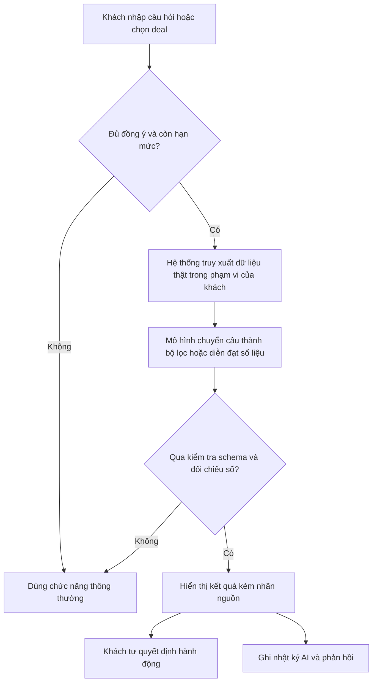

## 5.9. Tài khoản và cửa hàng

*Vai trò: Chủ cửa hàng (web) · 16 UC: R2-001 đến R2-016*

### 5.9.1. Mục tiêu nghiệp vụ

Quản lý danh tính của Chủ cửa hàng, hồ sơ và trạng thái vận hành của cửa hàng, cùng toàn bộ vòng đời gói dịch vụ (dùng thử, nâng cấp, gia hạn, hủy, hạn mức). Phân hệ đặt ra giới hạn tính năng và dữ liệu cho mọi phân hệ khác của web quản trị.

### 5.9.2. Phạm vi

**Thuộc phân hệ:** Đăng ký; Phiên đăng nhập; Hồ sơ cửa hàng; Cài đặt vận hành; Trạng thái cửa hàng; Gói dịch vụ.

**Danh sách UC:** R2-001 Đăng ký tài khoản và cửa hàng; R2-002 Đăng nhập; R2-003 Đăng xuất; R2-004 Đổi mật khẩu và đặt lại mật khẩu; R2-005 Xem hồ sơ cửa hàng; R2-006 Chỉnh sửa hồ sơ cửa hàng; R2-007 Thiết lập khung giờ nhận mặc định và giá sàn; R2-008 Chọn chế độ định giá: duyệt tay hoặc tự động; R2-009 Tạm ngưng cửa hàng; R2-010 Mở lại cửa hàng; R2-011 Xem gói và dùng thử Pro; R2-012 Nâng cấp lên Pro hoặc hạ về Cơ bản; R2-013 Gia hạn gói Pro; R2-014 Hủy gói Pro; R2-015 Xem hóa đơn và lịch sử thanh toán gói; R2-016 Xem hạn mức sử dụng của gói.

**Nằm ngoài phạm vi:** Nhiều cửa hàng trên một tài khoản (MVP mỗi tài khoản Chủ quản lý một cửa hàng); thanh toán gói qua cổng chính thức (MVP dùng VietQR hoặc ghi nhận giả lập); tự động gia hạn.

### 5.9.3. Tác nhân và quyền hạn

Chủ cửa hàng (web). Quản lý và Nhân viên quầy chỉ dùng đăng nhập, đăng xuất, đổi mật khẩu. Hệ thống tính hạn mức và nhắc hết hạn.

### 5.9.4. Dữ liệu nghiệp vụ

| Thực thể | Ý nghĩa, nguồn hình thành và ảnh hưởng đến quyết định nghiệp vụ |
|---|---|
| Tài khoản chủ và cửa hàng | Họ tên, email duy nhất, mật khẩu đã băm; cửa hàng gồm tên, địa chỉ đã geocode, tọa độ, SĐT, loại hình, giờ mở cửa theo ngày, logo, trạng thái (Chờ xác minh, Hoạt động, Tạm ngưng). |
| Cài đặt vận hành | Khung giờ nhận mặc định (tối đa 3 giờ), giá sàn (10-100% giá gốc, mặc định 40), mức giảm tối đa (0-90, mặc định 60), chế độ định giá (Duyệt tay, Tự động). |
| Gói và hạn mức | Gói hiện tại (GOI-CB, GOI-DT, GOI-PRO), ngày bắt đầu và hết hạn, hóa đơn bất biến, nhật ký sử dụng của từng hạn mức. |

### 5.9.5. Quy trình nghiệp vụ tổng thể

1. Chủ đăng ký cùng thông tin cửa hàng, xác minh email: cửa hàng sang Hoạt động, nhận gói Cơ bản kèm 1 tháng dùng thử Pro.
2. Chủ thiết lập khung giờ nhận, giá sàn, mức giảm tối đa và chế độ định giá; chế độ Tự động chỉ khả dụng ở Pro.
3. Khi nghỉ, chủ tạm ngưng cửa hàng (chặn nếu còn đơn Đã thanh toán chưa xử lý trừ khi chọn hủy và hoàn tiền) và mở lại sau đó.
4. Chủ xem gói, nâng cấp, gia hạn, hủy gói, xem hóa đơn và hạn mức; khi hết hạn Pro, cửa hàng về Cơ bản, dữ liệu dự báo và giá cũ chỉ xem.

**Phân hệ phụ thuộc và liên kết:** Cung cấp trạng thái cửa hàng, gói và hạn mức cho tất cả phân hệ web; đọc nhật ký sử dụng từ các UC có hạn mức.

### 5.9.6. Đặc tả từng UC

##### R2-001 - Đăng ký tài khoản và cửa hàng

**Mã UC:** R2-001  
**Tên UC:** Đăng ký tài khoản và cửa hàng  
**Nhóm:** Tài khoản và cửa hàng / Đăng ký · **Loại:** Tạo mới  
**Mục tiêu:** Chủ tiệm đăng ký trên web bằng email, mật khẩu và thông tin cửa hàng; hệ thống tạo user vai Chủ và một cửa hàng, gửi email xác minh. Mỗi tài khoản Chủ quản lý một cửa hàng trong MVP. *[Xác định trong Excel]*  
**Tác nhân:** Chủ cửa hàng (web)  

**Điều kiện tiên quyết** *[Tổng hợp từ ma trận gói và vai trò]*
- Không yêu cầu phiên đăng nhập; thực hiện trên web quản trị trước khi vào hệ thống.
- Gói dịch vụ: Mọi gói (GOI-CB, GOI-PRO, GOI-DT); không có hạn mức riêng.

**Dữ liệu đầu vào và hiển thị** *[Xác định trong Excel]*
- Họ tên chủ (text, bắt buộc)
- Email (duy nhất, bắt buộc)
- Mật khẩu (từ 8 ký tự gồm chữ và số)
- Tên cửa hàng (text, 2-80 ký tự)
- Địa chỉ (text, bắt buộc, geocode ra tọa độ)
- SĐT cửa hàng (định dạng VN)
- Loại hình (Tiệm bánh/Cà phê-bánh)
- Đồng ý điều khoản và trách nhiệm an toàn thực phẩm (bắt buộc)

**Luồng xử lý chính** *[Tổng hợp từ mô tả, quy tắc và kết quả]*
1. Người dùng chọn chức năng "Đăng ký tài khoản và cửa hàng" trên web quản trị.
2. Người dùng nhập hoặc chọn: Họ tên chủ, Email, Mật khẩu, Tên cửa hàng, Địa chỉ.
3. Hệ thống xác thực phiên, kiểm tra quyền, phạm vi dữ liệu, gói dịch vụ và hạn mức (nếu có).
4. Hệ thống kiểm tra từng điều kiện ở mục Validation; sai thì trả lỗi tại trường tương ứng và không tạo dữ liệu.
5. Xử lý nghiệp vụ: Chủ tiệm đăng ký trên web bằng email, mật khẩu và thông tin cửa hàng; hệ thống tạo user vai Chủ và một cửa hàng, gửi email xác minh. Mỗi tài khoản Chủ quản lý một cửa hàng trong MVP.
6. Hệ thống lưu dữ liệu, cập nhật các đối tượng liên quan và phản hồi: Tạo user và cửa hàng trạng thái Chờ xác minh; sau xác minh chuyển Hoạt động, bắt đầu dùng thử Pro.

**Business Rules** *[Xác định trong Excel]*
1. Cửa hàng chỉ hoạt động sau khi xác minh email.
2. Địa chỉ phải geocode được để hiện trên bản đồ.
3. Chủ tự chịu trách nhiệm chất lượng và hạn dùng hàng đăng bán.
4. Cửa hàng mới mặc định gói Cơ bản kèm 1 tháng dùng thử Pro.

**Validation** *[Xác định trong Excel]*
1. Email trùng: báo đã dùng.
2. Địa chỉ không geocode được: yêu cầu sửa/ghim vị trí tay.
3. Chưa đồng ý điều khoản: không tạo.
4. Rate limit 5 lần/giờ/IP.

**Luồng thay thế và ngoại lệ**
- Mọi trường hợp không hợp lệ nêu ở mục Validation là luồng ngoại lệ của UC này và được xử lý đúng như mô tả tại đó. *[Xác định]*
- Người dùng không có quyền hoặc đối tượng không thuộc phạm vi dữ liệu của mình: từ chối, không tiết lộ sự tồn tại của dữ liệu thuộc người khác (đề xuất hoàn thiện).
- Mất kết nối hoặc lỗi hệ thống giữa chừng: thao tác không được ghi nhận một phần; người dùng được thông báo và thử lại, thao tác thay đổi dữ liệu dùng khóa chống trùng khi áp dụng (đề xuất hoàn thiện).

**Dữ liệu thay đổi** *[Tổng hợp]*  
Theo kết quả đã xác định: Tạo user và cửa hàng trạng thái Chờ xác minh; sau xác minh chuyển Hoạt động, bắt đầu dùng thử Pro.

**Chuyển trạng thái** *[Tổng hợp]*
- Tạo user và cửa hàng trạng thái Chờ xác minh.
- sau xác minh chuyển Hoạt động, bắt đầu dùng thử Pro.

**Kết quả** *[Xác định trong Excel]*  
Tạo user và cửa hàng trạng thái Chờ xác minh; sau xác minh chuyển Hoạt động, bắt đầu dùng thử Pro.

**Tác động liên phân hệ** *[Tổng hợp]*  
Dữ liệu hoặc quy tắc của UC liên quan đến: Gói dịch vụ và hạn mức.

**Điều kiện hoàn thành** *[Tổng hợp]*  
Thành công khi: Tạo user và cửa hàng trạng thái Chờ xác minh; sau xác minh chuyển Hoạt động, bắt đầu dùng thử Pro. Không hoàn tất khi bất kỳ điều kiện Validation nào không đạt hoặc dịch vụ liên quan lỗi; dữ liệu giữ nguyên trạng thái trước thao tác.

**Tiêu chí nghiệm thu** *[Tổng hợp, kiểm tra được]*
1. Given người dùng cửa hàng đủ điều kiện tiên quyết và dữ liệu hợp lệ, When thực hiện "Đăng ký tài khoản và cửa hàng", Then kết quả đạt được là: tạo user và cửa hàng trạng thái Chờ xác minh; sau xác minh chuyển Hoạt động, bắt đầu dùng thử Pro.
2. Given email trùng, When thực hiện "Đăng ký tài khoản và cửa hàng", Then báo đã dùng.
3. Given địa chỉ không geocode được, When thực hiện "Đăng ký tài khoản và cửa hàng", Then yêu cầu sửa/ghim vị trí tay.
4. Given thao tác "Đăng ký tài khoản và cửa hàng" được thực hiện, When hệ thống áp dụng quy tắc "Cửa hàng chỉ hoạt động sau khi xác minh email", Then kết quả không được vi phạm quy tắc này.

##### R2-002 - Đăng nhập

**Mã UC:** R2-002  
**Tên UC:** Đăng nhập  
**Nhóm:** Tài khoản và cửa hàng / Phiên đăng nhập · **Loại:** Thao tác nghiệp vụ  
**Mục tiêu:** Chủ đăng nhập web bằng email và mật khẩu; server cấp JWT. *[Xác định trong Excel]*  
**Tác nhân:** Chủ cửa hàng (web)  

**Điều kiện tiên quyết** *[Tổng hợp từ ma trận gói và vai trò]*
- Không yêu cầu phiên đăng nhập; thực hiện trên web quản trị trước khi vào hệ thống.
- Gói dịch vụ: Mọi gói (GOI-CB, GOI-PRO, GOI-DT); không có hạn mức riêng.

**Dữ liệu đầu vào và hiển thị** *[Xác định trong Excel]*
- Email, mật khẩu

**Luồng xử lý chính** *[Tổng hợp từ mô tả, quy tắc và kết quả]*
1. Người dùng kích hoạt "Đăng nhập" trên web quản trị với dữ liệu: Email, mật khẩu.
2. Hệ thống xác thực phiên, kiểm tra quyền, trạng thái đối tượng và điều kiện thời gian.
3. Hệ thống kiểm tra các điều kiện ở mục Validation và áp dụng Business Rules theo thứ tự.
4. Xử lý nghiệp vụ: Chủ đăng nhập web bằng email và mật khẩu; server cấp JWT.
5. Hệ thống ghi nhận kết quả, cập nhật dữ liệu và phản hồi: Vào bảng điều khiển; thất bại ở lại đăng nhập.

**Business Rules** *[Xác định trong Excel]*
1. Chỉ vai Chủ vào được web quản trị; vai Khách bị từ chối.
2. Sai 5 lần khóa 15 phút.
3. Chỉ truy cập dữ liệu của cửa hàng mình.

**Validation** *[Xác định trong Excel]*
1. Sai thông tin: thông báo chung; chưa xác minh: yêu cầu xác minh email.

**Luồng thay thế và ngoại lệ**
- Mọi trường hợp không hợp lệ nêu ở mục Validation là luồng ngoại lệ của UC này và được xử lý đúng như mô tả tại đó. *[Xác định]*
- Người dùng không có quyền hoặc đối tượng không thuộc phạm vi dữ liệu của mình: từ chối, không tiết lộ sự tồn tại của dữ liệu thuộc người khác (đề xuất hoàn thiện).
- Mất kết nối hoặc lỗi hệ thống giữa chừng: thao tác không được ghi nhận một phần; người dùng được thông báo và thử lại, thao tác thay đổi dữ liệu dùng khóa chống trùng khi áp dụng (đề xuất hoàn thiện).

**Dữ liệu thay đổi** *[Tổng hợp]*  
Theo kết quả đã xác định: Vào bảng điều khiển; thất bại ở lại đăng nhập.

**Chuyển trạng thái** *[Tổng hợp]*
- Excel không nêu chuyển trạng thái riêng cho UC này; đối tượng giữ trạng thái hiện tại trừ phần được nêu ở mục Kết quả.

**Kết quả** *[Xác định trong Excel]*  
Vào bảng điều khiển; thất bại ở lại đăng nhập.

**Tác động liên phân hệ** *[Tổng hợp]*  
Không phát sinh tác động đáng kể ngoài phân hệ; dữ liệu chỉ dùng trong phạm vi chức năng.

**Điều kiện hoàn thành** *[Tổng hợp]*  
Thành công khi: Vào bảng điều khiển; thất bại ở lại đăng nhập. Không hoàn tất khi bất kỳ điều kiện Validation nào không đạt hoặc dịch vụ liên quan lỗi; dữ liệu giữ nguyên trạng thái trước thao tác.

**Tiêu chí nghiệm thu** *[Tổng hợp, kiểm tra được]*
1. Given người dùng cửa hàng đủ điều kiện tiên quyết và dữ liệu hợp lệ, When thực hiện "Đăng nhập", Then kết quả đạt được là: vào bảng điều khiển; thất bại ở lại đăng nhập.
2. Given sai thông tin, When thực hiện "Đăng nhập", Then thông báo chung; chưa xác minh: yêu cầu xác minh email.
3. Given thao tác "Đăng nhập" được thực hiện, When hệ thống áp dụng quy tắc "Chỉ vai Chủ vào được web quản trị; vai Khách bị từ chối", Then kết quả không được vi phạm quy tắc này.

##### R2-003 - Đăng xuất

**Mã UC:** R2-003  
**Tên UC:** Đăng xuất  
**Nhóm:** Tài khoản và cửa hàng / Phiên đăng nhập · **Loại:** Chuyển trạng thái  
**Mục tiêu:** Chủ đăng xuất, thu hồi refresh token phiên hiện tại. *[Xác định trong Excel]*  
**Tác nhân:** Chủ cửa hàng (web)  

**Điều kiện tiên quyết** *[Tổng hợp từ ma trận gói và vai trò]*
- Người dùng đã đăng nhập trên web bằng tài khoản Chủ hoặc nhân viên của cửa hàng; cửa hàng ở trạng thái Hoạt động (trừ các UC quản lý trạng thái cửa hàng, gói và hồ sơ).
- Nhóm quyền được phép: Chủ, Quản lý và Nhân viên quầy. *[Tổng hợp từ UC phân quyền nhân viên]*
- Gói dịch vụ: Mọi gói (GOI-CB, GOI-PRO, GOI-DT); không có hạn mức riêng.

**Dữ liệu đầu vào và hiển thị** *[Xác định trong Excel]*
- Refresh token (hệ thống)

**Luồng xử lý chính** *[Tổng hợp từ mô tả, quy tắc và kết quả]*
1. Người dùng chọn đối tượng cần xử lý và thao tác "Đăng xuất" trên web quản trị.
2. Người dùng cung cấp thêm: Refresh token.
3. Hệ thống kiểm tra trạng thái hiện tại có cho phép chuyển trạng thái này không, cùng quyền của người thực hiện.
4. Xử lý nghiệp vụ: Chủ đăng xuất, thu hồi refresh token phiên hiện tại.
5. Trạng thái, tồn kho, tiền hoặc thông báo liên quan được cập nhật trong cùng giao dịch; kết quả: Về màn hình đăng nhập.

**Business Rules** *[Xác định trong Excel]*
1. Không ảnh hưởng suất đang mở và đơn đang chờ nhận.

**Validation** *[Xác định trong Excel]*
1. Mất mạng: xóa token cục bộ, token tự hết hạn phía server.

**Luồng thay thế và ngoại lệ**
- Mọi trường hợp không hợp lệ nêu ở mục Validation là luồng ngoại lệ của UC này và được xử lý đúng như mô tả tại đó. *[Xác định]*
- Người dùng không có quyền hoặc đối tượng không thuộc phạm vi dữ liệu của mình: từ chối, không tiết lộ sự tồn tại của dữ liệu thuộc người khác (đề xuất hoàn thiện).
- Mất kết nối hoặc lỗi hệ thống giữa chừng: thao tác không được ghi nhận một phần; người dùng được thông báo và thử lại, thao tác thay đổi dữ liệu dùng khóa chống trùng khi áp dụng (đề xuất hoàn thiện).

**Dữ liệu thay đổi** *[Tổng hợp]*  
Theo kết quả đã xác định: Về màn hình đăng nhập.

**Chuyển trạng thái** *[Tổng hợp]*
- Excel không nêu chuyển trạng thái riêng cho UC này; đối tượng giữ trạng thái hiện tại trừ phần được nêu ở mục Kết quả.

**Kết quả** *[Xác định trong Excel]*  
Về màn hình đăng nhập.

**Tác động liên phân hệ** *[Tổng hợp]*  
Dữ liệu hoặc quy tắc của UC liên quan đến: Suất và tồn kho trong ngày; Đơn hàng.

**Điều kiện hoàn thành** *[Tổng hợp]*  
Thành công khi: Về màn hình đăng nhập. Không hoàn tất khi bất kỳ điều kiện Validation nào không đạt hoặc dịch vụ liên quan lỗi; dữ liệu giữ nguyên trạng thái trước thao tác.

**Tiêu chí nghiệm thu** *[Tổng hợp, kiểm tra được]*
1. Given người dùng cửa hàng đủ điều kiện tiên quyết và dữ liệu hợp lệ, When thực hiện "Đăng xuất", Then kết quả đạt được là: về màn hình đăng nhập.
2. Given mất mạng, When thực hiện "Đăng xuất", Then xóa token cục bộ, token tự hết hạn phía server.
3. Given thao tác "Đăng xuất" được thực hiện, When hệ thống áp dụng quy tắc "Không ảnh hưởng suất đang mở và đơn đang chờ nhận", Then kết quả không được vi phạm quy tắc này.

##### R2-004 - Đổi mật khẩu và đặt lại mật khẩu

**Mã UC:** R2-004  
**Tên UC:** Đổi mật khẩu và đặt lại mật khẩu  
**Nhóm:** Tài khoản và cửa hàng / Phiên đăng nhập · **Loại:** Cập nhật  
**Mục tiêu:** Chủ đổi mật khẩu bằng mật khẩu hiện tại hoặc đặt lại qua email; thu hồi phiên khác. *[Xác định trong Excel]*  
**Tác nhân:** Chủ cửa hàng (web)  

**Điều kiện tiên quyết** *[Tổng hợp từ ma trận gói và vai trò]*
- Không yêu cầu phiên đăng nhập; thực hiện trên web quản trị trước khi vào hệ thống.
- Gói dịch vụ: Mọi gói (GOI-CB, GOI-PRO, GOI-DT); không có hạn mức riêng.

**Dữ liệu đầu vào và hiển thị** *[Xác định trong Excel]*
- Mật khẩu hiện tại, mật khẩu mới; hoặc email và liên kết đặt lại (hạn 30 phút)

**Luồng xử lý chính** *[Tổng hợp từ mô tả, quy tắc và kết quả]*
1. Người dùng mở "Đổi mật khẩu và đặt lại mật khẩu" trên web quản trị; hệ thống nạp giá trị hiện tại.
2. Người dùng thay đổi: Mật khẩu hiện tại, mật khẩu mới; hoặc email và liên kết đặt lại.
3. Hệ thống kiểm tra quyền, trạng thái hiện tại của đối tượng và điều kiện ở mục Validation.
4. Xử lý nghiệp vụ: Chủ đổi mật khẩu bằng mật khẩu hiện tại hoặc đặt lại qua email; thu hồi phiên khác.
5. Hệ thống lưu giá trị mới, ghi lịch sử hoặc nhật ký nếu quy tắc yêu cầu và phản hồi: Mật khẩu mới có hiệu lực; gửi email thông báo.

**Business Rules** *[Xác định trong Excel]*
1. Liên kết đặt lại dùng một lần.
2. Thu hồi mọi phiên khác sau khi đổi.

**Validation** *[Xác định trong Excel]*
1. Sai mật khẩu cũ, mật khẩu yếu, liên kết hết hạn: báo lỗi.

**Luồng thay thế và ngoại lệ**
- Mọi trường hợp không hợp lệ nêu ở mục Validation là luồng ngoại lệ của UC này và được xử lý đúng như mô tả tại đó. *[Xác định]*
- Người dùng không có quyền hoặc đối tượng không thuộc phạm vi dữ liệu của mình: từ chối, không tiết lộ sự tồn tại của dữ liệu thuộc người khác (đề xuất hoàn thiện).
- Mất kết nối hoặc lỗi hệ thống giữa chừng: thao tác không được ghi nhận một phần; người dùng được thông báo và thử lại, thao tác thay đổi dữ liệu dùng khóa chống trùng khi áp dụng (đề xuất hoàn thiện).

**Dữ liệu thay đổi** *[Tổng hợp]*  
Theo kết quả đã xác định: Mật khẩu mới có hiệu lực; gửi email thông báo.

**Chuyển trạng thái** *[Tổng hợp]*
- Excel không nêu chuyển trạng thái riêng cho UC này; đối tượng giữ trạng thái hiện tại trừ phần được nêu ở mục Kết quả.

**Kết quả** *[Xác định trong Excel]*  
Mật khẩu mới có hiệu lực; gửi email thông báo.

**Tác động liên phân hệ** *[Tổng hợp]*  
Dữ liệu hoặc quy tắc của UC liên quan đến: Thông báo.

**Điều kiện hoàn thành** *[Tổng hợp]*  
Thành công khi: Mật khẩu mới có hiệu lực; gửi email thông báo. Không hoàn tất khi bất kỳ điều kiện Validation nào không đạt hoặc dịch vụ liên quan lỗi; dữ liệu giữ nguyên trạng thái trước thao tác.

**Tiêu chí nghiệm thu** *[Tổng hợp, kiểm tra được]*
1. Given người dùng cửa hàng đủ điều kiện tiên quyết và dữ liệu hợp lệ, When thực hiện "Đổi mật khẩu và đặt lại mật khẩu", Then kết quả đạt được là: mật khẩu mới có hiệu lực; gửi email thông báo.
2. Given sai mật khẩu cũ, mật khẩu yếu, liên kết hết hạn, When thực hiện "Đổi mật khẩu và đặt lại mật khẩu", Then báo lỗi.
3. Given thao tác "Đổi mật khẩu và đặt lại mật khẩu" được thực hiện, When hệ thống áp dụng quy tắc "Liên kết đặt lại dùng một lần", Then kết quả không được vi phạm quy tắc này.

##### R2-005 - Xem hồ sơ cửa hàng

**Mã UC:** R2-005  
**Tên UC:** Xem hồ sơ cửa hàng  
**Nhóm:** Tài khoản và cửa hàng / Hồ sơ cửa hàng · **Loại:** Truy vấn và hiển thị  
**Mục tiêu:** Chủ xem thông tin cửa hàng, trạng thái hoạt động, gói hiện tại và hạn gói. *[Xác định trong Excel]*  
**Tác nhân:** Chủ cửa hàng (web)  

**Điều kiện tiên quyết** *[Tổng hợp từ ma trận gói và vai trò]*
- Người dùng đã đăng nhập trên web bằng tài khoản Chủ hoặc nhân viên của cửa hàng; cửa hàng ở trạng thái Hoạt động (trừ các UC quản lý trạng thái cửa hàng, gói và hồ sơ).
- Nhóm quyền được phép: Chủ và Quản lý; Nhân viên quầy không có quyền (không thuộc bốn thao tác của nhóm này). *[Tổng hợp từ UC phân quyền nhân viên]*
- Gói dịch vụ: Mọi gói (GOI-CB, GOI-PRO, GOI-DT); không có hạn mức riêng.

**Dữ liệu hiển thị (UC không có trường nhập)** *[Xác định trong Excel]*
- Hiển thị: tên, địa chỉ, tọa độ, SĐT, giờ mở cửa, logo, trạng thái, gói, ngày hết hạn gói

**Luồng xử lý chính** *[Tổng hợp từ mô tả, quy tắc và kết quả]*
1. Người dùng mở màn hình "Xem hồ sơ cửa hàng" trên web quản trị.
2. Hệ thống xác thực phiên, xác định phạm vi dữ liệu của người dùng và áp các quy tắc hiển thị của UC.
3. Truy vấn dữ liệu: Chủ xem thông tin cửa hàng, trạng thái hoạt động, gói hiện tại và hạn gói.
4. Hiển thị các thuộc tính: tên, địa chỉ, tọa độ, SĐT, giờ mở cửa, logo, trạng thái, gói, ngày hết hạn gói.
5. Trường hợp không có dữ liệu hoặc không hợp lệ được xử lý theo mục Validation; không thay đổi dữ liệu nghiệp vụ.

**Business Rules** *[Xác định trong Excel]*
1. Chỉ xem cửa hàng của mình.

**Validation** *[Xác định trong Excel]*
1. Không có.

**Luồng thay thế và ngoại lệ**
- Người dùng không có quyền hoặc đối tượng không thuộc phạm vi dữ liệu của mình: từ chối, không tiết lộ sự tồn tại của dữ liệu thuộc người khác (đề xuất hoàn thiện).
- Mất kết nối hoặc lỗi hệ thống giữa chừng: thao tác không được ghi nhận một phần; người dùng được thông báo và thử lại, thao tác thay đổi dữ liệu dùng khóa chống trùng khi áp dụng (đề xuất hoàn thiện).

**Dữ liệu thay đổi** *[Tổng hợp]*  
Không tạo hoặc thay đổi dữ liệu nghiệp vụ; chỉ đọc theo phạm vi của người dùng.

**Chuyển trạng thái** *[Tổng hợp]*
- Không chuyển trạng thái của đối tượng nghiệp vụ.

**Kết quả** *[Xác định trong Excel]*  
Hiển thị hồ sơ.

**Tác động liên phân hệ** *[Tổng hợp]*  
Dữ liệu hoặc quy tắc của UC liên quan đến: Gói dịch vụ và hạn mức.

**Điều kiện hoàn thành** *[Tổng hợp]*  
Thành công khi: Hiển thị hồ sơ. Không hoàn tất khi bất kỳ điều kiện Validation nào không đạt hoặc dịch vụ liên quan lỗi; dữ liệu giữ nguyên trạng thái trước thao tác.

**Tiêu chí nghiệm thu** *[Tổng hợp, kiểm tra được]*
1. Given người dùng cửa hàng đủ điều kiện tiên quyết và dữ liệu hợp lệ, When thực hiện "Xem hồ sơ cửa hàng", Then kết quả đạt được là: hiển thị hồ sơ.
2. Given thao tác "Xem hồ sơ cửa hàng" được thực hiện, When hệ thống áp dụng quy tắc "Chỉ xem cửa hàng của mình", Then kết quả không được vi phạm quy tắc này.

##### R2-006 - Chỉnh sửa hồ sơ cửa hàng

**Mã UC:** R2-006  
**Tên UC:** Chỉnh sửa hồ sơ cửa hàng  
**Nhóm:** Tài khoản và cửa hàng / Hồ sơ cửa hàng · **Loại:** Cập nhật  
**Mục tiêu:** Chủ sửa tên, địa chỉ, SĐT, giờ mở cửa, logo. Đổi địa chỉ geocode lại tọa độ. *[Xác định trong Excel]*  
**Tác nhân:** Chủ cửa hàng (web)  

**Điều kiện tiên quyết** *[Tổng hợp từ ma trận gói và vai trò]*
- Người dùng đã đăng nhập trên web bằng tài khoản Chủ hoặc nhân viên của cửa hàng; cửa hàng ở trạng thái Hoạt động (trừ các UC quản lý trạng thái cửa hàng, gói và hồ sơ).
- Nhóm quyền được phép: Chủ và Quản lý; Nhân viên quầy không có quyền (không thuộc bốn thao tác của nhóm này). *[Tổng hợp từ UC phân quyền nhân viên]*
- Gói dịch vụ: Mọi gói (GOI-CB, GOI-PRO, GOI-DT); không có hạn mức riêng.

**Dữ liệu đầu vào và hiển thị** *[Xác định trong Excel]*
- Tên (2-80 ký tự)
- Địa chỉ (geocode)
- SĐT
- Giờ mở/đóng cửa theo ngày trong tuần (HH:mm, đóng sau mở)
- Logo (JPG/PNG tối đa 2 MB)

**Luồng xử lý chính** *[Tổng hợp từ mô tả, quy tắc và kết quả]*
1. Người dùng mở "Chỉnh sửa hồ sơ cửa hàng" trên web quản trị; hệ thống nạp giá trị hiện tại.
2. Người dùng thay đổi: Tên, Địa chỉ, SĐT, Giờ mở/đóng cửa theo ngày trong tuần, Logo.
3. Hệ thống kiểm tra quyền, trạng thái hiện tại của đối tượng và điều kiện ở mục Validation.
4. Xử lý nghiệp vụ: Chủ sửa tên, địa chỉ, SĐT, giờ mở cửa, logo. Đổi địa chỉ geocode lại tọa độ.
5. Hệ thống lưu giá trị mới, ghi lịch sử hoặc nhật ký nếu quy tắc yêu cầu và phản hồi: Hồ sơ cập nhật; bản đồ khách cập nhật.

**Business Rules** *[Xác định trong Excel]*
1. Đổi địa chỉ không ảnh hưởng đơn đã thanh toán; ghi nhật ký.
2. Suất đang mở giữ địa chỉ nhận lúc đặt đối với các đơn đã có.

**Validation** *[Xác định trong Excel]*
1. Giờ đóng trước giờ mở, địa chỉ không geocode được: báo lỗi.

**Luồng thay thế và ngoại lệ**
- Mọi trường hợp không hợp lệ nêu ở mục Validation là luồng ngoại lệ của UC này và được xử lý đúng như mô tả tại đó. *[Xác định]*
- Người dùng không có quyền hoặc đối tượng không thuộc phạm vi dữ liệu của mình: từ chối, không tiết lộ sự tồn tại của dữ liệu thuộc người khác (đề xuất hoàn thiện).
- Mất kết nối hoặc lỗi hệ thống giữa chừng: thao tác không được ghi nhận một phần; người dùng được thông báo và thử lại, thao tác thay đổi dữ liệu dùng khóa chống trùng khi áp dụng (đề xuất hoàn thiện).

**Dữ liệu thay đổi** *[Tổng hợp]*  
Theo kết quả đã xác định: Hồ sơ cập nhật; bản đồ khách cập nhật.

**Chuyển trạng thái** *[Tổng hợp]*
- Excel không nêu chuyển trạng thái riêng cho UC này; đối tượng giữ trạng thái hiện tại trừ phần được nêu ở mục Kết quả.

**Kết quả** *[Xác định trong Excel]*  
Hồ sơ cập nhật; bản đồ khách cập nhật.

**Tác động liên phân hệ** *[Tổng hợp]*  
Dữ liệu hoặc quy tắc của UC liên quan đến: Suất và tồn kho trong ngày; Đơn hàng; Thanh toán và hoàn tiền; Nhật ký hoạt động.

**Điều kiện hoàn thành** *[Tổng hợp]*  
Thành công khi: Hồ sơ cập nhật; bản đồ khách cập nhật. Không hoàn tất khi bất kỳ điều kiện Validation nào không đạt hoặc dịch vụ liên quan lỗi; dữ liệu giữ nguyên trạng thái trước thao tác.

**Tiêu chí nghiệm thu** *[Tổng hợp, kiểm tra được]*
1. Given người dùng cửa hàng đủ điều kiện tiên quyết và dữ liệu hợp lệ, When thực hiện "Chỉnh sửa hồ sơ cửa hàng", Then kết quả đạt được là: hồ sơ cập nhật; bản đồ khách cập nhật.
2. Given giờ đóng trước giờ mở, địa chỉ không geocode được, When thực hiện "Chỉnh sửa hồ sơ cửa hàng", Then báo lỗi.
3. Given thao tác "Chỉnh sửa hồ sơ cửa hàng" được thực hiện, When hệ thống áp dụng quy tắc "Đổi địa chỉ không ảnh hưởng đơn đã thanh toán; ghi nhật ký", Then kết quả không được vi phạm quy tắc này.

##### R2-007 - Thiết lập khung giờ nhận mặc định và giá sàn

**Mã UC:** R2-007  
**Tên UC:** Thiết lập khung giờ nhận mặc định và giá sàn  
**Nhóm:** Tài khoản và cửa hàng / Cài đặt vận hành · **Loại:** Cập nhật  
**Mục tiêu:** Chủ đặt khung giờ nhận mặc định, tỉ lệ giá sàn trên giá gốc và mức giảm tối đa để dùng khi tạo suất. *[Xác định trong Excel]*  
**Tác nhân:** Chủ cửa hàng (web)  

**Điều kiện tiên quyết** *[Tổng hợp từ ma trận gói và vai trò]*
- Người dùng đã đăng nhập trên web bằng tài khoản Chủ hoặc nhân viên của cửa hàng; cửa hàng ở trạng thái Hoạt động (trừ các UC quản lý trạng thái cửa hàng, gói và hồ sơ).
- Nhóm quyền được phép: Chủ và Quản lý; Nhân viên quầy không có quyền (không thuộc bốn thao tác của nhóm này). *[Tổng hợp từ UC phân quyền nhân viên]*
- Gói dịch vụ: Mọi gói (GOI-CB, GOI-PRO, GOI-DT); không có hạn mức riêng.

**Dữ liệu đầu vào và hiển thị** *[Xác định trong Excel]*
- Khung giờ nhận mặc định (giờ bắt đầu, giờ kết thúc, tối đa 3 giờ)
- Giá sàn (% giá gốc, 10-100, mặc định 40)
- Mức giảm tối đa (% từ 0-90, mặc định 60)

**Luồng xử lý chính** *[Tổng hợp từ mô tả, quy tắc và kết quả]*
1. Người dùng mở "Thiết lập khung giờ nhận mặc định và giá sàn" trên web quản trị; hệ thống nạp giá trị hiện tại.
2. Người dùng thay đổi: Khung giờ nhận mặc định, Giá sàn, Mức giảm tối đa.
3. Hệ thống kiểm tra quyền, trạng thái hiện tại của đối tượng và điều kiện ở mục Validation.
4. Xử lý nghiệp vụ: Chủ đặt khung giờ nhận mặc định, tỉ lệ giá sàn trên giá gốc và mức giảm tối đa để dùng khi tạo suất.
5. Hệ thống lưu giá trị mới, ghi lịch sử hoặc nhật ký nếu quy tắc yêu cầu và phản hồi: Thiết lập áp dụng cho suất mới.

**Business Rules** *[Xác định trong Excel]*
1. Giá sàn mặc định bảo đảm không thấp hơn giá vốn chủ khai báo nếu có.
2. Khung nhận phải nằm trong giờ mở cửa.

**Validation** *[Xác định trong Excel]*
1. Giá sàn lớn hơn giá bán mong muốn: cảnh báo; khung nhận ngoài giờ mở: từ chối.

**Luồng thay thế và ngoại lệ**
- Mọi trường hợp không hợp lệ nêu ở mục Validation là luồng ngoại lệ của UC này và được xử lý đúng như mô tả tại đó. *[Xác định]*
- Người dùng không có quyền hoặc đối tượng không thuộc phạm vi dữ liệu của mình: từ chối, không tiết lộ sự tồn tại của dữ liệu thuộc người khác (đề xuất hoàn thiện).
- Mất kết nối hoặc lỗi hệ thống giữa chừng: thao tác không được ghi nhận một phần; người dùng được thông báo và thử lại, thao tác thay đổi dữ liệu dùng khóa chống trùng khi áp dụng (đề xuất hoàn thiện).

**Dữ liệu thay đổi** *[Tổng hợp]*  
Theo kết quả đã xác định: Thiết lập áp dụng cho suất mới.

**Chuyển trạng thái** *[Tổng hợp]*
- Excel không nêu chuyển trạng thái riêng cho UC này; đối tượng giữ trạng thái hiện tại trừ phần được nêu ở mục Kết quả.

**Kết quả** *[Xác định trong Excel]*  
Thiết lập áp dụng cho suất mới.

**Tác động liên phân hệ** *[Tổng hợp]*  
Dữ liệu hoặc quy tắc của UC liên quan đến: Suất và tồn kho trong ngày; Định giá động.

**Điều kiện hoàn thành** *[Tổng hợp]*  
Thành công khi: Thiết lập áp dụng cho suất mới. Không hoàn tất khi bất kỳ điều kiện Validation nào không đạt hoặc dịch vụ liên quan lỗi; dữ liệu giữ nguyên trạng thái trước thao tác.

**Tiêu chí nghiệm thu** *[Tổng hợp, kiểm tra được]*
1. Given người dùng cửa hàng đủ điều kiện tiên quyết và dữ liệu hợp lệ, When thực hiện "Thiết lập khung giờ nhận mặc định và giá sàn", Then kết quả đạt được là: thiết lập áp dụng cho suất mới.
2. Given giá sàn lớn hơn giá bán mong muốn, When thực hiện "Thiết lập khung giờ nhận mặc định và giá sàn", Then cảnh báo; khung nhận ngoài giờ mở: từ chối.
3. Given thao tác "Thiết lập khung giờ nhận mặc định và giá sàn" được thực hiện, When hệ thống áp dụng quy tắc "Giá sàn mặc định bảo đảm không thấp hơn giá vốn chủ khai báo nếu có", Then kết quả không được vi phạm quy tắc này.

##### R2-008 - Chọn chế độ định giá: duyệt tay hoặc tự động

**Mã UC:** R2-008  
**Tên UC:** Chọn chế độ định giá: duyệt tay hoặc tự động  
**Nhóm:** Tài khoản và cửa hàng / Cài đặt vận hành · **Loại:** Cập nhật  
**Mục tiêu:** Chủ chọn để hệ thống chỉ đề xuất giá (duyệt tay) hoặc tự áp dụng giá đề xuất trong ràng buộc giá sàn. *[Xác định trong Excel]*  
**Tác nhân:** Chủ cửa hàng (web)  

**Điều kiện tiên quyết** *[Tổng hợp từ ma trận gói và vai trò]*
- Người dùng đã đăng nhập trên web bằng tài khoản Chủ hoặc nhân viên của cửa hàng; cửa hàng ở trạng thái Hoạt động (trừ các UC quản lý trạng thái cửa hàng, gói và hồ sơ).
- Nhóm quyền được phép: Chủ và Quản lý; Nhân viên quầy không có quyền (không thuộc bốn thao tác của nhóm này). *[Tổng hợp từ UC phân quyền nhân viên]*
- Gói dịch vụ: Chỉ gói Pro (GOI-PRO) và thời gian dùng thử Pro (GOI-DT). Gói Cơ bản (GOI-CB) không có quyền sử dụng; khi hết hạn Pro, tính năng bị khóa và dữ liệu đã tạo chỉ xem.

**Dữ liệu đầu vào và hiển thị** *[Xác định trong Excel]*
- Chế độ (Duyệt tay/Tự động)

**Luồng xử lý chính** *[Tổng hợp từ mô tả, quy tắc và kết quả]*
1. Người dùng mở "Chọn chế độ định giá: duyệt tay hoặc tự động" trên web quản trị; hệ thống nạp giá trị hiện tại.
2. Người dùng thay đổi: Chế độ.
3. Hệ thống kiểm tra quyền, trạng thái hiện tại của đối tượng và điều kiện ở mục Validation.
4. Xử lý nghiệp vụ: Chủ chọn để hệ thống chỉ đề xuất giá (duyệt tay) hoặc tự áp dụng giá đề xuất trong ràng buộc giá sàn.
5. Hệ thống lưu giá trị mới, ghi lịch sử hoặc nhật ký nếu quy tắc yêu cầu và phản hồi: Chế độ lưu và áp dụng cho các suất đang mở.

**Business Rules** *[Xác định trong Excel]*
1. Mặc định Duyệt tay.
2. Chế độ Tự động chỉ khả dụng ở gói Pro.
3. Tự động luôn tôn trọng giá sàn và mức giảm tối đa.

**Validation** *[Xác định trong Excel]*
1. Gói không phải Pro: không bật tự động.

**Luồng thay thế và ngoại lệ**
- Mọi trường hợp không hợp lệ nêu ở mục Validation là luồng ngoại lệ của UC này và được xử lý đúng như mô tả tại đó. *[Xác định]*
- Người dùng không có quyền hoặc đối tượng không thuộc phạm vi dữ liệu của mình: từ chối, không tiết lộ sự tồn tại của dữ liệu thuộc người khác (đề xuất hoàn thiện).
- Mất kết nối hoặc lỗi hệ thống giữa chừng: thao tác không được ghi nhận một phần; người dùng được thông báo và thử lại, thao tác thay đổi dữ liệu dùng khóa chống trùng khi áp dụng (đề xuất hoàn thiện).
- Cửa hàng ở gói Cơ bản hoặc đã hết Pro: tính năng ẩn hoặc khóa, hiển thị gợi ý nâng cấp; dữ liệu đã tạo trước đó chỉ xem (theo ma trận gói).

**Dữ liệu thay đổi** *[Tổng hợp]*  
Theo kết quả đã xác định: Chế độ lưu và áp dụng cho các suất đang mở.

**Chuyển trạng thái** *[Tổng hợp]*
- Excel không nêu chuyển trạng thái riêng cho UC này; đối tượng giữ trạng thái hiện tại trừ phần được nêu ở mục Kết quả.

**Kết quả** *[Xác định trong Excel]*  
Chế độ lưu và áp dụng cho các suất đang mở.

**Tác động liên phân hệ** *[Tổng hợp]*  
Dữ liệu hoặc quy tắc của UC liên quan đến: Suất và tồn kho trong ngày; Định giá động; Gói dịch vụ và hạn mức.

**Điều kiện hoàn thành** *[Tổng hợp]*  
Thành công khi: Chế độ lưu và áp dụng cho các suất đang mở. Không hoàn tất khi bất kỳ điều kiện Validation nào không đạt hoặc dịch vụ liên quan lỗi; dữ liệu giữ nguyên trạng thái trước thao tác.

**Tiêu chí nghiệm thu** *[Tổng hợp, kiểm tra được]*
1. Given người dùng cửa hàng đủ điều kiện tiên quyết và dữ liệu hợp lệ, When thực hiện "Chọn chế độ định giá: duyệt tay hoặc tự động", Then kết quả đạt được là: chế độ lưu và áp dụng cho các suất đang mở.
2. Given gói không phải Pro, When thực hiện "Chọn chế độ định giá: duyệt tay hoặc tự động", Then không bật tự động.
3. Given thao tác "Chọn chế độ định giá: duyệt tay hoặc tự động" được thực hiện, When hệ thống áp dụng quy tắc "Mặc định Duyệt tay", Then kết quả không được vi phạm quy tắc này.
4. Given cửa hàng ở gói Cơ bản, When mở "Chọn chế độ định giá: duyệt tay hoặc tự động", Then tính năng bị khóa và hiển thị gợi ý nâng cấp; cửa hàng Pro hoặc dùng thử truy cập bình thường.

##### R2-009 - Tạm ngưng cửa hàng

**Mã UC:** R2-009  
**Tên UC:** Tạm ngưng cửa hàng  
**Nhóm:** Tài khoản và cửa hàng / Trạng thái cửa hàng · **Loại:** Chuyển trạng thái  
**Mục tiêu:** Chủ tạm ngưng nhận đơn khi nghỉ; suất đang mở bị đóng và ẩn khỏi bản đồ. *[Xác định trong Excel]*  
**Tác nhân:** Chủ cửa hàng (web)  

**Điều kiện tiên quyết** *[Tổng hợp từ ma trận gói và vai trò]*
- Người dùng đã đăng nhập trên web bằng tài khoản Chủ hoặc nhân viên của cửa hàng; cửa hàng ở trạng thái Hoạt động (trừ các UC quản lý trạng thái cửa hàng, gói và hồ sơ).
- Nhóm quyền được phép: chỉ Chủ cửa hàng (nhóm Quản lý và Nhân viên quầy không có quyền). *[Tổng hợp từ UC phân quyền nhân viên]*
- Gói dịch vụ: Mọi gói (GOI-CB, GOI-PRO, GOI-DT); không có hạn mức riêng.

**Dữ liệu đầu vào và hiển thị** *[Xác định trong Excel]*
- Lý do (chọn/tùy chọn)
- Thời điểm mở lại dự kiến (ngày, tùy chọn)

**Luồng xử lý chính** *[Tổng hợp từ mô tả, quy tắc và kết quả]*
1. Người dùng chọn đối tượng cần xử lý và thao tác "Tạm ngưng cửa hàng" trên web quản trị.
2. Người dùng cung cấp thêm: Lý do, Thời điểm mở lại dự kiến.
3. Hệ thống kiểm tra trạng thái hiện tại có cho phép chuyển trạng thái này không, cùng quyền của người thực hiện.
4. Xử lý nghiệp vụ: Chủ tạm ngưng nhận đơn khi nghỉ; suất đang mở bị đóng và ẩn khỏi bản đồ.
5. Trạng thái, tồn kho, tiền hoặc thông báo liên quan được cập nhật trong cùng giao dịch; kết quả: Cửa hàng chuyển Tạm ngưng; khách thấy cửa hàng không khả dụng.

**Business Rules** *[Xác định trong Excel]*
1. Không tạm ngưng khi còn đơn Đã thanh toán chưa xử lý, trừ khi chủ chọn hủy và hoàn tiền các đơn đó.
2. Suất đóng thủ công không tạo hao hụt giả trong báo cáo.

**Validation** *[Xác định trong Excel]*
1. Còn đơn chưa xử lý: liệt kê đơn, yêu cầu chọn hướng xử lý.

**Luồng thay thế và ngoại lệ**
- Mọi trường hợp không hợp lệ nêu ở mục Validation là luồng ngoại lệ của UC này và được xử lý đúng như mô tả tại đó. *[Xác định]*
- Người dùng không có quyền hoặc đối tượng không thuộc phạm vi dữ liệu của mình: từ chối, không tiết lộ sự tồn tại của dữ liệu thuộc người khác (đề xuất hoàn thiện).
- Mất kết nối hoặc lỗi hệ thống giữa chừng: thao tác không được ghi nhận một phần; người dùng được thông báo và thử lại, thao tác thay đổi dữ liệu dùng khóa chống trùng khi áp dụng (đề xuất hoàn thiện).

**Dữ liệu thay đổi** *[Tổng hợp]*  
Theo kết quả đã xác định: Cửa hàng chuyển Tạm ngưng; khách thấy cửa hàng không khả dụng.

**Chuyển trạng thái** *[Tổng hợp]*
- Cửa hàng chuyển Tạm ngưng.

**Kết quả** *[Xác định trong Excel]*  
Cửa hàng chuyển Tạm ngưng; khách thấy cửa hàng không khả dụng.

**Tác động liên phân hệ** *[Tổng hợp]*  
Dữ liệu hoặc quy tắc của UC liên quan đến: Suất và tồn kho trong ngày; Đơn hàng; Thanh toán và hoàn tiền; Báo cáo và đối soát.

**Điều kiện hoàn thành** *[Tổng hợp]*  
Thành công khi: Cửa hàng chuyển Tạm ngưng; khách thấy cửa hàng không khả dụng. Không hoàn tất khi bất kỳ điều kiện Validation nào không đạt hoặc dịch vụ liên quan lỗi; dữ liệu giữ nguyên trạng thái trước thao tác.

**Tiêu chí nghiệm thu** *[Tổng hợp, kiểm tra được]*
1. Given người dùng cửa hàng đủ điều kiện tiên quyết và dữ liệu hợp lệ, When thực hiện "Tạm ngưng cửa hàng", Then kết quả đạt được là: cửa hàng chuyển Tạm ngưng; khách thấy cửa hàng không khả dụng.
2. Given còn đơn chưa xử lý, When thực hiện "Tạm ngưng cửa hàng", Then liệt kê đơn, yêu cầu chọn hướng xử lý.
3. Given thao tác "Tạm ngưng cửa hàng" được thực hiện, When hệ thống áp dụng quy tắc "Không tạm ngưng khi còn đơn Đã thanh toán chưa xử lý, trừ khi chủ chọn hủy và hoàn tiền các đơn đó", Then kết quả không được vi phạm quy tắc này.

##### R2-010 - Mở lại cửa hàng

**Mã UC:** R2-010  
**Tên UC:** Mở lại cửa hàng  
**Nhóm:** Tài khoản và cửa hàng / Trạng thái cửa hàng · **Loại:** Chuyển trạng thái  
**Mục tiêu:** Chủ mở lại cửa hàng sau khi tạm ngưng. *[Xác định trong Excel]*  
**Tác nhân:** Chủ cửa hàng (web)  

**Điều kiện tiên quyết** *[Tổng hợp từ ma trận gói và vai trò]*
- Người dùng đã đăng nhập trên web bằng tài khoản Chủ hoặc nhân viên của cửa hàng; cửa hàng ở trạng thái Hoạt động (trừ các UC quản lý trạng thái cửa hàng, gói và hồ sơ).
- Nhóm quyền được phép: chỉ Chủ cửa hàng (nhóm Quản lý và Nhân viên quầy không có quyền). *[Tổng hợp từ UC phân quyền nhân viên]*
- Gói dịch vụ: Mọi gói (GOI-CB, GOI-PRO, GOI-DT); không có hạn mức riêng.

**Dữ liệu đầu vào và hiển thị** *[Xác định trong Excel]*
- Không có trường nhập

**Luồng xử lý chính** *[Tổng hợp từ mô tả, quy tắc và kết quả]*
1. Người dùng chọn đối tượng cần xử lý và thao tác "Mở lại cửa hàng" trên web quản trị.
2. Hệ thống hiển thị hậu quả của thao tác và yêu cầu xác nhận.
3. Hệ thống kiểm tra trạng thái hiện tại có cho phép chuyển trạng thái này không, cùng quyền của người thực hiện.
4. Xử lý nghiệp vụ: Chủ mở lại cửa hàng sau khi tạm ngưng.
5. Trạng thái, tồn kho, tiền hoặc thông báo liên quan được cập nhật trong cùng giao dịch; kết quả: Cửa hàng chuyển Hoạt động; có thể tạo suất.

**Business Rules** *[Xác định trong Excel]*
1. Chỉ mở lại khi gói còn hiệu lực hoặc về gói Cơ bản.

**Validation** *[Xác định trong Excel]*
1. Không có.

**Luồng thay thế và ngoại lệ**
- Người dùng không có quyền hoặc đối tượng không thuộc phạm vi dữ liệu của mình: từ chối, không tiết lộ sự tồn tại của dữ liệu thuộc người khác (đề xuất hoàn thiện).
- Mất kết nối hoặc lỗi hệ thống giữa chừng: thao tác không được ghi nhận một phần; người dùng được thông báo và thử lại, thao tác thay đổi dữ liệu dùng khóa chống trùng khi áp dụng (đề xuất hoàn thiện).

**Dữ liệu thay đổi** *[Tổng hợp]*  
Theo kết quả đã xác định: Cửa hàng chuyển Hoạt động; có thể tạo suất.

**Chuyển trạng thái** *[Tổng hợp]*
- Cửa hàng chuyển Hoạt động.

**Kết quả** *[Xác định trong Excel]*  
Cửa hàng chuyển Hoạt động; có thể tạo suất.

**Tác động liên phân hệ** *[Tổng hợp]*  
Dữ liệu hoặc quy tắc của UC liên quan đến: Suất và tồn kho trong ngày; Gói dịch vụ và hạn mức.

**Điều kiện hoàn thành** *[Tổng hợp]*  
Thành công khi: Cửa hàng chuyển Hoạt động; có thể tạo suất. Không hoàn tất khi bất kỳ điều kiện Validation nào không đạt hoặc dịch vụ liên quan lỗi; dữ liệu giữ nguyên trạng thái trước thao tác.

**Tiêu chí nghiệm thu** *[Tổng hợp, kiểm tra được]*
1. Given người dùng cửa hàng đủ điều kiện tiên quyết và dữ liệu hợp lệ, When thực hiện "Mở lại cửa hàng", Then kết quả đạt được là: cửa hàng chuyển Hoạt động; có thể tạo suất.
2. Given thao tác "Mở lại cửa hàng" được thực hiện, When hệ thống áp dụng quy tắc "Chỉ mở lại khi gói còn hiệu lực hoặc về gói Cơ bản", Then kết quả không được vi phạm quy tắc này.

##### R2-011 - Xem gói và dùng thử Pro

**Mã UC:** R2-011  
**Tên UC:** Xem gói và dùng thử Pro  
**Nhóm:** Tài khoản và cửa hàng / Gói dịch vụ · **Loại:** Truy vấn và hiển thị  
**Mục tiêu:** Chủ xem gói Cơ bản/Pro, quyền lợi, hạn dùng thử và mức phí giả thuyết. *[Xác định trong Excel]*  
**Tác nhân:** Chủ cửa hàng (web)  

**Điều kiện tiên quyết** *[Tổng hợp từ ma trận gói và vai trò]*
- Người dùng đã đăng nhập trên web bằng tài khoản Chủ hoặc nhân viên của cửa hàng; cửa hàng ở trạng thái Hoạt động (trừ các UC quản lý trạng thái cửa hàng, gói và hồ sơ).
- Nhóm quyền được phép: chỉ Chủ cửa hàng (nhóm Quản lý và Nhân viên quầy không có quyền). *[Tổng hợp từ UC phân quyền nhân viên]*
- Gói dịch vụ: Mọi gói (GOI-CB, GOI-PRO, GOI-DT); không có hạn mức riêng.

**Dữ liệu hiển thị (UC không có trường nhập)** *[Xác định trong Excel]*
- Hiển thị: gói, quyền lợi, ngày bắt đầu/kết thúc dùng thử, phí tháng, hoa hồng

**Luồng xử lý chính** *[Tổng hợp từ mô tả, quy tắc và kết quả]*
1. Người dùng mở màn hình "Xem gói và dùng thử Pro" trên web quản trị.
2. Hệ thống xác thực phiên, xác định phạm vi dữ liệu của người dùng và áp các quy tắc hiển thị của UC.
3. Truy vấn dữ liệu: Chủ xem gói Cơ bản/Pro, quyền lợi, hạn dùng thử và mức phí giả thuyết.
4. Hiển thị các thuộc tính: gói, quyền lợi, ngày bắt đầu/kết thúc dùng thử, phí tháng, hoa hồng.
5. Trường hợp không có dữ liệu hoặc không hợp lệ được xử lý theo mục Validation; không thay đổi dữ liệu nghiệp vụ.

**Business Rules** *[Xác định trong Excel]*
1. Mỗi cửa hàng dùng thử Pro một lần.

**Validation** *[Xác định trong Excel]*
1. Không có.

**Luồng thay thế và ngoại lệ**
- Người dùng không có quyền hoặc đối tượng không thuộc phạm vi dữ liệu của mình: từ chối, không tiết lộ sự tồn tại của dữ liệu thuộc người khác (đề xuất hoàn thiện).
- Mất kết nối hoặc lỗi hệ thống giữa chừng: thao tác không được ghi nhận một phần; người dùng được thông báo và thử lại, thao tác thay đổi dữ liệu dùng khóa chống trùng khi áp dụng (đề xuất hoàn thiện).

**Dữ liệu thay đổi** *[Tổng hợp]*  
Không tạo hoặc thay đổi dữ liệu nghiệp vụ; chỉ đọc theo phạm vi của người dùng.

**Chuyển trạng thái** *[Tổng hợp]*
- Không chuyển trạng thái của đối tượng nghiệp vụ.

**Kết quả** *[Xác định trong Excel]*  
Hiển thị thông tin gói.

**Tác động liên phân hệ** *[Tổng hợp]*  
Dữ liệu hoặc quy tắc của UC liên quan đến: Gói dịch vụ và hạn mức.

**Điều kiện hoàn thành** *[Tổng hợp]*  
Thành công khi: Hiển thị thông tin gói. Không hoàn tất khi bất kỳ điều kiện Validation nào không đạt hoặc dịch vụ liên quan lỗi; dữ liệu giữ nguyên trạng thái trước thao tác.

**Tiêu chí nghiệm thu** *[Tổng hợp, kiểm tra được]*
1. Given người dùng cửa hàng đủ điều kiện tiên quyết và dữ liệu hợp lệ, When thực hiện "Xem gói và dùng thử Pro", Then kết quả đạt được là: hiển thị thông tin gói.
2. Given thao tác "Xem gói và dùng thử Pro" được thực hiện, When hệ thống áp dụng quy tắc "Mỗi cửa hàng dùng thử Pro một lần", Then kết quả không được vi phạm quy tắc này.

##### R2-012 - Nâng cấp lên Pro hoặc hạ về Cơ bản

**Mã UC:** R2-012  
**Tên UC:** Nâng cấp lên Pro hoặc hạ về Cơ bản  
**Nhóm:** Tài khoản và cửa hàng / Gói dịch vụ · **Loại:** Cập nhật  
**Mục tiêu:** Chủ đăng ký Pro (MVP: ghi nhận giả lập) hoặc hạ về Cơ bản khi hết kỳ. *[Xác định trong Excel]*  
**Tác nhân:** Chủ cửa hàng (web)  

**Điều kiện tiên quyết** *[Tổng hợp từ ma trận gói và vai trò]*
- Người dùng đã đăng nhập trên web bằng tài khoản Chủ hoặc nhân viên của cửa hàng; cửa hàng ở trạng thái Hoạt động (trừ các UC quản lý trạng thái cửa hàng, gói và hồ sơ).
- Nhóm quyền được phép: chỉ Chủ cửa hàng (nhóm Quản lý và Nhân viên quầy không có quyền). *[Tổng hợp từ UC phân quyền nhân viên]*
- Gói dịch vụ: Mọi gói (GOI-CB, GOI-PRO, GOI-DT); không có hạn mức riêng.

**Dữ liệu đầu vào và hiển thị** *[Xác định trong Excel]*
- Gói chọn (Cơ bản/Pro)
- Chu kỳ (tháng)

**Luồng xử lý chính** *[Tổng hợp từ mô tả, quy tắc và kết quả]*
1. Người dùng mở "Nâng cấp lên Pro hoặc hạ về Cơ bản" trên web quản trị; hệ thống nạp giá trị hiện tại.
2. Người dùng thay đổi: Gói chọn, Chu kỳ.
3. Hệ thống kiểm tra quyền, trạng thái hiện tại của đối tượng và điều kiện ở mục Validation.
4. Xử lý nghiệp vụ: Chủ đăng ký Pro (MVP: ghi nhận giả lập) hoặc hạ về Cơ bản khi hết kỳ.
5. Hệ thống lưu giá trị mới, ghi lịch sử hoặc nhật ký nếu quy tắc yêu cầu và phản hồi: Gói cập nhật; quyền tính năng đổi theo gói.

**Business Rules** *[Xác định trong Excel]*
1. Hạ gói có hiệu lực cuối kỳ; từ đó tắt dự báo, định giá động, chế độ tự động.
2. Dữ liệu cũ vẫn xem được.
3. Mức phí là tham số cấu hình, chưa có giá chính thức.

**Validation** *[Xác định trong Excel]*
1. Gói không đổi: báo không có thay đổi.

**Luồng thay thế và ngoại lệ**
- Mọi trường hợp không hợp lệ nêu ở mục Validation là luồng ngoại lệ của UC này và được xử lý đúng như mô tả tại đó. *[Xác định]*
- Người dùng không có quyền hoặc đối tượng không thuộc phạm vi dữ liệu của mình: từ chối, không tiết lộ sự tồn tại của dữ liệu thuộc người khác (đề xuất hoàn thiện).
- Mất kết nối hoặc lỗi hệ thống giữa chừng: thao tác không được ghi nhận một phần; người dùng được thông báo và thử lại, thao tác thay đổi dữ liệu dùng khóa chống trùng khi áp dụng (đề xuất hoàn thiện).

**Dữ liệu thay đổi** *[Tổng hợp]*  
Theo kết quả đã xác định: Gói cập nhật; quyền tính năng đổi theo gói.

**Chuyển trạng thái** *[Tổng hợp]*
- Excel không nêu chuyển trạng thái riêng cho UC này; đối tượng giữ trạng thái hiện tại trừ phần được nêu ở mục Kết quả.

**Kết quả** *[Xác định trong Excel]*  
Gói cập nhật; quyền tính năng đổi theo gói.

**Tác động liên phân hệ** *[Tổng hợp]*  
Dữ liệu hoặc quy tắc của UC liên quan đến: Dự báo số lượng; Định giá động; Gói dịch vụ và hạn mức.

**Điều kiện hoàn thành** *[Tổng hợp]*  
Thành công khi: Gói cập nhật; quyền tính năng đổi theo gói. Không hoàn tất khi bất kỳ điều kiện Validation nào không đạt hoặc dịch vụ liên quan lỗi; dữ liệu giữ nguyên trạng thái trước thao tác.

**Tiêu chí nghiệm thu** *[Tổng hợp, kiểm tra được]*
1. Given người dùng cửa hàng đủ điều kiện tiên quyết và dữ liệu hợp lệ, When thực hiện "Nâng cấp lên Pro hoặc hạ về Cơ bản", Then kết quả đạt được là: gói cập nhật; quyền tính năng đổi theo gói.
2. Given gói không đổi, When thực hiện "Nâng cấp lên Pro hoặc hạ về Cơ bản", Then báo không có thay đổi.
3. Given thao tác "Nâng cấp lên Pro hoặc hạ về Cơ bản" được thực hiện, When hệ thống áp dụng quy tắc "Hạ gói có hiệu lực cuối kỳ; từ đó tắt dự báo, định giá động, chế độ tự động", Then kết quả không được vi phạm quy tắc này.

##### R2-013 - Gia hạn gói Pro

**Mã UC:** R2-013  
**Tên UC:** Gia hạn gói Pro  
**Nhóm:** Tài khoản và cửa hàng / Gói dịch vụ · **Loại:** Cập nhật  
**Mục tiêu:** Chủ thanh toán gia hạn gói Pro trước hoặc sau ngày hết hạn; MVP thanh toán VietQR hoặc giả lập, không tự động gia hạn. *[Xác định trong Excel]*  
**Tác nhân:** Chủ cửa hàng (web)  

**Điều kiện tiên quyết** *[Tổng hợp từ ma trận gói và vai trò]*
- Người dùng đã đăng nhập trên web bằng tài khoản Chủ hoặc nhân viên của cửa hàng; cửa hàng ở trạng thái Hoạt động (trừ các UC quản lý trạng thái cửa hàng, gói và hồ sơ).
- Nhóm quyền được phép: chỉ Chủ cửa hàng (nhóm Quản lý và Nhân viên quầy không có quyền). *[Tổng hợp từ UC phân quyền nhân viên]*
- Gói dịch vụ: Chỉ gói Pro (GOI-PRO) và thời gian dùng thử Pro (GOI-DT). Gói Cơ bản (GOI-CB) không có quyền sử dụng; khi hết hạn Pro, tính năng bị khóa và dữ liệu đã tạo chỉ xem.

**Dữ liệu đầu vào và hiển thị** *[Xác định trong Excel]*
- Chu kỳ (1 tháng)
- Số tiền (theo cấu hình)
- Mã giao dịch (hệ thống)

**Luồng xử lý chính** *[Tổng hợp từ mô tả, quy tắc và kết quả]*
1. Người dùng mở "Gia hạn gói Pro" trên web quản trị; hệ thống nạp giá trị hiện tại.
2. Người dùng thay đổi: Chu kỳ, Số tiền, Mã giao dịch.
3. Hệ thống kiểm tra quyền, trạng thái hiện tại của đối tượng và điều kiện ở mục Validation.
4. Xử lý nghiệp vụ: Chủ thanh toán gia hạn gói Pro trước hoặc sau ngày hết hạn; MVP thanh toán VietQR hoặc giả lập, không tự động gia hạn.
5. Hệ thống lưu giá trị mới, ghi lịch sử hoặc nhật ký nếu quy tắc yêu cầu và phản hồi: Gói gia hạn; hóa đơn tạo; thông báo xác nhận.

**Business Rules** *[Xác định trong Excel]*
1. Gia hạn trước hạn nối tiếp kỳ cũ; sau hạn bắt đầu từ lúc thanh toán.
2. Mỗi mã giao dịch chỉ ghi nhận một lần.
3. Thanh toán chưa xác định xử lý theo quy tắc vòng đời gói.

**Validation** *[Xác định trong Excel]*
1. Thanh toán lỗi: giữ nguyên gói, cho thử lại.

**Luồng thay thế và ngoại lệ**
- Mọi trường hợp không hợp lệ nêu ở mục Validation là luồng ngoại lệ của UC này và được xử lý đúng như mô tả tại đó. *[Xác định]*
- Người dùng không có quyền hoặc đối tượng không thuộc phạm vi dữ liệu của mình: từ chối, không tiết lộ sự tồn tại của dữ liệu thuộc người khác (đề xuất hoàn thiện).
- Mất kết nối hoặc lỗi hệ thống giữa chừng: thao tác không được ghi nhận một phần; người dùng được thông báo và thử lại, thao tác thay đổi dữ liệu dùng khóa chống trùng khi áp dụng (đề xuất hoàn thiện).
- Cửa hàng ở gói Cơ bản hoặc đã hết Pro: tính năng ẩn hoặc khóa, hiển thị gợi ý nâng cấp; dữ liệu đã tạo trước đó chỉ xem (theo ma trận gói).

**Dữ liệu thay đổi** *[Tổng hợp]*  
Theo kết quả đã xác định: Gói gia hạn; hóa đơn tạo; thông báo xác nhận.

**Chuyển trạng thái** *[Tổng hợp]*
- Excel không nêu chuyển trạng thái riêng cho UC này; đối tượng giữ trạng thái hiện tại trừ phần được nêu ở mục Kết quả.

**Kết quả** *[Xác định trong Excel]*  
Gói gia hạn; hóa đơn tạo; thông báo xác nhận.

**Tác động liên phân hệ** *[Tổng hợp]*  
Dữ liệu hoặc quy tắc của UC liên quan đến: Đơn hàng; Thanh toán và hoàn tiền; Thông báo; Gói dịch vụ và hạn mức.

**Điều kiện hoàn thành** *[Tổng hợp]*  
Thành công khi: Gói gia hạn; hóa đơn tạo; thông báo xác nhận. Không hoàn tất khi bất kỳ điều kiện Validation nào không đạt hoặc dịch vụ liên quan lỗi; dữ liệu giữ nguyên trạng thái trước thao tác.

**Tiêu chí nghiệm thu** *[Tổng hợp, kiểm tra được]*
1. Given người dùng cửa hàng đủ điều kiện tiên quyết và dữ liệu hợp lệ, When thực hiện "Gia hạn gói Pro", Then kết quả đạt được là: gói gia hạn; hóa đơn tạo; thông báo xác nhận.
2. Given thanh toán lỗi, When thực hiện "Gia hạn gói Pro", Then giữ nguyên gói, cho thử lại.
3. Given thao tác "Gia hạn gói Pro" được thực hiện, When hệ thống áp dụng quy tắc "Gia hạn trước hạn nối tiếp kỳ cũ; sau hạn bắt đầu từ lúc thanh toán", Then kết quả không được vi phạm quy tắc này.
4. Given cửa hàng ở gói Cơ bản, When mở "Gia hạn gói Pro", Then tính năng bị khóa và hiển thị gợi ý nâng cấp; cửa hàng Pro hoặc dùng thử truy cập bình thường.

##### R2-014 - Hủy gói Pro

**Mã UC:** R2-014  
**Tên UC:** Hủy gói Pro  
**Nhóm:** Tài khoản và cửa hàng / Gói dịch vụ · **Loại:** Chuyển trạng thái  
**Mục tiêu:** Chủ hủy gia hạn gói Pro; quyền lợi giữ đến hết kỳ đã trả. *[Xác định trong Excel]*  
**Tác nhân:** Chủ cửa hàng (web)  

**Điều kiện tiên quyết** *[Tổng hợp từ ma trận gói và vai trò]*
- Người dùng đã đăng nhập trên web bằng tài khoản Chủ hoặc nhân viên của cửa hàng; cửa hàng ở trạng thái Hoạt động (trừ các UC quản lý trạng thái cửa hàng, gói và hồ sơ).
- Nhóm quyền được phép: chỉ Chủ cửa hàng (nhóm Quản lý và Nhân viên quầy không có quyền). *[Tổng hợp từ UC phân quyền nhân viên]*
- Gói dịch vụ: Chỉ gói Pro (GOI-PRO) và thời gian dùng thử Pro (GOI-DT). Gói Cơ bản (GOI-CB) không có quyền sử dụng; khi hết hạn Pro, tính năng bị khóa và dữ liệu đã tạo chỉ xem.

**Dữ liệu đầu vào và hiển thị** *[Xác định trong Excel]*
- Lý do hủy (chọn)
- Xác nhận

**Luồng xử lý chính** *[Tổng hợp từ mô tả, quy tắc và kết quả]*
1. Người dùng chọn đối tượng cần xử lý và thao tác "Hủy gói Pro" trên web quản trị.
2. Người dùng cung cấp thêm: Lý do hủy, Xác nhận.
3. Hệ thống kiểm tra trạng thái hiện tại có cho phép chuyển trạng thái này không, cùng quyền của người thực hiện.
4. Xử lý nghiệp vụ: Chủ hủy gia hạn gói Pro; quyền lợi giữ đến hết kỳ đã trả.
5. Trạng thái, tồn kho, tiền hoặc thông báo liên quan được cập nhật trong cùng giao dịch; kết quả: Gói đánh dấu Sẽ hết hạn; chủ nhận thông báo ngày dừng quyền.

**Business Rules** *[Xác định trong Excel]*
1. Không hoàn phí phần còn lại; hết kỳ tự về Cơ bản; hủy trong dùng thử dừng ngay khi chủ yêu cầu.

**Validation** *[Xác định trong Excel]*
1. Gói đã hết hạn hoặc đã hủy: báo.

**Luồng thay thế và ngoại lệ**
- Mọi trường hợp không hợp lệ nêu ở mục Validation là luồng ngoại lệ của UC này và được xử lý đúng như mô tả tại đó. *[Xác định]*
- Người dùng không có quyền hoặc đối tượng không thuộc phạm vi dữ liệu của mình: từ chối, không tiết lộ sự tồn tại của dữ liệu thuộc người khác (đề xuất hoàn thiện).
- Mất kết nối hoặc lỗi hệ thống giữa chừng: thao tác không được ghi nhận một phần; người dùng được thông báo và thử lại, thao tác thay đổi dữ liệu dùng khóa chống trùng khi áp dụng (đề xuất hoàn thiện).
- Cửa hàng ở gói Cơ bản hoặc đã hết Pro: tính năng ẩn hoặc khóa, hiển thị gợi ý nâng cấp; dữ liệu đã tạo trước đó chỉ xem (theo ma trận gói).

**Dữ liệu thay đổi** *[Tổng hợp]*  
Theo kết quả đã xác định: Gói đánh dấu Sẽ hết hạn; chủ nhận thông báo ngày dừng quyền.

**Chuyển trạng thái** *[Tổng hợp]*
- Excel không nêu chuyển trạng thái riêng cho UC này; đối tượng giữ trạng thái hiện tại trừ phần được nêu ở mục Kết quả.

**Kết quả** *[Xác định trong Excel]*  
Gói đánh dấu Sẽ hết hạn; chủ nhận thông báo ngày dừng quyền.

**Tác động liên phân hệ** *[Tổng hợp]*  
Dữ liệu hoặc quy tắc của UC liên quan đến: Thông báo; Gói dịch vụ và hạn mức.

**Điều kiện hoàn thành** *[Tổng hợp]*  
Thành công khi: Gói đánh dấu Sẽ hết hạn; chủ nhận thông báo ngày dừng quyền. Không hoàn tất khi bất kỳ điều kiện Validation nào không đạt hoặc dịch vụ liên quan lỗi; dữ liệu giữ nguyên trạng thái trước thao tác.

**Tiêu chí nghiệm thu** *[Tổng hợp, kiểm tra được]*
1. Given người dùng cửa hàng đủ điều kiện tiên quyết và dữ liệu hợp lệ, When thực hiện "Hủy gói Pro", Then kết quả đạt được là: gói đánh dấu Sẽ hết hạn; chủ nhận thông báo ngày dừng quyền.
2. Given gói đã hết hạn hoặc đã hủy, When thực hiện "Hủy gói Pro", Then báo.
3. Given thao tác "Hủy gói Pro" được thực hiện, When hệ thống áp dụng quy tắc "Không hoàn phí phần còn lại; hết kỳ tự về Cơ bản; hủy trong dùng thử dừng ngay khi chủ yêu cầu", Then kết quả không được vi phạm quy tắc này.
4. Given cửa hàng ở gói Cơ bản, When mở "Hủy gói Pro", Then tính năng bị khóa và hiển thị gợi ý nâng cấp; cửa hàng Pro hoặc dùng thử truy cập bình thường.

##### R2-015 - Xem hóa đơn và lịch sử thanh toán gói

**Mã UC:** R2-015  
**Tên UC:** Xem hóa đơn và lịch sử thanh toán gói  
**Nhóm:** Tài khoản và cửa hàng / Gói dịch vụ · **Loại:** Truy vấn và hiển thị  
**Mục tiêu:** Chủ xem và tải hóa đơn các kỳ thanh toán gói. *[Xác định trong Excel]*  
**Tác nhân:** Chủ cửa hàng (web)  

**Điều kiện tiên quyết** *[Tổng hợp từ ma trận gói và vai trò]*
- Người dùng đã đăng nhập trên web bằng tài khoản Chủ hoặc nhân viên của cửa hàng; cửa hàng ở trạng thái Hoạt động (trừ các UC quản lý trạng thái cửa hàng, gói và hồ sơ).
- Nhóm quyền được phép: chỉ Chủ cửa hàng (nhóm Quản lý và Nhân viên quầy không có quyền). *[Tổng hợp từ UC phân quyền nhân viên]*
- Gói dịch vụ: Mọi gói (GOI-CB, GOI-PRO, GOI-DT); không có hạn mức riêng.

**Dữ liệu hiển thị (UC không có trường nhập)** *[Xác định trong Excel]*
- Hiển thị: kỳ, số tiền, trạng thái, mã giao dịch, ngày thanh toán

**Luồng xử lý chính** *[Tổng hợp từ mô tả, quy tắc và kết quả]*
1. Người dùng mở màn hình "Xem hóa đơn và lịch sử thanh toán gói" trên web quản trị.
2. Hệ thống xác thực phiên, xác định phạm vi dữ liệu của người dùng và áp các quy tắc hiển thị của UC.
3. Truy vấn dữ liệu: Chủ xem và tải hóa đơn các kỳ thanh toán gói.
4. Hiển thị các thuộc tính: kỳ, số tiền, trạng thái, mã giao dịch, ngày thanh toán.
5. Trường hợp không có dữ liệu hoặc không hợp lệ được xử lý theo mục Validation; không thay đổi dữ liệu nghiệp vụ.

**Business Rules** *[Xác định trong Excel]*
1. Chỉ Chủ xem; hóa đơn bất biến.

**Validation** *[Xác định trong Excel]*
1. Không có.

**Luồng thay thế và ngoại lệ**
- Người dùng không có quyền hoặc đối tượng không thuộc phạm vi dữ liệu của mình: từ chối, không tiết lộ sự tồn tại của dữ liệu thuộc người khác (đề xuất hoàn thiện).
- Mất kết nối hoặc lỗi hệ thống giữa chừng: thao tác không được ghi nhận một phần; người dùng được thông báo và thử lại, thao tác thay đổi dữ liệu dùng khóa chống trùng khi áp dụng (đề xuất hoàn thiện).

**Dữ liệu thay đổi** *[Tổng hợp]*  
Không tạo hoặc thay đổi dữ liệu nghiệp vụ; chỉ đọc theo phạm vi của người dùng.

**Chuyển trạng thái** *[Tổng hợp]*
- Không chuyển trạng thái của đối tượng nghiệp vụ.

**Kết quả** *[Xác định trong Excel]*  
Danh sách hóa đơn.

**Tác động liên phân hệ** *[Tổng hợp]*  
Dữ liệu hoặc quy tắc của UC liên quan đến: Đơn hàng; Thanh toán và hoàn tiền; Gói dịch vụ và hạn mức.

**Điều kiện hoàn thành** *[Tổng hợp]*  
Thành công khi: Danh sách hóa đơn. Không hoàn tất khi bất kỳ điều kiện Validation nào không đạt hoặc dịch vụ liên quan lỗi; dữ liệu giữ nguyên trạng thái trước thao tác.

**Tiêu chí nghiệm thu** *[Tổng hợp, kiểm tra được]*
1. Given người dùng cửa hàng đủ điều kiện tiên quyết và dữ liệu hợp lệ, When thực hiện "Xem hóa đơn và lịch sử thanh toán gói", Then kết quả đạt được là: danh sách hóa đơn.
2. Given thao tác "Xem hóa đơn và lịch sử thanh toán gói" được thực hiện, When hệ thống áp dụng quy tắc "Chỉ Chủ xem; hóa đơn bất biến", Then kết quả không được vi phạm quy tắc này.

##### R2-016 - Xem hạn mức sử dụng của gói

**Mã UC:** R2-016  
**Tên UC:** Xem hạn mức sử dụng của gói  
**Nhóm:** Tài khoản và cửa hàng / Gói dịch vụ · **Loại:** Truy vấn và hiển thị  
**Mục tiêu:** Chủ xem mức đã dùng và còn lại của các hạn mức: suất mở, lượt AI, xuất báo cáo, nhập CSV, chiến dịch, nhân viên. *[Xác định trong Excel]*  
**Tác nhân:** Chủ cửa hàng (web)  

**Điều kiện tiên quyết** *[Tổng hợp từ ma trận gói và vai trò]*
- Người dùng đã đăng nhập trên web bằng tài khoản Chủ hoặc nhân viên của cửa hàng; cửa hàng ở trạng thái Hoạt động (trừ các UC quản lý trạng thái cửa hàng, gói và hồ sơ).
- Nhóm quyền được phép: chỉ Chủ cửa hàng (nhóm Quản lý và Nhân viên quầy không có quyền). *[Tổng hợp từ UC phân quyền nhân viên]*
- Gói dịch vụ: Mọi gói (GOI-CB, GOI-PRO, GOI-DT); không có hạn mức riêng.

**Dữ liệu hiển thị (UC không có trường nhập)** *[Xác định trong Excel]*
- Hiển thị: hạn mức, đã dùng, còn lại, chu kỳ đặt lại

**Luồng xử lý chính** *[Tổng hợp từ mô tả, quy tắc và kết quả]*
1. Người dùng mở màn hình "Xem hạn mức sử dụng của gói" trên web quản trị.
2. Hệ thống xác thực phiên, xác định phạm vi dữ liệu của người dùng và áp các quy tắc hiển thị của UC.
3. Truy vấn dữ liệu: Chủ xem mức đã dùng và còn lại của các hạn mức: suất mở, lượt AI, xuất báo cáo, nhập CSV, chiến dịch, nhân viên.
4. Hiển thị các thuộc tính: hạn mức, đã dùng, còn lại, chu kỳ đặt lại.
5. Trường hợp không có dữ liệu hoặc không hợp lệ được xử lý theo mục Validation; không thay đổi dữ liệu nghiệp vụ.

**Business Rules** *[Xác định trong Excel]*
1. Số liệu tính từ nhật ký sử dụng; đặt lại theo chu kỳ của từng hạn mức.

**Validation** *[Xác định trong Excel]*
1. Không có.

**Luồng thay thế và ngoại lệ**
- Người dùng không có quyền hoặc đối tượng không thuộc phạm vi dữ liệu của mình: từ chối, không tiết lộ sự tồn tại của dữ liệu thuộc người khác (đề xuất hoàn thiện).
- Mất kết nối hoặc lỗi hệ thống giữa chừng: thao tác không được ghi nhận một phần; người dùng được thông báo và thử lại, thao tác thay đổi dữ liệu dùng khóa chống trùng khi áp dụng (đề xuất hoàn thiện).

**Dữ liệu thay đổi** *[Tổng hợp]*  
Không tạo hoặc thay đổi dữ liệu nghiệp vụ; chỉ đọc theo phạm vi của người dùng.

**Chuyển trạng thái** *[Tổng hợp]*
- Không chuyển trạng thái của đối tượng nghiệp vụ.

**Kết quả** *[Xác định trong Excel]*  
Bảng hạn mức.

**Tác động liên phân hệ** *[Tổng hợp]*  
Dữ liệu hoặc quy tắc của UC liên quan đến: Suất và tồn kho trong ngày; Ưu đãi và chiến dịch; Nhật ký hoạt động; Gói dịch vụ và hạn mức; Báo cáo và đối soát.

**Điều kiện hoàn thành** *[Tổng hợp]*  
Thành công khi: Bảng hạn mức. Không hoàn tất khi bất kỳ điều kiện Validation nào không đạt hoặc dịch vụ liên quan lỗi; dữ liệu giữ nguyên trạng thái trước thao tác.

**Tiêu chí nghiệm thu** *[Tổng hợp, kiểm tra được]*
1. Given người dùng cửa hàng đủ điều kiện tiên quyết và dữ liệu hợp lệ, When thực hiện "Xem hạn mức sử dụng của gói", Then kết quả đạt được là: bảng hạn mức.
2. Given thao tác "Xem hạn mức sử dụng của gói" được thực hiện, When hệ thống áp dụng quy tắc "Số liệu tính từ nhật ký sử dụng; đặt lại theo chu kỳ của từng hạn mức", Then kết quả không được vi phạm quy tắc này.

### 5.9.7. Các quy tắc nghiệp vụ dùng chung

| Mã BR | Quy tắc | UC chịu ảnh hưởng |
|---|---|---|
| BR-044 | Cửa hàng chỉ hoạt động sau khi xác minh email; địa chỉ phải geocode được; chủ tự chịu trách nhiệm chất lượng và hạn dùng hàng đăng bán. | R2-001 |
| BR-045 | Chỉ vai Chủ (và nhân viên được mời) vào web quản trị, vai Khách bị từ chối; sai mật khẩu 5 lần khóa 15 phút; chỉ truy cập dữ liệu cửa hàng của mình. | R2-002, R2-003, R2-004 |
| BR-046 | Giá sàn mặc định không thấp hơn giá vốn chủ khai báo nếu có; khung nhận phải nằm trong giờ mở cửa; chế độ giá mặc định Duyệt tay, Tự động chỉ ở Pro và luôn tôn trọng giá sàn. | R2-007, R2-008 |
| BR-047 | Tạm ngưng đóng các suất đang mở và ẩn khỏi bản đồ; suất đóng thủ công không tạo hao hụt giả; mở lại chỉ khi gói còn hiệu lực hoặc đã về Cơ bản. | R2-009, R2-010 |
| BR-048 | Mỗi cửa hàng dùng thử Pro một lần; hạ gói có hiệu lực cuối kỳ; hủy Pro giữ quyền đến hết kỳ đã trả và không hoàn phí phần còn lại; phí và hoa hồng là tham số cấu hình. | R2-011, R2-012, R2-014 |
| BR-049 | Gia hạn trước hạn nối tiếp kỳ cũ, sau hạn bắt đầu từ lúc thanh toán; mỗi mã giao dịch chỉ ghi nhận một lần; hóa đơn gói bất biến. | R2-013, R2-015 |
| BR-050 | Số liệu hạn mức tính từ nhật ký sử dụng và đặt lại theo chu kỳ riêng của từng hạn mức. | R2-016 |

### 5.9.8. Sơ đồ quy trình

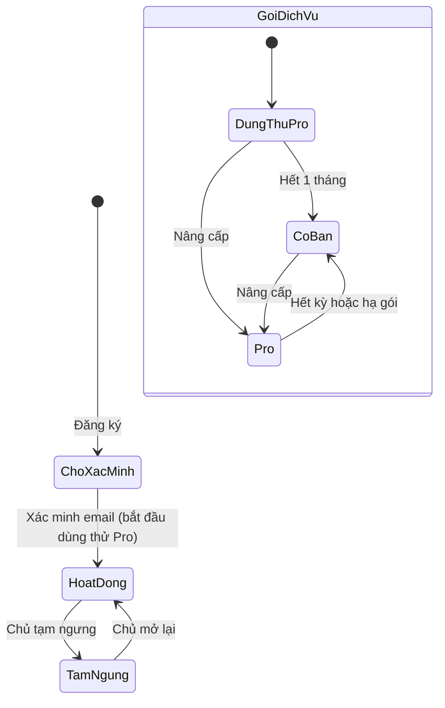

## 5.10. Danh mục món

*Vai trò: Chủ cửa hàng (web) · 9 UC: R2-017 đến R2-025*

### 5.10.1. Mục tiêu nghiệp vụ

Quản lý danh mục sản phẩm gốc mà các suất bán ra tham chiếu: thông tin món, thành phần và dị ứng, hạn dùng chuẩn, trọng lượng; nhập hàng loạt từ CSV và điền nhanh từ ảnh bằng AI. Danh mục càng đầy đủ thì tạo suất, dự báo, cảnh báo dị ứng và tính kg thực phẩm cứu được càng chính xác.

### 5.10.2. Phạm vi

**Thuộc phân hệ:** Danh sách và tra cứu; Quản lý món; Nhập dữ liệu.

**Danh sách UC:** R2-017 Xem danh sách món; R2-018 Tìm kiếm, lọc và sắp xếp món; R2-019 Xem chi tiết món; R2-020 Tạo món mới; R2-021 Gợi ý thông tin món từ ảnh bằng AI; R2-022 Chỉnh sửa món; R2-023 Lưu trữ món; R2-024 Khôi phục món; R2-025 Nhập danh mục món từ CSV.

**Nằm ngoài phạm vi:** Quản lý nguyên liệu và công thức; đồng bộ với phần mềm bán hàng khác.

### 5.10.3. Tác nhân và quyền hạn

Chủ cửa hàng và Quản lý (web). Nhân viên quầy không có quyền.

### 5.10.4. Dữ liệu nghiệp vụ

| Thực thể | Ý nghĩa, nguồn hình thành và ảnh hưởng đến quyết định nghiệp vụ |
|---|---|
| Món | Tên, loại, giá gốc, hạn dùng chuẩn, thành phần và dị ứng, trọng lượng, ảnh, trạng thái (Đang dùng, Đã lưu trữ). Món không bị xóa vật lý để giữ lịch sử suất và đơn. |
| Lô nhập CSV | Tối đa 100 dòng mỗi lần ở Cơ bản, 500 ở Pro; kết quả theo từng dòng. |

### 5.10.5. Quy trình nghiệp vụ tổng thể

1. Chủ tạo món thủ công hoặc nhờ AI gợi ý từ ảnh (kết quả điền vào biểu mẫu để chủ sửa); hoặc nhập CSV.
2. Chủ chỉnh sửa, lưu trữ (món không còn xuất hiện khi tạo suất) hoặc khôi phục; xem chi tiết kèm lịch sử suất và tổng bán, tổng bỏ.

**Phân hệ phụ thuộc và liên kết:** Cung cấp món cho Suất và tồn kho; dữ liệu thành phần và trọng lượng được dùng bởi Khám phá deal (dị ứng), Báo cáo (kg), Chất lượng dữ liệu.

### 5.10.6. Đặc tả từng UC

##### R2-017 - Xem danh sách món

**Mã UC:** R2-017  
**Tên UC:** Xem danh sách món  
**Nhóm:** Danh mục món / Danh sách và tra cứu · **Loại:** Truy vấn và hiển thị  
**Mục tiêu:** Danh sách món của cửa hàng, mặc định ẩn món đã lưu trữ. *[Xác định trong Excel]*  
**Tác nhân:** Chủ cửa hàng (web)  

**Điều kiện tiên quyết** *[Tổng hợp từ ma trận gói và vai trò]*
- Người dùng đã đăng nhập trên web bằng tài khoản Chủ hoặc nhân viên của cửa hàng; cửa hàng ở trạng thái Hoạt động (trừ các UC quản lý trạng thái cửa hàng, gói và hồ sơ).
- Nhóm quyền được phép: Chủ và Quản lý; Nhân viên quầy không có quyền (không thuộc bốn thao tác của nhóm này). *[Tổng hợp từ UC phân quyền nhân viên]*
- Gói dịch vụ: Mọi gói (GOI-CB, GOI-PRO, GOI-DT); không có hạn mức riêng.

**Dữ liệu hiển thị (UC không có trường nhập)** *[Xác định trong Excel]*
- Hiển thị: ảnh, tên, loại, giá gốc, hạn dùng chuẩn, trạng thái

**Luồng xử lý chính** *[Tổng hợp từ mô tả, quy tắc và kết quả]*
1. Người dùng mở màn hình "Xem danh sách món" trên web quản trị.
2. Hệ thống xác thực phiên, xác định phạm vi dữ liệu của người dùng và áp các quy tắc hiển thị của UC.
3. Truy vấn dữ liệu: Danh sách món của cửa hàng, mặc định ẩn món đã lưu trữ.
4. Hiển thị các thuộc tính: ảnh, tên, loại, giá gốc, hạn dùng chuẩn, trạng thái.
5. Trường hợp không có dữ liệu hoặc không hợp lệ được xử lý theo mục Validation; không thay đổi dữ liệu nghiệp vụ.

**Business Rules** *[Xác định trong Excel]*
1. Chỉ món của cửa hàng mình.

**Validation** *[Xác định trong Excel]*
1. Không có.

**Luồng thay thế và ngoại lệ**
- Người dùng không có quyền hoặc đối tượng không thuộc phạm vi dữ liệu của mình: từ chối, không tiết lộ sự tồn tại của dữ liệu thuộc người khác (đề xuất hoàn thiện).
- Mất kết nối hoặc lỗi hệ thống giữa chừng: thao tác không được ghi nhận một phần; người dùng được thông báo và thử lại, thao tác thay đổi dữ liệu dùng khóa chống trùng khi áp dụng (đề xuất hoàn thiện).

**Dữ liệu thay đổi** *[Tổng hợp]*  
Không tạo hoặc thay đổi dữ liệu nghiệp vụ; chỉ đọc theo phạm vi của người dùng.

**Chuyển trạng thái** *[Tổng hợp]*
- Không chuyển trạng thái của đối tượng nghiệp vụ.

**Kết quả** *[Xác định trong Excel]*  
Danh sách món phân trang 20.

**Tác động liên phân hệ** *[Tổng hợp]*  
Không phát sinh tác động đáng kể ngoài phân hệ; dữ liệu chỉ dùng trong phạm vi chức năng.

**Điều kiện hoàn thành** *[Tổng hợp]*  
Thành công khi: Danh sách món phân trang 20. Không hoàn tất khi bất kỳ điều kiện Validation nào không đạt hoặc dịch vụ liên quan lỗi; dữ liệu giữ nguyên trạng thái trước thao tác.

**Tiêu chí nghiệm thu** *[Tổng hợp, kiểm tra được]*
1. Given người dùng cửa hàng đủ điều kiện tiên quyết và dữ liệu hợp lệ, When thực hiện "Xem danh sách món", Then kết quả đạt được là: danh sách món phân trang 20.
2. Given thao tác "Xem danh sách món" được thực hiện, When hệ thống áp dụng quy tắc "Chỉ món của cửa hàng mình", Then kết quả không được vi phạm quy tắc này.

##### R2-018 - Tìm kiếm, lọc và sắp xếp món

**Mã UC:** R2-018  
**Tên UC:** Tìm kiếm, lọc và sắp xếp món  
**Nhóm:** Danh mục món / Danh sách và tra cứu · **Loại:** Truy vấn và hiển thị  
**Mục tiêu:** Tìm theo tên; lọc theo loại, trạng thái; sắp theo tên hoặc ngày tạo. *[Xác định trong Excel]*  
**Tác nhân:** Chủ cửa hàng (web)  

**Điều kiện tiên quyết** *[Tổng hợp từ ma trận gói và vai trò]*
- Người dùng đã đăng nhập trên web bằng tài khoản Chủ hoặc nhân viên của cửa hàng; cửa hàng ở trạng thái Hoạt động (trừ các UC quản lý trạng thái cửa hàng, gói và hồ sơ).
- Nhóm quyền được phép: Chủ và Quản lý; Nhân viên quầy không có quyền (không thuộc bốn thao tác của nhóm này). *[Tổng hợp từ UC phân quyền nhân viên]*
- Gói dịch vụ: Mọi gói (GOI-CB, GOI-PRO, GOI-DT); không có hạn mức riêng.

**Dữ liệu đầu vào và hiển thị** *[Xác định trong Excel]*
- Từ khóa, loại, trạng thái (Đang dùng/Đã lưu trữ), tiêu chí sắp xếp

**Luồng xử lý chính** *[Tổng hợp từ mô tả, quy tắc và kết quả]*
1. Người dùng mở màn hình "Tìm kiếm, lọc và sắp xếp món" trên web quản trị và đặt điều kiện: Từ khóa, loại, trạng thái.
2. Hệ thống xác thực phiên, xác định phạm vi dữ liệu của người dùng và áp các quy tắc hiển thị của UC.
3. Truy vấn dữ liệu: Tìm theo tên; lọc theo loại, trạng thái; sắp theo tên hoặc ngày tạo.
4. Hiển thị kết quả theo định dạng của màn hình.
5. Trường hợp không có dữ liệu hoặc không hợp lệ được xử lý theo mục Validation; không thay đổi dữ liệu nghiệp vụ.

**Business Rules** *[Xác định trong Excel]*
1. Tìm không phân biệt dấu và hoa thường.

**Validation** *[Xác định trong Excel]*
1. Không có.

**Luồng thay thế và ngoại lệ**
- Người dùng không có quyền hoặc đối tượng không thuộc phạm vi dữ liệu của mình: từ chối, không tiết lộ sự tồn tại của dữ liệu thuộc người khác (đề xuất hoàn thiện).
- Mất kết nối hoặc lỗi hệ thống giữa chừng: thao tác không được ghi nhận một phần; người dùng được thông báo và thử lại, thao tác thay đổi dữ liệu dùng khóa chống trùng khi áp dụng (đề xuất hoàn thiện).

**Dữ liệu thay đổi** *[Tổng hợp]*  
Không tạo hoặc thay đổi dữ liệu nghiệp vụ; chỉ đọc theo phạm vi của người dùng.

**Chuyển trạng thái** *[Tổng hợp]*
- Không chuyển trạng thái của đối tượng nghiệp vụ.

**Kết quả** *[Xác định trong Excel]*  
Danh sách theo điều kiện.

**Tác động liên phân hệ** *[Tổng hợp]*  
Không phát sinh tác động đáng kể ngoài phân hệ; dữ liệu chỉ dùng trong phạm vi chức năng.

**Điều kiện hoàn thành** *[Tổng hợp]*  
Thành công khi: Danh sách theo điều kiện. Không hoàn tất khi bất kỳ điều kiện Validation nào không đạt hoặc dịch vụ liên quan lỗi; dữ liệu giữ nguyên trạng thái trước thao tác.

**Tiêu chí nghiệm thu** *[Tổng hợp, kiểm tra được]*
1. Given người dùng cửa hàng đủ điều kiện tiên quyết và dữ liệu hợp lệ, When thực hiện "Tìm kiếm, lọc và sắp xếp món", Then kết quả đạt được là: danh sách theo điều kiện.
2. Given thao tác "Tìm kiếm, lọc và sắp xếp món" được thực hiện, When hệ thống áp dụng quy tắc "Tìm không phân biệt dấu và hoa thường", Then kết quả không được vi phạm quy tắc này.

##### R2-019 - Xem chi tiết món

**Mã UC:** R2-019  
**Tên UC:** Xem chi tiết món  
**Nhóm:** Danh mục món / Danh sách và tra cứu · **Loại:** Truy vấn và hiển thị  
**Mục tiêu:** Xem đầy đủ thuộc tính món, lịch sử các suất đã tạo từ món và tổng đã bán. *[Xác định trong Excel]*  
**Tác nhân:** Chủ cửa hàng (web)  

**Điều kiện tiên quyết** *[Tổng hợp từ ma trận gói và vai trò]*
- Người dùng đã đăng nhập trên web bằng tài khoản Chủ hoặc nhân viên của cửa hàng; cửa hàng ở trạng thái Hoạt động (trừ các UC quản lý trạng thái cửa hàng, gói và hồ sơ).
- Nhóm quyền được phép: Chủ và Quản lý; Nhân viên quầy không có quyền (không thuộc bốn thao tác của nhóm này). *[Tổng hợp từ UC phân quyền nhân viên]*
- Gói dịch vụ: Mọi gói (GOI-CB, GOI-PRO, GOI-DT); không có hạn mức riêng.

**Dữ liệu hiển thị (UC không có trường nhập)** *[Xác định trong Excel]*
- Hiển thị: toàn bộ thuộc tính món, số suất đã tạo, tổng bán, tổng bỏ

**Luồng xử lý chính** *[Tổng hợp từ mô tả, quy tắc và kết quả]*
1. Người dùng mở màn hình "Xem chi tiết món" trên web quản trị.
2. Hệ thống xác thực phiên, xác định phạm vi dữ liệu của người dùng và áp các quy tắc hiển thị của UC.
3. Truy vấn dữ liệu: Xem đầy đủ thuộc tính món, lịch sử các suất đã tạo từ món và tổng đã bán.
4. Hiển thị các thuộc tính: toàn bộ thuộc tính món, số suất đã tạo, tổng bán, tổng bỏ.
5. Trường hợp không có dữ liệu hoặc không hợp lệ được xử lý theo mục Validation; không thay đổi dữ liệu nghiệp vụ.

**Business Rules** *[Xác định trong Excel]*
1. Chỉ món của cửa hàng mình.

**Validation** *[Xác định trong Excel]*
1. Món không tồn tại: báo không tìm thấy.

**Luồng thay thế và ngoại lệ**
- Mọi trường hợp không hợp lệ nêu ở mục Validation là luồng ngoại lệ của UC này và được xử lý đúng như mô tả tại đó. *[Xác định]*
- Người dùng không có quyền hoặc đối tượng không thuộc phạm vi dữ liệu của mình: từ chối, không tiết lộ sự tồn tại của dữ liệu thuộc người khác (đề xuất hoàn thiện).
- Mất kết nối hoặc lỗi hệ thống giữa chừng: thao tác không được ghi nhận một phần; người dùng được thông báo và thử lại, thao tác thay đổi dữ liệu dùng khóa chống trùng khi áp dụng (đề xuất hoàn thiện).

**Dữ liệu thay đổi** *[Tổng hợp]*  
Không tạo hoặc thay đổi dữ liệu nghiệp vụ; chỉ đọc theo phạm vi của người dùng.

**Chuyển trạng thái** *[Tổng hợp]*
- Không chuyển trạng thái của đối tượng nghiệp vụ.

**Kết quả** *[Xác định trong Excel]*  
Hiển thị chi tiết.

**Tác động liên phân hệ** *[Tổng hợp]*  
Dữ liệu hoặc quy tắc của UC liên quan đến: Suất và tồn kho trong ngày.

**Điều kiện hoàn thành** *[Tổng hợp]*  
Thành công khi: Hiển thị chi tiết. Không hoàn tất khi bất kỳ điều kiện Validation nào không đạt hoặc dịch vụ liên quan lỗi; dữ liệu giữ nguyên trạng thái trước thao tác.

**Tiêu chí nghiệm thu** *[Tổng hợp, kiểm tra được]*
1. Given người dùng cửa hàng đủ điều kiện tiên quyết và dữ liệu hợp lệ, When thực hiện "Xem chi tiết món", Then kết quả đạt được là: hiển thị chi tiết.
2. Given món không tồn tại, When thực hiện "Xem chi tiết món", Then báo không tìm thấy.
3. Given thao tác "Xem chi tiết món" được thực hiện, When hệ thống áp dụng quy tắc "Chỉ món của cửa hàng mình", Then kết quả không được vi phạm quy tắc này.

##### R2-020 - Tạo món mới

**Mã UC:** R2-020  
**Tên UC:** Tạo món mới  
**Nhóm:** Danh mục món / Quản lý món · **Loại:** Tạo mới  
**Mục tiêu:** Chủ tạo món bằng cách nhập tay hoặc chụp ảnh để AI gợi ý rồi xác nhận. *[Xác định trong Excel]*  
**Tác nhân:** Chủ cửa hàng (web)  

**Điều kiện tiên quyết** *[Tổng hợp từ ma trận gói và vai trò]*
- Người dùng đã đăng nhập trên web bằng tài khoản Chủ hoặc nhân viên của cửa hàng; cửa hàng ở trạng thái Hoạt động (trừ các UC quản lý trạng thái cửa hàng, gói và hồ sơ).
- Nhóm quyền được phép: Chủ và Quản lý; Nhân viên quầy không có quyền (không thuộc bốn thao tác của nhóm này). *[Tổng hợp từ UC phân quyền nhân viên]*
- Gói dịch vụ: Mọi gói (GOI-CB, GOI-PRO, GOI-DT); không có hạn mức riêng.

**Dữ liệu đầu vào và hiển thị** *[Xác định trong Excel]*
- Tên món (2-80 ký tự, duy nhất trong cửa hàng)
- Loại (Bánh mì/Bánh ngọt/Bánh kem/Đồ uống/Khác)
- Giá gốc (số nguyên VND, 1.000-5.000.000, bội 500)
- Hạn dùng chuẩn (số giờ, 1-168)
- Trọng lượng ước tính một suất (gram, 10-5000, tùy chọn)
- Thành phần và dị ứng (text 0-300)
- Ảnh (JPG/PNG tối đa 5 MB)
- Giá vốn (VND, tùy chọn)

**Luồng xử lý chính** *[Tổng hợp từ mô tả, quy tắc và kết quả]*
1. Người dùng chọn chức năng "Tạo món mới" trên web quản trị.
2. Người dùng nhập hoặc chọn: Tên món, Loại, Giá gốc, Hạn dùng chuẩn, Trọng lượng ước tính một suất.
3. Hệ thống xác thực phiên, kiểm tra quyền, phạm vi dữ liệu, gói dịch vụ và hạn mức (nếu có).
4. Hệ thống kiểm tra từng điều kiện ở mục Validation; sai thì trả lỗi tại trường tương ứng và không tạo dữ liệu.
5. Xử lý nghiệp vụ: Chủ tạo món bằng cách nhập tay hoặc chụp ảnh để AI gợi ý rồi xác nhận.
6. Hệ thống lưu dữ liệu, cập nhật các đối tượng liên quan và phản hồi: Món trạng thái Đang dùng; xuất hiện khi tạo suất.

**Business Rules** *[Xác định trong Excel]*
1. Tên không trùng trong cùng cửa hàng.
2. Giá bán sau này không thấp hơn giá sàn, và không thấp hơn giá vốn nếu đã khai.
3. Gợi ý AI chỉ điền sẵn, chủ phải xác nhận mới lưu.

**Validation** *[Xác định trong Excel]*
1. Thiếu trường bắt buộc, sai kiểu, tên trùng: báo từng lỗi.

**Luồng thay thế và ngoại lệ**
- Mọi trường hợp không hợp lệ nêu ở mục Validation là luồng ngoại lệ của UC này và được xử lý đúng như mô tả tại đó. *[Xác định]*
- Người dùng không có quyền hoặc đối tượng không thuộc phạm vi dữ liệu của mình: từ chối, không tiết lộ sự tồn tại của dữ liệu thuộc người khác (đề xuất hoàn thiện).
- Mất kết nối hoặc lỗi hệ thống giữa chừng: thao tác không được ghi nhận một phần; người dùng được thông báo và thử lại, thao tác thay đổi dữ liệu dùng khóa chống trùng khi áp dụng (đề xuất hoàn thiện).

**Dữ liệu thay đổi** *[Tổng hợp]*  
Theo kết quả đã xác định: Món trạng thái Đang dùng; xuất hiện khi tạo suất.

**Chuyển trạng thái** *[Tổng hợp]*
- Món trạng thái Đang dùng.

**Kết quả** *[Xác định trong Excel]*  
Món trạng thái Đang dùng; xuất hiện khi tạo suất.

**Tác động liên phân hệ** *[Tổng hợp]*  
Dữ liệu hoặc quy tắc của UC liên quan đến: Suất và tồn kho trong ngày; Định giá động.

**Điều kiện hoàn thành** *[Tổng hợp]*  
Thành công khi: Món trạng thái Đang dùng; xuất hiện khi tạo suất. Không hoàn tất khi bất kỳ điều kiện Validation nào không đạt hoặc dịch vụ liên quan lỗi; dữ liệu giữ nguyên trạng thái trước thao tác.

**Tiêu chí nghiệm thu** *[Tổng hợp, kiểm tra được]*
1. Given người dùng cửa hàng đủ điều kiện tiên quyết và dữ liệu hợp lệ, When thực hiện "Tạo món mới", Then kết quả đạt được là: món trạng thái Đang dùng; xuất hiện khi tạo suất.
2. Given thiếu trường bắt buộc, sai kiểu, tên trùng, When thực hiện "Tạo món mới", Then báo từng lỗi.
3. Given thao tác "Tạo món mới" được thực hiện, When hệ thống áp dụng quy tắc "Tên không trùng trong cùng cửa hàng", Then kết quả không được vi phạm quy tắc này.

##### R2-021 - Gợi ý thông tin món từ ảnh bằng AI

**Mã UC:** R2-021  
**Tên UC:** Gợi ý thông tin món từ ảnh bằng AI  
**Nhóm:** Danh mục món / Quản lý món · **Loại:** UC AI sinh ngôn ngữ  
**Mục tiêu:** Chủ chụp/tải ảnh; backend gọi Gemini trả về tên gợi ý, mô tả, ước tính dinh dưỡng. Kết quả điền vào biểu mẫu để chủ sửa. *[Xác định trong Excel]*  
**Tác nhân:** Chủ cửa hàng (web); dịch vụ AI (Gemini) gọi từ server  

**Điều kiện tiên quyết** *[Tổng hợp từ ma trận gói và vai trò]*
- Người dùng đã đăng nhập trên web bằng tài khoản Chủ hoặc nhân viên của cửa hàng; cửa hàng ở trạng thái Hoạt động (trừ các UC quản lý trạng thái cửa hàng, gói và hồ sơ).
- Nhóm quyền được phép: Chủ và Quản lý; Nhân viên quầy không có quyền (không thuộc bốn thao tác của nhóm này). *[Tổng hợp từ UC phân quyền nhân viên]*
- Gói dịch vụ: Mọi gói. Hạn mức: GOI-CB 20 lượt/tháng; GOI-PRO 300 lượt/tháng (chu kỳ đặt lại: hằng tháng); GOI-DT như Pro. Khi hết hạn mức: Từ chối thao tác, hiện số lượt còn lại và thời điểm đặt lại; gợi ý nâng cấp.
- Tính năng AI đang bật trong cấu hình AI của cửa hàng, và còn hạn mức AI.

**Dữ liệu đầu vào và hiển thị** *[Xác định trong Excel]*
- Ảnh món (JPG/PNG)
- Kết quả AI: tên gợi ý, mô tả, dinh dưỡng ước tính (chỉ để tham khảo)

**Luồng xử lý chính** *[Tổng hợp từ mô tả, quy tắc và kết quả]*
1. Người dùng mở chức năng "Gợi ý thông tin món từ ảnh bằng AI" trên web quản trị và cung cấp đầu vào: Ảnh món.
2. Hệ thống kiểm tra quyền, cài đặt bật/tắt AI, đồng ý của người dùng và hạn mức AI còn lại; không đạt thì dừng và dùng phương án không AI.
3. Hệ thống xác định phạm vi dữ liệu được phép đọc (chỉ dữ liệu của người dùng hoặc cửa hàng đang hỏi, cộng dữ liệu công khai của deal) rồi truy xuất dữ liệu thật bằng truy vấn hoặc phép tính xác định.
4. Mô tả xử lý: Chủ chụp/tải ảnh; backend gọi Gemini trả về tên gợi ý, mô tả, ước tính dinh dưỡng. Kết quả điền vào biểu mẫu để chủ sửa.
5. Mô hình ngôn ngữ (Gemini, gọi từ server) chỉ làm phần được phép theo quy tắc của UC: chuyển câu chữ thành cấu trúc đã kiểm soát hoặc diễn đạt lại số liệu do hệ thống cung cấp.
6. Hệ thống kiểm tra đầu ra (schema, giới hạn giá trị, đối chiếu số liệu với dữ liệu nguồn); đầu ra không đạt bị loại và hiển thị phương án dự phòng.
7. Hệ thống hiển thị kết quả có gắn nhãn nguồn, ghi nhật ký AI và tính lượt vào hạn mức nếu UC có áp hạn mức. Mọi quyết định và hành động thay đổi dữ liệu chỉ diễn ra khi người dùng xác nhận và qua kiểm tra quy tắc.

**Business Rules** *[Xác định trong Excel]*
1. AI không quyết định giá, tồn, hạn dùng.
2. Lỗi/timeout 10 giây: bỏ qua, chủ nhập tay.
3. Khóa API chỉ nằm ở server.
4. Dinh dưỡng gắn nhãn Ước tính.

**Validation** *[Xác định trong Excel]*
1. Ảnh không đọc được: báo lỗi và cho nhập tay.

**Luồng thay thế và ngoại lệ**
- Mọi trường hợp không hợp lệ nêu ở mục Validation là luồng ngoại lệ của UC này và được xử lý đúng như mô tả tại đó. *[Xác định]*
- Người dùng không có quyền hoặc đối tượng không thuộc phạm vi dữ liệu của mình: từ chối, không tiết lộ sự tồn tại của dữ liệu thuộc người khác (đề xuất hoàn thiện).
- Mất kết nối hoặc lỗi hệ thống giữa chừng: thao tác không được ghi nhận một phần; người dùng được thông báo và thử lại, thao tác thay đổi dữ liệu dùng khóa chống trùng khi áp dụng (đề xuất hoàn thiện).
- Vượt hạn mức: Từ chối thao tác, hiện số lượt còn lại và thời điểm đặt lại; gợi ý nâng cấp. (theo ma trận gói).

**Dữ liệu thay đổi** *[Tổng hợp]*  
Theo kết quả đã xác định: Biểu mẫu điền sẵn; hoặc nhập tay khi AI lỗi.

**Chuyển trạng thái** *[Tổng hợp]*
- Excel không nêu chuyển trạng thái riêng cho UC này; đối tượng giữ trạng thái hiện tại trừ phần được nêu ở mục Kết quả.

**Kết quả** *[Xác định trong Excel]*  
Biểu mẫu điền sẵn; hoặc nhập tay khi AI lỗi.

**Tác động liên phân hệ** *[Tổng hợp]*  
Dữ liệu hoặc quy tắc của UC liên quan đến: Suất và tồn kho trong ngày; Định giá động; Nhật ký và hạn mức AI.

**Điều kiện hoàn thành** *[Tổng hợp]*  
Thành công khi: Biểu mẫu điền sẵn; hoặc nhập tay khi AI lỗi. Không hoàn tất khi bất kỳ điều kiện Validation nào không đạt hoặc dịch vụ liên quan lỗi; dữ liệu giữ nguyên trạng thái trước thao tác.

**Tiêu chí nghiệm thu** *[Tổng hợp, kiểm tra được]*
1. Given người dùng cửa hàng đủ điều kiện tiên quyết và dữ liệu hợp lệ, When thực hiện "Gợi ý thông tin món từ ảnh bằng AI", Then kết quả đạt được là: biểu mẫu điền sẵn; hoặc nhập tay khi AI lỗi.
2. Given ảnh không đọc được, When thực hiện "Gợi ý thông tin món từ ảnh bằng AI", Then báo lỗi và cho nhập tay.
3. Given thao tác "Gợi ý thông tin món từ ảnh bằng AI" được thực hiện, When hệ thống áp dụng quy tắc "AI không quyết định giá, tồn, hạn dùng", Then kết quả không được vi phạm quy tắc này.
4. Given đã dùng hết hạn mức 20 lượt/tháng, When thực hiện "Gợi ý thông tin món từ ảnh bằng AI" thêm một lần, Then hệ thống từ chối theo quy tắc "Từ chối thao tác, hiện số lượt còn lại và thời điểm đặt lại; gợi ý nâng cấp." và không thay đổi dữ liệu.
5. Given dịch vụ AI lỗi hoặc quá thời gian chờ, When thực hiện "Gợi ý thông tin món từ ảnh bằng AI", Then chức năng không dùng AI vẫn hoạt động và người dùng nhận phương án dự phòng đã mô tả; không có số liệu nào do AI tự tạo.

##### R2-022 - Chỉnh sửa món

**Mã UC:** R2-022  
**Tên UC:** Chỉnh sửa món  
**Nhóm:** Danh mục món / Quản lý món · **Loại:** Cập nhật  
**Mục tiêu:** Chủ sửa thuộc tính món. Thay đổi giá gốc không đổi giá của suất đang mở. *[Xác định trong Excel]*  
**Tác nhân:** Chủ cửa hàng (web)  

**Điều kiện tiên quyết** *[Tổng hợp từ ma trận gói và vai trò]*
- Người dùng đã đăng nhập trên web bằng tài khoản Chủ hoặc nhân viên của cửa hàng; cửa hàng ở trạng thái Hoạt động (trừ các UC quản lý trạng thái cửa hàng, gói và hồ sơ).
- Nhóm quyền được phép: Chủ và Quản lý; Nhân viên quầy không có quyền (không thuộc bốn thao tác của nhóm này). *[Tổng hợp từ UC phân quyền nhân viên]*
- Gói dịch vụ: Mọi gói (GOI-CB, GOI-PRO, GOI-DT); không có hạn mức riêng.

**Dữ liệu đầu vào và hiển thị** *[Xác định trong Excel]*
- Các trường như khi tạo món

**Luồng xử lý chính** *[Tổng hợp từ mô tả, quy tắc và kết quả]*
1. Người dùng mở "Chỉnh sửa món" trên web quản trị; hệ thống nạp giá trị hiện tại.
2. Người dùng thay đổi: Các trường như khi tạo món.
3. Hệ thống kiểm tra quyền, trạng thái hiện tại của đối tượng và điều kiện ở mục Validation.
4. Xử lý nghiệp vụ: Chủ sửa thuộc tính món. Thay đổi giá gốc không đổi giá của suất đang mở.
5. Hệ thống lưu giá trị mới, ghi lịch sử hoặc nhật ký nếu quy tắc yêu cầu và phản hồi: Món cập nhật.

**Business Rules** *[Xác định trong Excel]*
1. Sửa ảnh hưởng suất tạo sau, không ảnh hưởng đơn đã chốt.
2. Ghi nhật ký thay đổi giá gốc.

**Validation** *[Xác định trong Excel]*
1. Tên trùng, giá sai bội số: báo lỗi; cập nhật đồng thời: báo bản ghi đã đổi (kiểm tra phiên bản).

**Luồng thay thế và ngoại lệ**
- Mọi trường hợp không hợp lệ nêu ở mục Validation là luồng ngoại lệ của UC này và được xử lý đúng như mô tả tại đó. *[Xác định]*
- Người dùng không có quyền hoặc đối tượng không thuộc phạm vi dữ liệu của mình: từ chối, không tiết lộ sự tồn tại của dữ liệu thuộc người khác (đề xuất hoàn thiện).
- Mất kết nối hoặc lỗi hệ thống giữa chừng: thao tác không được ghi nhận một phần; người dùng được thông báo và thử lại, thao tác thay đổi dữ liệu dùng khóa chống trùng khi áp dụng (đề xuất hoàn thiện).

**Dữ liệu thay đổi** *[Tổng hợp]*  
Theo kết quả đã xác định: Món cập nhật.

**Chuyển trạng thái** *[Tổng hợp]*
- Excel không nêu chuyển trạng thái riêng cho UC này; đối tượng giữ trạng thái hiện tại trừ phần được nêu ở mục Kết quả.

**Kết quả** *[Xác định trong Excel]*  
Món cập nhật.

**Tác động liên phân hệ** *[Tổng hợp]*  
Dữ liệu hoặc quy tắc của UC liên quan đến: Suất và tồn kho trong ngày; Đơn hàng; Nhật ký hoạt động.

**Điều kiện hoàn thành** *[Tổng hợp]*  
Thành công khi: Món cập nhật. Không hoàn tất khi bất kỳ điều kiện Validation nào không đạt hoặc dịch vụ liên quan lỗi; dữ liệu giữ nguyên trạng thái trước thao tác.

**Tiêu chí nghiệm thu** *[Tổng hợp, kiểm tra được]*
1. Given người dùng cửa hàng đủ điều kiện tiên quyết và dữ liệu hợp lệ, When thực hiện "Chỉnh sửa món", Then kết quả đạt được là: món cập nhật.
2. Given tên trùng, giá sai bội số, When thực hiện "Chỉnh sửa món", Then báo lỗi; cập nhật đồng thời: báo bản ghi đã đổi (kiểm tra phiên bản).
3. Given thao tác "Chỉnh sửa món" được thực hiện, When hệ thống áp dụng quy tắc "Sửa ảnh hưởng suất tạo sau, không ảnh hưởng đơn đã chốt", Then kết quả không được vi phạm quy tắc này.

##### R2-023 - Lưu trữ món

**Mã UC:** R2-023  
**Tên UC:** Lưu trữ món  
**Nhóm:** Danh mục món / Quản lý món · **Loại:** Tạo mới  
**Mục tiêu:** Chủ lưu trữ món không bán nữa. Không xóa vật lý để giữ lịch sử. *[Xác định trong Excel]*  
**Tác nhân:** Chủ cửa hàng (web)  

**Điều kiện tiên quyết** *[Tổng hợp từ ma trận gói và vai trò]*
- Người dùng đã đăng nhập trên web bằng tài khoản Chủ hoặc nhân viên của cửa hàng; cửa hàng ở trạng thái Hoạt động (trừ các UC quản lý trạng thái cửa hàng, gói và hồ sơ).
- Nhóm quyền được phép: Chủ và Quản lý; Nhân viên quầy không có quyền (không thuộc bốn thao tác của nhóm này). *[Tổng hợp từ UC phân quyền nhân viên]*
- Gói dịch vụ: Mọi gói (GOI-CB, GOI-PRO, GOI-DT); không có hạn mức riêng.

**Dữ liệu đầu vào và hiển thị** *[Xác định trong Excel]*
- Mã món (hệ thống)

**Luồng xử lý chính** *[Tổng hợp từ mô tả, quy tắc và kết quả]*
1. Người dùng chọn chức năng "Lưu trữ món" trên web quản trị.
2. Người dùng nhập hoặc chọn: Mã món.
3. Hệ thống xác thực phiên, kiểm tra quyền, phạm vi dữ liệu, gói dịch vụ và hạn mức (nếu có).
4. Hệ thống kiểm tra từng điều kiện ở mục Validation; sai thì trả lỗi tại trường tương ứng và không tạo dữ liệu.
5. Xử lý nghiệp vụ: Chủ lưu trữ món không bán nữa. Không xóa vật lý để giữ lịch sử.
6. Hệ thống lưu dữ liệu, cập nhật các đối tượng liên quan và phản hồi: Món chuyển Đã lưu trữ.

**Business Rules** *[Xác định trong Excel]*
1. Không lưu trữ khi món có suất đang mở.
2. Món lưu trữ không xuất hiện khi tạo suất.
3. Lịch sử bán và dự báo giữ nguyên.

**Validation** *[Xác định trong Excel]*
1. Có suất đang mở: từ chối.

**Luồng thay thế và ngoại lệ**
- Mọi trường hợp không hợp lệ nêu ở mục Validation là luồng ngoại lệ của UC này và được xử lý đúng như mô tả tại đó. *[Xác định]*
- Người dùng không có quyền hoặc đối tượng không thuộc phạm vi dữ liệu của mình: từ chối, không tiết lộ sự tồn tại của dữ liệu thuộc người khác (đề xuất hoàn thiện).
- Mất kết nối hoặc lỗi hệ thống giữa chừng: thao tác không được ghi nhận một phần; người dùng được thông báo và thử lại, thao tác thay đổi dữ liệu dùng khóa chống trùng khi áp dụng (đề xuất hoàn thiện).

**Dữ liệu thay đổi** *[Tổng hợp]*  
Theo kết quả đã xác định: Món chuyển Đã lưu trữ.

**Chuyển trạng thái** *[Tổng hợp]*
- Món chuyển Đã lưu trữ.

**Kết quả** *[Xác định trong Excel]*  
Món chuyển Đã lưu trữ.

**Tác động liên phân hệ** *[Tổng hợp]*  
Dữ liệu hoặc quy tắc của UC liên quan đến: Suất và tồn kho trong ngày; Dự báo số lượng.

**Điều kiện hoàn thành** *[Tổng hợp]*  
Thành công khi: Món chuyển Đã lưu trữ. Không hoàn tất khi bất kỳ điều kiện Validation nào không đạt hoặc dịch vụ liên quan lỗi; dữ liệu giữ nguyên trạng thái trước thao tác.

**Tiêu chí nghiệm thu** *[Tổng hợp, kiểm tra được]*
1. Given người dùng cửa hàng đủ điều kiện tiên quyết và dữ liệu hợp lệ, When thực hiện "Lưu trữ món", Then kết quả đạt được là: món chuyển Đã lưu trữ.
2. Given có suất đang mở, When thực hiện "Lưu trữ món", Then từ chối.
3. Given thao tác "Lưu trữ món" được thực hiện, When hệ thống áp dụng quy tắc "Không lưu trữ khi món có suất đang mở", Then kết quả không được vi phạm quy tắc này.

##### R2-024 - Khôi phục món

**Mã UC:** R2-024  
**Tên UC:** Khôi phục món  
**Nhóm:** Danh mục món / Quản lý món · **Loại:** Chuyển trạng thái  
**Mục tiêu:** Chủ khôi phục món đã lưu trữ. *[Xác định trong Excel]*  
**Tác nhân:** Chủ cửa hàng (web)  

**Điều kiện tiên quyết** *[Tổng hợp từ ma trận gói và vai trò]*
- Người dùng đã đăng nhập trên web bằng tài khoản Chủ hoặc nhân viên của cửa hàng; cửa hàng ở trạng thái Hoạt động (trừ các UC quản lý trạng thái cửa hàng, gói và hồ sơ).
- Nhóm quyền được phép: Chủ và Quản lý; Nhân viên quầy không có quyền (không thuộc bốn thao tác của nhóm này). *[Tổng hợp từ UC phân quyền nhân viên]*
- Gói dịch vụ: Mọi gói (GOI-CB, GOI-PRO, GOI-DT); không có hạn mức riêng.

**Dữ liệu đầu vào và hiển thị** *[Xác định trong Excel]*
- Mã món (hệ thống)

**Luồng xử lý chính** *[Tổng hợp từ mô tả, quy tắc và kết quả]*
1. Người dùng chọn đối tượng cần xử lý và thao tác "Khôi phục món" trên web quản trị.
2. Người dùng cung cấp thêm: Mã món.
3. Hệ thống kiểm tra trạng thái hiện tại có cho phép chuyển trạng thái này không, cùng quyền của người thực hiện.
4. Xử lý nghiệp vụ: Chủ khôi phục món đã lưu trữ.
5. Trạng thái, tồn kho, tiền hoặc thông báo liên quan được cập nhật trong cùng giao dịch; kết quả: Món về Đang dùng.

**Business Rules** *[Xác định trong Excel]*
1. Tên phải còn duy nhất; trùng thì yêu cầu đổi tên.

**Validation** *[Xác định trong Excel]*
1. Tên trùng: yêu cầu đổi tên.

**Luồng thay thế và ngoại lệ**
- Mọi trường hợp không hợp lệ nêu ở mục Validation là luồng ngoại lệ của UC này và được xử lý đúng như mô tả tại đó. *[Xác định]*
- Người dùng không có quyền hoặc đối tượng không thuộc phạm vi dữ liệu của mình: từ chối, không tiết lộ sự tồn tại của dữ liệu thuộc người khác (đề xuất hoàn thiện).
- Mất kết nối hoặc lỗi hệ thống giữa chừng: thao tác không được ghi nhận một phần; người dùng được thông báo và thử lại, thao tác thay đổi dữ liệu dùng khóa chống trùng khi áp dụng (đề xuất hoàn thiện).

**Dữ liệu thay đổi** *[Tổng hợp]*  
Theo kết quả đã xác định: Món về Đang dùng.

**Chuyển trạng thái** *[Tổng hợp]*
- Excel không nêu chuyển trạng thái riêng cho UC này; đối tượng giữ trạng thái hiện tại trừ phần được nêu ở mục Kết quả.

**Kết quả** *[Xác định trong Excel]*  
Món về Đang dùng.

**Tác động liên phân hệ** *[Tổng hợp]*  
Không phát sinh tác động đáng kể ngoài phân hệ; dữ liệu chỉ dùng trong phạm vi chức năng.

**Điều kiện hoàn thành** *[Tổng hợp]*  
Thành công khi: Món về Đang dùng. Không hoàn tất khi bất kỳ điều kiện Validation nào không đạt hoặc dịch vụ liên quan lỗi; dữ liệu giữ nguyên trạng thái trước thao tác.

**Tiêu chí nghiệm thu** *[Tổng hợp, kiểm tra được]*
1. Given người dùng cửa hàng đủ điều kiện tiên quyết và dữ liệu hợp lệ, When thực hiện "Khôi phục món", Then kết quả đạt được là: món về Đang dùng.
2. Given tên trùng, When thực hiện "Khôi phục món", Then yêu cầu đổi tên.
3. Given thao tác "Khôi phục món" được thực hiện, When hệ thống áp dụng quy tắc "Tên phải còn duy nhất; trùng thì yêu cầu đổi tên", Then kết quả không được vi phạm quy tắc này.

##### R2-025 - Nhập danh mục món từ CSV

**Mã UC:** R2-025  
**Tên UC:** Nhập danh mục món từ CSV  
**Nhóm:** Danh mục món / Nhập dữ liệu · **Loại:** Tạo mới  
**Mục tiêu:** Chủ tải tệp CSV danh sách món; hệ thống kiểm tra từng dòng và báo kết quả. *[Xác định trong Excel]*  
**Tác nhân:** Chủ cửa hàng (web)  

**Điều kiện tiên quyết** *[Tổng hợp từ ma trận gói và vai trò]*
- Người dùng đã đăng nhập trên web bằng tài khoản Chủ hoặc nhân viên của cửa hàng; cửa hàng ở trạng thái Hoạt động (trừ các UC quản lý trạng thái cửa hàng, gói và hồ sơ).
- Nhóm quyền được phép: Chủ và Quản lý; Nhân viên quầy không có quyền (không thuộc bốn thao tác của nhóm này). *[Tổng hợp từ UC phân quyền nhân viên]*
- Gói dịch vụ: Mọi gói. Hạn mức: GOI-CB 100 dòng/lần nhập; GOI-PRO 500 dòng/lần nhập (chu kỳ đặt lại: mỗi lần nhập); GOI-DT như Pro. Khi hết hạn mức: Từ chối thao tác, hiện số lượt còn lại và thời điểm đặt lại; gợi ý nâng cấp.

**Dữ liệu đầu vào và hiển thị** *[Xác định trong Excel]*
- Tệp CSV (tối đa 500 dòng, 2 MB): tên, loại, giá gốc, hạn dùng chuẩn, trọng lượng, thành phần

**Luồng xử lý chính** *[Tổng hợp từ mô tả, quy tắc và kết quả]*
1. Người dùng chọn chức năng "Nhập danh mục món từ CSV" trên web quản trị.
2. Người dùng nhập hoặc chọn: Tệp CSV.
3. Hệ thống xác thực phiên, kiểm tra quyền, phạm vi dữ liệu, gói dịch vụ và hạn mức (nếu có).
4. Hệ thống kiểm tra từng điều kiện ở mục Validation; sai thì trả lỗi tại trường tương ứng và không tạo dữ liệu.
5. Xử lý nghiệp vụ: Chủ tải tệp CSV danh sách món; hệ thống kiểm tra từng dòng và báo kết quả.
6. Hệ thống lưu dữ liệu, cập nhật các đối tượng liên quan và phản hồi: Tạo các món hợp lệ; báo số dòng thành công/lỗi.

**Business Rules** *[Xác định trong Excel]*
1. Hợp lệ từng dòng; dòng lỗi bỏ qua và liệt kê.
2. Món trùng tên bỏ qua.
3. Có xem trước trước khi xác nhận nhập.

**Validation** *[Xác định trong Excel]*
1. Sai định dạng, quá dòng: từ chối cả tệp.

**Luồng thay thế và ngoại lệ**
- Mọi trường hợp không hợp lệ nêu ở mục Validation là luồng ngoại lệ của UC này và được xử lý đúng như mô tả tại đó. *[Xác định]*
- Người dùng không có quyền hoặc đối tượng không thuộc phạm vi dữ liệu của mình: từ chối, không tiết lộ sự tồn tại của dữ liệu thuộc người khác (đề xuất hoàn thiện).
- Mất kết nối hoặc lỗi hệ thống giữa chừng: thao tác không được ghi nhận một phần; người dùng được thông báo và thử lại, thao tác thay đổi dữ liệu dùng khóa chống trùng khi áp dụng (đề xuất hoàn thiện).
- Vượt hạn mức: Từ chối thao tác, hiện số lượt còn lại và thời điểm đặt lại; gợi ý nâng cấp. (theo ma trận gói).

**Dữ liệu thay đổi** *[Tổng hợp]*  
Theo kết quả đã xác định: Tạo các món hợp lệ; báo số dòng thành công/lỗi.

**Chuyển trạng thái** *[Tổng hợp]*
- Excel không nêu chuyển trạng thái riêng cho UC này; đối tượng giữ trạng thái hiện tại trừ phần được nêu ở mục Kết quả.

**Kết quả** *[Xác định trong Excel]*  
Tạo các món hợp lệ; báo số dòng thành công/lỗi.

**Tác động liên phân hệ** *[Tổng hợp]*  
Không phát sinh tác động đáng kể ngoài phân hệ; dữ liệu chỉ dùng trong phạm vi chức năng.

**Điều kiện hoàn thành** *[Tổng hợp]*  
Thành công khi: Tạo các món hợp lệ; báo số dòng thành công/lỗi. Không hoàn tất khi bất kỳ điều kiện Validation nào không đạt hoặc dịch vụ liên quan lỗi; dữ liệu giữ nguyên trạng thái trước thao tác.

**Tiêu chí nghiệm thu** *[Tổng hợp, kiểm tra được]*
1. Given người dùng cửa hàng đủ điều kiện tiên quyết và dữ liệu hợp lệ, When thực hiện "Nhập danh mục món từ CSV", Then kết quả đạt được là: tạo các món hợp lệ; báo số dòng thành công/lỗi.
2. Given sai định dạng, quá dòng, When thực hiện "Nhập danh mục món từ CSV", Then từ chối cả tệp.
3. Given thao tác "Nhập danh mục món từ CSV" được thực hiện, When hệ thống áp dụng quy tắc "Hợp lệ từng dòng; dòng lỗi bỏ qua và liệt kê", Then kết quả không được vi phạm quy tắc này.
4. Given đã dùng hết hạn mức 100 dòng/lần nhập, When thực hiện "Nhập danh mục món từ CSV" thêm một lần, Then hệ thống từ chối theo quy tắc "Từ chối thao tác, hiện số lượt còn lại và thời điểm đặt lại; gợi ý nâng cấp." và không thay đổi dữ liệu.

### 5.10.7. Các quy tắc nghiệp vụ dùng chung

| Mã BR | Quy tắc | UC chịu ảnh hưởng |
|---|---|---|
| BR-051 | Món chỉ lưu trữ không xóa; món đã lưu trữ ẩn mặc định và không chọn được khi tạo suất; khôi phục đưa về Đang dùng. | R2-023, R2-024, R2-017 |
| BR-052 | AI không quyết định giá, tồn, hạn dùng; lỗi hoặc quá 10 giây thì bỏ qua và chủ nhập tay; dinh dưỡng gắn nhãn Ước tính. | R2-021 |
| BR-053 | Nhập CSV bị giới hạn số dòng theo gói; dòng lỗi báo theo dòng và không chặn các dòng hợp lệ (theo Validation của UC). | R2-025 |

### 5.10.8. Sơ đồ quy trình

Phân hệ không có quy trình nhiều nhánh cần sơ đồ; luồng đã được mô tả ở 5.10.5 và trong từng UC.

## 5.11. Suất và tồn kho trong ngày

*Vai trò: Chủ cửa hàng (web) · 10 UC: R2-026 đến R2-035*

### 5.11.1. Mục tiêu nghiệp vụ

Cho cửa hàng biến hàng dư cuối ngày thành các suất có giá, số lượng và khung giờ nhận cụ thể để khách đặt, đồng thời bảo toàn tính đúng của tồn kho trong mọi điều chỉnh (sửa, đóng sớm, hủy). Đây là nguồn dữ liệu cung của toàn nền tảng.

### 5.11.2. Phạm vi

**Thuộc phân hệ:** Danh sách; Quản lý suất; Tự động; Lịch sử.

**Danh sách UC:** R2-026 Xem danh sách suất hôm nay và các ngày; R2-027 Lọc và tìm suất; R2-028 Tạo suất; R2-029 Nhân bản suất của hôm qua; R2-030 Chỉnh sửa suất chưa bán hết; R2-031 Điều chỉnh tồn kho có lý do; R2-032 Đóng suất sớm; R2-033 Hủy suất và hoàn tiền các đơn; R2-034 Tự động đóng suất hết khung nhận (hệ thống); R2-035 Xem lịch sử thay đổi của suất.

**Nằm ngoài phạm vi:** Bán tại quầy ngoài app (chỉ nhập số tổng hợp cuối ngày); quản lý kho nhiều ngày.

### 5.11.3. Tác nhân và quyền hạn

Chủ cửa hàng và Quản lý (web); hệ thống (tự đóng suất hết khung nhận). Nhân viên quầy không có quyền tạo hoặc sửa suất.

### 5.11.4. Dữ liệu nghiệp vụ

| Thực thể | Ý nghĩa, nguồn hình thành và ảnh hưởng đến quyết định nghiệp vụ |
|---|---|
| Suất | Món, số lượng, tồn còn, giá gốc, giá bán, giá sàn, khung nhận, trạng thái Nháp, Đang mở, Hết suất, Đã đóng, Đã hủy; lịch sử thay đổi. |
| Điều chỉnh tồn | Mỗi lần điều chỉnh có lý do và người thực hiện. |

### 5.11.5. Quy trình nghiệp vụ tổng thể

1. Chủ tạo suất từ món (giới hạn 20 suất mở mỗi ngày ở Cơ bản, 100 ở Pro) hoặc nhân bản suất hôm qua; ở Pro số lượng mặc định lấy từ dự báo.
2. Suất Đang mở hiển thị cho khách; khi bán hết chuyển Hết suất; chủ có thể chỉnh sửa khi chưa bán hết, điều chỉnh tồn có lý do, đóng sớm.
3. Hủy suất kèm hoàn tiền tất cả đơn liên quan; hệ thống tự đóng suất khi hết khung nhận.

**Phân hệ phụ thuộc và liên kết:** Phụ thuộc Danh mục món, Tài khoản (khung nhận, giá sàn, trạng thái cửa hàng, gói). Cung cấp suất cho Khám phá deal, Đặt hàng, Dự báo và Định giá.

### 5.11.6. Đặc tả từng UC

##### R2-026 - Xem danh sách suất hôm nay và các ngày

**Mã UC:** R2-026  
**Tên UC:** Xem danh sách suất hôm nay và các ngày  
**Nhóm:** Suất và tồn kho trong ngày / Danh sách · **Loại:** Truy vấn và hiển thị  
**Mục tiêu:** Xem suất theo ngày kèm tồn còn, số đã giữ, đã bán, trạng thái. *[Xác định trong Excel]*  
**Tác nhân:** Chủ cửa hàng (web)  

**Điều kiện tiên quyết** *[Tổng hợp từ ma trận gói và vai trò]*
- Người dùng đã đăng nhập trên web bằng tài khoản Chủ hoặc nhân viên của cửa hàng; cửa hàng ở trạng thái Hoạt động (trừ các UC quản lý trạng thái cửa hàng, gói và hồ sơ).
- Nhóm quyền được phép: Chủ và Quản lý; Nhân viên quầy không có quyền (không thuộc bốn thao tác của nhóm này). *[Tổng hợp từ UC phân quyền nhân viên]*
- Gói dịch vụ: Mọi gói (GOI-CB, GOI-PRO, GOI-DT); không có hạn mức riêng.

**Dữ liệu hiển thị (UC không có trường nhập)** *[Xác định trong Excel]*
- Hiển thị: món, giá gốc, giá bán, tổng suất, đã bán, đang giữ, còn, khung nhận, trạng thái

**Luồng xử lý chính** *[Tổng hợp từ mô tả, quy tắc và kết quả]*
1. Người dùng mở màn hình "Xem danh sách suất hôm nay và các ngày" trên web quản trị.
2. Hệ thống xác thực phiên, xác định phạm vi dữ liệu của người dùng và áp các quy tắc hiển thị của UC.
3. Truy vấn dữ liệu: Xem suất theo ngày kèm tồn còn, số đã giữ, đã bán, trạng thái.
4. Hiển thị các thuộc tính: món, giá gốc, giá bán, tổng suất, đã bán, đang giữ, còn, khung nhận, trạng thái.
5. Trường hợp không có dữ liệu hoặc không hợp lệ được xử lý theo mục Validation; không thay đổi dữ liệu nghiệp vụ.

**Business Rules** *[Xác định trong Excel]*
1. Chỉ suất của cửa hàng mình.

**Validation** *[Xác định trong Excel]*
1. Không có.

**Luồng thay thế và ngoại lệ**
- Người dùng không có quyền hoặc đối tượng không thuộc phạm vi dữ liệu của mình: từ chối, không tiết lộ sự tồn tại của dữ liệu thuộc người khác (đề xuất hoàn thiện).
- Mất kết nối hoặc lỗi hệ thống giữa chừng: thao tác không được ghi nhận một phần; người dùng được thông báo và thử lại, thao tác thay đổi dữ liệu dùng khóa chống trùng khi áp dụng (đề xuất hoàn thiện).

**Dữ liệu thay đổi** *[Tổng hợp]*  
Không tạo hoặc thay đổi dữ liệu nghiệp vụ; chỉ đọc theo phạm vi của người dùng.

**Chuyển trạng thái** *[Tổng hợp]*
- Không chuyển trạng thái của đối tượng nghiệp vụ.

**Kết quả** *[Xác định trong Excel]*  
Danh sách suất theo ngày.

**Tác động liên phân hệ** *[Tổng hợp]*  
Không phát sinh tác động đáng kể ngoài phân hệ; dữ liệu chỉ dùng trong phạm vi chức năng.

**Điều kiện hoàn thành** *[Tổng hợp]*  
Thành công khi: Danh sách suất theo ngày. Không hoàn tất khi bất kỳ điều kiện Validation nào không đạt hoặc dịch vụ liên quan lỗi; dữ liệu giữ nguyên trạng thái trước thao tác.

**Tiêu chí nghiệm thu** *[Tổng hợp, kiểm tra được]*
1. Given người dùng cửa hàng đủ điều kiện tiên quyết và dữ liệu hợp lệ, When thực hiện "Xem danh sách suất hôm nay và các ngày", Then kết quả đạt được là: danh sách suất theo ngày.
2. Given thao tác "Xem danh sách suất hôm nay và các ngày" được thực hiện, When hệ thống áp dụng quy tắc "Chỉ suất của cửa hàng mình", Then kết quả không được vi phạm quy tắc này.

##### R2-027 - Lọc và tìm suất

**Mã UC:** R2-027  
**Tên UC:** Lọc và tìm suất  
**Nhóm:** Suất và tồn kho trong ngày / Danh sách · **Loại:** Truy vấn và hiển thị  
**Mục tiêu:** Lọc theo ngày, trạng thái, món. *[Xác định trong Excel]*  
**Tác nhân:** Chủ cửa hàng (web)  

**Điều kiện tiên quyết** *[Tổng hợp từ ma trận gói và vai trò]*
- Người dùng đã đăng nhập trên web bằng tài khoản Chủ hoặc nhân viên của cửa hàng; cửa hàng ở trạng thái Hoạt động (trừ các UC quản lý trạng thái cửa hàng, gói và hồ sơ).
- Nhóm quyền được phép: Chủ và Quản lý; Nhân viên quầy không có quyền (không thuộc bốn thao tác của nhóm này). *[Tổng hợp từ UC phân quyền nhân viên]*
- Gói dịch vụ: Mọi gói (GOI-CB, GOI-PRO, GOI-DT); không có hạn mức riêng.

**Dữ liệu đầu vào và hiển thị** *[Xác định trong Excel]*
- Ngày, trạng thái (Nháp/Đang mở/Hết suất/Đã đóng/Đã hủy), món

**Luồng xử lý chính** *[Tổng hợp từ mô tả, quy tắc và kết quả]*
1. Người dùng mở màn hình "Lọc và tìm suất" trên web quản trị và đặt điều kiện: Ngày, trạng thái.
2. Hệ thống xác thực phiên, xác định phạm vi dữ liệu của người dùng và áp các quy tắc hiển thị của UC.
3. Truy vấn dữ liệu: Lọc theo ngày, trạng thái, món.
4. Hiển thị kết quả theo định dạng của màn hình.
5. Trường hợp không có dữ liệu hoặc không hợp lệ được xử lý theo mục Validation; không thay đổi dữ liệu nghiệp vụ.

**Business Rules** *[Xác định trong Excel]*
1. Khoảng ngày tối đa 90 ngày.

**Validation** *[Xác định trong Excel]*
1. Ngày sai thứ tự: báo lỗi.

**Luồng thay thế và ngoại lệ**
- Mọi trường hợp không hợp lệ nêu ở mục Validation là luồng ngoại lệ của UC này và được xử lý đúng như mô tả tại đó. *[Xác định]*
- Người dùng không có quyền hoặc đối tượng không thuộc phạm vi dữ liệu của mình: từ chối, không tiết lộ sự tồn tại của dữ liệu thuộc người khác (đề xuất hoàn thiện).
- Mất kết nối hoặc lỗi hệ thống giữa chừng: thao tác không được ghi nhận một phần; người dùng được thông báo và thử lại, thao tác thay đổi dữ liệu dùng khóa chống trùng khi áp dụng (đề xuất hoàn thiện).

**Dữ liệu thay đổi** *[Tổng hợp]*  
Không tạo hoặc thay đổi dữ liệu nghiệp vụ; chỉ đọc theo phạm vi của người dùng.

**Chuyển trạng thái** *[Tổng hợp]*
- Không chuyển trạng thái của đối tượng nghiệp vụ.

**Kết quả** *[Xác định trong Excel]*  
Danh sách theo điều kiện.

**Tác động liên phân hệ** *[Tổng hợp]*  
Không phát sinh tác động đáng kể ngoài phân hệ; dữ liệu chỉ dùng trong phạm vi chức năng.

**Điều kiện hoàn thành** *[Tổng hợp]*  
Thành công khi: Danh sách theo điều kiện. Không hoàn tất khi bất kỳ điều kiện Validation nào không đạt hoặc dịch vụ liên quan lỗi; dữ liệu giữ nguyên trạng thái trước thao tác.

**Tiêu chí nghiệm thu** *[Tổng hợp, kiểm tra được]*
1. Given người dùng cửa hàng đủ điều kiện tiên quyết và dữ liệu hợp lệ, When thực hiện "Lọc và tìm suất", Then kết quả đạt được là: danh sách theo điều kiện.
2. Given ngày sai thứ tự, When thực hiện "Lọc và tìm suất", Then báo lỗi.
3. Given thao tác "Lọc và tìm suất" được thực hiện, When hệ thống áp dụng quy tắc "Khoảng ngày tối đa 90 ngày", Then kết quả không được vi phạm quy tắc này.

##### R2-028 - Tạo suất

**Mã UC:** R2-028  
**Tên UC:** Tạo suất  
**Nhóm:** Suất và tồn kho trong ngày / Quản lý suất · **Loại:** Tạo mới  
**Mục tiêu:** Chủ chọn món, số lượng, giá bán, khung nhận và hạn dùng; lưu nháp hoặc mở bán. *[Xác định trong Excel]*  
**Tác nhân:** Chủ cửa hàng (web)  

**Điều kiện tiên quyết** *[Tổng hợp từ ma trận gói và vai trò]*
- Người dùng đã đăng nhập trên web bằng tài khoản Chủ hoặc nhân viên của cửa hàng; cửa hàng ở trạng thái Hoạt động (trừ các UC quản lý trạng thái cửa hàng, gói và hồ sơ).
- Nhóm quyền được phép: Chủ và Quản lý; Nhân viên quầy không có quyền (không thuộc bốn thao tác của nhóm này). *[Tổng hợp từ UC phân quyền nhân viên]*
- Gói dịch vụ: Mọi gói. Hạn mức: GOI-CB 20 suất mở/ngày; GOI-PRO 100 suất mở/ngày (chu kỳ đặt lại: hằng ngày); GOI-DT như Pro. Khi hết hạn mức: Từ chối thao tác, hiện số lượt còn lại và thời điểm đặt lại; gợi ý nâng cấp.

**Dữ liệu đầu vào và hiển thị** *[Xác định trong Excel]*
- Món (bắt buộc)
- Số lượng (1-500)
- Giá bán (VND, bội 500, ≥ giá sàn, ≤ giá gốc)
- Khung nhận (bắt đầu-kết thúc, trong hôm nay hoặc ngày mai, trong giờ mở cửa)
- Hạn dùng (thời điểm, sau khung nhận)
- Ghi chú (0-200)

**Luồng xử lý chính** *[Tổng hợp từ mô tả, quy tắc và kết quả]*
1. Người dùng chọn chức năng "Tạo suất" trên web quản trị.
2. Người dùng nhập hoặc chọn: Món, Số lượng, Giá bán, Khung nhận, Hạn dùng.
3. Hệ thống xác thực phiên, kiểm tra quyền, phạm vi dữ liệu, gói dịch vụ và hạn mức (nếu có).
4. Hệ thống kiểm tra từng điều kiện ở mục Validation; sai thì trả lỗi tại trường tương ứng và không tạo dữ liệu.
5. Xử lý nghiệp vụ: Chủ chọn món, số lượng, giá bán, khung nhận và hạn dùng; lưu nháp hoặc mở bán.
6. Hệ thống lưu dữ liệu, cập nhật các đối tượng liên quan và phản hồi: Suất ở Nháp hoặc Đang mở; suất mở hiện cho khách.

**Business Rules** *[Xác định trong Excel]*
1. Giá bán không vượt giá gốc, không thấp hơn giá sàn.
2. Hạn dùng phải sau giờ kết thúc nhận.
3. Chỉ món Đang dùng.
4. Gói Cơ bản tối đa 20 suất mở/ngày (tham số).

**Validation** *[Xác định trong Excel]*
1. Vi phạm bất kỳ ràng buộc nào: báo lỗi từng trường.

**Luồng thay thế và ngoại lệ**
- Mọi trường hợp không hợp lệ nêu ở mục Validation là luồng ngoại lệ của UC này và được xử lý đúng như mô tả tại đó. *[Xác định]*
- Người dùng không có quyền hoặc đối tượng không thuộc phạm vi dữ liệu của mình: từ chối, không tiết lộ sự tồn tại của dữ liệu thuộc người khác (đề xuất hoàn thiện).
- Mất kết nối hoặc lỗi hệ thống giữa chừng: thao tác không được ghi nhận một phần; người dùng được thông báo và thử lại, thao tác thay đổi dữ liệu dùng khóa chống trùng khi áp dụng (đề xuất hoàn thiện).
- Vượt hạn mức: Từ chối thao tác, hiện số lượt còn lại và thời điểm đặt lại; gợi ý nâng cấp. (theo ma trận gói).

**Dữ liệu thay đổi** *[Tổng hợp]*  
Theo kết quả đã xác định: Suất ở Nháp hoặc Đang mở; suất mở hiện cho khách.

**Chuyển trạng thái** *[Tổng hợp]*
- Excel không nêu chuyển trạng thái riêng cho UC này; đối tượng giữ trạng thái hiện tại trừ phần được nêu ở mục Kết quả.

**Kết quả** *[Xác định trong Excel]*  
Suất ở Nháp hoặc Đang mở; suất mở hiện cho khách.

**Tác động liên phân hệ** *[Tổng hợp]*  
Dữ liệu hoặc quy tắc của UC liên quan đến: Định giá động; Gói dịch vụ và hạn mức.

**Điều kiện hoàn thành** *[Tổng hợp]*  
Thành công khi: Suất ở Nháp hoặc Đang mở; suất mở hiện cho khách. Không hoàn tất khi bất kỳ điều kiện Validation nào không đạt hoặc dịch vụ liên quan lỗi; dữ liệu giữ nguyên trạng thái trước thao tác.

**Tiêu chí nghiệm thu** *[Tổng hợp, kiểm tra được]*
1. Given người dùng cửa hàng đủ điều kiện tiên quyết và dữ liệu hợp lệ, When thực hiện "Tạo suất", Then kết quả đạt được là: suất ở Nháp hoặc Đang mở; suất mở hiện cho khách.
2. Given vi phạm bất kỳ ràng buộc nào, When thực hiện "Tạo suất", Then báo lỗi từng trường.
3. Given thao tác "Tạo suất" được thực hiện, When hệ thống áp dụng quy tắc "Giá bán không vượt giá gốc, không thấp hơn giá sàn", Then kết quả không được vi phạm quy tắc này.
4. Given đã dùng hết hạn mức 20 suất mở/ngày, When thực hiện "Tạo suất" thêm một lần, Then hệ thống từ chối theo quy tắc "Từ chối thao tác, hiện số lượt còn lại và thời điểm đặt lại; gợi ý nâng cấp." và không thay đổi dữ liệu.

##### R2-029 - Nhân bản suất của hôm qua

**Mã UC:** R2-029  
**Tên UC:** Nhân bản suất của hôm qua  
**Nhóm:** Suất và tồn kho trong ngày / Quản lý suất · **Loại:** Tạo mới  
**Mục tiêu:** Chủ chọn các suất hôm qua để tạo nhanh suất hôm nay với số lượng và giá gợi ý. *[Xác định trong Excel]*  
**Tác nhân:** Chủ cửa hàng (web)  

**Điều kiện tiên quyết** *[Tổng hợp từ ma trận gói và vai trò]*
- Người dùng đã đăng nhập trên web bằng tài khoản Chủ hoặc nhân viên của cửa hàng; cửa hàng ở trạng thái Hoạt động (trừ các UC quản lý trạng thái cửa hàng, gói và hồ sơ).
- Nhóm quyền được phép: Chủ và Quản lý; Nhân viên quầy không có quyền (không thuộc bốn thao tác của nhóm này). *[Tổng hợp từ UC phân quyền nhân viên]*
- Gói dịch vụ: Mọi gói, nhưng gói Cơ bản có điều kiện: Cơ bản: số lượng không có gợi ý từ dự báo, chủ nhập tay.

**Dữ liệu đầu vào và hiển thị** *[Xác định trong Excel]*
- Danh sách suất nguồn, số lượng, giá, khung nhận

**Luồng xử lý chính** *[Tổng hợp từ mô tả, quy tắc và kết quả]*
1. Người dùng chọn chức năng "Nhân bản suất của hôm qua" trên web quản trị.
2. Người dùng nhập hoặc chọn: Danh sách suất nguồn, số lượng, giá, khung nhận.
3. Hệ thống xác thực phiên, kiểm tra quyền, phạm vi dữ liệu, gói dịch vụ và hạn mức (nếu có).
4. Hệ thống kiểm tra từng điều kiện ở mục Validation; sai thì trả lỗi tại trường tương ứng và không tạo dữ liệu.
5. Xử lý nghiệp vụ: Chủ chọn các suất hôm qua để tạo nhanh suất hôm nay với số lượng và giá gợi ý.
6. Hệ thống lưu dữ liệu, cập nhật các đối tượng liên quan và phản hồi: Tạo các suất Nháp để chủ rà và mở bán.

**Business Rules** *[Xác định trong Excel]*
1. Dùng cùng ràng buộc của tạo suất; có thể dùng số lượng dự báo làm mặc định ở gói Pro.

**Validation** *[Xác định trong Excel]*
1. Suất nguồn dùng món đã lưu trữ: bỏ qua và báo.

**Luồng thay thế và ngoại lệ**
- Mọi trường hợp không hợp lệ nêu ở mục Validation là luồng ngoại lệ của UC này và được xử lý đúng như mô tả tại đó. *[Xác định]*
- Người dùng không có quyền hoặc đối tượng không thuộc phạm vi dữ liệu của mình: từ chối, không tiết lộ sự tồn tại của dữ liệu thuộc người khác (đề xuất hoàn thiện).
- Mất kết nối hoặc lỗi hệ thống giữa chừng: thao tác không được ghi nhận một phần; người dùng được thông báo và thử lại, thao tác thay đổi dữ liệu dùng khóa chống trùng khi áp dụng (đề xuất hoàn thiện).

**Dữ liệu thay đổi** *[Tổng hợp]*  
Theo kết quả đã xác định: Tạo các suất Nháp để chủ rà và mở bán.

**Chuyển trạng thái** *[Tổng hợp]*
- Excel không nêu chuyển trạng thái riêng cho UC này; đối tượng giữ trạng thái hiện tại trừ phần được nêu ở mục Kết quả.

**Kết quả** *[Xác định trong Excel]*  
Tạo các suất Nháp để chủ rà và mở bán.

**Tác động liên phân hệ** *[Tổng hợp]*  
Dữ liệu hoặc quy tắc của UC liên quan đến: Dự báo số lượng; Gói dịch vụ và hạn mức.

**Điều kiện hoàn thành** *[Tổng hợp]*  
Thành công khi: Tạo các suất Nháp để chủ rà và mở bán. Không hoàn tất khi bất kỳ điều kiện Validation nào không đạt hoặc dịch vụ liên quan lỗi; dữ liệu giữ nguyên trạng thái trước thao tác.

**Tiêu chí nghiệm thu** *[Tổng hợp, kiểm tra được]*
1. Given người dùng cửa hàng đủ điều kiện tiên quyết và dữ liệu hợp lệ, When thực hiện "Nhân bản suất của hôm qua", Then kết quả đạt được là: tạo các suất Nháp để chủ rà và mở bán.
2. Given suất nguồn dùng món đã lưu trữ, When thực hiện "Nhân bản suất của hôm qua", Then bỏ qua và báo.
3. Given thao tác "Nhân bản suất của hôm qua" được thực hiện, When hệ thống áp dụng quy tắc "Dùng cùng ràng buộc của tạo suất; có thể dùng số lượng dự báo làm mặc định ở gói Pro", Then kết quả không được vi phạm quy tắc này.

##### R2-030 - Chỉnh sửa suất chưa bán hết

**Mã UC:** R2-030  
**Tên UC:** Chỉnh sửa suất chưa bán hết  
**Nhóm:** Suất và tồn kho trong ngày / Quản lý suất · **Loại:** Cập nhật  
**Mục tiêu:** Chủ sửa số lượng tổng, giá, khung nhận khi suất Nháp hoặc Đang mở. *[Xác định trong Excel]*  
**Tác nhân:** Chủ cửa hàng (web)  

**Điều kiện tiên quyết** *[Tổng hợp từ ma trận gói và vai trò]*
- Người dùng đã đăng nhập trên web bằng tài khoản Chủ hoặc nhân viên của cửa hàng; cửa hàng ở trạng thái Hoạt động (trừ các UC quản lý trạng thái cửa hàng, gói và hồ sơ).
- Nhóm quyền được phép: Chủ và Quản lý; Nhân viên quầy không có quyền (không thuộc bốn thao tác của nhóm này). *[Tổng hợp từ UC phân quyền nhân viên]*
- Gói dịch vụ: Mọi gói (GOI-CB, GOI-PRO, GOI-DT); không có hạn mức riêng.

**Dữ liệu đầu vào và hiển thị** *[Xác định trong Excel]*
- Số lượng, giá bán, khung nhận, ghi chú

**Luồng xử lý chính** *[Tổng hợp từ mô tả, quy tắc và kết quả]*
1. Người dùng mở "Chỉnh sửa suất chưa bán hết" trên web quản trị; hệ thống nạp giá trị hiện tại.
2. Người dùng thay đổi: Số lượng, giá bán, khung nhận, ghi chú.
3. Hệ thống kiểm tra quyền, trạng thái hiện tại của đối tượng và điều kiện ở mục Validation.
4. Xử lý nghiệp vụ: Chủ sửa số lượng tổng, giá, khung nhận khi suất Nháp hoặc Đang mở.
5. Hệ thống lưu giá trị mới, ghi lịch sử hoặc nhật ký nếu quy tắc yêu cầu và phản hồi: Suất cập nhật; khách thấy giá/số mới.

**Business Rules** *[Xác định trong Excel]*
1. Số lượng tổng không nhỏ hơn đã bán + đang giữ.
2. Đơn đã chốt giữ giá cũ.
3. Không rút ngắn khung nhận khi còn đơn Đã thanh toán chờ nhận trong khung đã bị rút.
4. Ghi nhật ký thay đổi giá.

**Validation** *[Xác định trong Excel]*
1. Cập nhật đồng thời: báo bản ghi đã đổi; sai ràng buộc: báo lỗi.

**Luồng thay thế và ngoại lệ**
- Mọi trường hợp không hợp lệ nêu ở mục Validation là luồng ngoại lệ của UC này và được xử lý đúng như mô tả tại đó. *[Xác định]*
- Người dùng không có quyền hoặc đối tượng không thuộc phạm vi dữ liệu của mình: từ chối, không tiết lộ sự tồn tại của dữ liệu thuộc người khác (đề xuất hoàn thiện).
- Mất kết nối hoặc lỗi hệ thống giữa chừng: thao tác không được ghi nhận một phần; người dùng được thông báo và thử lại, thao tác thay đổi dữ liệu dùng khóa chống trùng khi áp dụng (đề xuất hoàn thiện).

**Dữ liệu thay đổi** *[Tổng hợp]*  
Theo kết quả đã xác định: Suất cập nhật; khách thấy giá/số mới.

**Chuyển trạng thái** *[Tổng hợp]*
- Excel không nêu chuyển trạng thái riêng cho UC này; đối tượng giữ trạng thái hiện tại trừ phần được nêu ở mục Kết quả.

**Kết quả** *[Xác định trong Excel]*  
Suất cập nhật; khách thấy giá/số mới.

**Tác động liên phân hệ** *[Tổng hợp]*  
Dữ liệu hoặc quy tắc của UC liên quan đến: Đơn hàng; Thanh toán và hoàn tiền; Nhật ký hoạt động.

**Điều kiện hoàn thành** *[Tổng hợp]*  
Thành công khi: Suất cập nhật; khách thấy giá/số mới. Không hoàn tất khi bất kỳ điều kiện Validation nào không đạt hoặc dịch vụ liên quan lỗi; dữ liệu giữ nguyên trạng thái trước thao tác.

**Tiêu chí nghiệm thu** *[Tổng hợp, kiểm tra được]*
1. Given người dùng cửa hàng đủ điều kiện tiên quyết và dữ liệu hợp lệ, When thực hiện "Chỉnh sửa suất chưa bán hết", Then kết quả đạt được là: suất cập nhật; khách thấy giá/số mới.
2. Given cập nhật đồng thời, When thực hiện "Chỉnh sửa suất chưa bán hết", Then báo bản ghi đã đổi; sai ràng buộc: báo lỗi.
3. Given thao tác "Chỉnh sửa suất chưa bán hết" được thực hiện, When hệ thống áp dụng quy tắc "Số lượng tổng không nhỏ hơn đã bán + đang giữ", Then kết quả không được vi phạm quy tắc này.

##### R2-031 - Điều chỉnh tồn kho có lý do

**Mã UC:** R2-031  
**Tên UC:** Điều chỉnh tồn kho có lý do  
**Nhóm:** Suất và tồn kho trong ngày / Quản lý suất · **Loại:** Cập nhật  
**Mục tiêu:** Chủ tăng/giảm số suất khi phát sinh thực tế (làm thêm, hỏng, bán tại quầy). *[Xác định trong Excel]*  
**Tác nhân:** Chủ cửa hàng (web)  

**Điều kiện tiên quyết** *[Tổng hợp từ ma trận gói và vai trò]*
- Người dùng đã đăng nhập trên web bằng tài khoản Chủ hoặc nhân viên của cửa hàng; cửa hàng ở trạng thái Hoạt động (trừ các UC quản lý trạng thái cửa hàng, gói và hồ sơ).
- Nhóm quyền được phép: Chủ và Quản lý; Nhân viên quầy không có quyền (không thuộc bốn thao tác của nhóm này). *[Tổng hợp từ UC phân quyền nhân viên]*
- Gói dịch vụ: Mọi gói (GOI-CB, GOI-PRO, GOI-DT); không có hạn mức riêng.

**Dữ liệu đầu vào và hiển thị** *[Xác định trong Excel]*
- Số điều chỉnh (+/-)
- Lý do (Làm thêm/Hỏng/Bán tại quầy/Khác, bắt buộc)

**Luồng xử lý chính** *[Tổng hợp từ mô tả, quy tắc và kết quả]*
1. Người dùng mở "Điều chỉnh tồn kho có lý do" trên web quản trị; hệ thống nạp giá trị hiện tại.
2. Người dùng thay đổi: Số điều chỉnh, Lý do.
3. Hệ thống kiểm tra quyền, trạng thái hiện tại của đối tượng và điều kiện ở mục Validation.
4. Xử lý nghiệp vụ: Chủ tăng/giảm số suất khi phát sinh thực tế (làm thêm, hỏng, bán tại quầy).
5. Hệ thống lưu giá trị mới, ghi lịch sử hoặc nhật ký nếu quy tắc yêu cầu và phản hồi: Tồn thay đổi; có bản ghi điều chỉnh.

**Business Rules** *[Xác định trong Excel]*
1. Kết quả không âm và không nhỏ hơn đã bán + đang giữ.
2. Mỗi điều chỉnh lưu một bản ghi lịch sử; không sửa tồn trực tiếp.
3. Điều chỉnh tính vào báo cáo hao hụt theo lý do.

**Validation** *[Xác định trong Excel]*
1. Vượt giới hạn: từ chối.

**Luồng thay thế và ngoại lệ**
- Mọi trường hợp không hợp lệ nêu ở mục Validation là luồng ngoại lệ của UC này và được xử lý đúng như mô tả tại đó. *[Xác định]*
- Người dùng không có quyền hoặc đối tượng không thuộc phạm vi dữ liệu của mình: từ chối, không tiết lộ sự tồn tại của dữ liệu thuộc người khác (đề xuất hoàn thiện).
- Mất kết nối hoặc lỗi hệ thống giữa chừng: thao tác không được ghi nhận một phần; người dùng được thông báo và thử lại, thao tác thay đổi dữ liệu dùng khóa chống trùng khi áp dụng (đề xuất hoàn thiện).

**Dữ liệu thay đổi** *[Tổng hợp]*  
Theo kết quả đã xác định: Tồn thay đổi; có bản ghi điều chỉnh.

**Chuyển trạng thái** *[Tổng hợp]*
- Excel không nêu chuyển trạng thái riêng cho UC này; đối tượng giữ trạng thái hiện tại trừ phần được nêu ở mục Kết quả.

**Kết quả** *[Xác định trong Excel]*  
Tồn thay đổi; có bản ghi điều chỉnh.

**Tác động liên phân hệ** *[Tổng hợp]*  
Dữ liệu hoặc quy tắc của UC liên quan đến: Báo cáo và đối soát.

**Điều kiện hoàn thành** *[Tổng hợp]*  
Thành công khi: Tồn thay đổi; có bản ghi điều chỉnh. Không hoàn tất khi bất kỳ điều kiện Validation nào không đạt hoặc dịch vụ liên quan lỗi; dữ liệu giữ nguyên trạng thái trước thao tác.

**Tiêu chí nghiệm thu** *[Tổng hợp, kiểm tra được]*
1. Given người dùng cửa hàng đủ điều kiện tiên quyết và dữ liệu hợp lệ, When thực hiện "Điều chỉnh tồn kho có lý do", Then kết quả đạt được là: tồn thay đổi; có bản ghi điều chỉnh.
2. Given vượt giới hạn, When thực hiện "Điều chỉnh tồn kho có lý do", Then từ chối.
3. Given thao tác "Điều chỉnh tồn kho có lý do" được thực hiện, When hệ thống áp dụng quy tắc "Kết quả không âm và không nhỏ hơn đã bán + đang giữ", Then kết quả không được vi phạm quy tắc này.

##### R2-032 - Đóng suất sớm

**Mã UC:** R2-032  
**Tên UC:** Đóng suất sớm  
**Nhóm:** Suất và tồn kho trong ngày / Quản lý suất · **Loại:** Chuyển trạng thái  
**Mục tiêu:** Chủ đóng suất không bán thêm (hết nguyên liệu, đóng cửa). *[Xác định trong Excel]*  
**Tác nhân:** Chủ cửa hàng (web)  

**Điều kiện tiên quyết** *[Tổng hợp từ ma trận gói và vai trò]*
- Người dùng đã đăng nhập trên web bằng tài khoản Chủ hoặc nhân viên của cửa hàng; cửa hàng ở trạng thái Hoạt động (trừ các UC quản lý trạng thái cửa hàng, gói và hồ sơ).
- Nhóm quyền được phép: Chủ và Quản lý; Nhân viên quầy không có quyền (không thuộc bốn thao tác của nhóm này). *[Tổng hợp từ UC phân quyền nhân viên]*
- Gói dịch vụ: Mọi gói (GOI-CB, GOI-PRO, GOI-DT); không có hạn mức riêng.

**Dữ liệu đầu vào và hiển thị** *[Xác định trong Excel]*
- Lý do (chọn)

**Luồng xử lý chính** *[Tổng hợp từ mô tả, quy tắc và kết quả]*
1. Người dùng chọn đối tượng cần xử lý và thao tác "Đóng suất sớm" trên web quản trị.
2. Người dùng cung cấp thêm: Lý do.
3. Hệ thống kiểm tra trạng thái hiện tại có cho phép chuyển trạng thái này không, cùng quyền của người thực hiện.
4. Xử lý nghiệp vụ: Chủ đóng suất không bán thêm (hết nguyên liệu, đóng cửa).
5. Trạng thái, tồn kho, tiền hoặc thông báo liên quan được cập nhật trong cùng giao dịch; kết quả: Suất Đã đóng; biến mất khỏi danh sách khách.

**Business Rules** *[Xác định trong Excel]*
1. Các đơn Đã thanh toán vẫn được giao; đơn Chờ thanh toán vẫn hết hạn bình thường; phần tồn còn lại tính là Hao hụt.

**Validation** *[Xác định trong Excel]*
1. Suất đã đóng: báo.

**Luồng thay thế và ngoại lệ**
- Mọi trường hợp không hợp lệ nêu ở mục Validation là luồng ngoại lệ của UC này và được xử lý đúng như mô tả tại đó. *[Xác định]*
- Người dùng không có quyền hoặc đối tượng không thuộc phạm vi dữ liệu của mình: từ chối, không tiết lộ sự tồn tại của dữ liệu thuộc người khác (đề xuất hoàn thiện).
- Mất kết nối hoặc lỗi hệ thống giữa chừng: thao tác không được ghi nhận một phần; người dùng được thông báo và thử lại, thao tác thay đổi dữ liệu dùng khóa chống trùng khi áp dụng (đề xuất hoàn thiện).

**Dữ liệu thay đổi** *[Tổng hợp]*  
Theo kết quả đã xác định: Suất Đã đóng; biến mất khỏi danh sách khách.

**Chuyển trạng thái** *[Tổng hợp]*
- Suất Đã đóng.

**Kết quả** *[Xác định trong Excel]*  
Suất Đã đóng; biến mất khỏi danh sách khách.

**Tác động liên phân hệ** *[Tổng hợp]*  
Dữ liệu hoặc quy tắc của UC liên quan đến: Đơn hàng; Thanh toán và hoàn tiền.

**Điều kiện hoàn thành** *[Tổng hợp]*  
Thành công khi: Suất Đã đóng; biến mất khỏi danh sách khách. Không hoàn tất khi bất kỳ điều kiện Validation nào không đạt hoặc dịch vụ liên quan lỗi; dữ liệu giữ nguyên trạng thái trước thao tác.

**Tiêu chí nghiệm thu** *[Tổng hợp, kiểm tra được]*
1. Given người dùng cửa hàng đủ điều kiện tiên quyết và dữ liệu hợp lệ, When thực hiện "Đóng suất sớm", Then kết quả đạt được là: suất Đã đóng; biến mất khỏi danh sách khách.
2. Given suất đã đóng, When thực hiện "Đóng suất sớm", Then báo.
3. Given thao tác "Đóng suất sớm" được thực hiện, When hệ thống áp dụng quy tắc "Các đơn Đã thanh toán vẫn được giao; đơn Chờ thanh toán vẫn hết hạn bình thường; phần tồn còn lại tính là Hao hụt", Then kết quả không được vi phạm quy tắc này.

##### R2-033 - Hủy suất và hoàn tiền các đơn

**Mã UC:** R2-033  
**Tên UC:** Hủy suất và hoàn tiền các đơn  
**Nhóm:** Suất và tồn kho trong ngày / Quản lý suất · **Loại:** Chuyển trạng thái  
**Mục tiêu:** Chủ hủy suất khi không thể giao; hệ thống hủy mọi đơn Đã thanh toán và hoàn tiền đủ. *[Xác định trong Excel]*  
**Tác nhân:** Chủ cửa hàng (web)  

**Điều kiện tiên quyết** *[Tổng hợp từ ma trận gói và vai trò]*
- Người dùng đã đăng nhập trên web bằng tài khoản Chủ hoặc nhân viên của cửa hàng; cửa hàng ở trạng thái Hoạt động (trừ các UC quản lý trạng thái cửa hàng, gói và hồ sơ).
- Nhóm quyền được phép: Chủ và Quản lý; Nhân viên quầy không có quyền (không thuộc bốn thao tác của nhóm này). *[Tổng hợp từ UC phân quyền nhân viên]*
- Gói dịch vụ: Mọi gói (GOI-CB, GOI-PRO, GOI-DT); không có hạn mức riêng.

**Dữ liệu đầu vào và hiển thị** *[Xác định trong Excel]*
- Lý do (chọn, bắt buộc)

**Luồng xử lý chính** *[Tổng hợp từ mô tả, quy tắc và kết quả]*
1. Người dùng chọn đối tượng cần xử lý và thao tác "Hủy suất và hoàn tiền các đơn" trên web quản trị.
2. Người dùng cung cấp thêm: Lý do.
3. Hệ thống kiểm tra trạng thái hiện tại có cho phép chuyển trạng thái này không, cùng quyền của người thực hiện.
4. Xử lý nghiệp vụ: Chủ hủy suất khi không thể giao; hệ thống hủy mọi đơn Đã thanh toán và hoàn tiền đủ.
5. Trạng thái, tồn kho, tiền hoặc thông báo liên quan được cập nhật trong cùng giao dịch; kết quả: Suất Đã hủy; các đơn hoàn tiền; khách nhận thông báo.

**Business Rules** *[Xác định trong Excel]*
1. Hoàn 100% tiền khách, không tính hoa hồng.
2. Ghi nhận một lần hủy do cửa hàng; hủy quá 3 lần trong 30 ngày hiển thị cảnh báo uy tín.
3. Khách được thông báo.

**Validation** *[Xác định trong Excel]*
1. Suất đã đóng/đã hủy: báo.

**Luồng thay thế và ngoại lệ**
- Mọi trường hợp không hợp lệ nêu ở mục Validation là luồng ngoại lệ của UC này và được xử lý đúng như mô tả tại đó. *[Xác định]*
- Người dùng không có quyền hoặc đối tượng không thuộc phạm vi dữ liệu của mình: từ chối, không tiết lộ sự tồn tại của dữ liệu thuộc người khác (đề xuất hoàn thiện).
- Mất kết nối hoặc lỗi hệ thống giữa chừng: thao tác không được ghi nhận một phần; người dùng được thông báo và thử lại, thao tác thay đổi dữ liệu dùng khóa chống trùng khi áp dụng (đề xuất hoàn thiện).

**Dữ liệu thay đổi** *[Tổng hợp]*  
Theo kết quả đã xác định: Suất Đã hủy; các đơn hoàn tiền; khách nhận thông báo.

**Chuyển trạng thái** *[Tổng hợp]*
- Suất Đã hủy.

**Kết quả** *[Xác định trong Excel]*  
Suất Đã hủy; các đơn hoàn tiền; khách nhận thông báo.

**Tác động liên phân hệ** *[Tổng hợp]*  
Dữ liệu hoặc quy tắc của UC liên quan đến: Đơn hàng; Thanh toán và hoàn tiền; Thông báo; Báo cáo và đối soát.

**Điều kiện hoàn thành** *[Tổng hợp]*  
Thành công khi: Suất Đã hủy; các đơn hoàn tiền; khách nhận thông báo. Không hoàn tất khi bất kỳ điều kiện Validation nào không đạt hoặc dịch vụ liên quan lỗi; dữ liệu giữ nguyên trạng thái trước thao tác.

**Tiêu chí nghiệm thu** *[Tổng hợp, kiểm tra được]*
1. Given người dùng cửa hàng đủ điều kiện tiên quyết và dữ liệu hợp lệ, When thực hiện "Hủy suất và hoàn tiền các đơn", Then kết quả đạt được là: suất Đã hủy; các đơn hoàn tiền; khách nhận thông báo.
2. Given suất đã đóng/đã hủy, When thực hiện "Hủy suất và hoàn tiền các đơn", Then báo.
3. Given thao tác "Hủy suất và hoàn tiền các đơn" được thực hiện, When hệ thống áp dụng quy tắc "Hoàn 100% tiền khách, không tính hoa hồng", Then kết quả không được vi phạm quy tắc này.

##### R2-034 - Tự động đóng suất hết khung nhận (hệ thống)

**Mã UC:** R2-034  
**Tên UC:** Tự động đóng suất hết khung nhận (hệ thống)  
**Nhóm:** Suất và tồn kho trong ngày / Tự động · **Loại:** Tác vụ hệ thống  
**Mục tiêu:** Tác vụ định kỳ chuyển suất hết khung nhận sang Đã đóng và tính hao hụt = tổng - đã nhận - đã bán chờ. *[Xác định trong Excel]*  
**Tác nhân:** Hệ thống (tác vụ nền); đối tượng chịu tác động: Chủ cửa hàng (web)  

**Điều kiện tiên quyết** *[Tổng hợp từ ma trận gói và vai trò]*
- Tác vụ hệ thống chạy theo lịch hoặc theo sự kiện; không cần người dùng đăng nhập tại thời điểm chạy.
- Gói dịch vụ: Mọi gói (GOI-CB, GOI-PRO, GOI-DT); không có hạn mức riêng.

**Dữ liệu đầu vào và hiển thị** *[Xác định trong Excel]*
- Mã suất, khung nhận (hệ thống)

**Luồng xử lý chính** *[Tổng hợp từ mô tả, quy tắc và kết quả]*
1. Bộ lập lịch hoặc sự kiện nghiệp vụ kích hoạt tác vụ "Tự động đóng suất hết khung nhận (hệ thống)".
2. Hệ thống lọc đối tượng thuộc phạm vi xử lý bằng điều kiện trạng thái và thời gian của dữ liệu.
3. Xử lý theo mô tả nghiệp vụ: Tác vụ định kỳ chuyển suất hết khung nhận sang Đã đóng và tính hao hụt = tổng - đã nhận - đã bán chờ.
4. Mỗi đối tượng chỉ được xử lý một lần; thay đổi dữ liệu và trạng thái nằm trong cùng một giao dịch để tránh trạng thái nửa chừng.
5. Hệ thống ghi nhận kết quả, gửi thông báo liên quan nếu có và để lại nhật ký chạy: Suất Đã đóng; số hao hụt vào báo cáo.

**Business Rules** *[Xác định trong Excel]*
1. Chạy mỗi phút.
2. Hao hụt chốt một lần mỗi suất.
3. Dữ liệu sau chốt không sửa trừ khi có điều chỉnh có lý do.

**Validation** *[Xác định trong Excel]*
1. Lỗi: thử lại, cảnh báo nhật ký.

**Luồng thay thế và ngoại lệ**
- Mọi trường hợp không hợp lệ nêu ở mục Validation là luồng ngoại lệ của UC này và được xử lý đúng như mô tả tại đó. *[Xác định]*
- Lần chạy bị gián đoạn: lần chạy sau xử lý lại các đối tượng chưa xử lý; đối tượng đã xử lý không bị xử lý lần hai (đề xuất hoàn thiện).

**Dữ liệu thay đổi** *[Tổng hợp]*  
Theo kết quả đã xác định: Suất Đã đóng; số hao hụt vào báo cáo.

**Chuyển trạng thái** *[Tổng hợp]*
- Suất Đã đóng.

**Kết quả** *[Xác định trong Excel]*  
Suất Đã đóng; số hao hụt vào báo cáo.

**Tác động liên phân hệ** *[Tổng hợp]*  
Dữ liệu hoặc quy tắc của UC liên quan đến: Báo cáo và đối soát.

**Điều kiện hoàn thành** *[Tổng hợp]*  
Thành công khi: Suất Đã đóng; số hao hụt vào báo cáo. Không hoàn tất khi bất kỳ điều kiện Validation nào không đạt hoặc dịch vụ liên quan lỗi; dữ liệu giữ nguyên trạng thái trước thao tác.

**Tiêu chí nghiệm thu** *[Tổng hợp, kiểm tra được]*
1. Given có đối tượng thuộc phạm vi xử lý của tác vụ, When tác vụ "Tự động đóng suất hết khung nhận (hệ thống)" chạy, Then kết quả đạt được là: suất Đã đóng; số hao hụt vào báo cáo.
2. Given lỗi, When thực hiện "Tự động đóng suất hết khung nhận (hệ thống)", Then thử lại, cảnh báo nhật ký.
3. Given thao tác "Tự động đóng suất hết khung nhận (hệ thống)" được thực hiện, When hệ thống áp dụng quy tắc "Chạy mỗi phút", Then kết quả không được vi phạm quy tắc này.

##### R2-035 - Xem lịch sử thay đổi của suất

**Mã UC:** R2-035  
**Tên UC:** Xem lịch sử thay đổi của suất  
**Nhóm:** Suất và tồn kho trong ngày / Lịch sử · **Loại:** Truy vấn và hiển thị  
**Mục tiêu:** Xem ai đổi gì: giá, số lượng, trạng thái, điều chỉnh tồn. *[Xác định trong Excel]*  
**Tác nhân:** Chủ cửa hàng (web)  

**Điều kiện tiên quyết** *[Tổng hợp từ ma trận gói và vai trò]*
- Người dùng đã đăng nhập trên web bằng tài khoản Chủ hoặc nhân viên của cửa hàng; cửa hàng ở trạng thái Hoạt động (trừ các UC quản lý trạng thái cửa hàng, gói và hồ sơ).
- Nhóm quyền được phép: Chủ và Quản lý; Nhân viên quầy không có quyền (không thuộc bốn thao tác của nhóm này). *[Tổng hợp từ UC phân quyền nhân viên]*
- Gói dịch vụ: Mọi gói (GOI-CB, GOI-PRO, GOI-DT); không có hạn mức riêng.

**Dữ liệu hiển thị (UC không có trường nhập)** *[Xác định trong Excel]*
- Hiển thị: thời điểm, người thực hiện, trường đổi, giá trị cũ/mới, lý do

**Luồng xử lý chính** *[Tổng hợp từ mô tả, quy tắc và kết quả]*
1. Người dùng mở màn hình "Xem lịch sử thay đổi của suất" trên web quản trị.
2. Hệ thống xác thực phiên, xác định phạm vi dữ liệu của người dùng và áp các quy tắc hiển thị của UC.
3. Truy vấn dữ liệu: Xem ai đổi gì: giá, số lượng, trạng thái, điều chỉnh tồn.
4. Hiển thị các thuộc tính: thời điểm, người thực hiện, trường đổi, giá trị cũ/mới, lý do.
5. Trường hợp không có dữ liệu hoặc không hợp lệ được xử lý theo mục Validation; không thay đổi dữ liệu nghiệp vụ.

**Business Rules** *[Xác định trong Excel]*
1. Chỉ đọc; không xóa.

**Validation** *[Xác định trong Excel]*
1. Không có.

**Luồng thay thế và ngoại lệ**
- Người dùng không có quyền hoặc đối tượng không thuộc phạm vi dữ liệu của mình: từ chối, không tiết lộ sự tồn tại của dữ liệu thuộc người khác (đề xuất hoàn thiện).
- Mất kết nối hoặc lỗi hệ thống giữa chừng: thao tác không được ghi nhận một phần; người dùng được thông báo và thử lại, thao tác thay đổi dữ liệu dùng khóa chống trùng khi áp dụng (đề xuất hoàn thiện).

**Dữ liệu thay đổi** *[Tổng hợp]*  
Không tạo hoặc thay đổi dữ liệu nghiệp vụ; chỉ đọc theo phạm vi của người dùng.

**Chuyển trạng thái** *[Tổng hợp]*
- Không chuyển trạng thái của đối tượng nghiệp vụ.

**Kết quả** *[Xác định trong Excel]*  
Hiển thị dòng thời gian.

**Tác động liên phân hệ** *[Tổng hợp]*  
Không phát sinh tác động đáng kể ngoài phân hệ; dữ liệu chỉ dùng trong phạm vi chức năng.

**Điều kiện hoàn thành** *[Tổng hợp]*  
Thành công khi: Hiển thị dòng thời gian. Không hoàn tất khi bất kỳ điều kiện Validation nào không đạt hoặc dịch vụ liên quan lỗi; dữ liệu giữ nguyên trạng thái trước thao tác.

**Tiêu chí nghiệm thu** *[Tổng hợp, kiểm tra được]*
1. Given người dùng cửa hàng đủ điều kiện tiên quyết và dữ liệu hợp lệ, When thực hiện "Xem lịch sử thay đổi của suất", Then kết quả đạt được là: hiển thị dòng thời gian.
2. Given thao tác "Xem lịch sử thay đổi của suất" được thực hiện, When hệ thống áp dụng quy tắc "Chỉ đọc; không xóa", Then kết quả không được vi phạm quy tắc này.

### 5.11.7. Các quy tắc nghiệp vụ dùng chung

| Mã BR | Quy tắc | UC chịu ảnh hưởng |
|---|---|---|
| BR-054 | Giá bán không thấp hơn giá sàn và không cao hơn giá gốc; số suất mở trong ngày bị giới hạn theo gói. | R2-028, R2-029 |
| BR-055 | Chỉnh sửa suất chỉ khi chưa bán hết và không ảnh hưởng đơn đã giữ hoặc đã thanh toán (đơn giữ giá cũ). | R2-030 |
| BR-056 | Mọi điều chỉnh tồn bắt buộc có lý do và được ghi lịch sử; không cho tồn âm. | R2-031, R2-035 |
| BR-057 | Hủy suất làm các đơn liên quan bị hủy và hoàn tiền 100%, thông báo cho khách. | R2-033 |
| BR-058 | Tác vụ tự đóng suất chạy theo khung nhận và không tạo hao hụt giả. | R2-034 |

### 5.11.8. Sơ đồ quy trình

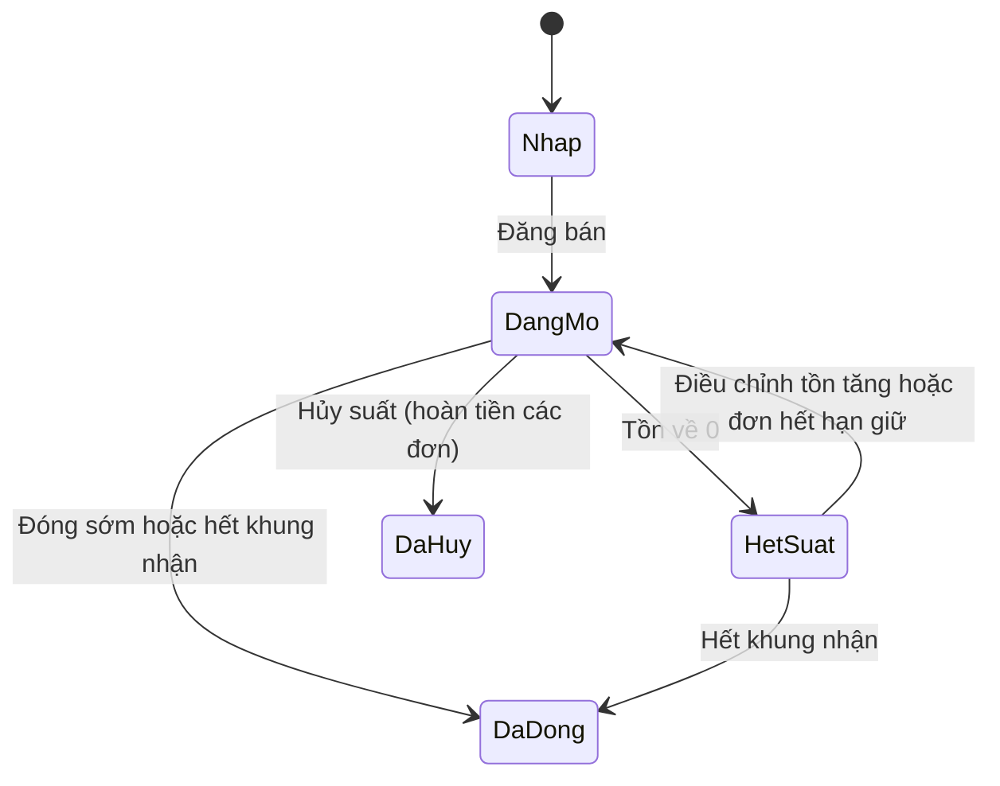

## 5.12. Dự báo số lượng (Pro)

*Vai trò: Chủ cửa hàng (web) · 8 UC: R2-036 đến R2-043*

### 5.12.1. Mục tiêu nghiệp vụ

Giúp chủ quyết định nên làm bao nhiêu mỗi món cho ngày mai (và xu hướng tuần tới) để giảm hao hụt và hết hàng sớm, bằng mô hình thống kê xác định có giải thích, đo được sai số và có phương án dự phòng. Lõi dự báo chạy độc lập với Gemini.

### 5.12.2. Phạm vi

**Thuộc phân hệ:** Xem dự báo; Dùng dự báo; Dữ liệu thực tế; Đo chất lượng; Xu hướng.

**Danh sách UC:** R2-036 Xem dự báo số lượng nên làm cho ngày mai; R2-037 Xem giải thích dự báo; R2-038 Chấp nhận hoặc ghi đè số lượng khuyến nghị; R2-039 Nhập số thực tế cuối ngày; R2-040 Khai báo sự kiện đặc biệt; R2-041 Xem độ chính xác dự báo; R2-042 Xem độ tin cậy dự báo và dự phòng khi dự báo kém; R2-043 Xem dự báo xu hướng nhu cầu cho tuần tới.

**Nằm ngoài phạm vi:** Dự báo nhu cầu theo sự kiện bên ngoài tự động thu thập; đặt hàng nguyên liệu.

### 5.12.3. Tác nhân và quyền hạn

Chủ cửa hàng và Quản lý (web), chỉ gói Pro hoặc dùng thử. Nhân viên quầy chỉ nhập số thực tế. Hệ thống tính dự báo mỗi ngày (chậm nhất 22:00).

### 5.12.4. Dữ liệu nghiệp vụ

| Thực thể | Ý nghĩa, nguồn hình thành và ảnh hưởng đến quyết định nghiệp vụ |
|---|---|
| Khuyến nghị | Theo món: số lượng khuyến nghị, khoảng thấp-cao, độ tin cậy Thấp, Vừa, Cao, thời điểm tính, thành phần điểm lưu ở bảng quyết định. |
| Số thực tế cuối ngày | Số đã làm, bán tại quầy, giờ hết hàng sớm; nhập được đến 48 giờ, sửa lưu lịch sử. |
| Sự kiện đặc biệt | Lễ, khuyến mãi, sự kiện, đóng cửa với mức ảnh hưởng ước tính, dùng làm hệ số hiệu chỉnh cấu hình. |

### 5.12.5. Quy trình nghiệp vụ tổng thể

1. Mỗi ngày hệ thống tính khuyến nghị cho ngày mai từ trung bình theo thứ trong tuần có hiệu chỉnh sự kiện và thời tiết, cần ít nhất 14 ngày dữ liệu.
2. Chủ xem khuyến nghị cùng lời giải thích, chấp nhận hoặc ghi đè số lượng; cả hai giá trị được lưu để đo sai số.
3. Cuối ngày chủ nhập số thực tế và khai báo sự kiện; dữ liệu nuôi dự báo các ngày sau.
4. Hệ thống đo độ chính xác so với cách Nấu như hôm qua; khi thiếu dữ liệu hoặc sai số vượt ngưỡng thì dùng số hôm qua và gắn nhãn dự phòng.
5. Từ 28 ngày dữ liệu, hệ thống thêm dự báo xu hướng 7 ngày tới kèm khoảng thấp-cao.

**Phân hệ phụ thuộc và liên kết:** Phụ thuộc Suất và tồn kho (số bán qua app), Tài khoản (gói). Cung cấp số lượng mặc định cho Tạo suất, dữ liệu cho Giải thích AI, Phát hiện bất thường và Mô phỏng.

### 5.12.6. Đặc tả từng UC

##### R2-036 - Xem dự báo số lượng nên làm cho ngày mai

**Mã UC:** R2-036  
**Tên UC:** Xem dự báo số lượng nên làm cho ngày mai  
**Nhóm:** Dự báo số lượng (Pro) / Xem dự báo · **Loại:** Truy vấn và hiển thị  
**Mục tiêu:** Hệ thống hiển thị số lượng khuyến nghị cho từng món, khoảng tin cậy và thời điểm tính (tối đa 22:00 mỗi ngày). *[Xác định trong Excel]*  
**Tác nhân:** Chủ cửa hàng (web)  

**Điều kiện tiên quyết** *[Tổng hợp từ ma trận gói và vai trò]*
- Người dùng đã đăng nhập trên web bằng tài khoản Chủ hoặc nhân viên của cửa hàng; cửa hàng ở trạng thái Hoạt động (trừ các UC quản lý trạng thái cửa hàng, gói và hồ sơ).
- Nhóm quyền được phép: Chủ và Quản lý; Nhân viên quầy không có quyền (không thuộc bốn thao tác của nhóm này). *[Tổng hợp từ UC phân quyền nhân viên]*
- Gói dịch vụ: Chỉ gói Pro (GOI-PRO) và thời gian dùng thử Pro (GOI-DT). Gói Cơ bản (GOI-CB) không có quyền sử dụng; khi hết hạn Pro, tính năng bị khóa và dữ liệu đã tạo chỉ xem.

**Dữ liệu hiển thị (UC không có trường nhập)** *[Xác định trong Excel]*
- Hiển thị: món, số lượng khuyến nghị, khoảng thấp-cao, độ tin cậy, thời điểm tính

**Luồng xử lý chính** *[Tổng hợp từ mô tả, quy tắc và kết quả]*
1. Người dùng mở màn hình "Xem dự báo số lượng nên làm cho ngày mai" trên web quản trị.
2. Hệ thống xác thực phiên, xác định phạm vi dữ liệu của người dùng và áp các quy tắc hiển thị của UC.
3. Truy vấn dữ liệu: Hệ thống hiển thị số lượng khuyến nghị cho từng món, khoảng tin cậy và thời điểm tính (tối đa 22:00 mỗi ngày).
4. Hiển thị các thuộc tính: món, số lượng khuyến nghị, khoảng thấp-cao, độ tin cậy, thời điểm tính.
5. Trường hợp không có dữ liệu hoặc không hợp lệ được xử lý theo mục Validation; không thay đổi dữ liệu nghiệp vụ.

**Business Rules** *[Xác định trong Excel]*
1. Chỉ gói Pro.
2. Mô hình: trung bình theo thứ trong tuần có hiệu chỉnh thời tiết, sự kiện; cần tối thiểu 14 ngày dữ liệu.
3. Thiếu dữ liệu: dùng số của hôm qua và ghi nhãn Chưa đủ dữ liệu.
4. Lõi chạy độc lập với Gemini.

**Validation** *[Xác định trong Excel]*
1. Gói Cơ bản: ẩn và gợi ý nâng cấp; thiếu dữ liệu: hiện cảnh báo.

**Luồng thay thế và ngoại lệ**
- Mọi trường hợp không hợp lệ nêu ở mục Validation là luồng ngoại lệ của UC này và được xử lý đúng như mô tả tại đó. *[Xác định]*
- Người dùng không có quyền hoặc đối tượng không thuộc phạm vi dữ liệu của mình: từ chối, không tiết lộ sự tồn tại của dữ liệu thuộc người khác (đề xuất hoàn thiện).
- Mất kết nối hoặc lỗi hệ thống giữa chừng: thao tác không được ghi nhận một phần; người dùng được thông báo và thử lại, thao tác thay đổi dữ liệu dùng khóa chống trùng khi áp dụng (đề xuất hoàn thiện).
- Cửa hàng ở gói Cơ bản hoặc đã hết Pro: tính năng ẩn hoặc khóa, hiển thị gợi ý nâng cấp; dữ liệu đã tạo trước đó chỉ xem (theo ma trận gói).

**Dữ liệu thay đổi** *[Tổng hợp]*  
Không tạo hoặc thay đổi dữ liệu nghiệp vụ; chỉ đọc theo phạm vi của người dùng.

**Chuyển trạng thái** *[Tổng hợp]*
- Không chuyển trạng thái của đối tượng nghiệp vụ.

**Kết quả** *[Xác định trong Excel]*  
Danh sách khuyến nghị.

**Tác động liên phân hệ** *[Tổng hợp]*  
Dữ liệu hoặc quy tắc của UC liên quan đến: Gói dịch vụ và hạn mức.

**Điều kiện hoàn thành** *[Tổng hợp]*  
Thành công khi: Danh sách khuyến nghị. Không hoàn tất khi bất kỳ điều kiện Validation nào không đạt hoặc dịch vụ liên quan lỗi; dữ liệu giữ nguyên trạng thái trước thao tác.

**Tiêu chí nghiệm thu** *[Tổng hợp, kiểm tra được]*
1. Given người dùng cửa hàng đủ điều kiện tiên quyết và dữ liệu hợp lệ, When thực hiện "Xem dự báo số lượng nên làm cho ngày mai", Then kết quả đạt được là: danh sách khuyến nghị.
2. Given gói Cơ bản, When thực hiện "Xem dự báo số lượng nên làm cho ngày mai", Then ẩn và gợi ý nâng cấp; thiếu dữ liệu: hiện cảnh báo.
3. Given thao tác "Xem dự báo số lượng nên làm cho ngày mai" được thực hiện, When hệ thống áp dụng quy tắc "Chỉ gói Pro", Then kết quả không được vi phạm quy tắc này.
4. Given cửa hàng ở gói Cơ bản, When mở "Xem dự báo số lượng nên làm cho ngày mai", Then tính năng bị khóa và hiển thị gợi ý nâng cấp; cửa hàng Pro hoặc dùng thử truy cập bình thường.

##### R2-037 - Xem giải thích dự báo

**Mã UC:** R2-037  
**Tên UC:** Xem giải thích dự báo  
**Nhóm:** Dự báo số lượng (Pro) / Xem dự báo · **Loại:** Truy vấn và hiển thị  
**Mục tiêu:** Xem lý do: các thành phần (trung bình thứ, hiệu chỉnh thời tiết/sự kiện) và dữ liệu ngày dùng. *[Xác định trong Excel]*  
**Tác nhân:** Chủ cửa hàng (web)  

**Điều kiện tiên quyết** *[Tổng hợp từ ma trận gói và vai trò]*
- Người dùng đã đăng nhập trên web bằng tài khoản Chủ hoặc nhân viên của cửa hàng; cửa hàng ở trạng thái Hoạt động (trừ các UC quản lý trạng thái cửa hàng, gói và hồ sơ).
- Nhóm quyền được phép: Chủ và Quản lý; Nhân viên quầy không có quyền (không thuộc bốn thao tác của nhóm này). *[Tổng hợp từ UC phân quyền nhân viên]*
- Gói dịch vụ: Chỉ gói Pro (GOI-PRO) và thời gian dùng thử Pro (GOI-DT). Gói Cơ bản (GOI-CB) không có quyền sử dụng; khi hết hạn Pro, tính năng bị khóa và dữ liệu đã tạo chỉ xem.

**Dữ liệu hiển thị (UC không có trường nhập)** *[Xác định trong Excel]*
- Hiển thị: thành phần điểm, số ngày dữ liệu, câu giải thích sinh từ template

**Luồng xử lý chính** *[Tổng hợp từ mô tả, quy tắc và kết quả]*
1. Người dùng mở màn hình "Xem giải thích dự báo" trên web quản trị.
2. Hệ thống xác thực phiên, xác định phạm vi dữ liệu của người dùng và áp các quy tắc hiển thị của UC.
3. Truy vấn dữ liệu: Xem lý do: các thành phần (trung bình thứ, hiệu chỉnh thời tiết/sự kiện) và dữ liệu ngày dùng.
4. Hiển thị các thuộc tính: thành phần điểm, số ngày dữ liệu, câu giải thích sinh từ template.
5. Trường hợp không có dữ liệu hoặc không hợp lệ được xử lý theo mục Validation; không thay đổi dữ liệu nghiệp vụ.

**Business Rules** *[Xác định trong Excel]*
1. Mỗi quyết định lưu thành phần trong bảng decisions.

**Validation** *[Xác định trong Excel]*
1. Không có.

**Luồng thay thế và ngoại lệ**
- Người dùng không có quyền hoặc đối tượng không thuộc phạm vi dữ liệu của mình: từ chối, không tiết lộ sự tồn tại của dữ liệu thuộc người khác (đề xuất hoàn thiện).
- Mất kết nối hoặc lỗi hệ thống giữa chừng: thao tác không được ghi nhận một phần; người dùng được thông báo và thử lại, thao tác thay đổi dữ liệu dùng khóa chống trùng khi áp dụng (đề xuất hoàn thiện).
- Cửa hàng ở gói Cơ bản hoặc đã hết Pro: tính năng ẩn hoặc khóa, hiển thị gợi ý nâng cấp; dữ liệu đã tạo trước đó chỉ xem (theo ma trận gói).

**Dữ liệu thay đổi** *[Tổng hợp]*  
Không tạo hoặc thay đổi dữ liệu nghiệp vụ; chỉ đọc theo phạm vi của người dùng.

**Chuyển trạng thái** *[Tổng hợp]*
- Không chuyển trạng thái của đối tượng nghiệp vụ.

**Kết quả** *[Xác định trong Excel]*  
Hiển thị giải thích.

**Tác động liên phân hệ** *[Tổng hợp]*  
Dữ liệu hoặc quy tắc của UC liên quan đến: Thành phần và dị ứng của món.

**Điều kiện hoàn thành** *[Tổng hợp]*  
Thành công khi: Hiển thị giải thích. Không hoàn tất khi bất kỳ điều kiện Validation nào không đạt hoặc dịch vụ liên quan lỗi; dữ liệu giữ nguyên trạng thái trước thao tác.

**Tiêu chí nghiệm thu** *[Tổng hợp, kiểm tra được]*
1. Given người dùng cửa hàng đủ điều kiện tiên quyết và dữ liệu hợp lệ, When thực hiện "Xem giải thích dự báo", Then kết quả đạt được là: hiển thị giải thích.
2. Given thao tác "Xem giải thích dự báo" được thực hiện, When hệ thống áp dụng quy tắc "Mỗi quyết định lưu thành phần trong bảng decisions", Then kết quả không được vi phạm quy tắc này.
3. Given cửa hàng ở gói Cơ bản, When mở "Xem giải thích dự báo", Then tính năng bị khóa và hiển thị gợi ý nâng cấp; cửa hàng Pro hoặc dùng thử truy cập bình thường.

##### R2-038 - Chấp nhận hoặc ghi đè số lượng khuyến nghị

**Mã UC:** R2-038  
**Tên UC:** Chấp nhận hoặc ghi đè số lượng khuyến nghị  
**Nhóm:** Dự báo số lượng (Pro) / Dùng dự báo · **Loại:** Chuyển trạng thái  
**Mục tiêu:** Chủ chấp nhận số khuyến nghị hoặc nhập số khác kèm lý do; số này làm mặc định khi tạo suất. *[Xác định trong Excel]*  
**Tác nhân:** Chủ cửa hàng (web)  

**Điều kiện tiên quyết** *[Tổng hợp từ ma trận gói và vai trò]*
- Người dùng đã đăng nhập trên web bằng tài khoản Chủ hoặc nhân viên của cửa hàng; cửa hàng ở trạng thái Hoạt động (trừ các UC quản lý trạng thái cửa hàng, gói và hồ sơ).
- Nhóm quyền được phép: Chủ và Quản lý; Nhân viên quầy không có quyền (không thuộc bốn thao tác của nhóm này). *[Tổng hợp từ UC phân quyền nhân viên]*
- Gói dịch vụ: Chỉ gói Pro (GOI-PRO) và thời gian dùng thử Pro (GOI-DT). Gói Cơ bản (GOI-CB) không có quyền sử dụng; khi hết hạn Pro, tính năng bị khóa và dữ liệu đã tạo chỉ xem.

**Dữ liệu đầu vào và hiển thị** *[Xác định trong Excel]*
- Số lượng chọn (số nguyên 0-500)
- Lý do ghi đè (tùy chọn)

**Luồng xử lý chính** *[Tổng hợp từ mô tả, quy tắc và kết quả]*
1. Người dùng chọn đối tượng cần xử lý và thao tác "Chấp nhận hoặc ghi đè số lượng khuyến nghị" trên web quản trị.
2. Người dùng cung cấp thêm: Số lượng chọn, Lý do ghi đè.
3. Hệ thống kiểm tra trạng thái hiện tại có cho phép chuyển trạng thái này không, cùng quyền của người thực hiện.
4. Xử lý nghiệp vụ: Chủ chấp nhận số khuyến nghị hoặc nhập số khác kèm lý do; số này làm mặc định khi tạo suất.
5. Trạng thái, tồn kho, tiền hoặc thông báo liên quan được cập nhật trong cùng giao dịch; kết quả: Kế hoạch làm của ngày mai lưu.

**Business Rules** *[Xác định trong Excel]*
1. Ghi lại cả số khuyến nghị lẫn số chủ chọn để đo sai số.

**Validation** *[Xác định trong Excel]*
1. Số ngoài khoảng: báo lỗi.

**Luồng thay thế và ngoại lệ**
- Mọi trường hợp không hợp lệ nêu ở mục Validation là luồng ngoại lệ của UC này và được xử lý đúng như mô tả tại đó. *[Xác định]*
- Người dùng không có quyền hoặc đối tượng không thuộc phạm vi dữ liệu của mình: từ chối, không tiết lộ sự tồn tại của dữ liệu thuộc người khác (đề xuất hoàn thiện).
- Mất kết nối hoặc lỗi hệ thống giữa chừng: thao tác không được ghi nhận một phần; người dùng được thông báo và thử lại, thao tác thay đổi dữ liệu dùng khóa chống trùng khi áp dụng (đề xuất hoàn thiện).
- Cửa hàng ở gói Cơ bản hoặc đã hết Pro: tính năng ẩn hoặc khóa, hiển thị gợi ý nâng cấp; dữ liệu đã tạo trước đó chỉ xem (theo ma trận gói).

**Dữ liệu thay đổi** *[Tổng hợp]*  
Theo kết quả đã xác định: Kế hoạch làm của ngày mai lưu.

**Chuyển trạng thái** *[Tổng hợp]*
- Excel không nêu chuyển trạng thái riêng cho UC này; đối tượng giữ trạng thái hiện tại trừ phần được nêu ở mục Kết quả.

**Kết quả** *[Xác định trong Excel]*  
Kế hoạch làm của ngày mai lưu.

**Tác động liên phân hệ** *[Tổng hợp]*  
Dữ liệu hoặc quy tắc của UC liên quan đến: Suất và tồn kho trong ngày.

**Điều kiện hoàn thành** *[Tổng hợp]*  
Thành công khi: Kế hoạch làm của ngày mai lưu. Không hoàn tất khi bất kỳ điều kiện Validation nào không đạt hoặc dịch vụ liên quan lỗi; dữ liệu giữ nguyên trạng thái trước thao tác.

**Tiêu chí nghiệm thu** *[Tổng hợp, kiểm tra được]*
1. Given người dùng cửa hàng đủ điều kiện tiên quyết và dữ liệu hợp lệ, When thực hiện "Chấp nhận hoặc ghi đè số lượng khuyến nghị", Then kết quả đạt được là: kế hoạch làm của ngày mai lưu.
2. Given số ngoài khoảng, When thực hiện "Chấp nhận hoặc ghi đè số lượng khuyến nghị", Then báo lỗi.
3. Given thao tác "Chấp nhận hoặc ghi đè số lượng khuyến nghị" được thực hiện, When hệ thống áp dụng quy tắc "Ghi lại cả số khuyến nghị lẫn số chủ chọn để đo sai số", Then kết quả không được vi phạm quy tắc này.
4. Given cửa hàng ở gói Cơ bản, When mở "Chấp nhận hoặc ghi đè số lượng khuyến nghị", Then tính năng bị khóa và hiển thị gợi ý nâng cấp; cửa hàng Pro hoặc dùng thử truy cập bình thường.

##### R2-039 - Nhập số thực tế cuối ngày

**Mã UC:** R2-039  
**Tên UC:** Nhập số thực tế cuối ngày  
**Nhóm:** Dự báo số lượng (Pro) / Dữ liệu thực tế · **Loại:** Tạo mới  
**Mục tiêu:** Chủ nhập số làm ra, bán ngoài app, hết hàng sớm lúc nào; hệ thống tự cộng số bán qua app. *[Xác định trong Excel]*  
**Tác nhân:** Chủ cửa hàng (web)  

**Điều kiện tiên quyết** *[Tổng hợp từ ma trận gói và vai trò]*
- Người dùng đã đăng nhập trên web bằng tài khoản Chủ hoặc nhân viên của cửa hàng; cửa hàng ở trạng thái Hoạt động (trừ các UC quản lý trạng thái cửa hàng, gói và hồ sơ).
- Nhóm quyền được phép: Chủ, Quản lý và Nhân viên quầy. *[Tổng hợp từ UC phân quyền nhân viên]*
- Gói dịch vụ: Chỉ gói Pro (GOI-PRO) và thời gian dùng thử Pro (GOI-DT). Gói Cơ bản (GOI-CB) không có quyền sử dụng; khi hết hạn Pro, tính năng bị khóa và dữ liệu đã tạo chỉ xem.

**Dữ liệu đầu vào và hiển thị** *[Xác định trong Excel]*
- Số đã làm (số nguyên)
- Bán tại quầy (số nguyên)
- Giờ hết hàng sớm (HH:mm, tùy chọn)
- Ngày (mặc định hôm nay)

**Luồng xử lý chính** *[Tổng hợp từ mô tả, quy tắc và kết quả]*
1. Người dùng chọn chức năng "Nhập số thực tế cuối ngày" trên web quản trị.
2. Người dùng nhập hoặc chọn: Số đã làm, Bán tại quầy, Giờ hết hàng sớm, Ngày.
3. Hệ thống xác thực phiên, kiểm tra quyền, phạm vi dữ liệu, gói dịch vụ và hạn mức (nếu có).
4. Hệ thống kiểm tra từng điều kiện ở mục Validation; sai thì trả lỗi tại trường tương ứng và không tạo dữ liệu.
5. Xử lý nghiệp vụ: Chủ nhập số làm ra, bán ngoài app, hết hàng sớm lúc nào; hệ thống tự cộng số bán qua app.
6. Hệ thống lưu dữ liệu, cập nhật các đối tượng liên quan và phản hồi: Dữ liệu ngày cập nhật; dự báo ngày kế tiếp tính lại.

**Business Rules** *[Xác định trong Excel]*
1. Có thể nhập đến 48 giờ sau; sau đó khóa.
2. Sửa số liệu lưu lịch sử.
3. Dữ liệu này nuôi dự báo.

**Validation** *[Xác định trong Excel]*
1. Số âm hoặc nhỏ hơn đã bán qua app: báo lỗi.

**Luồng thay thế và ngoại lệ**
- Mọi trường hợp không hợp lệ nêu ở mục Validation là luồng ngoại lệ của UC này và được xử lý đúng như mô tả tại đó. *[Xác định]*
- Người dùng không có quyền hoặc đối tượng không thuộc phạm vi dữ liệu của mình: từ chối, không tiết lộ sự tồn tại của dữ liệu thuộc người khác (đề xuất hoàn thiện).
- Mất kết nối hoặc lỗi hệ thống giữa chừng: thao tác không được ghi nhận một phần; người dùng được thông báo và thử lại, thao tác thay đổi dữ liệu dùng khóa chống trùng khi áp dụng (đề xuất hoàn thiện).
- Cửa hàng ở gói Cơ bản hoặc đã hết Pro: tính năng ẩn hoặc khóa, hiển thị gợi ý nâng cấp; dữ liệu đã tạo trước đó chỉ xem (theo ma trận gói).

**Dữ liệu thay đổi** *[Tổng hợp]*  
Theo kết quả đã xác định: Dữ liệu ngày cập nhật; dự báo ngày kế tiếp tính lại.

**Chuyển trạng thái** *[Tổng hợp]*
- Excel không nêu chuyển trạng thái riêng cho UC này; đối tượng giữ trạng thái hiện tại trừ phần được nêu ở mục Kết quả.

**Kết quả** *[Xác định trong Excel]*  
Dữ liệu ngày cập nhật; dự báo ngày kế tiếp tính lại.

**Tác động liên phân hệ** *[Tổng hợp]*  
Không phát sinh tác động đáng kể ngoài phân hệ; dữ liệu chỉ dùng trong phạm vi chức năng.

**Điều kiện hoàn thành** *[Tổng hợp]*  
Thành công khi: Dữ liệu ngày cập nhật; dự báo ngày kế tiếp tính lại. Không hoàn tất khi bất kỳ điều kiện Validation nào không đạt hoặc dịch vụ liên quan lỗi; dữ liệu giữ nguyên trạng thái trước thao tác.

**Tiêu chí nghiệm thu** *[Tổng hợp, kiểm tra được]*
1. Given người dùng cửa hàng đủ điều kiện tiên quyết và dữ liệu hợp lệ, When thực hiện "Nhập số thực tế cuối ngày", Then kết quả đạt được là: dữ liệu ngày cập nhật; dự báo ngày kế tiếp tính lại.
2. Given số âm hoặc nhỏ hơn đã bán qua app, When thực hiện "Nhập số thực tế cuối ngày", Then báo lỗi.
3. Given thao tác "Nhập số thực tế cuối ngày" được thực hiện, When hệ thống áp dụng quy tắc "Có thể nhập đến 48 giờ sau; sau đó khóa", Then kết quả không được vi phạm quy tắc này.
4. Given cửa hàng ở gói Cơ bản, When mở "Nhập số thực tế cuối ngày", Then tính năng bị khóa và hiển thị gợi ý nâng cấp; cửa hàng Pro hoặc dùng thử truy cập bình thường.

##### R2-040 - Khai báo sự kiện đặc biệt

**Mã UC:** R2-040  
**Tên UC:** Khai báo sự kiện đặc biệt  
**Nhóm:** Dự báo số lượng (Pro) / Dữ liệu thực tế · **Loại:** Tạo mới  
**Mục tiêu:** Chủ khai báo ngày lễ, khuyến mãi, sự kiện địa phương ảnh hưởng nhu cầu. *[Xác định trong Excel]*  
**Tác nhân:** Chủ cửa hàng (web)  

**Điều kiện tiên quyết** *[Tổng hợp từ ma trận gói và vai trò]*
- Người dùng đã đăng nhập trên web bằng tài khoản Chủ hoặc nhân viên của cửa hàng; cửa hàng ở trạng thái Hoạt động (trừ các UC quản lý trạng thái cửa hàng, gói và hồ sơ).
- Nhóm quyền được phép: Chủ và Quản lý; Nhân viên quầy không có quyền (không thuộc bốn thao tác của nhóm này). *[Tổng hợp từ UC phân quyền nhân viên]*
- Gói dịch vụ: Chỉ gói Pro (GOI-PRO) và thời gian dùng thử Pro (GOI-DT). Gói Cơ bản (GOI-CB) không có quyền sử dụng; khi hết hạn Pro, tính năng bị khóa và dữ liệu đã tạo chỉ xem.

**Dữ liệu đầu vào và hiển thị** *[Xác định trong Excel]*
- Ngày (ngày)
- Loại (Lễ/Khuyến mãi/Sự kiện/Đóng cửa)
- Ghi chú (0-100)
- Mức ảnh hưởng ước tính (Thấp/Vừa/Cao)

**Luồng xử lý chính** *[Tổng hợp từ mô tả, quy tắc và kết quả]*
1. Người dùng chọn chức năng "Khai báo sự kiện đặc biệt" trên web quản trị.
2. Người dùng nhập hoặc chọn: Ngày, Loại, Ghi chú, Mức ảnh hưởng ước tính.
3. Hệ thống xác thực phiên, kiểm tra quyền, phạm vi dữ liệu, gói dịch vụ và hạn mức (nếu có).
4. Hệ thống kiểm tra từng điều kiện ở mục Validation; sai thì trả lỗi tại trường tương ứng và không tạo dữ liệu.
5. Xử lý nghiệp vụ: Chủ khai báo ngày lễ, khuyến mãi, sự kiện địa phương ảnh hưởng nhu cầu.
6. Hệ thống lưu dữ liệu, cập nhật các đối tượng liên quan và phản hồi: Sự kiện lưu và dự báo ngày đó hiệu chỉnh.

**Business Rules** *[Xác định trong Excel]*
1. Sự kiện được dùng làm hệ số hiệu chỉnh cấu hình; không chồng hai sự kiện cùng loại cùng ngày.

**Validation** *[Xác định trong Excel]*
1. Trùng ngày cùng loại: báo lỗi.

**Luồng thay thế và ngoại lệ**
- Mọi trường hợp không hợp lệ nêu ở mục Validation là luồng ngoại lệ của UC này và được xử lý đúng như mô tả tại đó. *[Xác định]*
- Người dùng không có quyền hoặc đối tượng không thuộc phạm vi dữ liệu của mình: từ chối, không tiết lộ sự tồn tại của dữ liệu thuộc người khác (đề xuất hoàn thiện).
- Mất kết nối hoặc lỗi hệ thống giữa chừng: thao tác không được ghi nhận một phần; người dùng được thông báo và thử lại, thao tác thay đổi dữ liệu dùng khóa chống trùng khi áp dụng (đề xuất hoàn thiện).
- Cửa hàng ở gói Cơ bản hoặc đã hết Pro: tính năng ẩn hoặc khóa, hiển thị gợi ý nâng cấp; dữ liệu đã tạo trước đó chỉ xem (theo ma trận gói).

**Dữ liệu thay đổi** *[Tổng hợp]*  
Theo kết quả đã xác định: Sự kiện lưu và dự báo ngày đó hiệu chỉnh.

**Chuyển trạng thái** *[Tổng hợp]*
- Excel không nêu chuyển trạng thái riêng cho UC này; đối tượng giữ trạng thái hiện tại trừ phần được nêu ở mục Kết quả.

**Kết quả** *[Xác định trong Excel]*  
Sự kiện lưu và dự báo ngày đó hiệu chỉnh.

**Tác động liên phân hệ** *[Tổng hợp]*  
Không phát sinh tác động đáng kể ngoài phân hệ; dữ liệu chỉ dùng trong phạm vi chức năng.

**Điều kiện hoàn thành** *[Tổng hợp]*  
Thành công khi: Sự kiện lưu và dự báo ngày đó hiệu chỉnh. Không hoàn tất khi bất kỳ điều kiện Validation nào không đạt hoặc dịch vụ liên quan lỗi; dữ liệu giữ nguyên trạng thái trước thao tác.

**Tiêu chí nghiệm thu** *[Tổng hợp, kiểm tra được]*
1. Given người dùng cửa hàng đủ điều kiện tiên quyết và dữ liệu hợp lệ, When thực hiện "Khai báo sự kiện đặc biệt", Then kết quả đạt được là: sự kiện lưu và dự báo ngày đó hiệu chỉnh.
2. Given trùng ngày cùng loại, When thực hiện "Khai báo sự kiện đặc biệt", Then báo lỗi.
3. Given thao tác "Khai báo sự kiện đặc biệt" được thực hiện, When hệ thống áp dụng quy tắc "Sự kiện được dùng làm hệ số hiệu chỉnh cấu hình; không chồng hai sự kiện cùng loại cùng ngày", Then kết quả không được vi phạm quy tắc này.
4. Given cửa hàng ở gói Cơ bản, When mở "Khai báo sự kiện đặc biệt", Then tính năng bị khóa và hiển thị gợi ý nâng cấp; cửa hàng Pro hoặc dùng thử truy cập bình thường.

##### R2-041 - Xem độ chính xác dự báo

**Mã UC:** R2-041  
**Tên UC:** Xem độ chính xác dự báo  
**Nhóm:** Dự báo số lượng (Pro) / Đo chất lượng · **Loại:** Truy vấn và hiển thị  
**Mục tiêu:** So sánh dự báo với thực tế và với cách Nấu như hôm qua theo tuần/tháng. *[Xác định trong Excel]*  
**Tác nhân:** Chủ cửa hàng (web)  

**Điều kiện tiên quyết** *[Tổng hợp từ ma trận gói và vai trò]*
- Người dùng đã đăng nhập trên web bằng tài khoản Chủ hoặc nhân viên của cửa hàng; cửa hàng ở trạng thái Hoạt động (trừ các UC quản lý trạng thái cửa hàng, gói và hồ sơ).
- Nhóm quyền được phép: Chủ và Quản lý; Nhân viên quầy không có quyền (không thuộc bốn thao tác của nhóm này). *[Tổng hợp từ UC phân quyền nhân viên]*
- Gói dịch vụ: Chỉ gói Pro (GOI-PRO) và thời gian dùng thử Pro (GOI-DT). Gói Cơ bản (GOI-CB) không có quyền sử dụng; khi hết hạn Pro, tính năng bị khóa và dữ liệu đã tạo chỉ xem.

**Dữ liệu hiển thị (UC không có trường nhập)** *[Xác định trong Excel]*
- Hiển thị: sai số trung bình tuyệt đối, so với Nấu như hôm qua, theo món

**Luồng xử lý chính** *[Tổng hợp từ mô tả, quy tắc và kết quả]*
1. Người dùng mở màn hình "Xem độ chính xác dự báo" trên web quản trị.
2. Hệ thống xác thực phiên, xác định phạm vi dữ liệu của người dùng và áp các quy tắc hiển thị của UC.
3. Truy vấn dữ liệu: So sánh dự báo với thực tế và với cách Nấu như hôm qua theo tuần/tháng.
4. Hiển thị các thuộc tính: sai số trung bình tuyệt đối, so với Nấu như hôm qua, theo món.
5. Trường hợp không có dữ liệu hoặc không hợp lệ được xử lý theo mục Validation; không thay đổi dữ liệu nghiệp vụ.

**Business Rules** *[Xác định trong Excel]*
1. Chỉ tính ngày có đủ dữ liệu thực tế.

**Validation** *[Xác định trong Excel]*
1. Chưa đủ dữ liệu: hiện thông báo.

**Luồng thay thế và ngoại lệ**
- Mọi trường hợp không hợp lệ nêu ở mục Validation là luồng ngoại lệ của UC này và được xử lý đúng như mô tả tại đó. *[Xác định]*
- Người dùng không có quyền hoặc đối tượng không thuộc phạm vi dữ liệu của mình: từ chối, không tiết lộ sự tồn tại của dữ liệu thuộc người khác (đề xuất hoàn thiện).
- Mất kết nối hoặc lỗi hệ thống giữa chừng: thao tác không được ghi nhận một phần; người dùng được thông báo và thử lại, thao tác thay đổi dữ liệu dùng khóa chống trùng khi áp dụng (đề xuất hoàn thiện).
- Cửa hàng ở gói Cơ bản hoặc đã hết Pro: tính năng ẩn hoặc khóa, hiển thị gợi ý nâng cấp; dữ liệu đã tạo trước đó chỉ xem (theo ma trận gói).

**Dữ liệu thay đổi** *[Tổng hợp]*  
Không tạo hoặc thay đổi dữ liệu nghiệp vụ; chỉ đọc theo phạm vi của người dùng.

**Chuyển trạng thái** *[Tổng hợp]*
- Không chuyển trạng thái của đối tượng nghiệp vụ.

**Kết quả** *[Xác định trong Excel]*  
Biểu đồ và bảng sai số.

**Tác động liên phân hệ** *[Tổng hợp]*  
Không phát sinh tác động đáng kể ngoài phân hệ; dữ liệu chỉ dùng trong phạm vi chức năng.

**Điều kiện hoàn thành** *[Tổng hợp]*  
Thành công khi: Biểu đồ và bảng sai số. Không hoàn tất khi bất kỳ điều kiện Validation nào không đạt hoặc dịch vụ liên quan lỗi; dữ liệu giữ nguyên trạng thái trước thao tác.

**Tiêu chí nghiệm thu** *[Tổng hợp, kiểm tra được]*
1. Given người dùng cửa hàng đủ điều kiện tiên quyết và dữ liệu hợp lệ, When thực hiện "Xem độ chính xác dự báo", Then kết quả đạt được là: biểu đồ và bảng sai số.
2. Given chưa đủ dữ liệu, When thực hiện "Xem độ chính xác dự báo", Then hiện thông báo.
3. Given thao tác "Xem độ chính xác dự báo" được thực hiện, When hệ thống áp dụng quy tắc "Chỉ tính ngày có đủ dữ liệu thực tế", Then kết quả không được vi phạm quy tắc này.
4. Given cửa hàng ở gói Cơ bản, When mở "Xem độ chính xác dự báo", Then tính năng bị khóa và hiển thị gợi ý nâng cấp; cửa hàng Pro hoặc dùng thử truy cập bình thường.

##### R2-042 - Xem độ tin cậy dự báo và dự phòng khi dự báo kém

**Mã UC:** R2-042  
**Tên UC:** Xem độ tin cậy dự báo và dự phòng khi dự báo kém  
**Nhóm:** Dự báo số lượng (Pro) / Đo chất lượng · **Loại:** Truy vấn và hiển thị  
**Mục tiêu:** Mỗi dự báo kèm độ tin cậy Thấp/Vừa/Cao. Khi thiếu dữ liệu hoặc sai số cao, hệ thống tự dùng số của hôm qua, gắn nhãn dự phòng và gợi ý chủ nhập tay. *[Xác định trong Excel]*  
**Tác nhân:** Chủ cửa hàng (web)  

**Điều kiện tiên quyết** *[Tổng hợp từ ma trận gói và vai trò]*
- Người dùng đã đăng nhập trên web bằng tài khoản Chủ hoặc nhân viên của cửa hàng; cửa hàng ở trạng thái Hoạt động (trừ các UC quản lý trạng thái cửa hàng, gói và hồ sơ).
- Nhóm quyền được phép: Chủ và Quản lý; Nhân viên quầy không có quyền (không thuộc bốn thao tác của nhóm này). *[Tổng hợp từ UC phân quyền nhân viên]*
- Gói dịch vụ: Chỉ gói Pro (GOI-PRO) và thời gian dùng thử Pro (GOI-DT). Gói Cơ bản (GOI-CB) không có quyền sử dụng; khi hết hạn Pro, tính năng bị khóa và dữ liệu đã tạo chỉ xem.

**Dữ liệu hiển thị (UC không có trường nhập)** *[Xác định trong Excel]*
- Hiển thị: độ tin cậy, số ngày dữ liệu, sai số trung bình 7 ngày, nhãn dự phòng

**Luồng xử lý chính** *[Tổng hợp từ mô tả, quy tắc và kết quả]*
1. Người dùng mở màn hình "Xem độ tin cậy dự báo và dự phòng khi dự báo kém" trên web quản trị.
2. Hệ thống xác thực phiên, xác định phạm vi dữ liệu của người dùng và áp các quy tắc hiển thị của UC.
3. Truy vấn dữ liệu: Mỗi dự báo kèm độ tin cậy Thấp/Vừa/Cao. Khi thiếu dữ liệu hoặc sai số cao, hệ thống tự dùng số của hôm qua, gắn nhãn dự phòng và gợi ý chủ nhập tay.
4. Hiển thị các thuộc tính: độ tin cậy, số ngày dữ liệu, sai số trung bình 7 ngày, nhãn dự phòng.
5. Trường hợp không có dữ liệu hoặc không hợp lệ được xử lý theo mục Validation; không thay đổi dữ liệu nghiệp vụ.

**Business Rules** *[Xác định trong Excel]*
1. Dưới 14 ngày dữ liệu: độ tin cậy Thấp.
2. Sai số trung bình 7 ngày vượt ngưỡng (tham số cấu hình): hiện cảnh báo.
3. Lõi hoạt động độc lập với Gemini.

**Validation** *[Xác định trong Excel]*
1. Không có dữ liệu hôm qua: để trống cho chủ nhập tay.

**Luồng thay thế và ngoại lệ**
- Người dùng không có quyền hoặc đối tượng không thuộc phạm vi dữ liệu của mình: từ chối, không tiết lộ sự tồn tại của dữ liệu thuộc người khác (đề xuất hoàn thiện).
- Mất kết nối hoặc lỗi hệ thống giữa chừng: thao tác không được ghi nhận một phần; người dùng được thông báo và thử lại, thao tác thay đổi dữ liệu dùng khóa chống trùng khi áp dụng (đề xuất hoàn thiện).
- Cửa hàng ở gói Cơ bản hoặc đã hết Pro: tính năng ẩn hoặc khóa, hiển thị gợi ý nâng cấp; dữ liệu đã tạo trước đó chỉ xem (theo ma trận gói).

**Dữ liệu thay đổi** *[Tổng hợp]*  
Không tạo hoặc thay đổi dữ liệu nghiệp vụ; chỉ đọc theo phạm vi của người dùng.

**Chuyển trạng thái** *[Tổng hợp]*
- Không chuyển trạng thái của đối tượng nghiệp vụ.

**Kết quả** *[Xác định trong Excel]*  
Chủ biết khi nào nên tin dự báo; số dự phòng được ghi nhãn.

**Tác động liên phân hệ** *[Tổng hợp]*  
Không phát sinh tác động đáng kể ngoài phân hệ; dữ liệu chỉ dùng trong phạm vi chức năng.

**Điều kiện hoàn thành** *[Tổng hợp]*  
Thành công khi: Chủ biết khi nào nên tin dự báo; số dự phòng được ghi nhãn. Không hoàn tất khi bất kỳ điều kiện Validation nào không đạt hoặc dịch vụ liên quan lỗi; dữ liệu giữ nguyên trạng thái trước thao tác.

**Tiêu chí nghiệm thu** *[Tổng hợp, kiểm tra được]*
1. Given người dùng cửa hàng đủ điều kiện tiên quyết và dữ liệu hợp lệ, When thực hiện "Xem độ tin cậy dự báo và dự phòng khi dự báo kém", Then kết quả đạt được là: chủ biết khi nào nên tin dự báo; số dự phòng được ghi nhãn.
2. Given thao tác "Xem độ tin cậy dự báo và dự phòng khi dự báo kém" được thực hiện, When hệ thống áp dụng quy tắc "Dưới 14 ngày dữ liệu: độ tin cậy Thấp", Then kết quả không được vi phạm quy tắc này.
3. Given cửa hàng ở gói Cơ bản, When mở "Xem độ tin cậy dự báo và dự phòng khi dự báo kém", Then tính năng bị khóa và hiển thị gợi ý nâng cấp; cửa hàng Pro hoặc dùng thử truy cập bình thường.

##### R2-043 - Xem dự báo xu hướng nhu cầu cho tuần tới

**Mã UC:** R2-043  
**Tên UC:** Xem dự báo xu hướng nhu cầu cho tuần tới  
**Nhóm:** Dự báo số lượng (Pro) / Xu hướng · **Loại:** Truy vấn và hiển thị  
**Mục tiêu:** Hệ thống tính xu hướng bán theo thứ cho 7 ngày tới bằng mô hình thống kê đơn giản (trung bình theo thứ có hiệu chỉnh xu hướng 4 tuần), kèm khoảng thấp-cao. *[Xác định trong Excel]*  
**Tác nhân:** Chủ cửa hàng (web)  

**Điều kiện tiên quyết** *[Tổng hợp từ ma trận gói và vai trò]*
- Người dùng đã đăng nhập trên web bằng tài khoản Chủ hoặc nhân viên của cửa hàng; cửa hàng ở trạng thái Hoạt động (trừ các UC quản lý trạng thái cửa hàng, gói và hồ sơ).
- Nhóm quyền được phép: Chủ và Quản lý; Nhân viên quầy không có quyền (không thuộc bốn thao tác của nhóm này). *[Tổng hợp từ UC phân quyền nhân viên]*
- Gói dịch vụ: Chỉ gói Pro (GOI-PRO) và thời gian dùng thử Pro (GOI-DT). Gói Cơ bản (GOI-CB) không có quyền sử dụng; khi hết hạn Pro, tính năng bị khóa và dữ liệu đã tạo chỉ xem.

**Dữ liệu hiển thị (UC không có trường nhập)** *[Xác định trong Excel]*
- Hiển thị: ngày, món, số lượng dự báo, khoảng thấp-cao, độ tin cậy

**Luồng xử lý chính** *[Tổng hợp từ mô tả, quy tắc và kết quả]*
1. Người dùng mở màn hình "Xem dự báo xu hướng nhu cầu cho tuần tới" trên web quản trị.
2. Hệ thống xác thực phiên, xác định phạm vi dữ liệu của người dùng và áp các quy tắc hiển thị của UC.
3. Truy vấn dữ liệu: Hệ thống tính xu hướng bán theo thứ cho 7 ngày tới bằng mô hình thống kê đơn giản (trung bình theo thứ có hiệu chỉnh xu hướng 4 tuần), kèm khoảng thấp-cao.
4. Hiển thị các thuộc tính: ngày, món, số lượng dự báo, khoảng thấp-cao, độ tin cậy.
5. Trường hợp không có dữ liệu hoặc không hợp lệ được xử lý theo mục Validation; không thay đổi dữ liệu nghiệp vụ.

**Business Rules** *[Xác định trong Excel]*
1. Cần tối thiểu 28 ngày dữ liệu.
2. Mô hình xác định, không dùng mô hình ngôn ngữ.
3. Ngày nghỉ và sự kiện đã khai báo được dùng làm hiệu chỉnh.

**Validation** *[Xác định trong Excel]*
1. Dưới 28 ngày dữ liệu: ẩn dự báo tuần, vẫn dùng dự báo ngày mai.

**Luồng thay thế và ngoại lệ**
- Mọi trường hợp không hợp lệ nêu ở mục Validation là luồng ngoại lệ của UC này và được xử lý đúng như mô tả tại đó. *[Xác định]*
- Người dùng không có quyền hoặc đối tượng không thuộc phạm vi dữ liệu của mình: từ chối, không tiết lộ sự tồn tại của dữ liệu thuộc người khác (đề xuất hoàn thiện).
- Mất kết nối hoặc lỗi hệ thống giữa chừng: thao tác không được ghi nhận một phần; người dùng được thông báo và thử lại, thao tác thay đổi dữ liệu dùng khóa chống trùng khi áp dụng (đề xuất hoàn thiện).
- Cửa hàng ở gói Cơ bản hoặc đã hết Pro: tính năng ẩn hoặc khóa, hiển thị gợi ý nâng cấp; dữ liệu đã tạo trước đó chỉ xem (theo ma trận gói).

**Dữ liệu thay đổi** *[Tổng hợp]*  
Không tạo hoặc thay đổi dữ liệu nghiệp vụ; chỉ đọc theo phạm vi của người dùng.

**Chuyển trạng thái** *[Tổng hợp]*
- Không chuyển trạng thái của đối tượng nghiệp vụ.

**Kết quả** *[Xác định trong Excel]*  
Bảng và biểu đồ dự báo 7 ngày.

**Tác động liên phân hệ** *[Tổng hợp]*  
Dữ liệu hoặc quy tắc của UC liên quan đến: Đơn hàng.

**Điều kiện hoàn thành** *[Tổng hợp]*  
Thành công khi: Bảng và biểu đồ dự báo 7 ngày. Không hoàn tất khi bất kỳ điều kiện Validation nào không đạt hoặc dịch vụ liên quan lỗi; dữ liệu giữ nguyên trạng thái trước thao tác.

**Tiêu chí nghiệm thu** *[Tổng hợp, kiểm tra được]*
1. Given người dùng cửa hàng đủ điều kiện tiên quyết và dữ liệu hợp lệ, When thực hiện "Xem dự báo xu hướng nhu cầu cho tuần tới", Then kết quả đạt được là: bảng và biểu đồ dự báo 7 ngày.
2. Given dưới 28 ngày dữ liệu, When thực hiện "Xem dự báo xu hướng nhu cầu cho tuần tới", Then ẩn dự báo tuần, vẫn dùng dự báo ngày mai.
3. Given thao tác "Xem dự báo xu hướng nhu cầu cho tuần tới" được thực hiện, When hệ thống áp dụng quy tắc "Cần tối thiểu 28 ngày dữ liệu", Then kết quả không được vi phạm quy tắc này.
4. Given cửa hàng ở gói Cơ bản, When mở "Xem dự báo xu hướng nhu cầu cho tuần tới", Then tính năng bị khóa và hiển thị gợi ý nâng cấp; cửa hàng Pro hoặc dùng thử truy cập bình thường.

### 5.12.7. Các quy tắc nghiệp vụ dùng chung

| Mã BR | Quy tắc | UC chịu ảnh hưởng |
|---|---|---|
| BR-059 | Chỉ gói Pro hoặc dùng thử Pro; gói Cơ bản ẩn và gợi ý nâng cấp; hết Pro thì dữ liệu cũ chỉ xem. | R2-036 |
| BR-060 | Dự báo cần tối thiểu 14 ngày dữ liệu (28 ngày cho xu hướng tuần); thiếu thì dùng số hôm qua có nhãn. | R2-036, R2-043 |
| BR-061 | Lõi dự báo là mô hình xác định, không dùng mô hình ngôn ngữ và vẫn chạy khi Gemini lỗi; mỗi quyết định lưu thành phần điểm. | R2-037, R2-042 |
| BR-062 | Số thực tế nhập được đến 48 giờ sau, sau đó khóa; không âm và không nhỏ hơn số đã bán qua app. | R2-039 |
| BR-063 | Không chồng hai sự kiện cùng loại trong cùng một ngày. | R2-040 |

### 5.12.8. Sơ đồ quy trình

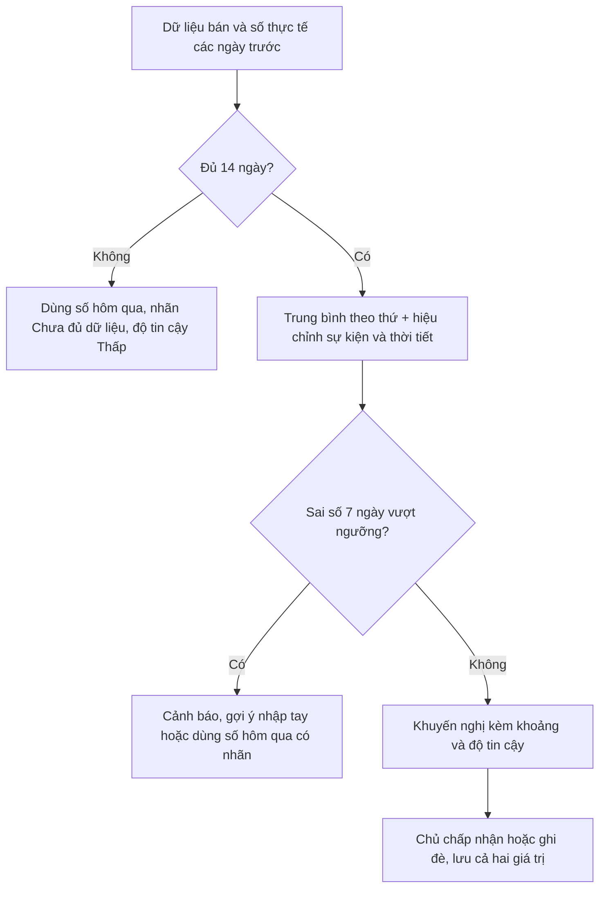

## 5.13. Định giá động (Pro)

*Vai trò: Chủ cửa hàng (web) · 5 UC: R2-044 đến R2-048*

### 5.13.1. Mục tiêu nghiệp vụ

Tăng khả năng bán hết trước khi hết khung nhận bằng đề xuất giá giảm theo giờ, trong ràng buộc giá sàn và số lần đổi giá, với quyền quyết định thuộc về chủ (hoặc chế độ Tự động do chủ chọn). Mọi đề xuất và lý do đều được lưu để truy vết.

### 5.13.2. Phạm vi

**Thuộc phân hệ:** Đề xuất giá; Quyết định giá.

**Danh sách UC:** R2-044 Xem đề xuất giá giảm theo giờ; R2-045 Xem giải thích đề xuất giá; R2-046 Duyệt đề xuất giá; R2-047 Từ chối đề xuất hoặc đặt giá thủ công; R2-048 Xem lịch sử quyết định giá.

**Nằm ngoài phạm vi:** Giá theo từng khách; đấu giá; thay đổi giá gốc.

### 5.13.3. Tác nhân và quyền hạn

Chủ cửa hàng và Quản lý (web), gói Pro hoặc dùng thử; hệ thống tính đề xuất.

### 5.13.4. Dữ liệu nghiệp vụ

| Thực thể | Ý nghĩa, nguồn hình thành và ảnh hưởng đến quyết định nghiệp vụ |
|---|---|
| Đề xuất giá | Suất, giá hiện tại, giá đề xuất, % giảm, giờ hiệu lực (15 phút), dự kiến bán hết, thành phần điểm, trạng thái (Chờ duyệt, Đã duyệt, Đã từ chối, Hết hiệu lực, Tự áp dụng). |
| Lịch sử quyết định | Giá cũ, giá mới, nguồn quyết định (chủ hoặc tự động), số bán sau 30 phút. |

### 5.13.5. Quy trình nghiệp vụ tổng thể

1. Hệ thống tính đề xuất giá cho suất đang mở từ giờ còn lại, tốc độ bán, hạn dùng và tồn còn.
2. Chủ xem lý do và duyệt trong 15 phút, hoặc từ chối và đặt giá thủ công; ở chế độ Tự động, hệ thống tự áp dụng trong giá sàn.
3. Khi duyệt, giá suất đổi nguyên tử và lưu lịch sử; đơn đã giữ hoặc đã thanh toán giữ giá cũ.

**Phân hệ phụ thuộc và liên kết:** Phụ thuộc Suất và tồn kho, Tài khoản (giá sàn, chế độ), Gói. Dữ liệu quyết định dùng cho báo cáo hiệu quả giá và Giải thích AI.

### 5.13.6. Đặc tả từng UC

##### R2-044 - Xem đề xuất giá giảm theo giờ

**Mã UC:** R2-044  
**Tên UC:** Xem đề xuất giá giảm theo giờ  
**Nhóm:** Định giá động (Pro) / Đề xuất giá · **Loại:** Truy vấn và hiển thị  
**Mục tiêu:** Hệ thống đề xuất giá mới cho suất đang mở dựa trên giờ còn lại, tốc độ bán, hạn dùng, tồn còn. *[Xác định trong Excel]*  
**Tác nhân:** Chủ cửa hàng (web)  

**Điều kiện tiên quyết** *[Tổng hợp từ ma trận gói và vai trò]*
- Người dùng đã đăng nhập trên web bằng tài khoản Chủ hoặc nhân viên của cửa hàng; cửa hàng ở trạng thái Hoạt động (trừ các UC quản lý trạng thái cửa hàng, gói và hồ sơ).
- Nhóm quyền được phép: Chủ và Quản lý; Nhân viên quầy không có quyền (không thuộc bốn thao tác của nhóm này). *[Tổng hợp từ UC phân quyền nhân viên]*
- Gói dịch vụ: Chỉ gói Pro (GOI-PRO) và thời gian dùng thử Pro (GOI-DT). Gói Cơ bản (GOI-CB) không có quyền sử dụng; khi hết hạn Pro, tính năng bị khóa và dữ liệu đã tạo chỉ xem.

**Dữ liệu hiển thị (UC không có trường nhập)** *[Xác định trong Excel]*
- Hiển thị: suất, giá hiện tại, giá đề xuất, % giảm, giờ hiệu lực, dự kiến bán hết

**Luồng xử lý chính** *[Tổng hợp từ mô tả, quy tắc và kết quả]*
1. Người dùng mở màn hình "Xem đề xuất giá giảm theo giờ" trên web quản trị.
2. Hệ thống xác thực phiên, xác định phạm vi dữ liệu của người dùng và áp các quy tắc hiển thị của UC.
3. Truy vấn dữ liệu: Hệ thống đề xuất giá mới cho suất đang mở dựa trên giờ còn lại, tốc độ bán, hạn dùng, tồn còn.
4. Hiển thị các thuộc tính: suất, giá hiện tại, giá đề xuất, % giảm, giờ hiệu lực, dự kiến bán hết.
5. Trường hợp không có dữ liệu hoặc không hợp lệ được xử lý theo mục Validation; không thay đổi dữ liệu nghiệp vụ.

**Business Rules** *[Xác định trong Excel]*
1. Giá đề xuất không thấp hơn giá sàn, không cao hơn giá hiện tại.
2. Tối đa 3 lần đổi giá trong một suất.
3. Giá làm tròn bội 500.
4. Lõi chạy khi Gemini lỗi.

**Validation** *[Xác định trong Excel]*
1. Không đủ dữ liệu: dùng lịch giảm cố định theo giờ do chủ đặt.

**Luồng thay thế và ngoại lệ**
- Mọi trường hợp không hợp lệ nêu ở mục Validation là luồng ngoại lệ của UC này và được xử lý đúng như mô tả tại đó. *[Xác định]*
- Người dùng không có quyền hoặc đối tượng không thuộc phạm vi dữ liệu của mình: từ chối, không tiết lộ sự tồn tại của dữ liệu thuộc người khác (đề xuất hoàn thiện).
- Mất kết nối hoặc lỗi hệ thống giữa chừng: thao tác không được ghi nhận một phần; người dùng được thông báo và thử lại, thao tác thay đổi dữ liệu dùng khóa chống trùng khi áp dụng (đề xuất hoàn thiện).
- Cửa hàng ở gói Cơ bản hoặc đã hết Pro: tính năng ẩn hoặc khóa, hiển thị gợi ý nâng cấp; dữ liệu đã tạo trước đó chỉ xem (theo ma trận gói).

**Dữ liệu thay đổi** *[Tổng hợp]*  
Không tạo hoặc thay đổi dữ liệu nghiệp vụ; chỉ đọc theo phạm vi của người dùng.

**Chuyển trạng thái** *[Tổng hợp]*
- Không chuyển trạng thái của đối tượng nghiệp vụ.

**Kết quả** *[Xác định trong Excel]*  
Danh sách đề xuất chờ duyệt.

**Tác động liên phân hệ** *[Tổng hợp]*  
Dữ liệu hoặc quy tắc của UC liên quan đến: Suất và tồn kho trong ngày.

**Điều kiện hoàn thành** *[Tổng hợp]*  
Thành công khi: Danh sách đề xuất chờ duyệt. Không hoàn tất khi bất kỳ điều kiện Validation nào không đạt hoặc dịch vụ liên quan lỗi; dữ liệu giữ nguyên trạng thái trước thao tác.

**Tiêu chí nghiệm thu** *[Tổng hợp, kiểm tra được]*
1. Given người dùng cửa hàng đủ điều kiện tiên quyết và dữ liệu hợp lệ, When thực hiện "Xem đề xuất giá giảm theo giờ", Then kết quả đạt được là: danh sách đề xuất chờ duyệt.
2. Given không đủ dữ liệu, When thực hiện "Xem đề xuất giá giảm theo giờ", Then dùng lịch giảm cố định theo giờ do chủ đặt.
3. Given thao tác "Xem đề xuất giá giảm theo giờ" được thực hiện, When hệ thống áp dụng quy tắc "Giá đề xuất không thấp hơn giá sàn, không cao hơn giá hiện tại", Then kết quả không được vi phạm quy tắc này.
4. Given cửa hàng ở gói Cơ bản, When mở "Xem đề xuất giá giảm theo giờ", Then tính năng bị khóa và hiển thị gợi ý nâng cấp; cửa hàng Pro hoặc dùng thử truy cập bình thường.

##### R2-045 - Xem giải thích đề xuất giá

**Mã UC:** R2-045  
**Tên UC:** Xem giải thích đề xuất giá  
**Nhóm:** Định giá động (Pro) / Đề xuất giá · **Loại:** Truy vấn và hiển thị  
**Mục tiêu:** Hiển thị lý do bằng câu giải thích và thành phần điểm. *[Xác định trong Excel]*  
**Tác nhân:** Chủ cửa hàng (web)  

**Điều kiện tiên quyết** *[Tổng hợp từ ma trận gói và vai trò]*
- Người dùng đã đăng nhập trên web bằng tài khoản Chủ hoặc nhân viên của cửa hàng; cửa hàng ở trạng thái Hoạt động (trừ các UC quản lý trạng thái cửa hàng, gói và hồ sơ).
- Nhóm quyền được phép: Chủ và Quản lý; Nhân viên quầy không có quyền (không thuộc bốn thao tác của nhóm này). *[Tổng hợp từ UC phân quyền nhân viên]*
- Gói dịch vụ: Chỉ gói Pro (GOI-PRO) và thời gian dùng thử Pro (GOI-DT). Gói Cơ bản (GOI-CB) không có quyền sử dụng; khi hết hạn Pro, tính năng bị khóa và dữ liệu đã tạo chỉ xem.

**Dữ liệu hiển thị (UC không có trường nhập)** *[Xác định trong Excel]*
- Hiển thị: giờ còn lại, tốc độ bán, tồn còn, hạn dùng, giá sàn, câu giải thích

**Luồng xử lý chính** *[Tổng hợp từ mô tả, quy tắc và kết quả]*
1. Người dùng mở màn hình "Xem giải thích đề xuất giá" trên web quản trị.
2. Hệ thống xác thực phiên, xác định phạm vi dữ liệu của người dùng và áp các quy tắc hiển thị của UC.
3. Truy vấn dữ liệu: Hiển thị lý do bằng câu giải thích và thành phần điểm.
4. Hiển thị các thuộc tính: giờ còn lại, tốc độ bán, tồn còn, hạn dùng, giá sàn, câu giải thích.
5. Trường hợp không có dữ liệu hoặc không hợp lệ được xử lý theo mục Validation; không thay đổi dữ liệu nghiệp vụ.

**Business Rules** *[Xác định trong Excel]*
1. Lưu mọi đề xuất và thành phần vào bảng decisions.

**Validation** *[Xác định trong Excel]*
1. Không có.

**Luồng thay thế và ngoại lệ**
- Người dùng không có quyền hoặc đối tượng không thuộc phạm vi dữ liệu của mình: từ chối, không tiết lộ sự tồn tại của dữ liệu thuộc người khác (đề xuất hoàn thiện).
- Mất kết nối hoặc lỗi hệ thống giữa chừng: thao tác không được ghi nhận một phần; người dùng được thông báo và thử lại, thao tác thay đổi dữ liệu dùng khóa chống trùng khi áp dụng (đề xuất hoàn thiện).
- Cửa hàng ở gói Cơ bản hoặc đã hết Pro: tính năng ẩn hoặc khóa, hiển thị gợi ý nâng cấp; dữ liệu đã tạo trước đó chỉ xem (theo ma trận gói).

**Dữ liệu thay đổi** *[Tổng hợp]*  
Không tạo hoặc thay đổi dữ liệu nghiệp vụ; chỉ đọc theo phạm vi của người dùng.

**Chuyển trạng thái** *[Tổng hợp]*
- Không chuyển trạng thái của đối tượng nghiệp vụ.

**Kết quả** *[Xác định trong Excel]*  
Hiển thị giải thích.

**Tác động liên phân hệ** *[Tổng hợp]*  
Dữ liệu hoặc quy tắc của UC liên quan đến: Thành phần và dị ứng của món.

**Điều kiện hoàn thành** *[Tổng hợp]*  
Thành công khi: Hiển thị giải thích. Không hoàn tất khi bất kỳ điều kiện Validation nào không đạt hoặc dịch vụ liên quan lỗi; dữ liệu giữ nguyên trạng thái trước thao tác.

**Tiêu chí nghiệm thu** *[Tổng hợp, kiểm tra được]*
1. Given người dùng cửa hàng đủ điều kiện tiên quyết và dữ liệu hợp lệ, When thực hiện "Xem giải thích đề xuất giá", Then kết quả đạt được là: hiển thị giải thích.
2. Given thao tác "Xem giải thích đề xuất giá" được thực hiện, When hệ thống áp dụng quy tắc "Lưu mọi đề xuất và thành phần vào bảng decisions", Then kết quả không được vi phạm quy tắc này.
3. Given cửa hàng ở gói Cơ bản, When mở "Xem giải thích đề xuất giá", Then tính năng bị khóa và hiển thị gợi ý nâng cấp; cửa hàng Pro hoặc dùng thử truy cập bình thường.

##### R2-046 - Duyệt đề xuất giá

**Mã UC:** R2-046  
**Tên UC:** Duyệt đề xuất giá  
**Nhóm:** Định giá động (Pro) / Quyết định giá · **Loại:** Chuyển trạng thái  
**Mục tiêu:** Chủ duyệt đề xuất; giá suất đổi ngay và khách thấy giá mới. *[Xác định trong Excel]*  
**Tác nhân:** Chủ cửa hàng (web)  

**Điều kiện tiên quyết** *[Tổng hợp từ ma trận gói và vai trò]*
- Người dùng đã đăng nhập trên web bằng tài khoản Chủ hoặc nhân viên của cửa hàng; cửa hàng ở trạng thái Hoạt động (trừ các UC quản lý trạng thái cửa hàng, gói và hồ sơ).
- Nhóm quyền được phép: Chủ và Quản lý; Nhân viên quầy không có quyền (không thuộc bốn thao tác của nhóm này). *[Tổng hợp từ UC phân quyền nhân viên]*
- Gói dịch vụ: Chỉ gói Pro (GOI-PRO) và thời gian dùng thử Pro (GOI-DT). Gói Cơ bản (GOI-CB) không có quyền sử dụng; khi hết hạn Pro, tính năng bị khóa và dữ liệu đã tạo chỉ xem.

**Dữ liệu đầu vào và hiển thị** *[Xác định trong Excel]*
- Mã đề xuất (hệ thống)

**Luồng xử lý chính** *[Tổng hợp từ mô tả, quy tắc và kết quả]*
1. Người dùng chọn đối tượng cần xử lý và thao tác "Duyệt đề xuất giá" trên web quản trị.
2. Người dùng cung cấp thêm: Mã đề xuất.
3. Hệ thống kiểm tra trạng thái hiện tại có cho phép chuyển trạng thái này không, cùng quyền của người thực hiện.
4. Xử lý nghiệp vụ: Chủ duyệt đề xuất; giá suất đổi ngay và khách thấy giá mới.
5. Trạng thái, tồn kho, tiền hoặc thông báo liên quan được cập nhật trong cùng giao dịch; kết quả: Giá suất đổi; có bản ghi quyết định.

**Business Rules** *[Xác định trong Excel]*
1. Đề xuất hết hiệu lực sau 15 phút.
2. Duyệt cập nhật giá nguyên tử và lưu lịch sử.
3. Đơn đã giữ/đã thanh toán giữ giá cũ.

**Validation** *[Xác định trong Excel]*
1. Đề xuất hết hạn: yêu cầu tính lại.

**Luồng thay thế và ngoại lệ**
- Mọi trường hợp không hợp lệ nêu ở mục Validation là luồng ngoại lệ của UC này và được xử lý đúng như mô tả tại đó. *[Xác định]*
- Người dùng không có quyền hoặc đối tượng không thuộc phạm vi dữ liệu của mình: từ chối, không tiết lộ sự tồn tại của dữ liệu thuộc người khác (đề xuất hoàn thiện).
- Mất kết nối hoặc lỗi hệ thống giữa chừng: thao tác không được ghi nhận một phần; người dùng được thông báo và thử lại, thao tác thay đổi dữ liệu dùng khóa chống trùng khi áp dụng (đề xuất hoàn thiện).
- Cửa hàng ở gói Cơ bản hoặc đã hết Pro: tính năng ẩn hoặc khóa, hiển thị gợi ý nâng cấp; dữ liệu đã tạo trước đó chỉ xem (theo ma trận gói).

**Dữ liệu thay đổi** *[Tổng hợp]*  
Theo kết quả đã xác định: Giá suất đổi; có bản ghi quyết định.

**Chuyển trạng thái** *[Tổng hợp]*
- Excel không nêu chuyển trạng thái riêng cho UC này; đối tượng giữ trạng thái hiện tại trừ phần được nêu ở mục Kết quả.

**Kết quả** *[Xác định trong Excel]*  
Giá suất đổi; có bản ghi quyết định.

**Tác động liên phân hệ** *[Tổng hợp]*  
Dữ liệu hoặc quy tắc của UC liên quan đến: Suất và tồn kho trong ngày; Đơn hàng; Thanh toán và hoàn tiền.

**Điều kiện hoàn thành** *[Tổng hợp]*  
Thành công khi: Giá suất đổi; có bản ghi quyết định. Không hoàn tất khi bất kỳ điều kiện Validation nào không đạt hoặc dịch vụ liên quan lỗi; dữ liệu giữ nguyên trạng thái trước thao tác.

**Tiêu chí nghiệm thu** *[Tổng hợp, kiểm tra được]*
1. Given người dùng cửa hàng đủ điều kiện tiên quyết và dữ liệu hợp lệ, When thực hiện "Duyệt đề xuất giá", Then kết quả đạt được là: giá suất đổi; có bản ghi quyết định.
2. Given đề xuất hết hạn, When thực hiện "Duyệt đề xuất giá", Then yêu cầu tính lại.
3. Given thao tác "Duyệt đề xuất giá" được thực hiện, When hệ thống áp dụng quy tắc "Đề xuất hết hiệu lực sau 15 phút", Then kết quả không được vi phạm quy tắc này.
4. Given cửa hàng ở gói Cơ bản, When mở "Duyệt đề xuất giá", Then tính năng bị khóa và hiển thị gợi ý nâng cấp; cửa hàng Pro hoặc dùng thử truy cập bình thường.

##### R2-047 - Từ chối đề xuất hoặc đặt giá thủ công

**Mã UC:** R2-047  
**Tên UC:** Từ chối đề xuất hoặc đặt giá thủ công  
**Nhóm:** Định giá động (Pro) / Quyết định giá · **Loại:** Chuyển trạng thái  
**Mục tiêu:** Chủ từ chối đề xuất hoặc nhập giá khác. *[Xác định trong Excel]*  
**Tác nhân:** Chủ cửa hàng (web)  

**Điều kiện tiên quyết** *[Tổng hợp từ ma trận gói và vai trò]*
- Người dùng đã đăng nhập trên web bằng tài khoản Chủ hoặc nhân viên của cửa hàng; cửa hàng ở trạng thái Hoạt động (trừ các UC quản lý trạng thái cửa hàng, gói và hồ sơ).
- Nhóm quyền được phép: Chủ và Quản lý; Nhân viên quầy không có quyền (không thuộc bốn thao tác của nhóm này). *[Tổng hợp từ UC phân quyền nhân viên]*
- Gói dịch vụ: Chỉ gói Pro (GOI-PRO) và thời gian dùng thử Pro (GOI-DT). Gói Cơ bản (GOI-CB) không có quyền sử dụng; khi hết hạn Pro, tính năng bị khóa và dữ liệu đã tạo chỉ xem.

**Dữ liệu đầu vào và hiển thị** *[Xác định trong Excel]*
- Giá thủ công (bội 500, ≥ giá sàn, ≤ giá hiện tại)
- Lý do (tùy chọn)

**Luồng xử lý chính** *[Tổng hợp từ mô tả, quy tắc và kết quả]*
1. Người dùng chọn đối tượng cần xử lý và thao tác "Từ chối đề xuất hoặc đặt giá thủ công" trên web quản trị.
2. Người dùng cung cấp thêm: Giá thủ công, Lý do.
3. Hệ thống kiểm tra trạng thái hiện tại có cho phép chuyển trạng thái này không, cùng quyền của người thực hiện.
4. Xử lý nghiệp vụ: Chủ từ chối đề xuất hoặc nhập giá khác.
5. Trạng thái, tồn kho, tiền hoặc thông báo liên quan được cập nhật trong cùng giao dịch; kết quả: Giá cập nhật hoặc giữ nguyên; đề xuất ghi Đã từ chối.

**Business Rules** *[Xác định trong Excel]*
1. Giá thủ công không được cao hơn giá gốc; ghi nhật ký.

**Validation** *[Xác định trong Excel]*
1. Giá ngoài khoảng: báo lỗi.

**Luồng thay thế và ngoại lệ**
- Mọi trường hợp không hợp lệ nêu ở mục Validation là luồng ngoại lệ của UC này và được xử lý đúng như mô tả tại đó. *[Xác định]*
- Người dùng không có quyền hoặc đối tượng không thuộc phạm vi dữ liệu của mình: từ chối, không tiết lộ sự tồn tại của dữ liệu thuộc người khác (đề xuất hoàn thiện).
- Mất kết nối hoặc lỗi hệ thống giữa chừng: thao tác không được ghi nhận một phần; người dùng được thông báo và thử lại, thao tác thay đổi dữ liệu dùng khóa chống trùng khi áp dụng (đề xuất hoàn thiện).
- Cửa hàng ở gói Cơ bản hoặc đã hết Pro: tính năng ẩn hoặc khóa, hiển thị gợi ý nâng cấp; dữ liệu đã tạo trước đó chỉ xem (theo ma trận gói).

**Dữ liệu thay đổi** *[Tổng hợp]*  
Theo kết quả đã xác định: Giá cập nhật hoặc giữ nguyên; đề xuất ghi Đã từ chối.

**Chuyển trạng thái** *[Tổng hợp]*
- Excel không nêu chuyển trạng thái riêng cho UC này; đối tượng giữ trạng thái hiện tại trừ phần được nêu ở mục Kết quả.

**Kết quả** *[Xác định trong Excel]*  
Giá cập nhật hoặc giữ nguyên; đề xuất ghi Đã từ chối.

**Tác động liên phân hệ** *[Tổng hợp]*  
Dữ liệu hoặc quy tắc của UC liên quan đến: Nhật ký hoạt động.

**Điều kiện hoàn thành** *[Tổng hợp]*  
Thành công khi: Giá cập nhật hoặc giữ nguyên; đề xuất ghi Đã từ chối. Không hoàn tất khi bất kỳ điều kiện Validation nào không đạt hoặc dịch vụ liên quan lỗi; dữ liệu giữ nguyên trạng thái trước thao tác.

**Tiêu chí nghiệm thu** *[Tổng hợp, kiểm tra được]*
1. Given người dùng cửa hàng đủ điều kiện tiên quyết và dữ liệu hợp lệ, When thực hiện "Từ chối đề xuất hoặc đặt giá thủ công", Then kết quả đạt được là: giá cập nhật hoặc giữ nguyên; đề xuất ghi Đã từ chối.
2. Given giá ngoài khoảng, When thực hiện "Từ chối đề xuất hoặc đặt giá thủ công", Then báo lỗi.
3. Given thao tác "Từ chối đề xuất hoặc đặt giá thủ công" được thực hiện, When hệ thống áp dụng quy tắc "Giá thủ công không được cao hơn giá gốc; ghi nhật ký", Then kết quả không được vi phạm quy tắc này.
4. Given cửa hàng ở gói Cơ bản, When mở "Từ chối đề xuất hoặc đặt giá thủ công", Then tính năng bị khóa và hiển thị gợi ý nâng cấp; cửa hàng Pro hoặc dùng thử truy cập bình thường.

##### R2-048 - Xem lịch sử quyết định giá

**Mã UC:** R2-048  
**Tên UC:** Xem lịch sử quyết định giá  
**Nhóm:** Định giá động (Pro) / Quyết định giá · **Loại:** Truy vấn và hiển thị  
**Mục tiêu:** Xem các lần đổi giá, ai duyệt (chủ hoặc tự động), kết quả bán sau đổi. *[Xác định trong Excel]*  
**Tác nhân:** Chủ cửa hàng (web)  

**Điều kiện tiên quyết** *[Tổng hợp từ ma trận gói và vai trò]*
- Người dùng đã đăng nhập trên web bằng tài khoản Chủ hoặc nhân viên của cửa hàng; cửa hàng ở trạng thái Hoạt động (trừ các UC quản lý trạng thái cửa hàng, gói và hồ sơ).
- Nhóm quyền được phép: Chủ và Quản lý; Nhân viên quầy không có quyền (không thuộc bốn thao tác của nhóm này). *[Tổng hợp từ UC phân quyền nhân viên]*
- Gói dịch vụ: Chỉ gói Pro (GOI-PRO) và thời gian dùng thử Pro (GOI-DT). Gói Cơ bản (GOI-CB) không có quyền sử dụng; khi hết hạn Pro, tính năng bị khóa và dữ liệu đã tạo chỉ xem.

**Dữ liệu hiển thị (UC không có trường nhập)** *[Xác định trong Excel]*
- Hiển thị: thời điểm, giá cũ/mới, nguồn quyết định, số bán sau 30 phút

**Luồng xử lý chính** *[Tổng hợp từ mô tả, quy tắc và kết quả]*
1. Người dùng mở màn hình "Xem lịch sử quyết định giá" trên web quản trị.
2. Hệ thống xác thực phiên, xác định phạm vi dữ liệu của người dùng và áp các quy tắc hiển thị của UC.
3. Truy vấn dữ liệu: Xem các lần đổi giá, ai duyệt (chủ hoặc tự động), kết quả bán sau đổi.
4. Hiển thị các thuộc tính: thời điểm, giá cũ/mới, nguồn quyết định, số bán sau 30 phút.
5. Trường hợp không có dữ liệu hoặc không hợp lệ được xử lý theo mục Validation; không thay đổi dữ liệu nghiệp vụ.

**Business Rules** *[Xác định trong Excel]*
1. Chỉ đọc.

**Validation** *[Xác định trong Excel]*
1. Không có.

**Luồng thay thế và ngoại lệ**
- Người dùng không có quyền hoặc đối tượng không thuộc phạm vi dữ liệu của mình: từ chối, không tiết lộ sự tồn tại của dữ liệu thuộc người khác (đề xuất hoàn thiện).
- Mất kết nối hoặc lỗi hệ thống giữa chừng: thao tác không được ghi nhận một phần; người dùng được thông báo và thử lại, thao tác thay đổi dữ liệu dùng khóa chống trùng khi áp dụng (đề xuất hoàn thiện).
- Cửa hàng ở gói Cơ bản hoặc đã hết Pro: tính năng ẩn hoặc khóa, hiển thị gợi ý nâng cấp; dữ liệu đã tạo trước đó chỉ xem (theo ma trận gói).

**Dữ liệu thay đổi** *[Tổng hợp]*  
Không tạo hoặc thay đổi dữ liệu nghiệp vụ; chỉ đọc theo phạm vi của người dùng.

**Chuyển trạng thái** *[Tổng hợp]*
- Không chuyển trạng thái của đối tượng nghiệp vụ.

**Kết quả** *[Xác định trong Excel]*  
Bảng lịch sử.

**Tác động liên phân hệ** *[Tổng hợp]*  
Không phát sinh tác động đáng kể ngoài phân hệ; dữ liệu chỉ dùng trong phạm vi chức năng.

**Điều kiện hoàn thành** *[Tổng hợp]*  
Thành công khi: Bảng lịch sử. Không hoàn tất khi bất kỳ điều kiện Validation nào không đạt hoặc dịch vụ liên quan lỗi; dữ liệu giữ nguyên trạng thái trước thao tác.

**Tiêu chí nghiệm thu** *[Tổng hợp, kiểm tra được]*
1. Given người dùng cửa hàng đủ điều kiện tiên quyết và dữ liệu hợp lệ, When thực hiện "Xem lịch sử quyết định giá", Then kết quả đạt được là: bảng lịch sử.
2. Given thao tác "Xem lịch sử quyết định giá" được thực hiện, When hệ thống áp dụng quy tắc "Chỉ đọc", Then kết quả không được vi phạm quy tắc này.
3. Given cửa hàng ở gói Cơ bản, When mở "Xem lịch sử quyết định giá", Then tính năng bị khóa và hiển thị gợi ý nâng cấp; cửa hàng Pro hoặc dùng thử truy cập bình thường.

### 5.13.7. Các quy tắc nghiệp vụ dùng chung

| Mã BR | Quy tắc | UC chịu ảnh hưởng |
|---|---|---|
| BR-064 | Giá đề xuất không thấp hơn giá sàn, không cao hơn giá hiện tại, làm tròn bội 500, tối đa 3 lần đổi giá trong một suất. | R2-044 |
| BR-065 | Đề xuất hết hiệu lực sau 15 phút; duyệt cập nhật giá nguyên tử; đơn đã giữ hoặc đã thanh toán giữ giá cũ. | R2-046 |
| BR-066 | Giá thủ công là bội 500, không thấp hơn giá sàn, không cao hơn giá hiện tại (và không cao hơn giá gốc); ghi nhật ký. | R2-047 |
| BR-067 | Lõi định giá chạy khi Gemini lỗi; không đủ dữ liệu thì dùng lịch giảm cố định theo giờ do chủ đặt. | R2-044, R2-045 |

### 5.13.8. Sơ đồ quy trình

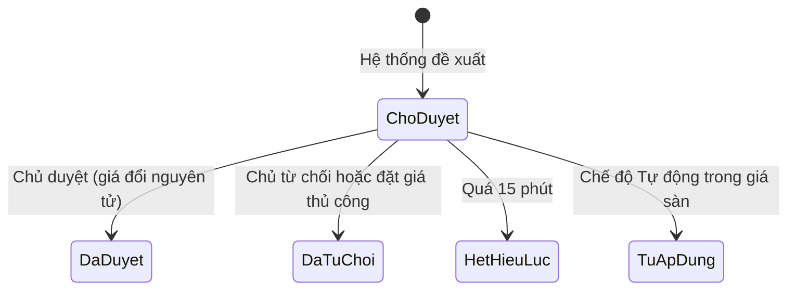

## 5.14. Đơn hàng và nhận hàng

*Vai trò: Chủ cửa hàng (web) · 5 UC: R2-049 đến R2-053*

### 5.14.1. Mục tiêu nghiệp vụ

Cho cửa hàng thấy đúng đơn cần chuẩn bị, xác nhận khách nhận hàng chính xác một lần, và xử lý hủy đơn do cửa hàng với hoàn tiền đúng quy tắc. Phân hệ đảm bảo thông tin khách ở mức tối thiểu (tên rút gọn, không SĐT).

### 5.14.2. Phạm vi

**Thuộc phân hệ:** Danh sách; Giao nhận.

**Danh sách UC:** R2-049 Xem danh sách đơn của cửa hàng; R2-050 Lọc, tìm và xuất đơn; R2-051 Xem chi tiết đơn; R2-052 Quét QR xác nhận khách nhận hàng; R2-053 Hủy đơn do cửa hàng.

**Nằm ngoài phạm vi:** Giao hàng; sửa nội dung đơn; chỉnh giá sau thanh toán.

### 5.14.3. Tác nhân và quyền hạn

Chủ, Quản lý và Nhân viên quầy (xem đơn trong ngày, quét QR); chỉ Chủ và Quản lý hủy đơn và xuất đơn.

### 5.14.4. Dữ liệu nghiệp vụ

| Thực thể | Ý nghĩa, nguồn hình thành và ảnh hưởng đến quyết định nghiệp vụ |
|---|---|
| Đơn của cửa hàng | Mã đơn, tên khách rút gọn, món, số lượng, tổng tiền, tiền sau hoa hồng, trạng thái, mốc thời gian, giờ hẹn, ghi chú khách, khiếu nại liên quan. |
| Lệnh hoàn tiền | Tạo khi cửa hàng hủy đơn Đã thanh toán, hoàn 100% không hoa hồng. |

### 5.14.5. Quy trình nghiệp vụ tổng thể

1. Cửa hàng xem danh sách đơn theo ngày và trạng thái, lọc, tìm, xuất CSV (không chứa dữ liệu cá nhân, tối đa 12 tháng).
2. Khi khách đến, nhân viên quét QR hoặc nhập mã dự phòng; hệ thống hiển thị món và số lượng để đối chiếu rồi đánh dấu Đã nhận nguyên tử.
3. Khi không thể giao, chủ hủy đơn Đã thanh toán chưa nhận kèm lý do bắt buộc, hoàn 100%, cộng trả tồn nếu còn trong khung nhận.

**Phân hệ phụ thuộc và liên kết:** Phụ thuộc Đặt hàng và thanh toán, Nhận hàng của khách; cung cấp doanh thu thu hồi cho Báo cáo và đối soát.

### 5.14.6. Đặc tả từng UC

##### R2-049 - Xem danh sách đơn của cửa hàng

**Mã UC:** R2-049  
**Tên UC:** Xem danh sách đơn của cửa hàng  
**Nhóm:** Đơn hàng và nhận hàng / Danh sách · **Loại:** Truy vấn và hiển thị  
**Mục tiêu:** Xem đơn theo ngày và trạng thái; đơn hôm nay ở đầu. *[Xác định trong Excel]*  
**Tác nhân:** Chủ cửa hàng (web)  

**Điều kiện tiên quyết** *[Tổng hợp từ ma trận gói và vai trò]*
- Người dùng đã đăng nhập trên web bằng tài khoản Chủ hoặc nhân viên của cửa hàng; cửa hàng ở trạng thái Hoạt động (trừ các UC quản lý trạng thái cửa hàng, gói và hồ sơ).
- Nhóm quyền được phép: Chủ, Quản lý và Nhân viên quầy. *[Tổng hợp từ UC phân quyền nhân viên]*
- Gói dịch vụ: Mọi gói (GOI-CB, GOI-PRO, GOI-DT); không có hạn mức riêng.

**Dữ liệu hiển thị (UC không có trường nhập)** *[Xác định trong Excel]*
- Hiển thị: mã đơn, tên khách (rút gọn), món, số lượng, tổng tiền, trạng thái, khung nhận

**Luồng xử lý chính** *[Tổng hợp từ mô tả, quy tắc và kết quả]*
1. Người dùng mở màn hình "Xem danh sách đơn của cửa hàng" trên web quản trị.
2. Hệ thống xác thực phiên, xác định phạm vi dữ liệu của người dùng và áp các quy tắc hiển thị của UC.
3. Truy vấn dữ liệu: Xem đơn theo ngày và trạng thái; đơn hôm nay ở đầu.
4. Hiển thị các thuộc tính: mã đơn, tên khách (rút gọn), món, số lượng, tổng tiền, trạng thái, khung nhận.
5. Trường hợp không có dữ liệu hoặc không hợp lệ được xử lý theo mục Validation; không thay đổi dữ liệu nghiệp vụ.

**Business Rules** *[Xác định trong Excel]*
1. Chỉ đơn của cửa hàng; che họ tên khách thành chữ cái đầu và SĐT không hiển thị.

**Validation** *[Xác định trong Excel]*
1. Không có.

**Luồng thay thế và ngoại lệ**
- Người dùng không có quyền hoặc đối tượng không thuộc phạm vi dữ liệu của mình: từ chối, không tiết lộ sự tồn tại của dữ liệu thuộc người khác (đề xuất hoàn thiện).
- Mất kết nối hoặc lỗi hệ thống giữa chừng: thao tác không được ghi nhận một phần; người dùng được thông báo và thử lại, thao tác thay đổi dữ liệu dùng khóa chống trùng khi áp dụng (đề xuất hoàn thiện).

**Dữ liệu thay đổi** *[Tổng hợp]*  
Không tạo hoặc thay đổi dữ liệu nghiệp vụ; chỉ đọc theo phạm vi của người dùng.

**Chuyển trạng thái** *[Tổng hợp]*
- Không chuyển trạng thái của đối tượng nghiệp vụ.

**Kết quả** *[Xác định trong Excel]*  
Danh sách đơn.

**Tác động liên phân hệ** *[Tổng hợp]*  
Không phát sinh tác động đáng kể ngoài phân hệ; dữ liệu chỉ dùng trong phạm vi chức năng.

**Điều kiện hoàn thành** *[Tổng hợp]*  
Thành công khi: Danh sách đơn. Không hoàn tất khi bất kỳ điều kiện Validation nào không đạt hoặc dịch vụ liên quan lỗi; dữ liệu giữ nguyên trạng thái trước thao tác.

**Tiêu chí nghiệm thu** *[Tổng hợp, kiểm tra được]*
1. Given người dùng cửa hàng đủ điều kiện tiên quyết và dữ liệu hợp lệ, When thực hiện "Xem danh sách đơn của cửa hàng", Then kết quả đạt được là: danh sách đơn.
2. Given thao tác "Xem danh sách đơn của cửa hàng" được thực hiện, When hệ thống áp dụng quy tắc "Chỉ đơn của cửa hàng; che họ tên khách thành chữ cái đầu và SĐT không hiển thị", Then kết quả không được vi phạm quy tắc này.

##### R2-050 - Lọc, tìm và xuất đơn

**Mã UC:** R2-050  
**Tên UC:** Lọc, tìm và xuất đơn  
**Nhóm:** Đơn hàng và nhận hàng / Danh sách · **Loại:** Truy vấn và hiển thị  
**Mục tiêu:** Lọc theo ngày, trạng thái, món; tìm theo mã đơn; xuất CSV. *[Xác định trong Excel]*  
**Tác nhân:** Chủ cửa hàng (web)  

**Điều kiện tiên quyết** *[Tổng hợp từ ma trận gói và vai trò]*
- Người dùng đã đăng nhập trên web bằng tài khoản Chủ hoặc nhân viên của cửa hàng; cửa hàng ở trạng thái Hoạt động (trừ các UC quản lý trạng thái cửa hàng, gói và hồ sơ).
- Nhóm quyền được phép: Chủ và Quản lý; Nhân viên quầy không có quyền (không thuộc bốn thao tác của nhóm này). *[Tổng hợp từ UC phân quyền nhân viên]*
- Gói dịch vụ: Mọi gói. Hạn mức: GOI-CB 5 lần xuất/tháng; GOI-PRO 60 lần xuất/tháng (chu kỳ đặt lại: hằng tháng); GOI-DT như Pro. Khi hết hạn mức: Từ chối thao tác, hiện số lượt còn lại và thời điểm đặt lại; gợi ý nâng cấp.

**Dữ liệu đầu vào và hiển thị** *[Xác định trong Excel]*
- Ngày, trạng thái, món, mã đơn

**Luồng xử lý chính** *[Tổng hợp từ mô tả, quy tắc và kết quả]*
1. Người dùng mở màn hình "Lọc, tìm và xuất đơn" trên web quản trị và đặt điều kiện: Ngày, trạng thái, món, mã đơn.
2. Hệ thống xác thực phiên, xác định phạm vi dữ liệu của người dùng và áp các quy tắc hiển thị của UC.
3. Truy vấn dữ liệu: Lọc theo ngày, trạng thái, món; tìm theo mã đơn; xuất CSV.
4. Hiển thị kết quả theo định dạng của màn hình.
5. Trường hợp không có dữ liệu hoặc không hợp lệ được xử lý theo mục Validation; không thay đổi dữ liệu nghiệp vụ.

**Business Rules** *[Xác định trong Excel]*
1. Xuất tối đa 12 tháng.
2. Tệp xuất không chứa dữ liệu cá nhân của khách.
3. Mỗi lần xuất ghi nhật ký.

**Validation** *[Xác định trong Excel]*
1. Khoảng ngày quá lớn: từ chối.

**Luồng thay thế và ngoại lệ**
- Mọi trường hợp không hợp lệ nêu ở mục Validation là luồng ngoại lệ của UC này và được xử lý đúng như mô tả tại đó. *[Xác định]*
- Người dùng không có quyền hoặc đối tượng không thuộc phạm vi dữ liệu của mình: từ chối, không tiết lộ sự tồn tại của dữ liệu thuộc người khác (đề xuất hoàn thiện).
- Mất kết nối hoặc lỗi hệ thống giữa chừng: thao tác không được ghi nhận một phần; người dùng được thông báo và thử lại, thao tác thay đổi dữ liệu dùng khóa chống trùng khi áp dụng (đề xuất hoàn thiện).
- Vượt hạn mức: Từ chối thao tác, hiện số lượt còn lại và thời điểm đặt lại; gợi ý nâng cấp. (theo ma trận gói).

**Dữ liệu thay đổi** *[Tổng hợp]*  
Không tạo hoặc thay đổi dữ liệu nghiệp vụ; chỉ đọc theo phạm vi của người dùng.

**Chuyển trạng thái** *[Tổng hợp]*
- Không chuyển trạng thái của đối tượng nghiệp vụ.

**Kết quả** *[Xác định trong Excel]*  
Danh sách hoặc tệp CSV.

**Tác động liên phân hệ** *[Tổng hợp]*  
Dữ liệu hoặc quy tắc của UC liên quan đến: Nhật ký hoạt động.

**Điều kiện hoàn thành** *[Tổng hợp]*  
Thành công khi: Danh sách hoặc tệp CSV. Không hoàn tất khi bất kỳ điều kiện Validation nào không đạt hoặc dịch vụ liên quan lỗi; dữ liệu giữ nguyên trạng thái trước thao tác.

**Tiêu chí nghiệm thu** *[Tổng hợp, kiểm tra được]*
1. Given người dùng cửa hàng đủ điều kiện tiên quyết và dữ liệu hợp lệ, When thực hiện "Lọc, tìm và xuất đơn", Then kết quả đạt được là: danh sách hoặc tệp CSV.
2. Given khoảng ngày quá lớn, When thực hiện "Lọc, tìm và xuất đơn", Then từ chối.
3. Given thao tác "Lọc, tìm và xuất đơn" được thực hiện, When hệ thống áp dụng quy tắc "Xuất tối đa 12 tháng", Then kết quả không được vi phạm quy tắc này.
4. Given đã dùng hết hạn mức 5 lần xuất/tháng, When thực hiện "Lọc, tìm và xuất đơn" thêm một lần, Then hệ thống từ chối theo quy tắc "Từ chối thao tác, hiện số lượt còn lại và thời điểm đặt lại; gợi ý nâng cấp." và không thay đổi dữ liệu.

##### R2-051 - Xem chi tiết đơn

**Mã UC:** R2-051  
**Tên UC:** Xem chi tiết đơn  
**Nhóm:** Đơn hàng và nhận hàng / Danh sách · **Loại:** Truy vấn và hiển thị  
**Mục tiêu:** Xem trạng thái, mốc thời gian, hoa hồng, khiếu nại liên quan. *[Xác định trong Excel]*  
**Tác nhân:** Chủ cửa hàng (web)  

**Điều kiện tiên quyết** *[Tổng hợp từ ma trận gói và vai trò]*
- Người dùng đã đăng nhập trên web bằng tài khoản Chủ hoặc nhân viên của cửa hàng; cửa hàng ở trạng thái Hoạt động (trừ các UC quản lý trạng thái cửa hàng, gói và hồ sơ).
- Nhóm quyền được phép: Chủ, Quản lý và Nhân viên quầy. *[Tổng hợp từ UC phân quyền nhân viên]*
- Gói dịch vụ: Mọi gói (GOI-CB, GOI-PRO, GOI-DT); không có hạn mức riêng.

**Dữ liệu hiển thị (UC không có trường nhập)** *[Xác định trong Excel]*
- Hiển thị: thuộc tính đơn, tiền sau hoa hồng, lịch sử trạng thái

**Luồng xử lý chính** *[Tổng hợp từ mô tả, quy tắc và kết quả]*
1. Người dùng mở màn hình "Xem chi tiết đơn" trên web quản trị.
2. Hệ thống xác thực phiên, xác định phạm vi dữ liệu của người dùng và áp các quy tắc hiển thị của UC.
3. Truy vấn dữ liệu: Xem trạng thái, mốc thời gian, hoa hồng, khiếu nại liên quan.
4. Hiển thị các thuộc tính: thuộc tính đơn, tiền sau hoa hồng, lịch sử trạng thái.
5. Trường hợp không có dữ liệu hoặc không hợp lệ được xử lý theo mục Validation; không thay đổi dữ liệu nghiệp vụ.

**Business Rules** *[Xác định trong Excel]*
1. Chỉ đơn của cửa hàng mình.

**Validation** *[Xác định trong Excel]*
1. Không có.

**Luồng thay thế và ngoại lệ**
- Người dùng không có quyền hoặc đối tượng không thuộc phạm vi dữ liệu của mình: từ chối, không tiết lộ sự tồn tại của dữ liệu thuộc người khác (đề xuất hoàn thiện).
- Mất kết nối hoặc lỗi hệ thống giữa chừng: thao tác không được ghi nhận một phần; người dùng được thông báo và thử lại, thao tác thay đổi dữ liệu dùng khóa chống trùng khi áp dụng (đề xuất hoàn thiện).

**Dữ liệu thay đổi** *[Tổng hợp]*  
Không tạo hoặc thay đổi dữ liệu nghiệp vụ; chỉ đọc theo phạm vi của người dùng.

**Chuyển trạng thái** *[Tổng hợp]*
- Không chuyển trạng thái của đối tượng nghiệp vụ.

**Kết quả** *[Xác định trong Excel]*  
Hiển thị chi tiết.

**Tác động liên phân hệ** *[Tổng hợp]*  
Dữ liệu hoặc quy tắc của UC liên quan đến: Khiếu nại; Báo cáo và đối soát.

**Điều kiện hoàn thành** *[Tổng hợp]*  
Thành công khi: Hiển thị chi tiết. Không hoàn tất khi bất kỳ điều kiện Validation nào không đạt hoặc dịch vụ liên quan lỗi; dữ liệu giữ nguyên trạng thái trước thao tác.

**Tiêu chí nghiệm thu** *[Tổng hợp, kiểm tra được]*
1. Given người dùng cửa hàng đủ điều kiện tiên quyết và dữ liệu hợp lệ, When thực hiện "Xem chi tiết đơn", Then kết quả đạt được là: hiển thị chi tiết.
2. Given thao tác "Xem chi tiết đơn" được thực hiện, When hệ thống áp dụng quy tắc "Chỉ đơn của cửa hàng mình", Then kết quả không được vi phạm quy tắc này.

##### R2-052 - Quét QR xác nhận khách nhận hàng

**Mã UC:** R2-052  
**Tên UC:** Quét QR xác nhận khách nhận hàng  
**Nhóm:** Đơn hàng và nhận hàng / Giao nhận · **Loại:** Thao tác nghiệp vụ  
**Mục tiêu:** Chủ quét QR bằng camera trình duyệt hoặc nhập mã dự phòng; hệ thống xác nhận và chuyển đơn Đã nhận. *[Xác định trong Excel]*  
**Tác nhân:** Chủ cửa hàng (web); nhân viên quầy được phép  

**Điều kiện tiên quyết** *[Tổng hợp từ ma trận gói và vai trò]*
- Người dùng đã đăng nhập trên web bằng tài khoản Chủ hoặc nhân viên của cửa hàng; cửa hàng ở trạng thái Hoạt động (trừ các UC quản lý trạng thái cửa hàng, gói và hồ sơ).
- Nhóm quyền được phép: Chủ, Quản lý và Nhân viên quầy. *[Tổng hợp từ UC phân quyền nhân viên]*
- Gói dịch vụ: Mọi gói (GOI-CB, GOI-PRO, GOI-DT); không có hạn mức riêng.

**Dữ liệu đầu vào và hiển thị** *[Xác định trong Excel]*
- Token QR hoặc mã dự phòng 6 ký tự

**Luồng xử lý chính** *[Tổng hợp từ mô tả, quy tắc và kết quả]*
1. Người dùng kích hoạt "Quét QR xác nhận khách nhận hàng" trên web quản trị với dữ liệu: Token QR hoặc mã dự phòng 6 ký tự.
2. Hệ thống xác thực phiên, kiểm tra quyền, trạng thái đối tượng và điều kiện thời gian.
3. Hệ thống kiểm tra các điều kiện ở mục Validation và áp dụng Business Rules theo thứ tự.
4. Xử lý nghiệp vụ: Chủ quét QR bằng camera trình duyệt hoặc nhập mã dự phòng; hệ thống xác nhận và chuyển đơn Đã nhận.
5. Hệ thống ghi nhận kết quả, cập nhật dữ liệu và phản hồi: Đơn Đã nhận; ghi nhận doanh thu thu hồi; khách được thông báo.

**Business Rules** *[Xác định trong Excel]*
1. Đơn phải thuộc cửa hàng, Đã thanh toán, trong khung nhận cộng 15 phút trễ.
2. Đánh dấu nguyên tử một lần.
3. Hiển thị tên món và số lượng để đối chiếu.

**Validation** *[Xác định trong Excel]*
1. QR đã dùng/hết hạn/sai cửa hàng/chưa thanh toán: báo rõ lý do; camera lỗi: dùng mã dự phòng.

**Luồng thay thế và ngoại lệ**
- Mọi trường hợp không hợp lệ nêu ở mục Validation là luồng ngoại lệ của UC này và được xử lý đúng như mô tả tại đó. *[Xác định]*
- Người dùng không có quyền hoặc đối tượng không thuộc phạm vi dữ liệu của mình: từ chối, không tiết lộ sự tồn tại của dữ liệu thuộc người khác (đề xuất hoàn thiện).
- Mất kết nối hoặc lỗi hệ thống giữa chừng: thao tác không được ghi nhận một phần; người dùng được thông báo và thử lại, thao tác thay đổi dữ liệu dùng khóa chống trùng khi áp dụng (đề xuất hoàn thiện).

**Dữ liệu thay đổi** *[Tổng hợp]*  
Theo kết quả đã xác định: Đơn Đã nhận; ghi nhận doanh thu thu hồi; khách được thông báo.

**Chuyển trạng thái** *[Tổng hợp]*
- Đơn Đã nhận.

**Kết quả** *[Xác định trong Excel]*  
Đơn Đã nhận; ghi nhận doanh thu thu hồi; khách được thông báo.

**Tác động liên phân hệ** *[Tổng hợp]*  
Dữ liệu hoặc quy tắc của UC liên quan đến: Thanh toán và hoàn tiền; Thông báo; Nhận hàng bằng QR.

**Điều kiện hoàn thành** *[Tổng hợp]*  
Thành công khi: Đơn Đã nhận; ghi nhận doanh thu thu hồi; khách được thông báo. Không hoàn tất khi bất kỳ điều kiện Validation nào không đạt hoặc dịch vụ liên quan lỗi; dữ liệu giữ nguyên trạng thái trước thao tác.

**Tiêu chí nghiệm thu** *[Tổng hợp, kiểm tra được]*
1. Given người dùng cửa hàng đủ điều kiện tiên quyết và dữ liệu hợp lệ, When thực hiện "Quét QR xác nhận khách nhận hàng", Then kết quả đạt được là: đơn Đã nhận; ghi nhận doanh thu thu hồi; khách được thông báo.
2. Given qR đã dùng/hết hạn/sai cửa hàng/chưa thanh toán, When thực hiện "Quét QR xác nhận khách nhận hàng", Then báo rõ lý do; camera lỗi: dùng mã dự phòng.
3. Given thao tác "Quét QR xác nhận khách nhận hàng" được thực hiện, When hệ thống áp dụng quy tắc "Đơn phải thuộc cửa hàng, Đã thanh toán, trong khung nhận cộng 15 phút trễ", Then kết quả không được vi phạm quy tắc này.

##### R2-053 - Hủy đơn do cửa hàng

**Mã UC:** R2-053  
**Tên UC:** Hủy đơn do cửa hàng  
**Nhóm:** Đơn hàng và nhận hàng / Giao nhận · **Loại:** Chuyển trạng thái  
**Mục tiêu:** Chủ hủy một đơn Đã thanh toán khi không thể giao và hoàn tiền. *[Xác định trong Excel]*  
**Tác nhân:** Chủ cửa hàng (web)  

**Điều kiện tiên quyết** *[Tổng hợp từ ma trận gói và vai trò]*
- Người dùng đã đăng nhập trên web bằng tài khoản Chủ hoặc nhân viên của cửa hàng; cửa hàng ở trạng thái Hoạt động (trừ các UC quản lý trạng thái cửa hàng, gói và hồ sơ).
- Nhóm quyền được phép: Chủ và Quản lý; Nhân viên quầy không có quyền (không thuộc bốn thao tác của nhóm này). *[Tổng hợp từ UC phân quyền nhân viên]*
- Gói dịch vụ: Mọi gói (GOI-CB, GOI-PRO, GOI-DT); không có hạn mức riêng.

**Dữ liệu đầu vào và hiển thị** *[Xác định trong Excel]*
- Lý do (chọn, bắt buộc)

**Luồng xử lý chính** *[Tổng hợp từ mô tả, quy tắc và kết quả]*
1. Người dùng chọn đối tượng cần xử lý và thao tác "Hủy đơn do cửa hàng" trên web quản trị.
2. Người dùng cung cấp thêm: Lý do.
3. Hệ thống kiểm tra trạng thái hiện tại có cho phép chuyển trạng thái này không, cùng quyền của người thực hiện.
4. Xử lý nghiệp vụ: Chủ hủy một đơn Đã thanh toán khi không thể giao và hoàn tiền.
5. Trạng thái, tồn kho, tiền hoặc thông báo liên quan được cập nhật trong cùng giao dịch; kết quả: Đơn Đã hủy rồi Đã hoàn tiền; khách được thông báo.

**Business Rules** *[Xác định trong Excel]*
1. Hoàn 100%, không hoa hồng.
2. Chỉ hủy khi chưa nhận.
3. Tồn cộng trả nếu còn trong khung nhận.

**Validation** *[Xác định trong Excel]*
1. Đơn đã nhận: không hủy.

**Luồng thay thế và ngoại lệ**
- Mọi trường hợp không hợp lệ nêu ở mục Validation là luồng ngoại lệ của UC này và được xử lý đúng như mô tả tại đó. *[Xác định]*
- Người dùng không có quyền hoặc đối tượng không thuộc phạm vi dữ liệu của mình: từ chối, không tiết lộ sự tồn tại của dữ liệu thuộc người khác (đề xuất hoàn thiện).
- Mất kết nối hoặc lỗi hệ thống giữa chừng: thao tác không được ghi nhận một phần; người dùng được thông báo và thử lại, thao tác thay đổi dữ liệu dùng khóa chống trùng khi áp dụng (đề xuất hoàn thiện).

**Dữ liệu thay đổi** *[Tổng hợp]*  
Theo kết quả đã xác định: Đơn Đã hủy rồi Đã hoàn tiền; khách được thông báo.

**Chuyển trạng thái** *[Tổng hợp]*
- Đơn Đã hủy rồi Đã hoàn tiền.

**Kết quả** *[Xác định trong Excel]*  
Đơn Đã hủy rồi Đã hoàn tiền; khách được thông báo.

**Tác động liên phân hệ** *[Tổng hợp]*  
Dữ liệu hoặc quy tắc của UC liên quan đến: Suất và tồn kho trong ngày; Thanh toán và hoàn tiền; Thông báo; Báo cáo và đối soát.

**Điều kiện hoàn thành** *[Tổng hợp]*  
Thành công khi: Đơn Đã hủy rồi Đã hoàn tiền; khách được thông báo. Không hoàn tất khi bất kỳ điều kiện Validation nào không đạt hoặc dịch vụ liên quan lỗi; dữ liệu giữ nguyên trạng thái trước thao tác.

**Tiêu chí nghiệm thu** *[Tổng hợp, kiểm tra được]*
1. Given người dùng cửa hàng đủ điều kiện tiên quyết và dữ liệu hợp lệ, When thực hiện "Hủy đơn do cửa hàng", Then kết quả đạt được là: đơn Đã hủy rồi Đã hoàn tiền; khách được thông báo.
2. Given đơn đã nhận, When thực hiện "Hủy đơn do cửa hàng", Then không hủy.
3. Given thao tác "Hủy đơn do cửa hàng" được thực hiện, When hệ thống áp dụng quy tắc "Hoàn 100%, không hoa hồng", Then kết quả không được vi phạm quy tắc này.

### 5.14.7. Các quy tắc nghiệp vụ dùng chung

| Mã BR | Quy tắc | UC chịu ảnh hưởng |
|---|---|---|
| BR-068 | Chỉ thấy đơn của cửa hàng mình; họ tên khách che thành chữ cái đầu, không hiển thị SĐT; tệp xuất không chứa dữ liệu cá nhân và mỗi lần xuất ghi nhật ký. | R2-049, R2-050, R2-051 |
| BR-069 | Quét QR hợp lệ khi đơn thuộc cửa hàng, Đã thanh toán, trong khung nhận cộng 15 phút trễ; đánh dấu nguyên tử một lần. | R2-052 |
| BR-070 | Hủy đơn của cửa hàng chỉ khi chưa nhận, hoàn 100% không hoa hồng, tồn cộng trả nếu còn trong khung nhận, bắt buộc có lý do. | R2-053 |

### 5.14.8. Sơ đồ quy trình

Phân hệ không có quy trình nhiều nhánh cần sơ đồ; luồng đã được mô tả ở 5.14.5 và trong từng UC.

## 5.15. Khiếu nại và đánh giá

*Vai trò: Chủ cửa hàng (web) · 7 UC: R2-054 đến R2-060*

### 5.15.1. Mục tiêu nghiệp vụ

Cho cửa hàng xử lý khiếu nại của khách trong thời hạn rõ ràng với trách nhiệm tài chính minh bạch và quản lý danh tiếng bằng phản hồi công khai và báo cáo đánh giá vi phạm. Cơ chế tự hoàn khi quá hạn bảo vệ khách khi cửa hàng im lặng.

### 5.15.2. Phạm vi

**Thuộc phân hệ:** Khiếu nại; Đánh giá.

**Danh sách UC:** R2-054 Xem danh sách và chi tiết khiếu nại; R2-055 Chấp nhận khiếu nại và hoàn tiền; R2-056 Từ chối khiếu nại; R2-057 Xem và phản hồi đánh giá; R2-058 Báo cáo đánh giá vi phạm; R2-059 Đề nghị gia hạn thời gian phản hồi khiếu nại; R2-060 Tự động hoàn tiền khi quá hạn phản hồi khiếu nại (hệ thống).

**Nằm ngoài phạm vi:** Hòa giải bởi nền tảng; mở lại khiếu nại đã bị từ chối.

### 5.15.3. Tác nhân và quyền hạn

Chủ cửa hàng và Quản lý (web); hệ thống (tự hoàn khi quá hạn).

### 5.15.4. Dữ liệu nghiệp vụ

| Thực thể | Ý nghĩa, nguồn hình thành và ảnh hưởng đến quyết định nghiệp vụ |
|---|---|
| Khiếu nại (phía cửa hàng) | Đơn, loại, mô tả, ảnh, hạn phản hồi 48 giờ (cộng 24 giờ nếu gia hạn một lần), trạng thái, số tiền hoàn, ghi chú. |
| Đánh giá và phản hồi | Một phản hồi công khai cho mỗi đánh giá, sửa trong 24 giờ; báo cáo đánh giá vi phạm. |

### 5.15.5. Quy trình nghiệp vụ tổng thể

1. Khách gửi khiếu nại; cửa hàng nhận thông báo và xem chi tiết kèm ảnh.
2. Cửa hàng chấp nhận toàn bộ hoặc một phần (hoàn tiền, không thu hoa hồng phần hoàn), hoặc từ chối kèm lý do bắt buộc; có thể đề nghị gia hạn thêm 24 giờ một lần.
3. Nếu quá hạn, tác vụ hệ thống chuyển khiếu nại sang Đã chấp nhận và hoàn đủ.
4. Cửa hàng phản hồi đánh giá hoặc báo cáo đánh giá xúc phạm hay sai sự thật; đánh giá bị báo cáo vẫn hiện đến khi có kết luận.

**Phân hệ phụ thuộc và liên kết:** Phụ thuộc Hậu mãi của khách (khiếu nại, đánh giá), Đơn hàng. Ảnh hưởng đối soát (hoàn tiền) và Thông báo.

### 5.15.6. Đặc tả từng UC

##### R2-054 - Xem danh sách và chi tiết khiếu nại

**Mã UC:** R2-054  
**Tên UC:** Xem danh sách và chi tiết khiếu nại  
**Nhóm:** Khiếu nại và đánh giá / Khiếu nại · **Loại:** Truy vấn và hiển thị  
**Mục tiêu:** Chủ xem khiếu nại của đơn, kèm ảnh và hạn phản hồi. *[Xác định trong Excel]*  
**Tác nhân:** Chủ cửa hàng (web)  

**Điều kiện tiên quyết** *[Tổng hợp từ ma trận gói và vai trò]*
- Người dùng đã đăng nhập trên web bằng tài khoản Chủ hoặc nhân viên của cửa hàng; cửa hàng ở trạng thái Hoạt động (trừ các UC quản lý trạng thái cửa hàng, gói và hồ sơ).
- Nhóm quyền được phép: Chủ và Quản lý; Nhân viên quầy không có quyền (không thuộc bốn thao tác của nhóm này). *[Tổng hợp từ UC phân quyền nhân viên]*
- Gói dịch vụ: Mọi gói (GOI-CB, GOI-PRO, GOI-DT); không có hạn mức riêng.

**Dữ liệu hiển thị (UC không có trường nhập)** *[Xác định trong Excel]*
- Hiển thị: đơn, loại, mô tả, ảnh, hạn phản hồi, trạng thái

**Luồng xử lý chính** *[Tổng hợp từ mô tả, quy tắc và kết quả]*
1. Người dùng mở màn hình "Xem danh sách và chi tiết khiếu nại" trên web quản trị.
2. Hệ thống xác thực phiên, xác định phạm vi dữ liệu của người dùng và áp các quy tắc hiển thị của UC.
3. Truy vấn dữ liệu: Chủ xem khiếu nại của đơn, kèm ảnh và hạn phản hồi.
4. Hiển thị các thuộc tính: đơn, loại, mô tả, ảnh, hạn phản hồi, trạng thái.
5. Trường hợp không có dữ liệu hoặc không hợp lệ được xử lý theo mục Validation; không thay đổi dữ liệu nghiệp vụ.

**Business Rules** *[Xác định trong Excel]*
1. Chỉ khiếu nại thuộc đơn của cửa hàng.

**Validation** *[Xác định trong Excel]*
1. Không có.

**Luồng thay thế và ngoại lệ**
- Người dùng không có quyền hoặc đối tượng không thuộc phạm vi dữ liệu của mình: từ chối, không tiết lộ sự tồn tại của dữ liệu thuộc người khác (đề xuất hoàn thiện).
- Mất kết nối hoặc lỗi hệ thống giữa chừng: thao tác không được ghi nhận một phần; người dùng được thông báo và thử lại, thao tác thay đổi dữ liệu dùng khóa chống trùng khi áp dụng (đề xuất hoàn thiện).

**Dữ liệu thay đổi** *[Tổng hợp]*  
Không tạo hoặc thay đổi dữ liệu nghiệp vụ; chỉ đọc theo phạm vi của người dùng.

**Chuyển trạng thái** *[Tổng hợp]*
- Không chuyển trạng thái của đối tượng nghiệp vụ.

**Kết quả** *[Xác định trong Excel]*  
Danh sách và chi tiết.

**Tác động liên phân hệ** *[Tổng hợp]*  
Dữ liệu hoặc quy tắc của UC liên quan đến: Đơn hàng.

**Điều kiện hoàn thành** *[Tổng hợp]*  
Thành công khi: Danh sách và chi tiết. Không hoàn tất khi bất kỳ điều kiện Validation nào không đạt hoặc dịch vụ liên quan lỗi; dữ liệu giữ nguyên trạng thái trước thao tác.

**Tiêu chí nghiệm thu** *[Tổng hợp, kiểm tra được]*
1. Given người dùng cửa hàng đủ điều kiện tiên quyết và dữ liệu hợp lệ, When thực hiện "Xem danh sách và chi tiết khiếu nại", Then kết quả đạt được là: danh sách và chi tiết.
2. Given thao tác "Xem danh sách và chi tiết khiếu nại" được thực hiện, When hệ thống áp dụng quy tắc "Chỉ khiếu nại thuộc đơn của cửa hàng", Then kết quả không được vi phạm quy tắc này.

##### R2-055 - Chấp nhận khiếu nại và hoàn tiền

**Mã UC:** R2-055  
**Tên UC:** Chấp nhận khiếu nại và hoàn tiền  
**Nhóm:** Khiếu nại và đánh giá / Khiếu nại · **Loại:** Chuyển trạng thái  
**Mục tiêu:** Chủ chấp nhận toàn bộ hoặc một phần; hệ thống hoàn tiền cho khách. *[Xác định trong Excel]*  
**Tác nhân:** Chủ cửa hàng (web)  

**Điều kiện tiên quyết** *[Tổng hợp từ ma trận gói và vai trò]*
- Người dùng đã đăng nhập trên web bằng tài khoản Chủ hoặc nhân viên của cửa hàng; cửa hàng ở trạng thái Hoạt động (trừ các UC quản lý trạng thái cửa hàng, gói và hồ sơ).
- Nhóm quyền được phép: Chủ và Quản lý; Nhân viên quầy không có quyền (không thuộc bốn thao tác của nhóm này). *[Tổng hợp từ UC phân quyền nhân viên]*
- Gói dịch vụ: Mọi gói (GOI-CB, GOI-PRO, GOI-DT); không có hạn mức riêng.

**Dữ liệu đầu vào và hiển thị** *[Xác định trong Excel]*
- Số tiền hoàn (VND, 0 < số ≤ tổng đơn)
- Ghi chú (0-300)

**Luồng xử lý chính** *[Tổng hợp từ mô tả, quy tắc và kết quả]*
1. Người dùng chọn đối tượng cần xử lý và thao tác "Chấp nhận khiếu nại và hoàn tiền" trên web quản trị.
2. Người dùng cung cấp thêm: Số tiền hoàn, Ghi chú.
3. Hệ thống kiểm tra trạng thái hiện tại có cho phép chuyển trạng thái này không, cùng quyền của người thực hiện.
4. Xử lý nghiệp vụ: Chủ chấp nhận toàn bộ hoặc một phần; hệ thống hoàn tiền cho khách.
5. Trạng thái, tồn kho, tiền hoặc thông báo liên quan được cập nhật trong cùng giao dịch; kết quả: Khiếu nại Đã chấp nhận; khách được hoàn và thông báo.

**Business Rules** *[Xác định trong Excel]*
1. Phản hồi trong 48 giờ; quá hạn tự động hoàn đủ (tham số).
2. Hoàn tiền không thu hoa hồng phần hoàn.

**Validation** *[Xác định trong Excel]*
1. Số tiền vượt tổng đơn: báo lỗi.

**Luồng thay thế và ngoại lệ**
- Mọi trường hợp không hợp lệ nêu ở mục Validation là luồng ngoại lệ của UC này và được xử lý đúng như mô tả tại đó. *[Xác định]*
- Người dùng không có quyền hoặc đối tượng không thuộc phạm vi dữ liệu của mình: từ chối, không tiết lộ sự tồn tại của dữ liệu thuộc người khác (đề xuất hoàn thiện).
- Mất kết nối hoặc lỗi hệ thống giữa chừng: thao tác không được ghi nhận một phần; người dùng được thông báo và thử lại, thao tác thay đổi dữ liệu dùng khóa chống trùng khi áp dụng (đề xuất hoàn thiện).

**Dữ liệu thay đổi** *[Tổng hợp]*  
Theo kết quả đã xác định: Khiếu nại Đã chấp nhận; khách được hoàn và thông báo.

**Chuyển trạng thái** *[Tổng hợp]*
- Khiếu nại Đã chấp nhận.

**Kết quả** *[Xác định trong Excel]*  
Khiếu nại Đã chấp nhận; khách được hoàn và thông báo.

**Tác động liên phân hệ** *[Tổng hợp]*  
Dữ liệu hoặc quy tắc của UC liên quan đến: Thanh toán và hoàn tiền; Thông báo; Báo cáo và đối soát.

**Điều kiện hoàn thành** *[Tổng hợp]*  
Thành công khi: Khiếu nại Đã chấp nhận; khách được hoàn và thông báo. Không hoàn tất khi bất kỳ điều kiện Validation nào không đạt hoặc dịch vụ liên quan lỗi; dữ liệu giữ nguyên trạng thái trước thao tác.

**Tiêu chí nghiệm thu** *[Tổng hợp, kiểm tra được]*
1. Given người dùng cửa hàng đủ điều kiện tiên quyết và dữ liệu hợp lệ, When thực hiện "Chấp nhận khiếu nại và hoàn tiền", Then kết quả đạt được là: khiếu nại Đã chấp nhận; khách được hoàn và thông báo.
2. Given số tiền vượt tổng đơn, When thực hiện "Chấp nhận khiếu nại và hoàn tiền", Then báo lỗi.
3. Given thao tác "Chấp nhận khiếu nại và hoàn tiền" được thực hiện, When hệ thống áp dụng quy tắc "Phản hồi trong 48 giờ; quá hạn tự động hoàn đủ (tham số)", Then kết quả không được vi phạm quy tắc này.

##### R2-056 - Từ chối khiếu nại

**Mã UC:** R2-056  
**Tên UC:** Từ chối khiếu nại  
**Nhóm:** Khiếu nại và đánh giá / Khiếu nại · **Loại:** Chuyển trạng thái  
**Mục tiêu:** Chủ từ chối kèm lý do bắt buộc. *[Xác định trong Excel]*  
**Tác nhân:** Chủ cửa hàng (web)  

**Điều kiện tiên quyết** *[Tổng hợp từ ma trận gói và vai trò]*
- Người dùng đã đăng nhập trên web bằng tài khoản Chủ hoặc nhân viên của cửa hàng; cửa hàng ở trạng thái Hoạt động (trừ các UC quản lý trạng thái cửa hàng, gói và hồ sơ).
- Nhóm quyền được phép: Chủ và Quản lý; Nhân viên quầy không có quyền (không thuộc bốn thao tác của nhóm này). *[Tổng hợp từ UC phân quyền nhân viên]*
- Gói dịch vụ: Mọi gói (GOI-CB, GOI-PRO, GOI-DT); không có hạn mức riêng.

**Dữ liệu đầu vào và hiển thị** *[Xác định trong Excel]*
- Lý do (10-300 ký tự)

**Luồng xử lý chính** *[Tổng hợp từ mô tả, quy tắc và kết quả]*
1. Người dùng chọn đối tượng cần xử lý và thao tác "Từ chối khiếu nại" trên web quản trị.
2. Người dùng cung cấp thêm: Lý do.
3. Hệ thống kiểm tra trạng thái hiện tại có cho phép chuyển trạng thái này không, cùng quyền của người thực hiện.
4. Xử lý nghiệp vụ: Chủ từ chối kèm lý do bắt buộc.
5. Trạng thái, tồn kho, tiền hoặc thông báo liên quan được cập nhật trong cùng giao dịch; kết quả: Khiếu nại Bị từ chối.

**Business Rules** *[Xác định trong Excel]*
1. Từ chối ghi vào lịch sử, khách thấy lý do; khách không mở lại, chỉ khiếu nại ngoài hệ thống ở MVP.

**Validation** *[Xác định trong Excel]*
1. Thiếu lý do: không cho gửi.

**Luồng thay thế và ngoại lệ**
- Mọi trường hợp không hợp lệ nêu ở mục Validation là luồng ngoại lệ của UC này và được xử lý đúng như mô tả tại đó. *[Xác định]*
- Người dùng không có quyền hoặc đối tượng không thuộc phạm vi dữ liệu của mình: từ chối, không tiết lộ sự tồn tại của dữ liệu thuộc người khác (đề xuất hoàn thiện).
- Mất kết nối hoặc lỗi hệ thống giữa chừng: thao tác không được ghi nhận một phần; người dùng được thông báo và thử lại, thao tác thay đổi dữ liệu dùng khóa chống trùng khi áp dụng (đề xuất hoàn thiện).

**Dữ liệu thay đổi** *[Tổng hợp]*  
Theo kết quả đã xác định: Khiếu nại Bị từ chối.

**Chuyển trạng thái** *[Tổng hợp]*
- Khiếu nại Bị từ chối.

**Kết quả** *[Xác định trong Excel]*  
Khiếu nại Bị từ chối.

**Tác động liên phân hệ** *[Tổng hợp]*  
Không phát sinh tác động đáng kể ngoài phân hệ; dữ liệu chỉ dùng trong phạm vi chức năng.

**Điều kiện hoàn thành** *[Tổng hợp]*  
Thành công khi: Khiếu nại Bị từ chối. Không hoàn tất khi bất kỳ điều kiện Validation nào không đạt hoặc dịch vụ liên quan lỗi; dữ liệu giữ nguyên trạng thái trước thao tác.

**Tiêu chí nghiệm thu** *[Tổng hợp, kiểm tra được]*
1. Given người dùng cửa hàng đủ điều kiện tiên quyết và dữ liệu hợp lệ, When thực hiện "Từ chối khiếu nại", Then kết quả đạt được là: khiếu nại Bị từ chối.
2. Given thiếu lý do, When thực hiện "Từ chối khiếu nại", Then không cho gửi.
3. Given thao tác "Từ chối khiếu nại" được thực hiện, When hệ thống áp dụng quy tắc "Từ chối ghi vào lịch sử, khách thấy lý do; khách không mở lại, chỉ khiếu nại ngoài hệ thống ở MVP", Then kết quả không được vi phạm quy tắc này.

##### R2-057 - Xem và phản hồi đánh giá

**Mã UC:** R2-057  
**Tên UC:** Xem và phản hồi đánh giá  
**Nhóm:** Khiếu nại và đánh giá / Đánh giá · **Loại:** Truy vấn kèm thao tác  
**Mục tiêu:** Chủ xem đánh giá của khách và gửi một phản hồi công khai cho mỗi đánh giá. *[Xác định trong Excel]*  
**Tác nhân:** Chủ cửa hàng (web)  

**Điều kiện tiên quyết** *[Tổng hợp từ ma trận gói và vai trò]*
- Người dùng đã đăng nhập trên web bằng tài khoản Chủ hoặc nhân viên của cửa hàng; cửa hàng ở trạng thái Hoạt động (trừ các UC quản lý trạng thái cửa hàng, gói và hồ sơ).
- Nhóm quyền được phép: Chủ và Quản lý; Nhân viên quầy không có quyền (không thuộc bốn thao tác của nhóm này). *[Tổng hợp từ UC phân quyền nhân viên]*
- Gói dịch vụ: Mọi gói (GOI-CB, GOI-PRO, GOI-DT); không có hạn mức riêng.

**Dữ liệu đầu vào và hiển thị** *[Xác định trong Excel]*
- Phản hồi (0-300 ký tự)

**Luồng xử lý chính** *[Tổng hợp từ mô tả, quy tắc và kết quả]*
1. Người dùng mở "Xem và phản hồi đánh giá" trên web quản trị.
2. Hệ thống xác thực phiên và giới hạn dữ liệu theo chủ sở hữu.
3. Hiển thị thông tin: theo mô tả.
4. Người dùng chọn thao tác bổ sung trên đối tượng đang xem với dữ liệu: Phản hồi.
5. Xử lý theo mô tả nghiệp vụ: Chủ xem đánh giá của khách và gửi một phản hồi công khai cho mỗi đánh giá.
6. Hệ thống kiểm tra Business Rules và Validation, ghi nhận thay đổi và làm mới màn hình: Phản hồi hiển thị công khai.

**Business Rules** *[Xác định trong Excel]*
1. Mỗi đánh giá một phản hồi; sửa trong 24 giờ.

**Validation** *[Xác định trong Excel]*
1. Quá hạn sửa: từ chối.

**Luồng thay thế và ngoại lệ**
- Mọi trường hợp không hợp lệ nêu ở mục Validation là luồng ngoại lệ của UC này và được xử lý đúng như mô tả tại đó. *[Xác định]*
- Người dùng không có quyền hoặc đối tượng không thuộc phạm vi dữ liệu của mình: từ chối, không tiết lộ sự tồn tại của dữ liệu thuộc người khác (đề xuất hoàn thiện).
- Mất kết nối hoặc lỗi hệ thống giữa chừng: thao tác không được ghi nhận một phần; người dùng được thông báo và thử lại, thao tác thay đổi dữ liệu dùng khóa chống trùng khi áp dụng (đề xuất hoàn thiện).

**Dữ liệu thay đổi** *[Tổng hợp]*  
Theo kết quả đã xác định: Phản hồi hiển thị công khai.

**Chuyển trạng thái** *[Tổng hợp]*
- Excel không nêu chuyển trạng thái riêng cho UC này; đối tượng giữ trạng thái hiện tại trừ phần được nêu ở mục Kết quả.

**Kết quả** *[Xác định trong Excel]*  
Phản hồi hiển thị công khai.

**Tác động liên phân hệ** *[Tổng hợp]*  
Không phát sinh tác động đáng kể ngoài phân hệ; dữ liệu chỉ dùng trong phạm vi chức năng.

**Điều kiện hoàn thành** *[Tổng hợp]*  
Thành công khi: Phản hồi hiển thị công khai. Không hoàn tất khi bất kỳ điều kiện Validation nào không đạt hoặc dịch vụ liên quan lỗi; dữ liệu giữ nguyên trạng thái trước thao tác.

**Tiêu chí nghiệm thu** *[Tổng hợp, kiểm tra được]*
1. Given người dùng cửa hàng đủ điều kiện tiên quyết và dữ liệu hợp lệ, When thực hiện "Xem và phản hồi đánh giá", Then kết quả đạt được là: phản hồi hiển thị công khai.
2. Given quá hạn sửa, When thực hiện "Xem và phản hồi đánh giá", Then từ chối.
3. Given thao tác "Xem và phản hồi đánh giá" được thực hiện, When hệ thống áp dụng quy tắc "Mỗi đánh giá một phản hồi; sửa trong 24 giờ", Then kết quả không được vi phạm quy tắc này.

##### R2-058 - Báo cáo đánh giá vi phạm

**Mã UC:** R2-058  
**Tên UC:** Báo cáo đánh giá vi phạm  
**Nhóm:** Khiếu nại và đánh giá / Đánh giá · **Loại:** Chuyển trạng thái  
**Mục tiêu:** Chủ báo cáo đánh giá có nội dung xúc phạm/sai sự thật. *[Xác định trong Excel]*  
**Tác nhân:** Chủ cửa hàng (web)  

**Điều kiện tiên quyết** *[Tổng hợp từ ma trận gói và vai trò]*
- Người dùng đã đăng nhập trên web bằng tài khoản Chủ hoặc nhân viên của cửa hàng; cửa hàng ở trạng thái Hoạt động (trừ các UC quản lý trạng thái cửa hàng, gói và hồ sơ).
- Nhóm quyền được phép: Chủ và Quản lý; Nhân viên quầy không có quyền (không thuộc bốn thao tác của nhóm này). *[Tổng hợp từ UC phân quyền nhân viên]*
- Gói dịch vụ: Mọi gói (GOI-CB, GOI-PRO, GOI-DT); không có hạn mức riêng.

**Dữ liệu đầu vào và hiển thị** *[Xác định trong Excel]*
- Lý do (chọn), ghi chú

**Luồng xử lý chính** *[Tổng hợp từ mô tả, quy tắc và kết quả]*
1. Người dùng chọn đối tượng cần xử lý và thao tác "Báo cáo đánh giá vi phạm" trên web quản trị.
2. Người dùng cung cấp thêm: Lý do.
3. Hệ thống kiểm tra trạng thái hiện tại có cho phép chuyển trạng thái này không, cùng quyền của người thực hiện.
4. Xử lý nghiệp vụ: Chủ báo cáo đánh giá có nội dung xúc phạm/sai sự thật.
5. Trạng thái, tồn kho, tiền hoặc thông báo liên quan được cập nhật trong cùng giao dịch; kết quả: Ghi nhận báo cáo; chủ nhận thông báo đã tiếp nhận.

**Business Rules** *[Xác định trong Excel]*
1. Đánh giá bị báo cáo vẫn hiện đến khi có kết luận; xử lý bằng quy trình vận hành nền tảng ngoài hệ thống.

**Validation** *[Xác định trong Excel]*
1. Báo cáo trùng: gộp.

**Luồng thay thế và ngoại lệ**
- Mọi trường hợp không hợp lệ nêu ở mục Validation là luồng ngoại lệ của UC này và được xử lý đúng như mô tả tại đó. *[Xác định]*
- Người dùng không có quyền hoặc đối tượng không thuộc phạm vi dữ liệu của mình: từ chối, không tiết lộ sự tồn tại của dữ liệu thuộc người khác (đề xuất hoàn thiện).
- Mất kết nối hoặc lỗi hệ thống giữa chừng: thao tác không được ghi nhận một phần; người dùng được thông báo và thử lại, thao tác thay đổi dữ liệu dùng khóa chống trùng khi áp dụng (đề xuất hoàn thiện).

**Dữ liệu thay đổi** *[Tổng hợp]*  
Theo kết quả đã xác định: Ghi nhận báo cáo; chủ nhận thông báo đã tiếp nhận.

**Chuyển trạng thái** *[Tổng hợp]*
- Excel không nêu chuyển trạng thái riêng cho UC này; đối tượng giữ trạng thái hiện tại trừ phần được nêu ở mục Kết quả.

**Kết quả** *[Xác định trong Excel]*  
Ghi nhận báo cáo; chủ nhận thông báo đã tiếp nhận.

**Tác động liên phân hệ** *[Tổng hợp]*  
Dữ liệu hoặc quy tắc của UC liên quan đến: Thông báo; Báo cáo và đối soát.

**Điều kiện hoàn thành** *[Tổng hợp]*  
Thành công khi: Ghi nhận báo cáo; chủ nhận thông báo đã tiếp nhận. Không hoàn tất khi bất kỳ điều kiện Validation nào không đạt hoặc dịch vụ liên quan lỗi; dữ liệu giữ nguyên trạng thái trước thao tác.

**Tiêu chí nghiệm thu** *[Tổng hợp, kiểm tra được]*
1. Given người dùng cửa hàng đủ điều kiện tiên quyết và dữ liệu hợp lệ, When thực hiện "Báo cáo đánh giá vi phạm", Then kết quả đạt được là: ghi nhận báo cáo; chủ nhận thông báo đã tiếp nhận.
2. Given báo cáo trùng, When thực hiện "Báo cáo đánh giá vi phạm", Then gộp.
3. Given thao tác "Báo cáo đánh giá vi phạm" được thực hiện, When hệ thống áp dụng quy tắc "Đánh giá bị báo cáo vẫn hiện đến khi có kết luận; xử lý bằng quy trình vận hành nền tảng ngoài hệ thống", Then kết quả không được vi phạm quy tắc này.

##### R2-059 - Đề nghị gia hạn thời gian phản hồi khiếu nại

**Mã UC:** R2-059  
**Tên UC:** Đề nghị gia hạn thời gian phản hồi khiếu nại  
**Nhóm:** Khiếu nại và đánh giá / Khiếu nại · **Loại:** Tạo mới  
**Mục tiêu:** Chủ đề nghị gia hạn thêm 24 giờ cho một khiếu nại, tối đa một lần mỗi khiếu nại. *[Xác định trong Excel]*  
**Tác nhân:** Chủ cửa hàng (web)  

**Điều kiện tiên quyết** *[Tổng hợp từ ma trận gói và vai trò]*
- Người dùng đã đăng nhập trên web bằng tài khoản Chủ hoặc nhân viên của cửa hàng; cửa hàng ở trạng thái Hoạt động (trừ các UC quản lý trạng thái cửa hàng, gói và hồ sơ).
- Nhóm quyền được phép: Chủ và Quản lý; Nhân viên quầy không có quyền (không thuộc bốn thao tác của nhóm này). *[Tổng hợp từ UC phân quyền nhân viên]*
- Gói dịch vụ: Mọi gói (GOI-CB, GOI-PRO, GOI-DT); không có hạn mức riêng.

**Dữ liệu đầu vào và hiển thị** *[Xác định trong Excel]*
- Mã khiếu nại (hệ thống)
- Lý do (10-200 ký tự)

**Luồng xử lý chính** *[Tổng hợp từ mô tả, quy tắc và kết quả]*
1. Người dùng chọn chức năng "Đề nghị gia hạn thời gian phản hồi khiếu nại" trên web quản trị.
2. Người dùng nhập hoặc chọn: Mã khiếu nại, Lý do.
3. Hệ thống xác thực phiên, kiểm tra quyền, phạm vi dữ liệu, gói dịch vụ và hạn mức (nếu có).
4. Hệ thống kiểm tra từng điều kiện ở mục Validation; sai thì trả lỗi tại trường tương ứng và không tạo dữ liệu.
5. Xử lý nghiệp vụ: Chủ đề nghị gia hạn thêm 24 giờ cho một khiếu nại, tối đa một lần mỗi khiếu nại.
6. Hệ thống lưu dữ liệu, cập nhật các đối tượng liên quan và phản hồi: Hạn phản hồi cộng 24 giờ; khách thấy hạn mới.

**Business Rules** *[Xác định trong Excel]*
1. Chỉ gia hạn khi chưa quá hạn 48 giờ.
2. Mỗi khiếu nại gia hạn một lần.

**Validation** *[Xác định trong Excel]*
1. Đã gia hạn hoặc đã quá hạn: từ chối.

**Luồng thay thế và ngoại lệ**
- Mọi trường hợp không hợp lệ nêu ở mục Validation là luồng ngoại lệ của UC này và được xử lý đúng như mô tả tại đó. *[Xác định]*
- Người dùng không có quyền hoặc đối tượng không thuộc phạm vi dữ liệu của mình: từ chối, không tiết lộ sự tồn tại của dữ liệu thuộc người khác (đề xuất hoàn thiện).
- Mất kết nối hoặc lỗi hệ thống giữa chừng: thao tác không được ghi nhận một phần; người dùng được thông báo và thử lại, thao tác thay đổi dữ liệu dùng khóa chống trùng khi áp dụng (đề xuất hoàn thiện).

**Dữ liệu thay đổi** *[Tổng hợp]*  
Theo kết quả đã xác định: Hạn phản hồi cộng 24 giờ; khách thấy hạn mới.

**Chuyển trạng thái** *[Tổng hợp]*
- Excel không nêu chuyển trạng thái riêng cho UC này; đối tượng giữ trạng thái hiện tại trừ phần được nêu ở mục Kết quả.

**Kết quả** *[Xác định trong Excel]*  
Hạn phản hồi cộng 24 giờ; khách thấy hạn mới.

**Tác động liên phân hệ** *[Tổng hợp]*  
Không phát sinh tác động đáng kể ngoài phân hệ; dữ liệu chỉ dùng trong phạm vi chức năng.

**Điều kiện hoàn thành** *[Tổng hợp]*  
Thành công khi: Hạn phản hồi cộng 24 giờ; khách thấy hạn mới. Không hoàn tất khi bất kỳ điều kiện Validation nào không đạt hoặc dịch vụ liên quan lỗi; dữ liệu giữ nguyên trạng thái trước thao tác.

**Tiêu chí nghiệm thu** *[Tổng hợp, kiểm tra được]*
1. Given người dùng cửa hàng đủ điều kiện tiên quyết và dữ liệu hợp lệ, When thực hiện "Đề nghị gia hạn thời gian phản hồi khiếu nại", Then kết quả đạt được là: hạn phản hồi cộng 24 giờ; khách thấy hạn mới.
2. Given đã gia hạn hoặc đã quá hạn, When thực hiện "Đề nghị gia hạn thời gian phản hồi khiếu nại", Then từ chối.
3. Given thao tác "Đề nghị gia hạn thời gian phản hồi khiếu nại" được thực hiện, When hệ thống áp dụng quy tắc "Chỉ gia hạn khi chưa quá hạn 48 giờ", Then kết quả không được vi phạm quy tắc này.

##### R2-060 - Tự động hoàn tiền khi quá hạn phản hồi khiếu nại (hệ thống)

**Mã UC:** R2-060  
**Tên UC:** Tự động hoàn tiền khi quá hạn phản hồi khiếu nại (hệ thống)  
**Nhóm:** Khiếu nại và đánh giá / Khiếu nại · **Loại:** Tác vụ hệ thống  
**Mục tiêu:** Tác vụ định kỳ tìm khiếu nại Chờ cửa hàng đã quá hạn phản hồi, chuyển Đã chấp nhận và hoàn đủ tiền cho khách. *[Xác định trong Excel]*  
**Tác nhân:** Hệ thống (tác vụ nền); đối tượng chịu tác động: Chủ cửa hàng (web)  

**Điều kiện tiên quyết** *[Tổng hợp từ ma trận gói và vai trò]*
- Tác vụ hệ thống chạy theo lịch hoặc theo sự kiện; không cần người dùng đăng nhập tại thời điểm chạy.
- Gói dịch vụ: Mọi gói (GOI-CB, GOI-PRO, GOI-DT); không có hạn mức riêng.

**Dữ liệu đầu vào và hiển thị** *[Xác định trong Excel]*
- Mã khiếu nại, hạn phản hồi, số tiền hoàn (hệ thống)

**Luồng xử lý chính** *[Tổng hợp từ mô tả, quy tắc và kết quả]*
1. Bộ lập lịch hoặc sự kiện nghiệp vụ kích hoạt tác vụ "Tự động hoàn tiền khi quá hạn phản hồi khiếu nại (hệ thống)".
2. Hệ thống lọc đối tượng thuộc phạm vi xử lý bằng điều kiện trạng thái và thời gian của dữ liệu.
3. Xử lý theo mô tả nghiệp vụ: Tác vụ định kỳ tìm khiếu nại Chờ cửa hàng đã quá hạn phản hồi, chuyển Đã chấp nhận và hoàn đủ tiền cho khách.
4. Mỗi đối tượng chỉ được xử lý một lần; thay đổi dữ liệu và trạng thái nằm trong cùng một giao dịch để tránh trạng thái nửa chừng.
5. Hệ thống ghi nhận kết quả, gửi thông báo liên quan nếu có và để lại nhật ký chạy: Khiếu nại Đã chấp nhận (tự động); khách được hoàn; chủ nhận thông báo.

**Business Rules** *[Xác định trong Excel]*
1. Hạn 48 giờ (cộng 24 giờ nếu có gia hạn), là tham số cấu hình.
2. Hoàn 100% tổng đơn, không thu hoa hồng.
3. Khiếu nại đã xử lý không bị tác động.

**Validation** *[Xác định trong Excel]*
1. Lệnh hoàn lỗi: thử lại, cảnh báo nhật ký.

**Luồng thay thế và ngoại lệ**
- Mọi trường hợp không hợp lệ nêu ở mục Validation là luồng ngoại lệ của UC này và được xử lý đúng như mô tả tại đó. *[Xác định]*
- Lần chạy bị gián đoạn: lần chạy sau xử lý lại các đối tượng chưa xử lý; đối tượng đã xử lý không bị xử lý lần hai (đề xuất hoàn thiện).

**Dữ liệu thay đổi** *[Tổng hợp]*  
Theo kết quả đã xác định: Khiếu nại Đã chấp nhận (tự động); khách được hoàn; chủ nhận thông báo.

**Chuyển trạng thái** *[Tổng hợp]*
- Khiếu nại Đã chấp nhận (tự động).

**Kết quả** *[Xác định trong Excel]*  
Khiếu nại Đã chấp nhận (tự động); khách được hoàn; chủ nhận thông báo.

**Tác động liên phân hệ** *[Tổng hợp]*  
Dữ liệu hoặc quy tắc của UC liên quan đến: Đơn hàng; Thanh toán và hoàn tiền; Thông báo; Báo cáo và đối soát.

**Điều kiện hoàn thành** *[Tổng hợp]*  
Thành công khi: Khiếu nại Đã chấp nhận (tự động); khách được hoàn; chủ nhận thông báo. Không hoàn tất khi bất kỳ điều kiện Validation nào không đạt hoặc dịch vụ liên quan lỗi; dữ liệu giữ nguyên trạng thái trước thao tác.

**Tiêu chí nghiệm thu** *[Tổng hợp, kiểm tra được]*
1. Given có đối tượng thuộc phạm vi xử lý của tác vụ, When tác vụ "Tự động hoàn tiền khi quá hạn phản hồi khiếu nại (hệ thống)" chạy, Then kết quả đạt được là: khiếu nại Đã chấp nhận (tự động); khách được hoàn; chủ nhận thông báo.
2. Given lệnh hoàn lỗi, When thực hiện "Tự động hoàn tiền khi quá hạn phản hồi khiếu nại (hệ thống)", Then thử lại, cảnh báo nhật ký.
3. Given thao tác "Tự động hoàn tiền khi quá hạn phản hồi khiếu nại (hệ thống)" được thực hiện, When hệ thống áp dụng quy tắc "Hạn 48 giờ (cộng 24 giờ nếu có gia hạn), là tham số cấu hình", Then kết quả không được vi phạm quy tắc này.

### 5.15.7. Các quy tắc nghiệp vụ dùng chung

| Mã BR | Quy tắc | UC chịu ảnh hưởng |
|---|---|---|
| BR-071 | Phản hồi khiếu nại trong 48 giờ; quá hạn tự động hoàn đủ 100% tổng đơn không thu hoa hồng (tham số); khiếu nại đã xử lý không bị tác động. | R2-055, R2-060 |
| BR-072 | Số tiền hoàn lớn hơn 0 và không vượt tổng đơn; từ chối cần lý do 10-300 ký tự và khách không mở lại trong MVP. | R2-055, R2-056 |
| BR-073 | Gia hạn chỉ khi chưa quá hạn 48 giờ và mỗi khiếu nại một lần. | R2-059 |
| BR-074 | Mỗi đánh giá một phản hồi, sửa trong 24 giờ; báo cáo trùng được gộp. | R2-057, R2-058 |

### 5.15.8. Sơ đồ quy trình

Phân hệ không có quy trình nhiều nhánh cần sơ đồ; luồng đã được mô tả ở 5.15.5 và trong từng UC.

## 5.16. Báo cáo và đối soát

*Vai trò: Chủ cửa hàng (web) · 13 UC: R2-061 đến R2-073*

### 5.16.1. Mục tiêu nghiệp vụ

Cho chủ thấy tình hình trong ngày, hao hụt và thu hồi, doanh thu, hiệu quả giá, so sánh kỳ, tác động môi trường, và đối soát tiền thu, hoa hồng, hoàn tiền, phí gói với sao kê tuần bất biến. Đây là nơi chủ kiểm chứng giá trị của nền tảng.

### 5.16.2. Phạm vi

**Thuộc phân hệ:** Bảng điều khiển; Báo cáo hao hụt; Đối soát; Xuất báo cáo; Demo; Báo cáo kinh doanh; Tác động.

**Danh sách UC:** R2-061 Xem bảng điều khiển hôm nay; R2-062 Xem báo cáo hao hụt và thu hồi theo kỳ; R2-063 Xem đối soát doanh thu và hoa hồng; R2-064 Xuất báo cáo CSV hoặc PDF; R2-065 Chế độ demo tua nhanh thời gian; R2-066 Chốt đối soát tuần (hệ thống); R2-067 Xem sao kê đối soát tuần đã chốt; R2-068 Xem báo cáo doanh thu và đơn theo kỳ; R2-069 Xem báo cáo theo món: bán chạy và hao hụt; R2-070 Xem phân bố bán hàng theo giờ; R2-071 Đo hiệu quả đề xuất giá; R2-072 So sánh hai kỳ; R2-073 Xem và chia sẻ báo cáo tác động môi trường.

**Nằm ngoài phạm vi:** Kế toán, kê khai thuế, hóa đơn điện tử; thanh toán thật cho cửa hàng (MVP chỉ đối soát sao kê).

### 5.16.3. Tác nhân và quyền hạn

Chủ và Quản lý (web); hệ thống chốt đối soát tuần; chế độ demo tua nhanh dành cho trình diễn.

### 5.16.4. Dữ liệu nghiệp vụ

| Thực thể | Ý nghĩa, nguồn hình thành và ảnh hưởng đến quyết định nghiệp vụ |
|---|---|
| Chỉ số ngày | Số suất, đã bán, còn, doanh thu, đơn chờ nhận, đề xuất giá chờ duyệt. |
| Chỉ số kỳ | Hao hụt = tổng suất trừ suất đã nhận, doanh thu thu hồi, kg ước tính (chỉ từ trọng lượng khai báo), số lần hết hàng sớm. |
| Sao kê tuần | Kỳ thứ hai đến chủ nhật, tổng thu, hoa hồng, hoàn tiền, thuê bao, thực nhận, trạng thái chốt; bất biến sau khi chốt. |

### 5.16.5. Quy trình nghiệp vụ tổng thể

1. Hằng ngày chủ xem bảng điều khiển; hằng kỳ xem báo cáo hao hụt, doanh thu, theo món, theo giờ, hiệu quả giá và so sánh hai kỳ.
2. Cuối tuần hệ thống chốt đối soát: mỗi đơn chỉ vào một kỳ, chênh lệch giao dịch và đơn gắn cờ chờ rà soát, tạo sao kê bất biến và thông báo cho chủ.
3. Chủ xuất báo cáo CSV hoặc PDF (giới hạn theo gói) và chia sẻ trang tác động công khai tùy chọn.

**Phân hệ phụ thuộc và liên kết:** Đọc dữ liệu từ Đơn hàng, Suất, Khiếu nại, Gói dịch vụ, Định giá; cung cấp số liệu cho Trợ lý AI (hỏi đáp, tóm tắt, phát hiện bất thường).

### 5.16.6. Đặc tả từng UC

##### R2-061 - Xem bảng điều khiển hôm nay

**Mã UC:** R2-061  
**Tên UC:** Xem bảng điều khiển hôm nay  
**Nhóm:** Báo cáo và đối soát / Bảng điều khiển · **Loại:** Truy vấn và hiển thị  
**Mục tiêu:** Hiển thị số suất, đã bán, còn, doanh thu, đơn chờ nhận, đề xuất giá chờ duyệt. *[Xác định trong Excel]*  
**Tác nhân:** Chủ cửa hàng (web)  

**Điều kiện tiên quyết** *[Tổng hợp từ ma trận gói và vai trò]*
- Người dùng đã đăng nhập trên web bằng tài khoản Chủ hoặc nhân viên của cửa hàng; cửa hàng ở trạng thái Hoạt động (trừ các UC quản lý trạng thái cửa hàng, gói và hồ sơ).
- Nhóm quyền được phép: Chủ và Quản lý; Nhân viên quầy không có quyền (không thuộc bốn thao tác của nhóm này). *[Tổng hợp từ UC phân quyền nhân viên]*
- Gói dịch vụ: Mọi gói (GOI-CB, GOI-PRO, GOI-DT); không có hạn mức riêng.

**Dữ liệu hiển thị (UC không có trường nhập)** *[Xác định trong Excel]*
- Hiển thị: chỉ số trong ngày theo thời gian thực

**Luồng xử lý chính** *[Tổng hợp từ mô tả, quy tắc và kết quả]*
1. Người dùng mở màn hình "Xem bảng điều khiển hôm nay" trên web quản trị.
2. Hệ thống xác thực phiên, xác định phạm vi dữ liệu của người dùng và áp các quy tắc hiển thị của UC.
3. Truy vấn dữ liệu: Hiển thị số suất, đã bán, còn, doanh thu, đơn chờ nhận, đề xuất giá chờ duyệt.
4. Hiển thị các thuộc tính: chỉ số trong ngày theo thời gian thực.
5. Trường hợp không có dữ liệu hoặc không hợp lệ được xử lý theo mục Validation; không thay đổi dữ liệu nghiệp vụ.

**Business Rules** *[Xác định trong Excel]*
1. Chỉ số liệu của cửa hàng mình.

**Validation** *[Xác định trong Excel]*
1. Không có.

**Luồng thay thế và ngoại lệ**
- Người dùng không có quyền hoặc đối tượng không thuộc phạm vi dữ liệu của mình: từ chối, không tiết lộ sự tồn tại của dữ liệu thuộc người khác (đề xuất hoàn thiện).
- Mất kết nối hoặc lỗi hệ thống giữa chừng: thao tác không được ghi nhận một phần; người dùng được thông báo và thử lại, thao tác thay đổi dữ liệu dùng khóa chống trùng khi áp dụng (đề xuất hoàn thiện).

**Dữ liệu thay đổi** *[Tổng hợp]*  
Không tạo hoặc thay đổi dữ liệu nghiệp vụ; chỉ đọc theo phạm vi của người dùng.

**Chuyển trạng thái** *[Tổng hợp]*
- Không chuyển trạng thái của đối tượng nghiệp vụ.

**Kết quả** *[Xác định trong Excel]*  
Bảng điều khiển.

**Tác động liên phân hệ** *[Tổng hợp]*  
Dữ liệu hoặc quy tắc của UC liên quan đến: Suất và tồn kho trong ngày; Đơn hàng; Định giá động.

**Điều kiện hoàn thành** *[Tổng hợp]*  
Thành công khi: Bảng điều khiển. Không hoàn tất khi bất kỳ điều kiện Validation nào không đạt hoặc dịch vụ liên quan lỗi; dữ liệu giữ nguyên trạng thái trước thao tác.

**Tiêu chí nghiệm thu** *[Tổng hợp, kiểm tra được]*
1. Given người dùng cửa hàng đủ điều kiện tiên quyết và dữ liệu hợp lệ, When thực hiện "Xem bảng điều khiển hôm nay", Then kết quả đạt được là: bảng điều khiển.
2. Given thao tác "Xem bảng điều khiển hôm nay" được thực hiện, When hệ thống áp dụng quy tắc "Chỉ số liệu của cửa hàng mình", Then kết quả không được vi phạm quy tắc này.

##### R2-062 - Xem báo cáo hao hụt và thu hồi theo kỳ

**Mã UC:** R2-062  
**Tên UC:** Xem báo cáo hao hụt và thu hồi theo kỳ  
**Nhóm:** Báo cáo và đối soát / Báo cáo hao hụt · **Loại:** Truy vấn và hiển thị  
**Mục tiêu:** Báo cáo ngày/tuần/tháng: hàng làm, bán, bỏ, tiền thu hồi, số kg cứu được. *[Xác định trong Excel]*  
**Tác nhân:** Chủ cửa hàng (web)  

**Điều kiện tiên quyết** *[Tổng hợp từ ma trận gói và vai trò]*
- Người dùng đã đăng nhập trên web bằng tài khoản Chủ hoặc nhân viên của cửa hàng; cửa hàng ở trạng thái Hoạt động (trừ các UC quản lý trạng thái cửa hàng, gói và hồ sơ).
- Nhóm quyền được phép: Chủ và Quản lý; Nhân viên quầy không có quyền (không thuộc bốn thao tác của nhóm này). *[Tổng hợp từ UC phân quyền nhân viên]*
- Gói dịch vụ: Mọi gói. Hạn mức: GOI-CB 7 ngày gần nhất được xem; GOI-PRO 365 ngày gần nhất được xem (chu kỳ đặt lại: cuốn chiếu); GOI-DT như Pro. Khi hết hạn mức: Từ chối thao tác, hiện số lượt còn lại và thời điểm đặt lại; gợi ý nâng cấp.

**Dữ liệu đầu vào và hiển thị** *[Xác định trong Excel]*
- Từ ngày, đến ngày
- Hiển thị: hao hụt (suất và tiền), doanh thu thu hồi, kg ước tính, số lần hết hàng sớm

**Luồng xử lý chính** *[Tổng hợp từ mô tả, quy tắc và kết quả]*
1. Người dùng mở màn hình "Xem báo cáo hao hụt và thu hồi theo kỳ" trên web quản trị và đặt điều kiện: Từ ngày, đến ngày.
2. Hệ thống xác thực phiên, xác định phạm vi dữ liệu của người dùng và áp các quy tắc hiển thị của UC.
3. Truy vấn dữ liệu: Báo cáo ngày/tuần/tháng: hàng làm, bán, bỏ, tiền thu hồi, số kg cứu được.
4. Hiển thị các thuộc tính: hao hụt (suất và tiền), doanh thu thu hồi, kg ước tính, số lần hết hàng sớm.
5. Trường hợp không có dữ liệu hoặc không hợp lệ được xử lý theo mục Validation; không thay đổi dữ liệu nghiệp vụ.

**Business Rules** *[Xác định trong Excel]*
1. Hao hụt = tổng suất - suất đã nhận.
2. kg dùng trọng lượng cửa hàng khai báo; thiếu thì không tính.
3. Dữ liệu chốt không sửa trực tiếp.

**Validation** *[Xác định trong Excel]*
1. Ngày sai thứ tự: báo lỗi.

**Luồng thay thế và ngoại lệ**
- Mọi trường hợp không hợp lệ nêu ở mục Validation là luồng ngoại lệ của UC này và được xử lý đúng như mô tả tại đó. *[Xác định]*
- Người dùng không có quyền hoặc đối tượng không thuộc phạm vi dữ liệu của mình: từ chối, không tiết lộ sự tồn tại của dữ liệu thuộc người khác (đề xuất hoàn thiện).
- Mất kết nối hoặc lỗi hệ thống giữa chừng: thao tác không được ghi nhận một phần; người dùng được thông báo và thử lại, thao tác thay đổi dữ liệu dùng khóa chống trùng khi áp dụng (đề xuất hoàn thiện).
- Vượt hạn mức: Từ chối thao tác, hiện số lượt còn lại và thời điểm đặt lại; gợi ý nâng cấp. (theo ma trận gói).

**Dữ liệu thay đổi** *[Tổng hợp]*  
Không tạo hoặc thay đổi dữ liệu nghiệp vụ; chỉ đọc theo phạm vi của người dùng.

**Chuyển trạng thái** *[Tổng hợp]*
- Không chuyển trạng thái của đối tượng nghiệp vụ.

**Kết quả** *[Xác định trong Excel]*  
Biểu đồ và bảng.

**Tác động liên phân hệ** *[Tổng hợp]*  
Dữ liệu hoặc quy tắc của UC liên quan đến: Suất và tồn kho trong ngày.

**Điều kiện hoàn thành** *[Tổng hợp]*  
Thành công khi: Biểu đồ và bảng. Không hoàn tất khi bất kỳ điều kiện Validation nào không đạt hoặc dịch vụ liên quan lỗi; dữ liệu giữ nguyên trạng thái trước thao tác.

**Tiêu chí nghiệm thu** *[Tổng hợp, kiểm tra được]*
1. Given người dùng cửa hàng đủ điều kiện tiên quyết và dữ liệu hợp lệ, When thực hiện "Xem báo cáo hao hụt và thu hồi theo kỳ", Then kết quả đạt được là: biểu đồ và bảng.
2. Given ngày sai thứ tự, When thực hiện "Xem báo cáo hao hụt và thu hồi theo kỳ", Then báo lỗi.
3. Given thao tác "Xem báo cáo hao hụt và thu hồi theo kỳ" được thực hiện, When hệ thống áp dụng quy tắc "Hao hụt = tổng suất - suất đã nhận", Then kết quả không được vi phạm quy tắc này.
4. Given đã dùng hết hạn mức 7 ngày gần nhất được xem, When thực hiện "Xem báo cáo hao hụt và thu hồi theo kỳ" thêm một lần, Then hệ thống từ chối theo quy tắc "Từ chối thao tác, hiện số lượt còn lại và thời điểm đặt lại; gợi ý nâng cấp." và không thay đổi dữ liệu.

##### R2-063 - Xem đối soát doanh thu và hoa hồng

**Mã UC:** R2-063  
**Tên UC:** Xem đối soát doanh thu và hoa hồng  
**Nhóm:** Báo cáo và đối soát / Đối soát · **Loại:** Truy vấn và hiển thị  
**Mục tiêu:** Danh sách đơn đã nhận/không đến nhận, tiền thu, hoa hồng, thuê bao, số phải thanh toán cho cửa hàng. *[Xác định trong Excel]*  
**Tác nhân:** Chủ cửa hàng (web)  

**Điều kiện tiên quyết** *[Tổng hợp từ ma trận gói và vai trò]*
- Người dùng đã đăng nhập trên web bằng tài khoản Chủ hoặc nhân viên của cửa hàng; cửa hàng ở trạng thái Hoạt động (trừ các UC quản lý trạng thái cửa hàng, gói và hồ sơ).
- Nhóm quyền được phép: Chủ và Quản lý; Nhân viên quầy không có quyền (không thuộc bốn thao tác của nhóm này). *[Tổng hợp từ UC phân quyền nhân viên]*
- Gói dịch vụ: Mọi gói (GOI-CB, GOI-PRO, GOI-DT); không có hạn mức riêng.

**Dữ liệu hiển thị (UC không có trường nhập)** *[Xác định trong Excel]*
- Hiển thị: đơn, tiền thu, hoa hồng 10% (tham số), hoàn tiền, thực nhận

**Luồng xử lý chính** *[Tổng hợp từ mô tả, quy tắc và kết quả]*
1. Người dùng mở màn hình "Xem đối soát doanh thu và hoa hồng" trên web quản trị.
2. Hệ thống xác thực phiên, xác định phạm vi dữ liệu của người dùng và áp các quy tắc hiển thị của UC.
3. Truy vấn dữ liệu: Danh sách đơn đã nhận/không đến nhận, tiền thu, hoa hồng, thuê bao, số phải thanh toán cho cửa hàng.
4. Hiển thị các thuộc tính: đơn, tiền thu, hoa hồng 10% (tham số), hoàn tiền, thực nhận.
5. Trường hợp không có dữ liệu hoặc không hợp lệ được xử lý theo mục Validation; không thay đổi dữ liệu nghiệp vụ.

**Business Rules** *[Xác định trong Excel]*
1. Hoa hồng tính trên đơn Đã nhận và Hết hạn nhận.
2. Đơn hoàn không tính hoa hồng.
3. Kỳ đối soát tuần; bất biến sau chốt.

**Validation** *[Xác định trong Excel]*
1. Chênh lệch số tiền: gắn cờ để rà.

**Luồng thay thế và ngoại lệ**
- Mọi trường hợp không hợp lệ nêu ở mục Validation là luồng ngoại lệ của UC này và được xử lý đúng như mô tả tại đó. *[Xác định]*
- Người dùng không có quyền hoặc đối tượng không thuộc phạm vi dữ liệu của mình: từ chối, không tiết lộ sự tồn tại của dữ liệu thuộc người khác (đề xuất hoàn thiện).
- Mất kết nối hoặc lỗi hệ thống giữa chừng: thao tác không được ghi nhận một phần; người dùng được thông báo và thử lại, thao tác thay đổi dữ liệu dùng khóa chống trùng khi áp dụng (đề xuất hoàn thiện).

**Dữ liệu thay đổi** *[Tổng hợp]*  
Không tạo hoặc thay đổi dữ liệu nghiệp vụ; chỉ đọc theo phạm vi của người dùng.

**Chuyển trạng thái** *[Tổng hợp]*
- Không chuyển trạng thái của đối tượng nghiệp vụ.

**Kết quả** *[Xác định trong Excel]*  
Bảng đối soát theo kỳ.

**Tác động liên phân hệ** *[Tổng hợp]*  
Dữ liệu hoặc quy tắc của UC liên quan đến: Đơn hàng; Thanh toán và hoàn tiền; Chống lạm dụng đặt hàng.

**Điều kiện hoàn thành** *[Tổng hợp]*  
Thành công khi: Bảng đối soát theo kỳ. Không hoàn tất khi bất kỳ điều kiện Validation nào không đạt hoặc dịch vụ liên quan lỗi; dữ liệu giữ nguyên trạng thái trước thao tác.

**Tiêu chí nghiệm thu** *[Tổng hợp, kiểm tra được]*
1. Given người dùng cửa hàng đủ điều kiện tiên quyết và dữ liệu hợp lệ, When thực hiện "Xem đối soát doanh thu và hoa hồng", Then kết quả đạt được là: bảng đối soát theo kỳ.
2. Given chênh lệch số tiền, When thực hiện "Xem đối soát doanh thu và hoa hồng", Then gắn cờ để rà.
3. Given thao tác "Xem đối soát doanh thu và hoa hồng" được thực hiện, When hệ thống áp dụng quy tắc "Hoa hồng tính trên đơn Đã nhận và Hết hạn nhận", Then kết quả không được vi phạm quy tắc này.

##### R2-064 - Xuất báo cáo CSV hoặc PDF

**Mã UC:** R2-064  
**Tên UC:** Xuất báo cáo CSV hoặc PDF  
**Nhóm:** Báo cáo và đối soát / Xuất báo cáo · **Loại:** Tạo mới  
**Mục tiêu:** Xuất báo cáo hao hụt hoặc đối soát. *[Xác định trong Excel]*  
**Tác nhân:** Chủ cửa hàng (web)  

**Điều kiện tiên quyết** *[Tổng hợp từ ma trận gói và vai trò]*
- Người dùng đã đăng nhập trên web bằng tài khoản Chủ hoặc nhân viên của cửa hàng; cửa hàng ở trạng thái Hoạt động (trừ các UC quản lý trạng thái cửa hàng, gói và hồ sơ).
- Nhóm quyền được phép: Chủ và Quản lý; Nhân viên quầy không có quyền (không thuộc bốn thao tác của nhóm này). *[Tổng hợp từ UC phân quyền nhân viên]*
- Gói dịch vụ: Mọi gói. Hạn mức: GOI-CB 3 lần xuất/tháng; GOI-PRO 30 lần xuất/tháng (chu kỳ đặt lại: hằng tháng); GOI-DT như Pro. Khi hết hạn mức: Từ chối thao tác, hiện số lượt còn lại và thời điểm đặt lại; gợi ý nâng cấp.

**Dữ liệu đầu vào và hiển thị** *[Xác định trong Excel]*
- Loại báo cáo, kỳ, định dạng

**Luồng xử lý chính** *[Tổng hợp từ mô tả, quy tắc và kết quả]*
1. Người dùng chọn chức năng "Xuất báo cáo CSV hoặc PDF" trên web quản trị.
2. Người dùng nhập hoặc chọn: Loại báo cáo, kỳ, định dạng.
3. Hệ thống xác thực phiên, kiểm tra quyền, phạm vi dữ liệu, gói dịch vụ và hạn mức (nếu có).
4. Hệ thống kiểm tra từng điều kiện ở mục Validation; sai thì trả lỗi tại trường tương ứng và không tạo dữ liệu.
5. Xử lý nghiệp vụ: Xuất báo cáo hao hụt hoặc đối soát.
6. Hệ thống lưu dữ liệu, cập nhật các đối tượng liên quan và phản hồi: Tệp tải xuống.

**Business Rules** *[Xác định trong Excel]*
1. Ghi nhật ký mỗi lần xuất; không xuất dữ liệu cá nhân của khách.

**Validation** *[Xác định trong Excel]*
1. Kỳ quá dài: từ chối.

**Luồng thay thế và ngoại lệ**
- Mọi trường hợp không hợp lệ nêu ở mục Validation là luồng ngoại lệ của UC này và được xử lý đúng như mô tả tại đó. *[Xác định]*
- Người dùng không có quyền hoặc đối tượng không thuộc phạm vi dữ liệu của mình: từ chối, không tiết lộ sự tồn tại của dữ liệu thuộc người khác (đề xuất hoàn thiện).
- Mất kết nối hoặc lỗi hệ thống giữa chừng: thao tác không được ghi nhận một phần; người dùng được thông báo và thử lại, thao tác thay đổi dữ liệu dùng khóa chống trùng khi áp dụng (đề xuất hoàn thiện).
- Vượt hạn mức: Từ chối thao tác, hiện số lượt còn lại và thời điểm đặt lại; gợi ý nâng cấp. (theo ma trận gói).

**Dữ liệu thay đổi** *[Tổng hợp]*  
Theo kết quả đã xác định: Tệp tải xuống.

**Chuyển trạng thái** *[Tổng hợp]*
- Excel không nêu chuyển trạng thái riêng cho UC này; đối tượng giữ trạng thái hiện tại trừ phần được nêu ở mục Kết quả.

**Kết quả** *[Xác định trong Excel]*  
Tệp tải xuống.

**Tác động liên phân hệ** *[Tổng hợp]*  
Dữ liệu hoặc quy tắc của UC liên quan đến: Nhật ký hoạt động.

**Điều kiện hoàn thành** *[Tổng hợp]*  
Thành công khi: Tệp tải xuống. Không hoàn tất khi bất kỳ điều kiện Validation nào không đạt hoặc dịch vụ liên quan lỗi; dữ liệu giữ nguyên trạng thái trước thao tác.

**Tiêu chí nghiệm thu** *[Tổng hợp, kiểm tra được]*
1. Given người dùng cửa hàng đủ điều kiện tiên quyết và dữ liệu hợp lệ, When thực hiện "Xuất báo cáo CSV hoặc PDF", Then kết quả đạt được là: tệp tải xuống.
2. Given kỳ quá dài, When thực hiện "Xuất báo cáo CSV hoặc PDF", Then từ chối.
3. Given thao tác "Xuất báo cáo CSV hoặc PDF" được thực hiện, When hệ thống áp dụng quy tắc "Ghi nhật ký mỗi lần xuất; không xuất dữ liệu cá nhân của khách", Then kết quả không được vi phạm quy tắc này.
4. Given đã dùng hết hạn mức 3 lần xuất/tháng, When thực hiện "Xuất báo cáo CSV hoặc PDF" thêm một lần, Then hệ thống từ chối theo quy tắc "Từ chối thao tác, hiện số lượt còn lại và thời điểm đặt lại; gợi ý nâng cấp." và không thay đổi dữ liệu.

##### R2-065 - Chế độ demo tua nhanh thời gian

**Mã UC:** R2-065  
**Tên UC:** Chế độ demo tua nhanh thời gian  
**Nhóm:** Báo cáo và đối soát / Demo · **Loại:** Cập nhật  
**Mục tiêu:** Chủ bật chế độ mô phỏng một ngày trong 2 phút trên dữ liệu mẫu để xem vòng lặp dự báo, giá, bán. *[Xác định trong Excel]*  
**Tác nhân:** Chủ cửa hàng (web)  

**Điều kiện tiên quyết** *[Tổng hợp từ ma trận gói và vai trò]*
- Người dùng đã đăng nhập trên web bằng tài khoản Chủ hoặc nhân viên của cửa hàng; cửa hàng ở trạng thái Hoạt động (trừ các UC quản lý trạng thái cửa hàng, gói và hồ sơ).
- Nhóm quyền được phép: Chủ và Quản lý; Nhân viên quầy không có quyền (không thuộc bốn thao tác của nhóm này). *[Tổng hợp từ UC phân quyền nhân viên]*
- Gói dịch vụ: Mọi gói (GOI-CB, GOI-PRO, GOI-DT); không có hạn mức riêng.

**Dữ liệu đầu vào và hiển thị** *[Xác định trong Excel]*
- Tốc độ tua (1 ngày = 2 phút)
- Bộ dữ liệu mẫu

**Luồng xử lý chính** *[Tổng hợp từ mô tả, quy tắc và kết quả]*
1. Người dùng mở "Chế độ demo tua nhanh thời gian" trên web quản trị; hệ thống nạp giá trị hiện tại.
2. Người dùng thay đổi: Tốc độ tua, Bộ dữ liệu mẫu.
3. Hệ thống kiểm tra quyền, trạng thái hiện tại của đối tượng và điều kiện ở mục Validation.
4. Xử lý nghiệp vụ: Chủ bật chế độ mô phỏng một ngày trong 2 phút trên dữ liệu mẫu để xem vòng lặp dự báo, giá, bán.
5. Hệ thống lưu giá trị mới, ghi lịch sử hoặc nhật ký nếu quy tắc yêu cầu và phản hồi: Mô phỏng chạy; thoát demo không để lại dữ liệu.

**Business Rules** *[Xác định trong Excel]*
1. Dữ liệu demo tách biệt, không ghi vào số liệu thật; gắn nhãn DEMO trên mọi màn hình.

**Validation** *[Xác định trong Excel]*
1. Không có.

**Luồng thay thế và ngoại lệ**
- Người dùng không có quyền hoặc đối tượng không thuộc phạm vi dữ liệu của mình: từ chối, không tiết lộ sự tồn tại của dữ liệu thuộc người khác (đề xuất hoàn thiện).
- Mất kết nối hoặc lỗi hệ thống giữa chừng: thao tác không được ghi nhận một phần; người dùng được thông báo và thử lại, thao tác thay đổi dữ liệu dùng khóa chống trùng khi áp dụng (đề xuất hoàn thiện).

**Dữ liệu thay đổi** *[Tổng hợp]*  
Theo kết quả đã xác định: Mô phỏng chạy; thoát demo không để lại dữ liệu.

**Chuyển trạng thái** *[Tổng hợp]*
- Excel không nêu chuyển trạng thái riêng cho UC này; đối tượng giữ trạng thái hiện tại trừ phần được nêu ở mục Kết quả.

**Kết quả** *[Xác định trong Excel]*  
Mô phỏng chạy; thoát demo không để lại dữ liệu.

**Tác động liên phân hệ** *[Tổng hợp]*  
Dữ liệu hoặc quy tắc của UC liên quan đến: Dự báo số lượng.

**Điều kiện hoàn thành** *[Tổng hợp]*  
Thành công khi: Mô phỏng chạy; thoát demo không để lại dữ liệu. Không hoàn tất khi bất kỳ điều kiện Validation nào không đạt hoặc dịch vụ liên quan lỗi; dữ liệu giữ nguyên trạng thái trước thao tác.

**Tiêu chí nghiệm thu** *[Tổng hợp, kiểm tra được]*
1. Given người dùng cửa hàng đủ điều kiện tiên quyết và dữ liệu hợp lệ, When thực hiện "Chế độ demo tua nhanh thời gian", Then kết quả đạt được là: mô phỏng chạy; thoát demo không để lại dữ liệu.
2. Given thao tác "Chế độ demo tua nhanh thời gian" được thực hiện, When hệ thống áp dụng quy tắc "Dữ liệu demo tách biệt, không ghi vào số liệu thật; gắn nhãn DEMO trên mọi màn hình", Then kết quả không được vi phạm quy tắc này.

##### R2-066 - Chốt đối soát tuần (hệ thống)

**Mã UC:** R2-066  
**Tên UC:** Chốt đối soát tuần (hệ thống)  
**Nhóm:** Báo cáo và đối soát / Đối soát · **Loại:** Tác vụ hệ thống  
**Mục tiêu:** Cuối mỗi tuần hệ thống chốt số liệu đơn, hoa hồng, hoàn tiền, phí thuê bao và tạo bản sao kê bất biến. *[Xác định trong Excel]*  
**Tác nhân:** Hệ thống (tác vụ nền); đối tượng chịu tác động: Chủ cửa hàng (web)  

**Điều kiện tiên quyết** *[Tổng hợp từ ma trận gói và vai trò]*
- Tác vụ hệ thống chạy theo lịch hoặc theo sự kiện; không cần người dùng đăng nhập tại thời điểm chạy.
- Gói dịch vụ: Mọi gói (GOI-CB, GOI-PRO, GOI-DT); không có hạn mức riêng.

**Dữ liệu đầu vào và hiển thị** *[Xác định trong Excel]*
- Kỳ (thứ hai đến chủ nhật), tổng thu, hoa hồng, hoàn tiền, thuê bao, thực nhận, trạng thái chốt

**Luồng xử lý chính** *[Tổng hợp từ mô tả, quy tắc và kết quả]*
1. Bộ lập lịch hoặc sự kiện nghiệp vụ kích hoạt tác vụ "Chốt đối soát tuần (hệ thống)".
2. Hệ thống lọc đối tượng thuộc phạm vi xử lý bằng điều kiện trạng thái và thời gian của dữ liệu.
3. Xử lý theo mô tả nghiệp vụ: Cuối mỗi tuần hệ thống chốt số liệu đơn, hoa hồng, hoàn tiền, phí thuê bao và tạo bản sao kê bất biến.
4. Mỗi đối tượng chỉ được xử lý một lần; thay đổi dữ liệu và trạng thái nằm trong cùng một giao dịch để tránh trạng thái nửa chừng.
5. Hệ thống ghi nhận kết quả, gửi thông báo liên quan nếu có và để lại nhật ký chạy: Sao kê tuần tạo ra; chủ nhận thông báo.

**Business Rules** *[Xác định trong Excel]*
1. Sau chốt không sửa; sai sót xử lý bằng bút toán điều chỉnh ở kỳ sau.
2. Hoa hồng và phí là tham số cấu hình.
3. Mỗi đơn chỉ vào một kỳ.

**Validation** *[Xác định trong Excel]*
1. Chênh lệch giữa giao dịch và đơn: gắn cờ chờ rà soát, không chặn chốt kỳ.

**Luồng thay thế và ngoại lệ**
- Mọi trường hợp không hợp lệ nêu ở mục Validation là luồng ngoại lệ của UC này và được xử lý đúng như mô tả tại đó. *[Xác định]*
- Lần chạy bị gián đoạn: lần chạy sau xử lý lại các đối tượng chưa xử lý; đối tượng đã xử lý không bị xử lý lần hai (đề xuất hoàn thiện).

**Dữ liệu thay đổi** *[Tổng hợp]*  
Theo kết quả đã xác định: Sao kê tuần tạo ra; chủ nhận thông báo.

**Chuyển trạng thái** *[Tổng hợp]*
- Excel không nêu chuyển trạng thái riêng cho UC này; đối tượng giữ trạng thái hiện tại trừ phần được nêu ở mục Kết quả.

**Kết quả** *[Xác định trong Excel]*  
Sao kê tuần tạo ra; chủ nhận thông báo.

**Tác động liên phân hệ** *[Tổng hợp]*  
Dữ liệu hoặc quy tắc của UC liên quan đến: Đơn hàng; Thanh toán và hoàn tiền; Thông báo.

**Điều kiện hoàn thành** *[Tổng hợp]*  
Thành công khi: Sao kê tuần tạo ra; chủ nhận thông báo. Không hoàn tất khi bất kỳ điều kiện Validation nào không đạt hoặc dịch vụ liên quan lỗi; dữ liệu giữ nguyên trạng thái trước thao tác.

**Tiêu chí nghiệm thu** *[Tổng hợp, kiểm tra được]*
1. Given có đối tượng thuộc phạm vi xử lý của tác vụ, When tác vụ "Chốt đối soát tuần (hệ thống)" chạy, Then kết quả đạt được là: sao kê tuần tạo ra; chủ nhận thông báo.
2. Given chênh lệch giữa giao dịch và đơn, When thực hiện "Chốt đối soát tuần (hệ thống)", Then gắn cờ chờ rà soát, không chặn chốt kỳ.
3. Given thao tác "Chốt đối soát tuần (hệ thống)" được thực hiện, When hệ thống áp dụng quy tắc "Sau chốt không sửa; sai sót xử lý bằng bút toán điều chỉnh ở kỳ sau", Then kết quả không được vi phạm quy tắc này.

##### R2-067 - Xem sao kê đối soát tuần đã chốt

**Mã UC:** R2-067  
**Tên UC:** Xem sao kê đối soát tuần đã chốt  
**Nhóm:** Báo cáo và đối soát / Đối soát · **Loại:** Truy vấn và hiển thị  
**Mục tiêu:** Chủ xem và tải sao kê các tuần đã chốt, kèm danh sách đơn thuộc kỳ. *[Xác định trong Excel]*  
**Tác nhân:** Chủ cửa hàng (web)  

**Điều kiện tiên quyết** *[Tổng hợp từ ma trận gói và vai trò]*
- Người dùng đã đăng nhập trên web bằng tài khoản Chủ hoặc nhân viên của cửa hàng; cửa hàng ở trạng thái Hoạt động (trừ các UC quản lý trạng thái cửa hàng, gói và hồ sơ).
- Nhóm quyền được phép: Chủ và Quản lý; Nhân viên quầy không có quyền (không thuộc bốn thao tác của nhóm này). *[Tổng hợp từ UC phân quyền nhân viên]*
- Gói dịch vụ: Mọi gói (GOI-CB, GOI-PRO, GOI-DT); không có hạn mức riêng.

**Dữ liệu hiển thị (UC không có trường nhập)** *[Xác định trong Excel]*
- Hiển thị: kỳ, tổng thu, hoa hồng, hoàn tiền, thuê bao, thực nhận, danh sách đơn

**Luồng xử lý chính** *[Tổng hợp từ mô tả, quy tắc và kết quả]*
1. Người dùng mở màn hình "Xem sao kê đối soát tuần đã chốt" trên web quản trị.
2. Hệ thống xác thực phiên, xác định phạm vi dữ liệu của người dùng và áp các quy tắc hiển thị của UC.
3. Truy vấn dữ liệu: Chủ xem và tải sao kê các tuần đã chốt, kèm danh sách đơn thuộc kỳ.
4. Hiển thị các thuộc tính: kỳ, tổng thu, hoa hồng, hoàn tiền, thuê bao, thực nhận, danh sách đơn.
5. Trường hợp không có dữ liệu hoặc không hợp lệ được xử lý theo mục Validation; không thay đổi dữ liệu nghiệp vụ.

**Business Rules** *[Xác định trong Excel]*
1. Chỉ xem sao kê của cửa hàng mình; sao kê không chứa dữ liệu cá nhân của khách.

**Validation** *[Xác định trong Excel]*
1. Kỳ chưa chốt: hiện số tạm tính, gắn nhãn Chưa chốt.

**Luồng thay thế và ngoại lệ**
- Mọi trường hợp không hợp lệ nêu ở mục Validation là luồng ngoại lệ của UC này và được xử lý đúng như mô tả tại đó. *[Xác định]*
- Người dùng không có quyền hoặc đối tượng không thuộc phạm vi dữ liệu của mình: từ chối, không tiết lộ sự tồn tại của dữ liệu thuộc người khác (đề xuất hoàn thiện).
- Mất kết nối hoặc lỗi hệ thống giữa chừng: thao tác không được ghi nhận một phần; người dùng được thông báo và thử lại, thao tác thay đổi dữ liệu dùng khóa chống trùng khi áp dụng (đề xuất hoàn thiện).

**Dữ liệu thay đổi** *[Tổng hợp]*  
Không tạo hoặc thay đổi dữ liệu nghiệp vụ; chỉ đọc theo phạm vi của người dùng.

**Chuyển trạng thái** *[Tổng hợp]*
- Không chuyển trạng thái của đối tượng nghiệp vụ.

**Kết quả** *[Xác định trong Excel]*  
Hiển thị sao kê; ghi nhật ký khi tải.

**Tác động liên phân hệ** *[Tổng hợp]*  
Dữ liệu hoặc quy tắc của UC liên quan đến: Đơn hàng; Nhật ký hoạt động.

**Điều kiện hoàn thành** *[Tổng hợp]*  
Thành công khi: Hiển thị sao kê; ghi nhật ký khi tải. Không hoàn tất khi bất kỳ điều kiện Validation nào không đạt hoặc dịch vụ liên quan lỗi; dữ liệu giữ nguyên trạng thái trước thao tác.

**Tiêu chí nghiệm thu** *[Tổng hợp, kiểm tra được]*
1. Given người dùng cửa hàng đủ điều kiện tiên quyết và dữ liệu hợp lệ, When thực hiện "Xem sao kê đối soát tuần đã chốt", Then kết quả đạt được là: hiển thị sao kê; ghi nhật ký khi tải.
2. Given kỳ chưa chốt, When thực hiện "Xem sao kê đối soát tuần đã chốt", Then hiện số tạm tính, gắn nhãn Chưa chốt.
3. Given thao tác "Xem sao kê đối soát tuần đã chốt" được thực hiện, When hệ thống áp dụng quy tắc "Chỉ xem sao kê của cửa hàng mình; sao kê không chứa dữ liệu cá nhân của khách", Then kết quả không được vi phạm quy tắc này.

##### R2-068 - Xem báo cáo doanh thu và đơn theo kỳ

**Mã UC:** R2-068  
**Tên UC:** Xem báo cáo doanh thu và đơn theo kỳ  
**Nhóm:** Báo cáo và đối soát / Báo cáo kinh doanh · **Loại:** Truy vấn và hiển thị  
**Mục tiêu:** Chủ xem doanh thu, số đơn, giá trị trung bình, doanh thu thu hồi, hoàn tiền theo ngày/tuần/tháng. *[Xác định trong Excel]*  
**Tác nhân:** Chủ cửa hàng (web)  

**Điều kiện tiên quyết** *[Tổng hợp từ ma trận gói và vai trò]*
- Người dùng đã đăng nhập trên web bằng tài khoản Chủ hoặc nhân viên của cửa hàng; cửa hàng ở trạng thái Hoạt động (trừ các UC quản lý trạng thái cửa hàng, gói và hồ sơ).
- Nhóm quyền được phép: Chủ và Quản lý; Nhân viên quầy không có quyền (không thuộc bốn thao tác của nhóm này). *[Tổng hợp từ UC phân quyền nhân viên]*
- Gói dịch vụ: Mọi gói (GOI-CB, GOI-PRO, GOI-DT); không có hạn mức riêng.

**Dữ liệu đầu vào và hiển thị** *[Xác định trong Excel]*
- Từ ngày, đến ngày, nhóm theo (ngày/tuần/tháng)
- Hiển thị: doanh thu, đơn, hoàn tiền

**Luồng xử lý chính** *[Tổng hợp từ mô tả, quy tắc và kết quả]*
1. Người dùng mở màn hình "Xem báo cáo doanh thu và đơn theo kỳ" trên web quản trị và đặt điều kiện: Từ ngày, đến ngày, nhóm theo.
2. Hệ thống xác thực phiên, xác định phạm vi dữ liệu của người dùng và áp các quy tắc hiển thị của UC.
3. Truy vấn dữ liệu: Chủ xem doanh thu, số đơn, giá trị trung bình, doanh thu thu hồi, hoàn tiền theo ngày/tuần/tháng.
4. Hiển thị các thuộc tính: doanh thu, đơn, hoàn tiền.
5. Trường hợp không có dữ liệu hoặc không hợp lệ được xử lý theo mục Validation; không thay đổi dữ liệu nghiệp vụ.

**Business Rules** *[Xác định trong Excel]*
1. Số liệu tính bằng truy vấn xác định từ đơn; kỳ tối đa 12 tháng.

**Validation** *[Xác định trong Excel]*
1. Ngày sai thứ tự: báo lỗi.

**Luồng thay thế và ngoại lệ**
- Mọi trường hợp không hợp lệ nêu ở mục Validation là luồng ngoại lệ của UC này và được xử lý đúng như mô tả tại đó. *[Xác định]*
- Người dùng không có quyền hoặc đối tượng không thuộc phạm vi dữ liệu của mình: từ chối, không tiết lộ sự tồn tại của dữ liệu thuộc người khác (đề xuất hoàn thiện).
- Mất kết nối hoặc lỗi hệ thống giữa chừng: thao tác không được ghi nhận một phần; người dùng được thông báo và thử lại, thao tác thay đổi dữ liệu dùng khóa chống trùng khi áp dụng (đề xuất hoàn thiện).

**Dữ liệu thay đổi** *[Tổng hợp]*  
Không tạo hoặc thay đổi dữ liệu nghiệp vụ; chỉ đọc theo phạm vi của người dùng.

**Chuyển trạng thái** *[Tổng hợp]*
- Không chuyển trạng thái của đối tượng nghiệp vụ.

**Kết quả** *[Xác định trong Excel]*  
Biểu đồ và bảng.

**Tác động liên phân hệ** *[Tổng hợp]*  
Dữ liệu hoặc quy tắc của UC liên quan đến: Đơn hàng; Thanh toán và hoàn tiền.

**Điều kiện hoàn thành** *[Tổng hợp]*  
Thành công khi: Biểu đồ và bảng. Không hoàn tất khi bất kỳ điều kiện Validation nào không đạt hoặc dịch vụ liên quan lỗi; dữ liệu giữ nguyên trạng thái trước thao tác.

**Tiêu chí nghiệm thu** *[Tổng hợp, kiểm tra được]*
1. Given người dùng cửa hàng đủ điều kiện tiên quyết và dữ liệu hợp lệ, When thực hiện "Xem báo cáo doanh thu và đơn theo kỳ", Then kết quả đạt được là: biểu đồ và bảng.
2. Given ngày sai thứ tự, When thực hiện "Xem báo cáo doanh thu và đơn theo kỳ", Then báo lỗi.
3. Given thao tác "Xem báo cáo doanh thu và đơn theo kỳ" được thực hiện, When hệ thống áp dụng quy tắc "Số liệu tính bằng truy vấn xác định từ đơn; kỳ tối đa 12 tháng", Then kết quả không được vi phạm quy tắc này.

##### R2-069 - Xem báo cáo theo món: bán chạy và hao hụt

**Mã UC:** R2-069  
**Tên UC:** Xem báo cáo theo món: bán chạy và hao hụt  
**Nhóm:** Báo cáo và đối soát / Báo cáo kinh doanh · **Loại:** Truy vấn và hiển thị  
**Mục tiêu:** Chủ xem món bán chạy, món hao hụt nhiều, tỷ lệ bán hết. *[Xác định trong Excel]*  
**Tác nhân:** Chủ cửa hàng (web)  

**Điều kiện tiên quyết** *[Tổng hợp từ ma trận gói và vai trò]*
- Người dùng đã đăng nhập trên web bằng tài khoản Chủ hoặc nhân viên của cửa hàng; cửa hàng ở trạng thái Hoạt động (trừ các UC quản lý trạng thái cửa hàng, gói và hồ sơ).
- Nhóm quyền được phép: Chủ và Quản lý; Nhân viên quầy không có quyền (không thuộc bốn thao tác của nhóm này). *[Tổng hợp từ UC phân quyền nhân viên]*
- Gói dịch vụ: Mọi gói (GOI-CB, GOI-PRO, GOI-DT); không có hạn mức riêng.

**Dữ liệu hiển thị (UC không có trường nhập)** *[Xác định trong Excel]*
- Hiển thị: món, đã bán, hao hụt, tỷ lệ bán hết, giá bán trung bình

**Luồng xử lý chính** *[Tổng hợp từ mô tả, quy tắc và kết quả]*
1. Người dùng mở màn hình "Xem báo cáo theo món: bán chạy và hao hụt" trên web quản trị.
2. Hệ thống xác thực phiên, xác định phạm vi dữ liệu của người dùng và áp các quy tắc hiển thị của UC.
3. Truy vấn dữ liệu: Chủ xem món bán chạy, món hao hụt nhiều, tỷ lệ bán hết.
4. Hiển thị các thuộc tính: món, đã bán, hao hụt, tỷ lệ bán hết, giá bán trung bình.
5. Trường hợp không có dữ liệu hoặc không hợp lệ được xử lý theo mục Validation; không thay đổi dữ liệu nghiệp vụ.

**Business Rules** *[Xác định trong Excel]*
1. Tỷ lệ bán hết = suất đã nhận chia tổng suất; món ít hơn 5 suất bị gắn nhãn Ít dữ liệu.

**Validation** *[Xác định trong Excel]*
1. Không có.

**Luồng thay thế và ngoại lệ**
- Người dùng không có quyền hoặc đối tượng không thuộc phạm vi dữ liệu của mình: từ chối, không tiết lộ sự tồn tại của dữ liệu thuộc người khác (đề xuất hoàn thiện).
- Mất kết nối hoặc lỗi hệ thống giữa chừng: thao tác không được ghi nhận một phần; người dùng được thông báo và thử lại, thao tác thay đổi dữ liệu dùng khóa chống trùng khi áp dụng (đề xuất hoàn thiện).

**Dữ liệu thay đổi** *[Tổng hợp]*  
Không tạo hoặc thay đổi dữ liệu nghiệp vụ; chỉ đọc theo phạm vi của người dùng.

**Chuyển trạng thái** *[Tổng hợp]*
- Không chuyển trạng thái của đối tượng nghiệp vụ.

**Kết quả** *[Xác định trong Excel]*  
Bảng xếp hạng món.

**Tác động liên phân hệ** *[Tổng hợp]*  
Dữ liệu hoặc quy tắc của UC liên quan đến: Suất và tồn kho trong ngày.

**Điều kiện hoàn thành** *[Tổng hợp]*  
Thành công khi: Bảng xếp hạng món. Không hoàn tất khi bất kỳ điều kiện Validation nào không đạt hoặc dịch vụ liên quan lỗi; dữ liệu giữ nguyên trạng thái trước thao tác.

**Tiêu chí nghiệm thu** *[Tổng hợp, kiểm tra được]*
1. Given người dùng cửa hàng đủ điều kiện tiên quyết và dữ liệu hợp lệ, When thực hiện "Xem báo cáo theo món: bán chạy và hao hụt", Then kết quả đạt được là: bảng xếp hạng món.
2. Given thao tác "Xem báo cáo theo món: bán chạy và hao hụt" được thực hiện, When hệ thống áp dụng quy tắc "Tỷ lệ bán hết = suất đã nhận chia tổng suất; món ít hơn 5 suất bị gắn nhãn Ít dữ liệu", Then kết quả không được vi phạm quy tắc này.

##### R2-070 - Xem phân bố bán hàng theo giờ

**Mã UC:** R2-070  
**Tên UC:** Xem phân bố bán hàng theo giờ  
**Nhóm:** Báo cáo và đối soát / Báo cáo kinh doanh · **Loại:** Truy vấn và hiển thị  
**Mục tiêu:** Chủ xem lượng đơn theo giờ trong ngày và theo thứ để chọn khung nhận và thời điểm giảm giá. *[Xác định trong Excel]*  
**Tác nhân:** Chủ cửa hàng (web)  

**Điều kiện tiên quyết** *[Tổng hợp từ ma trận gói và vai trò]*
- Người dùng đã đăng nhập trên web bằng tài khoản Chủ hoặc nhân viên của cửa hàng; cửa hàng ở trạng thái Hoạt động (trừ các UC quản lý trạng thái cửa hàng, gói và hồ sơ).
- Nhóm quyền được phép: Chủ và Quản lý; Nhân viên quầy không có quyền (không thuộc bốn thao tác của nhóm này). *[Tổng hợp từ UC phân quyền nhân viên]*
- Gói dịch vụ: Chỉ gói Pro (GOI-PRO) và thời gian dùng thử Pro (GOI-DT). Gói Cơ bản (GOI-CB) không có quyền sử dụng; khi hết hạn Pro, tính năng bị khóa và dữ liệu đã tạo chỉ xem.

**Dữ liệu hiển thị (UC không có trường nhập)** *[Xác định trong Excel]*
- Hiển thị: giờ, thứ, số đơn, tỷ lệ bán hết

**Luồng xử lý chính** *[Tổng hợp từ mô tả, quy tắc và kết quả]*
1. Người dùng mở màn hình "Xem phân bố bán hàng theo giờ" trên web quản trị.
2. Hệ thống xác thực phiên, xác định phạm vi dữ liệu của người dùng và áp các quy tắc hiển thị của UC.
3. Truy vấn dữ liệu: Chủ xem lượng đơn theo giờ trong ngày và theo thứ để chọn khung nhận và thời điểm giảm giá.
4. Hiển thị các thuộc tính: giờ, thứ, số đơn, tỷ lệ bán hết.
5. Trường hợp không có dữ liệu hoặc không hợp lệ được xử lý theo mục Validation; không thay đổi dữ liệu nghiệp vụ.

**Business Rules** *[Xác định trong Excel]*
1. Cần ít nhất 14 ngày dữ liệu; nếu không hiển thị nhãn Chưa đủ dữ liệu.

**Validation** *[Xác định trong Excel]*
1. Chưa đủ dữ liệu: thông báo.

**Luồng thay thế và ngoại lệ**
- Mọi trường hợp không hợp lệ nêu ở mục Validation là luồng ngoại lệ của UC này và được xử lý đúng như mô tả tại đó. *[Xác định]*
- Người dùng không có quyền hoặc đối tượng không thuộc phạm vi dữ liệu của mình: từ chối, không tiết lộ sự tồn tại của dữ liệu thuộc người khác (đề xuất hoàn thiện).
- Mất kết nối hoặc lỗi hệ thống giữa chừng: thao tác không được ghi nhận một phần; người dùng được thông báo và thử lại, thao tác thay đổi dữ liệu dùng khóa chống trùng khi áp dụng (đề xuất hoàn thiện).
- Cửa hàng ở gói Cơ bản hoặc đã hết Pro: tính năng ẩn hoặc khóa, hiển thị gợi ý nâng cấp; dữ liệu đã tạo trước đó chỉ xem (theo ma trận gói).

**Dữ liệu thay đổi** *[Tổng hợp]*  
Không tạo hoặc thay đổi dữ liệu nghiệp vụ; chỉ đọc theo phạm vi của người dùng.

**Chuyển trạng thái** *[Tổng hợp]*
- Không chuyển trạng thái của đối tượng nghiệp vụ.

**Kết quả** *[Xác định trong Excel]*  
Bản đồ nhiệt giờ và thứ.

**Tác động liên phân hệ** *[Tổng hợp]*  
Dữ liệu hoặc quy tắc của UC liên quan đến: Đơn hàng.

**Điều kiện hoàn thành** *[Tổng hợp]*  
Thành công khi: Bản đồ nhiệt giờ và thứ. Không hoàn tất khi bất kỳ điều kiện Validation nào không đạt hoặc dịch vụ liên quan lỗi; dữ liệu giữ nguyên trạng thái trước thao tác.

**Tiêu chí nghiệm thu** *[Tổng hợp, kiểm tra được]*
1. Given người dùng cửa hàng đủ điều kiện tiên quyết và dữ liệu hợp lệ, When thực hiện "Xem phân bố bán hàng theo giờ", Then kết quả đạt được là: bản đồ nhiệt giờ và thứ.
2. Given chưa đủ dữ liệu, When thực hiện "Xem phân bố bán hàng theo giờ", Then thông báo.
3. Given thao tác "Xem phân bố bán hàng theo giờ" được thực hiện, When hệ thống áp dụng quy tắc "Cần ít nhất 14 ngày dữ liệu; nếu không hiển thị nhãn Chưa đủ dữ liệu", Then kết quả không được vi phạm quy tắc này.
4. Given cửa hàng ở gói Cơ bản, When mở "Xem phân bố bán hàng theo giờ", Then tính năng bị khóa và hiển thị gợi ý nâng cấp; cửa hàng Pro hoặc dùng thử truy cập bình thường.

##### R2-071 - Đo hiệu quả đề xuất giá

**Mã UC:** R2-071  
**Tên UC:** Đo hiệu quả đề xuất giá  
**Nhóm:** Báo cáo và đối soát / Báo cáo kinh doanh · **Loại:** Thao tác nghiệp vụ  
**Mục tiêu:** Chủ xem tỷ lệ chấp nhận đề xuất giá, doanh thu thu hồi so với nhóm không giảm và số suất bán thêm. *[Xác định trong Excel]*  
**Tác nhân:** Chủ cửa hàng (web)  

**Điều kiện tiên quyết** *[Tổng hợp từ ma trận gói và vai trò]*
- Người dùng đã đăng nhập trên web bằng tài khoản Chủ hoặc nhân viên của cửa hàng; cửa hàng ở trạng thái Hoạt động (trừ các UC quản lý trạng thái cửa hàng, gói và hồ sơ).
- Nhóm quyền được phép: Chủ và Quản lý; Nhân viên quầy không có quyền (không thuộc bốn thao tác của nhóm này). *[Tổng hợp từ UC phân quyền nhân viên]*
- Gói dịch vụ: Chỉ gói Pro (GOI-PRO) và thời gian dùng thử Pro (GOI-DT). Gói Cơ bản (GOI-CB) không có quyền sử dụng; khi hết hạn Pro, tính năng bị khóa và dữ liệu đã tạo chỉ xem.

**Dữ liệu hiển thị (UC không có trường nhập)** *[Xác định trong Excel]*
- Hiển thị: số đề xuất, tỷ lệ duyệt, doanh thu thu hồi, hàng bỏ trước và sau

**Luồng xử lý chính** *[Tổng hợp từ mô tả, quy tắc và kết quả]*
1. Người dùng kích hoạt "Đo hiệu quả đề xuất giá" trên web quản trị.
2. Hệ thống xác thực phiên, kiểm tra quyền, trạng thái đối tượng và điều kiện thời gian.
3. Hệ thống kiểm tra các điều kiện ở mục Validation và áp dụng Business Rules theo thứ tự.
4. Xử lý nghiệp vụ: Chủ xem tỷ lệ chấp nhận đề xuất giá, doanh thu thu hồi so với nhóm không giảm và số suất bán thêm.
5. Hệ thống ghi nhận kết quả, cập nhật dữ liệu và phản hồi: Báo cáo hiệu quả giá.

**Business Rules** *[Xác định trong Excel]*
1. So sánh trước và sau theo quy tắc cùng thứ trong tuần; ghi chú rõ đây là so sánh quan sát, không phải thí nghiệm có đối chứng.

**Validation** *[Xác định trong Excel]*
1. Chưa đủ dữ liệu: thông báo.

**Luồng thay thế và ngoại lệ**
- Mọi trường hợp không hợp lệ nêu ở mục Validation là luồng ngoại lệ của UC này và được xử lý đúng như mô tả tại đó. *[Xác định]*
- Người dùng không có quyền hoặc đối tượng không thuộc phạm vi dữ liệu của mình: từ chối, không tiết lộ sự tồn tại của dữ liệu thuộc người khác (đề xuất hoàn thiện).
- Mất kết nối hoặc lỗi hệ thống giữa chừng: thao tác không được ghi nhận một phần; người dùng được thông báo và thử lại, thao tác thay đổi dữ liệu dùng khóa chống trùng khi áp dụng (đề xuất hoàn thiện).
- Cửa hàng ở gói Cơ bản hoặc đã hết Pro: tính năng ẩn hoặc khóa, hiển thị gợi ý nâng cấp; dữ liệu đã tạo trước đó chỉ xem (theo ma trận gói).

**Dữ liệu thay đổi** *[Tổng hợp]*  
Theo kết quả đã xác định: Báo cáo hiệu quả giá.

**Chuyển trạng thái** *[Tổng hợp]*
- Excel không nêu chuyển trạng thái riêng cho UC này; đối tượng giữ trạng thái hiện tại trừ phần được nêu ở mục Kết quả.

**Kết quả** *[Xác định trong Excel]*  
Báo cáo hiệu quả giá.

**Tác động liên phân hệ** *[Tổng hợp]*  
Dữ liệu hoặc quy tắc của UC liên quan đến: Suất và tồn kho trong ngày; Định giá động.

**Điều kiện hoàn thành** *[Tổng hợp]*  
Thành công khi: Báo cáo hiệu quả giá. Không hoàn tất khi bất kỳ điều kiện Validation nào không đạt hoặc dịch vụ liên quan lỗi; dữ liệu giữ nguyên trạng thái trước thao tác.

**Tiêu chí nghiệm thu** *[Tổng hợp, kiểm tra được]*
1. Given người dùng cửa hàng đủ điều kiện tiên quyết và dữ liệu hợp lệ, When thực hiện "Đo hiệu quả đề xuất giá", Then kết quả đạt được là: báo cáo hiệu quả giá.
2. Given chưa đủ dữ liệu, When thực hiện "Đo hiệu quả đề xuất giá", Then thông báo.
3. Given thao tác "Đo hiệu quả đề xuất giá" được thực hiện, When hệ thống áp dụng quy tắc "So sánh trước và sau theo quy tắc cùng thứ trong tuần; ghi chú rõ đây là so sánh quan sát, không phải thí nghiệm có đối chứng", Then kết quả không được vi phạm quy tắc này.
4. Given cửa hàng ở gói Cơ bản, When mở "Đo hiệu quả đề xuất giá", Then tính năng bị khóa và hiển thị gợi ý nâng cấp; cửa hàng Pro hoặc dùng thử truy cập bình thường.

##### R2-072 - So sánh hai kỳ

**Mã UC:** R2-072  
**Tên UC:** So sánh hai kỳ  
**Nhóm:** Báo cáo và đối soát / Báo cáo kinh doanh · **Loại:** Truy vấn và hiển thị  
**Mục tiêu:** Chủ chọn hai kỳ để so sánh doanh thu, hao hụt, đơn, tỷ lệ bán hết. *[Xác định trong Excel]*  
**Tác nhân:** Chủ cửa hàng (web)  

**Điều kiện tiên quyết** *[Tổng hợp từ ma trận gói và vai trò]*
- Người dùng đã đăng nhập trên web bằng tài khoản Chủ hoặc nhân viên của cửa hàng; cửa hàng ở trạng thái Hoạt động (trừ các UC quản lý trạng thái cửa hàng, gói và hồ sơ).
- Nhóm quyền được phép: Chủ và Quản lý; Nhân viên quầy không có quyền (không thuộc bốn thao tác của nhóm này). *[Tổng hợp từ UC phân quyền nhân viên]*
- Gói dịch vụ: Mọi gói (GOI-CB, GOI-PRO, GOI-DT); không có hạn mức riêng.

**Dữ liệu đầu vào và hiển thị** *[Xác định trong Excel]*
- Kỳ A, kỳ B
- Chỉ số

**Luồng xử lý chính** *[Tổng hợp từ mô tả, quy tắc và kết quả]*
1. Người dùng mở màn hình "So sánh hai kỳ" trên web quản trị và đặt điều kiện: Kỳ A, kỳ B, Chỉ số.
2. Hệ thống xác thực phiên, xác định phạm vi dữ liệu của người dùng và áp các quy tắc hiển thị của UC.
3. Truy vấn dữ liệu: Chủ chọn hai kỳ để so sánh doanh thu, hao hụt, đơn, tỷ lệ bán hết.
4. Hiển thị kết quả theo định dạng của màn hình.
5. Trường hợp không có dữ liệu hoặc không hợp lệ được xử lý theo mục Validation; không thay đổi dữ liệu nghiệp vụ.

**Business Rules** *[Xác định trong Excel]*
1. Hai kỳ cùng độ dài; chỉ số tính bằng truy vấn xác định.

**Validation** *[Xác định trong Excel]*
1. Độ dài khác nhau: yêu cầu chỉnh.

**Luồng thay thế và ngoại lệ**
- Mọi trường hợp không hợp lệ nêu ở mục Validation là luồng ngoại lệ của UC này và được xử lý đúng như mô tả tại đó. *[Xác định]*
- Người dùng không có quyền hoặc đối tượng không thuộc phạm vi dữ liệu của mình: từ chối, không tiết lộ sự tồn tại của dữ liệu thuộc người khác (đề xuất hoàn thiện).
- Mất kết nối hoặc lỗi hệ thống giữa chừng: thao tác không được ghi nhận một phần; người dùng được thông báo và thử lại, thao tác thay đổi dữ liệu dùng khóa chống trùng khi áp dụng (đề xuất hoàn thiện).

**Dữ liệu thay đổi** *[Tổng hợp]*  
Không tạo hoặc thay đổi dữ liệu nghiệp vụ; chỉ đọc theo phạm vi của người dùng.

**Chuyển trạng thái** *[Tổng hợp]*
- Không chuyển trạng thái của đối tượng nghiệp vụ.

**Kết quả** *[Xác định trong Excel]*  
Bảng so sánh chênh lệch.

**Tác động liên phân hệ** *[Tổng hợp]*  
Dữ liệu hoặc quy tắc của UC liên quan đến: Đơn hàng.

**Điều kiện hoàn thành** *[Tổng hợp]*  
Thành công khi: Bảng so sánh chênh lệch. Không hoàn tất khi bất kỳ điều kiện Validation nào không đạt hoặc dịch vụ liên quan lỗi; dữ liệu giữ nguyên trạng thái trước thao tác.

**Tiêu chí nghiệm thu** *[Tổng hợp, kiểm tra được]*
1. Given người dùng cửa hàng đủ điều kiện tiên quyết và dữ liệu hợp lệ, When thực hiện "So sánh hai kỳ", Then kết quả đạt được là: bảng so sánh chênh lệch.
2. Given độ dài khác nhau, When thực hiện "So sánh hai kỳ", Then yêu cầu chỉnh.
3. Given thao tác "So sánh hai kỳ" được thực hiện, When hệ thống áp dụng quy tắc "Hai kỳ cùng độ dài; chỉ số tính bằng truy vấn xác định", Then kết quả không được vi phạm quy tắc này.

##### R2-073 - Xem và chia sẻ báo cáo tác động môi trường

**Mã UC:** R2-073  
**Tên UC:** Xem và chia sẻ báo cáo tác động môi trường  
**Nhóm:** Báo cáo và đối soát / Tác động · **Loại:** Truy vấn kèm thao tác  
**Mục tiêu:** Chủ xem số suất cứu được, kg thực phẩm ước tính, tiền thu hồi, và xuất bản trang tác động công khai tùy chọn. *[Xác định trong Excel]*  
**Tác nhân:** Chủ cửa hàng (web)  

**Điều kiện tiên quyết** *[Tổng hợp từ ma trận gói và vai trò]*
- Người dùng đã đăng nhập trên web bằng tài khoản Chủ hoặc nhân viên của cửa hàng; cửa hàng ở trạng thái Hoạt động (trừ các UC quản lý trạng thái cửa hàng, gói và hồ sơ).
- Nhóm quyền được phép: Chủ và Quản lý; Nhân viên quầy không có quyền (không thuộc bốn thao tác của nhóm này). *[Tổng hợp từ UC phân quyền nhân viên]*
- Gói dịch vụ: Mọi gói (GOI-CB, GOI-PRO, GOI-DT); không có hạn mức riêng.

**Dữ liệu đầu vào và hiển thị** *[Xác định trong Excel]*
- Hiển thị: suất đã bán, kg ước tính, tiền thu hồi
- Cờ công khai (boolean)

**Luồng xử lý chính** *[Tổng hợp từ mô tả, quy tắc và kết quả]*
1. Người dùng mở "Xem và chia sẻ báo cáo tác động môi trường" trên web quản trị.
2. Hệ thống xác thực phiên và giới hạn dữ liệu theo chủ sở hữu.
3. Hiển thị thông tin: suất đã bán, kg ước tính, tiền thu hồi.
4. Người dùng chọn thao tác bổ sung trên đối tượng đang xem với dữ liệu: Cờ công khai.
5. Xử lý theo mô tả nghiệp vụ: Chủ xem số suất cứu được, kg thực phẩm ước tính, tiền thu hồi, và xuất bản trang tác động công khai tùy chọn.
6. Hệ thống kiểm tra Business Rules và Validation, ghi nhận thay đổi và làm mới màn hình: Báo cáo hiển thị; trang chia sẻ tạo khi chủ bật.

**Business Rules** *[Xác định trong Excel]*
1. kg chỉ tính từ trọng lượng cửa hàng khai báo.
2. Trang công khai không chứa dữ liệu khách.
3. Số liệu ghi rõ là ước tính.

**Validation** *[Xác định trong Excel]*
1. Thiếu trọng lượng món: tính phần có dữ liệu và hiện nhãn.

**Luồng thay thế và ngoại lệ**
- Mọi trường hợp không hợp lệ nêu ở mục Validation là luồng ngoại lệ của UC này và được xử lý đúng như mô tả tại đó. *[Xác định]*
- Người dùng không có quyền hoặc đối tượng không thuộc phạm vi dữ liệu của mình: từ chối, không tiết lộ sự tồn tại của dữ liệu thuộc người khác (đề xuất hoàn thiện).
- Mất kết nối hoặc lỗi hệ thống giữa chừng: thao tác không được ghi nhận một phần; người dùng được thông báo và thử lại, thao tác thay đổi dữ liệu dùng khóa chống trùng khi áp dụng (đề xuất hoàn thiện).

**Dữ liệu thay đổi** *[Tổng hợp]*  
Theo kết quả đã xác định: Báo cáo hiển thị; trang chia sẻ tạo khi chủ bật.

**Chuyển trạng thái** *[Tổng hợp]*
- Excel không nêu chuyển trạng thái riêng cho UC này; đối tượng giữ trạng thái hiện tại trừ phần được nêu ở mục Kết quả.

**Kết quả** *[Xác định trong Excel]*  
Báo cáo hiển thị; trang chia sẻ tạo khi chủ bật.

**Tác động liên phân hệ** *[Tổng hợp]*  
Dữ liệu hoặc quy tắc của UC liên quan đến: Suất và tồn kho trong ngày.

**Điều kiện hoàn thành** *[Tổng hợp]*  
Thành công khi: Báo cáo hiển thị; trang chia sẻ tạo khi chủ bật. Không hoàn tất khi bất kỳ điều kiện Validation nào không đạt hoặc dịch vụ liên quan lỗi; dữ liệu giữ nguyên trạng thái trước thao tác.

**Tiêu chí nghiệm thu** *[Tổng hợp, kiểm tra được]*
1. Given người dùng cửa hàng đủ điều kiện tiên quyết và dữ liệu hợp lệ, When thực hiện "Xem và chia sẻ báo cáo tác động môi trường", Then kết quả đạt được là: báo cáo hiển thị; trang chia sẻ tạo khi chủ bật.
2. Given thiếu trọng lượng món, When thực hiện "Xem và chia sẻ báo cáo tác động môi trường", Then tính phần có dữ liệu và hiện nhãn.
3. Given thao tác "Xem và chia sẻ báo cáo tác động môi trường" được thực hiện, When hệ thống áp dụng quy tắc "kg chỉ tính từ trọng lượng cửa hàng khai báo", Then kết quả không được vi phạm quy tắc này.

### 5.16.7. Các quy tắc nghiệp vụ dùng chung

| Mã BR | Quy tắc | UC chịu ảnh hưởng |
|---|---|---|
| BR-075 | Sau khi chốt, sao kê bất biến; sai sót xử lý bằng bút toán điều chỉnh ở kỳ sau; hoa hồng và phí là tham số cấu hình. | R2-066, R2-067, R2-063 |
| BR-076 | Hao hụt bằng tổng suất trừ suất đã nhận; kg ước tính chỉ từ trọng lượng cửa hàng khai báo, thiếu thì không tính và có nhãn. | R2-062, R2-073 |
| BR-077 | Xuất báo cáo bị giới hạn lượt theo gói và ghi nhật ký; báo cáo hao hụt Cơ bản chỉ 7 ngày gần nhất. | R2-064, R2-062 |
| BR-078 | Báo cáo hiệu quả giá là so sánh quan sát trước và sau, không phải thí nghiệm có đối chứng; so sánh hai kỳ yêu cầu cùng độ dài. | R2-071, R2-072 |
| BR-079 | Trang tác động công khai không chứa dữ liệu khách và ghi rõ là ước tính. | R2-073 |

### 5.16.8. Sơ đồ quy trình

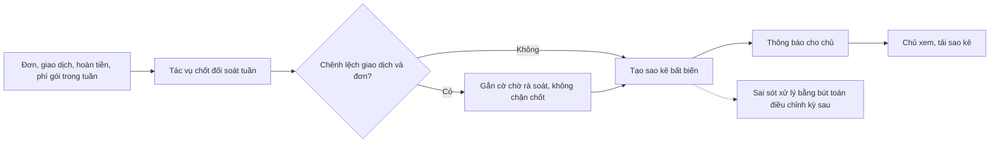

## 5.17. Thông báo và nhật ký

*Vai trò: Chủ cửa hàng (web) · 2 UC: R2-074 đến R2-075*

### 5.17.1. Mục tiêu nghiệp vụ

Đưa các sự kiện cần hành động đến chủ đúng lúc và lưu vết các thao tác nhạy cảm của cửa hàng phục vụ kiểm soát nội bộ.

### 5.17.2. Phạm vi

**Thuộc phân hệ:** Thông báo; Nhật ký.

**Danh sách UC:** R2-074 Xem và đánh dấu đã đọc thông báo; R2-075 Xem nhật ký hoạt động cửa hàng.

**Nằm ngoài phạm vi:** Nhật ký của nền tảng; thông báo qua email ngoài các UC đã nêu.

### 5.17.3. Tác nhân và quyền hạn

Chủ và Quản lý (web); Nhân viên quầy chỉ xem thông báo của mình.

### 5.17.4. Dữ liệu nghiệp vụ

| Thực thể | Ý nghĩa, nguồn hình thành và ảnh hưởng đến quyết định nghiệp vụ |
|---|---|
| Thông báo web | Loại (đơn mới, đơn hủy, khiếu nại, đề xuất giá, nhắc nhập số cuối ngày), nội dung, thời gian, trạng thái đọc, giữ 90 ngày. |
| Nhật ký hoạt động | Thời gian, hành động, đối tượng, giá trị cũ và mới, IP; chỉ đọc, không xóa, giữ 12 tháng. |

### 5.17.5. Quy trình nghiệp vụ tổng thể

1. Sự kiện nghiệp vụ tạo thông báo cho người dùng cửa hàng; người dùng đánh dấu đã đọc.
2. Chủ xem nhật ký để truy vết đổi giá, hủy suất, điều chỉnh tồn, xuất dữ liệu, đổi hồ sơ.

**Phân hệ phụ thuộc và liên kết:** Nhận sự kiện từ hầu hết phân hệ; cung cấp truy vết cho Cấu hình và Nhân viên.

### 5.17.6. Đặc tả từng UC

##### R2-074 - Xem và đánh dấu đã đọc thông báo

**Mã UC:** R2-074  
**Tên UC:** Xem và đánh dấu đã đọc thông báo  
**Nhóm:** Thông báo và nhật ký / Thông báo · **Loại:** Truy vấn kèm thao tác  
**Mục tiêu:** Thông báo trên web: đơn mới, đơn hủy, khiếu nại, đề xuất giá, nhắc nhập số cuối ngày. *[Xác định trong Excel]*  
**Tác nhân:** Chủ cửa hàng (web)  

**Điều kiện tiên quyết** *[Tổng hợp từ ma trận gói và vai trò]*
- Người dùng đã đăng nhập trên web bằng tài khoản Chủ hoặc nhân viên của cửa hàng; cửa hàng ở trạng thái Hoạt động (trừ các UC quản lý trạng thái cửa hàng, gói và hồ sơ).
- Nhóm quyền được phép: Chủ, Quản lý và Nhân viên quầy. *[Tổng hợp từ UC phân quyền nhân viên]*
- Gói dịch vụ: Mọi gói (GOI-CB, GOI-PRO, GOI-DT); không có hạn mức riêng.

**Dữ liệu hiển thị (UC không có trường nhập)** *[Xác định trong Excel]*
- Hiển thị: loại, nội dung, thời gian, trạng thái đọc

**Luồng xử lý chính** *[Tổng hợp từ mô tả, quy tắc và kết quả]*
1. Người dùng mở "Xem và đánh dấu đã đọc thông báo" trên web quản trị.
2. Hệ thống xác thực phiên và giới hạn dữ liệu theo chủ sở hữu.
3. Hiển thị thông tin: loại, nội dung, thời gian, trạng thái đọc.
4. Người dùng chọn thao tác bổ sung trên đối tượng đang xem.
5. Xử lý theo mô tả nghiệp vụ: Thông báo trên web: đơn mới, đơn hủy, khiếu nại, đề xuất giá, nhắc nhập số cuối ngày.
6. Hệ thống kiểm tra Business Rules và Validation, ghi nhận thay đổi và làm mới màn hình: Danh sách thông báo; số chưa đọc cập nhật.

**Business Rules** *[Xác định trong Excel]*
1. Giữ 90 ngày; chỉ của mình.

**Validation** *[Xác định trong Excel]*
1. Không có.

**Luồng thay thế và ngoại lệ**
- Người dùng không có quyền hoặc đối tượng không thuộc phạm vi dữ liệu của mình: từ chối, không tiết lộ sự tồn tại của dữ liệu thuộc người khác (đề xuất hoàn thiện).
- Mất kết nối hoặc lỗi hệ thống giữa chừng: thao tác không được ghi nhận một phần; người dùng được thông báo và thử lại, thao tác thay đổi dữ liệu dùng khóa chống trùng khi áp dụng (đề xuất hoàn thiện).

**Dữ liệu thay đổi** *[Tổng hợp]*  
Theo kết quả đã xác định: Danh sách thông báo; số chưa đọc cập nhật.

**Chuyển trạng thái** *[Tổng hợp]*
- Excel không nêu chuyển trạng thái riêng cho UC này; đối tượng giữ trạng thái hiện tại trừ phần được nêu ở mục Kết quả.

**Kết quả** *[Xác định trong Excel]*  
Danh sách thông báo; số chưa đọc cập nhật.

**Tác động liên phân hệ** *[Tổng hợp]*  
Dữ liệu hoặc quy tắc của UC liên quan đến: Đơn hàng; Khiếu nại; Định giá động.

**Điều kiện hoàn thành** *[Tổng hợp]*  
Thành công khi: Danh sách thông báo; số chưa đọc cập nhật. Không hoàn tất khi bất kỳ điều kiện Validation nào không đạt hoặc dịch vụ liên quan lỗi; dữ liệu giữ nguyên trạng thái trước thao tác.

**Tiêu chí nghiệm thu** *[Tổng hợp, kiểm tra được]*
1. Given người dùng cửa hàng đủ điều kiện tiên quyết và dữ liệu hợp lệ, When thực hiện "Xem và đánh dấu đã đọc thông báo", Then kết quả đạt được là: danh sách thông báo; số chưa đọc cập nhật.
2. Given thao tác "Xem và đánh dấu đã đọc thông báo" được thực hiện, When hệ thống áp dụng quy tắc "Giữ 90 ngày; chỉ của mình", Then kết quả không được vi phạm quy tắc này.

##### R2-075 - Xem nhật ký hoạt động cửa hàng

**Mã UC:** R2-075  
**Tên UC:** Xem nhật ký hoạt động cửa hàng  
**Nhóm:** Thông báo và nhật ký / Nhật ký · **Loại:** Truy vấn và hiển thị  
**Mục tiêu:** Xem các thao tác quan trọng: đổi giá, hủy suất, điều chỉnh tồn, xuất dữ liệu, đổi hồ sơ. *[Xác định trong Excel]*  
**Tác nhân:** Chủ cửa hàng (web)  

**Điều kiện tiên quyết** *[Tổng hợp từ ma trận gói và vai trò]*
- Người dùng đã đăng nhập trên web bằng tài khoản Chủ hoặc nhân viên của cửa hàng; cửa hàng ở trạng thái Hoạt động (trừ các UC quản lý trạng thái cửa hàng, gói và hồ sơ).
- Nhóm quyền được phép: Chủ và Quản lý; Nhân viên quầy không có quyền (không thuộc bốn thao tác của nhóm này). *[Tổng hợp từ UC phân quyền nhân viên]*
- Gói dịch vụ: Mọi gói (GOI-CB, GOI-PRO, GOI-DT); không có hạn mức riêng.

**Dữ liệu hiển thị (UC không có trường nhập)** *[Xác định trong Excel]*
- Hiển thị: thời gian, hành động, đối tượng, giá trị cũ/mới, địa chỉ IP

**Luồng xử lý chính** *[Tổng hợp từ mô tả, quy tắc và kết quả]*
1. Người dùng mở màn hình "Xem nhật ký hoạt động cửa hàng" trên web quản trị.
2. Hệ thống xác thực phiên, xác định phạm vi dữ liệu của người dùng và áp các quy tắc hiển thị của UC.
3. Truy vấn dữ liệu: Xem các thao tác quan trọng: đổi giá, hủy suất, điều chỉnh tồn, xuất dữ liệu, đổi hồ sơ.
4. Hiển thị các thuộc tính: thời gian, hành động, đối tượng, giá trị cũ/mới, địa chỉ IP.
5. Trường hợp không có dữ liệu hoặc không hợp lệ được xử lý theo mục Validation; không thay đổi dữ liệu nghiệp vụ.

**Business Rules** *[Xác định trong Excel]*
1. Chỉ đọc; không xóa; giữ 12 tháng.

**Validation** *[Xác định trong Excel]*
1. Không có.

**Luồng thay thế và ngoại lệ**
- Người dùng không có quyền hoặc đối tượng không thuộc phạm vi dữ liệu của mình: từ chối, không tiết lộ sự tồn tại của dữ liệu thuộc người khác (đề xuất hoàn thiện).
- Mất kết nối hoặc lỗi hệ thống giữa chừng: thao tác không được ghi nhận một phần; người dùng được thông báo và thử lại, thao tác thay đổi dữ liệu dùng khóa chống trùng khi áp dụng (đề xuất hoàn thiện).

**Dữ liệu thay đổi** *[Tổng hợp]*  
Không tạo hoặc thay đổi dữ liệu nghiệp vụ; chỉ đọc theo phạm vi của người dùng.

**Chuyển trạng thái** *[Tổng hợp]*
- Không chuyển trạng thái của đối tượng nghiệp vụ.

**Kết quả** *[Xác định trong Excel]*  
Bảng nhật ký.

**Tác động liên phân hệ** *[Tổng hợp]*  
Dữ liệu hoặc quy tắc của UC liên quan đến: Suất và tồn kho trong ngày; Nhật ký hoạt động.

**Điều kiện hoàn thành** *[Tổng hợp]*  
Thành công khi: Bảng nhật ký. Không hoàn tất khi bất kỳ điều kiện Validation nào không đạt hoặc dịch vụ liên quan lỗi; dữ liệu giữ nguyên trạng thái trước thao tác.

**Tiêu chí nghiệm thu** *[Tổng hợp, kiểm tra được]*
1. Given người dùng cửa hàng đủ điều kiện tiên quyết và dữ liệu hợp lệ, When thực hiện "Xem nhật ký hoạt động cửa hàng", Then kết quả đạt được là: bảng nhật ký.
2. Given thao tác "Xem nhật ký hoạt động cửa hàng" được thực hiện, When hệ thống áp dụng quy tắc "Chỉ đọc; không xóa; giữ 12 tháng", Then kết quả không được vi phạm quy tắc này.

### 5.17.7. Các quy tắc nghiệp vụ dùng chung

| Mã BR | Quy tắc | UC chịu ảnh hưởng |
|---|---|---|
| BR-080 | Thông báo chỉ của chính người nhận và giữ 90 ngày; nhật ký hoạt động chỉ đọc, không xóa, giữ 12 tháng. | R2-074, R2-075 |

### 5.17.8. Sơ đồ quy trình

Phân hệ không có quy trình nhiều nhánh cần sơ đồ; luồng đã được mô tả ở 5.17.5 và trong từng UC.

## 5.18. Nhân viên và phân quyền

*Vai trò: Chủ cửa hàng (web) · 6 UC: R2-076 đến R2-081*

### 5.18.1. Mục tiêu nghiệp vụ

Cho chủ ủy quyền vận hành cho người khác mà không chia sẻ mật khẩu, theo ba nhóm quyền rõ ràng, và giám sát hoạt động của từng người. Phân hệ cụ thể hóa phạm vi của hai vai trò Quản lý và Nhân viên quầy bên trong vai Chủ cửa hàng.

### 5.18.2. Phạm vi

**Thuộc phân hệ:** Quản lý nhân viên; Giám sát.

**Danh sách UC:** R2-076 Mời nhân viên vào cửa hàng; R2-077 Xem danh sách và chi tiết nhân viên; R2-078 Đổi nhóm quyền của nhân viên; R2-079 Tạm khóa và mở khóa nhân viên; R2-080 Gỡ nhân viên khỏi cửa hàng; R2-081 Xem hoạt động của từng nhân viên.

**Nằm ngoài phạm vi:** Tạo thêm nhóm quyền tùy chỉnh; chấm công và tính lương.

### 5.18.3. Tác nhân và quyền hạn

Chỉ Chủ cửa hàng thao tác; nhân viên chịu tác động.

### 5.18.4. Dữ liệu nghiệp vụ

| Thực thể | Ý nghĩa, nguồn hình thành và ảnh hưởng đến quyết định nghiệp vụ |
|---|---|
| Nhân viên | Email (một email thuộc một cửa hàng tại một thời điểm), họ tên, nhóm quyền (Quản lý, Nhân viên quầy), trạng thái (Đã mời, Hoạt động, Tạm khóa, Đã gỡ), liên kết mời dùng một lần hết hạn 72 giờ. |
| Hoạt động nhân viên | Nhật ký theo người dùng, chỉ đọc, giữ 12 tháng. |

### 5.18.5. Quy trình nghiệp vụ tổng thể

1. Chủ mời nhân viên bằng email (giới hạn 1 ở Cơ bản, 5 ở Pro), nhân viên đặt mật khẩu qua liên kết.
2. Chủ đổi nhóm quyền, tạm khóa hoặc gỡ nhân viên; xem hoạt động của từng người.
3. Nhóm Quản lý có toàn quyền vận hành trừ gói, thanh toán, nhân viên, cấu hình quy tắc kinh doanh và xuất dữ liệu toàn bộ; Nhân viên quầy chỉ quét QR, xem đơn trong ngày, nhập số thực tế và xem lịch hẹn nhận.

**Phân hệ phụ thuộc và liên kết:** Quyền của nhóm được tất cả phân hệ web áp dụng; hạn mức số nhân viên lấy từ Gói dịch vụ.

### 5.18.6. Đặc tả từng UC

##### R2-076 - Mời nhân viên vào cửa hàng

**Mã UC:** R2-076  
**Tên UC:** Mời nhân viên vào cửa hàng  
**Nhóm:** Nhân viên và phân quyền / Quản lý nhân viên · **Loại:** Tạo mới  
**Mục tiêu:** Chủ mời nhân viên bằng email; nhân viên đặt mật khẩu qua liên kết và có tài khoản thuộc cửa hàng với quyền được phân. Nhân viên là người dùng thuộc nhóm vai Chủ cửa hàng ở phạm vi giới hạn. *[Xác định trong Excel]*  
**Tác nhân:** Chủ cửa hàng (web)  

**Điều kiện tiên quyết** *[Tổng hợp từ ma trận gói và vai trò]*
- Người dùng đã đăng nhập trên web bằng tài khoản Chủ hoặc nhân viên của cửa hàng; cửa hàng ở trạng thái Hoạt động (trừ các UC quản lý trạng thái cửa hàng, gói và hồ sơ).
- Nhóm quyền được phép: chỉ Chủ cửa hàng (nhóm Quản lý và Nhân viên quầy không có quyền). *[Tổng hợp từ UC phân quyền nhân viên]*
- Gói dịch vụ: Mọi gói. Hạn mức: GOI-CB 1 nhân viên đang hoạt động; GOI-PRO 5 nhân viên đang hoạt động (chu kỳ đặt lại: không đặt lại theo chu kỳ, giới hạn theo số lượng đang tồn tại); GOI-DT như Pro. Khi hết hạn mức: Từ chối thao tác, hiện số lượt còn lại và thời điểm đặt lại; gợi ý nâng cấp.

**Dữ liệu đầu vào và hiển thị** *[Xác định trong Excel]*
- Email nhân viên (duy nhất)
- Họ tên (2-60)
- Nhóm quyền (Quản lý/Nhân viên quầy)
- Liên kết mời (hệ thống, hết hạn 72 giờ)

**Luồng xử lý chính** *[Tổng hợp từ mô tả, quy tắc và kết quả]*
1. Người dùng chọn chức năng "Mời nhân viên vào cửa hàng" trên web quản trị.
2. Người dùng nhập hoặc chọn: Email nhân viên, Họ tên, Nhóm quyền, Liên kết mời.
3. Hệ thống xác thực phiên, kiểm tra quyền, phạm vi dữ liệu, gói dịch vụ và hạn mức (nếu có).
4. Hệ thống kiểm tra từng điều kiện ở mục Validation; sai thì trả lỗi tại trường tương ứng và không tạo dữ liệu.
5. Xử lý nghiệp vụ: Chủ mời nhân viên bằng email; nhân viên đặt mật khẩu qua liên kết và có tài khoản thuộc cửa hàng với quyền được phân. Nhân viên là người dùng thuộc nhóm vai Chủ cửa hàng ở phạm vi giới hạn.
6. Hệ thống lưu dữ liệu, cập nhật các đối tượng liên quan và phản hồi: Lời mời gửi đi; nhân viên kích hoạt sau khi đặt mật khẩu.

**Business Rules** *[Xác định trong Excel]*
1. Chỉ tài khoản Chủ mời nhân viên.
2. Một email thuộc một cửa hàng tại một thời điểm.
3. Số nhân viên tối đa theo gói.
4. Liên kết mời dùng một lần.

**Validation** *[Xác định trong Excel]*
1. Email đã thuộc cửa hàng khác hoặc đã mời: từ chối; vượt số lượng gói: từ chối và gợi ý nâng cấp.

**Luồng thay thế và ngoại lệ**
- Mọi trường hợp không hợp lệ nêu ở mục Validation là luồng ngoại lệ của UC này và được xử lý đúng như mô tả tại đó. *[Xác định]*
- Người dùng không có quyền hoặc đối tượng không thuộc phạm vi dữ liệu của mình: từ chối, không tiết lộ sự tồn tại của dữ liệu thuộc người khác (đề xuất hoàn thiện).
- Mất kết nối hoặc lỗi hệ thống giữa chừng: thao tác không được ghi nhận một phần; người dùng được thông báo và thử lại, thao tác thay đổi dữ liệu dùng khóa chống trùng khi áp dụng (đề xuất hoàn thiện).
- Vượt hạn mức: Từ chối thao tác, hiện số lượt còn lại và thời điểm đặt lại; gợi ý nâng cấp. (theo ma trận gói).

**Dữ liệu thay đổi** *[Tổng hợp]*  
Theo kết quả đã xác định: Lời mời gửi đi; nhân viên kích hoạt sau khi đặt mật khẩu.

**Chuyển trạng thái** *[Tổng hợp]*
- Excel không nêu chuyển trạng thái riêng cho UC này; đối tượng giữ trạng thái hiện tại trừ phần được nêu ở mục Kết quả.

**Kết quả** *[Xác định trong Excel]*  
Lời mời gửi đi; nhân viên kích hoạt sau khi đặt mật khẩu.

**Tác động liên phân hệ** *[Tổng hợp]*  
Dữ liệu hoặc quy tắc của UC liên quan đến: Gói dịch vụ và hạn mức.

**Điều kiện hoàn thành** *[Tổng hợp]*  
Thành công khi: Lời mời gửi đi; nhân viên kích hoạt sau khi đặt mật khẩu. Không hoàn tất khi bất kỳ điều kiện Validation nào không đạt hoặc dịch vụ liên quan lỗi; dữ liệu giữ nguyên trạng thái trước thao tác.

**Tiêu chí nghiệm thu** *[Tổng hợp, kiểm tra được]*
1. Given người dùng cửa hàng đủ điều kiện tiên quyết và dữ liệu hợp lệ, When thực hiện "Mời nhân viên vào cửa hàng", Then kết quả đạt được là: lời mời gửi đi; nhân viên kích hoạt sau khi đặt mật khẩu.
2. Given email đã thuộc cửa hàng khác hoặc đã mời, When thực hiện "Mời nhân viên vào cửa hàng", Then từ chối; vượt số lượng gói: từ chối và gợi ý nâng cấp.
3. Given thao tác "Mời nhân viên vào cửa hàng" được thực hiện, When hệ thống áp dụng quy tắc "Chỉ tài khoản Chủ mời nhân viên", Then kết quả không được vi phạm quy tắc này.
4. Given đã dùng hết hạn mức 1 nhân viên đang hoạt động, When thực hiện "Mời nhân viên vào cửa hàng" thêm một lần, Then hệ thống từ chối theo quy tắc "Từ chối thao tác, hiện số lượt còn lại và thời điểm đặt lại; gợi ý nâng cấp." và không thay đổi dữ liệu.

##### R2-077 - Xem danh sách và chi tiết nhân viên

**Mã UC:** R2-077  
**Tên UC:** Xem danh sách và chi tiết nhân viên  
**Nhóm:** Nhân viên và phân quyền / Quản lý nhân viên · **Loại:** Truy vấn và hiển thị  
**Mục tiêu:** Chủ xem nhân viên, nhóm quyền, trạng thái, lần hoạt động cuối. *[Xác định trong Excel]*  
**Tác nhân:** Chủ cửa hàng (web)  

**Điều kiện tiên quyết** *[Tổng hợp từ ma trận gói và vai trò]*
- Người dùng đã đăng nhập trên web bằng tài khoản Chủ hoặc nhân viên của cửa hàng; cửa hàng ở trạng thái Hoạt động (trừ các UC quản lý trạng thái cửa hàng, gói và hồ sơ).
- Nhóm quyền được phép: chỉ Chủ cửa hàng (nhóm Quản lý và Nhân viên quầy không có quyền). *[Tổng hợp từ UC phân quyền nhân viên]*
- Gói dịch vụ: Mọi gói (GOI-CB, GOI-PRO, GOI-DT); không có hạn mức riêng.

**Dữ liệu hiển thị (UC không có trường nhập)** *[Xác định trong Excel]*
- Hiển thị: tên, email, nhóm quyền, trạng thái (Chờ kích hoạt/Hoạt động/Tạm khóa/Đã gỡ), hoạt động cuối

**Luồng xử lý chính** *[Tổng hợp từ mô tả, quy tắc và kết quả]*
1. Người dùng mở màn hình "Xem danh sách và chi tiết nhân viên" trên web quản trị.
2. Hệ thống xác thực phiên, xác định phạm vi dữ liệu của người dùng và áp các quy tắc hiển thị của UC.
3. Truy vấn dữ liệu: Chủ xem nhân viên, nhóm quyền, trạng thái, lần hoạt động cuối.
4. Hiển thị các thuộc tính: tên, email, nhóm quyền, trạng thái (Chờ kích hoạt/Hoạt động/Tạm khóa/Đã gỡ), hoạt động cuối.
5. Trường hợp không có dữ liệu hoặc không hợp lệ được xử lý theo mục Validation; không thay đổi dữ liệu nghiệp vụ.

**Business Rules** *[Xác định trong Excel]*
1. Chỉ Chủ xem toàn bộ; Quản lý xem danh sách không xem được thông tin gói và thanh toán.

**Validation** *[Xác định trong Excel]*
1. Không có.

**Luồng thay thế và ngoại lệ**
- Người dùng không có quyền hoặc đối tượng không thuộc phạm vi dữ liệu của mình: từ chối, không tiết lộ sự tồn tại của dữ liệu thuộc người khác (đề xuất hoàn thiện).
- Mất kết nối hoặc lỗi hệ thống giữa chừng: thao tác không được ghi nhận một phần; người dùng được thông báo và thử lại, thao tác thay đổi dữ liệu dùng khóa chống trùng khi áp dụng (đề xuất hoàn thiện).

**Dữ liệu thay đổi** *[Tổng hợp]*  
Không tạo hoặc thay đổi dữ liệu nghiệp vụ; chỉ đọc theo phạm vi của người dùng.

**Chuyển trạng thái** *[Tổng hợp]*
- Không chuyển trạng thái của đối tượng nghiệp vụ.

**Kết quả** *[Xác định trong Excel]*  
Danh sách nhân viên.

**Tác động liên phân hệ** *[Tổng hợp]*  
Dữ liệu hoặc quy tắc của UC liên quan đến: Thanh toán và hoàn tiền; Gói dịch vụ và hạn mức.

**Điều kiện hoàn thành** *[Tổng hợp]*  
Thành công khi: Danh sách nhân viên. Không hoàn tất khi bất kỳ điều kiện Validation nào không đạt hoặc dịch vụ liên quan lỗi; dữ liệu giữ nguyên trạng thái trước thao tác.

**Tiêu chí nghiệm thu** *[Tổng hợp, kiểm tra được]*
1. Given người dùng cửa hàng đủ điều kiện tiên quyết và dữ liệu hợp lệ, When thực hiện "Xem danh sách và chi tiết nhân viên", Then kết quả đạt được là: danh sách nhân viên.
2. Given thao tác "Xem danh sách và chi tiết nhân viên" được thực hiện, When hệ thống áp dụng quy tắc "Chỉ Chủ xem toàn bộ; Quản lý xem danh sách không xem được thông tin gói và thanh toán", Then kết quả không được vi phạm quy tắc này.

##### R2-078 - Đổi nhóm quyền của nhân viên

**Mã UC:** R2-078  
**Tên UC:** Đổi nhóm quyền của nhân viên  
**Nhóm:** Nhân viên và phân quyền / Quản lý nhân viên · **Loại:** Cập nhật  
**Mục tiêu:** Chủ đổi nhóm quyền. Quản lý: toàn quyền vận hành trừ gói, thanh toán, nhân viên, cấu hình quy tắc kinh doanh và xuất dữ liệu toàn bộ. Nhân viên quầy: quét QR, xem đơn trong ngày, nhập số thực tế, xem lịch hẹn nhận. *[Xác định trong Excel]*  
**Tác nhân:** Chủ cửa hàng (web)  

**Điều kiện tiên quyết** *[Tổng hợp từ ma trận gói và vai trò]*
- Người dùng đã đăng nhập trên web bằng tài khoản Chủ hoặc nhân viên của cửa hàng; cửa hàng ở trạng thái Hoạt động (trừ các UC quản lý trạng thái cửa hàng, gói và hồ sơ).
- Nhóm quyền được phép: chỉ Chủ cửa hàng (nhóm Quản lý và Nhân viên quầy không có quyền). *[Tổng hợp từ UC phân quyền nhân viên]*
- Gói dịch vụ: Mọi gói (GOI-CB, GOI-PRO, GOI-DT); không có hạn mức riêng.

**Dữ liệu đầu vào và hiển thị** *[Xác định trong Excel]*
- Nhóm quyền mới
- Lý do (tùy chọn)

**Luồng xử lý chính** *[Tổng hợp từ mô tả, quy tắc và kết quả]*
1. Người dùng mở "Đổi nhóm quyền của nhân viên" trên web quản trị; hệ thống nạp giá trị hiện tại.
2. Người dùng thay đổi: Nhóm quyền mới, Lý do.
3. Hệ thống kiểm tra quyền, trạng thái hiện tại của đối tượng và điều kiện ở mục Validation.
4. Xử lý nghiệp vụ: Chủ đổi nhóm quyền. Quản lý: toàn quyền vận hành trừ gói, thanh toán, nhân viên, cấu hình quy tắc kinh doanh và xuất dữ liệu toàn bộ. Nhân viên quầy: quét QR, xem đơn trong ngày, nhập số thực tế, xem lịch hẹn nhận.
5. Hệ thống lưu giá trị mới, ghi lịch sử hoặc nhật ký nếu quy tắc yêu cầu và phản hồi: Quyền hiệu lực ngay ở lần gọi API kế tiếp.

**Business Rules** *[Xác định trong Excel]*
1. Không tự nâng quyền hay đổi quyền của chính mình.
2. Quyền được kiểm tra ở tầng API cho từng thao tác.
3. Ghi nhật ký kiểm toán.

**Validation** *[Xác định trong Excel]*
1. Cửa hàng phải còn ít nhất một Chủ; đổi quyền Chủ không thực hiện ở chức năng này.

**Luồng thay thế và ngoại lệ**
- Mọi trường hợp không hợp lệ nêu ở mục Validation là luồng ngoại lệ của UC này và được xử lý đúng như mô tả tại đó. *[Xác định]*
- Người dùng không có quyền hoặc đối tượng không thuộc phạm vi dữ liệu của mình: từ chối, không tiết lộ sự tồn tại của dữ liệu thuộc người khác (đề xuất hoàn thiện).
- Mất kết nối hoặc lỗi hệ thống giữa chừng: thao tác không được ghi nhận một phần; người dùng được thông báo và thử lại, thao tác thay đổi dữ liệu dùng khóa chống trùng khi áp dụng (đề xuất hoàn thiện).

**Dữ liệu thay đổi** *[Tổng hợp]*  
Theo kết quả đã xác định: Quyền hiệu lực ngay ở lần gọi API kế tiếp.

**Chuyển trạng thái** *[Tổng hợp]*
- Excel không nêu chuyển trạng thái riêng cho UC này; đối tượng giữ trạng thái hiện tại trừ phần được nêu ở mục Kết quả.

**Kết quả** *[Xác định trong Excel]*  
Quyền hiệu lực ngay ở lần gọi API kế tiếp.

**Tác động liên phân hệ** *[Tổng hợp]*  
Dữ liệu hoặc quy tắc của UC liên quan đến: Đơn hàng; Thanh toán và hoàn tiền; Nhật ký hoạt động; Gói dịch vụ và hạn mức; Nhận hàng bằng QR.

**Điều kiện hoàn thành** *[Tổng hợp]*  
Thành công khi: Quyền hiệu lực ngay ở lần gọi API kế tiếp. Không hoàn tất khi bất kỳ điều kiện Validation nào không đạt hoặc dịch vụ liên quan lỗi; dữ liệu giữ nguyên trạng thái trước thao tác.

**Tiêu chí nghiệm thu** *[Tổng hợp, kiểm tra được]*
1. Given người dùng cửa hàng đủ điều kiện tiên quyết và dữ liệu hợp lệ, When thực hiện "Đổi nhóm quyền của nhân viên", Then kết quả đạt được là: quyền hiệu lực ngay ở lần gọi API kế tiếp.
2. Given thao tác "Đổi nhóm quyền của nhân viên" được thực hiện, When hệ thống áp dụng quy tắc "Không tự nâng quyền hay đổi quyền của chính mình", Then kết quả không được vi phạm quy tắc này.

##### R2-079 - Tạm khóa và mở khóa nhân viên

**Mã UC:** R2-079  
**Tên UC:** Tạm khóa và mở khóa nhân viên  
**Nhóm:** Nhân viên và phân quyền / Quản lý nhân viên · **Loại:** Chuyển trạng thái  
**Mục tiêu:** Chủ tạm khóa nhân viên khi nghi ngờ hoặc nghỉ việc tạm thời, và mở khóa lại. *[Xác định trong Excel]*  
**Tác nhân:** Chủ cửa hàng (web)  

**Điều kiện tiên quyết** *[Tổng hợp từ ma trận gói và vai trò]*
- Người dùng đã đăng nhập trên web bằng tài khoản Chủ hoặc nhân viên của cửa hàng; cửa hàng ở trạng thái Hoạt động (trừ các UC quản lý trạng thái cửa hàng, gói và hồ sơ).
- Nhóm quyền được phép: chỉ Chủ cửa hàng (nhóm Quản lý và Nhân viên quầy không có quyền). *[Tổng hợp từ UC phân quyền nhân viên]*
- Gói dịch vụ: Mọi gói (GOI-CB, GOI-PRO, GOI-DT); không có hạn mức riêng.

**Dữ liệu đầu vào và hiển thị** *[Xác định trong Excel]*
- Mã nhân viên
- Lý do (chọn)

**Luồng xử lý chính** *[Tổng hợp từ mô tả, quy tắc và kết quả]*
1. Người dùng chọn đối tượng cần xử lý và thao tác "Tạm khóa và mở khóa nhân viên" trên web quản trị.
2. Người dùng cung cấp thêm: Mã nhân viên, Lý do.
3. Hệ thống kiểm tra trạng thái hiện tại có cho phép chuyển trạng thái này không, cùng quyền của người thực hiện.
4. Xử lý nghiệp vụ: Chủ tạm khóa nhân viên khi nghi ngờ hoặc nghỉ việc tạm thời, và mở khóa lại.
5. Trạng thái, tồn kho, tiền hoặc thông báo liên quan được cập nhật trong cùng giao dịch; kết quả: Trạng thái nhân viên đổi; ghi nhật ký.

**Business Rules** *[Xác định trong Excel]*
1. Khóa thu hồi toàn bộ phiên đăng nhập.
2. Dữ liệu và lịch sử thao tác của nhân viên giữ nguyên.

**Validation** *[Xác định trong Excel]*
1. Tự khóa chính mình: từ chối.

**Luồng thay thế và ngoại lệ**
- Mọi trường hợp không hợp lệ nêu ở mục Validation là luồng ngoại lệ của UC này và được xử lý đúng như mô tả tại đó. *[Xác định]*
- Người dùng không có quyền hoặc đối tượng không thuộc phạm vi dữ liệu của mình: từ chối, không tiết lộ sự tồn tại của dữ liệu thuộc người khác (đề xuất hoàn thiện).
- Mất kết nối hoặc lỗi hệ thống giữa chừng: thao tác không được ghi nhận một phần; người dùng được thông báo và thử lại, thao tác thay đổi dữ liệu dùng khóa chống trùng khi áp dụng (đề xuất hoàn thiện).

**Dữ liệu thay đổi** *[Tổng hợp]*  
Theo kết quả đã xác định: Trạng thái nhân viên đổi; ghi nhật ký.

**Chuyển trạng thái** *[Tổng hợp]*
- Excel không nêu chuyển trạng thái riêng cho UC này; đối tượng giữ trạng thái hiện tại trừ phần được nêu ở mục Kết quả.

**Kết quả** *[Xác định trong Excel]*  
Trạng thái nhân viên đổi; ghi nhật ký.

**Tác động liên phân hệ** *[Tổng hợp]*  
Dữ liệu hoặc quy tắc của UC liên quan đến: Nhật ký hoạt động.

**Điều kiện hoàn thành** *[Tổng hợp]*  
Thành công khi: Trạng thái nhân viên đổi; ghi nhật ký. Không hoàn tất khi bất kỳ điều kiện Validation nào không đạt hoặc dịch vụ liên quan lỗi; dữ liệu giữ nguyên trạng thái trước thao tác.

**Tiêu chí nghiệm thu** *[Tổng hợp, kiểm tra được]*
1. Given người dùng cửa hàng đủ điều kiện tiên quyết và dữ liệu hợp lệ, When thực hiện "Tạm khóa và mở khóa nhân viên", Then kết quả đạt được là: trạng thái nhân viên đổi; ghi nhật ký.
2. Given tự khóa chính mình, When thực hiện "Tạm khóa và mở khóa nhân viên", Then từ chối.
3. Given thao tác "Tạm khóa và mở khóa nhân viên" được thực hiện, When hệ thống áp dụng quy tắc "Khóa thu hồi toàn bộ phiên đăng nhập", Then kết quả không được vi phạm quy tắc này.

##### R2-080 - Gỡ nhân viên khỏi cửa hàng

**Mã UC:** R2-080  
**Tên UC:** Gỡ nhân viên khỏi cửa hàng  
**Nhóm:** Nhân viên và phân quyền / Quản lý nhân viên · **Loại:** Chuyển trạng thái  
**Mục tiêu:** Chủ gỡ nhân viên; tài khoản bị vô hiệu hóa mềm, lịch sử thao tác giữ lại dưới tên đã gỡ. *[Xác định trong Excel]*  
**Tác nhân:** Chủ cửa hàng (web)  

**Điều kiện tiên quyết** *[Tổng hợp từ ma trận gói và vai trò]*
- Người dùng đã đăng nhập trên web bằng tài khoản Chủ hoặc nhân viên của cửa hàng; cửa hàng ở trạng thái Hoạt động (trừ các UC quản lý trạng thái cửa hàng, gói và hồ sơ).
- Nhóm quyền được phép: chỉ Chủ cửa hàng (nhóm Quản lý và Nhân viên quầy không có quyền). *[Tổng hợp từ UC phân quyền nhân viên]*
- Gói dịch vụ: Mọi gói (GOI-CB, GOI-PRO, GOI-DT); không có hạn mức riêng.

**Dữ liệu đầu vào và hiển thị** *[Xác định trong Excel]*
- Mã nhân viên
- Xác nhận (mật khẩu chủ)

**Luồng xử lý chính** *[Tổng hợp từ mô tả, quy tắc và kết quả]*
1. Người dùng chọn đối tượng cần xử lý và thao tác "Gỡ nhân viên khỏi cửa hàng" trên web quản trị.
2. Người dùng cung cấp thêm: Mã nhân viên, Xác nhận.
3. Hệ thống kiểm tra trạng thái hiện tại có cho phép chuyển trạng thái này không, cùng quyền của người thực hiện.
4. Xử lý nghiệp vụ: Chủ gỡ nhân viên; tài khoản bị vô hiệu hóa mềm, lịch sử thao tác giữ lại dưới tên đã gỡ.
5. Trạng thái, tồn kho, tiền hoặc thông báo liên quan được cập nhật trong cùng giao dịch; kết quả: Nhân viên không đăng nhập được.

**Business Rules** *[Xác định trong Excel]*
1. Không xóa vật lý vì nhật ký kiểm toán tham chiếu nhân viên.
2. Phiên bị thu hồi ngay.

**Validation** *[Xác định trong Excel]*
1. Nhân viên đang xử lý khiếu nại hoặc đơn dở: yêu cầu chuyển người phụ trách hoặc chấp nhận để trống.

**Luồng thay thế và ngoại lệ**
- Mọi trường hợp không hợp lệ nêu ở mục Validation là luồng ngoại lệ của UC này và được xử lý đúng như mô tả tại đó. *[Xác định]*
- Người dùng không có quyền hoặc đối tượng không thuộc phạm vi dữ liệu của mình: từ chối, không tiết lộ sự tồn tại của dữ liệu thuộc người khác (đề xuất hoàn thiện).
- Mất kết nối hoặc lỗi hệ thống giữa chừng: thao tác không được ghi nhận một phần; người dùng được thông báo và thử lại, thao tác thay đổi dữ liệu dùng khóa chống trùng khi áp dụng (đề xuất hoàn thiện).

**Dữ liệu thay đổi** *[Tổng hợp]*  
Theo kết quả đã xác định: Nhân viên không đăng nhập được.

**Chuyển trạng thái** *[Tổng hợp]*
- Excel không nêu chuyển trạng thái riêng cho UC này; đối tượng giữ trạng thái hiện tại trừ phần được nêu ở mục Kết quả.

**Kết quả** *[Xác định trong Excel]*  
Nhân viên không đăng nhập được.

**Tác động liên phân hệ** *[Tổng hợp]*  
Dữ liệu hoặc quy tắc của UC liên quan đến: Nhật ký hoạt động.

**Điều kiện hoàn thành** *[Tổng hợp]*  
Thành công khi: Nhân viên không đăng nhập được. Không hoàn tất khi bất kỳ điều kiện Validation nào không đạt hoặc dịch vụ liên quan lỗi; dữ liệu giữ nguyên trạng thái trước thao tác.

**Tiêu chí nghiệm thu** *[Tổng hợp, kiểm tra được]*
1. Given người dùng cửa hàng đủ điều kiện tiên quyết và dữ liệu hợp lệ, When thực hiện "Gỡ nhân viên khỏi cửa hàng", Then kết quả đạt được là: nhân viên không đăng nhập được.
2. Given nhân viên đang xử lý khiếu nại hoặc đơn dở, When thực hiện "Gỡ nhân viên khỏi cửa hàng", Then yêu cầu chuyển người phụ trách hoặc chấp nhận để trống.
3. Given thao tác "Gỡ nhân viên khỏi cửa hàng" được thực hiện, When hệ thống áp dụng quy tắc "Không xóa vật lý vì nhật ký kiểm toán tham chiếu nhân viên", Then kết quả không được vi phạm quy tắc này.

##### R2-081 - Xem hoạt động của từng nhân viên

**Mã UC:** R2-081  
**Tên UC:** Xem hoạt động của từng nhân viên  
**Nhóm:** Nhân viên và phân quyền / Giám sát · **Loại:** Truy vấn và hiển thị  
**Mục tiêu:** Chủ xem các thao tác quan trọng theo nhân viên: quét QR, đổi giá, hủy suất, điều chỉnh tồn. *[Xác định trong Excel]*  
**Tác nhân:** Chủ cửa hàng (web)  

**Điều kiện tiên quyết** *[Tổng hợp từ ma trận gói và vai trò]*
- Người dùng đã đăng nhập trên web bằng tài khoản Chủ hoặc nhân viên của cửa hàng; cửa hàng ở trạng thái Hoạt động (trừ các UC quản lý trạng thái cửa hàng, gói và hồ sơ).
- Nhóm quyền được phép: chỉ Chủ cửa hàng (nhóm Quản lý và Nhân viên quầy không có quyền). *[Tổng hợp từ UC phân quyền nhân viên]*
- Gói dịch vụ: Mọi gói (GOI-CB, GOI-PRO, GOI-DT); không có hạn mức riêng.

**Dữ liệu đầu vào và hiển thị** *[Xác định trong Excel]*
- Hiển thị: nhân viên, hành động, đối tượng, thời điểm
- Bộ lọc: nhân viên, loại hành động, khoảng ngày

**Luồng xử lý chính** *[Tổng hợp từ mô tả, quy tắc và kết quả]*
1. Người dùng mở màn hình "Xem hoạt động của từng nhân viên" trên web quản trị và đặt điều kiện: Bộ lọc.
2. Hệ thống xác thực phiên, xác định phạm vi dữ liệu của người dùng và áp các quy tắc hiển thị của UC.
3. Truy vấn dữ liệu: Chủ xem các thao tác quan trọng theo nhân viên: quét QR, đổi giá, hủy suất, điều chỉnh tồn.
4. Hiển thị các thuộc tính: nhân viên, hành động, đối tượng, thời điểm.
5. Trường hợp không có dữ liệu hoặc không hợp lệ được xử lý theo mục Validation; không thay đổi dữ liệu nghiệp vụ.

**Business Rules** *[Xác định trong Excel]*
1. Chỉ Chủ và Quản lý xem; nhật ký chỉ đọc, giữ 12 tháng.

**Validation** *[Xác định trong Excel]*
1. Khoảng ngày quá 90 ngày: yêu cầu thu hẹp.

**Luồng thay thế và ngoại lệ**
- Mọi trường hợp không hợp lệ nêu ở mục Validation là luồng ngoại lệ của UC này và được xử lý đúng như mô tả tại đó. *[Xác định]*
- Người dùng không có quyền hoặc đối tượng không thuộc phạm vi dữ liệu của mình: từ chối, không tiết lộ sự tồn tại của dữ liệu thuộc người khác (đề xuất hoàn thiện).
- Mất kết nối hoặc lỗi hệ thống giữa chừng: thao tác không được ghi nhận một phần; người dùng được thông báo và thử lại, thao tác thay đổi dữ liệu dùng khóa chống trùng khi áp dụng (đề xuất hoàn thiện).

**Dữ liệu thay đổi** *[Tổng hợp]*  
Không tạo hoặc thay đổi dữ liệu nghiệp vụ; chỉ đọc theo phạm vi của người dùng.

**Chuyển trạng thái** *[Tổng hợp]*
- Không chuyển trạng thái của đối tượng nghiệp vụ.

**Kết quả** *[Xác định trong Excel]*  
Danh sách hoạt động.

**Tác động liên phân hệ** *[Tổng hợp]*  
Dữ liệu hoặc quy tắc của UC liên quan đến: Suất và tồn kho trong ngày; Nhật ký hoạt động; Nhận hàng bằng QR.

**Điều kiện hoàn thành** *[Tổng hợp]*  
Thành công khi: Danh sách hoạt động. Không hoàn tất khi bất kỳ điều kiện Validation nào không đạt hoặc dịch vụ liên quan lỗi; dữ liệu giữ nguyên trạng thái trước thao tác.

**Tiêu chí nghiệm thu** *[Tổng hợp, kiểm tra được]*
1. Given người dùng cửa hàng đủ điều kiện tiên quyết và dữ liệu hợp lệ, When thực hiện "Xem hoạt động của từng nhân viên", Then kết quả đạt được là: danh sách hoạt động.
2. Given khoảng ngày quá 90 ngày, When thực hiện "Xem hoạt động của từng nhân viên", Then yêu cầu thu hẹp.
3. Given thao tác "Xem hoạt động của từng nhân viên" được thực hiện, When hệ thống áp dụng quy tắc "Chỉ Chủ và Quản lý xem; nhật ký chỉ đọc, giữ 12 tháng", Then kết quả không được vi phạm quy tắc này.

### 5.18.7. Các quy tắc nghiệp vụ dùng chung

| Mã BR | Quy tắc | UC chịu ảnh hưởng |
|---|---|---|
| BR-081 | Chỉ tài khoản Chủ mời, đổi quyền, khóa hoặc gỡ nhân viên; liên kết mời dùng một lần; số nhân viên tối đa theo gói. | R2-076, R2-078, R2-079, R2-080 |
| BR-082 | Quản lý xem danh sách nhân viên nhưng không xem được thông tin gói và thanh toán. | R2-077 |

### 5.18.8. Sơ đồ quy trình

Phân hệ không có quy trình nhiều nhánh cần sơ đồ; luồng đã được mô tả ở 5.18.5 và trong từng UC.

## 5.19. Khách hàng của cửa hàng

*Vai trò: Chủ cửa hàng (web) · 6 UC: R2-082 đến R2-087*

### 5.19.1. Mục tiêu nghiệp vụ

Cho cửa hàng hiểu tệp khách quen của mình ở mức ẩn danh vừa đủ để chăm sóc (khách thường mua, nhóm khách theo quy tắc, khách hay không đến nhận), mà không xâm phạm dữ liệu cá nhân của khách.

### 5.19.2. Phạm vi

**Thuộc phân hệ:** Danh sách khách; Phân nhóm; Ghi chú; Quan tâm cửa hàng.

**Danh sách UC:** R2-082 Xem danh sách khách đã mua; R2-083 Xem lịch sử mua của một khách; R2-084 Xem phân nhóm khách theo quy tắc; R2-085 Ghi chú nội bộ về khách; R2-086 Xem số khách yêu thích cửa hàng; R2-087 Xem khách thường không đến nhận.

**Nằm ngoài phạm vi:** Xem SĐT, email của khách; tự gửi tin nhắn riêng cho khách ngoài chiến dịch thông báo.

### 5.19.3. Tác nhân và quyền hạn

Chủ và Quản lý (web).

### 5.19.4. Dữ liệu nghiệp vụ

| Thực thể | Ý nghĩa, nguồn hình thành và ảnh hưởng đến quyết định nghiệp vụ |
|---|---|
| Hồ sơ mua của khách tại cửa hàng | Mã khách rút gọn, số đơn, giá trị, lần mua gần nhất; ghi chú nội bộ của cửa hàng. |
| Nhóm khách theo quy tắc | Phân nhóm tính lại hằng ngày bằng thống kê quy tắc, không dùng mô hình ngôn ngữ; cần tối thiểu 20 khách. |

### 5.19.5. Quy trình nghiệp vụ tổng thể

1. Chủ xem danh sách khách đã mua và lịch sử mua của từng khách; thêm ghi chú nội bộ.
2. Chủ xem phân nhóm khách (Pro), số khách yêu thích cửa hàng và khách thường không đến nhận.

**Phân hệ phụ thuộc và liên kết:** Đọc đơn, yêu thích, bộ đếm không đến nhận; cung cấp tệp mục tiêu cho Chiến dịch.

### 5.19.6. Đặc tả từng UC

##### R2-082 - Xem danh sách khách đã mua

**Mã UC:** R2-082  
**Tên UC:** Xem danh sách khách đã mua  
**Nhóm:** Khách hàng của cửa hàng / Danh sách khách · **Loại:** Truy vấn và hiển thị  
**Mục tiêu:** Chủ xem khách đã mua ở cửa hàng dưới dạng ẩn danh: chữ cái đầu của tên, số đơn, tổng chi tiêu, lần mua cuối, số lần không đến nhận. *[Xác định trong Excel]*  
**Tác nhân:** Chủ cửa hàng (web)  

**Điều kiện tiên quyết** *[Tổng hợp từ ma trận gói và vai trò]*
- Người dùng đã đăng nhập trên web bằng tài khoản Chủ hoặc nhân viên của cửa hàng; cửa hàng ở trạng thái Hoạt động (trừ các UC quản lý trạng thái cửa hàng, gói và hồ sơ).
- Nhóm quyền được phép: Chủ và Quản lý; Nhân viên quầy không có quyền (không thuộc bốn thao tác của nhóm này). *[Tổng hợp từ UC phân quyền nhân viên]*
- Gói dịch vụ: Mọi gói (GOI-CB, GOI-PRO, GOI-DT); không có hạn mức riêng.

**Dữ liệu hiển thị (UC không có trường nhập)** *[Xác định trong Excel]*
- Hiển thị: mã khách rút gọn, chữ cái đầu, số đơn, tổng chi, lần mua cuối, số lần không đến

**Luồng xử lý chính** *[Tổng hợp từ mô tả, quy tắc và kết quả]*
1. Người dùng mở màn hình "Xem danh sách khách đã mua" trên web quản trị.
2. Hệ thống xác thực phiên, xác định phạm vi dữ liệu của người dùng và áp các quy tắc hiển thị của UC.
3. Truy vấn dữ liệu: Chủ xem khách đã mua ở cửa hàng dưới dạng ẩn danh: chữ cái đầu của tên, số đơn, tổng chi tiêu, lần mua cuối, số lần không đến nhận.
4. Hiển thị các thuộc tính: mã khách rút gọn, chữ cái đầu, số đơn, tổng chi, lần mua cuối, số lần không đến.
5. Trường hợp không có dữ liệu hoặc không hợp lệ được xử lý theo mục Validation; không thay đổi dữ liệu nghiệp vụ.

**Business Rules** *[Xác định trong Excel]*
1. Không hiển thị email, SĐT hay vị trí của khách.
2. Chỉ khách có đơn tại cửa hàng này.
3. Khách đã xóa tài khoản hiển thị là Đã ẩn danh.

**Validation** *[Xác định trong Excel]*
1. Không có.

**Luồng thay thế và ngoại lệ**
- Người dùng không có quyền hoặc đối tượng không thuộc phạm vi dữ liệu của mình: từ chối, không tiết lộ sự tồn tại của dữ liệu thuộc người khác (đề xuất hoàn thiện).
- Mất kết nối hoặc lỗi hệ thống giữa chừng: thao tác không được ghi nhận một phần; người dùng được thông báo và thử lại, thao tác thay đổi dữ liệu dùng khóa chống trùng khi áp dụng (đề xuất hoàn thiện).

**Dữ liệu thay đổi** *[Tổng hợp]*  
Không tạo hoặc thay đổi dữ liệu nghiệp vụ; chỉ đọc theo phạm vi của người dùng.

**Chuyển trạng thái** *[Tổng hợp]*
- Không chuyển trạng thái của đối tượng nghiệp vụ.

**Kết quả** *[Xác định trong Excel]*  
Danh sách khách có phân trang.

**Tác động liên phân hệ** *[Tổng hợp]*  
Dữ liệu hoặc quy tắc của UC liên quan đến: Đơn hàng; Chống lạm dụng đặt hàng.

**Điều kiện hoàn thành** *[Tổng hợp]*  
Thành công khi: Danh sách khách có phân trang. Không hoàn tất khi bất kỳ điều kiện Validation nào không đạt hoặc dịch vụ liên quan lỗi; dữ liệu giữ nguyên trạng thái trước thao tác.

**Tiêu chí nghiệm thu** *[Tổng hợp, kiểm tra được]*
1. Given người dùng cửa hàng đủ điều kiện tiên quyết và dữ liệu hợp lệ, When thực hiện "Xem danh sách khách đã mua", Then kết quả đạt được là: danh sách khách có phân trang.
2. Given thao tác "Xem danh sách khách đã mua" được thực hiện, When hệ thống áp dụng quy tắc "Không hiển thị email, SĐT hay vị trí của khách", Then kết quả không được vi phạm quy tắc này.

##### R2-083 - Xem lịch sử mua của một khách

**Mã UC:** R2-083  
**Tên UC:** Xem lịch sử mua của một khách  
**Nhóm:** Khách hàng của cửa hàng / Danh sách khách · **Loại:** Truy vấn và hiển thị  
**Mục tiêu:** Chủ xem các đơn của một khách tại cửa hàng và xu hướng món hay mua. *[Xác định trong Excel]*  
**Tác nhân:** Chủ cửa hàng (web)  

**Điều kiện tiên quyết** *[Tổng hợp từ ma trận gói và vai trò]*
- Người dùng đã đăng nhập trên web bằng tài khoản Chủ hoặc nhân viên của cửa hàng; cửa hàng ở trạng thái Hoạt động (trừ các UC quản lý trạng thái cửa hàng, gói và hồ sơ).
- Nhóm quyền được phép: Chủ và Quản lý; Nhân viên quầy không có quyền (không thuộc bốn thao tác của nhóm này). *[Tổng hợp từ UC phân quyền nhân viên]*
- Gói dịch vụ: Mọi gói (GOI-CB, GOI-PRO, GOI-DT); không có hạn mức riêng.

**Dữ liệu hiển thị (UC không có trường nhập)** *[Xác định trong Excel]*
- Hiển thị: đơn, món, thời gian, trạng thái, khiếu nại, đánh giá

**Luồng xử lý chính** *[Tổng hợp từ mô tả, quy tắc và kết quả]*
1. Người dùng mở màn hình "Xem lịch sử mua của một khách" trên web quản trị.
2. Hệ thống xác thực phiên, xác định phạm vi dữ liệu của người dùng và áp các quy tắc hiển thị của UC.
3. Truy vấn dữ liệu: Chủ xem các đơn của một khách tại cửa hàng và xu hướng món hay mua.
4. Hiển thị các thuộc tính: đơn, món, thời gian, trạng thái, khiếu nại, đánh giá.
5. Trường hợp không có dữ liệu hoặc không hợp lệ được xử lý theo mục Validation; không thay đổi dữ liệu nghiệp vụ.

**Business Rules** *[Xác định trong Excel]*
1. Chỉ dữ liệu giao dịch tại cửa hàng này.

**Validation** *[Xác định trong Excel]*
1. Khách ngoài cửa hàng: từ chối.

**Luồng thay thế và ngoại lệ**
- Mọi trường hợp không hợp lệ nêu ở mục Validation là luồng ngoại lệ của UC này và được xử lý đúng như mô tả tại đó. *[Xác định]*
- Người dùng không có quyền hoặc đối tượng không thuộc phạm vi dữ liệu của mình: từ chối, không tiết lộ sự tồn tại của dữ liệu thuộc người khác (đề xuất hoàn thiện).
- Mất kết nối hoặc lỗi hệ thống giữa chừng: thao tác không được ghi nhận một phần; người dùng được thông báo và thử lại, thao tác thay đổi dữ liệu dùng khóa chống trùng khi áp dụng (đề xuất hoàn thiện).

**Dữ liệu thay đổi** *[Tổng hợp]*  
Không tạo hoặc thay đổi dữ liệu nghiệp vụ; chỉ đọc theo phạm vi của người dùng.

**Chuyển trạng thái** *[Tổng hợp]*
- Không chuyển trạng thái của đối tượng nghiệp vụ.

**Kết quả** *[Xác định trong Excel]*  
Lịch sử mua của khách.

**Tác động liên phân hệ** *[Tổng hợp]*  
Dữ liệu hoặc quy tắc của UC liên quan đến: Đơn hàng; Thanh toán và hoàn tiền.

**Điều kiện hoàn thành** *[Tổng hợp]*  
Thành công khi: Lịch sử mua của khách. Không hoàn tất khi bất kỳ điều kiện Validation nào không đạt hoặc dịch vụ liên quan lỗi; dữ liệu giữ nguyên trạng thái trước thao tác.

**Tiêu chí nghiệm thu** *[Tổng hợp, kiểm tra được]*
1. Given người dùng cửa hàng đủ điều kiện tiên quyết và dữ liệu hợp lệ, When thực hiện "Xem lịch sử mua của một khách", Then kết quả đạt được là: lịch sử mua của khách.
2. Given khách ngoài cửa hàng, When thực hiện "Xem lịch sử mua của một khách", Then từ chối.
3. Given thao tác "Xem lịch sử mua của một khách" được thực hiện, When hệ thống áp dụng quy tắc "Chỉ dữ liệu giao dịch tại cửa hàng này", Then kết quả không được vi phạm quy tắc này.

##### R2-084 - Xem phân nhóm khách theo quy tắc

**Mã UC:** R2-084  
**Tên UC:** Xem phân nhóm khách theo quy tắc  
**Nhóm:** Khách hàng của cửa hàng / Phân nhóm · **Loại:** Truy vấn và hiển thị  
**Mục tiêu:** Hệ thống phân khách thành Mới, Thân thiết, Có nguy cơ rời, Hay không đến nhận bằng quy tắc xác định (số đơn, khoảng cách ngày mua gần nhất, tỷ lệ không đến) và cho chủ xem số lượng từng nhóm. *[Xác định trong Excel]*  
**Tác nhân:** Chủ cửa hàng (web)  

**Điều kiện tiên quyết** *[Tổng hợp từ ma trận gói và vai trò]*
- Người dùng đã đăng nhập trên web bằng tài khoản Chủ hoặc nhân viên của cửa hàng; cửa hàng ở trạng thái Hoạt động (trừ các UC quản lý trạng thái cửa hàng, gói và hồ sơ).
- Nhóm quyền được phép: Chủ và Quản lý; Nhân viên quầy không có quyền (không thuộc bốn thao tác của nhóm này). *[Tổng hợp từ UC phân quyền nhân viên]*
- Gói dịch vụ: Chỉ gói Pro (GOI-PRO) và thời gian dùng thử Pro (GOI-DT). Gói Cơ bản (GOI-CB) không có quyền sử dụng; khi hết hạn Pro, tính năng bị khóa và dữ liệu đã tạo chỉ xem.

**Dữ liệu đầu vào và hiển thị** *[Xác định trong Excel]*
- Hiển thị: nhóm, số khách, đặc điểm nhóm
- Ngưỡng cấu hình: số đơn thân thiết (mặc định 5), số ngày nguy cơ rời (mặc định 30)

**Luồng xử lý chính** *[Tổng hợp từ mô tả, quy tắc và kết quả]*
1. Người dùng mở màn hình "Xem phân nhóm khách theo quy tắc" trên web quản trị và đặt điều kiện: Ngưỡng cấu hình.
2. Hệ thống xác thực phiên, xác định phạm vi dữ liệu của người dùng và áp các quy tắc hiển thị của UC.
3. Truy vấn dữ liệu: Hệ thống phân khách thành Mới, Thân thiết, Có nguy cơ rời, Hay không đến nhận bằng quy tắc xác định (số đơn, khoảng cách ngày mua gần nhất, tỷ lệ không đến) và cho chủ xem số lượng từng nhóm.
4. Hiển thị các thuộc tính: nhóm, số khách, đặc điểm nhóm.
5. Trường hợp không có dữ liệu hoặc không hợp lệ được xử lý theo mục Validation; không thay đổi dữ liệu nghiệp vụ.

**Business Rules** *[Xác định trong Excel]*
1. Đây là thống kê quy tắc, không dùng mô hình ngôn ngữ.
2. Phân nhóm tính lại hằng ngày.
3. Chủ chỉ xem số lượng và danh sách ẩn danh trong nhóm.

**Validation** *[Xác định trong Excel]*
1. Chưa đủ dữ liệu (dưới 20 khách): hiện thông báo.

**Luồng thay thế và ngoại lệ**
- Mọi trường hợp không hợp lệ nêu ở mục Validation là luồng ngoại lệ của UC này và được xử lý đúng như mô tả tại đó. *[Xác định]*
- Người dùng không có quyền hoặc đối tượng không thuộc phạm vi dữ liệu của mình: từ chối, không tiết lộ sự tồn tại của dữ liệu thuộc người khác (đề xuất hoàn thiện).
- Mất kết nối hoặc lỗi hệ thống giữa chừng: thao tác không được ghi nhận một phần; người dùng được thông báo và thử lại, thao tác thay đổi dữ liệu dùng khóa chống trùng khi áp dụng (đề xuất hoàn thiện).
- Cửa hàng ở gói Cơ bản hoặc đã hết Pro: tính năng ẩn hoặc khóa, hiển thị gợi ý nâng cấp; dữ liệu đã tạo trước đó chỉ xem (theo ma trận gói).

**Dữ liệu thay đổi** *[Tổng hợp]*  
Không tạo hoặc thay đổi dữ liệu nghiệp vụ; chỉ đọc theo phạm vi của người dùng.

**Chuyển trạng thái** *[Tổng hợp]*
- Không chuyển trạng thái của đối tượng nghiệp vụ.

**Kết quả** *[Xác định trong Excel]*  
Báo cáo phân nhóm khách.

**Tác động liên phân hệ** *[Tổng hợp]*  
Dữ liệu hoặc quy tắc của UC liên quan đến: Đơn hàng; Báo cáo và đối soát; Chống lạm dụng đặt hàng.

**Điều kiện hoàn thành** *[Tổng hợp]*  
Thành công khi: Báo cáo phân nhóm khách. Không hoàn tất khi bất kỳ điều kiện Validation nào không đạt hoặc dịch vụ liên quan lỗi; dữ liệu giữ nguyên trạng thái trước thao tác.

**Tiêu chí nghiệm thu** *[Tổng hợp, kiểm tra được]*
1. Given người dùng cửa hàng đủ điều kiện tiên quyết và dữ liệu hợp lệ, When thực hiện "Xem phân nhóm khách theo quy tắc", Then kết quả đạt được là: báo cáo phân nhóm khách.
2. Given chưa đủ dữ liệu (dưới 20 khách), When thực hiện "Xem phân nhóm khách theo quy tắc", Then hiện thông báo.
3. Given thao tác "Xem phân nhóm khách theo quy tắc" được thực hiện, When hệ thống áp dụng quy tắc "Đây là thống kê quy tắc, không dùng mô hình ngôn ngữ", Then kết quả không được vi phạm quy tắc này.
4. Given cửa hàng ở gói Cơ bản, When mở "Xem phân nhóm khách theo quy tắc", Then tính năng bị khóa và hiển thị gợi ý nâng cấp; cửa hàng Pro hoặc dùng thử truy cập bình thường.

##### R2-085 - Ghi chú nội bộ về khách

**Mã UC:** R2-085  
**Tên UC:** Ghi chú nội bộ về khách  
**Nhóm:** Khách hàng của cửa hàng / Ghi chú · **Loại:** Tạo mới  
**Mục tiêu:** Chủ ghi chú nội bộ (ví dụ hay đặt bánh mì) gắn với mã khách rút gọn. *[Xác định trong Excel]*  
**Tác nhân:** Chủ cửa hàng (web)  

**Điều kiện tiên quyết** *[Tổng hợp từ ma trận gói và vai trò]*
- Người dùng đã đăng nhập trên web bằng tài khoản Chủ hoặc nhân viên của cửa hàng; cửa hàng ở trạng thái Hoạt động (trừ các UC quản lý trạng thái cửa hàng, gói và hồ sơ).
- Nhóm quyền được phép: Chủ và Quản lý; Nhân viên quầy không có quyền (không thuộc bốn thao tác của nhóm này). *[Tổng hợp từ UC phân quyền nhân viên]*
- Gói dịch vụ: Mọi gói (GOI-CB, GOI-PRO, GOI-DT); không có hạn mức riêng.

**Dữ liệu đầu vào và hiển thị** *[Xác định trong Excel]*
- Mã khách rút gọn
- Ghi chú (0-200)

**Luồng xử lý chính** *[Tổng hợp từ mô tả, quy tắc và kết quả]*
1. Người dùng chọn chức năng "Ghi chú nội bộ về khách" trên web quản trị.
2. Người dùng nhập hoặc chọn: Mã khách rút gọn, Ghi chú.
3. Hệ thống xác thực phiên, kiểm tra quyền, phạm vi dữ liệu, gói dịch vụ và hạn mức (nếu có).
4. Hệ thống kiểm tra từng điều kiện ở mục Validation; sai thì trả lỗi tại trường tương ứng và không tạo dữ liệu.
5. Xử lý nghiệp vụ: Chủ ghi chú nội bộ (ví dụ hay đặt bánh mì) gắn với mã khách rút gọn.
6. Hệ thống lưu dữ liệu, cập nhật các đối tượng liên quan và phản hồi: Ghi chú lưu.

**Business Rules** *[Xác định trong Excel]*
1. Ghi chú nội bộ cửa hàng, khách không xem được.
2. Không ghi thông tin nhận dạng cá nhân.
3. Xóa vật lý được.

**Validation** *[Xác định trong Excel]*
1. Ghi chú có SĐT hoặc email: cảnh báo và từ chối lưu.

**Luồng thay thế và ngoại lệ**
- Mọi trường hợp không hợp lệ nêu ở mục Validation là luồng ngoại lệ của UC này và được xử lý đúng như mô tả tại đó. *[Xác định]*
- Người dùng không có quyền hoặc đối tượng không thuộc phạm vi dữ liệu của mình: từ chối, không tiết lộ sự tồn tại của dữ liệu thuộc người khác (đề xuất hoàn thiện).
- Mất kết nối hoặc lỗi hệ thống giữa chừng: thao tác không được ghi nhận một phần; người dùng được thông báo và thử lại, thao tác thay đổi dữ liệu dùng khóa chống trùng khi áp dụng (đề xuất hoàn thiện).

**Dữ liệu thay đổi** *[Tổng hợp]*  
Theo kết quả đã xác định: Ghi chú lưu.

**Chuyển trạng thái** *[Tổng hợp]*
- Excel không nêu chuyển trạng thái riêng cho UC này; đối tượng giữ trạng thái hiện tại trừ phần được nêu ở mục Kết quả.

**Kết quả** *[Xác định trong Excel]*  
Ghi chú lưu.

**Tác động liên phân hệ** *[Tổng hợp]*  
Không phát sinh tác động đáng kể ngoài phân hệ; dữ liệu chỉ dùng trong phạm vi chức năng.

**Điều kiện hoàn thành** *[Tổng hợp]*  
Thành công khi: Ghi chú lưu. Không hoàn tất khi bất kỳ điều kiện Validation nào không đạt hoặc dịch vụ liên quan lỗi; dữ liệu giữ nguyên trạng thái trước thao tác.

**Tiêu chí nghiệm thu** *[Tổng hợp, kiểm tra được]*
1. Given người dùng cửa hàng đủ điều kiện tiên quyết và dữ liệu hợp lệ, When thực hiện "Ghi chú nội bộ về khách", Then kết quả đạt được là: ghi chú lưu.
2. Given ghi chú có SĐT hoặc email, When thực hiện "Ghi chú nội bộ về khách", Then cảnh báo và từ chối lưu.
3. Given thao tác "Ghi chú nội bộ về khách" được thực hiện, When hệ thống áp dụng quy tắc "Ghi chú nội bộ cửa hàng, khách không xem được", Then kết quả không được vi phạm quy tắc này.

##### R2-086 - Xem số khách yêu thích cửa hàng

**Mã UC:** R2-086  
**Tên UC:** Xem số khách yêu thích cửa hàng  
**Nhóm:** Khách hàng của cửa hàng / Quan tâm cửa hàng · **Loại:** Truy vấn và hiển thị  
**Mục tiêu:** Chủ xem số khách đã yêu thích cửa hàng và xu hướng theo tuần. *[Xác định trong Excel]*  
**Tác nhân:** Chủ cửa hàng (web)  

**Điều kiện tiên quyết** *[Tổng hợp từ ma trận gói và vai trò]*
- Người dùng đã đăng nhập trên web bằng tài khoản Chủ hoặc nhân viên của cửa hàng; cửa hàng ở trạng thái Hoạt động (trừ các UC quản lý trạng thái cửa hàng, gói và hồ sơ).
- Nhóm quyền được phép: Chủ và Quản lý; Nhân viên quầy không có quyền (không thuộc bốn thao tác của nhóm này). *[Tổng hợp từ UC phân quyền nhân viên]*
- Gói dịch vụ: Mọi gói (GOI-CB, GOI-PRO, GOI-DT); không có hạn mức riêng.

**Dữ liệu hiển thị (UC không có trường nhập)** *[Xác định trong Excel]*
- Hiển thị: tổng khách yêu thích, tăng giảm theo tuần

**Luồng xử lý chính** *[Tổng hợp từ mô tả, quy tắc và kết quả]*
1. Người dùng mở màn hình "Xem số khách yêu thích cửa hàng" trên web quản trị.
2. Hệ thống xác thực phiên, xác định phạm vi dữ liệu của người dùng và áp các quy tắc hiển thị của UC.
3. Truy vấn dữ liệu: Chủ xem số khách đã yêu thích cửa hàng và xu hướng theo tuần.
4. Hiển thị các thuộc tính: tổng khách yêu thích, tăng giảm theo tuần.
5. Trường hợp không có dữ liệu hoặc không hợp lệ được xử lý theo mục Validation; không thay đổi dữ liệu nghiệp vụ.

**Business Rules** *[Xác định trong Excel]*
1. Chỉ hiện số lượng tổng hợp, không danh sách cá nhân.

**Validation** *[Xác định trong Excel]*
1. Không có.

**Luồng thay thế và ngoại lệ**
- Người dùng không có quyền hoặc đối tượng không thuộc phạm vi dữ liệu của mình: từ chối, không tiết lộ sự tồn tại của dữ liệu thuộc người khác (đề xuất hoàn thiện).
- Mất kết nối hoặc lỗi hệ thống giữa chừng: thao tác không được ghi nhận một phần; người dùng được thông báo và thử lại, thao tác thay đổi dữ liệu dùng khóa chống trùng khi áp dụng (đề xuất hoàn thiện).

**Dữ liệu thay đổi** *[Tổng hợp]*  
Không tạo hoặc thay đổi dữ liệu nghiệp vụ; chỉ đọc theo phạm vi của người dùng.

**Chuyển trạng thái** *[Tổng hợp]*
- Không chuyển trạng thái của đối tượng nghiệp vụ.

**Kết quả** *[Xác định trong Excel]*  
Số lượng và biểu đồ.

**Tác động liên phân hệ** *[Tổng hợp]*  
Dữ liệu hoặc quy tắc của UC liên quan đến: Cửa hàng yêu thích.

**Điều kiện hoàn thành** *[Tổng hợp]*  
Thành công khi: Số lượng và biểu đồ. Không hoàn tất khi bất kỳ điều kiện Validation nào không đạt hoặc dịch vụ liên quan lỗi; dữ liệu giữ nguyên trạng thái trước thao tác.

**Tiêu chí nghiệm thu** *[Tổng hợp, kiểm tra được]*
1. Given người dùng cửa hàng đủ điều kiện tiên quyết và dữ liệu hợp lệ, When thực hiện "Xem số khách yêu thích cửa hàng", Then kết quả đạt được là: số lượng và biểu đồ.
2. Given thao tác "Xem số khách yêu thích cửa hàng" được thực hiện, When hệ thống áp dụng quy tắc "Chỉ hiện số lượng tổng hợp, không danh sách cá nhân", Then kết quả không được vi phạm quy tắc này.

##### R2-087 - Xem khách thường không đến nhận

**Mã UC:** R2-087  
**Tên UC:** Xem khách thường không đến nhận  
**Nhóm:** Khách hàng của cửa hàng / Quan tâm cửa hàng · **Loại:** Truy vấn và hiển thị  
**Mục tiêu:** Chủ xem danh sách ẩn danh khách có tỷ lệ không đến nhận cao để cân nhắc quy tắc đặt. *[Xác định trong Excel]*  
**Tác nhân:** Chủ cửa hàng (web)  

**Điều kiện tiên quyết** *[Tổng hợp từ ma trận gói và vai trò]*
- Người dùng đã đăng nhập trên web bằng tài khoản Chủ hoặc nhân viên của cửa hàng; cửa hàng ở trạng thái Hoạt động (trừ các UC quản lý trạng thái cửa hàng, gói và hồ sơ).
- Nhóm quyền được phép: Chủ và Quản lý; Nhân viên quầy không có quyền (không thuộc bốn thao tác của nhóm này). *[Tổng hợp từ UC phân quyền nhân viên]*
- Gói dịch vụ: Mọi gói (GOI-CB, GOI-PRO, GOI-DT); không có hạn mức riêng.

**Dữ liệu hiển thị (UC không có trường nhập)** *[Xác định trong Excel]*
- Hiển thị: mã rút gọn, số lần không đến, số đơn

**Luồng xử lý chính** *[Tổng hợp từ mô tả, quy tắc và kết quả]*
1. Người dùng mở màn hình "Xem khách thường không đến nhận" trên web quản trị.
2. Hệ thống xác thực phiên, xác định phạm vi dữ liệu của người dùng và áp các quy tắc hiển thị của UC.
3. Truy vấn dữ liệu: Chủ xem danh sách ẩn danh khách có tỷ lệ không đến nhận cao để cân nhắc quy tắc đặt.
4. Hiển thị các thuộc tính: mã rút gọn, số lần không đến, số đơn.
5. Trường hợp không có dữ liệu hoặc không hợp lệ được xử lý theo mục Validation; không thay đổi dữ liệu nghiệp vụ.

**Business Rules** *[Xác định trong Excel]*
1. Dữ liệu tổng hợp ẩn danh; không cho chủ chặn khách theo cá nhân, việc khóa đặt do hệ thống thực hiện theo ngưỡng.

**Validation** *[Xác định trong Excel]*
1. Không có.

**Luồng thay thế và ngoại lệ**
- Người dùng không có quyền hoặc đối tượng không thuộc phạm vi dữ liệu của mình: từ chối, không tiết lộ sự tồn tại của dữ liệu thuộc người khác (đề xuất hoàn thiện).
- Mất kết nối hoặc lỗi hệ thống giữa chừng: thao tác không được ghi nhận một phần; người dùng được thông báo và thử lại, thao tác thay đổi dữ liệu dùng khóa chống trùng khi áp dụng (đề xuất hoàn thiện).

**Dữ liệu thay đổi** *[Tổng hợp]*  
Không tạo hoặc thay đổi dữ liệu nghiệp vụ; chỉ đọc theo phạm vi của người dùng.

**Chuyển trạng thái** *[Tổng hợp]*
- Không chuyển trạng thái của đối tượng nghiệp vụ.

**Kết quả** *[Xác định trong Excel]*  
Danh sách tham khảo.

**Tác động liên phân hệ** *[Tổng hợp]*  
Dữ liệu hoặc quy tắc của UC liên quan đến: Chống lạm dụng đặt hàng.

**Điều kiện hoàn thành** *[Tổng hợp]*  
Thành công khi: Danh sách tham khảo. Không hoàn tất khi bất kỳ điều kiện Validation nào không đạt hoặc dịch vụ liên quan lỗi; dữ liệu giữ nguyên trạng thái trước thao tác.

**Tiêu chí nghiệm thu** *[Tổng hợp, kiểm tra được]*
1. Given người dùng cửa hàng đủ điều kiện tiên quyết và dữ liệu hợp lệ, When thực hiện "Xem khách thường không đến nhận", Then kết quả đạt được là: danh sách tham khảo.
2. Given thao tác "Xem khách thường không đến nhận" được thực hiện, When hệ thống áp dụng quy tắc "Dữ liệu tổng hợp ẩn danh; không cho chủ chặn khách theo cá nhân, việc khóa đặt do hệ thống thực hiện theo ngưỡng", Then kết quả không được vi phạm quy tắc này.

### 5.19.7. Các quy tắc nghiệp vụ dùng chung

| Mã BR | Quy tắc | UC chịu ảnh hưởng |
|---|---|---|
| BR-083 | Cửa hàng chỉ thấy dữ liệu khách ẩn danh hoặc rút gọn; phân nhóm là thống kê quy tắc tính lại hằng ngày, chỉ xem số lượng và danh sách ẩn danh. | R2-084, R2-082 |

### 5.19.8. Sơ đồ quy trình

Phân hệ không có quy trình nhiều nhánh cần sơ đồ; luồng đã được mô tả ở 5.19.5 và trong từng UC.

## 5.20. Ưu đãi và chiến dịch

*Vai trò: Chủ cửa hàng (web) · 7 UC: R2-088 đến R2-094*

### 5.20.1. Mục tiêu nghiệp vụ

Cho cửa hàng chủ động kích cầu có kiểm soát: ưu đãi giảm giá cho khách, túi bất ngờ bán hết hàng cuối ngày, và chiến dịch thông báo đến khách yêu thích có đo hiệu quả. Phân hệ đặt giới hạn để bảo vệ khách khỏi thư rác và bảo vệ cửa hàng khỏi giảm quá sâu.

### 5.20.2. Phạm vi

**Thuộc phân hệ:** Ưu đãi; Túi bất ngờ; Chiến dịch thông báo.

**Danh sách UC:** R2-088 Tạo ưu đãi cho khách; R2-089 Xem danh sách và hiệu quả ưu đãi; R2-090 Sửa, tạm dừng hoặc kết thúc ưu đãi; R2-091 Tạo túi bất ngờ để bán hết hàng cuối ngày; R2-092 Tạo chiến dịch thông báo đến khách yêu thích; R2-093 Hủy hoặc đổi lịch chiến dịch; R2-094 Xem hiệu quả chiến dịch thông báo.

**Nằm ngoài phạm vi:** Ưu đãi do nền tảng tài trợ; quảng cáo trả phí.

### 5.20.3. Tác nhân và quyền hạn

Chủ và Quản lý (web). Khách nhận ưu đãi ở app.

### 5.20.4. Dữ liệu nghiệp vụ

| Thực thể | Ý nghĩa, nguồn hình thành và ảnh hưởng đến quyết định nghiệp vụ |
|---|---|
| Ưu đãi | Loại giảm (phần trăm hoặc tiền), giá trị, điều kiện, thời hạn, giới hạn lượt, trạng thái; do cửa hàng chịu chi phí, hoa hồng tính trên giá sau ưu đãi. |
| Túi bất ngờ | Suất đặc biệt có thành phần và dị ứng có thể có, giá không vượt 60% giá trị ước tính tối thiểu (tham số). |
| Chiến dịch thông báo | Đối tượng (khách yêu thích đã đồng ý nhận ưu đãi), nội dung, lịch gửi, trạng thái, số liệu hiệu quả. |

### 5.20.5. Quy trình nghiệp vụ tổng thể

1. Chủ tạo ưu đãi trong giới hạn: giảm phần trăm tối đa 50, giảm tiền tối đa 50% giá bán, không thấp hơn giá sàn, số ưu đãi đang chạy theo gói.
2. Chủ tạo túi bất ngờ để bán hết hàng cuối ngày; túi dùng cơ chế tồn kho và đơn như suất thường.
3. Chủ tạo chiến dịch thông báo đến khách yêu thích: nội dung qua bộ lọc từ ngữ, tối đa 1 chiến dịch mỗi ngày cho mỗi cửa hàng, không gửi 22:00 đến 07:00.
4. Chủ xem hiệu quả ưu đãi và chiến dịch, sửa, tạm dừng, kết thúc ưu đãi hoặc hủy, đổi lịch chiến dịch.

**Phân hệ phụ thuộc và liên kết:** Phụ thuộc Khách hàng của cửa hàng (đối tượng), Gói (hạn mức), Tài khoản (giá sàn). Cung cấp ưu đãi cho Ví ưu đãi và Đặt hàng của khách.

### 5.20.6. Đặc tả từng UC

##### R2-088 - Tạo ưu đãi cho khách

**Mã UC:** R2-088  
**Tên UC:** Tạo ưu đãi cho khách  
**Nhóm:** Ưu đãi và chiến dịch / Ưu đãi · **Loại:** Tạo mới  
**Mục tiêu:** Chủ tạo ưu đãi giảm thêm theo số tiền hoặc phần trăm cho nhóm khách chọn, trong thời hạn và số lượt giới hạn. *[Xác định trong Excel]*  
**Tác nhân:** Chủ cửa hàng (web)  

**Điều kiện tiên quyết** *[Tổng hợp từ ma trận gói và vai trò]*
- Người dùng đã đăng nhập trên web bằng tài khoản Chủ hoặc nhân viên của cửa hàng; cửa hàng ở trạng thái Hoạt động (trừ các UC quản lý trạng thái cửa hàng, gói và hồ sơ).
- Nhóm quyền được phép: Chủ và Quản lý; Nhân viên quầy không có quyền (không thuộc bốn thao tác của nhóm này). *[Tổng hợp từ UC phân quyền nhân viên]*
- Gói dịch vụ: Mọi gói. Hạn mức: GOI-CB 2 ưu đãi đang chạy cùng lúc; GOI-PRO 10 ưu đãi đang chạy cùng lúc (chu kỳ đặt lại: không đặt lại theo chu kỳ, giới hạn theo số lượng đang tồn tại); GOI-DT như Pro. Khi hết hạn mức: Từ chối thao tác, hiện số lượt còn lại và thời điểm đặt lại; gợi ý nâng cấp.

**Dữ liệu đầu vào và hiển thị** *[Xác định trong Excel]*
- Tên (2-60)
- Loại (Giảm %/Giảm tiền)
- Giá trị (số)
- Đối tượng (Tất cả/Khách yêu thích/Nhóm Thân thiết/Nhóm Có nguy cơ rời)
- Giới hạn lượt (số nguyên)
- Thời hạn (bắt đầu-kết thúc)
- Đơn tối thiểu (VND, tùy chọn)

**Luồng xử lý chính** *[Tổng hợp từ mô tả, quy tắc và kết quả]*
1. Người dùng chọn chức năng "Tạo ưu đãi cho khách" trên web quản trị.
2. Người dùng nhập hoặc chọn: Tên, Loại, Giá trị, Đối tượng, Giới hạn lượt.
3. Hệ thống xác thực phiên, kiểm tra quyền, phạm vi dữ liệu, gói dịch vụ và hạn mức (nếu có).
4. Hệ thống kiểm tra từng điều kiện ở mục Validation; sai thì trả lỗi tại trường tương ứng và không tạo dữ liệu.
5. Xử lý nghiệp vụ: Chủ tạo ưu đãi giảm thêm theo số tiền hoặc phần trăm cho nhóm khách chọn, trong thời hạn và số lượt giới hạn.
6. Hệ thống lưu dữ liệu, cập nhật các đối tượng liên quan và phản hồi: Ưu đãi ở trạng thái Nháp hoặc Đang chạy.

**Business Rules** *[Xác định trong Excel]*
1. Ưu đãi không làm giá bán thấp hơn giá sàn.
2. Giảm % tối đa 50, giảm tiền tối đa 50% giá bán.
3. Số ưu đãi đang chạy tối đa theo gói.
4. Ưu đãi do cửa hàng chịu chi phí; hoa hồng tính trên giá sau ưu đãi.

**Validation** *[Xác định trong Excel]*
1. Giá trị vượt giới hạn hoặc thời hạn không hợp lệ: từ chối.

**Luồng thay thế và ngoại lệ**
- Mọi trường hợp không hợp lệ nêu ở mục Validation là luồng ngoại lệ của UC này và được xử lý đúng như mô tả tại đó. *[Xác định]*
- Người dùng không có quyền hoặc đối tượng không thuộc phạm vi dữ liệu của mình: từ chối, không tiết lộ sự tồn tại của dữ liệu thuộc người khác (đề xuất hoàn thiện).
- Mất kết nối hoặc lỗi hệ thống giữa chừng: thao tác không được ghi nhận một phần; người dùng được thông báo và thử lại, thao tác thay đổi dữ liệu dùng khóa chống trùng khi áp dụng (đề xuất hoàn thiện).
- Vượt hạn mức: Từ chối thao tác, hiện số lượt còn lại và thời điểm đặt lại; gợi ý nâng cấp. (theo ma trận gói).

**Dữ liệu thay đổi** *[Tổng hợp]*  
Theo kết quả đã xác định: Ưu đãi ở trạng thái Nháp hoặc Đang chạy.

**Chuyển trạng thái** *[Tổng hợp]*
- Ưu đãi ở trạng thái Nháp hoặc Đang chạy.

**Kết quả** *[Xác định trong Excel]*  
Ưu đãi ở trạng thái Nháp hoặc Đang chạy.

**Tác động liên phân hệ** *[Tổng hợp]*  
Dữ liệu hoặc quy tắc của UC liên quan đến: Định giá động; Gói dịch vụ và hạn mức; Báo cáo và đối soát.

**Điều kiện hoàn thành** *[Tổng hợp]*  
Thành công khi: Ưu đãi ở trạng thái Nháp hoặc Đang chạy. Không hoàn tất khi bất kỳ điều kiện Validation nào không đạt hoặc dịch vụ liên quan lỗi; dữ liệu giữ nguyên trạng thái trước thao tác.

**Tiêu chí nghiệm thu** *[Tổng hợp, kiểm tra được]*
1. Given người dùng cửa hàng đủ điều kiện tiên quyết và dữ liệu hợp lệ, When thực hiện "Tạo ưu đãi cho khách", Then kết quả đạt được là: ưu đãi ở trạng thái Nháp hoặc Đang chạy.
2. Given giá trị vượt giới hạn hoặc thời hạn không hợp lệ, When thực hiện "Tạo ưu đãi cho khách", Then từ chối.
3. Given thao tác "Tạo ưu đãi cho khách" được thực hiện, When hệ thống áp dụng quy tắc "Ưu đãi không làm giá bán thấp hơn giá sàn", Then kết quả không được vi phạm quy tắc này.
4. Given đã dùng hết hạn mức 2 ưu đãi đang chạy cùng lúc, When thực hiện "Tạo ưu đãi cho khách" thêm một lần, Then hệ thống từ chối theo quy tắc "Từ chối thao tác, hiện số lượt còn lại và thời điểm đặt lại; gợi ý nâng cấp." và không thay đổi dữ liệu.

##### R2-089 - Xem danh sách và hiệu quả ưu đãi

**Mã UC:** R2-089  
**Tên UC:** Xem danh sách và hiệu quả ưu đãi  
**Nhóm:** Ưu đãi và chiến dịch / Ưu đãi · **Loại:** Truy vấn và hiển thị  
**Mục tiêu:** Chủ xem ưu đãi, số lượt đã dùng, doanh thu từ đơn dùng ưu đãi. *[Xác định trong Excel]*  
**Tác nhân:** Chủ cửa hàng (web)  

**Điều kiện tiên quyết** *[Tổng hợp từ ma trận gói và vai trò]*
- Người dùng đã đăng nhập trên web bằng tài khoản Chủ hoặc nhân viên của cửa hàng; cửa hàng ở trạng thái Hoạt động (trừ các UC quản lý trạng thái cửa hàng, gói và hồ sơ).
- Nhóm quyền được phép: Chủ và Quản lý; Nhân viên quầy không có quyền (không thuộc bốn thao tác của nhóm này). *[Tổng hợp từ UC phân quyền nhân viên]*
- Gói dịch vụ: Mọi gói (GOI-CB, GOI-PRO, GOI-DT); không có hạn mức riêng.

**Dữ liệu hiển thị (UC không có trường nhập)** *[Xác định trong Excel]*
- Hiển thị: ưu đãi, trạng thái, lượt dùng/giới hạn, doanh thu, số tiền giảm

**Luồng xử lý chính** *[Tổng hợp từ mô tả, quy tắc và kết quả]*
1. Người dùng mở màn hình "Xem danh sách và hiệu quả ưu đãi" trên web quản trị.
2. Hệ thống xác thực phiên, xác định phạm vi dữ liệu của người dùng và áp các quy tắc hiển thị của UC.
3. Truy vấn dữ liệu: Chủ xem ưu đãi, số lượt đã dùng, doanh thu từ đơn dùng ưu đãi.
4. Hiển thị các thuộc tính: ưu đãi, trạng thái, lượt dùng/giới hạn, doanh thu, số tiền giảm.
5. Trường hợp không có dữ liệu hoặc không hợp lệ được xử lý theo mục Validation; không thay đổi dữ liệu nghiệp vụ.

**Business Rules** *[Xác định trong Excel]*
1. Chỉ ưu đãi của cửa hàng mình.

**Validation** *[Xác định trong Excel]*
1. Không có.

**Luồng thay thế và ngoại lệ**
- Người dùng không có quyền hoặc đối tượng không thuộc phạm vi dữ liệu của mình: từ chối, không tiết lộ sự tồn tại của dữ liệu thuộc người khác (đề xuất hoàn thiện).
- Mất kết nối hoặc lỗi hệ thống giữa chừng: thao tác không được ghi nhận một phần; người dùng được thông báo và thử lại, thao tác thay đổi dữ liệu dùng khóa chống trùng khi áp dụng (đề xuất hoàn thiện).

**Dữ liệu thay đổi** *[Tổng hợp]*  
Không tạo hoặc thay đổi dữ liệu nghiệp vụ; chỉ đọc theo phạm vi của người dùng.

**Chuyển trạng thái** *[Tổng hợp]*
- Không chuyển trạng thái của đối tượng nghiệp vụ.

**Kết quả** *[Xác định trong Excel]*  
Danh sách và chỉ số.

**Tác động liên phân hệ** *[Tổng hợp]*  
Dữ liệu hoặc quy tắc của UC liên quan đến: Đơn hàng.

**Điều kiện hoàn thành** *[Tổng hợp]*  
Thành công khi: Danh sách và chỉ số. Không hoàn tất khi bất kỳ điều kiện Validation nào không đạt hoặc dịch vụ liên quan lỗi; dữ liệu giữ nguyên trạng thái trước thao tác.

**Tiêu chí nghiệm thu** *[Tổng hợp, kiểm tra được]*
1. Given người dùng cửa hàng đủ điều kiện tiên quyết và dữ liệu hợp lệ, When thực hiện "Xem danh sách và hiệu quả ưu đãi", Then kết quả đạt được là: danh sách và chỉ số.
2. Given thao tác "Xem danh sách và hiệu quả ưu đãi" được thực hiện, When hệ thống áp dụng quy tắc "Chỉ ưu đãi của cửa hàng mình", Then kết quả không được vi phạm quy tắc này.

##### R2-090 - Sửa, tạm dừng hoặc kết thúc ưu đãi

**Mã UC:** R2-090  
**Tên UC:** Sửa, tạm dừng hoặc kết thúc ưu đãi  
**Nhóm:** Ưu đãi và chiến dịch / Ưu đãi · **Loại:** Cập nhật  
**Mục tiêu:** Chủ sửa ưu đãi chưa có lượt dùng, tạm dừng hoặc kết thúc sớm ưu đãi đang chạy. *[Xác định trong Excel]*  
**Tác nhân:** Chủ cửa hàng (web)  

**Điều kiện tiên quyết** *[Tổng hợp từ ma trận gói và vai trò]*
- Người dùng đã đăng nhập trên web bằng tài khoản Chủ hoặc nhân viên của cửa hàng; cửa hàng ở trạng thái Hoạt động (trừ các UC quản lý trạng thái cửa hàng, gói và hồ sơ).
- Nhóm quyền được phép: Chủ và Quản lý; Nhân viên quầy không có quyền (không thuộc bốn thao tác của nhóm này). *[Tổng hợp từ UC phân quyền nhân viên]*
- Gói dịch vụ: Mọi gói (GOI-CB, GOI-PRO, GOI-DT); không có hạn mức riêng.

**Dữ liệu đầu vào và hiển thị** *[Xác định trong Excel]*
- Các trường như khi tạo
- Hành động (Sửa/Tạm dừng/Kết thúc)

**Luồng xử lý chính** *[Tổng hợp từ mô tả, quy tắc và kết quả]*
1. Người dùng mở "Sửa, tạm dừng hoặc kết thúc ưu đãi" trên web quản trị; hệ thống nạp giá trị hiện tại.
2. Người dùng thay đổi: Các trường như khi tạo, Hành động.
3. Hệ thống kiểm tra quyền, trạng thái hiện tại của đối tượng và điều kiện ở mục Validation.
4. Xử lý nghiệp vụ: Chủ sửa ưu đãi chưa có lượt dùng, tạm dừng hoặc kết thúc sớm ưu đãi đang chạy.
5. Hệ thống lưu giá trị mới, ghi lịch sử hoặc nhật ký nếu quy tắc yêu cầu và phản hồi: Ưu đãi cập nhật hoặc đổi trạng thái; khách thấy ngay.

**Business Rules** *[Xác định trong Excel]*
1. Ưu đãi đã có lượt dùng chỉ được tăng giới hạn lượt hoặc gia hạn, không giảm giá trị.
2. Kết thúc sớm không ảnh hưởng đơn đã áp dụng.
3. Không xóa, ưu đãi lưu trữ để giữ lịch sử.

**Validation** *[Xác định trong Excel]*
1. Sửa giá trị khi đã có lượt dùng: từ chối.

**Luồng thay thế và ngoại lệ**
- Mọi trường hợp không hợp lệ nêu ở mục Validation là luồng ngoại lệ của UC này và được xử lý đúng như mô tả tại đó. *[Xác định]*
- Người dùng không có quyền hoặc đối tượng không thuộc phạm vi dữ liệu của mình: từ chối, không tiết lộ sự tồn tại của dữ liệu thuộc người khác (đề xuất hoàn thiện).
- Mất kết nối hoặc lỗi hệ thống giữa chừng: thao tác không được ghi nhận một phần; người dùng được thông báo và thử lại, thao tác thay đổi dữ liệu dùng khóa chống trùng khi áp dụng (đề xuất hoàn thiện).

**Dữ liệu thay đổi** *[Tổng hợp]*  
Theo kết quả đã xác định: Ưu đãi cập nhật hoặc đổi trạng thái; khách thấy ngay.

**Chuyển trạng thái** *[Tổng hợp]*
- Ưu đãi cập nhật hoặc đổi trạng thái.

**Kết quả** *[Xác định trong Excel]*  
Ưu đãi cập nhật hoặc đổi trạng thái; khách thấy ngay.

**Tác động liên phân hệ** *[Tổng hợp]*  
Dữ liệu hoặc quy tắc của UC liên quan đến: Đơn hàng.

**Điều kiện hoàn thành** *[Tổng hợp]*  
Thành công khi: Ưu đãi cập nhật hoặc đổi trạng thái; khách thấy ngay. Không hoàn tất khi bất kỳ điều kiện Validation nào không đạt hoặc dịch vụ liên quan lỗi; dữ liệu giữ nguyên trạng thái trước thao tác.

**Tiêu chí nghiệm thu** *[Tổng hợp, kiểm tra được]*
1. Given người dùng cửa hàng đủ điều kiện tiên quyết và dữ liệu hợp lệ, When thực hiện "Sửa, tạm dừng hoặc kết thúc ưu đãi", Then kết quả đạt được là: ưu đãi cập nhật hoặc đổi trạng thái; khách thấy ngay.
2. Given sửa giá trị khi đã có lượt dùng, When thực hiện "Sửa, tạm dừng hoặc kết thúc ưu đãi", Then từ chối.
3. Given thao tác "Sửa, tạm dừng hoặc kết thúc ưu đãi" được thực hiện, When hệ thống áp dụng quy tắc "Ưu đãi đã có lượt dùng chỉ được tăng giới hạn lượt hoặc gia hạn, không giảm giá trị", Then kết quả không được vi phạm quy tắc này.

##### R2-091 - Tạo túi bất ngờ để bán hết hàng cuối ngày

**Mã UC:** R2-091  
**Tên UC:** Tạo túi bất ngờ để bán hết hàng cuối ngày  
**Nhóm:** Ưu đãi và chiến dịch / Túi bất ngờ · **Loại:** Tạo mới  
**Mục tiêu:** Chủ gộp nhiều món dư thành túi bất ngờ giá cố định, khách chỉ biết loại và giá trị tối thiểu, mô tả chung nội dung. *[Xác định trong Excel]*  
**Tác nhân:** Chủ cửa hàng (web)  

**Điều kiện tiên quyết** *[Tổng hợp từ ma trận gói và vai trò]*
- Người dùng đã đăng nhập trên web bằng tài khoản Chủ hoặc nhân viên của cửa hàng; cửa hàng ở trạng thái Hoạt động (trừ các UC quản lý trạng thái cửa hàng, gói và hồ sơ).
- Nhóm quyền được phép: Chủ và Quản lý; Nhân viên quầy không có quyền (không thuộc bốn thao tác của nhóm này). *[Tổng hợp từ UC phân quyền nhân viên]*
- Gói dịch vụ: Mọi gói (GOI-CB, GOI-PRO, GOI-DT); không có hạn mức riêng.

**Dữ liệu đầu vào và hiển thị** *[Xác định trong Excel]*
- Tên túi
- Số lượng túi
- Giá bán
- Giá trị ước tính tối thiểu (VND)
- Loại món có thể có
- Dị ứng có thể có (bắt buộc khai báo)
- Khung nhận

**Luồng xử lý chính** *[Tổng hợp từ mô tả, quy tắc và kết quả]*
1. Người dùng chọn chức năng "Tạo túi bất ngờ để bán hết hàng cuối ngày" trên web quản trị.
2. Người dùng nhập hoặc chọn: Tên túi, Số lượng túi, Giá bán, Giá trị ước tính tối thiểu, Loại món có thể có.
3. Hệ thống xác thực phiên, kiểm tra quyền, phạm vi dữ liệu, gói dịch vụ và hạn mức (nếu có).
4. Hệ thống kiểm tra từng điều kiện ở mục Validation; sai thì trả lỗi tại trường tương ứng và không tạo dữ liệu.
5. Xử lý nghiệp vụ: Chủ gộp nhiều món dư thành túi bất ngờ giá cố định, khách chỉ biết loại và giá trị tối thiểu, mô tả chung nội dung.
6. Hệ thống lưu dữ liệu, cập nhật các đối tượng liên quan và phản hồi: Túi hiện trong danh sách deal như một suất.

**Business Rules** *[Xác định trong Excel]*
1. Giá bán không vượt 60% giá trị ước tính tối thiểu (tham số).
2. Phải khai báo thành phần và dị ứng có thể có.
3. Túi dùng cơ chế tồn kho và đơn như suất thường.
4. Không hoàn tiền vì nội dung túi khác kỳ vọng, nhưng vẫn khiếu nại được nếu hàng không đạt chất lượng.

**Validation** *[Xác định trong Excel]*
1. Thiếu khai báo dị ứng: từ chối.

**Luồng thay thế và ngoại lệ**
- Mọi trường hợp không hợp lệ nêu ở mục Validation là luồng ngoại lệ của UC này và được xử lý đúng như mô tả tại đó. *[Xác định]*
- Người dùng không có quyền hoặc đối tượng không thuộc phạm vi dữ liệu của mình: từ chối, không tiết lộ sự tồn tại của dữ liệu thuộc người khác (đề xuất hoàn thiện).
- Mất kết nối hoặc lỗi hệ thống giữa chừng: thao tác không được ghi nhận một phần; người dùng được thông báo và thử lại, thao tác thay đổi dữ liệu dùng khóa chống trùng khi áp dụng (đề xuất hoàn thiện).

**Dữ liệu thay đổi** *[Tổng hợp]*  
Theo kết quả đã xác định: Túi hiện trong danh sách deal như một suất.

**Chuyển trạng thái** *[Tổng hợp]*
- Excel không nêu chuyển trạng thái riêng cho UC này; đối tượng giữ trạng thái hiện tại trừ phần được nêu ở mục Kết quả.

**Kết quả** *[Xác định trong Excel]*  
Túi hiện trong danh sách deal như một suất.

**Tác động liên phân hệ** *[Tổng hợp]*  
Dữ liệu hoặc quy tắc của UC liên quan đến: Suất và tồn kho trong ngày; Đơn hàng; Thanh toán và hoàn tiền; Khiếu nại; Thành phần và dị ứng của món.

**Điều kiện hoàn thành** *[Tổng hợp]*  
Thành công khi: Túi hiện trong danh sách deal như một suất. Không hoàn tất khi bất kỳ điều kiện Validation nào không đạt hoặc dịch vụ liên quan lỗi; dữ liệu giữ nguyên trạng thái trước thao tác.

**Tiêu chí nghiệm thu** *[Tổng hợp, kiểm tra được]*
1. Given người dùng cửa hàng đủ điều kiện tiên quyết và dữ liệu hợp lệ, When thực hiện "Tạo túi bất ngờ để bán hết hàng cuối ngày", Then kết quả đạt được là: túi hiện trong danh sách deal như một suất.
2. Given thiếu khai báo dị ứng, When thực hiện "Tạo túi bất ngờ để bán hết hàng cuối ngày", Then từ chối.
3. Given thao tác "Tạo túi bất ngờ để bán hết hàng cuối ngày" được thực hiện, When hệ thống áp dụng quy tắc "Giá bán không vượt 60% giá trị ước tính tối thiểu (tham số)", Then kết quả không được vi phạm quy tắc này.

##### R2-092 - Tạo chiến dịch thông báo đến khách yêu thích

**Mã UC:** R2-092  
**Tên UC:** Tạo chiến dịch thông báo đến khách yêu thích  
**Nhóm:** Ưu đãi và chiến dịch / Chiến dịch thông báo · **Loại:** Tạo mới  
**Mục tiêu:** Chủ soạn thông báo (ví dụ có bánh mới giảm sâu) gửi cho khách yêu thích cửa hàng và đã đồng ý nhận ưu đãi, đặt lịch gửi. *[Xác định trong Excel]*  
**Tác nhân:** Chủ cửa hàng (web)  

**Điều kiện tiên quyết** *[Tổng hợp từ ma trận gói và vai trò]*
- Người dùng đã đăng nhập trên web bằng tài khoản Chủ hoặc nhân viên của cửa hàng; cửa hàng ở trạng thái Hoạt động (trừ các UC quản lý trạng thái cửa hàng, gói và hồ sơ).
- Nhóm quyền được phép: Chủ và Quản lý; Nhân viên quầy không có quyền (không thuộc bốn thao tác của nhóm này). *[Tổng hợp từ UC phân quyền nhân viên]*
- Gói dịch vụ: Mọi gói. Hạn mức: GOI-CB 4 chiến dịch/tháng; GOI-PRO 30 chiến dịch/tháng (chu kỳ đặt lại: hằng tháng); GOI-DT như Pro. Khi hết hạn mức: Từ chối thao tác, hiện số lượt còn lại và thời điểm đặt lại; gợi ý nâng cấp.

**Dữ liệu đầu vào và hiển thị** *[Xác định trong Excel]*
- Tiêu đề (≤50)
- Nội dung (≤150)
- Đối tượng (Khách yêu thích/Nhóm Thân thiết/Nhóm Có nguy cơ rời)
- Liên kết suất hoặc ưu đãi
- Thời điểm gửi

**Luồng xử lý chính** *[Tổng hợp từ mô tả, quy tắc và kết quả]*
1. Người dùng chọn chức năng "Tạo chiến dịch thông báo đến khách yêu thích" trên web quản trị.
2. Người dùng nhập hoặc chọn: Tiêu đề, Nội dung, Đối tượng, Liên kết suất hoặc ưu đãi, Thời điểm gửi.
3. Hệ thống xác thực phiên, kiểm tra quyền, phạm vi dữ liệu, gói dịch vụ và hạn mức (nếu có).
4. Hệ thống kiểm tra từng điều kiện ở mục Validation; sai thì trả lỗi tại trường tương ứng và không tạo dữ liệu.
5. Xử lý nghiệp vụ: Chủ soạn thông báo (ví dụ có bánh mới giảm sâu) gửi cho khách yêu thích cửa hàng và đã đồng ý nhận ưu đãi, đặt lịch gửi.
6. Hệ thống lưu dữ liệu, cập nhật các đối tượng liên quan và phản hồi: Chiến dịch Đã lên lịch; gửi bất đồng bộ qua hàng đợi.

**Business Rules** *[Xác định trong Excel]*
1. Chỉ gửi đến khách đã đồng ý nhận ưu đãi.
2. Tối đa 1 chiến dịch/ngày mỗi cửa hàng và 2 thông báo/ngày cho mỗi khách từ mọi cửa hàng.
3. Không gửi 22:00-07:00.
4. Nội dung qua bộ lọc từ ngữ vi phạm.
5. Số chiến dịch/tháng theo gói.

**Validation** *[Xác định trong Excel]*
1. Đối tượng rỗng, nội dung vi phạm, vượt tần suất: từ chối.

**Luồng thay thế và ngoại lệ**
- Mọi trường hợp không hợp lệ nêu ở mục Validation là luồng ngoại lệ của UC này và được xử lý đúng như mô tả tại đó. *[Xác định]*
- Người dùng không có quyền hoặc đối tượng không thuộc phạm vi dữ liệu của mình: từ chối, không tiết lộ sự tồn tại của dữ liệu thuộc người khác (đề xuất hoàn thiện).
- Mất kết nối hoặc lỗi hệ thống giữa chừng: thao tác không được ghi nhận một phần; người dùng được thông báo và thử lại, thao tác thay đổi dữ liệu dùng khóa chống trùng khi áp dụng (đề xuất hoàn thiện).
- Vượt hạn mức: Từ chối thao tác, hiện số lượt còn lại và thời điểm đặt lại; gợi ý nâng cấp. (theo ma trận gói).

**Dữ liệu thay đổi** *[Tổng hợp]*  
Theo kết quả đã xác định: Chiến dịch Đã lên lịch; gửi bất đồng bộ qua hàng đợi.

**Chuyển trạng thái** *[Tổng hợp]*
- Excel không nêu chuyển trạng thái riêng cho UC này; đối tượng giữ trạng thái hiện tại trừ phần được nêu ở mục Kết quả.

**Kết quả** *[Xác định trong Excel]*  
Chiến dịch Đã lên lịch; gửi bất đồng bộ qua hàng đợi.

**Tác động liên phân hệ** *[Tổng hợp]*  
Dữ liệu hoặc quy tắc của UC liên quan đến: Thông báo; Gói dịch vụ và hạn mức; Cửa hàng yêu thích.

**Điều kiện hoàn thành** *[Tổng hợp]*  
Thành công khi: Chiến dịch Đã lên lịch; gửi bất đồng bộ qua hàng đợi. Không hoàn tất khi bất kỳ điều kiện Validation nào không đạt hoặc dịch vụ liên quan lỗi; dữ liệu giữ nguyên trạng thái trước thao tác.

**Tiêu chí nghiệm thu** *[Tổng hợp, kiểm tra được]*
1. Given người dùng cửa hàng đủ điều kiện tiên quyết và dữ liệu hợp lệ, When thực hiện "Tạo chiến dịch thông báo đến khách yêu thích", Then kết quả đạt được là: chiến dịch Đã lên lịch; gửi bất đồng bộ qua hàng đợi.
2. Given đối tượng rỗng, nội dung vi phạm, vượt tần suất, When thực hiện "Tạo chiến dịch thông báo đến khách yêu thích", Then từ chối.
3. Given thao tác "Tạo chiến dịch thông báo đến khách yêu thích" được thực hiện, When hệ thống áp dụng quy tắc "Chỉ gửi đến khách đã đồng ý nhận ưu đãi", Then kết quả không được vi phạm quy tắc này.
4. Given đã dùng hết hạn mức 4 chiến dịch/tháng, When thực hiện "Tạo chiến dịch thông báo đến khách yêu thích" thêm một lần, Then hệ thống từ chối theo quy tắc "Từ chối thao tác, hiện số lượt còn lại và thời điểm đặt lại; gợi ý nâng cấp." và không thay đổi dữ liệu.

##### R2-093 - Hủy hoặc đổi lịch chiến dịch

**Mã UC:** R2-093  
**Tên UC:** Hủy hoặc đổi lịch chiến dịch  
**Nhóm:** Ưu đãi và chiến dịch / Chiến dịch thông báo · **Loại:** Chuyển trạng thái  
**Mục tiêu:** Chủ hủy hoặc đổi lịch chiến dịch chưa gửi. *[Xác định trong Excel]*  
**Tác nhân:** Chủ cửa hàng (web)  

**Điều kiện tiên quyết** *[Tổng hợp từ ma trận gói và vai trò]*
- Người dùng đã đăng nhập trên web bằng tài khoản Chủ hoặc nhân viên của cửa hàng; cửa hàng ở trạng thái Hoạt động (trừ các UC quản lý trạng thái cửa hàng, gói và hồ sơ).
- Nhóm quyền được phép: Chủ và Quản lý; Nhân viên quầy không có quyền (không thuộc bốn thao tác của nhóm này). *[Tổng hợp từ UC phân quyền nhân viên]*
- Gói dịch vụ: Mọi gói (GOI-CB, GOI-PRO, GOI-DT); không có hạn mức riêng.

**Dữ liệu đầu vào và hiển thị** *[Xác định trong Excel]*
- Mã chiến dịch
- Thời điểm mới

**Luồng xử lý chính** *[Tổng hợp từ mô tả, quy tắc và kết quả]*
1. Người dùng chọn đối tượng cần xử lý và thao tác "Hủy hoặc đổi lịch chiến dịch" trên web quản trị.
2. Người dùng cung cấp thêm: Mã chiến dịch, Thời điểm mới.
3. Hệ thống kiểm tra trạng thái hiện tại có cho phép chuyển trạng thái này không, cùng quyền của người thực hiện.
4. Xử lý nghiệp vụ: Chủ hủy hoặc đổi lịch chiến dịch chưa gửi.
5. Trạng thái, tồn kho, tiền hoặc thông báo liên quan được cập nhật trong cùng giao dịch; kết quả: Chiến dịch Đã hủy hoặc đổi lịch.

**Business Rules** *[Xác định trong Excel]*
1. Chỉ hủy hoặc sửa khi trạng thái Đã lên lịch và còn trên 15 phút trước giờ gửi.

**Validation** *[Xác định trong Excel]*
1. Đã gửi hoặc sát giờ: từ chối.

**Luồng thay thế và ngoại lệ**
- Mọi trường hợp không hợp lệ nêu ở mục Validation là luồng ngoại lệ của UC này và được xử lý đúng như mô tả tại đó. *[Xác định]*
- Người dùng không có quyền hoặc đối tượng không thuộc phạm vi dữ liệu của mình: từ chối, không tiết lộ sự tồn tại của dữ liệu thuộc người khác (đề xuất hoàn thiện).
- Mất kết nối hoặc lỗi hệ thống giữa chừng: thao tác không được ghi nhận một phần; người dùng được thông báo và thử lại, thao tác thay đổi dữ liệu dùng khóa chống trùng khi áp dụng (đề xuất hoàn thiện).

**Dữ liệu thay đổi** *[Tổng hợp]*  
Theo kết quả đã xác định: Chiến dịch Đã hủy hoặc đổi lịch.

**Chuyển trạng thái** *[Tổng hợp]*
- Chiến dịch Đã hủy hoặc đổi lịch.
- Chỉ hủy hoặc sửa khi trạng thái Đã lên lịch và còn trên 15 phút trước giờ gửi.

**Kết quả** *[Xác định trong Excel]*  
Chiến dịch Đã hủy hoặc đổi lịch.

**Tác động liên phân hệ** *[Tổng hợp]*  
Không phát sinh tác động đáng kể ngoài phân hệ; dữ liệu chỉ dùng trong phạm vi chức năng.

**Điều kiện hoàn thành** *[Tổng hợp]*  
Thành công khi: Chiến dịch Đã hủy hoặc đổi lịch. Không hoàn tất khi bất kỳ điều kiện Validation nào không đạt hoặc dịch vụ liên quan lỗi; dữ liệu giữ nguyên trạng thái trước thao tác.

**Tiêu chí nghiệm thu** *[Tổng hợp, kiểm tra được]*
1. Given người dùng cửa hàng đủ điều kiện tiên quyết và dữ liệu hợp lệ, When thực hiện "Hủy hoặc đổi lịch chiến dịch", Then kết quả đạt được là: chiến dịch Đã hủy hoặc đổi lịch.
2. Given đã gửi hoặc sát giờ, When thực hiện "Hủy hoặc đổi lịch chiến dịch", Then từ chối.
3. Given thao tác "Hủy hoặc đổi lịch chiến dịch" được thực hiện, When hệ thống áp dụng quy tắc "Chỉ hủy hoặc sửa khi trạng thái Đã lên lịch và còn trên 15 phút trước giờ gửi", Then kết quả không được vi phạm quy tắc này.

##### R2-094 - Xem hiệu quả chiến dịch thông báo

**Mã UC:** R2-094  
**Tên UC:** Xem hiệu quả chiến dịch thông báo  
**Nhóm:** Ưu đãi và chiến dịch / Chiến dịch thông báo · **Loại:** Truy vấn và hiển thị  
**Mục tiêu:** Chủ xem số người nhận, tỷ lệ mở, số đơn phát sinh trong 24 giờ sau khi gửi. *[Xác định trong Excel]*  
**Tác nhân:** Chủ cửa hàng (web)  

**Điều kiện tiên quyết** *[Tổng hợp từ ma trận gói và vai trò]*
- Người dùng đã đăng nhập trên web bằng tài khoản Chủ hoặc nhân viên của cửa hàng; cửa hàng ở trạng thái Hoạt động (trừ các UC quản lý trạng thái cửa hàng, gói và hồ sơ).
- Nhóm quyền được phép: Chủ và Quản lý; Nhân viên quầy không có quyền (không thuộc bốn thao tác của nhóm này). *[Tổng hợp từ UC phân quyền nhân viên]*
- Gói dịch vụ: Chỉ gói Pro (GOI-PRO) và thời gian dùng thử Pro (GOI-DT). Gói Cơ bản (GOI-CB) không có quyền sử dụng; khi hết hạn Pro, tính năng bị khóa và dữ liệu đã tạo chỉ xem.

**Dữ liệu hiển thị (UC không có trường nhập)** *[Xác định trong Excel]*
- Hiển thị: người nhận, tỷ lệ mở, bấm, số đơn, doanh thu

**Luồng xử lý chính** *[Tổng hợp từ mô tả, quy tắc và kết quả]*
1. Người dùng mở màn hình "Xem hiệu quả chiến dịch thông báo" trên web quản trị.
2. Hệ thống xác thực phiên, xác định phạm vi dữ liệu của người dùng và áp các quy tắc hiển thị của UC.
3. Truy vấn dữ liệu: Chủ xem số người nhận, tỷ lệ mở, số đơn phát sinh trong 24 giờ sau khi gửi.
4. Hiển thị các thuộc tính: người nhận, tỷ lệ mở, bấm, số đơn, doanh thu.
5. Trường hợp không có dữ liệu hoặc không hợp lệ được xử lý theo mục Validation; không thay đổi dữ liệu nghiệp vụ.

**Business Rules** *[Xác định trong Excel]*
1. Đơn được quy cho chiến dịch nếu khách bấm vào liên kết và đặt trong 24 giờ.

**Validation** *[Xác định trong Excel]*
1. Chiến dịch chưa gửi: chưa có số liệu.

**Luồng thay thế và ngoại lệ**
- Mọi trường hợp không hợp lệ nêu ở mục Validation là luồng ngoại lệ của UC này và được xử lý đúng như mô tả tại đó. *[Xác định]*
- Người dùng không có quyền hoặc đối tượng không thuộc phạm vi dữ liệu của mình: từ chối, không tiết lộ sự tồn tại của dữ liệu thuộc người khác (đề xuất hoàn thiện).
- Mất kết nối hoặc lỗi hệ thống giữa chừng: thao tác không được ghi nhận một phần; người dùng được thông báo và thử lại, thao tác thay đổi dữ liệu dùng khóa chống trùng khi áp dụng (đề xuất hoàn thiện).
- Cửa hàng ở gói Cơ bản hoặc đã hết Pro: tính năng ẩn hoặc khóa, hiển thị gợi ý nâng cấp; dữ liệu đã tạo trước đó chỉ xem (theo ma trận gói).

**Dữ liệu thay đổi** *[Tổng hợp]*  
Không tạo hoặc thay đổi dữ liệu nghiệp vụ; chỉ đọc theo phạm vi của người dùng.

**Chuyển trạng thái** *[Tổng hợp]*
- Không chuyển trạng thái của đối tượng nghiệp vụ.

**Kết quả** *[Xác định trong Excel]*  
Báo cáo chiến dịch.

**Tác động liên phân hệ** *[Tổng hợp]*  
Dữ liệu hoặc quy tắc của UC liên quan đến: Đơn hàng; Thông báo; Báo cáo và đối soát.

**Điều kiện hoàn thành** *[Tổng hợp]*  
Thành công khi: Báo cáo chiến dịch. Không hoàn tất khi bất kỳ điều kiện Validation nào không đạt hoặc dịch vụ liên quan lỗi; dữ liệu giữ nguyên trạng thái trước thao tác.

**Tiêu chí nghiệm thu** *[Tổng hợp, kiểm tra được]*
1. Given người dùng cửa hàng đủ điều kiện tiên quyết và dữ liệu hợp lệ, When thực hiện "Xem hiệu quả chiến dịch thông báo", Then kết quả đạt được là: báo cáo chiến dịch.
2. Given chiến dịch chưa gửi, When thực hiện "Xem hiệu quả chiến dịch thông báo", Then chưa có số liệu.
3. Given thao tác "Xem hiệu quả chiến dịch thông báo" được thực hiện, When hệ thống áp dụng quy tắc "Đơn được quy cho chiến dịch nếu khách bấm vào liên kết và đặt trong 24 giờ", Then kết quả không được vi phạm quy tắc này.
4. Given cửa hàng ở gói Cơ bản, When mở "Xem hiệu quả chiến dịch thông báo", Then tính năng bị khóa và hiển thị gợi ý nâng cấp; cửa hàng Pro hoặc dùng thử truy cập bình thường.

### 5.20.7. Các quy tắc nghiệp vụ dùng chung

| Mã BR | Quy tắc | UC chịu ảnh hưởng |
|---|---|---|
| BR-084 | Ưu đãi không làm giá bán thấp hơn giá sàn; giảm phần trăm tối đa 50, giảm tiền tối đa 50% giá bán. | R2-088 |
| BR-085 | Túi bất ngờ bắt buộc khai báo thành phần và dị ứng có thể có; không hoàn tiền vì nội dung khác kỳ vọng nhưng vẫn khiếu nại được khi hàng không đạt chất lượng. | R2-091 |
| BR-086 | Chiến dịch chỉ gửi cho khách đã đồng ý nhận ưu đãi, tối đa 2 thông báo mỗi ngày cho mỗi khách từ mọi cửa hàng, không gửi 22:00-07:00, nội dung qua bộ lọc từ ngữ vi phạm. | R2-092, R2-093 |

### 5.20.8. Sơ đồ quy trình

Phân hệ không có quy trình nhiều nhánh cần sơ đồ; luồng đã được mô tả ở 5.20.5 và trong từng UC.

## 5.21. Công việc và lịch

*Vai trò: Chủ cửa hàng (web) · 4 UC: R2-095 đến R2-098*

### 5.21.1. Mục tiêu nghiệp vụ

Giúp cửa hàng không bỏ sót việc theo ngày (nhập số cuối ngày, đề xuất giá chờ duyệt, đơn sắp đến hạn nhận) và quản lý ngày nghỉ, giờ mở cửa đặc biệt.

### 5.21.2. Phạm vi

**Thuộc phân hệ:** Việc cần làm; Lịch cửa hàng.

**Danh sách UC:** R2-095 Xem bảng việc cần làm hôm nay; R2-096 Cấu hình nhắc việc; R2-097 Khai báo ngày nghỉ và giờ mở cửa đặc biệt; R2-098 Xem lịch hẹn nhận hàng trong ngày.

**Nằm ngoài phạm vi:** Quản lý ca làm việc và chấm công.

### 5.21.3. Tác nhân và quyền hạn

Chủ, Quản lý; Nhân viên quầy chỉ thấy việc thuộc quyền và lịch hẹn nhận.

### 5.21.4. Dữ liệu nghiệp vụ

| Thực thể | Ý nghĩa, nguồn hình thành và ảnh hưởng đến quyết định nghiệp vụ |
|---|---|
| Việc cần làm | Sinh tự động từ trạng thái dữ liệu, không do AI tạo; hoàn thành tự biến mất. |
| Lịch cửa hàng | Ngày nghỉ, giờ mở cửa đặc biệt, lịch hẹn nhận theo giờ khách chọn. |

### 5.21.5. Quy trình nghiệp vụ tổng thể

1. Hệ thống tổng hợp việc cần làm hôm nay từ trạng thái dữ liệu; chủ cấu hình nhắc việc.
2. Chủ khai báo ngày nghỉ hoặc giờ mở cửa đặc biệt; cửa hàng xem lịch hẹn nhận trong ngày.

**Phân hệ phụ thuộc và liên kết:** Đọc dữ liệu từ Đơn hàng, Dự báo, Định giá; ngày nghỉ ảnh hưởng Suất, Dự báo và hiển thị trên app.

### 5.21.6. Đặc tả từng UC

##### R2-095 - Xem bảng việc cần làm hôm nay

**Mã UC:** R2-095  
**Tên UC:** Xem bảng việc cần làm hôm nay  
**Nhóm:** Công việc và lịch / Việc cần làm · **Loại:** Truy vấn và hiển thị  
**Mục tiêu:** Hệ thống tổng hợp việc cần chủ xử lý: đề xuất giá chờ duyệt, khiếu nại sắp hết hạn, nhập số thực tế, suất chưa mở, dữ liệu món thiếu. *[Xác định trong Excel]*  
**Tác nhân:** Chủ cửa hàng (web)  

**Điều kiện tiên quyết** *[Tổng hợp từ ma trận gói và vai trò]*
- Người dùng đã đăng nhập trên web bằng tài khoản Chủ hoặc nhân viên của cửa hàng; cửa hàng ở trạng thái Hoạt động (trừ các UC quản lý trạng thái cửa hàng, gói và hồ sơ).
- Nhóm quyền được phép: Chủ, Quản lý và Nhân viên quầy. *[Tổng hợp từ UC phân quyền nhân viên]*
- Gói dịch vụ: Mọi gói (GOI-CB, GOI-PRO, GOI-DT); không có hạn mức riêng.

**Dữ liệu hiển thị (UC không có trường nhập)** *[Xác định trong Excel]*
- Hiển thị: loại việc, mô tả, hạn, liên kết xử lý, mức khẩn

**Luồng xử lý chính** *[Tổng hợp từ mô tả, quy tắc và kết quả]*
1. Người dùng mở màn hình "Xem bảng việc cần làm hôm nay" trên web quản trị.
2. Hệ thống xác thực phiên, xác định phạm vi dữ liệu của người dùng và áp các quy tắc hiển thị của UC.
3. Truy vấn dữ liệu: Hệ thống tổng hợp việc cần chủ xử lý: đề xuất giá chờ duyệt, khiếu nại sắp hết hạn, nhập số thực tế, suất chưa mở, dữ liệu món thiếu.
4. Hiển thị các thuộc tính: loại việc, mô tả, hạn, liên kết xử lý, mức khẩn.
5. Trường hợp không có dữ liệu hoặc không hợp lệ được xử lý theo mục Validation; không thay đổi dữ liệu nghiệp vụ.

**Business Rules** *[Xác định trong Excel]*
1. Việc sinh tự động từ trạng thái dữ liệu, không do AI tạo.
2. Việc hoàn thành tự biến mất.
3. Nhân viên chỉ thấy việc thuộc quyền.

**Validation** *[Xác định trong Excel]*
1. Không có.

**Luồng thay thế và ngoại lệ**
- Người dùng không có quyền hoặc đối tượng không thuộc phạm vi dữ liệu của mình: từ chối, không tiết lộ sự tồn tại của dữ liệu thuộc người khác (đề xuất hoàn thiện).
- Mất kết nối hoặc lỗi hệ thống giữa chừng: thao tác không được ghi nhận một phần; người dùng được thông báo và thử lại, thao tác thay đổi dữ liệu dùng khóa chống trùng khi áp dụng (đề xuất hoàn thiện).

**Dữ liệu thay đổi** *[Tổng hợp]*  
Không tạo hoặc thay đổi dữ liệu nghiệp vụ; chỉ đọc theo phạm vi của người dùng.

**Chuyển trạng thái** *[Tổng hợp]*
- Việc sinh tự động từ trạng thái dữ liệu, không do AI tạo.

**Kết quả** *[Xác định trong Excel]*  
Danh sách việc ưu tiên.

**Tác động liên phân hệ** *[Tổng hợp]*  
Dữ liệu hoặc quy tắc của UC liên quan đến: Suất và tồn kho trong ngày; Khiếu nại; Định giá động; Nhân viên và phân quyền.

**Điều kiện hoàn thành** *[Tổng hợp]*  
Thành công khi: Danh sách việc ưu tiên. Không hoàn tất khi bất kỳ điều kiện Validation nào không đạt hoặc dịch vụ liên quan lỗi; dữ liệu giữ nguyên trạng thái trước thao tác.

**Tiêu chí nghiệm thu** *[Tổng hợp, kiểm tra được]*
1. Given người dùng cửa hàng đủ điều kiện tiên quyết và dữ liệu hợp lệ, When thực hiện "Xem bảng việc cần làm hôm nay", Then kết quả đạt được là: danh sách việc ưu tiên.
2. Given thao tác "Xem bảng việc cần làm hôm nay" được thực hiện, When hệ thống áp dụng quy tắc "Việc sinh tự động từ trạng thái dữ liệu, không do AI tạo", Then kết quả không được vi phạm quy tắc này.

##### R2-096 - Cấu hình nhắc việc

**Mã UC:** R2-096  
**Tên UC:** Cấu hình nhắc việc  
**Nhóm:** Công việc và lịch / Việc cần làm · **Loại:** Cập nhật  
**Mục tiêu:** Chủ chọn loại việc cần nhắc, thời điểm và kênh (web, email). *[Xác định trong Excel]*  
**Tác nhân:** Chủ cửa hàng (web)  

**Điều kiện tiên quyết** *[Tổng hợp từ ma trận gói và vai trò]*
- Người dùng đã đăng nhập trên web bằng tài khoản Chủ hoặc nhân viên của cửa hàng; cửa hàng ở trạng thái Hoạt động (trừ các UC quản lý trạng thái cửa hàng, gói và hồ sơ).
- Nhóm quyền được phép: Chủ và Quản lý; Nhân viên quầy không có quyền (không thuộc bốn thao tác của nhóm này). *[Tổng hợp từ UC phân quyền nhân viên]*
- Gói dịch vụ: Mọi gói (GOI-CB, GOI-PRO, GOI-DT); không có hạn mức riêng.

**Dữ liệu đầu vào và hiển thị** *[Xác định trong Excel]*
- Loại nhắc, thời điểm (HH:mm), kênh

**Luồng xử lý chính** *[Tổng hợp từ mô tả, quy tắc và kết quả]*
1. Người dùng mở "Cấu hình nhắc việc" trên web quản trị; hệ thống nạp giá trị hiện tại.
2. Người dùng thay đổi: Loại nhắc, thời điểm.
3. Hệ thống kiểm tra quyền, trạng thái hiện tại của đối tượng và điều kiện ở mục Validation.
4. Xử lý nghiệp vụ: Chủ chọn loại việc cần nhắc, thời điểm và kênh (web, email).
5. Hệ thống lưu giá trị mới, ghi lịch sử hoặc nhật ký nếu quy tắc yêu cầu và phản hồi: Lịch nhắc lưu.

**Business Rules** *[Xác định trong Excel]*
1. Nhắc về khiếu nại sắp hết hạn và giao dịch hoàn tiền là bắt buộc, không tắt được.

**Validation** *[Xác định trong Excel]*
1. Tắt nhắc bắt buộc: từ chối.

**Luồng thay thế và ngoại lệ**
- Mọi trường hợp không hợp lệ nêu ở mục Validation là luồng ngoại lệ của UC này và được xử lý đúng như mô tả tại đó. *[Xác định]*
- Người dùng không có quyền hoặc đối tượng không thuộc phạm vi dữ liệu của mình: từ chối, không tiết lộ sự tồn tại của dữ liệu thuộc người khác (đề xuất hoàn thiện).
- Mất kết nối hoặc lỗi hệ thống giữa chừng: thao tác không được ghi nhận một phần; người dùng được thông báo và thử lại, thao tác thay đổi dữ liệu dùng khóa chống trùng khi áp dụng (đề xuất hoàn thiện).

**Dữ liệu thay đổi** *[Tổng hợp]*  
Theo kết quả đã xác định: Lịch nhắc lưu.

**Chuyển trạng thái** *[Tổng hợp]*
- Excel không nêu chuyển trạng thái riêng cho UC này; đối tượng giữ trạng thái hiện tại trừ phần được nêu ở mục Kết quả.

**Kết quả** *[Xác định trong Excel]*  
Lịch nhắc lưu.

**Tác động liên phân hệ** *[Tổng hợp]*  
Dữ liệu hoặc quy tắc của UC liên quan đến: Thanh toán và hoàn tiền; Khiếu nại.

**Điều kiện hoàn thành** *[Tổng hợp]*  
Thành công khi: Lịch nhắc lưu. Không hoàn tất khi bất kỳ điều kiện Validation nào không đạt hoặc dịch vụ liên quan lỗi; dữ liệu giữ nguyên trạng thái trước thao tác.

**Tiêu chí nghiệm thu** *[Tổng hợp, kiểm tra được]*
1. Given người dùng cửa hàng đủ điều kiện tiên quyết và dữ liệu hợp lệ, When thực hiện "Cấu hình nhắc việc", Then kết quả đạt được là: lịch nhắc lưu.
2. Given tắt nhắc bắt buộc, When thực hiện "Cấu hình nhắc việc", Then từ chối.
3. Given thao tác "Cấu hình nhắc việc" được thực hiện, When hệ thống áp dụng quy tắc "Nhắc về khiếu nại sắp hết hạn và giao dịch hoàn tiền là bắt buộc, không tắt được", Then kết quả không được vi phạm quy tắc này.

##### R2-097 - Khai báo ngày nghỉ và giờ mở cửa đặc biệt

**Mã UC:** R2-097  
**Tên UC:** Khai báo ngày nghỉ và giờ mở cửa đặc biệt  
**Nhóm:** Công việc và lịch / Lịch cửa hàng · **Loại:** Tạo mới  
**Mục tiêu:** Chủ khai báo ngày nghỉ hoặc giờ mở cửa khác thường để suất và dự báo không tính nhầm. *[Xác định trong Excel]*  
**Tác nhân:** Chủ cửa hàng (web)  

**Điều kiện tiên quyết** *[Tổng hợp từ ma trận gói và vai trò]*
- Người dùng đã đăng nhập trên web bằng tài khoản Chủ hoặc nhân viên của cửa hàng; cửa hàng ở trạng thái Hoạt động (trừ các UC quản lý trạng thái cửa hàng, gói và hồ sơ).
- Nhóm quyền được phép: Chủ và Quản lý; Nhân viên quầy không có quyền (không thuộc bốn thao tác của nhóm này). *[Tổng hợp từ UC phân quyền nhân viên]*
- Gói dịch vụ: Mọi gói (GOI-CB, GOI-PRO, GOI-DT); không có hạn mức riêng.

**Dữ liệu đầu vào và hiển thị** *[Xác định trong Excel]*
- Ngày (hoặc khoảng ngày)
- Loại (Nghỉ/Giờ đặc biệt)
- Giờ mở, giờ đóng (nếu đặc biệt)
- Ghi chú

**Luồng xử lý chính** *[Tổng hợp từ mô tả, quy tắc và kết quả]*
1. Người dùng chọn chức năng "Khai báo ngày nghỉ và giờ mở cửa đặc biệt" trên web quản trị.
2. Người dùng nhập hoặc chọn: Ngày, Loại, Giờ mở, giờ đóng, Ghi chú.
3. Hệ thống xác thực phiên, kiểm tra quyền, phạm vi dữ liệu, gói dịch vụ và hạn mức (nếu có).
4. Hệ thống kiểm tra từng điều kiện ở mục Validation; sai thì trả lỗi tại trường tương ứng và không tạo dữ liệu.
5. Xử lý nghiệp vụ: Chủ khai báo ngày nghỉ hoặc giờ mở cửa khác thường để suất và dự báo không tính nhầm.
6. Hệ thống lưu dữ liệu, cập nhật các đối tượng liên quan và phản hồi: Lịch cập nhật; tạo suất bị chặn ngày nghỉ.

**Business Rules** *[Xác định trong Excel]*
1. Không khai báo nghỉ khi còn suất Đã thanh toán trong ngày đó.
2. Ngày nghỉ được dự báo bỏ qua và không tính hao hụt.
3. Khung nhận phải nằm trong giờ đặc biệt.

**Validation** *[Xác định trong Excel]*
1. Còn đơn trong ngày nghỉ: liệt kê, yêu cầu hủy và hoàn tiền trước.

**Luồng thay thế và ngoại lệ**
- Mọi trường hợp không hợp lệ nêu ở mục Validation là luồng ngoại lệ của UC này và được xử lý đúng như mô tả tại đó. *[Xác định]*
- Người dùng không có quyền hoặc đối tượng không thuộc phạm vi dữ liệu của mình: từ chối, không tiết lộ sự tồn tại của dữ liệu thuộc người khác (đề xuất hoàn thiện).
- Mất kết nối hoặc lỗi hệ thống giữa chừng: thao tác không được ghi nhận một phần; người dùng được thông báo và thử lại, thao tác thay đổi dữ liệu dùng khóa chống trùng khi áp dụng (đề xuất hoàn thiện).

**Dữ liệu thay đổi** *[Tổng hợp]*  
Theo kết quả đã xác định: Lịch cập nhật; tạo suất bị chặn ngày nghỉ.

**Chuyển trạng thái** *[Tổng hợp]*
- Excel không nêu chuyển trạng thái riêng cho UC này; đối tượng giữ trạng thái hiện tại trừ phần được nêu ở mục Kết quả.

**Kết quả** *[Xác định trong Excel]*  
Lịch cập nhật; tạo suất bị chặn ngày nghỉ.

**Tác động liên phân hệ** *[Tổng hợp]*  
Dữ liệu hoặc quy tắc của UC liên quan đến: Suất và tồn kho trong ngày; Thanh toán và hoàn tiền; Dự báo số lượng.

**Điều kiện hoàn thành** *[Tổng hợp]*  
Thành công khi: Lịch cập nhật; tạo suất bị chặn ngày nghỉ. Không hoàn tất khi bất kỳ điều kiện Validation nào không đạt hoặc dịch vụ liên quan lỗi; dữ liệu giữ nguyên trạng thái trước thao tác.

**Tiêu chí nghiệm thu** *[Tổng hợp, kiểm tra được]*
1. Given người dùng cửa hàng đủ điều kiện tiên quyết và dữ liệu hợp lệ, When thực hiện "Khai báo ngày nghỉ và giờ mở cửa đặc biệt", Then kết quả đạt được là: lịch cập nhật; tạo suất bị chặn ngày nghỉ.
2. Given còn đơn trong ngày nghỉ, When thực hiện "Khai báo ngày nghỉ và giờ mở cửa đặc biệt", Then liệt kê, yêu cầu hủy và hoàn tiền trước.
3. Given thao tác "Khai báo ngày nghỉ và giờ mở cửa đặc biệt" được thực hiện, When hệ thống áp dụng quy tắc "Không khai báo nghỉ khi còn suất Đã thanh toán trong ngày đó", Then kết quả không được vi phạm quy tắc này.

##### R2-098 - Xem lịch hẹn nhận hàng trong ngày

**Mã UC:** R2-098  
**Tên UC:** Xem lịch hẹn nhận hàng trong ngày  
**Nhóm:** Công việc và lịch / Lịch cửa hàng · **Loại:** Truy vấn và hiển thị  
**Mục tiêu:** Chủ và nhân viên quầy xem lịch giờ hẹn nhận theo mốc 15 phút để chuẩn bị hàng. *[Xác định trong Excel]*  
**Tác nhân:** Chủ cửa hàng (web)  

**Điều kiện tiên quyết** *[Tổng hợp từ ma trận gói và vai trò]*
- Người dùng đã đăng nhập trên web bằng tài khoản Chủ hoặc nhân viên của cửa hàng; cửa hàng ở trạng thái Hoạt động (trừ các UC quản lý trạng thái cửa hàng, gói và hồ sơ).
- Nhóm quyền được phép: Chủ, Quản lý và Nhân viên quầy. *[Tổng hợp từ UC phân quyền nhân viên]*
- Gói dịch vụ: Mọi gói (GOI-CB, GOI-PRO, GOI-DT); không có hạn mức riêng.

**Dữ liệu hiển thị (UC không có trường nhập)** *[Xác định trong Excel]*
- Hiển thị: mốc giờ, mã đơn, món, số lượng, ghi chú, trạng thái báo sắp đến

**Luồng xử lý chính** *[Tổng hợp từ mô tả, quy tắc và kết quả]*
1. Người dùng mở màn hình "Xem lịch hẹn nhận hàng trong ngày" trên web quản trị.
2. Hệ thống xác thực phiên, xác định phạm vi dữ liệu của người dùng và áp các quy tắc hiển thị của UC.
3. Truy vấn dữ liệu: Chủ và nhân viên quầy xem lịch giờ hẹn nhận theo mốc 15 phút để chuẩn bị hàng.
4. Hiển thị các thuộc tính: mốc giờ, mã đơn, món, số lượng, ghi chú, trạng thái báo sắp đến.
5. Trường hợp không có dữ liệu hoặc không hợp lệ được xử lý theo mục Validation; không thay đổi dữ liệu nghiệp vụ.

**Business Rules** *[Xác định trong Excel]*
1. Đơn chưa hẹn giờ gom vào nhóm Chưa hẹn; chỉ đơn Đã thanh toán hiển thị.

**Validation** *[Xác định trong Excel]*
1. Không có.

**Luồng thay thế và ngoại lệ**
- Người dùng không có quyền hoặc đối tượng không thuộc phạm vi dữ liệu của mình: từ chối, không tiết lộ sự tồn tại của dữ liệu thuộc người khác (đề xuất hoàn thiện).
- Mất kết nối hoặc lỗi hệ thống giữa chừng: thao tác không được ghi nhận một phần; người dùng được thông báo và thử lại, thao tác thay đổi dữ liệu dùng khóa chống trùng khi áp dụng (đề xuất hoàn thiện).

**Dữ liệu thay đổi** *[Tổng hợp]*  
Không tạo hoặc thay đổi dữ liệu nghiệp vụ; chỉ đọc theo phạm vi của người dùng.

**Chuyển trạng thái** *[Tổng hợp]*
- Không chuyển trạng thái của đối tượng nghiệp vụ.

**Kết quả** *[Xác định trong Excel]*  
Lịch hẹn nhận.

**Tác động liên phân hệ** *[Tổng hợp]*  
Dữ liệu hoặc quy tắc của UC liên quan đến: Đơn hàng; Thanh toán và hoàn tiền; Nhân viên và phân quyền.

**Điều kiện hoàn thành** *[Tổng hợp]*  
Thành công khi: Lịch hẹn nhận. Không hoàn tất khi bất kỳ điều kiện Validation nào không đạt hoặc dịch vụ liên quan lỗi; dữ liệu giữ nguyên trạng thái trước thao tác.

**Tiêu chí nghiệm thu** *[Tổng hợp, kiểm tra được]*
1. Given người dùng cửa hàng đủ điều kiện tiên quyết và dữ liệu hợp lệ, When thực hiện "Xem lịch hẹn nhận hàng trong ngày", Then kết quả đạt được là: lịch hẹn nhận.
2. Given thao tác "Xem lịch hẹn nhận hàng trong ngày" được thực hiện, When hệ thống áp dụng quy tắc "Đơn chưa hẹn giờ gom vào nhóm Chưa hẹn; chỉ đơn Đã thanh toán hiển thị", Then kết quả không được vi phạm quy tắc này.

### 5.21.7. Các quy tắc nghiệp vụ dùng chung

| Mã BR | Quy tắc | UC chịu ảnh hưởng |
|---|---|---|
| BR-087 | Việc cần làm sinh từ dữ liệu, không do AI tạo; việc hoàn thành tự biến mất; nhân viên chỉ thấy việc thuộc quyền. | R2-095 |

### 5.21.8. Sơ đồ quy trình

Phân hệ không có quy trình nhiều nhánh cần sơ đồ; luồng đã được mô tả ở 5.21.5 và trong từng UC.

## 5.22. Chất lượng dữ liệu

*Vai trò: Chủ cửa hàng (web) · 2 UC: R2-099 đến R2-100*

### 5.22.1. Mục tiêu nghiệp vụ

Phát hiện dữ liệu danh mục thiếu hoặc bất thường (thiếu thành phần, trọng lượng, hạn dùng chuẩn) ảnh hưởng đến cảnh báo dị ứng, tính kg và dự báo, và cho phép sửa hàng loạt an toàn.

### 5.22.2. Phạm vi

**Thuộc phân hệ:** Kiểm tra dữ liệu.

**Danh sách UC:** R2-099 Xem cảnh báo dữ liệu thiếu hoặc bất thường; R2-100 Cập nhật hàng loạt thuộc tính món.

**Nằm ngoài phạm vi:** Làm sạch dữ liệu giao dịch.

### 5.22.3. Tác nhân và quyền hạn

Chủ và Quản lý (web).

### 5.22.4. Dữ liệu nghiệp vụ

| Thực thể | Ý nghĩa, nguồn hình thành và ảnh hưởng đến quyết định nghiệp vụ |
|---|---|
| Cảnh báo dữ liệu | Danh sách món thiếu hoặc bất thường kèm lý do, tính bằng quy tắc xác định. |

### 5.22.5. Quy trình nghiệp vụ tổng thể

1. Hệ thống quét danh mục theo quy tắc và liệt kê cảnh báo; chủ cập nhật hàng loạt thuộc tính món.

**Phân hệ phụ thuộc và liên kết:** Đọc Danh mục món; kết quả cải thiện Khám phá deal, Báo cáo, Dự báo.

### 5.22.6. Đặc tả từng UC

##### R2-099 - Xem cảnh báo dữ liệu thiếu hoặc bất thường

**Mã UC:** R2-099  
**Tên UC:** Xem cảnh báo dữ liệu thiếu hoặc bất thường  
**Nhóm:** Chất lượng dữ liệu / Kiểm tra dữ liệu · **Loại:** Truy vấn và hiển thị  
**Mục tiêu:** Hệ thống quét bằng quy tắc: món thiếu trọng lượng, giá vốn, thành phần; ngày không nhập số thực tế; số nhập bất thường so với lịch sử; giá gốc thay đổi lớn. *[Xác định trong Excel]*  
**Tác nhân:** Chủ cửa hàng (web)  

**Điều kiện tiên quyết** *[Tổng hợp từ ma trận gói và vai trò]*
- Người dùng đã đăng nhập trên web bằng tài khoản Chủ hoặc nhân viên của cửa hàng; cửa hàng ở trạng thái Hoạt động (trừ các UC quản lý trạng thái cửa hàng, gói và hồ sơ).
- Nhóm quyền được phép: Chủ và Quản lý; Nhân viên quầy không có quyền (không thuộc bốn thao tác của nhóm này). *[Tổng hợp từ UC phân quyền nhân viên]*
- Gói dịch vụ: Mọi gói (GOI-CB, GOI-PRO, GOI-DT); không có hạn mức riêng.

**Dữ liệu đầu vào và hiển thị** *[Xác định trong Excel]*
- Hiển thị: loại cảnh báo, đối tượng, mức độ, gợi ý sửa
- Trạng thái (Mở/Đã xử lý/Bỏ qua)

**Luồng xử lý chính** *[Tổng hợp từ mô tả, quy tắc và kết quả]*
1. Người dùng mở màn hình "Xem cảnh báo dữ liệu thiếu hoặc bất thường" trên web quản trị và đặt điều kiện: Trạng thái.
2. Hệ thống xác thực phiên, xác định phạm vi dữ liệu của người dùng và áp các quy tắc hiển thị của UC.
3. Truy vấn dữ liệu: Hệ thống quét bằng quy tắc: món thiếu trọng lượng, giá vốn, thành phần; ngày không nhập số thực tế; số nhập bất thường so với lịch sử; giá gốc thay đổi lớn.
4. Hiển thị các thuộc tính: loại cảnh báo, đối tượng, mức độ, gợi ý sửa.
5. Trường hợp không có dữ liệu hoặc không hợp lệ được xử lý theo mục Validation; không thay đổi dữ liệu nghiệp vụ.

**Business Rules** *[Xác định trong Excel]*
1. Quy tắc xác định, không dùng AI.
2. Cảnh báo bỏ qua có lý do và sẽ xuất hiện lại nếu dữ liệu tiếp tục sai.
3. Dữ liệu thiếu làm giảm độ tin cậy dự báo và được thể hiện ở đó.

**Validation** *[Xác định trong Excel]*
1. Không có.

**Luồng thay thế và ngoại lệ**
- Người dùng không có quyền hoặc đối tượng không thuộc phạm vi dữ liệu của mình: từ chối, không tiết lộ sự tồn tại của dữ liệu thuộc người khác (đề xuất hoàn thiện).
- Mất kết nối hoặc lỗi hệ thống giữa chừng: thao tác không được ghi nhận một phần; người dùng được thông báo và thử lại, thao tác thay đổi dữ liệu dùng khóa chống trùng khi áp dụng (đề xuất hoàn thiện).

**Dữ liệu thay đổi** *[Tổng hợp]*  
Không tạo hoặc thay đổi dữ liệu nghiệp vụ; chỉ đọc theo phạm vi của người dùng.

**Chuyển trạng thái** *[Tổng hợp]*
- Không chuyển trạng thái của đối tượng nghiệp vụ.

**Kết quả** *[Xác định trong Excel]*  
Danh sách cảnh báo và điểm đầy đủ dữ liệu.

**Tác động liên phân hệ** *[Tổng hợp]*  
Dữ liệu hoặc quy tắc của UC liên quan đến: Dự báo số lượng; Thành phần và dị ứng của món.

**Điều kiện hoàn thành** *[Tổng hợp]*  
Thành công khi: Danh sách cảnh báo và điểm đầy đủ dữ liệu. Không hoàn tất khi bất kỳ điều kiện Validation nào không đạt hoặc dịch vụ liên quan lỗi; dữ liệu giữ nguyên trạng thái trước thao tác.

**Tiêu chí nghiệm thu** *[Tổng hợp, kiểm tra được]*
1. Given người dùng cửa hàng đủ điều kiện tiên quyết và dữ liệu hợp lệ, When thực hiện "Xem cảnh báo dữ liệu thiếu hoặc bất thường", Then kết quả đạt được là: danh sách cảnh báo và điểm đầy đủ dữ liệu.
2. Given thao tác "Xem cảnh báo dữ liệu thiếu hoặc bất thường" được thực hiện, When hệ thống áp dụng quy tắc "Quy tắc xác định, không dùng AI", Then kết quả không được vi phạm quy tắc này.

##### R2-100 - Cập nhật hàng loạt thuộc tính món

**Mã UC:** R2-100  
**Tên UC:** Cập nhật hàng loạt thuộc tính món  
**Nhóm:** Chất lượng dữ liệu / Kiểm tra dữ liệu · **Loại:** Cập nhật  
**Mục tiêu:** Chủ chọn nhiều món để cập nhật cùng lúc trọng lượng, hạn dùng chuẩn, loại. *[Xác định trong Excel]*  
**Tác nhân:** Chủ cửa hàng (web)  

**Điều kiện tiên quyết** *[Tổng hợp từ ma trận gói và vai trò]*
- Người dùng đã đăng nhập trên web bằng tài khoản Chủ hoặc nhân viên của cửa hàng; cửa hàng ở trạng thái Hoạt động (trừ các UC quản lý trạng thái cửa hàng, gói và hồ sơ).
- Nhóm quyền được phép: Chủ và Quản lý; Nhân viên quầy không có quyền (không thuộc bốn thao tác của nhóm này). *[Tổng hợp từ UC phân quyền nhân viên]*
- Gói dịch vụ: Mọi gói (GOI-CB, GOI-PRO, GOI-DT); không có hạn mức riêng.

**Dữ liệu đầu vào và hiển thị** *[Xác định trong Excel]*
- Danh sách món
- Thuộc tính cần đổi

**Luồng xử lý chính** *[Tổng hợp từ mô tả, quy tắc và kết quả]*
1. Người dùng mở "Cập nhật hàng loạt thuộc tính món" trên web quản trị; hệ thống nạp giá trị hiện tại.
2. Người dùng thay đổi: Danh sách món, Thuộc tính cần đổi.
3. Hệ thống kiểm tra quyền, trạng thái hiện tại của đối tượng và điều kiện ở mục Validation.
4. Xử lý nghiệp vụ: Chủ chọn nhiều món để cập nhật cùng lúc trọng lượng, hạn dùng chuẩn, loại.
5. Hệ thống lưu giá trị mới, ghi lịch sử hoặc nhật ký nếu quy tắc yêu cầu và phản hồi: Món cập nhật; báo số thành công và thất bại.

**Business Rules** *[Xác định trong Excel]*
1. Tối đa 100 món/lần.
2. Có xem trước và chỉ áp dụng cho dữ liệu tương lai.
3. Lưu nhật ký thay đổi từng món.

**Validation** *[Xác định trong Excel]*
1. Giá trị không hợp lệ ở một món: bỏ qua món đó và liệt kê.

**Luồng thay thế và ngoại lệ**
- Mọi trường hợp không hợp lệ nêu ở mục Validation là luồng ngoại lệ của UC này và được xử lý đúng như mô tả tại đó. *[Xác định]*
- Người dùng không có quyền hoặc đối tượng không thuộc phạm vi dữ liệu của mình: từ chối, không tiết lộ sự tồn tại của dữ liệu thuộc người khác (đề xuất hoàn thiện).
- Mất kết nối hoặc lỗi hệ thống giữa chừng: thao tác không được ghi nhận một phần; người dùng được thông báo và thử lại, thao tác thay đổi dữ liệu dùng khóa chống trùng khi áp dụng (đề xuất hoàn thiện).

**Dữ liệu thay đổi** *[Tổng hợp]*  
Theo kết quả đã xác định: Món cập nhật; báo số thành công và thất bại.

**Chuyển trạng thái** *[Tổng hợp]*
- Excel không nêu chuyển trạng thái riêng cho UC này; đối tượng giữ trạng thái hiện tại trừ phần được nêu ở mục Kết quả.

**Kết quả** *[Xác định trong Excel]*  
Món cập nhật; báo số thành công và thất bại.

**Tác động liên phân hệ** *[Tổng hợp]*  
Dữ liệu hoặc quy tắc của UC liên quan đến: Nhật ký hoạt động.

**Điều kiện hoàn thành** *[Tổng hợp]*  
Thành công khi: Món cập nhật; báo số thành công và thất bại. Không hoàn tất khi bất kỳ điều kiện Validation nào không đạt hoặc dịch vụ liên quan lỗi; dữ liệu giữ nguyên trạng thái trước thao tác.

**Tiêu chí nghiệm thu** *[Tổng hợp, kiểm tra được]*
1. Given người dùng cửa hàng đủ điều kiện tiên quyết và dữ liệu hợp lệ, When thực hiện "Cập nhật hàng loạt thuộc tính món", Then kết quả đạt được là: món cập nhật; báo số thành công và thất bại.
2. Given giá trị không hợp lệ ở một món, When thực hiện "Cập nhật hàng loạt thuộc tính món", Then bỏ qua món đó và liệt kê.
3. Given thao tác "Cập nhật hàng loạt thuộc tính món" được thực hiện, When hệ thống áp dụng quy tắc "Tối đa 100 món/lần", Then kết quả không được vi phạm quy tắc này.

### 5.22.7. Các quy tắc nghiệp vụ dùng chung

| Mã BR | Quy tắc | UC chịu ảnh hưởng |
|---|---|---|
| BR-088 | Cảnh báo dữ liệu tính bằng quy tắc, không do AI; cập nhật hàng loạt phải xem trước và ghi nhật ký. | R2-099, R2-100 |

### 5.22.8. Sơ đồ quy trình

Phân hệ không có quy trình nhiều nhánh cần sơ đồ; luồng đã được mô tả ở 5.22.5 và trong từng UC.

## 5.23. Cấu hình và quy tắc kinh doanh

*Vai trò: Chủ cửa hàng (web) · 3 UC: R2-101 đến R2-103*

### 5.23.1. Mục tiêu nghiệp vụ

Cho chủ điều chỉnh quy tắc kinh doanh cấp cửa hàng trong biên cho phép, truy vết mọi thay đổi cấu hình và xuất toàn bộ dữ liệu cửa hàng khi cần.

### 5.23.2. Phạm vi

**Thuộc phân hệ:** Quy tắc cửa hàng; Dữ liệu cửa hàng.

**Danh sách UC:** R2-101 Thiết lập quy tắc kinh doanh của cửa hàng; R2-102 Xem lịch sử thay đổi cấu hình; R2-103 Xuất toàn bộ dữ liệu cửa hàng.

**Nằm ngoài phạm vi:** Cấu hình tham số toàn nền tảng (hoa hồng, thời hạn giữ suất mặc định).

### 5.23.3. Tác nhân và quyền hạn

Chỉ Chủ cửa hàng.

### 5.23.4. Dữ liệu nghiệp vụ

| Thực thể | Ý nghĩa, nguồn hình thành và ảnh hưởng đến quyết định nghiệp vụ |
|---|---|
| Quy tắc kinh doanh của cửa hàng | Các tham số vận hành cấp cửa hàng trong biên của nền tảng; lịch sử thay đổi giá trị cũ và mới. |
| Bản xuất dữ liệu | Tệp tổng hợp dữ liệu cửa hàng, ghi nhật ký mỗi lần xuất. |

### 5.23.5. Quy trình nghiệp vụ tổng thể

1. Chủ thiết lập quy tắc, xem lịch sử thay đổi, xuất toàn bộ dữ liệu (giới hạn theo UC).

**Phân hệ phụ thuộc và liên kết:** Quy tắc được các phân hệ Suất, Định giá, Đơn hàng áp dụng.

### 5.23.6. Đặc tả từng UC

##### R2-101 - Thiết lập quy tắc kinh doanh của cửa hàng

**Mã UC:** R2-101  
**Tên UC:** Thiết lập quy tắc kinh doanh của cửa hàng  
**Nhóm:** Cấu hình và quy tắc kinh doanh / Quy tắc cửa hàng · **Loại:** Cập nhật  
**Mục tiêu:** Chủ đặt các quy tắc riêng trong khung nền tảng cho phép: số suất tối đa mỗi đơn, thời gian trễ cho phép khi nhận, nhận hộ cho phép hay không. *[Xác định trong Excel]*  
**Tác nhân:** Chủ cửa hàng (web)  

**Điều kiện tiên quyết** *[Tổng hợp từ ma trận gói và vai trò]*
- Người dùng đã đăng nhập trên web bằng tài khoản Chủ hoặc nhân viên của cửa hàng; cửa hàng ở trạng thái Hoạt động (trừ các UC quản lý trạng thái cửa hàng, gói và hồ sơ).
- Nhóm quyền được phép: chỉ Chủ cửa hàng (nhóm Quản lý và Nhân viên quầy không có quyền). *[Tổng hợp từ UC phân quyền nhân viên]*
- Gói dịch vụ: Mọi gói (GOI-CB, GOI-PRO, GOI-DT); không có hạn mức riêng.

**Dữ liệu đầu vào và hiển thị** *[Xác định trong Excel]*
- Suất tối đa mỗi đơn (1-5)
- Thời gian trễ cho phép (0-30 phút)
- Cho phép nhận hộ (boolean)

**Luồng xử lý chính** *[Tổng hợp từ mô tả, quy tắc và kết quả]*
1. Người dùng mở "Thiết lập quy tắc kinh doanh của cửa hàng" trên web quản trị; hệ thống nạp giá trị hiện tại.
2. Người dùng thay đổi: Suất tối đa mỗi đơn, Thời gian trễ cho phép, Cho phép nhận hộ.
3. Hệ thống kiểm tra quyền, trạng thái hiện tại của đối tượng và điều kiện ở mục Validation.
4. Xử lý nghiệp vụ: Chủ đặt các quy tắc riêng trong khung nền tảng cho phép: số suất tối đa mỗi đơn, thời gian trễ cho phép khi nhận, nhận hộ cho phép hay không.
5. Hệ thống lưu giá trị mới, ghi lịch sử hoặc nhật ký nếu quy tắc yêu cầu và phản hồi: Quy tắc lưu và áp dụng cho đơn mới.

**Business Rules** *[Xác định trong Excel]*
1. Chỉ Chủ đổi.
2. Giá trị mới áp dụng cho đơn tạo sau, không đổi đơn đang giữ.
3. Ghi nhật ký thay đổi cấu hình.

**Validation** *[Xác định trong Excel]*
1. Ngoài khoảng cho phép: từ chối.

**Luồng thay thế và ngoại lệ**
- Mọi trường hợp không hợp lệ nêu ở mục Validation là luồng ngoại lệ của UC này và được xử lý đúng như mô tả tại đó. *[Xác định]*
- Người dùng không có quyền hoặc đối tượng không thuộc phạm vi dữ liệu của mình: từ chối, không tiết lộ sự tồn tại của dữ liệu thuộc người khác (đề xuất hoàn thiện).
- Mất kết nối hoặc lỗi hệ thống giữa chừng: thao tác không được ghi nhận một phần; người dùng được thông báo và thử lại, thao tác thay đổi dữ liệu dùng khóa chống trùng khi áp dụng (đề xuất hoàn thiện).

**Dữ liệu thay đổi** *[Tổng hợp]*  
Theo kết quả đã xác định: Quy tắc lưu và áp dụng cho đơn mới.

**Chuyển trạng thái** *[Tổng hợp]*
- Excel không nêu chuyển trạng thái riêng cho UC này; đối tượng giữ trạng thái hiện tại trừ phần được nêu ở mục Kết quả.

**Kết quả** *[Xác định trong Excel]*  
Quy tắc lưu và áp dụng cho đơn mới.

**Tác động liên phân hệ** *[Tổng hợp]*  
Dữ liệu hoặc quy tắc của UC liên quan đến: Suất và tồn kho trong ngày; Đơn hàng; Nhật ký hoạt động.

**Điều kiện hoàn thành** *[Tổng hợp]*  
Thành công khi: Quy tắc lưu và áp dụng cho đơn mới. Không hoàn tất khi bất kỳ điều kiện Validation nào không đạt hoặc dịch vụ liên quan lỗi; dữ liệu giữ nguyên trạng thái trước thao tác.

**Tiêu chí nghiệm thu** *[Tổng hợp, kiểm tra được]*
1. Given người dùng cửa hàng đủ điều kiện tiên quyết và dữ liệu hợp lệ, When thực hiện "Thiết lập quy tắc kinh doanh của cửa hàng", Then kết quả đạt được là: quy tắc lưu và áp dụng cho đơn mới.
2. Given ngoài khoảng cho phép, When thực hiện "Thiết lập quy tắc kinh doanh của cửa hàng", Then từ chối.
3. Given thao tác "Thiết lập quy tắc kinh doanh của cửa hàng" được thực hiện, When hệ thống áp dụng quy tắc "Chỉ Chủ đổi", Then kết quả không được vi phạm quy tắc này.

##### R2-102 - Xem lịch sử thay đổi cấu hình

**Mã UC:** R2-102  
**Tên UC:** Xem lịch sử thay đổi cấu hình  
**Nhóm:** Cấu hình và quy tắc kinh doanh / Quy tắc cửa hàng · **Loại:** Truy vấn và hiển thị  
**Mục tiêu:** Chủ xem ai đổi cấu hình nào, giá trị cũ và mới. *[Xác định trong Excel]*  
**Tác nhân:** Chủ cửa hàng (web)  

**Điều kiện tiên quyết** *[Tổng hợp từ ma trận gói và vai trò]*
- Người dùng đã đăng nhập trên web bằng tài khoản Chủ hoặc nhân viên của cửa hàng; cửa hàng ở trạng thái Hoạt động (trừ các UC quản lý trạng thái cửa hàng, gói và hồ sơ).
- Nhóm quyền được phép: chỉ Chủ cửa hàng (nhóm Quản lý và Nhân viên quầy không có quyền). *[Tổng hợp từ UC phân quyền nhân viên]*
- Gói dịch vụ: Mọi gói (GOI-CB, GOI-PRO, GOI-DT); không có hạn mức riêng.

**Dữ liệu hiển thị (UC không có trường nhập)** *[Xác định trong Excel]*
- Hiển thị: thời điểm, người đổi, cấu hình, giá trị cũ/mới

**Luồng xử lý chính** *[Tổng hợp từ mô tả, quy tắc và kết quả]*
1. Người dùng mở màn hình "Xem lịch sử thay đổi cấu hình" trên web quản trị.
2. Hệ thống xác thực phiên, xác định phạm vi dữ liệu của người dùng và áp các quy tắc hiển thị của UC.
3. Truy vấn dữ liệu: Chủ xem ai đổi cấu hình nào, giá trị cũ và mới.
4. Hiển thị các thuộc tính: thời điểm, người đổi, cấu hình, giá trị cũ/mới.
5. Trường hợp không có dữ liệu hoặc không hợp lệ được xử lý theo mục Validation; không thay đổi dữ liệu nghiệp vụ.

**Business Rules** *[Xác định trong Excel]*
1. Chỉ đọc; giữ 12 tháng.

**Validation** *[Xác định trong Excel]*
1. Không có.

**Luồng thay thế và ngoại lệ**
- Người dùng không có quyền hoặc đối tượng không thuộc phạm vi dữ liệu của mình: từ chối, không tiết lộ sự tồn tại của dữ liệu thuộc người khác (đề xuất hoàn thiện).
- Mất kết nối hoặc lỗi hệ thống giữa chừng: thao tác không được ghi nhận một phần; người dùng được thông báo và thử lại, thao tác thay đổi dữ liệu dùng khóa chống trùng khi áp dụng (đề xuất hoàn thiện).

**Dữ liệu thay đổi** *[Tổng hợp]*  
Không tạo hoặc thay đổi dữ liệu nghiệp vụ; chỉ đọc theo phạm vi của người dùng.

**Chuyển trạng thái** *[Tổng hợp]*
- Không chuyển trạng thái của đối tượng nghiệp vụ.

**Kết quả** *[Xác định trong Excel]*  
Bảng lịch sử.

**Tác động liên phân hệ** *[Tổng hợp]*  
Không phát sinh tác động đáng kể ngoài phân hệ; dữ liệu chỉ dùng trong phạm vi chức năng.

**Điều kiện hoàn thành** *[Tổng hợp]*  
Thành công khi: Bảng lịch sử. Không hoàn tất khi bất kỳ điều kiện Validation nào không đạt hoặc dịch vụ liên quan lỗi; dữ liệu giữ nguyên trạng thái trước thao tác.

**Tiêu chí nghiệm thu** *[Tổng hợp, kiểm tra được]*
1. Given người dùng cửa hàng đủ điều kiện tiên quyết và dữ liệu hợp lệ, When thực hiện "Xem lịch sử thay đổi cấu hình", Then kết quả đạt được là: bảng lịch sử.
2. Given thao tác "Xem lịch sử thay đổi cấu hình" được thực hiện, When hệ thống áp dụng quy tắc "Chỉ đọc; giữ 12 tháng", Then kết quả không được vi phạm quy tắc này.

##### R2-103 - Xuất toàn bộ dữ liệu cửa hàng

**Mã UC:** R2-103  
**Tên UC:** Xuất toàn bộ dữ liệu cửa hàng  
**Nhóm:** Cấu hình và quy tắc kinh doanh / Dữ liệu cửa hàng · **Loại:** Tạo mới  
**Mục tiêu:** Chủ yêu cầu tệp dữ liệu cửa hàng: món, suất, đơn (ẩn danh khách), báo cáo, sao kê. *[Xác định trong Excel]*  
**Tác nhân:** Chủ cửa hàng (web)  

**Điều kiện tiên quyết** *[Tổng hợp từ ma trận gói và vai trò]*
- Người dùng đã đăng nhập trên web bằng tài khoản Chủ hoặc nhân viên của cửa hàng; cửa hàng ở trạng thái Hoạt động (trừ các UC quản lý trạng thái cửa hàng, gói và hồ sơ).
- Nhóm quyền được phép: chỉ Chủ cửa hàng (nhóm Quản lý và Nhân viên quầy không có quyền). *[Tổng hợp từ UC phân quyền nhân viên]*
- Gói dịch vụ: Mọi gói (GOI-CB, GOI-PRO, GOI-DT); không có hạn mức riêng.

**Dữ liệu đầu vào và hiển thị** *[Xác định trong Excel]*
- Phạm vi, định dạng (CSV/JSON)
- Liên kết tải (hết hạn 24 giờ)

**Luồng xử lý chính** *[Tổng hợp từ mô tả, quy tắc và kết quả]*
1. Người dùng chọn chức năng "Xuất toàn bộ dữ liệu cửa hàng" trên web quản trị.
2. Người dùng nhập hoặc chọn: Phạm vi, định dạng, Liên kết tải.
3. Hệ thống xác thực phiên, kiểm tra quyền, phạm vi dữ liệu, gói dịch vụ và hạn mức (nếu có).
4. Hệ thống kiểm tra từng điều kiện ở mục Validation; sai thì trả lỗi tại trường tương ứng và không tạo dữ liệu.
5. Xử lý nghiệp vụ: Chủ yêu cầu tệp dữ liệu cửa hàng: món, suất, đơn (ẩn danh khách), báo cáo, sao kê.
6. Hệ thống lưu dữ liệu, cập nhật các đối tượng liên quan và phản hồi: Tệp tạo; ghi nhật ký kiểm toán.

**Business Rules** *[Xác định trong Excel]*
1. Chỉ Chủ; yêu cầu xác thực lại mật khẩu.
2. Tối đa 1 lần/ngày; xử lý bất đồng bộ.
3. Không chứa dữ liệu nhận dạng khách.

**Validation** *[Xác định trong Excel]*
1. Vượt giới hạn: từ chối.

**Luồng thay thế và ngoại lệ**
- Mọi trường hợp không hợp lệ nêu ở mục Validation là luồng ngoại lệ của UC này và được xử lý đúng như mô tả tại đó. *[Xác định]*
- Người dùng không có quyền hoặc đối tượng không thuộc phạm vi dữ liệu của mình: từ chối, không tiết lộ sự tồn tại của dữ liệu thuộc người khác (đề xuất hoàn thiện).
- Mất kết nối hoặc lỗi hệ thống giữa chừng: thao tác không được ghi nhận một phần; người dùng được thông báo và thử lại, thao tác thay đổi dữ liệu dùng khóa chống trùng khi áp dụng (đề xuất hoàn thiện).

**Dữ liệu thay đổi** *[Tổng hợp]*  
Theo kết quả đã xác định: Tệp tạo; ghi nhật ký kiểm toán.

**Chuyển trạng thái** *[Tổng hợp]*
- Excel không nêu chuyển trạng thái riêng cho UC này; đối tượng giữ trạng thái hiện tại trừ phần được nêu ở mục Kết quả.

**Kết quả** *[Xác định trong Excel]*  
Tệp tạo; ghi nhật ký kiểm toán.

**Tác động liên phân hệ** *[Tổng hợp]*  
Dữ liệu hoặc quy tắc của UC liên quan đến: Suất và tồn kho trong ngày; Đơn hàng; Nhật ký hoạt động; Báo cáo và đối soát.

**Điều kiện hoàn thành** *[Tổng hợp]*  
Thành công khi: Tệp tạo; ghi nhật ký kiểm toán. Không hoàn tất khi bất kỳ điều kiện Validation nào không đạt hoặc dịch vụ liên quan lỗi; dữ liệu giữ nguyên trạng thái trước thao tác.

**Tiêu chí nghiệm thu** *[Tổng hợp, kiểm tra được]*
1. Given người dùng cửa hàng đủ điều kiện tiên quyết và dữ liệu hợp lệ, When thực hiện "Xuất toàn bộ dữ liệu cửa hàng", Then kết quả đạt được là: tệp tạo; ghi nhật ký kiểm toán.
2. Given vượt giới hạn, When thực hiện "Xuất toàn bộ dữ liệu cửa hàng", Then từ chối.
3. Given thao tác "Xuất toàn bộ dữ liệu cửa hàng" được thực hiện, When hệ thống áp dụng quy tắc "Chỉ Chủ; yêu cầu xác thực lại mật khẩu", Then kết quả không được vi phạm quy tắc này.

### 5.23.7. Các quy tắc nghiệp vụ dùng chung

| Mã BR | Quy tắc | UC chịu ảnh hưởng |
|---|---|---|
| BR-089 | Chỉ Chủ được cấu hình quy tắc và xuất dữ liệu toàn bộ; mọi thay đổi ghi lịch sử; xuất dữ liệu ghi nhật ký. | R2-101, R2-102, R2-103 |

### 5.23.8. Sơ đồ quy trình

Phân hệ không có quy trình nhiều nhánh cần sơ đồ; luồng đã được mô tả ở 5.23.5 và trong từng UC.

## 5.24. Mô phỏng chính sách

*Vai trò: Chủ cửa hàng (web) · 2 UC: R2-104 đến R2-105*

### 5.24.1. Mục tiêu nghiệp vụ

Cho chủ thử chính sách giá trên dữ liệu lịch sử trước khi áp dụng thật, với kết quả được nêu rõ là ước lượng dựa trên giả định.

### 5.24.2. Phạm vi

**Thuộc phân hệ:** Mô phỏng.

**Danh sách UC:** R2-104 Chạy mô phỏng chính sách giá trên dữ liệu lịch sử; R2-105 Xem và so sánh kết quả mô phỏng.

**Nằm ngoài phạm vi:** Mô phỏng chiến dịch ưu đãi; mô phỏng dự báo nhu cầu tương lai ngoài dữ liệu lịch sử.

### 5.24.3. Tác nhân và quyền hạn

Chủ và Quản lý (web), gói Pro hoặc dùng thử.

### 5.24.4. Dữ liệu nghiệp vụ

| Thực thể | Ý nghĩa, nguồn hình thành và ảnh hưởng đến quyết định nghiệp vụ |
|---|---|
| Lượt mô phỏng | Tham số chính sách, kỳ dữ liệu, kết quả ước lượng, trạng thái chạy bất đồng bộ. |

### 5.24.5. Quy trình nghiệp vụ tổng thể

1. Chủ chọn chính sách giá và kỳ lịch sử; lượt chạy vào hàng đợi, dùng cùng lõi định giá như chế độ chạy thật; chủ xem và so sánh kết quả các lượt.

**Phân hệ phụ thuộc và liên kết:** Dùng lõi Định giá động và dữ liệu Đơn hàng; chỉ Pro.

### 5.24.6. Đặc tả từng UC

##### R2-104 - Chạy mô phỏng chính sách giá trên dữ liệu lịch sử

**Mã UC:** R2-104  
**Tên UC:** Chạy mô phỏng chính sách giá trên dữ liệu lịch sử  
**Nhóm:** Mô phỏng chính sách / Mô phỏng · **Loại:** Tạo mới  
**Mục tiêu:** Chủ chọn kịch bản giá (ví dụ giảm cố định 30% cuối ngày so với đề xuất động) và chạy lại trên dữ liệu bán của cửa hàng bằng lõi core để ước lượng hao hụt và doanh thu thu hồi. *[Xác định trong Excel]*  
**Tác nhân:** Chủ cửa hàng (web)  

**Điều kiện tiên quyết** *[Tổng hợp từ ma trận gói và vai trò]*
- Người dùng đã đăng nhập trên web bằng tài khoản Chủ hoặc nhân viên của cửa hàng; cửa hàng ở trạng thái Hoạt động (trừ các UC quản lý trạng thái cửa hàng, gói và hồ sơ).
- Nhóm quyền được phép: Chủ và Quản lý; Nhân viên quầy không có quyền (không thuộc bốn thao tác của nhóm này). *[Tổng hợp từ UC phân quyền nhân viên]*
- Gói dịch vụ: Chỉ gói Pro (GOI-PRO) và thời gian dùng thử Pro (GOI-DT). Gói Cơ bản (GOI-CB) không có quyền sử dụng; khi hết hạn Pro, tính năng bị khóa và dữ liệu đã tạo chỉ xem.

**Dữ liệu đầu vào và hiển thị** *[Xác định trong Excel]*
- Kịch bản (chọn)
- Khoảng ngày lịch sử (14-90 ngày)
- Giả định độ co giãn (mặc định cấu hình)

**Luồng xử lý chính** *[Tổng hợp từ mô tả, quy tắc và kết quả]*
1. Người dùng chọn chức năng "Chạy mô phỏng chính sách giá trên dữ liệu lịch sử" trên web quản trị.
2. Người dùng nhập hoặc chọn: Kịch bản, Khoảng ngày lịch sử, Giả định độ co giãn.
3. Hệ thống xác thực phiên, kiểm tra quyền, phạm vi dữ liệu, gói dịch vụ và hạn mức (nếu có).
4. Hệ thống kiểm tra từng điều kiện ở mục Validation; sai thì trả lỗi tại trường tương ứng và không tạo dữ liệu.
5. Xử lý nghiệp vụ: Chủ chọn kịch bản giá (ví dụ giảm cố định 30% cuối ngày so với đề xuất động) và chạy lại trên dữ liệu bán của cửa hàng bằng lõi core để ước lượng hao hụt và doanh thu thu hồi.
6. Hệ thống lưu dữ liệu, cập nhật các đối tượng liên quan và phản hồi: Báo cáo mô phỏng lưu lại, xem được sau.

**Business Rules** *[Xác định trong Excel]*
1. Mô phỏng dùng cùng lõi core như chế độ chạy thật.
2. Kết quả ghi rõ là ước lượng dựa trên giả định, không phải cam kết.
3. Cần ít nhất 14 ngày dữ liệu.
4. Chạy bất đồng bộ qua hàng đợi.

**Validation** *[Xác định trong Excel]*
1. Chưa đủ dữ liệu: từ chối và nêu số ngày còn thiếu.

**Luồng thay thế và ngoại lệ**
- Mọi trường hợp không hợp lệ nêu ở mục Validation là luồng ngoại lệ của UC này và được xử lý đúng như mô tả tại đó. *[Xác định]*
- Người dùng không có quyền hoặc đối tượng không thuộc phạm vi dữ liệu của mình: từ chối, không tiết lộ sự tồn tại của dữ liệu thuộc người khác (đề xuất hoàn thiện).
- Mất kết nối hoặc lỗi hệ thống giữa chừng: thao tác không được ghi nhận một phần; người dùng được thông báo và thử lại, thao tác thay đổi dữ liệu dùng khóa chống trùng khi áp dụng (đề xuất hoàn thiện).
- Cửa hàng ở gói Cơ bản hoặc đã hết Pro: tính năng ẩn hoặc khóa, hiển thị gợi ý nâng cấp; dữ liệu đã tạo trước đó chỉ xem (theo ma trận gói).

**Dữ liệu thay đổi** *[Tổng hợp]*  
Theo kết quả đã xác định: Báo cáo mô phỏng lưu lại, xem được sau.

**Chuyển trạng thái** *[Tổng hợp]*
- Excel không nêu chuyển trạng thái riêng cho UC này; đối tượng giữ trạng thái hiện tại trừ phần được nêu ở mục Kết quả.

**Kết quả** *[Xác định trong Excel]*  
Báo cáo mô phỏng lưu lại, xem được sau.

**Tác động liên phân hệ** *[Tổng hợp]*  
Dữ liệu hoặc quy tắc của UC liên quan đến: Báo cáo và đối soát.

**Điều kiện hoàn thành** *[Tổng hợp]*  
Thành công khi: Báo cáo mô phỏng lưu lại, xem được sau. Không hoàn tất khi bất kỳ điều kiện Validation nào không đạt hoặc dịch vụ liên quan lỗi; dữ liệu giữ nguyên trạng thái trước thao tác.

**Tiêu chí nghiệm thu** *[Tổng hợp, kiểm tra được]*
1. Given người dùng cửa hàng đủ điều kiện tiên quyết và dữ liệu hợp lệ, When thực hiện "Chạy mô phỏng chính sách giá trên dữ liệu lịch sử", Then kết quả đạt được là: báo cáo mô phỏng lưu lại, xem được sau.
2. Given chưa đủ dữ liệu, When thực hiện "Chạy mô phỏng chính sách giá trên dữ liệu lịch sử", Then từ chối và nêu số ngày còn thiếu.
3. Given thao tác "Chạy mô phỏng chính sách giá trên dữ liệu lịch sử" được thực hiện, When hệ thống áp dụng quy tắc "Mô phỏng dùng cùng lõi core như chế độ chạy thật", Then kết quả không được vi phạm quy tắc này.
4. Given cửa hàng ở gói Cơ bản, When mở "Chạy mô phỏng chính sách giá trên dữ liệu lịch sử", Then tính năng bị khóa và hiển thị gợi ý nâng cấp; cửa hàng Pro hoặc dùng thử truy cập bình thường.

##### R2-105 - Xem và so sánh kết quả mô phỏng

**Mã UC:** R2-105  
**Tên UC:** Xem và so sánh kết quả mô phỏng  
**Nhóm:** Mô phỏng chính sách / Mô phỏng · **Loại:** Truy vấn kèm thao tác  
**Mục tiêu:** Chủ xem các lần mô phỏng đã chạy và so sánh kịch bản. *[Xác định trong Excel]*  
**Tác nhân:** Chủ cửa hàng (web)  

**Điều kiện tiên quyết** *[Tổng hợp từ ma trận gói và vai trò]*
- Người dùng đã đăng nhập trên web bằng tài khoản Chủ hoặc nhân viên của cửa hàng; cửa hàng ở trạng thái Hoạt động (trừ các UC quản lý trạng thái cửa hàng, gói và hồ sơ).
- Nhóm quyền được phép: Chủ và Quản lý; Nhân viên quầy không có quyền (không thuộc bốn thao tác của nhóm này). *[Tổng hợp từ UC phân quyền nhân viên]*
- Gói dịch vụ: Chỉ gói Pro (GOI-PRO) và thời gian dùng thử Pro (GOI-DT). Gói Cơ bản (GOI-CB) không có quyền sử dụng; khi hết hạn Pro, tính năng bị khóa và dữ liệu đã tạo chỉ xem.

**Dữ liệu hiển thị (UC không có trường nhập)** *[Xác định trong Excel]*
- Hiển thị: kịch bản, tham số, hao hụt ước tính, doanh thu thu hồi ước tính, hết hàng sớm

**Luồng xử lý chính** *[Tổng hợp từ mô tả, quy tắc và kết quả]*
1. Người dùng mở "Xem và so sánh kết quả mô phỏng" trên web quản trị.
2. Hệ thống xác thực phiên và giới hạn dữ liệu theo chủ sở hữu.
3. Hiển thị thông tin: kịch bản, tham số, hao hụt ước tính, doanh thu thu hồi ước tính, hết hàng sớm.
4. Người dùng chọn thao tác bổ sung trên đối tượng đang xem.
5. Xử lý theo mô tả nghiệp vụ: Chủ xem các lần mô phỏng đã chạy và so sánh kịch bản.
6. Hệ thống kiểm tra Business Rules và Validation, ghi nhận thay đổi và làm mới màn hình: Bảng so sánh.

**Business Rules** *[Xác định trong Excel]*
1. Kết quả bất biến sau khi chạy; có thể xóa mềm.

**Validation** *[Xác định trong Excel]*
1. Không có.

**Luồng thay thế và ngoại lệ**
- Người dùng không có quyền hoặc đối tượng không thuộc phạm vi dữ liệu của mình: từ chối, không tiết lộ sự tồn tại của dữ liệu thuộc người khác (đề xuất hoàn thiện).
- Mất kết nối hoặc lỗi hệ thống giữa chừng: thao tác không được ghi nhận một phần; người dùng được thông báo và thử lại, thao tác thay đổi dữ liệu dùng khóa chống trùng khi áp dụng (đề xuất hoàn thiện).
- Cửa hàng ở gói Cơ bản hoặc đã hết Pro: tính năng ẩn hoặc khóa, hiển thị gợi ý nâng cấp; dữ liệu đã tạo trước đó chỉ xem (theo ma trận gói).

**Dữ liệu thay đổi** *[Tổng hợp]*  
Theo kết quả đã xác định: Bảng so sánh.

**Chuyển trạng thái** *[Tổng hợp]*
- Excel không nêu chuyển trạng thái riêng cho UC này; đối tượng giữ trạng thái hiện tại trừ phần được nêu ở mục Kết quả.

**Kết quả** *[Xác định trong Excel]*  
Bảng so sánh.

**Tác động liên phân hệ** *[Tổng hợp]*  
Không phát sinh tác động đáng kể ngoài phân hệ; dữ liệu chỉ dùng trong phạm vi chức năng.

**Điều kiện hoàn thành** *[Tổng hợp]*  
Thành công khi: Bảng so sánh. Không hoàn tất khi bất kỳ điều kiện Validation nào không đạt hoặc dịch vụ liên quan lỗi; dữ liệu giữ nguyên trạng thái trước thao tác.

**Tiêu chí nghiệm thu** *[Tổng hợp, kiểm tra được]*
1. Given người dùng cửa hàng đủ điều kiện tiên quyết và dữ liệu hợp lệ, When thực hiện "Xem và so sánh kết quả mô phỏng", Then kết quả đạt được là: bảng so sánh.
2. Given thao tác "Xem và so sánh kết quả mô phỏng" được thực hiện, When hệ thống áp dụng quy tắc "Kết quả bất biến sau khi chạy; có thể xóa mềm", Then kết quả không được vi phạm quy tắc này.
3. Given cửa hàng ở gói Cơ bản, When mở "Xem và so sánh kết quả mô phỏng", Then tính năng bị khóa và hiển thị gợi ý nâng cấp; cửa hàng Pro hoặc dùng thử truy cập bình thường.

### 5.24.7. Các quy tắc nghiệp vụ dùng chung

| Mã BR | Quy tắc | UC chịu ảnh hưởng |
|---|---|---|
| BR-090 | Mô phỏng dùng cùng lõi như chạy thật, cần tối thiểu 14 ngày dữ liệu, chạy bất đồng bộ; kết quả ghi rõ là ước lượng, không phải cam kết. | R2-104, R2-105 |

### 5.24.8. Sơ đồ quy trình

Phân hệ không có quy trình nhiều nhánh cần sơ đồ; luồng đã được mô tả ở 5.24.5 và trong từng UC.

## 5.25. Hỗ trợ nền tảng

*Vai trò: Chủ cửa hàng (web) · 2 UC: R2-106 đến R2-107*

### 5.25.1. Mục tiêu nghiệp vụ

Cho cửa hàng gửi và theo dõi yêu cầu hỗ trợ tới nền tảng với luồng trao đổi có trạng thái.

### 5.25.2. Phạm vi

**Thuộc phân hệ:** Yêu cầu hỗ trợ.

**Danh sách UC:** R2-106 Gửi yêu cầu hỗ trợ cho nền tảng; R2-107 Xem trạng thái và trao đổi trong yêu cầu hỗ trợ.

**Nằm ngoài phạm vi:** Hỗ trợ trực tiếp qua điện thoại; vận hành đội hỗ trợ nền tảng (nằm ngoài hệ thống).

### 5.25.3. Tác nhân và quyền hạn

Chủ và Quản lý (web); bên hỗ trợ nền tảng xử lý ngoài phạm vi các sheet.

### 5.25.4. Dữ liệu nghiệp vụ

| Thực thể | Ý nghĩa, nguồn hình thành và ảnh hưởng đến quyết định nghiệp vụ |
|---|---|
| Yêu cầu hỗ trợ | Mã, loại, nội dung, tệp đính kèm, trạng thái, luồng trao đổi. |

### 5.25.5. Quy trình nghiệp vụ tổng thể

1. Chủ gửi yêu cầu hỗ trợ, theo dõi trạng thái và trao đổi trong yêu cầu.

**Phân hệ phụ thuộc và liên kết:** Độc lập với các phân hệ khác; có thể tham chiếu đơn hoặc khiếu nại.

### 5.25.6. Đặc tả từng UC

##### R2-106 - Gửi yêu cầu hỗ trợ cho nền tảng

**Mã UC:** R2-106  
**Tên UC:** Gửi yêu cầu hỗ trợ cho nền tảng  
**Nhóm:** Hỗ trợ nền tảng / Yêu cầu hỗ trợ · **Loại:** Tạo mới  
**Mục tiêu:** Chủ gửi yêu cầu về thanh toán gói, lỗi hệ thống, khiếu nại tranh chấp, báo cáo vi phạm. *[Xác định trong Excel]*  
**Tác nhân:** Chủ cửa hàng (web)  

**Điều kiện tiên quyết** *[Tổng hợp từ ma trận gói và vai trò]*
- Người dùng đã đăng nhập trên web bằng tài khoản Chủ hoặc nhân viên của cửa hàng; cửa hàng ở trạng thái Hoạt động (trừ các UC quản lý trạng thái cửa hàng, gói và hồ sơ).
- Nhóm quyền được phép: Chủ và Quản lý; Nhân viên quầy không có quyền (không thuộc bốn thao tác của nhóm này). *[Tổng hợp từ UC phân quyền nhân viên]*
- Gói dịch vụ: Mọi gói (GOI-CB, GOI-PRO, GOI-DT); không có hạn mức riêng.

**Dữ liệu đầu vào và hiển thị** *[Xác định trong Excel]*
- Loại (Thanh toán/Lỗi/Tranh chấp/Khác)
- Nội dung (10-1000)
- Đính kèm (0-3)

**Luồng xử lý chính** *[Tổng hợp từ mô tả, quy tắc và kết quả]*
1. Người dùng chọn chức năng "Gửi yêu cầu hỗ trợ cho nền tảng" trên web quản trị.
2. Người dùng nhập hoặc chọn: Loại, Nội dung, Đính kèm.
3. Hệ thống xác thực phiên, kiểm tra quyền, phạm vi dữ liệu, gói dịch vụ và hạn mức (nếu có).
4. Hệ thống kiểm tra từng điều kiện ở mục Validation; sai thì trả lỗi tại trường tương ứng và không tạo dữ liệu.
5. Xử lý nghiệp vụ: Chủ gửi yêu cầu về thanh toán gói, lỗi hệ thống, khiếu nại tranh chấp, báo cáo vi phạm.
6. Hệ thống lưu dữ liệu, cập nhật các đối tượng liên quan và phản hồi: Yêu cầu tạo; chủ nhận mã tra cứu.

**Business Rules** *[Xác định trong Excel]*
1. Mỗi yêu cầu có mã và trạng thái Mở, Đang xử lý, Đã trả lời, Đã đóng; tối đa 10 yêu cầu mở.

**Validation** *[Xác định trong Excel]*
1. Vượt giới hạn: yêu cầu đóng bớt.

**Luồng thay thế và ngoại lệ**
- Mọi trường hợp không hợp lệ nêu ở mục Validation là luồng ngoại lệ của UC này và được xử lý đúng như mô tả tại đó. *[Xác định]*
- Người dùng không có quyền hoặc đối tượng không thuộc phạm vi dữ liệu của mình: từ chối, không tiết lộ sự tồn tại của dữ liệu thuộc người khác (đề xuất hoàn thiện).
- Mất kết nối hoặc lỗi hệ thống giữa chừng: thao tác không được ghi nhận một phần; người dùng được thông báo và thử lại, thao tác thay đổi dữ liệu dùng khóa chống trùng khi áp dụng (đề xuất hoàn thiện).

**Dữ liệu thay đổi** *[Tổng hợp]*  
Theo kết quả đã xác định: Yêu cầu tạo; chủ nhận mã tra cứu.

**Chuyển trạng thái** *[Tổng hợp]*
- Mỗi yêu cầu có mã và trạng thái Mở, Đang xử lý, Đã trả lời, Đã đóng; tối đa 10 yêu cầu mở.

**Kết quả** *[Xác định trong Excel]*  
Yêu cầu tạo; chủ nhận mã tra cứu.

**Tác động liên phân hệ** *[Tổng hợp]*  
Dữ liệu hoặc quy tắc của UC liên quan đến: Thanh toán và hoàn tiền; Khiếu nại; Gói dịch vụ và hạn mức; Báo cáo và đối soát.

**Điều kiện hoàn thành** *[Tổng hợp]*  
Thành công khi: Yêu cầu tạo; chủ nhận mã tra cứu. Không hoàn tất khi bất kỳ điều kiện Validation nào không đạt hoặc dịch vụ liên quan lỗi; dữ liệu giữ nguyên trạng thái trước thao tác.

**Tiêu chí nghiệm thu** *[Tổng hợp, kiểm tra được]*
1. Given người dùng cửa hàng đủ điều kiện tiên quyết và dữ liệu hợp lệ, When thực hiện "Gửi yêu cầu hỗ trợ cho nền tảng", Then kết quả đạt được là: yêu cầu tạo; chủ nhận mã tra cứu.
2. Given vượt giới hạn, When thực hiện "Gửi yêu cầu hỗ trợ cho nền tảng", Then yêu cầu đóng bớt.
3. Given thao tác "Gửi yêu cầu hỗ trợ cho nền tảng" được thực hiện, When hệ thống áp dụng quy tắc "Mỗi yêu cầu có mã và trạng thái Mở, Đang xử lý, Đã trả lời, Đã đóng; tối đa 10 yêu cầu mở", Then kết quả không được vi phạm quy tắc này.

##### R2-107 - Xem trạng thái và trao đổi trong yêu cầu hỗ trợ

**Mã UC:** R2-107  
**Tên UC:** Xem trạng thái và trao đổi trong yêu cầu hỗ trợ  
**Nhóm:** Hỗ trợ nền tảng / Yêu cầu hỗ trợ · **Loại:** Truy vấn và hiển thị  
**Mục tiêu:** Chủ theo dõi và trả lời trong luồng hỗ trợ. *[Xác định trong Excel]*  
**Tác nhân:** Chủ cửa hàng (web)  

**Điều kiện tiên quyết** *[Tổng hợp từ ma trận gói và vai trò]*
- Người dùng đã đăng nhập trên web bằng tài khoản Chủ hoặc nhân viên của cửa hàng; cửa hàng ở trạng thái Hoạt động (trừ các UC quản lý trạng thái cửa hàng, gói và hồ sơ).
- Nhóm quyền được phép: Chủ và Quản lý; Nhân viên quầy không có quyền (không thuộc bốn thao tác của nhóm này). *[Tổng hợp từ UC phân quyền nhân viên]*
- Gói dịch vụ: Mọi gói (GOI-CB, GOI-PRO, GOI-DT); không có hạn mức riêng.

**Dữ liệu đầu vào và hiển thị** *[Xác định trong Excel]*
- Hiển thị: trạng thái, trao đổi, tệp
- Trả lời (1-1000)

**Luồng xử lý chính** *[Tổng hợp từ mô tả, quy tắc và kết quả]*
1. Người dùng mở màn hình "Xem trạng thái và trao đổi trong yêu cầu hỗ trợ" trên web quản trị và đặt điều kiện: Trả lời.
2. Hệ thống xác thực phiên, xác định phạm vi dữ liệu của người dùng và áp các quy tắc hiển thị của UC.
3. Truy vấn dữ liệu: Chủ theo dõi và trả lời trong luồng hỗ trợ.
4. Hiển thị các thuộc tính: trạng thái, trao đổi, tệp.
5. Trường hợp không có dữ liệu hoặc không hợp lệ được xử lý theo mục Validation; không thay đổi dữ liệu nghiệp vụ.

**Business Rules** *[Xác định trong Excel]*
1. Chỉ chủ và bên xử lý thấy; yêu cầu Đã đóng không mở lại.

**Validation** *[Xác định trong Excel]*
1. Yêu cầu đã đóng: không gửi thêm.

**Luồng thay thế và ngoại lệ**
- Mọi trường hợp không hợp lệ nêu ở mục Validation là luồng ngoại lệ của UC này và được xử lý đúng như mô tả tại đó. *[Xác định]*
- Người dùng không có quyền hoặc đối tượng không thuộc phạm vi dữ liệu của mình: từ chối, không tiết lộ sự tồn tại của dữ liệu thuộc người khác (đề xuất hoàn thiện).
- Mất kết nối hoặc lỗi hệ thống giữa chừng: thao tác không được ghi nhận một phần; người dùng được thông báo và thử lại, thao tác thay đổi dữ liệu dùng khóa chống trùng khi áp dụng (đề xuất hoàn thiện).

**Dữ liệu thay đổi** *[Tổng hợp]*  
Không tạo hoặc thay đổi dữ liệu nghiệp vụ; chỉ đọc theo phạm vi của người dùng.

**Chuyển trạng thái** *[Tổng hợp]*
- Không chuyển trạng thái của đối tượng nghiệp vụ.

**Kết quả** *[Xác định trong Excel]*  
Luồng trao đổi cập nhật.

**Tác động liên phân hệ** *[Tổng hợp]*  
Không phát sinh tác động đáng kể ngoài phân hệ; dữ liệu chỉ dùng trong phạm vi chức năng.

**Điều kiện hoàn thành** *[Tổng hợp]*  
Thành công khi: Luồng trao đổi cập nhật. Không hoàn tất khi bất kỳ điều kiện Validation nào không đạt hoặc dịch vụ liên quan lỗi; dữ liệu giữ nguyên trạng thái trước thao tác.

**Tiêu chí nghiệm thu** *[Tổng hợp, kiểm tra được]*
1. Given người dùng cửa hàng đủ điều kiện tiên quyết và dữ liệu hợp lệ, When thực hiện "Xem trạng thái và trao đổi trong yêu cầu hỗ trợ", Then kết quả đạt được là: luồng trao đổi cập nhật.
2. Given yêu cầu đã đóng, When thực hiện "Xem trạng thái và trao đổi trong yêu cầu hỗ trợ", Then không gửi thêm.
3. Given thao tác "Xem trạng thái và trao đổi trong yêu cầu hỗ trợ" được thực hiện, When hệ thống áp dụng quy tắc "Chỉ chủ và bên xử lý thấy; yêu cầu Đã đóng không mở lại", Then kết quả không được vi phạm quy tắc này.

### 5.25.7. Các quy tắc nghiệp vụ dùng chung

| Mã BR | Quy tắc | UC chịu ảnh hưởng |
|---|---|---|
| BR-091 | Chỉ chủ và bên xử lý thấy yêu cầu; yêu cầu đã đóng không mở lại. | R2-106, R2-107 |

### 5.25.8. Sơ đồ quy trình

Phân hệ không có quy trình nhiều nhánh cần sơ đồ; luồng đã được mô tả ở 5.25.5 và trong từng UC.

## 5.26. Trợ lý AI và phân tích

*Vai trò: Chủ cửa hàng (web) · 19 UC: R2-108 đến R2-126*

### 5.26.1. Mục tiêu nghiệp vụ

Đưa AI vào toàn bộ vòng đời kinh doanh của cửa hàng: hiểu số liệu (hỏi đáp, tóm tắt tuần), phát hiện vấn đề (bất thường), tìm nguyên nhân, đề xuất và theo dõi hành động, giải thích quyết định của hệ thống, hỗ trợ soạn nội dung và đọc ảnh, đồng thời quản trị AI (bật tắt, hạn mức, nhật ký, chất lượng). AI luôn đứng sau lớp dữ liệu và quy tắc xác định.

### 5.26.2. Phạm vi

**Thuộc phân hệ:** Hỏi đáp dữ liệu; Quản lý hội thoại; Báo cáo thông minh; Phát hiện bất thường; Phân tích nguyên nhân; Đề xuất hành động; Giải thích quyết định; Soạn nội dung; Hỗ trợ nhập liệu; Cấu hình AI; Quản trị AI; Phân tích khách hàng.

**Danh sách UC:** R2-108 [AI] Hỏi đáp dữ liệu kinh doanh bằng ngôn ngữ tự nhiên; R2-109 [AI] Trò chuyện với trợ lý cửa hàng nhiều lượt; R2-110 [AI] Xem và xóa lịch sử trò chuyện với trợ lý; R2-111 [AI] Tóm tắt và giải thích báo cáo tuần; R2-112 Phát hiện biến động bất thường của doanh thu, đơn và hao hụt; R2-113 [AI] Phân tích nguyên nhân có thể của một biến động; R2-114 [AI] Đề xuất hành động cải thiện kinh doanh; R2-115 [AI] Theo dõi thực hiện và đo kết quả của đề xuất; R2-116 [AI] Giải thích vì sao hệ thống đề xuất số lượng hoặc giá này; R2-117 [AI] Soạn mô tả món và nội dung thông báo; R2-118 [AI] Gợi ý phản hồi khiếu nại và đánh giá của khách; R2-119 [AI] Kiểm tra ảnh món trước khi đăng; R2-120 [AI] Đọc hạn dùng từ ảnh nhãn; R2-121 Gợi ý tặng phần không bán được cho nơi nhận hỗ trợ; R2-122 Bật tắt từng tính năng AI và cấu hình giọng điệu; R2-123 Xem mức dùng và hạn mức AI; R2-124 Xem nhật ký AI để truy vết; R2-125 [AI] Đánh giá chất lượng kết quả của AI; R2-126 [AI] Đề xuất ưu đãi hoặc chiến dịch phù hợp.

**Nằm ngoài phạm vi:** AI tự thay đổi giá, tồn, tạo suất hoặc gửi thông báo không qua xác nhận của chủ; AI truy vấn SQL tự do; AI dự báo thay lõi dự báo.

### 5.26.3. Tác nhân và quyền hạn

Chủ và Quản lý (web). Dịch vụ AI (Gemini) gọi từ server. Gói Pro mở các năng lực phân tích sâu; gói Cơ bản có hỏi đáp, soạn nội dung, đọc ảnh ở hạn mức thấp.

### 5.26.4. Dữ liệu nghiệp vụ

| Thực thể | Ý nghĩa, nguồn hình thành và ảnh hưởng đến quyết định nghiệp vụ |
|---|---|
| Đặc tả truy vấn | JSON thuộc danh mục truy vấn cho phép (chỉ số, kỳ, nhóm theo, bộ lọc), luôn ràng buộc theo mã cửa hàng của người hỏi. |
| Thẻ đề xuất hành động | Hành động thuộc danh mục hệ thống hỗ trợ, hạn hiệu lực 7 ngày, trạng thái chờ, đã chấp nhận, bỏ qua, đã đo; kèm số liệu căn cứ. |
| Cảnh báo bất thường | Tối đa 1 cảnh báo mỗi chỉ số mỗi ngày, cần 28 ngày dữ liệu; đánh dấu Sai để chỉnh ngưỡng. |
| Nhật ký AI và hạn mức AI | Mã yêu cầu, tính năng, phạm vi dữ liệu, mô hình, độ trễ, kết quả, phản hồi; giữ 90 ngày, chỉ đọc. |
| Cấu hình AI | Bật tắt từng tính năng và giọng điệu. |

### 5.26.5. Quy trình nghiệp vụ tổng thể

1. Chủ hoặc lịch hệ thống kích hoạt năng lực AI; hệ thống kiểm tra bật tắt tính năng, quyền, gói và hạn mức.
2. Hệ thống truy xuất số liệu bằng truy vấn xác định (hoặc thống kê quy tắc cho phát hiện bất thường), mô hình chỉ diễn đạt hoặc chuyển câu hỏi thành đặc tả hợp lệ.
3. Kết quả qua kiểm tra (danh mục truy vấn, đối chiếu số, điều kiện hành động) rồi hiển thị kèm nhãn; hành động thay đổi dữ liệu chỉ thực hiện sau khi chủ chấp nhận và qua quy tắc (giá sàn, tồn, tần suất).
4. Hệ thống theo dõi kết quả của đề xuất đã thực hiện sau 7 ngày bằng quy tắc thống kê, ghi rõ không phải thí nghiệm có đối chứng, rồi dùng kết quả cải thiện thứ hạng đề xuất.
5. Chủ đánh giá chất lượng kết quả, xem mức dùng và nhật ký AI để truy vết.

**Phân hệ phụ thuộc và liên kết:** Đọc dữ liệu từ Báo cáo, Dự báo, Định giá, Khiếu nại, Ưu đãi; không phân hệ nào phụ thuộc AI để vận hành lõi.

### 5.26.6. Đặc tả từng UC

##### R2-108 - [AI] Hỏi đáp dữ liệu kinh doanh bằng ngôn ngữ tự nhiên

**Mã UC:** R2-108  
**Tên UC:** [AI] Hỏi đáp dữ liệu kinh doanh bằng ngôn ngữ tự nhiên  
**Nhóm:** Trợ lý AI và phân tích / Hỏi đáp dữ liệu · **Loại:** UC AI sinh ngôn ngữ  
**Mục tiêu:** Chủ hỏi như tuần này bánh nào hao hụt nhiều nhất. Mô hình chuyển câu hỏi thành một truy vấn nằm trong danh mục truy vấn được phép (chỉ số, khoảng thời gian, nhóm theo); hệ thống chạy truy vấn xác định, trả số liệu, mô hình chỉ diễn đạt kết quả. AI không tự tính hay suy đoán số liệu. *[Xác định trong Excel]*  
**Tác nhân:** Chủ cửa hàng (web); dịch vụ AI (Gemini) gọi từ server  

**Điều kiện tiên quyết** *[Tổng hợp từ ma trận gói và vai trò]*
- Người dùng đã đăng nhập trên web bằng tài khoản Chủ hoặc nhân viên của cửa hàng; cửa hàng ở trạng thái Hoạt động (trừ các UC quản lý trạng thái cửa hàng, gói và hồ sơ).
- Nhóm quyền được phép: Chủ và Quản lý; Nhân viên quầy không có quyền (không thuộc bốn thao tác của nhóm này). *[Tổng hợp từ UC phân quyền nhân viên]*
- Gói dịch vụ: Mọi gói. Hạn mức: GOI-CB 10 lượt hỏi/tháng (dùng chung với trò chuyện trợ lý); GOI-PRO 300 lượt hỏi/tháng (dùng chung với trò chuyện trợ lý) (chu kỳ đặt lại: hằng tháng); GOI-DT như Pro. Khi hết hạn mức: Từ chối thao tác, hiện số lượt còn lại và thời điểm đặt lại; gợi ý nâng cấp.
- Tính năng AI đang bật trong cấu hình AI của cửa hàng, và còn hạn mức AI.

**Dữ liệu đầu vào và hiển thị** *[Xác định trong Excel]*
- Đầu vào: câu hỏi (1-300 ký tự)
- Bước trung gian: đặc tả truy vấn JSON (chỉ_số, kỳ, nhóm_theo, bộ_lọc)
- Đầu ra: bảng/biểu đồ từ CSDL và câu trả lời

**Luồng xử lý chính** *[Tổng hợp từ mô tả, quy tắc và kết quả]*
1. Người dùng mở chức năng "Hỏi đáp dữ liệu kinh doanh bằng ngôn ngữ tự nhiên" trên web quản trị và cung cấp đầu vào: câu hỏi (1-300 ký tự).
2. Hệ thống kiểm tra quyền, cài đặt bật/tắt AI, đồng ý của người dùng và hạn mức AI còn lại; không đạt thì dừng và dùng phương án không AI.
3. Hệ thống xác định phạm vi dữ liệu được phép đọc (chỉ dữ liệu của người dùng hoặc cửa hàng đang hỏi, cộng dữ liệu công khai của deal) rồi truy xuất dữ liệu thật bằng truy vấn hoặc phép tính xác định.
4. Mô tả xử lý: Chủ hỏi như tuần này bánh nào hao hụt nhiều nhất. Mô hình chuyển câu hỏi thành một truy vấn nằm trong danh mục truy vấn được phép (chỉ số, khoảng thời gian, nhóm theo); hệ thống chạy truy vấn xác định, trả số liệu, mô hình chỉ diễn đạt kết quả. AI không tự tính hay suy đoán số liệu.
5. Mô hình ngôn ngữ (Gemini, gọi từ server) chỉ làm phần được phép theo quy tắc của UC: chuyển câu chữ thành cấu trúc đã kiểm soát hoặc diễn đạt lại số liệu do hệ thống cung cấp.
6. Hệ thống kiểm tra đầu ra (schema, giới hạn giá trị, đối chiếu số liệu với dữ liệu nguồn); đầu ra không đạt bị loại và hiển thị phương án dự phòng.
7. Hệ thống hiển thị kết quả có gắn nhãn nguồn, ghi nhật ký AI và tính lượt vào hạn mức nếu UC có áp hạn mức. Mọi quyết định và hành động thay đổi dữ liệu chỉ diễn ra khi người dùng xác nhận và qua kiểm tra quy tắc.

**Business Rules** *[Xác định trong Excel]*
1. Đặc tả truy vấn phải thuộc danh mục cho phép và luôn bị ràng buộc theo mã cửa hàng của người hỏi; không sinh SQL tự do.
2. Mọi con số hiển thị lấy từ kết quả truy vấn và hiển thị kèm kỳ và định nghĩa chỉ số.
3. Nhân viên chỉ hỏi được trong phạm vi quyền của mình.
4. Câu hỏi chưa có chỉ số tương ứng thì nói rõ chưa hỗ trợ.

**Quy tắc riêng cho AI** *[Xác định trong Excel]*
- Phân tách rõ: số liệu và dữ liệu lấy từ hệ thống; phần diễn đạt do mô hình ngôn ngữ sinh; quyết định do người dùng; hành động chỉ do hệ thống thực hiện sau khi kiểm tra điều kiện.
- Hạn mức AI: Cơ bản 10 câu/tháng, Pro 300 câu/tháng (tham số).
- Nhật ký AI lưu: mã yêu cầu, tính năng, phạm vi dữ liệu được truy cập, mô hình, độ trễ, kết quả, phản hồi của người dùng; chỉ người dùng sở hữu và cửa hàng liên quan truy vết được.
- Chỉ số đánh giá: tỷ lệ truy vấn thành công, độ chính xác số liệu trên bộ kiểm thử, thời gian tiết kiệm so với tự xem báo cáo.

**Validation** *[Xác định trong Excel]*
1. Câu hỏi mơ hồ: hỏi lại; kỳ dữ liệu không đủ: nói rõ.
2. Đặc tả không hợp lệ: không chạy, hiện lý do.
3. Lỗi/hết thời gian chờ (10 giây) hoặc hết hạn mức: hiện danh sách báo cáo dựng sẵn để chủ tự xem.

**Luồng thay thế và ngoại lệ**
- Mọi trường hợp không hợp lệ nêu ở mục Validation là luồng ngoại lệ của UC này và được xử lý đúng như mô tả tại đó. *[Xác định]*
- Người dùng không có quyền hoặc đối tượng không thuộc phạm vi dữ liệu của mình: từ chối, không tiết lộ sự tồn tại của dữ liệu thuộc người khác (đề xuất hoàn thiện).
- Mất kết nối hoặc lỗi hệ thống giữa chừng: thao tác không được ghi nhận một phần; người dùng được thông báo và thử lại, thao tác thay đổi dữ liệu dùng khóa chống trùng khi áp dụng (đề xuất hoàn thiện).
- Vượt hạn mức: Từ chối thao tác, hiện số lượt còn lại và thời điểm đặt lại; gợi ý nâng cấp. (theo ma trận gói).

**Dữ liệu thay đổi** *[Tổng hợp]*  
Theo kết quả đã xác định: Chủ nhận câu trả lời kèm bảng/biểu đồ và định nghĩa chỉ số; có thể lưu câu hỏi thường dùng.

**Chuyển trạng thái** *[Tổng hợp]*
- Excel không nêu chuyển trạng thái riêng cho UC này; đối tượng giữ trạng thái hiện tại trừ phần được nêu ở mục Kết quả.

**Kết quả** *[Xác định trong Excel]*  
Chủ nhận câu trả lời kèm bảng/biểu đồ và định nghĩa chỉ số; có thể lưu câu hỏi thường dùng.

**Tác động liên phân hệ** *[Tổng hợp]*  
Dữ liệu hoặc quy tắc của UC liên quan đến: Đánh giá; Nhật ký hoạt động; Gói dịch vụ và hạn mức; Nhật ký và hạn mức AI; Báo cáo và đối soát.

**Điều kiện hoàn thành** *[Tổng hợp]*  
Thành công khi: Chủ nhận câu trả lời kèm bảng/biểu đồ và định nghĩa chỉ số; có thể lưu câu hỏi thường dùng. Không hoàn tất khi bất kỳ điều kiện Validation nào không đạt hoặc dịch vụ liên quan lỗi; dữ liệu giữ nguyên trạng thái trước thao tác.

**Tiêu chí nghiệm thu** *[Tổng hợp, kiểm tra được]*
1. Given người dùng cửa hàng đủ điều kiện tiên quyết và dữ liệu hợp lệ, When thực hiện "Hỏi đáp dữ liệu kinh doanh bằng ngôn ngữ tự nhiên", Then kết quả đạt được là: chủ nhận câu trả lời kèm bảng/biểu đồ và định nghĩa chỉ số; có thể lưu câu hỏi thường dùng.
2. Given câu hỏi mơ hồ, When thực hiện "Hỏi đáp dữ liệu kinh doanh bằng ngôn ngữ tự nhiên", Then hỏi lại; kỳ dữ liệu không đủ: nói rõ.
3. Given đặc tả không hợp lệ, When thực hiện "Hỏi đáp dữ liệu kinh doanh bằng ngôn ngữ tự nhiên", Then không chạy, hiện lý do.
4. Given thao tác "Hỏi đáp dữ liệu kinh doanh bằng ngôn ngữ tự nhiên" được thực hiện, When hệ thống áp dụng quy tắc "Đặc tả truy vấn phải thuộc danh mục cho phép và luôn bị ràng buộc theo mã cửa hàng của người hỏi; không sinh SQL tự do", Then kết quả không được vi phạm quy tắc này.
5. Given đã dùng hết hạn mức 10 lượt hỏi/tháng (dùng chung với trò chuyện trợ lý), When thực hiện "Hỏi đáp dữ liệu kinh doanh bằng ngôn ngữ tự nhiên" thêm một lần, Then hệ thống từ chối theo quy tắc "Từ chối thao tác, hiện số lượt còn lại và thời điểm đặt lại; gợi ý nâng cấp." và không thay đổi dữ liệu.
6. Given dịch vụ AI lỗi hoặc quá thời gian chờ, When thực hiện "Hỏi đáp dữ liệu kinh doanh bằng ngôn ngữ tự nhiên", Then chức năng không dùng AI vẫn hoạt động và người dùng nhận phương án dự phòng đã mô tả; không có số liệu nào do AI tự tạo.

##### R2-109 - [AI] Trò chuyện với trợ lý cửa hàng nhiều lượt

**Mã UC:** R2-109  
**Tên UC:** [AI] Trò chuyện với trợ lý cửa hàng nhiều lượt  
**Nhóm:** Trợ lý AI và phân tích / Hỏi đáp dữ liệu · **Loại:** UC AI sinh ngôn ngữ  
**Mục tiêu:** Chủ trao đổi nhiều lượt: hỏi tiếp, so sánh kỳ, yêu cầu giải thích. Trợ lý giữ ngữ cảnh trong phiên và gọi các công cụ phân tích, báo cáo, dự báo đã có; không thực hiện thay đổi dữ liệu. *[Xác định trong Excel]*  
**Tác nhân:** Chủ cửa hàng (web); dịch vụ AI (Gemini) gọi từ server  

**Điều kiện tiên quyết** *[Tổng hợp từ ma trận gói và vai trò]*
- Người dùng đã đăng nhập trên web bằng tài khoản Chủ hoặc nhân viên của cửa hàng; cửa hàng ở trạng thái Hoạt động (trừ các UC quản lý trạng thái cửa hàng, gói và hồ sơ).
- Nhóm quyền được phép: Chủ và Quản lý; Nhân viên quầy không có quyền (không thuộc bốn thao tác của nhóm này). *[Tổng hợp từ UC phân quyền nhân viên]*
- Gói dịch vụ: Mọi gói. Hạn mức: GOI-CB 10 lượt hỏi/tháng (dùng chung với hỏi đáp dữ liệu); GOI-PRO 300 lượt hỏi/tháng (dùng chung với hỏi đáp dữ liệu) (chu kỳ đặt lại: hằng tháng); GOI-DT như Pro. Khi hết hạn mức: Từ chối thao tác, hiện số lượt còn lại và thời điểm đặt lại; gợi ý nâng cấp.
- Tính năng AI đang bật trong cấu hình AI của cửa hàng, và còn hạn mức AI.

**Dữ liệu đầu vào và hiển thị** *[Xác định trong Excel]*
- Đầu vào: tin nhắn (1-500), mã phiên
- Ngữ cảnh: 10 lượt gần nhất
- Công cụ: truy vấn chỉ số, đọc dự báo, đọc báo cáo

**Luồng xử lý chính** *[Tổng hợp từ mô tả, quy tắc và kết quả]*
1. Người dùng mở chức năng "Trò chuyện với trợ lý cửa hàng nhiều lượt" trên web quản trị và cung cấp đầu vào: tin nhắn (1-500), mã phiên, 10 lượt gần nhất, Công cụ.
2. Hệ thống kiểm tra quyền, cài đặt bật/tắt AI, đồng ý của người dùng và hạn mức AI còn lại; không đạt thì dừng và dùng phương án không AI.
3. Hệ thống xác định phạm vi dữ liệu được phép đọc (chỉ dữ liệu của người dùng hoặc cửa hàng đang hỏi, cộng dữ liệu công khai của deal) rồi truy xuất dữ liệu thật bằng truy vấn hoặc phép tính xác định.
4. Mô tả xử lý: Chủ trao đổi nhiều lượt: hỏi tiếp, so sánh kỳ, yêu cầu giải thích. Trợ lý giữ ngữ cảnh trong phiên và gọi các công cụ phân tích, báo cáo, dự báo đã có; không thực hiện thay đổi dữ liệu.
5. Mô hình ngôn ngữ (Gemini, gọi từ server) chỉ làm phần được phép theo quy tắc của UC: chuyển câu chữ thành cấu trúc đã kiểm soát hoặc diễn đạt lại số liệu do hệ thống cung cấp.
6. Hệ thống kiểm tra đầu ra (schema, giới hạn giá trị, đối chiếu số liệu với dữ liệu nguồn); đầu ra không đạt bị loại và hiển thị phương án dự phòng.
7. Hệ thống hiển thị kết quả có gắn nhãn nguồn, ghi nhật ký AI và tính lượt vào hạn mức nếu UC có áp hạn mức. Mọi quyết định và hành động thay đổi dữ liệu chỉ diễn ra khi người dùng xác nhận và qua kiểm tra quy tắc.

**Business Rules** *[Xác định trong Excel]*
1. Trợ lý chỉ đọc dữ liệu cửa hàng của người dùng và không có công cụ ghi.
2. Đề xuất hành động chuyển thành thẻ đề xuất để chủ duyệt.
3. Không trả lời về dữ liệu cửa hàng khác.

**Quy tắc riêng cho AI** *[Xác định trong Excel]*
- Phân tách rõ: số liệu và dữ liệu lấy từ hệ thống; phần diễn đạt do mô hình ngôn ngữ sinh; quyết định do người dùng; hành động chỉ do hệ thống thực hiện sau khi kiểm tra điều kiện.
- Hạn mức AI: Dùng chung hạn mức Hỏi đáp dữ liệu.
- Nhật ký AI lưu: mã yêu cầu, tính năng, phạm vi dữ liệu được truy cập, mô hình, độ trễ, kết quả, phản hồi của người dùng; chỉ người dùng sở hữu và cửa hàng liên quan truy vết được.
- Chỉ số đánh giá: số lượt hội thoại hữu ích, tỷ lệ chuyển thành hành động.

**Validation** *[Xác định trong Excel]*
1. Câu hỏi ngoài phạm vi: từ chối nhẹ và gợi ý phạm vi hỗ trợ.
2. Lỗi/hết thời gian chờ (10 giây) hoặc hết hạn mức: tắt trợ lý, chức năng báo cáo giữ nguyên.

**Luồng thay thế và ngoại lệ**
- Mọi trường hợp không hợp lệ nêu ở mục Validation là luồng ngoại lệ của UC này và được xử lý đúng như mô tả tại đó. *[Xác định]*
- Người dùng không có quyền hoặc đối tượng không thuộc phạm vi dữ liệu của mình: từ chối, không tiết lộ sự tồn tại của dữ liệu thuộc người khác (đề xuất hoàn thiện).
- Mất kết nối hoặc lỗi hệ thống giữa chừng: thao tác không được ghi nhận một phần; người dùng được thông báo và thử lại, thao tác thay đổi dữ liệu dùng khóa chống trùng khi áp dụng (đề xuất hoàn thiện).
- Vượt hạn mức: Từ chối thao tác, hiện số lượt còn lại và thời điểm đặt lại; gợi ý nâng cấp. (theo ma trận gói).

**Dữ liệu thay đổi** *[Tổng hợp]*  
Theo kết quả đã xác định: Trả lời kèm nguồn số liệu và nút tạo thẻ đề xuất.

**Chuyển trạng thái** *[Tổng hợp]*
- Đề xuất hành động chuyển thành thẻ đề xuất để chủ duyệt.

**Kết quả** *[Xác định trong Excel]*  
Trả lời kèm nguồn số liệu và nút tạo thẻ đề xuất.

**Tác động liên phân hệ** *[Tổng hợp]*  
Dữ liệu hoặc quy tắc của UC liên quan đến: Đánh giá; Dự báo số lượng; Nhật ký hoạt động; Gói dịch vụ và hạn mức; Nhật ký và hạn mức AI.

**Điều kiện hoàn thành** *[Tổng hợp]*  
Thành công khi: Trả lời kèm nguồn số liệu và nút tạo thẻ đề xuất. Không hoàn tất khi bất kỳ điều kiện Validation nào không đạt hoặc dịch vụ liên quan lỗi; dữ liệu giữ nguyên trạng thái trước thao tác.

**Tiêu chí nghiệm thu** *[Tổng hợp, kiểm tra được]*
1. Given người dùng cửa hàng đủ điều kiện tiên quyết và dữ liệu hợp lệ, When thực hiện "Trò chuyện với trợ lý cửa hàng nhiều lượt", Then kết quả đạt được là: trả lời kèm nguồn số liệu và nút tạo thẻ đề xuất.
2. Given câu hỏi ngoài phạm vi, When thực hiện "Trò chuyện với trợ lý cửa hàng nhiều lượt", Then từ chối nhẹ và gợi ý phạm vi hỗ trợ.
3. Given lỗi/hết thời gian chờ (10 giây) hoặc hết hạn mức, When thực hiện "Trò chuyện với trợ lý cửa hàng nhiều lượt", Then tắt trợ lý, chức năng báo cáo giữ nguyên.
4. Given thao tác "Trò chuyện với trợ lý cửa hàng nhiều lượt" được thực hiện, When hệ thống áp dụng quy tắc "Trợ lý chỉ đọc dữ liệu cửa hàng của người dùng và không có công cụ ghi", Then kết quả không được vi phạm quy tắc này.
5. Given đã dùng hết hạn mức 10 lượt hỏi/tháng (dùng chung với hỏi đáp dữ liệu), When thực hiện "Trò chuyện với trợ lý cửa hàng nhiều lượt" thêm một lần, Then hệ thống từ chối theo quy tắc "Từ chối thao tác, hiện số lượt còn lại và thời điểm đặt lại; gợi ý nâng cấp." và không thay đổi dữ liệu.
6. Given dịch vụ AI lỗi hoặc quá thời gian chờ, When thực hiện "Trò chuyện với trợ lý cửa hàng nhiều lượt", Then chức năng không dùng AI vẫn hoạt động và người dùng nhận phương án dự phòng đã mô tả; không có số liệu nào do AI tự tạo.

##### R2-110 - [AI] Xem và xóa lịch sử trò chuyện với trợ lý

**Mã UC:** R2-110  
**Tên UC:** [AI] Xem và xóa lịch sử trò chuyện với trợ lý  
**Nhóm:** Trợ lý AI và phân tích / Quản lý hội thoại · **Loại:** UC AI sinh ngôn ngữ  
**Mục tiêu:** Chủ xem các hội thoại với trợ lý, xóa từng hội thoại hoặc toàn bộ. *[Xác định trong Excel]*  
**Tác nhân:** Chủ cửa hàng (web); dịch vụ AI (Gemini) gọi từ server  

**Điều kiện tiên quyết** *[Tổng hợp từ ma trận gói và vai trò]*
- Người dùng đã đăng nhập trên web bằng tài khoản Chủ hoặc nhân viên của cửa hàng; cửa hàng ở trạng thái Hoạt động (trừ các UC quản lý trạng thái cửa hàng, gói và hồ sơ).
- Nhóm quyền được phép: Chủ và Quản lý; Nhân viên quầy không có quyền (không thuộc bốn thao tác của nhóm này). *[Tổng hợp từ UC phân quyền nhân viên]*
- Gói dịch vụ: Mọi gói (GOI-CB, GOI-PRO, GOI-DT); không có hạn mức riêng.
- Tính năng AI đang bật trong cấu hình AI của cửa hàng, và còn hạn mức AI.

**Dữ liệu hiển thị (UC không có trường nhập)** *[Xác định trong Excel]*
- Hiển thị: danh sách hội thoại, thời điểm, người hỏi

**Luồng xử lý chính** *[Tổng hợp từ mô tả, quy tắc và kết quả]*
1. Người dùng mở chức năng "Xem và xóa lịch sử trò chuyện với trợ lý" trên web quản trị và cung cấp đầu vào: theo màn hình chức năng.
2. Hệ thống kiểm tra quyền, cài đặt bật/tắt AI, đồng ý của người dùng và hạn mức AI còn lại; không đạt thì dừng và dùng phương án không AI.
3. Hệ thống xác định phạm vi dữ liệu được phép đọc (chỉ dữ liệu của người dùng hoặc cửa hàng đang hỏi, cộng dữ liệu công khai của deal) rồi truy xuất dữ liệu thật bằng truy vấn hoặc phép tính xác định.
4. Mô tả xử lý: Chủ xem các hội thoại với trợ lý, xóa từng hội thoại hoặc toàn bộ.
5. Mô hình ngôn ngữ (Gemini, gọi từ server) chỉ làm phần được phép theo quy tắc của UC: chuyển câu chữ thành cấu trúc đã kiểm soát hoặc diễn đạt lại số liệu do hệ thống cung cấp.
6. Hệ thống kiểm tra đầu ra (schema, giới hạn giá trị, đối chiếu số liệu với dữ liệu nguồn); đầu ra không đạt bị loại và hiển thị phương án dự phòng.
7. Hệ thống hiển thị kết quả có gắn nhãn nguồn, ghi nhật ký AI và tính lượt vào hạn mức nếu UC có áp hạn mức. Mọi quyết định và hành động thay đổi dữ liệu chỉ diễn ra khi người dùng xác nhận và qua kiểm tra quy tắc.

**Business Rules** *[Xác định trong Excel]*
1. Mỗi người dùng chỉ thấy hội thoại của mình; Chủ không xem hội thoại của nhân viên trừ khi bật quyền giám sát cấu hình.
2. Xóa là xóa nội dung, giữ thống kê ẩn danh.
3. Giữ tối đa 90 ngày.

**Quy tắc riêng cho AI** *[Xác định trong Excel]*
- Phân tách rõ: số liệu và dữ liệu lấy từ hệ thống; phần diễn đạt do mô hình ngôn ngữ sinh; quyết định do người dùng; hành động chỉ do hệ thống thực hiện sau khi kiểm tra điều kiện.
- Hạn mức AI: Không tính hạn mức.
- Nhật ký AI lưu: mã yêu cầu, tính năng, phạm vi dữ liệu được truy cập, mô hình, độ trễ, kết quả, phản hồi của người dùng; chỉ người dùng sở hữu và cửa hàng liên quan truy vết được.
- Chỉ số đánh giá: không áp dụng.

**Validation** *[Xác định trong Excel]*
1. Không có.
2. Lỗi/hết thời gian chờ (10 giây) hoặc hết hạn mức: không áp dụng.

**Luồng thay thế và ngoại lệ**
- Mọi trường hợp không hợp lệ nêu ở mục Validation là luồng ngoại lệ của UC này và được xử lý đúng như mô tả tại đó. *[Xác định]*
- Người dùng không có quyền hoặc đối tượng không thuộc phạm vi dữ liệu của mình: từ chối, không tiết lộ sự tồn tại của dữ liệu thuộc người khác (đề xuất hoàn thiện).
- Mất kết nối hoặc lỗi hệ thống giữa chừng: thao tác không được ghi nhận một phần; người dùng được thông báo và thử lại, thao tác thay đổi dữ liệu dùng khóa chống trùng khi áp dụng (đề xuất hoàn thiện).

**Dữ liệu thay đổi** *[Tổng hợp]*  
Theo kết quả đã xác định: Hội thoại bị xóa.

**Chuyển trạng thái** *[Tổng hợp]*
- Excel không nêu chuyển trạng thái riêng cho UC này; đối tượng giữ trạng thái hiện tại trừ phần được nêu ở mục Kết quả.

**Kết quả** *[Xác định trong Excel]*  
Hội thoại bị xóa.

**Tác động liên phân hệ** *[Tổng hợp]*  
Dữ liệu hoặc quy tắc của UC liên quan đến: Đánh giá; Nhật ký hoạt động; Gói dịch vụ và hạn mức; Nhật ký và hạn mức AI; Nhân viên và phân quyền.

**Điều kiện hoàn thành** *[Tổng hợp]*  
Thành công khi: Hội thoại bị xóa. Không hoàn tất khi bất kỳ điều kiện Validation nào không đạt hoặc dịch vụ liên quan lỗi; dữ liệu giữ nguyên trạng thái trước thao tác.

**Tiêu chí nghiệm thu** *[Tổng hợp, kiểm tra được]*
1. Given người dùng cửa hàng đủ điều kiện tiên quyết và dữ liệu hợp lệ, When thực hiện "Xem và xóa lịch sử trò chuyện với trợ lý", Then kết quả đạt được là: hội thoại bị xóa.
2. Given lỗi/hết thời gian chờ (10 giây) hoặc hết hạn mức, When thực hiện "Xem và xóa lịch sử trò chuyện với trợ lý", Then không áp dụng.
3. Given thao tác "Xem và xóa lịch sử trò chuyện với trợ lý" được thực hiện, When hệ thống áp dụng quy tắc "Mỗi người dùng chỉ thấy hội thoại của mình; Chủ không xem hội thoại của nhân viên trừ khi bật quyền giám sát cấu hình", Then kết quả không được vi phạm quy tắc này.
4. Given dịch vụ AI lỗi hoặc quá thời gian chờ, When thực hiện "Xem và xóa lịch sử trò chuyện với trợ lý", Then chức năng không dùng AI vẫn hoạt động và người dùng nhận phương án dự phòng đã mô tả; không có số liệu nào do AI tự tạo.

##### R2-111 - [AI] Tóm tắt và giải thích báo cáo tuần

**Mã UC:** R2-111  
**Tên UC:** [AI] Tóm tắt và giải thích báo cáo tuần  
**Nhóm:** Trợ lý AI và phân tích / Báo cáo thông minh · **Loại:** UC AI sinh ngôn ngữ  
**Mục tiêu:** Cuối tuần hệ thống tính các chỉ số chính bằng truy vấn xác định; mô hình viết bản tóm tắt dễ hiểu nêu điểm nổi bật và thay đổi so với tuần trước, mọi số liệu đi kèm bảng gốc. *[Xác định trong Excel]*  
**Tác nhân:** Chủ cửa hàng (web); dịch vụ AI (Gemini) gọi từ server  

**Điều kiện tiên quyết** *[Tổng hợp từ ma trận gói và vai trò]*
- Người dùng đã đăng nhập trên web bằng tài khoản Chủ hoặc nhân viên của cửa hàng; cửa hàng ở trạng thái Hoạt động (trừ các UC quản lý trạng thái cửa hàng, gói và hồ sơ).
- Nhóm quyền được phép: Chủ và Quản lý; Nhân viên quầy không có quyền (không thuộc bốn thao tác của nhóm này). *[Tổng hợp từ UC phân quyền nhân viên]*
- Gói dịch vụ: Chỉ gói Pro (GOI-PRO) và thời gian dùng thử Pro (GOI-DT). Gói Cơ bản (GOI-CB) không có quyền sử dụng; khi hết hạn Pro, tính năng bị khóa và dữ liệu đã tạo chỉ xem. Hạn mức trong Pro: 1 bản tóm tắt/tuần (tạo theo lịch), chu kỳ đặt lại hằng tuần.
- Tính năng AI đang bật trong cấu hình AI của cửa hàng, và còn hạn mức AI.

**Dữ liệu đầu vào và hiển thị** *[Xác định trong Excel]*
- Đầu vào: chỉ số tuần (tính bằng hệ thống)
- Đầu ra: bản tóm tắt, danh sách điểm nổi bật, liên kết báo cáo

**Luồng xử lý chính** *[Tổng hợp từ mô tả, quy tắc và kết quả]*
1. Người dùng mở chức năng "Tóm tắt và giải thích báo cáo tuần" trên web quản trị và cung cấp đầu vào: chỉ số tuần (tính bằng hệ thống).
2. Hệ thống kiểm tra quyền, cài đặt bật/tắt AI, đồng ý của người dùng và hạn mức AI còn lại; không đạt thì dừng và dùng phương án không AI.
3. Hệ thống xác định phạm vi dữ liệu được phép đọc (chỉ dữ liệu của người dùng hoặc cửa hàng đang hỏi, cộng dữ liệu công khai của deal) rồi truy xuất dữ liệu thật bằng truy vấn hoặc phép tính xác định.
4. Mô tả xử lý: Cuối tuần hệ thống tính các chỉ số chính bằng truy vấn xác định; mô hình viết bản tóm tắt dễ hiểu nêu điểm nổi bật và thay đổi so với tuần trước, mọi số liệu đi kèm bảng gốc.
5. Mô hình ngôn ngữ (Gemini, gọi từ server) chỉ làm phần được phép theo quy tắc của UC: chuyển câu chữ thành cấu trúc đã kiểm soát hoặc diễn đạt lại số liệu do hệ thống cung cấp.
6. Hệ thống kiểm tra đầu ra (schema, giới hạn giá trị, đối chiếu số liệu với dữ liệu nguồn); đầu ra không đạt bị loại và hiển thị phương án dự phòng.
7. Hệ thống hiển thị kết quả có gắn nhãn nguồn, ghi nhật ký AI và tính lượt vào hạn mức nếu UC có áp hạn mức. Mọi quyết định và hành động thay đổi dữ liệu chỉ diễn ra khi người dùng xác nhận và qua kiểm tra quy tắc.

**Business Rules** *[Xác định trong Excel]*
1. Mỗi con số trong tóm tắt phải khớp bảng chỉ số; hệ thống kiểm tra đối chiếu trước khi gửi.
2. Tóm tắt chỉ mô tả, phần nguyên nhân phải nằm ở UC Phân tích nguyên nhân.
3. Tạo bất đồng bộ vào sáng thứ hai, gửi qua thông báo web và email nếu chủ bật.

**Quy tắc riêng cho AI** *[Xác định trong Excel]*
- Phân tách rõ: số liệu và dữ liệu lấy từ hệ thống; phần diễn đạt do mô hình ngôn ngữ sinh; quyết định do người dùng; hành động chỉ do hệ thống thực hiện sau khi kiểm tra điều kiện.
- Hạn mức AI: Tạo theo lịch, Pro: 1 bản/tuần; Cơ bản không có.
- Nhật ký AI lưu: mã yêu cầu, tính năng, phạm vi dữ liệu được truy cập, mô hình, độ trễ, kết quả, phản hồi của người dùng; chỉ người dùng sở hữu và cửa hàng liên quan truy vết được.
- Chỉ số đánh giá: tỷ lệ chủ mở bản tóm tắt, thời gian đọc báo cáo giảm, tỷ lệ số liệu khớp.

**Validation** *[Xác định trong Excel]*
1. Số không khớp: bỏ phần diễn đạt, gửi bảng số liệu thuần.
2. Lỗi/hết thời gian chờ (10 giây) hoặc hết hạn mức: gửi bảng số liệu tuần không có đoạn diễn đạt.

**Luồng thay thế và ngoại lệ**
- Mọi trường hợp không hợp lệ nêu ở mục Validation là luồng ngoại lệ của UC này và được xử lý đúng như mô tả tại đó. *[Xác định]*
- Người dùng không có quyền hoặc đối tượng không thuộc phạm vi dữ liệu của mình: từ chối, không tiết lộ sự tồn tại của dữ liệu thuộc người khác (đề xuất hoàn thiện).
- Mất kết nối hoặc lỗi hệ thống giữa chừng: thao tác không được ghi nhận một phần; người dùng được thông báo và thử lại, thao tác thay đổi dữ liệu dùng khóa chống trùng khi áp dụng (đề xuất hoàn thiện).
- Cửa hàng ở gói Cơ bản hoặc đã hết Pro: tính năng ẩn hoặc khóa, hiển thị gợi ý nâng cấp; dữ liệu đã tạo trước đó chỉ xem (theo ma trận gói).

**Dữ liệu thay đổi** *[Tổng hợp]*  
Theo kết quả đã xác định: Bản tóm tắt tuần lưu trong lịch sử báo cáo.

**Chuyển trạng thái** *[Tổng hợp]*
- Excel không nêu chuyển trạng thái riêng cho UC này; đối tượng giữ trạng thái hiện tại trừ phần được nêu ở mục Kết quả.

**Kết quả** *[Xác định trong Excel]*  
Bản tóm tắt tuần lưu trong lịch sử báo cáo.

**Tác động liên phân hệ** *[Tổng hợp]*  
Dữ liệu hoặc quy tắc của UC liên quan đến: Thông báo; Đánh giá; Nhật ký hoạt động; Gói dịch vụ và hạn mức; Nhật ký và hạn mức AI.

**Điều kiện hoàn thành** *[Tổng hợp]*  
Thành công khi: Bản tóm tắt tuần lưu trong lịch sử báo cáo. Không hoàn tất khi bất kỳ điều kiện Validation nào không đạt hoặc dịch vụ liên quan lỗi; dữ liệu giữ nguyên trạng thái trước thao tác.

**Tiêu chí nghiệm thu** *[Tổng hợp, kiểm tra được]*
1. Given người dùng cửa hàng đủ điều kiện tiên quyết và dữ liệu hợp lệ, When thực hiện "Tóm tắt và giải thích báo cáo tuần", Then kết quả đạt được là: bản tóm tắt tuần lưu trong lịch sử báo cáo.
2. Given số không khớp, When thực hiện "Tóm tắt và giải thích báo cáo tuần", Then bỏ phần diễn đạt, gửi bảng số liệu thuần.
3. Given lỗi/hết thời gian chờ (10 giây) hoặc hết hạn mức, When thực hiện "Tóm tắt và giải thích báo cáo tuần", Then gửi bảng số liệu tuần không có đoạn diễn đạt.
4. Given thao tác "Tóm tắt và giải thích báo cáo tuần" được thực hiện, When hệ thống áp dụng quy tắc "Mỗi con số trong tóm tắt phải khớp bảng chỉ số; hệ thống kiểm tra đối chiếu trước khi gửi", Then kết quả không được vi phạm quy tắc này.
5. Given cửa hàng ở gói Cơ bản, When mở "Tóm tắt và giải thích báo cáo tuần", Then tính năng bị khóa và hiển thị gợi ý nâng cấp; cửa hàng Pro hoặc dùng thử truy cập bình thường.
6. Given dịch vụ AI lỗi hoặc quá thời gian chờ, When thực hiện "Tóm tắt và giải thích báo cáo tuần", Then chức năng không dùng AI vẫn hoạt động và người dùng nhận phương án dự phòng đã mô tả; không có số liệu nào do AI tự tạo.

##### R2-112 - Phát hiện biến động bất thường của doanh thu, đơn và hao hụt

**Mã UC:** R2-112  
**Tên UC:** Phát hiện biến động bất thường của doanh thu, đơn và hao hụt  
**Nhóm:** Trợ lý AI và phân tích / Phát hiện bất thường · **Loại:** UC thống kê hoặc quy tắc trong nhóm AI (không dùng mô hình ngôn ngữ)  
**Mục tiêu:** Hệ thống so sánh chỉ số hằng ngày với mức kỳ vọng theo thứ trong tuần bằng thống kê xác định (độ lệch bền vững), và cảnh báo khi vượt ngưỡng. Không dùng mô hình ngôn ngữ để phát hiện. *[Xác định trong Excel]*  
**Tác nhân:** Hệ thống (tác vụ nền); đối tượng chịu tác động: Chủ cửa hàng (web)  

**Điều kiện tiên quyết** *[Tổng hợp từ ma trận gói và vai trò]*
- Tác vụ hệ thống chạy theo lịch hoặc theo sự kiện; không cần người dùng đăng nhập tại thời điểm chạy.
- Gói dịch vụ: Chỉ gói Pro (GOI-PRO) và thời gian dùng thử Pro (GOI-DT). Gói Cơ bản (GOI-CB) không có quyền sử dụng; khi hết hạn Pro, tính năng bị khóa và dữ liệu đã tạo chỉ xem.

**Dữ liệu đầu vào và hiển thị** *[Xác định trong Excel]*
- Dữ liệu: doanh thu, số đơn, hao hụt, tỷ lệ bán hết, tỷ lệ không đến nhận theo ngày
- Ngưỡng nhạy (Thấp/Vừa/Cao)
- Đầu ra: cảnh báo (chỉ số, mức lệch, kỳ)

**Luồng xử lý chính** *[Tổng hợp từ mô tả, quy tắc và kết quả]*
1. Bộ lập lịch hoặc sự kiện nghiệp vụ kích hoạt tác vụ "Phát hiện biến động bất thường của doanh thu, đơn và hao hụt".
2. Hệ thống lọc đối tượng thuộc phạm vi xử lý bằng điều kiện trạng thái và thời gian của dữ liệu.
3. Xử lý theo mô tả nghiệp vụ: Hệ thống so sánh chỉ số hằng ngày với mức kỳ vọng theo thứ trong tuần bằng thống kê xác định (độ lệch bền vững), và cảnh báo khi vượt ngưỡng. Không dùng mô hình ngôn ngữ để phát hiện.
4. Mỗi đối tượng chỉ được xử lý một lần; thay đổi dữ liệu và trạng thái nằm trong cùng một giao dịch để tránh trạng thái nửa chừng.
5. Hệ thống ghi nhận kết quả, gửi thông báo liên quan nếu có và để lại nhật ký chạy: Cảnh báo hiển thị trên bảng việc và thông báo; chủ chuyển sang phân tích nguyên nhân.

**Business Rules** *[Xác định trong Excel]*
1. Cần ít nhất 28 ngày dữ liệu.
2. Mỗi chỉ số tối đa 1 cảnh báo/ngày.
3. Ngày nghỉ và sự kiện khai báo được loại khỏi đường cơ sở.
4. Cảnh báo có thể đánh dấu Sai và dùng để điều chỉnh ngưỡng.

**Quy tắc riêng cho AI** *[Xác định trong Excel]*
- Phân tách rõ: số liệu và dữ liệu lấy từ hệ thống; phần diễn đạt do mô hình ngôn ngữ sinh; quyết định do người dùng; hành động chỉ do hệ thống thực hiện sau khi kiểm tra điều kiện.
- Hạn mức AI: Chạy theo lịch, Pro.
- Nhật ký AI lưu: mã yêu cầu, tính năng, phạm vi dữ liệu được truy cập, mô hình, độ trễ, kết quả, phản hồi của người dùng; chỉ người dùng sở hữu và cửa hàng liên quan truy vết được.
- Chỉ số đánh giá: độ chính xác cảnh báo theo đánh dấu của chủ, số cảnh báo sai mỗi tuần.

**Validation** *[Xác định trong Excel]*
1. Chưa đủ dữ liệu: không phát cảnh báo, hiện nhãn.
2. Lỗi/hết thời gian chờ (10 giây) hoặc hết hạn mức: ẩn cảnh báo, báo cáo thường vẫn có.

**Luồng thay thế và ngoại lệ**
- Mọi trường hợp không hợp lệ nêu ở mục Validation là luồng ngoại lệ của UC này và được xử lý đúng như mô tả tại đó. *[Xác định]*
- Lần chạy bị gián đoạn: lần chạy sau xử lý lại các đối tượng chưa xử lý; đối tượng đã xử lý không bị xử lý lần hai (đề xuất hoàn thiện).
- Cửa hàng ở gói Cơ bản hoặc đã hết Pro: tính năng ẩn hoặc khóa, hiển thị gợi ý nâng cấp; dữ liệu đã tạo trước đó chỉ xem (theo ma trận gói).

**Dữ liệu thay đổi** *[Tổng hợp]*  
Theo kết quả đã xác định: Cảnh báo hiển thị trên bảng việc và thông báo; chủ chuyển sang phân tích nguyên nhân.

**Chuyển trạng thái** *[Tổng hợp]*
- chủ chuyển sang phân tích nguyên nhân.

**Kết quả** *[Xác định trong Excel]*  
Cảnh báo hiển thị trên bảng việc và thông báo; chủ chuyển sang phân tích nguyên nhân.

**Tác động liên phân hệ** *[Tổng hợp]*  
Dữ liệu hoặc quy tắc của UC liên quan đến: Đơn hàng; Thông báo; Đánh giá; Nhật ký hoạt động; Gói dịch vụ và hạn mức.

**Điều kiện hoàn thành** *[Tổng hợp]*  
Thành công khi: Cảnh báo hiển thị trên bảng việc và thông báo; chủ chuyển sang phân tích nguyên nhân. Không hoàn tất khi bất kỳ điều kiện Validation nào không đạt hoặc dịch vụ liên quan lỗi; dữ liệu giữ nguyên trạng thái trước thao tác.

**Tiêu chí nghiệm thu** *[Tổng hợp, kiểm tra được]*
1. Given có đối tượng thuộc phạm vi xử lý của tác vụ, When tác vụ "Phát hiện biến động bất thường của doanh thu, đơn và hao hụt" chạy, Then kết quả đạt được là: cảnh báo hiển thị trên bảng việc và thông báo; chủ chuyển sang phân tích nguyên nhân.
2. Given chưa đủ dữ liệu, When thực hiện "Phát hiện biến động bất thường của doanh thu, đơn và hao hụt", Then không phát cảnh báo, hiện nhãn.
3. Given lỗi/hết thời gian chờ (10 giây) hoặc hết hạn mức, When thực hiện "Phát hiện biến động bất thường của doanh thu, đơn và hao hụt", Then ẩn cảnh báo, báo cáo thường vẫn có.
4. Given thao tác "Phát hiện biến động bất thường của doanh thu, đơn và hao hụt" được thực hiện, When hệ thống áp dụng quy tắc "Cần ít nhất 28 ngày dữ liệu", Then kết quả không được vi phạm quy tắc này.
5. Given cửa hàng ở gói Cơ bản, When mở "Phát hiện biến động bất thường của doanh thu, đơn và hao hụt", Then tính năng bị khóa và hiển thị gợi ý nâng cấp; cửa hàng Pro hoặc dùng thử truy cập bình thường.

##### R2-113 - [AI] Phân tích nguyên nhân có thể của một biến động

**Mã UC:** R2-113  
**Tên UC:** [AI] Phân tích nguyên nhân có thể của một biến động  
**Nhóm:** Trợ lý AI và phân tích / Phân tích nguyên nhân · **Loại:** UC AI sinh ngôn ngữ  
**Mục tiêu:** Từ một cảnh báo hoặc câu hỏi vì sao, hệ thống tính các yếu tố có thể liên quan bằng thống kê (ngày trong tuần, giá giảm, thời tiết, sự kiện, hết hàng sớm, đổi menu); mô hình diễn đạt các giả thuyết xếp theo mức hỗ trợ của dữ liệu. *[Xác định trong Excel]*  
**Tác nhân:** Chủ cửa hàng (web); dịch vụ AI (Gemini) gọi từ server  

**Điều kiện tiên quyết** *[Tổng hợp từ ma trận gói và vai trò]*
- Người dùng đã đăng nhập trên web bằng tài khoản Chủ hoặc nhân viên của cửa hàng; cửa hàng ở trạng thái Hoạt động (trừ các UC quản lý trạng thái cửa hàng, gói và hồ sơ).
- Nhóm quyền được phép: Chủ và Quản lý; Nhân viên quầy không có quyền (không thuộc bốn thao tác của nhóm này). *[Tổng hợp từ UC phân quyền nhân viên]*
- Gói dịch vụ: Chỉ gói Pro (GOI-PRO) và thời gian dùng thử Pro (GOI-DT). Gói Cơ bản (GOI-CB) không có quyền sử dụng; khi hết hạn Pro, tính năng bị khóa và dữ liệu đã tạo chỉ xem. Hạn mức trong Pro: 300 lượt hỏi/tháng (dùng chung hạn mức hỏi đáp dữ liệu), chu kỳ đặt lại hằng tháng.
- Tính năng AI đang bật trong cấu hình AI của cửa hàng, và còn hạn mức AI.

**Dữ liệu đầu vào và hiển thị** *[Xác định trong Excel]*
- Đầu vào: mã cảnh báo hoặc câu hỏi, kỳ
- Dữ liệu: các yếu tố trên của cửa hàng
- Đầu ra: danh sách giả thuyết kèm bằng chứng và mức hỗ trợ

**Luồng xử lý chính** *[Tổng hợp từ mô tả, quy tắc và kết quả]*
1. Người dùng mở chức năng "Phân tích nguyên nhân có thể của một biến động" trên web quản trị và cung cấp đầu vào: mã cảnh báo hoặc câu hỏi, kỳ, các yếu tố trên của cửa hàng.
2. Hệ thống kiểm tra quyền, cài đặt bật/tắt AI, đồng ý của người dùng và hạn mức AI còn lại; không đạt thì dừng và dùng phương án không AI.
3. Hệ thống xác định phạm vi dữ liệu được phép đọc (chỉ dữ liệu của người dùng hoặc cửa hàng đang hỏi, cộng dữ liệu công khai của deal) rồi truy xuất dữ liệu thật bằng truy vấn hoặc phép tính xác định.
4. Mô tả xử lý: Từ một cảnh báo hoặc câu hỏi vì sao, hệ thống tính các yếu tố có thể liên quan bằng thống kê (ngày trong tuần, giá giảm, thời tiết, sự kiện, hết hàng sớm, đổi menu); mô hình diễn đạt các giả thuyết xếp theo mức hỗ trợ của dữ liệu.
5. Mô hình ngôn ngữ (Gemini, gọi từ server) chỉ làm phần được phép theo quy tắc của UC: chuyển câu chữ thành cấu trúc đã kiểm soát hoặc diễn đạt lại số liệu do hệ thống cung cấp.
6. Hệ thống kiểm tra đầu ra (schema, giới hạn giá trị, đối chiếu số liệu với dữ liệu nguồn); đầu ra không đạt bị loại và hiển thị phương án dự phòng.
7. Hệ thống hiển thị kết quả có gắn nhãn nguồn, ghi nhật ký AI và tính lượt vào hạn mức nếu UC có áp hạn mức. Mọi quyết định và hành động thay đổi dữ liệu chỉ diễn ra khi người dùng xác nhận và qua kiểm tra quy tắc.

**Business Rules** *[Xác định trong Excel]*
1. Kết quả luôn gắn nhãn Giả thuyết, không khẳng định quan hệ nhân quả.
2. Mỗi giả thuyết trích số liệu hệ thống làm bằng chứng.
3. Không dùng dữ liệu thị trường bên ngoài chưa được cấp phép.

**Quy tắc riêng cho AI** *[Xác định trong Excel]*
- Phân tách rõ: số liệu và dữ liệu lấy từ hệ thống; phần diễn đạt do mô hình ngôn ngữ sinh; quyết định do người dùng; hành động chỉ do hệ thống thực hiện sau khi kiểm tra điều kiện.
- Hạn mức AI: Tính vào hạn mức Hỏi đáp dữ liệu.
- Nhật ký AI lưu: mã yêu cầu, tính năng, phạm vi dữ liệu được truy cập, mô hình, độ trễ, kết quả, phản hồi của người dùng; chỉ người dùng sở hữu và cửa hàng liên quan truy vết được.
- Chỉ số đánh giá: tỷ lệ chủ đánh giá hữu ích, tỷ lệ giả thuyết được xác nhận sau đó.

**Validation** *[Xác định trong Excel]*
1. Không đủ bằng chứng: nói rõ chưa xác định được.
2. Lỗi/hết thời gian chờ (10 giây) hoặc hết hạn mức: hiện bảng yếu tố thống kê không có diễn đạt.

**Luồng thay thế và ngoại lệ**
- Mọi trường hợp không hợp lệ nêu ở mục Validation là luồng ngoại lệ của UC này và được xử lý đúng như mô tả tại đó. *[Xác định]*
- Người dùng không có quyền hoặc đối tượng không thuộc phạm vi dữ liệu của mình: từ chối, không tiết lộ sự tồn tại của dữ liệu thuộc người khác (đề xuất hoàn thiện).
- Mất kết nối hoặc lỗi hệ thống giữa chừng: thao tác không được ghi nhận một phần; người dùng được thông báo và thử lại, thao tác thay đổi dữ liệu dùng khóa chống trùng khi áp dụng (đề xuất hoàn thiện).
- Cửa hàng ở gói Cơ bản hoặc đã hết Pro: tính năng ẩn hoặc khóa, hiển thị gợi ý nâng cấp; dữ liệu đã tạo trước đó chỉ xem (theo ma trận gói).

**Dữ liệu thay đổi** *[Tổng hợp]*  
Theo kết quả đã xác định: Chủ nhận danh sách giả thuyết, có thể tạo thẻ đề xuất hành động.

**Chuyển trạng thái** *[Tổng hợp]*
- Excel không nêu chuyển trạng thái riêng cho UC này; đối tượng giữ trạng thái hiện tại trừ phần được nêu ở mục Kết quả.

**Kết quả** *[Xác định trong Excel]*  
Chủ nhận danh sách giả thuyết, có thể tạo thẻ đề xuất hành động.

**Tác động liên phân hệ** *[Tổng hợp]*  
Dữ liệu hoặc quy tắc của UC liên quan đến: Đánh giá; Nhật ký hoạt động; Gói dịch vụ và hạn mức; Nhật ký và hạn mức AI.

**Điều kiện hoàn thành** *[Tổng hợp]*  
Thành công khi: Chủ nhận danh sách giả thuyết, có thể tạo thẻ đề xuất hành động. Không hoàn tất khi bất kỳ điều kiện Validation nào không đạt hoặc dịch vụ liên quan lỗi; dữ liệu giữ nguyên trạng thái trước thao tác.

**Tiêu chí nghiệm thu** *[Tổng hợp, kiểm tra được]*
1. Given người dùng cửa hàng đủ điều kiện tiên quyết và dữ liệu hợp lệ, When thực hiện "Phân tích nguyên nhân có thể của một biến động", Then kết quả đạt được là: chủ nhận danh sách giả thuyết, có thể tạo thẻ đề xuất hành động.
2. Given không đủ bằng chứng, When thực hiện "Phân tích nguyên nhân có thể của một biến động", Then nói rõ chưa xác định được.
3. Given lỗi/hết thời gian chờ (10 giây) hoặc hết hạn mức, When thực hiện "Phân tích nguyên nhân có thể của một biến động", Then hiện bảng yếu tố thống kê không có diễn đạt.
4. Given thao tác "Phân tích nguyên nhân có thể của một biến động" được thực hiện, When hệ thống áp dụng quy tắc "Kết quả luôn gắn nhãn Giả thuyết, không khẳng định quan hệ nhân quả", Then kết quả không được vi phạm quy tắc này.
5. Given cửa hàng ở gói Cơ bản, When mở "Phân tích nguyên nhân có thể của một biến động", Then tính năng bị khóa và hiển thị gợi ý nâng cấp; cửa hàng Pro hoặc dùng thử truy cập bình thường.
6. Given dịch vụ AI lỗi hoặc quá thời gian chờ, When thực hiện "Phân tích nguyên nhân có thể của một biến động", Then chức năng không dùng AI vẫn hoạt động và người dùng nhận phương án dự phòng đã mô tả; không có số liệu nào do AI tự tạo.

##### R2-114 - [AI] Đề xuất hành động cải thiện kinh doanh

**Mã UC:** R2-114  
**Tên UC:** [AI] Đề xuất hành động cải thiện kinh doanh  
**Nhóm:** Trợ lý AI và phân tích / Đề xuất hành động · **Loại:** UC AI sinh ngôn ngữ  
**Mục tiêu:** Hệ thống tạo các thẻ đề xuất cụ thể (đổi khung nhận, giảm số lượng món A, mở túi bất ngờ, gửi chiến dịch đến nhóm có nguy cơ rời) từ kết quả phân tích và quy tắc; mô hình chỉ viết lý do ngắn. *[Xác định trong Excel]*  
**Tác nhân:** Chủ cửa hàng (web); dịch vụ AI (Gemini) gọi từ server  

**Điều kiện tiên quyết** *[Tổng hợp từ ma trận gói và vai trò]*
- Người dùng đã đăng nhập trên web bằng tài khoản Chủ hoặc nhân viên của cửa hàng; cửa hàng ở trạng thái Hoạt động (trừ các UC quản lý trạng thái cửa hàng, gói và hồ sơ).
- Nhóm quyền được phép: Chủ và Quản lý; Nhân viên quầy không có quyền (không thuộc bốn thao tác của nhóm này). *[Tổng hợp từ UC phân quyền nhân viên]*
- Gói dịch vụ: Chỉ gói Pro (GOI-PRO) và thời gian dùng thử Pro (GOI-DT). Gói Cơ bản (GOI-CB) không có quyền sử dụng; khi hết hạn Pro, tính năng bị khóa và dữ liệu đã tạo chỉ xem. Hạn mức trong Pro: 20 thẻ đề xuất/tháng, chu kỳ đặt lại hằng tháng.
- Tính năng AI đang bật trong cấu hình AI của cửa hàng, và còn hạn mức AI.

**Dữ liệu đầu vào và hiển thị** *[Xác định trong Excel]*
- Đầu vào: cảnh báo, phân tích, báo cáo
- Đầu ra: thẻ đề xuất (hành động, đối tượng, lý do, kết quả kỳ vọng, hạn)

**Luồng xử lý chính** *[Tổng hợp từ mô tả, quy tắc và kết quả]*
1. Người dùng mở chức năng "Đề xuất hành động cải thiện kinh doanh" trên web quản trị và cung cấp đầu vào: cảnh báo, phân tích, báo cáo.
2. Hệ thống kiểm tra quyền, cài đặt bật/tắt AI, đồng ý của người dùng và hạn mức AI còn lại; không đạt thì dừng và dùng phương án không AI.
3. Hệ thống xác định phạm vi dữ liệu được phép đọc (chỉ dữ liệu của người dùng hoặc cửa hàng đang hỏi, cộng dữ liệu công khai của deal) rồi truy xuất dữ liệu thật bằng truy vấn hoặc phép tính xác định.
4. Mô tả xử lý: Hệ thống tạo các thẻ đề xuất cụ thể (đổi khung nhận, giảm số lượng món A, mở túi bất ngờ, gửi chiến dịch đến nhóm có nguy cơ rời) từ kết quả phân tích và quy tắc; mô hình chỉ viết lý do ngắn.
5. Mô hình ngôn ngữ (Gemini, gọi từ server) chỉ làm phần được phép theo quy tắc của UC: chuyển câu chữ thành cấu trúc đã kiểm soát hoặc diễn đạt lại số liệu do hệ thống cung cấp.
6. Hệ thống kiểm tra đầu ra (schema, giới hạn giá trị, đối chiếu số liệu với dữ liệu nguồn); đầu ra không đạt bị loại và hiển thị phương án dự phòng.
7. Hệ thống hiển thị kết quả có gắn nhãn nguồn, ghi nhật ký AI và tính lượt vào hạn mức nếu UC có áp hạn mức. Mọi quyết định và hành động thay đổi dữ liệu chỉ diễn ra khi người dùng xác nhận và qua kiểm tra quy tắc.

**Business Rules** *[Xác định trong Excel]*
1. Hành động thuộc danh mục hệ thống hỗ trợ; AI không tạo hành động mới.
2. Hành động thay đổi dữ liệu chỉ thực hiện sau khi chủ bấm chấp nhận và qua kiểm tra quy tắc (giá sàn, tồn, giới hạn tần suất).
3. Mỗi thẻ có hạn hiệu lực 7 ngày.

**Quy tắc riêng cho AI** *[Xác định trong Excel]*
- Phân tách rõ: số liệu và dữ liệu lấy từ hệ thống; phần diễn đạt do mô hình ngôn ngữ sinh; quyết định do người dùng; hành động chỉ do hệ thống thực hiện sau khi kiểm tra điều kiện.
- Hạn mức AI: Pro: 20 thẻ/tháng.
- Nhật ký AI lưu: mã yêu cầu, tính năng, phạm vi dữ liệu được truy cập, mô hình, độ trễ, kết quả, phản hồi của người dùng; chỉ người dùng sở hữu và cửa hàng liên quan truy vết được.
- Chỉ số đánh giá: tỷ lệ chấp nhận đề xuất, kết quả sau khi thực hiện.

**Validation** *[Xác định trong Excel]*
1. Điều kiện không còn thỏa khi chấp nhận: từ chối và nêu lý do.
2. Lỗi/hết thời gian chờ (10 giây) hoặc hết hạn mức: ẩn thẻ do AI, giữ thẻ theo quy tắc.

**Luồng thay thế và ngoại lệ**
- Mọi trường hợp không hợp lệ nêu ở mục Validation là luồng ngoại lệ của UC này và được xử lý đúng như mô tả tại đó. *[Xác định]*
- Người dùng không có quyền hoặc đối tượng không thuộc phạm vi dữ liệu của mình: từ chối, không tiết lộ sự tồn tại của dữ liệu thuộc người khác (đề xuất hoàn thiện).
- Mất kết nối hoặc lỗi hệ thống giữa chừng: thao tác không được ghi nhận một phần; người dùng được thông báo và thử lại, thao tác thay đổi dữ liệu dùng khóa chống trùng khi áp dụng (đề xuất hoàn thiện).
- Cửa hàng ở gói Cơ bản hoặc đã hết Pro: tính năng ẩn hoặc khóa, hiển thị gợi ý nâng cấp; dữ liệu đã tạo trước đó chỉ xem (theo ma trận gói).

**Dữ liệu thay đổi** *[Tổng hợp]*  
Theo kết quả đã xác định: Thẻ ở trạng thái Chờ chủ; chấp nhận thì tạo hành động tương ứng, từ chối ghi lý do.

**Chuyển trạng thái** *[Tổng hợp]*
- Thẻ ở trạng thái Chờ chủ.

**Kết quả** *[Xác định trong Excel]*  
Thẻ ở trạng thái Chờ chủ; chấp nhận thì tạo hành động tương ứng, từ chối ghi lý do.

**Tác động liên phân hệ** *[Tổng hợp]*  
Dữ liệu hoặc quy tắc của UC liên quan đến: Suất và tồn kho trong ngày; Đánh giá; Ưu đãi và chiến dịch; Định giá động; Nhật ký hoạt động.

**Điều kiện hoàn thành** *[Tổng hợp]*  
Thành công khi: Thẻ ở trạng thái Chờ chủ; chấp nhận thì tạo hành động tương ứng, từ chối ghi lý do. Không hoàn tất khi bất kỳ điều kiện Validation nào không đạt hoặc dịch vụ liên quan lỗi; dữ liệu giữ nguyên trạng thái trước thao tác.

**Tiêu chí nghiệm thu** *[Tổng hợp, kiểm tra được]*
1. Given người dùng cửa hàng đủ điều kiện tiên quyết và dữ liệu hợp lệ, When thực hiện "Đề xuất hành động cải thiện kinh doanh", Then kết quả đạt được là: thẻ ở trạng thái Chờ chủ; chấp nhận thì tạo hành động tương ứng, từ chối ghi lý do.
2. Given điều kiện không còn thỏa khi chấp nhận, When thực hiện "Đề xuất hành động cải thiện kinh doanh", Then từ chối và nêu lý do.
3. Given lỗi/hết thời gian chờ (10 giây) hoặc hết hạn mức, When thực hiện "Đề xuất hành động cải thiện kinh doanh", Then ẩn thẻ do AI, giữ thẻ theo quy tắc.
4. Given thao tác "Đề xuất hành động cải thiện kinh doanh" được thực hiện, When hệ thống áp dụng quy tắc "Hành động thuộc danh mục hệ thống hỗ trợ; AI không tạo hành động mới", Then kết quả không được vi phạm quy tắc này.
5. Given cửa hàng ở gói Cơ bản, When mở "Đề xuất hành động cải thiện kinh doanh", Then tính năng bị khóa và hiển thị gợi ý nâng cấp; cửa hàng Pro hoặc dùng thử truy cập bình thường.
6. Given dịch vụ AI lỗi hoặc quá thời gian chờ, When thực hiện "Đề xuất hành động cải thiện kinh doanh", Then chức năng không dùng AI vẫn hoạt động và người dùng nhận phương án dự phòng đã mô tả; không có số liệu nào do AI tự tạo.

##### R2-115 - [AI] Theo dõi thực hiện và đo kết quả của đề xuất

**Mã UC:** R2-115  
**Tên UC:** [AI] Theo dõi thực hiện và đo kết quả của đề xuất  
**Nhóm:** Trợ lý AI và phân tích / Đề xuất hành động · **Loại:** UC AI sinh ngôn ngữ  
**Mục tiêu:** Với mỗi thẻ đã chấp nhận, hệ thống ghi mốc trước, theo dõi chỉ số liên quan trong 7 ngày và báo kết quả so sánh quan sát. *[Xác định trong Excel]*  
**Tác nhân:** Chủ cửa hàng (web); dịch vụ AI (Gemini) gọi từ server  

**Điều kiện tiên quyết** *[Tổng hợp từ ma trận gói và vai trò]*
- Người dùng đã đăng nhập trên web bằng tài khoản Chủ hoặc nhân viên của cửa hàng; cửa hàng ở trạng thái Hoạt động (trừ các UC quản lý trạng thái cửa hàng, gói và hồ sơ).
- Nhóm quyền được phép: Chủ và Quản lý; Nhân viên quầy không có quyền (không thuộc bốn thao tác của nhóm này). *[Tổng hợp từ UC phân quyền nhân viên]*
- Gói dịch vụ: Chỉ gói Pro (GOI-PRO) và thời gian dùng thử Pro (GOI-DT). Gói Cơ bản (GOI-CB) không có quyền sử dụng; khi hết hạn Pro, tính năng bị khóa và dữ liệu đã tạo chỉ xem.
- Tính năng AI đang bật trong cấu hình AI của cửa hàng, và còn hạn mức AI.

**Dữ liệu đầu vào và hiển thị** *[Xác định trong Excel]*
- Đầu vào: thẻ đã chấp nhận
- Chỉ số theo dõi, giá trị trước, giá trị sau, kết luận (Tích cực/Không rõ/Tiêu cực)

**Luồng xử lý chính** *[Tổng hợp từ mô tả, quy tắc và kết quả]*
1. Người dùng mở chức năng "Theo dõi thực hiện và đo kết quả của đề xuất" trên web quản trị và cung cấp đầu vào: thẻ đã chấp nhận, Chỉ số theo dõi, giá trị trước, giá trị sau, kết luận.
2. Hệ thống kiểm tra quyền, cài đặt bật/tắt AI, đồng ý của người dùng và hạn mức AI còn lại; không đạt thì dừng và dùng phương án không AI.
3. Hệ thống xác định phạm vi dữ liệu được phép đọc (chỉ dữ liệu của người dùng hoặc cửa hàng đang hỏi, cộng dữ liệu công khai của deal) rồi truy xuất dữ liệu thật bằng truy vấn hoặc phép tính xác định.
4. Mô tả xử lý: Với mỗi thẻ đã chấp nhận, hệ thống ghi mốc trước, theo dõi chỉ số liên quan trong 7 ngày và báo kết quả so sánh quan sát.
5. Mô hình ngôn ngữ (Gemini, gọi từ server) chỉ làm phần được phép theo quy tắc của UC: chuyển câu chữ thành cấu trúc đã kiểm soát hoặc diễn đạt lại số liệu do hệ thống cung cấp.
6. Hệ thống kiểm tra đầu ra (schema, giới hạn giá trị, đối chiếu số liệu với dữ liệu nguồn); đầu ra không đạt bị loại và hiển thị phương án dự phòng.
7. Hệ thống hiển thị kết quả có gắn nhãn nguồn, ghi nhật ký AI và tính lượt vào hạn mức nếu UC có áp hạn mức. Mọi quyết định và hành động thay đổi dữ liệu chỉ diễn ra khi người dùng xác nhận và qua kiểm tra quy tắc.

**Business Rules** *[Xác định trong Excel]*
1. Kết luận do quy tắc thống kê xác định, ghi rõ không phải thí nghiệm có đối chứng.
2. Kết quả quay lại cải thiện thứ hạng đề xuất.
3. Thẻ không đủ dữ liệu đánh dấu Chưa kết luận.

**Quy tắc riêng cho AI** *[Xác định trong Excel]*
- Phân tách rõ: số liệu và dữ liệu lấy từ hệ thống; phần diễn đạt do mô hình ngôn ngữ sinh; quyết định do người dùng; hành động chỉ do hệ thống thực hiện sau khi kiểm tra điều kiện.
- Hạn mức AI: Không tính hạn mức.
- Nhật ký AI lưu: mã yêu cầu, tính năng, phạm vi dữ liệu được truy cập, mô hình, độ trễ, kết quả, phản hồi của người dùng; chỉ người dùng sở hữu và cửa hàng liên quan truy vết được.
- Chỉ số đánh giá: tỷ lệ đề xuất tích cực, thay đổi chỉ số sau thực hiện.

**Validation** *[Xác định trong Excel]*
1. Dữ liệu sau 7 ngày chưa đủ: gia hạn theo dõi thêm 7 ngày.
2. Lỗi/hết thời gian chờ (10 giây) hoặc hết hạn mức: chủ đánh giá thủ công.

**Luồng thay thế và ngoại lệ**
- Mọi trường hợp không hợp lệ nêu ở mục Validation là luồng ngoại lệ của UC này và được xử lý đúng như mô tả tại đó. *[Xác định]*
- Người dùng không có quyền hoặc đối tượng không thuộc phạm vi dữ liệu của mình: từ chối, không tiết lộ sự tồn tại của dữ liệu thuộc người khác (đề xuất hoàn thiện).
- Mất kết nối hoặc lỗi hệ thống giữa chừng: thao tác không được ghi nhận một phần; người dùng được thông báo và thử lại, thao tác thay đổi dữ liệu dùng khóa chống trùng khi áp dụng (đề xuất hoàn thiện).
- Cửa hàng ở gói Cơ bản hoặc đã hết Pro: tính năng ẩn hoặc khóa, hiển thị gợi ý nâng cấp; dữ liệu đã tạo trước đó chỉ xem (theo ma trận gói).

**Dữ liệu thay đổi** *[Tổng hợp]*  
Theo kết quả đã xác định: Kết quả hiển thị trên thẻ và báo cáo hiệu quả đề xuất.

**Chuyển trạng thái** *[Tổng hợp]*
- Excel không nêu chuyển trạng thái riêng cho UC này; đối tượng giữ trạng thái hiện tại trừ phần được nêu ở mục Kết quả.

**Kết quả** *[Xác định trong Excel]*  
Kết quả hiển thị trên thẻ và báo cáo hiệu quả đề xuất.

**Tác động liên phân hệ** *[Tổng hợp]*  
Dữ liệu hoặc quy tắc của UC liên quan đến: Đánh giá; Nhật ký hoạt động; Gói dịch vụ và hạn mức; Nhật ký và hạn mức AI; Báo cáo và đối soát.

**Điều kiện hoàn thành** *[Tổng hợp]*  
Thành công khi: Kết quả hiển thị trên thẻ và báo cáo hiệu quả đề xuất. Không hoàn tất khi bất kỳ điều kiện Validation nào không đạt hoặc dịch vụ liên quan lỗi; dữ liệu giữ nguyên trạng thái trước thao tác.

**Tiêu chí nghiệm thu** *[Tổng hợp, kiểm tra được]*
1. Given người dùng cửa hàng đủ điều kiện tiên quyết và dữ liệu hợp lệ, When thực hiện "Theo dõi thực hiện và đo kết quả của đề xuất", Then kết quả đạt được là: kết quả hiển thị trên thẻ và báo cáo hiệu quả đề xuất.
2. Given dữ liệu sau 7 ngày chưa đủ, When thực hiện "Theo dõi thực hiện và đo kết quả của đề xuất", Then gia hạn theo dõi thêm 7 ngày.
3. Given lỗi/hết thời gian chờ (10 giây) hoặc hết hạn mức, When thực hiện "Theo dõi thực hiện và đo kết quả của đề xuất", Then chủ đánh giá thủ công.
4. Given thao tác "Theo dõi thực hiện và đo kết quả của đề xuất" được thực hiện, When hệ thống áp dụng quy tắc "Kết luận do quy tắc thống kê xác định, ghi rõ không phải thí nghiệm có đối chứng", Then kết quả không được vi phạm quy tắc này.
5. Given cửa hàng ở gói Cơ bản, When mở "Theo dõi thực hiện và đo kết quả của đề xuất", Then tính năng bị khóa và hiển thị gợi ý nâng cấp; cửa hàng Pro hoặc dùng thử truy cập bình thường.
6. Given dịch vụ AI lỗi hoặc quá thời gian chờ, When thực hiện "Theo dõi thực hiện và đo kết quả của đề xuất", Then chức năng không dùng AI vẫn hoạt động và người dùng nhận phương án dự phòng đã mô tả; không có số liệu nào do AI tự tạo.

##### R2-116 - [AI] Giải thích vì sao hệ thống đề xuất số lượng hoặc giá này

**Mã UC:** R2-116  
**Tên UC:** [AI] Giải thích vì sao hệ thống đề xuất số lượng hoặc giá này  
**Nhóm:** Trợ lý AI và phân tích / Giải thích quyết định · **Loại:** UC AI sinh ngôn ngữ  
**Mục tiêu:** Chủ bấm Vì sao trên đề xuất dự báo hoặc giá; hệ thống đọc bảng decisions (thành phần điểm) và mô hình diễn đạt lại bằng ngôn ngữ tự nhiên, trả lời thêm câu hỏi tiếp theo. *[Xác định trong Excel]*  
**Tác nhân:** Chủ cửa hàng (web); dịch vụ AI (Gemini) gọi từ server  

**Điều kiện tiên quyết** *[Tổng hợp từ ma trận gói và vai trò]*
- Người dùng đã đăng nhập trên web bằng tài khoản Chủ hoặc nhân viên của cửa hàng; cửa hàng ở trạng thái Hoạt động (trừ các UC quản lý trạng thái cửa hàng, gói và hồ sơ).
- Nhóm quyền được phép: Chủ và Quản lý; Nhân viên quầy không có quyền (không thuộc bốn thao tác của nhóm này). *[Tổng hợp từ UC phân quyền nhân viên]*
- Gói dịch vụ: Chỉ gói Pro (GOI-PRO) và thời gian dùng thử Pro (GOI-DT). Gói Cơ bản (GOI-CB) không có quyền sử dụng; khi hết hạn Pro, tính năng bị khóa và dữ liệu đã tạo chỉ xem. Hạn mức trong Pro: 300 lượt hỏi/tháng (dùng chung hạn mức hỏi đáp dữ liệu), chu kỳ đặt lại hằng tháng.
- Tính năng AI đang bật trong cấu hình AI của cửa hàng, và còn hạn mức AI.

**Dữ liệu đầu vào và hiển thị** *[Xác định trong Excel]*
- Đầu vào: mã quyết định, câu hỏi thêm
- Dữ liệu: thành phần điểm đã lưu
- Đầu ra: giải thích

**Luồng xử lý chính** *[Tổng hợp từ mô tả, quy tắc và kết quả]*
1. Người dùng mở chức năng "Giải thích vì sao hệ thống đề xuất số lượng hoặc giá này" trên web quản trị và cung cấp đầu vào: mã quyết định, câu hỏi thêm, thành phần điểm đã lưu.
2. Hệ thống kiểm tra quyền, cài đặt bật/tắt AI, đồng ý của người dùng và hạn mức AI còn lại; không đạt thì dừng và dùng phương án không AI.
3. Hệ thống xác định phạm vi dữ liệu được phép đọc (chỉ dữ liệu của người dùng hoặc cửa hàng đang hỏi, cộng dữ liệu công khai của deal) rồi truy xuất dữ liệu thật bằng truy vấn hoặc phép tính xác định.
4. Mô tả xử lý: Chủ bấm Vì sao trên đề xuất dự báo hoặc giá; hệ thống đọc bảng decisions (thành phần điểm) và mô hình diễn đạt lại bằng ngôn ngữ tự nhiên, trả lời thêm câu hỏi tiếp theo.
5. Mô hình ngôn ngữ (Gemini, gọi từ server) chỉ làm phần được phép theo quy tắc của UC: chuyển câu chữ thành cấu trúc đã kiểm soát hoặc diễn đạt lại số liệu do hệ thống cung cấp.
6. Hệ thống kiểm tra đầu ra (schema, giới hạn giá trị, đối chiếu số liệu với dữ liệu nguồn); đầu ra không đạt bị loại và hiển thị phương án dự phòng.
7. Hệ thống hiển thị kết quả có gắn nhãn nguồn, ghi nhật ký AI và tính lượt vào hạn mức nếu UC có áp hạn mức. Mọi quyết định và hành động thay đổi dữ liệu chỉ diễn ra khi người dùng xác nhận và qua kiểm tra quy tắc.

**Business Rules** *[Xác định trong Excel]*
1. Giải thích chỉ dùng thành phần đã lưu của quyết định đó, không tạo lý do mới.
2. Quyết định và giá trị không bị AI thay đổi.
3. Giải thích mẫu theo template vẫn hiển thị luôn, phần AI là bổ sung.

**Quy tắc riêng cho AI** *[Xác định trong Excel]*
- Phân tách rõ: số liệu và dữ liệu lấy từ hệ thống; phần diễn đạt do mô hình ngôn ngữ sinh; quyết định do người dùng; hành động chỉ do hệ thống thực hiện sau khi kiểm tra điều kiện.
- Hạn mức AI: Tính vào hạn mức Hỏi đáp dữ liệu.
- Nhật ký AI lưu: mã yêu cầu, tính năng, phạm vi dữ liệu được truy cập, mô hình, độ trễ, kết quả, phản hồi của người dùng; chỉ người dùng sở hữu và cửa hàng liên quan truy vết được.
- Chỉ số đánh giá: tỷ lệ chủ duyệt đề xuất sau khi xem giải thích.

**Validation** *[Xác định trong Excel]*
1. Quyết định không thuộc cửa hàng: từ chối.
2. Lỗi/hết thời gian chờ (10 giây) hoặc hết hạn mức: hiện câu giải thích từ template.

**Luồng thay thế và ngoại lệ**
- Mọi trường hợp không hợp lệ nêu ở mục Validation là luồng ngoại lệ của UC này và được xử lý đúng như mô tả tại đó. *[Xác định]*
- Người dùng không có quyền hoặc đối tượng không thuộc phạm vi dữ liệu của mình: từ chối, không tiết lộ sự tồn tại của dữ liệu thuộc người khác (đề xuất hoàn thiện).
- Mất kết nối hoặc lỗi hệ thống giữa chừng: thao tác không được ghi nhận một phần; người dùng được thông báo và thử lại, thao tác thay đổi dữ liệu dùng khóa chống trùng khi áp dụng (đề xuất hoàn thiện).
- Cửa hàng ở gói Cơ bản hoặc đã hết Pro: tính năng ẩn hoặc khóa, hiển thị gợi ý nâng cấp; dữ liệu đã tạo trước đó chỉ xem (theo ma trận gói).

**Dữ liệu thay đổi** *[Tổng hợp]*  
Theo kết quả đã xác định: Chủ đọc giải thích chi tiết hơn.

**Chuyển trạng thái** *[Tổng hợp]*
- Excel không nêu chuyển trạng thái riêng cho UC này; đối tượng giữ trạng thái hiện tại trừ phần được nêu ở mục Kết quả.

**Kết quả** *[Xác định trong Excel]*  
Chủ đọc giải thích chi tiết hơn.

**Tác động liên phân hệ** *[Tổng hợp]*  
Dữ liệu hoặc quy tắc của UC liên quan đến: Đánh giá; Dự báo số lượng; Nhật ký hoạt động; Gói dịch vụ và hạn mức; Nhật ký và hạn mức AI.

**Điều kiện hoàn thành** *[Tổng hợp]*  
Thành công khi: Chủ đọc giải thích chi tiết hơn. Không hoàn tất khi bất kỳ điều kiện Validation nào không đạt hoặc dịch vụ liên quan lỗi; dữ liệu giữ nguyên trạng thái trước thao tác.

**Tiêu chí nghiệm thu** *[Tổng hợp, kiểm tra được]*
1. Given người dùng cửa hàng đủ điều kiện tiên quyết và dữ liệu hợp lệ, When thực hiện "Giải thích vì sao hệ thống đề xuất số lượng hoặc giá này", Then kết quả đạt được là: chủ đọc giải thích chi tiết hơn.
2. Given quyết định không thuộc cửa hàng, When thực hiện "Giải thích vì sao hệ thống đề xuất số lượng hoặc giá này", Then từ chối.
3. Given lỗi/hết thời gian chờ (10 giây) hoặc hết hạn mức, When thực hiện "Giải thích vì sao hệ thống đề xuất số lượng hoặc giá này", Then hiện câu giải thích từ template.
4. Given thao tác "Giải thích vì sao hệ thống đề xuất số lượng hoặc giá này" được thực hiện, When hệ thống áp dụng quy tắc "Giải thích chỉ dùng thành phần đã lưu của quyết định đó, không tạo lý do mới", Then kết quả không được vi phạm quy tắc này.
5. Given cửa hàng ở gói Cơ bản, When mở "Giải thích vì sao hệ thống đề xuất số lượng hoặc giá này", Then tính năng bị khóa và hiển thị gợi ý nâng cấp; cửa hàng Pro hoặc dùng thử truy cập bình thường.
6. Given dịch vụ AI lỗi hoặc quá thời gian chờ, When thực hiện "Giải thích vì sao hệ thống đề xuất số lượng hoặc giá này", Then chức năng không dùng AI vẫn hoạt động và người dùng nhận phương án dự phòng đã mô tả; không có số liệu nào do AI tự tạo.

##### R2-117 - [AI] Soạn mô tả món và nội dung thông báo

**Mã UC:** R2-117  
**Tên UC:** [AI] Soạn mô tả món và nội dung thông báo  
**Nhóm:** Trợ lý AI và phân tích / Soạn nội dung · **Loại:** UC AI sinh ngôn ngữ  
**Mục tiêu:** Chủ nhập ý chính hoặc chọn món; mô hình soạn mô tả món hoặc nội dung thông báo chiến dịch theo giọng chọn. Chủ sửa và duyệt; không tự đăng. *[Xác định trong Excel]*  
**Tác nhân:** Chủ cửa hàng (web); dịch vụ AI (Gemini) gọi từ server  

**Điều kiện tiên quyết** *[Tổng hợp từ ma trận gói và vai trò]*
- Người dùng đã đăng nhập trên web bằng tài khoản Chủ hoặc nhân viên của cửa hàng; cửa hàng ở trạng thái Hoạt động (trừ các UC quản lý trạng thái cửa hàng, gói và hồ sơ).
- Nhóm quyền được phép: Chủ và Quản lý; Nhân viên quầy không có quyền (không thuộc bốn thao tác của nhóm này). *[Tổng hợp từ UC phân quyền nhân viên]*
- Gói dịch vụ: Mọi gói. Hạn mức: GOI-CB 10 lượt soạn/tháng (dùng chung với gợi ý phản hồi); GOI-PRO 200 lượt soạn/tháng (dùng chung với gợi ý phản hồi) (chu kỳ đặt lại: hằng tháng); GOI-DT như Pro. Khi hết hạn mức: Từ chối thao tác, hiện số lượt còn lại và thời điểm đặt lại; gợi ý nâng cấp.
- Tính năng AI đang bật trong cấu hình AI của cửa hàng, và còn hạn mức AI.

**Dữ liệu đầu vào và hiển thị** *[Xác định trong Excel]*
- Đầu vào: ý chính, món hoặc chiến dịch, giọng điệu (Thân thiện/Trang trọng/Ngắn gọn)
- Đầu ra: 2-3 bản nháp

**Luồng xử lý chính** *[Tổng hợp từ mô tả, quy tắc và kết quả]*
1. Người dùng mở chức năng "Soạn mô tả món và nội dung thông báo" trên web quản trị và cung cấp đầu vào: ý chính, món hoặc chiến dịch, giọng điệu (Thân thiện/Trang trọng/Ngắn gọn).
2. Hệ thống kiểm tra quyền, cài đặt bật/tắt AI, đồng ý của người dùng và hạn mức AI còn lại; không đạt thì dừng và dùng phương án không AI.
3. Hệ thống xác định phạm vi dữ liệu được phép đọc (chỉ dữ liệu của người dùng hoặc cửa hàng đang hỏi, cộng dữ liệu công khai của deal) rồi truy xuất dữ liệu thật bằng truy vấn hoặc phép tính xác định.
4. Mô tả xử lý: Chủ nhập ý chính hoặc chọn món; mô hình soạn mô tả món hoặc nội dung thông báo chiến dịch theo giọng chọn. Chủ sửa và duyệt; không tự đăng.
5. Mô hình ngôn ngữ (Gemini, gọi từ server) chỉ làm phần được phép theo quy tắc của UC: chuyển câu chữ thành cấu trúc đã kiểm soát hoặc diễn đạt lại số liệu do hệ thống cung cấp.
6. Hệ thống kiểm tra đầu ra (schema, giới hạn giá trị, đối chiếu số liệu với dữ liệu nguồn); đầu ra không đạt bị loại và hiển thị phương án dự phòng.
7. Hệ thống hiển thị kết quả có gắn nhãn nguồn, ghi nhật ký AI và tính lượt vào hạn mức nếu UC có áp hạn mức. Mọi quyết định và hành động thay đổi dữ liệu chỉ diễn ra khi người dùng xác nhận và qua kiểm tra quy tắc.

**Business Rules** *[Xác định trong Excel]*
1. Bản nháp chỉ dùng thông tin chủ cung cấp và dữ liệu món; không bịa thành phần, khuyến mãi hay số liệu.
2. Nội dung qua bộ lọc từ ngữ vi phạm và giới hạn độ dài.
3. Chỉ đăng sau khi chủ bấm xác nhận.

**Quy tắc riêng cho AI** *[Xác định trong Excel]*
- Phân tách rõ: số liệu và dữ liệu lấy từ hệ thống; phần diễn đạt do mô hình ngôn ngữ sinh; quyết định do người dùng; hành động chỉ do hệ thống thực hiện sau khi kiểm tra điều kiện.
- Hạn mức AI: Cơ bản 10 lượt/tháng, Pro 200 lượt/tháng.
- Nhật ký AI lưu: mã yêu cầu, tính năng, phạm vi dữ liệu được truy cập, mô hình, độ trễ, kết quả, phản hồi của người dùng; chỉ người dùng sở hữu và cửa hàng liên quan truy vết được.
- Chỉ số đánh giá: tỷ lệ bản nháp được dùng, thời gian soạn giảm.

**Validation** *[Xác định trong Excel]*
1. Thiếu thông tin: yêu cầu bổ sung, không tự điền.
2. Lỗi/hết thời gian chờ (10 giây) hoặc hết hạn mức: chủ tự nhập nội dung.

**Luồng thay thế và ngoại lệ**
- Mọi trường hợp không hợp lệ nêu ở mục Validation là luồng ngoại lệ của UC này và được xử lý đúng như mô tả tại đó. *[Xác định]*
- Người dùng không có quyền hoặc đối tượng không thuộc phạm vi dữ liệu của mình: từ chối, không tiết lộ sự tồn tại của dữ liệu thuộc người khác (đề xuất hoàn thiện).
- Mất kết nối hoặc lỗi hệ thống giữa chừng: thao tác không được ghi nhận một phần; người dùng được thông báo và thử lại, thao tác thay đổi dữ liệu dùng khóa chống trùng khi áp dụng (đề xuất hoàn thiện).
- Vượt hạn mức: Từ chối thao tác, hiện số lượt còn lại và thời điểm đặt lại; gợi ý nâng cấp. (theo ma trận gói).

**Dữ liệu thay đổi** *[Tổng hợp]*  
Theo kết quả đã xác định: Bản nháp điền vào biểu mẫu để chủ chọn và sửa.

**Chuyển trạng thái** *[Tổng hợp]*
- Excel không nêu chuyển trạng thái riêng cho UC này; đối tượng giữ trạng thái hiện tại trừ phần được nêu ở mục Kết quả.

**Kết quả** *[Xác định trong Excel]*  
Bản nháp điền vào biểu mẫu để chủ chọn và sửa.

**Tác động liên phân hệ** *[Tổng hợp]*  
Dữ liệu hoặc quy tắc của UC liên quan đến: Thông báo; Đánh giá; Ưu đãi và chiến dịch; Nhật ký hoạt động; Gói dịch vụ và hạn mức.

**Điều kiện hoàn thành** *[Tổng hợp]*  
Thành công khi: Bản nháp điền vào biểu mẫu để chủ chọn và sửa. Không hoàn tất khi bất kỳ điều kiện Validation nào không đạt hoặc dịch vụ liên quan lỗi; dữ liệu giữ nguyên trạng thái trước thao tác.

**Tiêu chí nghiệm thu** *[Tổng hợp, kiểm tra được]*
1. Given người dùng cửa hàng đủ điều kiện tiên quyết và dữ liệu hợp lệ, When thực hiện "Soạn mô tả món và nội dung thông báo", Then kết quả đạt được là: bản nháp điền vào biểu mẫu để chủ chọn và sửa.
2. Given thiếu thông tin, When thực hiện "Soạn mô tả món và nội dung thông báo", Then yêu cầu bổ sung, không tự điền.
3. Given lỗi/hết thời gian chờ (10 giây) hoặc hết hạn mức, When thực hiện "Soạn mô tả món và nội dung thông báo", Then chủ tự nhập nội dung.
4. Given thao tác "Soạn mô tả món và nội dung thông báo" được thực hiện, When hệ thống áp dụng quy tắc "Bản nháp chỉ dùng thông tin chủ cung cấp và dữ liệu món; không bịa thành phần, khuyến mãi hay số liệu", Then kết quả không được vi phạm quy tắc này.
5. Given đã dùng hết hạn mức 10 lượt soạn/tháng (dùng chung với gợi ý phản hồi), When thực hiện "Soạn mô tả món và nội dung thông báo" thêm một lần, Then hệ thống từ chối theo quy tắc "Từ chối thao tác, hiện số lượt còn lại và thời điểm đặt lại; gợi ý nâng cấp." và không thay đổi dữ liệu.
6. Given dịch vụ AI lỗi hoặc quá thời gian chờ, When thực hiện "Soạn mô tả món và nội dung thông báo", Then chức năng không dùng AI vẫn hoạt động và người dùng nhận phương án dự phòng đã mô tả; không có số liệu nào do AI tự tạo.

##### R2-118 - [AI] Gợi ý phản hồi khiếu nại và đánh giá của khách

**Mã UC:** R2-118  
**Tên UC:** [AI] Gợi ý phản hồi khiếu nại và đánh giá của khách  
**Nhóm:** Trợ lý AI và phân tích / Soạn nội dung · **Loại:** UC AI sinh ngôn ngữ  
**Mục tiêu:** Mô hình soạn bản nháp phản hồi lịch sự dựa trên nội dung khiếu nại hoặc đánh giá; quyết định chấp nhận, từ chối hay hoàn tiền vẫn do chủ. *[Xác định trong Excel]*  
**Tác nhân:** Chủ cửa hàng (web); dịch vụ AI (Gemini) gọi từ server  

**Điều kiện tiên quyết** *[Tổng hợp từ ma trận gói và vai trò]*
- Người dùng đã đăng nhập trên web bằng tài khoản Chủ hoặc nhân viên của cửa hàng; cửa hàng ở trạng thái Hoạt động (trừ các UC quản lý trạng thái cửa hàng, gói và hồ sơ).
- Nhóm quyền được phép: Chủ và Quản lý; Nhân viên quầy không có quyền (không thuộc bốn thao tác của nhóm này). *[Tổng hợp từ UC phân quyền nhân viên]*
- Gói dịch vụ: Mọi gói. Hạn mức: GOI-CB 10 lượt soạn/tháng (dùng chung với soạn nội dung); GOI-PRO 200 lượt soạn/tháng (dùng chung với soạn nội dung) (chu kỳ đặt lại: hằng tháng); GOI-DT như Pro. Khi hết hạn mức: Từ chối thao tác, hiện số lượt còn lại và thời điểm đặt lại; gợi ý nâng cấp.
- Tính năng AI đang bật trong cấu hình AI của cửa hàng, và còn hạn mức AI.

**Dữ liệu đầu vào và hiển thị** *[Xác định trong Excel]*
- Đầu vào: khiếu nại hoặc đánh giá, giọng điệu
- Đầu ra: bản nháp phản hồi

**Luồng xử lý chính** *[Tổng hợp từ mô tả, quy tắc và kết quả]*
1. Người dùng mở chức năng "Gợi ý phản hồi khiếu nại và đánh giá của khách" trên web quản trị và cung cấp đầu vào: khiếu nại hoặc đánh giá, giọng điệu.
2. Hệ thống kiểm tra quyền, cài đặt bật/tắt AI, đồng ý của người dùng và hạn mức AI còn lại; không đạt thì dừng và dùng phương án không AI.
3. Hệ thống xác định phạm vi dữ liệu được phép đọc (chỉ dữ liệu của người dùng hoặc cửa hàng đang hỏi, cộng dữ liệu công khai của deal) rồi truy xuất dữ liệu thật bằng truy vấn hoặc phép tính xác định.
4. Mô tả xử lý: Mô hình soạn bản nháp phản hồi lịch sự dựa trên nội dung khiếu nại hoặc đánh giá; quyết định chấp nhận, từ chối hay hoàn tiền vẫn do chủ.
5. Mô hình ngôn ngữ (Gemini, gọi từ server) chỉ làm phần được phép theo quy tắc của UC: chuyển câu chữ thành cấu trúc đã kiểm soát hoặc diễn đạt lại số liệu do hệ thống cung cấp.
6. Hệ thống kiểm tra đầu ra (schema, giới hạn giá trị, đối chiếu số liệu với dữ liệu nguồn); đầu ra không đạt bị loại và hiển thị phương án dự phòng.
7. Hệ thống hiển thị kết quả có gắn nhãn nguồn, ghi nhật ký AI và tính lượt vào hạn mức nếu UC có áp hạn mức. Mọi quyết định và hành động thay đổi dữ liệu chỉ diễn ra khi người dùng xác nhận và qua kiểm tra quy tắc.

**Business Rules** *[Xác định trong Excel]*
1. AI không quyết định hoàn tiền và không hứa hẹn thay chủ.
2. Bản nháp không nhắc thông tin cá nhân của khách.
3. Chủ phải xác nhận mới gửi.

**Quy tắc riêng cho AI** *[Xác định trong Excel]*
- Phân tách rõ: số liệu và dữ liệu lấy từ hệ thống; phần diễn đạt do mô hình ngôn ngữ sinh; quyết định do người dùng; hành động chỉ do hệ thống thực hiện sau khi kiểm tra điều kiện.
- Hạn mức AI: Tính vào hạn mức Soạn nội dung.
- Nhật ký AI lưu: mã yêu cầu, tính năng, phạm vi dữ liệu được truy cập, mô hình, độ trễ, kết quả, phản hồi của người dùng; chỉ người dùng sở hữu và cửa hàng liên quan truy vết được.
- Chỉ số đánh giá: tỷ lệ dùng bản nháp, thời gian phản hồi trung bình.

**Validation** *[Xác định trong Excel]*
1. Nội dung khiếu nại độc hại: chỉ hiện nội dung gốc, không soạn.
2. Lỗi/hết thời gian chờ (10 giây) hoặc hết hạn mức: chủ tự soạn.

**Luồng thay thế và ngoại lệ**
- Mọi trường hợp không hợp lệ nêu ở mục Validation là luồng ngoại lệ của UC này và được xử lý đúng như mô tả tại đó. *[Xác định]*
- Người dùng không có quyền hoặc đối tượng không thuộc phạm vi dữ liệu của mình: từ chối, không tiết lộ sự tồn tại của dữ liệu thuộc người khác (đề xuất hoàn thiện).
- Mất kết nối hoặc lỗi hệ thống giữa chừng: thao tác không được ghi nhận một phần; người dùng được thông báo và thử lại, thao tác thay đổi dữ liệu dùng khóa chống trùng khi áp dụng (đề xuất hoàn thiện).
- Vượt hạn mức: Từ chối thao tác, hiện số lượt còn lại và thời điểm đặt lại; gợi ý nâng cấp. (theo ma trận gói).

**Dữ liệu thay đổi** *[Tổng hợp]*  
Theo kết quả đã xác định: Bản nháp điền sẵn vào ô phản hồi.

**Chuyển trạng thái** *[Tổng hợp]*
- Excel không nêu chuyển trạng thái riêng cho UC này; đối tượng giữ trạng thái hiện tại trừ phần được nêu ở mục Kết quả.

**Kết quả** *[Xác định trong Excel]*  
Bản nháp điền sẵn vào ô phản hồi.

**Tác động liên phân hệ** *[Tổng hợp]*  
Dữ liệu hoặc quy tắc của UC liên quan đến: Thanh toán và hoàn tiền; Khiếu nại; Đánh giá; Nhật ký hoạt động; Gói dịch vụ và hạn mức.

**Điều kiện hoàn thành** *[Tổng hợp]*  
Thành công khi: Bản nháp điền sẵn vào ô phản hồi. Không hoàn tất khi bất kỳ điều kiện Validation nào không đạt hoặc dịch vụ liên quan lỗi; dữ liệu giữ nguyên trạng thái trước thao tác.

**Tiêu chí nghiệm thu** *[Tổng hợp, kiểm tra được]*
1. Given người dùng cửa hàng đủ điều kiện tiên quyết và dữ liệu hợp lệ, When thực hiện "Gợi ý phản hồi khiếu nại và đánh giá của khách", Then kết quả đạt được là: bản nháp điền sẵn vào ô phản hồi.
2. Given nội dung khiếu nại độc hại, When thực hiện "Gợi ý phản hồi khiếu nại và đánh giá của khách", Then chỉ hiện nội dung gốc, không soạn.
3. Given lỗi/hết thời gian chờ (10 giây) hoặc hết hạn mức, When thực hiện "Gợi ý phản hồi khiếu nại và đánh giá của khách", Then chủ tự soạn.
4. Given thao tác "Gợi ý phản hồi khiếu nại và đánh giá của khách" được thực hiện, When hệ thống áp dụng quy tắc "AI không quyết định hoàn tiền và không hứa hẹn thay chủ", Then kết quả không được vi phạm quy tắc này.
5. Given đã dùng hết hạn mức 10 lượt soạn/tháng (dùng chung với soạn nội dung), When thực hiện "Gợi ý phản hồi khiếu nại và đánh giá của khách" thêm một lần, Then hệ thống từ chối theo quy tắc "Từ chối thao tác, hiện số lượt còn lại và thời điểm đặt lại; gợi ý nâng cấp." và không thay đổi dữ liệu.
6. Given dịch vụ AI lỗi hoặc quá thời gian chờ, When thực hiện "Gợi ý phản hồi khiếu nại và đánh giá của khách", Then chức năng không dùng AI vẫn hoạt động và người dùng nhận phương án dự phòng đã mô tả; không có số liệu nào do AI tự tạo.

##### R2-119 - [AI] Kiểm tra ảnh món trước khi đăng

**Mã UC:** R2-119  
**Tên UC:** [AI] Kiểm tra ảnh món trước khi đăng  
**Nhóm:** Trợ lý AI và phân tích / Hỗ trợ nhập liệu · **Loại:** UC AI sinh ngôn ngữ  
**Mục tiêu:** Mô hình xem ảnh và cảnh báo ảnh quá mờ, tối, không giống loại món đã chọn hoặc chứa thông tin nhạy cảm; chủ quyết định dùng hay chụp lại. *[Xác định trong Excel]*  
**Tác nhân:** Chủ cửa hàng (web); dịch vụ AI (Gemini) gọi từ server  

**Điều kiện tiên quyết** *[Tổng hợp từ ma trận gói và vai trò]*
- Người dùng đã đăng nhập trên web bằng tài khoản Chủ hoặc nhân viên của cửa hàng; cửa hàng ở trạng thái Hoạt động (trừ các UC quản lý trạng thái cửa hàng, gói và hồ sơ).
- Nhóm quyền được phép: Chủ và Quản lý; Nhân viên quầy không có quyền (không thuộc bốn thao tác của nhóm này). *[Tổng hợp từ UC phân quyền nhân viên]*
- Gói dịch vụ: Mọi gói. Hạn mức: GOI-CB 20 lượt/tháng (dùng chung hạn mức AI đọc ảnh); GOI-PRO 300 lượt/tháng (dùng chung hạn mức AI đọc ảnh) (chu kỳ đặt lại: hằng tháng); GOI-DT như Pro. Khi hết hạn mức: Từ chối thao tác, hiện số lượt còn lại và thời điểm đặt lại; gợi ý nâng cấp.
- Tính năng AI đang bật trong cấu hình AI của cửa hàng, và còn hạn mức AI.

**Dữ liệu đầu vào và hiển thị** *[Xác định trong Excel]*
- Đầu vào: ảnh món, loại món đã chọn
- Đầu ra: cảnh báo chất lượng (Mờ/Tối/Không khớp/Khác) và mức tin cậy

**Luồng xử lý chính** *[Tổng hợp từ mô tả, quy tắc và kết quả]*
1. Người dùng mở chức năng "Kiểm tra ảnh món trước khi đăng" trên web quản trị và cung cấp đầu vào: ảnh món, loại món đã chọn.
2. Hệ thống kiểm tra quyền, cài đặt bật/tắt AI, đồng ý của người dùng và hạn mức AI còn lại; không đạt thì dừng và dùng phương án không AI.
3. Hệ thống xác định phạm vi dữ liệu được phép đọc (chỉ dữ liệu của người dùng hoặc cửa hàng đang hỏi, cộng dữ liệu công khai của deal) rồi truy xuất dữ liệu thật bằng truy vấn hoặc phép tính xác định.
4. Mô tả xử lý: Mô hình xem ảnh và cảnh báo ảnh quá mờ, tối, không giống loại món đã chọn hoặc chứa thông tin nhạy cảm; chủ quyết định dùng hay chụp lại.
5. Mô hình ngôn ngữ (Gemini, gọi từ server) chỉ làm phần được phép theo quy tắc của UC: chuyển câu chữ thành cấu trúc đã kiểm soát hoặc diễn đạt lại số liệu do hệ thống cung cấp.
6. Hệ thống kiểm tra đầu ra (schema, giới hạn giá trị, đối chiếu số liệu với dữ liệu nguồn); đầu ra không đạt bị loại và hiển thị phương án dự phòng.
7. Hệ thống hiển thị kết quả có gắn nhãn nguồn, ghi nhật ký AI và tính lượt vào hạn mức nếu UC có áp hạn mức. Mọi quyết định và hành động thay đổi dữ liệu chỉ diễn ra khi người dùng xác nhận và qua kiểm tra quy tắc.

**Business Rules** *[Xác định trong Excel]*
1. Chỉ cảnh báo, không chặn đăng.
2. Ảnh chỉ dùng cho kiểm tra và đăng món, không dùng mục đích khác.
3. Cảnh báo kèm mức tin cậy.

**Quy tắc riêng cho AI** *[Xác định trong Excel]*
- Phân tách rõ: số liệu và dữ liệu lấy từ hệ thống; phần diễn đạt do mô hình ngôn ngữ sinh; quyết định do người dùng; hành động chỉ do hệ thống thực hiện sau khi kiểm tra điều kiện.
- Hạn mức AI: Dùng chung hạn mức AI đọc ảnh.
- Nhật ký AI lưu: mã yêu cầu, tính năng, phạm vi dữ liệu được truy cập, mô hình, độ trễ, kết quả, phản hồi của người dùng; chỉ người dùng sở hữu và cửa hàng liên quan truy vết được.
- Chỉ số đánh giá: tỷ lệ cảnh báo được chủ chấp nhận, tỷ lệ ảnh bị khiếu nại giảm.

**Validation** *[Xác định trong Excel]*
1. Ảnh không đọc được: bỏ qua bước kiểm tra.
2. Lỗi/hết thời gian chờ (10 giây) hoặc hết hạn mức: bỏ kiểm tra, chủ tự đánh giá.

**Luồng thay thế và ngoại lệ**
- Mọi trường hợp không hợp lệ nêu ở mục Validation là luồng ngoại lệ của UC này và được xử lý đúng như mô tả tại đó. *[Xác định]*
- Người dùng không có quyền hoặc đối tượng không thuộc phạm vi dữ liệu của mình: từ chối, không tiết lộ sự tồn tại của dữ liệu thuộc người khác (đề xuất hoàn thiện).
- Mất kết nối hoặc lỗi hệ thống giữa chừng: thao tác không được ghi nhận một phần; người dùng được thông báo và thử lại, thao tác thay đổi dữ liệu dùng khóa chống trùng khi áp dụng (đề xuất hoàn thiện).
- Vượt hạn mức: Từ chối thao tác, hiện số lượt còn lại và thời điểm đặt lại; gợi ý nâng cấp. (theo ma trận gói).

**Dữ liệu thay đổi** *[Tổng hợp]*  
Theo kết quả đã xác định: Chủ nhận gợi ý chụp lại hoặc xác nhận dùng ảnh.

**Chuyển trạng thái** *[Tổng hợp]*
- Excel không nêu chuyển trạng thái riêng cho UC này; đối tượng giữ trạng thái hiện tại trừ phần được nêu ở mục Kết quả.

**Kết quả** *[Xác định trong Excel]*  
Chủ nhận gợi ý chụp lại hoặc xác nhận dùng ảnh.

**Tác động liên phân hệ** *[Tổng hợp]*  
Dữ liệu hoặc quy tắc của UC liên quan đến: Khiếu nại; Đánh giá; Nhật ký hoạt động; Gói dịch vụ và hạn mức; Nhật ký và hạn mức AI.

**Điều kiện hoàn thành** *[Tổng hợp]*  
Thành công khi: Chủ nhận gợi ý chụp lại hoặc xác nhận dùng ảnh. Không hoàn tất khi bất kỳ điều kiện Validation nào không đạt hoặc dịch vụ liên quan lỗi; dữ liệu giữ nguyên trạng thái trước thao tác.

**Tiêu chí nghiệm thu** *[Tổng hợp, kiểm tra được]*
1. Given người dùng cửa hàng đủ điều kiện tiên quyết và dữ liệu hợp lệ, When thực hiện "Kiểm tra ảnh món trước khi đăng", Then kết quả đạt được là: chủ nhận gợi ý chụp lại hoặc xác nhận dùng ảnh.
2. Given ảnh không đọc được, When thực hiện "Kiểm tra ảnh món trước khi đăng", Then bỏ qua bước kiểm tra.
3. Given lỗi/hết thời gian chờ (10 giây) hoặc hết hạn mức, When thực hiện "Kiểm tra ảnh món trước khi đăng", Then bỏ kiểm tra, chủ tự đánh giá.
4. Given thao tác "Kiểm tra ảnh món trước khi đăng" được thực hiện, When hệ thống áp dụng quy tắc "Chỉ cảnh báo, không chặn đăng", Then kết quả không được vi phạm quy tắc này.
5. Given đã dùng hết hạn mức 20 lượt/tháng (dùng chung hạn mức AI đọc ảnh), When thực hiện "Kiểm tra ảnh món trước khi đăng" thêm một lần, Then hệ thống từ chối theo quy tắc "Từ chối thao tác, hiện số lượt còn lại và thời điểm đặt lại; gợi ý nâng cấp." và không thay đổi dữ liệu.
6. Given dịch vụ AI lỗi hoặc quá thời gian chờ, When thực hiện "Kiểm tra ảnh món trước khi đăng", Then chức năng không dùng AI vẫn hoạt động và người dùng nhận phương án dự phòng đã mô tả; không có số liệu nào do AI tự tạo.

##### R2-120 - [AI] Đọc hạn dùng từ ảnh nhãn

**Mã UC:** R2-120  
**Tên UC:** [AI] Đọc hạn dùng từ ảnh nhãn  
**Nhóm:** Trợ lý AI và phân tích / Hỗ trợ nhập liệu · **Loại:** UC AI sinh ngôn ngữ  
**Mục tiêu:** Chủ chụp nhãn hoặc ghi chú hạn dùng; mô hình trích ngày hạn dùng và điền vào suất để chủ xác nhận. *[Xác định trong Excel]*  
**Tác nhân:** Chủ cửa hàng (web); dịch vụ AI (Gemini) gọi từ server  

**Điều kiện tiên quyết** *[Tổng hợp từ ma trận gói và vai trò]*
- Người dùng đã đăng nhập trên web bằng tài khoản Chủ hoặc nhân viên của cửa hàng; cửa hàng ở trạng thái Hoạt động (trừ các UC quản lý trạng thái cửa hàng, gói và hồ sơ).
- Nhóm quyền được phép: Chủ và Quản lý; Nhân viên quầy không có quyền (không thuộc bốn thao tác của nhóm này). *[Tổng hợp từ UC phân quyền nhân viên]*
- Gói dịch vụ: Mọi gói. Hạn mức: GOI-CB 20 lượt/tháng (dùng chung hạn mức AI đọc ảnh); GOI-PRO 300 lượt/tháng (dùng chung hạn mức AI đọc ảnh) (chu kỳ đặt lại: hằng tháng); GOI-DT như Pro. Khi hết hạn mức: Từ chối thao tác, hiện số lượt còn lại và thời điểm đặt lại; gợi ý nâng cấp.
- Tính năng AI đang bật trong cấu hình AI của cửa hàng, và còn hạn mức AI.

**Dữ liệu đầu vào và hiển thị** *[Xác định trong Excel]*
- Đầu vào: ảnh nhãn
- Đầu ra: ngày giờ hạn dùng đọc được, mức tin cậy

**Luồng xử lý chính** *[Tổng hợp từ mô tả, quy tắc và kết quả]*
1. Người dùng mở chức năng "Đọc hạn dùng từ ảnh nhãn" trên web quản trị và cung cấp đầu vào: ảnh nhãn.
2. Hệ thống kiểm tra quyền, cài đặt bật/tắt AI, đồng ý của người dùng và hạn mức AI còn lại; không đạt thì dừng và dùng phương án không AI.
3. Hệ thống xác định phạm vi dữ liệu được phép đọc (chỉ dữ liệu của người dùng hoặc cửa hàng đang hỏi, cộng dữ liệu công khai của deal) rồi truy xuất dữ liệu thật bằng truy vấn hoặc phép tính xác định.
4. Mô tả xử lý: Chủ chụp nhãn hoặc ghi chú hạn dùng; mô hình trích ngày hạn dùng và điền vào suất để chủ xác nhận.
5. Mô hình ngôn ngữ (Gemini, gọi từ server) chỉ làm phần được phép theo quy tắc của UC: chuyển câu chữ thành cấu trúc đã kiểm soát hoặc diễn đạt lại số liệu do hệ thống cung cấp.
6. Hệ thống kiểm tra đầu ra (schema, giới hạn giá trị, đối chiếu số liệu với dữ liệu nguồn); đầu ra không đạt bị loại và hiển thị phương án dự phòng.
7. Hệ thống hiển thị kết quả có gắn nhãn nguồn, ghi nhật ký AI và tính lượt vào hạn mức nếu UC có áp hạn mức. Mọi quyết định và hành động thay đổi dữ liệu chỉ diễn ra khi người dùng xác nhận và qua kiểm tra quy tắc.

**Business Rules** *[Xác định trong Excel]*
1. Kết quả chỉ điền sẵn; chủ phải xác nhận.
2. Hạn dùng đọc được phải sau khung nhận, nếu không báo lỗi như validation thường.
3. Mức tin cậy thấp thì yêu cầu nhập tay.

**Quy tắc riêng cho AI** *[Xác định trong Excel]*
- Phân tách rõ: số liệu và dữ liệu lấy từ hệ thống; phần diễn đạt do mô hình ngôn ngữ sinh; quyết định do người dùng; hành động chỉ do hệ thống thực hiện sau khi kiểm tra điều kiện.
- Hạn mức AI: Dùng chung hạn mức AI đọc ảnh.
- Nhật ký AI lưu: mã yêu cầu, tính năng, phạm vi dữ liệu được truy cập, mô hình, độ trễ, kết quả, phản hồi của người dùng; chỉ người dùng sở hữu và cửa hàng liên quan truy vết được.
- Chỉ số đánh giá: tỷ lệ chủ xác nhận không sửa, tỷ lệ suất sai hạn dùng.

**Validation** *[Xác định trong Excel]*
1. Không đọc được hoặc nhiều ngày mâu thuẫn: yêu cầu nhập tay.
2. Lỗi/hết thời gian chờ (10 giây) hoặc hết hạn mức: nhập tay.

**Luồng thay thế và ngoại lệ**
- Mọi trường hợp không hợp lệ nêu ở mục Validation là luồng ngoại lệ của UC này và được xử lý đúng như mô tả tại đó. *[Xác định]*
- Người dùng không có quyền hoặc đối tượng không thuộc phạm vi dữ liệu của mình: từ chối, không tiết lộ sự tồn tại của dữ liệu thuộc người khác (đề xuất hoàn thiện).
- Mất kết nối hoặc lỗi hệ thống giữa chừng: thao tác không được ghi nhận một phần; người dùng được thông báo và thử lại, thao tác thay đổi dữ liệu dùng khóa chống trùng khi áp dụng (đề xuất hoàn thiện).
- Vượt hạn mức: Từ chối thao tác, hiện số lượt còn lại và thời điểm đặt lại; gợi ý nâng cấp. (theo ma trận gói).

**Dữ liệu thay đổi** *[Tổng hợp]*  
Theo kết quả đã xác định: Trường hạn dùng điền sẵn để xác nhận.

**Chuyển trạng thái** *[Tổng hợp]*
- Excel không nêu chuyển trạng thái riêng cho UC này; đối tượng giữ trạng thái hiện tại trừ phần được nêu ở mục Kết quả.

**Kết quả** *[Xác định trong Excel]*  
Trường hạn dùng điền sẵn để xác nhận.

**Tác động liên phân hệ** *[Tổng hợp]*  
Dữ liệu hoặc quy tắc của UC liên quan đến: Suất và tồn kho trong ngày; Đánh giá; Nhật ký hoạt động; Gói dịch vụ và hạn mức; Nhật ký và hạn mức AI.

**Điều kiện hoàn thành** *[Tổng hợp]*  
Thành công khi: Trường hạn dùng điền sẵn để xác nhận. Không hoàn tất khi bất kỳ điều kiện Validation nào không đạt hoặc dịch vụ liên quan lỗi; dữ liệu giữ nguyên trạng thái trước thao tác.

**Tiêu chí nghiệm thu** *[Tổng hợp, kiểm tra được]*
1. Given người dùng cửa hàng đủ điều kiện tiên quyết và dữ liệu hợp lệ, When thực hiện "Đọc hạn dùng từ ảnh nhãn", Then kết quả đạt được là: trường hạn dùng điền sẵn để xác nhận.
2. Given không đọc được hoặc nhiều ngày mâu thuẫn, When thực hiện "Đọc hạn dùng từ ảnh nhãn", Then yêu cầu nhập tay.
3. Given lỗi/hết thời gian chờ (10 giây) hoặc hết hạn mức, When thực hiện "Đọc hạn dùng từ ảnh nhãn", Then nhập tay.
4. Given thao tác "Đọc hạn dùng từ ảnh nhãn" được thực hiện, When hệ thống áp dụng quy tắc "Kết quả chỉ điền sẵn; chủ phải xác nhận", Then kết quả không được vi phạm quy tắc này.
5. Given đã dùng hết hạn mức 20 lượt/tháng (dùng chung hạn mức AI đọc ảnh), When thực hiện "Đọc hạn dùng từ ảnh nhãn" thêm một lần, Then hệ thống từ chối theo quy tắc "Từ chối thao tác, hiện số lượt còn lại và thời điểm đặt lại; gợi ý nâng cấp." và không thay đổi dữ liệu.
6. Given dịch vụ AI lỗi hoặc quá thời gian chờ, When thực hiện "Đọc hạn dùng từ ảnh nhãn", Then chức năng không dùng AI vẫn hoạt động và người dùng nhận phương án dự phòng đã mô tả; không có số liệu nào do AI tự tạo.

##### R2-121 - Gợi ý tặng phần không bán được cho nơi nhận hỗ trợ

**Mã UC:** R2-121  
**Tên UC:** Gợi ý tặng phần không bán được cho nơi nhận hỗ trợ  
**Nhóm:** Trợ lý AI và phân tích / Hỗ trợ nhập liệu · **Loại:** UC thống kê hoặc quy tắc trong nhóm AI (không dùng mô hình ngôn ngữ)  
**Mục tiêu:** Gần cuối khung nhận, hệ thống phát hiện suất còn tồn và nhắc chủ cân nhắc tặng cho tổ chức mà chủ đã lưu; việc tặng do chủ quyết định. Đây là quy tắc xác định, không phải AI tạo sinh. *[Xác định trong Excel]*  
**Tác nhân:** Chủ cửa hàng (web)  

**Điều kiện tiên quyết** *[Tổng hợp từ ma trận gói và vai trò]*
- Người dùng đã đăng nhập trên web bằng tài khoản Chủ hoặc nhân viên của cửa hàng; cửa hàng ở trạng thái Hoạt động (trừ các UC quản lý trạng thái cửa hàng, gói và hồ sơ).
- Nhóm quyền được phép: Chủ và Quản lý; Nhân viên quầy không có quyền (không thuộc bốn thao tác của nhóm này). *[Tổng hợp từ UC phân quyền nhân viên]*
- Gói dịch vụ: Mọi gói (GOI-CB, GOI-PRO, GOI-DT); không có hạn mức riêng.

**Dữ liệu đầu vào và hiển thị** *[Xác định trong Excel]*
- Dữ liệu: tồn còn lại, thời gian còn lại, danh sách nơi nhận do chủ nhập (tên, địa chỉ, liên hệ)
- Ghi nhận: số suất tặng, nơi nhận

**Luồng xử lý chính** *[Tổng hợp từ mô tả, quy tắc và kết quả]*
1. Người dùng mở "Gợi ý tặng phần không bán được cho nơi nhận hỗ trợ" trên web quản trị.
2. Hệ thống xác thực phiên và giới hạn dữ liệu theo chủ sở hữu.
3. Hiển thị thông tin: theo mô tả.
4. Người dùng chọn thao tác bổ sung trên đối tượng đang xem với dữ liệu: tồn còn lại, thời gian còn lại, danh sách nơi nhận do chủ nhập (tên, địa chỉ, liên hệ), Ghi nhận.
5. Xử lý theo mô tả nghiệp vụ: Gần cuối khung nhận, hệ thống phát hiện suất còn tồn và nhắc chủ cân nhắc tặng cho tổ chức mà chủ đã lưu; việc tặng do chủ quyết định. Đây là quy tắc xác định, không phải AI tạo sinh.
6. Hệ thống kiểm tra Business Rules và Validation, ghi nhận thay đổi và làm mới màn hình: Ghi nhận suất tặng vào báo cáo tác động riêng với hao hụt.

**Business Rules** *[Xác định trong Excel]*
1. Chỉ gợi ý khi còn tối thiểu 3 suất và còn dưới 30 phút.
2. Suất ghi nhận Tặng không tính là bán và không tính hoa hồng.
3. Chỉ tặng hàng còn hạn; chủ chịu trách nhiệm an toàn thực phẩm.
4. Danh sách nơi nhận do chủ tự nhập, nền tảng không xác minh.

**Quy tắc riêng cho AI** *[Xác định trong Excel]*
- Phân tách rõ: số liệu và dữ liệu lấy từ hệ thống; phần diễn đạt do mô hình ngôn ngữ sinh; quyết định do người dùng; hành động chỉ do hệ thống thực hiện sau khi kiểm tra điều kiện.
- Hạn mức AI: Không tính hạn mức.
- Nhật ký AI lưu: mã yêu cầu, tính năng, phạm vi dữ liệu được truy cập, mô hình, độ trễ, kết quả, phản hồi của người dùng; chỉ người dùng sở hữu và cửa hàng liên quan truy vết được.
- Chỉ số đánh giá: số suất được tặng thay vì bỏ.

**Validation** *[Xác định trong Excel]*
1. Chưa có nơi nhận: gợi ý thêm nơi nhận.
2. Lỗi/hết thời gian chờ (10 giây) hoặc hết hạn mức: không gợi ý, chủ ghi nhận thủ công.

**Luồng thay thế và ngoại lệ**
- Mọi trường hợp không hợp lệ nêu ở mục Validation là luồng ngoại lệ của UC này và được xử lý đúng như mô tả tại đó. *[Xác định]*
- Người dùng không có quyền hoặc đối tượng không thuộc phạm vi dữ liệu của mình: từ chối, không tiết lộ sự tồn tại của dữ liệu thuộc người khác (đề xuất hoàn thiện).
- Mất kết nối hoặc lỗi hệ thống giữa chừng: thao tác không được ghi nhận một phần; người dùng được thông báo và thử lại, thao tác thay đổi dữ liệu dùng khóa chống trùng khi áp dụng (đề xuất hoàn thiện).

**Dữ liệu thay đổi** *[Tổng hợp]*  
Theo kết quả đã xác định: Ghi nhận suất tặng vào báo cáo tác động riêng với hao hụt.

**Chuyển trạng thái** *[Tổng hợp]*
- Excel không nêu chuyển trạng thái riêng cho UC này; đối tượng giữ trạng thái hiện tại trừ phần được nêu ở mục Kết quả.

**Kết quả** *[Xác định trong Excel]*  
Ghi nhận suất tặng vào báo cáo tác động riêng với hao hụt.

**Tác động liên phân hệ** *[Tổng hợp]*  
Dữ liệu hoặc quy tắc của UC liên quan đến: Suất và tồn kho trong ngày; Đánh giá; Nhật ký hoạt động; Gói dịch vụ và hạn mức; Nhật ký và hạn mức AI.

**Điều kiện hoàn thành** *[Tổng hợp]*  
Thành công khi: Ghi nhận suất tặng vào báo cáo tác động riêng với hao hụt. Không hoàn tất khi bất kỳ điều kiện Validation nào không đạt hoặc dịch vụ liên quan lỗi; dữ liệu giữ nguyên trạng thái trước thao tác.

**Tiêu chí nghiệm thu** *[Tổng hợp, kiểm tra được]*
1. Given người dùng cửa hàng đủ điều kiện tiên quyết và dữ liệu hợp lệ, When thực hiện "Gợi ý tặng phần không bán được cho nơi nhận hỗ trợ", Then kết quả đạt được là: ghi nhận suất tặng vào báo cáo tác động riêng với hao hụt.
2. Given chưa có nơi nhận, When thực hiện "Gợi ý tặng phần không bán được cho nơi nhận hỗ trợ", Then gợi ý thêm nơi nhận.
3. Given lỗi/hết thời gian chờ (10 giây) hoặc hết hạn mức, When thực hiện "Gợi ý tặng phần không bán được cho nơi nhận hỗ trợ", Then không gợi ý, chủ ghi nhận thủ công.
4. Given thao tác "Gợi ý tặng phần không bán được cho nơi nhận hỗ trợ" được thực hiện, When hệ thống áp dụng quy tắc "Chỉ gợi ý khi còn tối thiểu 3 suất và còn dưới 30 phút", Then kết quả không được vi phạm quy tắc này.

##### R2-122 - Bật tắt từng tính năng AI và cấu hình giọng điệu

**Mã UC:** R2-122  
**Tên UC:** Bật tắt từng tính năng AI và cấu hình giọng điệu  
**Nhóm:** Trợ lý AI và phân tích / Cấu hình AI · **Loại:** UC thống kê hoặc quy tắc trong nhóm AI (không dùng mô hình ngôn ngữ)  
**Mục tiêu:** Chủ bật hoặc tắt từng nhóm tính năng AI, chọn giọng điệu mặc định và quyền dùng AI của nhân viên. *[Xác định trong Excel]*  
**Tác nhân:** Chủ cửa hàng (web)  

**Điều kiện tiên quyết** *[Tổng hợp từ ma trận gói và vai trò]*
- Người dùng đã đăng nhập trên web bằng tài khoản Chủ hoặc nhân viên của cửa hàng; cửa hàng ở trạng thái Hoạt động (trừ các UC quản lý trạng thái cửa hàng, gói và hồ sơ).
- Nhóm quyền được phép: Chủ và Quản lý; Nhân viên quầy không có quyền (không thuộc bốn thao tác của nhóm này). *[Tổng hợp từ UC phân quyền nhân viên]*
- Gói dịch vụ: Mọi gói (GOI-CB, GOI-PRO, GOI-DT); không có hạn mức riêng.

**Dữ liệu đầu vào và hiển thị** *[Xác định trong Excel]*
- Bật/tắt: trợ lý, tóm tắt tuần, đề xuất hành động, soạn nội dung, đọc ảnh
- Giọng điệu mặc định
- Quyền AI theo nhóm nhân viên

**Luồng xử lý chính** *[Tổng hợp từ mô tả, quy tắc và kết quả]*
1. Người dùng mở "Bật tắt từng tính năng AI và cấu hình giọng điệu" trên web quản trị; hệ thống nạp giá trị hiện tại.
2. Người dùng thay đổi: Bật/tắt, Giọng điệu mặc định, Quyền AI theo nhóm nhân viên.
3. Hệ thống kiểm tra quyền, trạng thái hiện tại của đối tượng và điều kiện ở mục Validation.
4. Xử lý nghiệp vụ: Chủ bật hoặc tắt từng nhóm tính năng AI, chọn giọng điệu mặc định và quyền dùng AI của nhân viên.
5. Hệ thống lưu giá trị mới, ghi lịch sử hoặc nhật ký nếu quy tắc yêu cầu và phản hồi: Cấu hình lưu; áp dụng ngay.

**Business Rules** *[Xác định trong Excel]*
1. Chỉ Chủ đổi cấu hình AI.
2. Tắt tính năng không xóa lịch sử đã có.
3. Tính năng ngoài gói bị khóa kể cả khi bật.

**Quy tắc riêng cho AI** *[Xác định trong Excel]*
- Phân tách rõ: số liệu và dữ liệu lấy từ hệ thống; phần diễn đạt do mô hình ngôn ngữ sinh; quyết định do người dùng; hành động chỉ do hệ thống thực hiện sau khi kiểm tra điều kiện.
- Hạn mức AI: Không tính hạn mức.
- Nhật ký AI lưu: mã yêu cầu, tính năng, phạm vi dữ liệu được truy cập, mô hình, độ trễ, kết quả, phản hồi của người dùng; chỉ người dùng sở hữu và cửa hàng liên quan truy vết được.
- Chỉ số đánh giá: tỷ lệ cửa hàng bật từng tính năng.

**Validation** *[Xác định trong Excel]*
1. Bật tính năng ngoài gói: từ chối.
2. Lỗi/hết thời gian chờ (10 giây) hoặc hết hạn mức: không áp dụng.

**Luồng thay thế và ngoại lệ**
- Mọi trường hợp không hợp lệ nêu ở mục Validation là luồng ngoại lệ của UC này và được xử lý đúng như mô tả tại đó. *[Xác định]*
- Người dùng không có quyền hoặc đối tượng không thuộc phạm vi dữ liệu của mình: từ chối, không tiết lộ sự tồn tại của dữ liệu thuộc người khác (đề xuất hoàn thiện).
- Mất kết nối hoặc lỗi hệ thống giữa chừng: thao tác không được ghi nhận một phần; người dùng được thông báo và thử lại, thao tác thay đổi dữ liệu dùng khóa chống trùng khi áp dụng (đề xuất hoàn thiện).

**Dữ liệu thay đổi** *[Tổng hợp]*  
Theo kết quả đã xác định: Cấu hình lưu; áp dụng ngay.

**Chuyển trạng thái** *[Tổng hợp]*
- Excel không nêu chuyển trạng thái riêng cho UC này; đối tượng giữ trạng thái hiện tại trừ phần được nêu ở mục Kết quả.

**Kết quả** *[Xác định trong Excel]*  
Cấu hình lưu; áp dụng ngay.

**Tác động liên phân hệ** *[Tổng hợp]*  
Dữ liệu hoặc quy tắc của UC liên quan đến: Đánh giá; Nhật ký hoạt động; Gói dịch vụ và hạn mức; Nhật ký và hạn mức AI; Nhân viên và phân quyền.

**Điều kiện hoàn thành** *[Tổng hợp]*  
Thành công khi: Cấu hình lưu; áp dụng ngay. Không hoàn tất khi bất kỳ điều kiện Validation nào không đạt hoặc dịch vụ liên quan lỗi; dữ liệu giữ nguyên trạng thái trước thao tác.

**Tiêu chí nghiệm thu** *[Tổng hợp, kiểm tra được]*
1. Given người dùng cửa hàng đủ điều kiện tiên quyết và dữ liệu hợp lệ, When thực hiện "Bật tắt từng tính năng AI và cấu hình giọng điệu", Then kết quả đạt được là: cấu hình lưu; áp dụng ngay.
2. Given bật tính năng ngoài gói, When thực hiện "Bật tắt từng tính năng AI và cấu hình giọng điệu", Then từ chối.
3. Given lỗi/hết thời gian chờ (10 giây) hoặc hết hạn mức, When thực hiện "Bật tắt từng tính năng AI và cấu hình giọng điệu", Then không áp dụng.
4. Given thao tác "Bật tắt từng tính năng AI và cấu hình giọng điệu" được thực hiện, When hệ thống áp dụng quy tắc "Chỉ Chủ đổi cấu hình AI", Then kết quả không được vi phạm quy tắc này.

##### R2-123 - Xem mức dùng và hạn mức AI

**Mã UC:** R2-123  
**Tên UC:** Xem mức dùng và hạn mức AI  
**Nhóm:** Trợ lý AI và phân tích / Quản trị AI · **Loại:** UC thống kê hoặc quy tắc trong nhóm AI (không dùng mô hình ngôn ngữ)  
**Mục tiêu:** Chủ xem số lượt AI đã dùng theo tính năng và còn lại trong chu kỳ. *[Xác định trong Excel]*  
**Tác nhân:** Chủ cửa hàng (web)  

**Điều kiện tiên quyết** *[Tổng hợp từ ma trận gói và vai trò]*
- Người dùng đã đăng nhập trên web bằng tài khoản Chủ hoặc nhân viên của cửa hàng; cửa hàng ở trạng thái Hoạt động (trừ các UC quản lý trạng thái cửa hàng, gói và hồ sơ).
- Nhóm quyền được phép: Chủ và Quản lý; Nhân viên quầy không có quyền (không thuộc bốn thao tác của nhóm này). *[Tổng hợp từ UC phân quyền nhân viên]*
- Gói dịch vụ: Mọi gói (GOI-CB, GOI-PRO, GOI-DT); không có hạn mức riêng.

**Dữ liệu hiển thị (UC không có trường nhập)** *[Xác định trong Excel]*
- Hiển thị: tính năng, đã dùng, hạn mức, ngày đặt lại, số lượt bị từ chối

**Luồng xử lý chính** *[Tổng hợp từ mô tả, quy tắc và kết quả]*
1. Người dùng mở màn hình "Xem mức dùng và hạn mức AI" trên web quản trị.
2. Hệ thống xác thực phiên, xác định phạm vi dữ liệu của người dùng và áp các quy tắc hiển thị của UC.
3. Truy vấn dữ liệu: Chủ xem số lượt AI đã dùng theo tính năng và còn lại trong chu kỳ.
4. Hiển thị các thuộc tính: tính năng, đã dùng, hạn mức, ngày đặt lại, số lượt bị từ chối.
5. Trường hợp không có dữ liệu hoặc không hợp lệ được xử lý theo mục Validation; không thay đổi dữ liệu nghiệp vụ.

**Business Rules** *[Xác định trong Excel]*
1. Số liệu từ nhật ký AI; hết hạn mức thì tính năng trả thông báo và gợi ý nâng cấp.

**Quy tắc riêng cho AI** *[Xác định trong Excel]*
- Phân tách rõ: số liệu và dữ liệu lấy từ hệ thống; phần diễn đạt do mô hình ngôn ngữ sinh; quyết định do người dùng; hành động chỉ do hệ thống thực hiện sau khi kiểm tra điều kiện.
- Hạn mức AI: Không tính hạn mức.
- Nhật ký AI lưu: mã yêu cầu, tính năng, phạm vi dữ liệu được truy cập, mô hình, độ trễ, kết quả, phản hồi của người dùng; chỉ người dùng sở hữu và cửa hàng liên quan truy vết được.
- Chỉ số đánh giá: tỷ lệ lượt bị từ chối vì hết hạn mức.

**Validation** *[Xác định trong Excel]*
1. Không có.
2. Lỗi/hết thời gian chờ (10 giây) hoặc hết hạn mức: không áp dụng.

**Luồng thay thế và ngoại lệ**
- Mọi trường hợp không hợp lệ nêu ở mục Validation là luồng ngoại lệ của UC này và được xử lý đúng như mô tả tại đó. *[Xác định]*
- Người dùng không có quyền hoặc đối tượng không thuộc phạm vi dữ liệu của mình: từ chối, không tiết lộ sự tồn tại của dữ liệu thuộc người khác (đề xuất hoàn thiện).
- Mất kết nối hoặc lỗi hệ thống giữa chừng: thao tác không được ghi nhận một phần; người dùng được thông báo và thử lại, thao tác thay đổi dữ liệu dùng khóa chống trùng khi áp dụng (đề xuất hoàn thiện).

**Dữ liệu thay đổi** *[Tổng hợp]*  
Không tạo hoặc thay đổi dữ liệu nghiệp vụ; chỉ đọc theo phạm vi của người dùng.

**Chuyển trạng thái** *[Tổng hợp]*
- Không chuyển trạng thái của đối tượng nghiệp vụ.

**Kết quả** *[Xác định trong Excel]*  
Bảng mức dùng.

**Tác động liên phân hệ** *[Tổng hợp]*  
Dữ liệu hoặc quy tắc của UC liên quan đến: Thông báo; Đánh giá; Nhật ký hoạt động; Gói dịch vụ và hạn mức; Nhật ký và hạn mức AI.

**Điều kiện hoàn thành** *[Tổng hợp]*  
Thành công khi: Bảng mức dùng. Không hoàn tất khi bất kỳ điều kiện Validation nào không đạt hoặc dịch vụ liên quan lỗi; dữ liệu giữ nguyên trạng thái trước thao tác.

**Tiêu chí nghiệm thu** *[Tổng hợp, kiểm tra được]*
1. Given người dùng cửa hàng đủ điều kiện tiên quyết và dữ liệu hợp lệ, When thực hiện "Xem mức dùng và hạn mức AI", Then kết quả đạt được là: bảng mức dùng.
2. Given lỗi/hết thời gian chờ (10 giây) hoặc hết hạn mức, When thực hiện "Xem mức dùng và hạn mức AI", Then không áp dụng.
3. Given thao tác "Xem mức dùng và hạn mức AI" được thực hiện, When hệ thống áp dụng quy tắc "Số liệu từ nhật ký AI; hết hạn mức thì tính năng trả thông báo và gợi ý nâng cấp", Then kết quả không được vi phạm quy tắc này.

##### R2-124 - Xem nhật ký AI để truy vết

**Mã UC:** R2-124  
**Tên UC:** Xem nhật ký AI để truy vết  
**Nhóm:** Trợ lý AI và phân tích / Quản trị AI · **Loại:** UC thống kê hoặc quy tắc trong nhóm AI (không dùng mô hình ngôn ngữ)  
**Mục tiêu:** Chủ xem lịch sử các lượt AI của cửa hàng: ai hỏi, tính năng, phạm vi dữ liệu, kết quả và phản hồi. *[Xác định trong Excel]*  
**Tác nhân:** Chủ cửa hàng (web)  

**Điều kiện tiên quyết** *[Tổng hợp từ ma trận gói và vai trò]*
- Người dùng đã đăng nhập trên web bằng tài khoản Chủ hoặc nhân viên của cửa hàng; cửa hàng ở trạng thái Hoạt động (trừ các UC quản lý trạng thái cửa hàng, gói và hồ sơ).
- Nhóm quyền được phép: Chủ và Quản lý; Nhân viên quầy không có quyền (không thuộc bốn thao tác của nhóm này). *[Tổng hợp từ UC phân quyền nhân viên]*
- Gói dịch vụ: Mọi gói (GOI-CB, GOI-PRO, GOI-DT); không có hạn mức riêng.

**Dữ liệu hiển thị (UC không có trường nhập)** *[Xác định trong Excel]*
- Hiển thị: thời điểm, người dùng, tính năng, tóm tắt đầu vào, kết quả, phản hồi, mã lỗi

**Luồng xử lý chính** *[Tổng hợp từ mô tả, quy tắc và kết quả]*
1. Người dùng mở màn hình "Xem nhật ký AI để truy vết" trên web quản trị.
2. Hệ thống xác thực phiên, xác định phạm vi dữ liệu của người dùng và áp các quy tắc hiển thị của UC.
3. Truy vấn dữ liệu: Chủ xem lịch sử các lượt AI của cửa hàng: ai hỏi, tính năng, phạm vi dữ liệu, kết quả và phản hồi.
4. Hiển thị các thuộc tính: thời điểm, người dùng, tính năng, tóm tắt đầu vào, kết quả, phản hồi, mã lỗi.
5. Trường hợp không có dữ liệu hoặc không hợp lệ được xử lý theo mục Validation; không thay đổi dữ liệu nghiệp vụ.

**Business Rules** *[Xác định trong Excel]*
1. Chỉ Chủ và Quản lý xem.
2. Nhật ký không chứa dữ liệu nhận dạng khách.
3. Giữ 90 ngày, chỉ đọc.

**Quy tắc riêng cho AI** *[Xác định trong Excel]*
- Phân tách rõ: số liệu và dữ liệu lấy từ hệ thống; phần diễn đạt do mô hình ngôn ngữ sinh; quyết định do người dùng; hành động chỉ do hệ thống thực hiện sau khi kiểm tra điều kiện.
- Hạn mức AI: Không tính hạn mức.
- Nhật ký AI lưu: mã yêu cầu, tính năng, phạm vi dữ liệu được truy cập, mô hình, độ trễ, kết quả, phản hồi của người dùng; chỉ người dùng sở hữu và cửa hàng liên quan truy vết được.
- Chỉ số đánh giá: không áp dụng.

**Validation** *[Xác định trong Excel]*
1. Khoảng ngày quá 90 ngày: thu hẹp.
2. Lỗi/hết thời gian chờ (10 giây) hoặc hết hạn mức: không áp dụng.

**Luồng thay thế và ngoại lệ**
- Mọi trường hợp không hợp lệ nêu ở mục Validation là luồng ngoại lệ của UC này và được xử lý đúng như mô tả tại đó. *[Xác định]*
- Người dùng không có quyền hoặc đối tượng không thuộc phạm vi dữ liệu của mình: từ chối, không tiết lộ sự tồn tại của dữ liệu thuộc người khác (đề xuất hoàn thiện).
- Mất kết nối hoặc lỗi hệ thống giữa chừng: thao tác không được ghi nhận một phần; người dùng được thông báo và thử lại, thao tác thay đổi dữ liệu dùng khóa chống trùng khi áp dụng (đề xuất hoàn thiện).

**Dữ liệu thay đổi** *[Tổng hợp]*  
Không tạo hoặc thay đổi dữ liệu nghiệp vụ; chỉ đọc theo phạm vi của người dùng.

**Chuyển trạng thái** *[Tổng hợp]*
- Không chuyển trạng thái của đối tượng nghiệp vụ.

**Kết quả** *[Xác định trong Excel]*  
Bảng nhật ký AI.

**Tác động liên phân hệ** *[Tổng hợp]*  
Dữ liệu hoặc quy tắc của UC liên quan đến: Đánh giá; Nhật ký hoạt động; Gói dịch vụ và hạn mức; Nhật ký và hạn mức AI.

**Điều kiện hoàn thành** *[Tổng hợp]*  
Thành công khi: Bảng nhật ký AI. Không hoàn tất khi bất kỳ điều kiện Validation nào không đạt hoặc dịch vụ liên quan lỗi; dữ liệu giữ nguyên trạng thái trước thao tác.

**Tiêu chí nghiệm thu** *[Tổng hợp, kiểm tra được]*
1. Given người dùng cửa hàng đủ điều kiện tiên quyết và dữ liệu hợp lệ, When thực hiện "Xem nhật ký AI để truy vết", Then kết quả đạt được là: bảng nhật ký AI.
2. Given khoảng ngày quá 90 ngày, When thực hiện "Xem nhật ký AI để truy vết", Then thu hẹp.
3. Given lỗi/hết thời gian chờ (10 giây) hoặc hết hạn mức, When thực hiện "Xem nhật ký AI để truy vết", Then không áp dụng.
4. Given thao tác "Xem nhật ký AI để truy vết" được thực hiện, When hệ thống áp dụng quy tắc "Chỉ Chủ và Quản lý xem", Then kết quả không được vi phạm quy tắc này.

##### R2-125 - [AI] Đánh giá chất lượng kết quả của AI

**Mã UC:** R2-125  
**Tên UC:** [AI] Đánh giá chất lượng kết quả của AI  
**Nhóm:** Trợ lý AI và phân tích / Quản trị AI · **Loại:** UC AI sinh ngôn ngữ  
**Mục tiêu:** Chủ đánh dấu kết quả AI là hữu ích hoặc sai kèm lý do để cải thiện. *[Xác định trong Excel]*  
**Tác nhân:** Chủ cửa hàng (web); dịch vụ AI (Gemini) gọi từ server  

**Điều kiện tiên quyết** *[Tổng hợp từ ma trận gói và vai trò]*
- Người dùng đã đăng nhập trên web bằng tài khoản Chủ hoặc nhân viên của cửa hàng; cửa hàng ở trạng thái Hoạt động (trừ các UC quản lý trạng thái cửa hàng, gói và hồ sơ).
- Nhóm quyền được phép: Chủ và Quản lý; Nhân viên quầy không có quyền (không thuộc bốn thao tác của nhóm này). *[Tổng hợp từ UC phân quyền nhân viên]*
- Gói dịch vụ: Mọi gói (GOI-CB, GOI-PRO, GOI-DT); không có hạn mức riêng.
- Tính năng AI đang bật trong cấu hình AI của cửa hàng, và còn hạn mức AI.

**Dữ liệu đầu vào và hiển thị** *[Xác định trong Excel]*
- Mã kết quả AI
- Đánh giá (Hữu ích/Sai số liệu/Không liên quan/Khác)
- Ghi chú (0-200)

**Luồng xử lý chính** *[Tổng hợp từ mô tả, quy tắc và kết quả]*
1. Người dùng mở chức năng "Đánh giá chất lượng kết quả của AI" trên web quản trị và cung cấp đầu vào: Mã kết quả AI, Đánh giá, Ghi chú.
2. Hệ thống kiểm tra quyền, cài đặt bật/tắt AI, đồng ý của người dùng và hạn mức AI còn lại; không đạt thì dừng và dùng phương án không AI.
3. Hệ thống xác định phạm vi dữ liệu được phép đọc (chỉ dữ liệu của người dùng hoặc cửa hàng đang hỏi, cộng dữ liệu công khai của deal) rồi truy xuất dữ liệu thật bằng truy vấn hoặc phép tính xác định.
4. Mô tả xử lý: Chủ đánh dấu kết quả AI là hữu ích hoặc sai kèm lý do để cải thiện.
5. Mô hình ngôn ngữ (Gemini, gọi từ server) chỉ làm phần được phép theo quy tắc của UC: chuyển câu chữ thành cấu trúc đã kiểm soát hoặc diễn đạt lại số liệu do hệ thống cung cấp.
6. Hệ thống kiểm tra đầu ra (schema, giới hạn giá trị, đối chiếu số liệu với dữ liệu nguồn); đầu ra không đạt bị loại và hiển thị phương án dự phòng.
7. Hệ thống hiển thị kết quả có gắn nhãn nguồn, ghi nhật ký AI và tính lượt vào hạn mức nếu UC có áp hạn mức. Mọi quyết định và hành động thay đổi dữ liệu chỉ diễn ra khi người dùng xác nhận và qua kiểm tra quy tắc.

**Business Rules** *[Xác định trong Excel]*
1. Mỗi kết quả đánh giá một lần, sửa trong 24 giờ.
2. Đánh dấu Sai số liệu tạo cảnh báo nội bộ để kiểm tra kết nối dữ liệu.

**Quy tắc riêng cho AI** *[Xác định trong Excel]*
- Phân tách rõ: số liệu và dữ liệu lấy từ hệ thống; phần diễn đạt do mô hình ngôn ngữ sinh; quyết định do người dùng; hành động chỉ do hệ thống thực hiện sau khi kiểm tra điều kiện.
- Hạn mức AI: Không tính hạn mức.
- Nhật ký AI lưu: mã yêu cầu, tính năng, phạm vi dữ liệu được truy cập, mô hình, độ trễ, kết quả, phản hồi của người dùng; chỉ người dùng sở hữu và cửa hàng liên quan truy vết được.
- Chỉ số đánh giá: tỷ lệ hữu ích, tỷ lệ Sai số liệu.

**Validation** *[Xác định trong Excel]*
1. Kết quả không thuộc cửa hàng: từ chối.
2. Lỗi/hết thời gian chờ (10 giây) hoặc hết hạn mức: lưu phản hồi và gửi lại khi có mạng.

**Luồng thay thế và ngoại lệ**
- Mọi trường hợp không hợp lệ nêu ở mục Validation là luồng ngoại lệ của UC này và được xử lý đúng như mô tả tại đó. *[Xác định]*
- Người dùng không có quyền hoặc đối tượng không thuộc phạm vi dữ liệu của mình: từ chối, không tiết lộ sự tồn tại của dữ liệu thuộc người khác (đề xuất hoàn thiện).
- Mất kết nối hoặc lỗi hệ thống giữa chừng: thao tác không được ghi nhận một phần; người dùng được thông báo và thử lại, thao tác thay đổi dữ liệu dùng khóa chống trùng khi áp dụng (đề xuất hoàn thiện).

**Dữ liệu thay đổi** *[Tổng hợp]*  
Theo kết quả đã xác định: Phản hồi lưu; tính vào chỉ số chất lượng.

**Chuyển trạng thái** *[Tổng hợp]*
- Excel không nêu chuyển trạng thái riêng cho UC này; đối tượng giữ trạng thái hiện tại trừ phần được nêu ở mục Kết quả.

**Kết quả** *[Xác định trong Excel]*  
Phản hồi lưu; tính vào chỉ số chất lượng.

**Tác động liên phân hệ** *[Tổng hợp]*  
Dữ liệu hoặc quy tắc của UC liên quan đến: Đánh giá; Nhật ký hoạt động; Gói dịch vụ và hạn mức; Nhật ký và hạn mức AI.

**Điều kiện hoàn thành** *[Tổng hợp]*  
Thành công khi: Phản hồi lưu; tính vào chỉ số chất lượng. Không hoàn tất khi bất kỳ điều kiện Validation nào không đạt hoặc dịch vụ liên quan lỗi; dữ liệu giữ nguyên trạng thái trước thao tác.

**Tiêu chí nghiệm thu** *[Tổng hợp, kiểm tra được]*
1. Given người dùng cửa hàng đủ điều kiện tiên quyết và dữ liệu hợp lệ, When thực hiện "Đánh giá chất lượng kết quả của AI", Then kết quả đạt được là: phản hồi lưu; tính vào chỉ số chất lượng.
2. Given kết quả không thuộc cửa hàng, When thực hiện "Đánh giá chất lượng kết quả của AI", Then từ chối.
3. Given lỗi/hết thời gian chờ (10 giây) hoặc hết hạn mức, When thực hiện "Đánh giá chất lượng kết quả của AI", Then lưu phản hồi và gửi lại khi có mạng.
4. Given thao tác "Đánh giá chất lượng kết quả của AI" được thực hiện, When hệ thống áp dụng quy tắc "Mỗi kết quả đánh giá một lần, sửa trong 24 giờ", Then kết quả không được vi phạm quy tắc này.
5. Given dịch vụ AI lỗi hoặc quá thời gian chờ, When thực hiện "Đánh giá chất lượng kết quả của AI", Then chức năng không dùng AI vẫn hoạt động và người dùng nhận phương án dự phòng đã mô tả; không có số liệu nào do AI tự tạo.

##### R2-126 - [AI] Đề xuất ưu đãi hoặc chiến dịch phù hợp

**Mã UC:** R2-126  
**Tên UC:** [AI] Đề xuất ưu đãi hoặc chiến dịch phù hợp  
**Nhóm:** Trợ lý AI và phân tích / Phân tích khách hàng · **Loại:** UC AI sinh ngôn ngữ  
**Mục tiêu:** Dựa trên phân nhóm khách, giờ bán chậm và hàng tồn cuối ngày, hệ thống đề xuất ưu đãi hoặc chiến dịch cụ thể (đối tượng, mức giảm trong giới hạn, thời điểm); mô hình soạn nội dung thông báo. Chủ duyệt trước khi tạo. *[Xác định trong Excel]*  
**Tác nhân:** Chủ cửa hàng (web); dịch vụ AI (Gemini) gọi từ server  

**Điều kiện tiên quyết** *[Tổng hợp từ ma trận gói và vai trò]*
- Người dùng đã đăng nhập trên web bằng tài khoản Chủ hoặc nhân viên của cửa hàng; cửa hàng ở trạng thái Hoạt động (trừ các UC quản lý trạng thái cửa hàng, gói và hồ sơ).
- Nhóm quyền được phép: Chủ và Quản lý; Nhân viên quầy không có quyền (không thuộc bốn thao tác của nhóm này). *[Tổng hợp từ UC phân quyền nhân viên]*
- Gói dịch vụ: Chỉ gói Pro (GOI-PRO) và thời gian dùng thử Pro (GOI-DT). Gói Cơ bản (GOI-CB) không có quyền sử dụng; khi hết hạn Pro, tính năng bị khóa và dữ liệu đã tạo chỉ xem. Hạn mức trong Pro: 20 đề xuất/tháng, chu kỳ đặt lại hằng tháng.
- Tính năng AI đang bật trong cấu hình AI của cửa hàng, và còn hạn mức AI.

**Dữ liệu đầu vào và hiển thị** *[Xác định trong Excel]*
- Đầu vào: phân nhóm khách, bán theo giờ, tồn dự kiến, ngân sách ưu đãi tối đa (chủ đặt)
- Đầu ra: đề xuất ưu đãi/chiến dịch và bản nháp

**Luồng xử lý chính** *[Tổng hợp từ mô tả, quy tắc và kết quả]*
1. Người dùng mở chức năng "Đề xuất ưu đãi hoặc chiến dịch phù hợp" trên web quản trị và cung cấp đầu vào: phân nhóm khách, bán theo giờ, tồn dự kiến, ngân sách ưu đãi tối đa (chủ đặt).
2. Hệ thống kiểm tra quyền, cài đặt bật/tắt AI, đồng ý của người dùng và hạn mức AI còn lại; không đạt thì dừng và dùng phương án không AI.
3. Hệ thống xác định phạm vi dữ liệu được phép đọc (chỉ dữ liệu của người dùng hoặc cửa hàng đang hỏi, cộng dữ liệu công khai của deal) rồi truy xuất dữ liệu thật bằng truy vấn hoặc phép tính xác định.
4. Mô tả xử lý: Dựa trên phân nhóm khách, giờ bán chậm và hàng tồn cuối ngày, hệ thống đề xuất ưu đãi hoặc chiến dịch cụ thể (đối tượng, mức giảm trong giới hạn, thời điểm); mô hình soạn nội dung thông báo. Chủ duyệt trước khi tạo.
5. Mô hình ngôn ngữ (Gemini, gọi từ server) chỉ làm phần được phép theo quy tắc của UC: chuyển câu chữ thành cấu trúc đã kiểm soát hoặc diễn đạt lại số liệu do hệ thống cung cấp.
6. Hệ thống kiểm tra đầu ra (schema, giới hạn giá trị, đối chiếu số liệu với dữ liệu nguồn); đầu ra không đạt bị loại và hiển thị phương án dự phòng.
7. Hệ thống hiển thị kết quả có gắn nhãn nguồn, ghi nhật ký AI và tính lượt vào hạn mức nếu UC có áp hạn mức. Mọi quyết định và hành động thay đổi dữ liệu chỉ diễn ra khi người dùng xác nhận và qua kiểm tra quy tắc.

**Business Rules** *[Xác định trong Excel]*
1. Mức giảm không vượt ngân sách chủ đặt và không thấp hơn giá sàn.
2. Đối tượng chỉ gồm khách đã đồng ý nhận ưu đãi.
3. Tạo ưu đãi hoặc chiến dịch thật chỉ khi chủ xác nhận và qua đủ kiểm tra tần suất.

**Quy tắc riêng cho AI** *[Xác định trong Excel]*
- Phân tách rõ: số liệu và dữ liệu lấy từ hệ thống; phần diễn đạt do mô hình ngôn ngữ sinh; quyết định do người dùng; hành động chỉ do hệ thống thực hiện sau khi kiểm tra điều kiện.
- Hạn mức AI: Pro: 20 đề xuất/tháng.
- Nhật ký AI lưu: mã yêu cầu, tính năng, phạm vi dữ liệu được truy cập, mô hình, độ trễ, kết quả, phản hồi của người dùng; chỉ người dùng sở hữu và cửa hàng liên quan truy vết được.
- Chỉ số đánh giá: tỷ lệ chấp nhận, doanh thu phát sinh từ chiến dịch so với kỳ trước.

**Validation** *[Xác định trong Excel]*
1. Chưa có nhóm khách đủ lớn (dưới 20): chỉ đề xuất ưu đãi công khai.
2. Lỗi/hết thời gian chờ (10 giây) hoặc hết hạn mức: dùng mẫu ưu đãi dựng sẵn.

**Luồng thay thế và ngoại lệ**
- Mọi trường hợp không hợp lệ nêu ở mục Validation là luồng ngoại lệ của UC này và được xử lý đúng như mô tả tại đó. *[Xác định]*
- Người dùng không có quyền hoặc đối tượng không thuộc phạm vi dữ liệu của mình: từ chối, không tiết lộ sự tồn tại của dữ liệu thuộc người khác (đề xuất hoàn thiện).
- Mất kết nối hoặc lỗi hệ thống giữa chừng: thao tác không được ghi nhận một phần; người dùng được thông báo và thử lại, thao tác thay đổi dữ liệu dùng khóa chống trùng khi áp dụng (đề xuất hoàn thiện).
- Cửa hàng ở gói Cơ bản hoặc đã hết Pro: tính năng ẩn hoặc khóa, hiển thị gợi ý nâng cấp; dữ liệu đã tạo trước đó chỉ xem (theo ma trận gói).

**Dữ liệu thay đổi** *[Tổng hợp]*  
Theo kết quả đã xác định: Đề xuất dạng thẻ; chấp nhận thì sinh bản nháp ưu đãi hoặc chiến dịch.

**Chuyển trạng thái** *[Tổng hợp]*
- Excel không nêu chuyển trạng thái riêng cho UC này; đối tượng giữ trạng thái hiện tại trừ phần được nêu ở mục Kết quả.

**Kết quả** *[Xác định trong Excel]*  
Đề xuất dạng thẻ; chấp nhận thì sinh bản nháp ưu đãi hoặc chiến dịch.

**Tác động liên phân hệ** *[Tổng hợp]*  
Dữ liệu hoặc quy tắc của UC liên quan đến: Suất và tồn kho trong ngày; Thông báo; Đánh giá; Ưu đãi và chiến dịch; Định giá động.

**Điều kiện hoàn thành** *[Tổng hợp]*  
Thành công khi: Đề xuất dạng thẻ; chấp nhận thì sinh bản nháp ưu đãi hoặc chiến dịch. Không hoàn tất khi bất kỳ điều kiện Validation nào không đạt hoặc dịch vụ liên quan lỗi; dữ liệu giữ nguyên trạng thái trước thao tác.

**Tiêu chí nghiệm thu** *[Tổng hợp, kiểm tra được]*
1. Given người dùng cửa hàng đủ điều kiện tiên quyết và dữ liệu hợp lệ, When thực hiện "Đề xuất ưu đãi hoặc chiến dịch phù hợp", Then kết quả đạt được là: đề xuất dạng thẻ; chấp nhận thì sinh bản nháp ưu đãi hoặc chiến dịch.
2. Given chưa có nhóm khách đủ lớn (dưới 20), When thực hiện "Đề xuất ưu đãi hoặc chiến dịch phù hợp", Then chỉ đề xuất ưu đãi công khai.
3. Given lỗi/hết thời gian chờ (10 giây) hoặc hết hạn mức, When thực hiện "Đề xuất ưu đãi hoặc chiến dịch phù hợp", Then dùng mẫu ưu đãi dựng sẵn.
4. Given thao tác "Đề xuất ưu đãi hoặc chiến dịch phù hợp" được thực hiện, When hệ thống áp dụng quy tắc "Mức giảm không vượt ngân sách chủ đặt và không thấp hơn giá sàn", Then kết quả không được vi phạm quy tắc này.
5. Given cửa hàng ở gói Cơ bản, When mở "Đề xuất ưu đãi hoặc chiến dịch phù hợp", Then tính năng bị khóa và hiển thị gợi ý nâng cấp; cửa hàng Pro hoặc dùng thử truy cập bình thường.
6. Given dịch vụ AI lỗi hoặc quá thời gian chờ, When thực hiện "Đề xuất ưu đãi hoặc chiến dịch phù hợp", Then chức năng không dùng AI vẫn hoạt động và người dùng nhận phương án dự phòng đã mô tả; không có số liệu nào do AI tự tạo.

### 5.26.7. Các quy tắc nghiệp vụ dùng chung

| Mã BR | Quy tắc | UC chịu ảnh hưởng |
|---|---|---|
| BR-092 | Đặc tả truy vấn phải thuộc danh mục cho phép và ràng buộc theo mã cửa hàng; không sinh SQL tự do; câu hỏi chưa có chỉ số thì nói rõ chưa hỗ trợ. | R2-108, R2-109 |
| BR-093 | Mọi con số hiển thị lấy từ kết quả truy vấn kèm kỳ và định nghĩa chỉ số; nhân viên chỉ hỏi được trong phạm vi quyền của mình. | R2-108, R2-111 |
| BR-094 | Hành động do AI đề xuất thuộc danh mục hệ thống hỗ trợ; AI không tạo hành động mới; hành động thay đổi dữ liệu chỉ thực hiện sau khi chủ chấp nhận và qua kiểm tra giá sàn, tồn, tần suất; thẻ có hạn hiệu lực 7 ngày. | R2-114, R2-126 |
| BR-095 | Kết luận đo kết quả do quy tắc thống kê xác định, ghi rõ không phải thí nghiệm có đối chứng; thiếu dữ liệu thì Chưa kết luận hoặc gia hạn theo dõi 7 ngày. | R2-115 |
| BR-096 | Phát hiện bất thường cần 28 ngày dữ liệu, tối đa 1 cảnh báo mỗi chỉ số mỗi ngày, loại ngày nghỉ và sự kiện khỏi đường cơ sở; không dùng mô hình ngôn ngữ. | R2-112 |
| BR-097 | Kiểm tra ảnh và đọc hạn dùng chỉ hỗ trợ: chủ xác nhận trước khi dùng; hạn dùng đọc được phải được chủ xác nhận thủ công. | R2-119, R2-120 |
| BR-098 | Gợi ý tặng phần không bán được là quy tắc, không dùng mô hình ngôn ngữ; chỉ gợi ý khi còn tối thiểu 3 suất và còn dưới 30 phút; suất Tặng không tính là bán và không tính hoa hồng. | R2-121 |
| BR-099 | Nhật ký AI chỉ đọc, giữ 90 ngày, chỉ Chủ và Quản lý xem, không chứa dữ liệu nhận dạng khách; chủ bật tắt được từng tính năng AI. | R2-124, R2-122, R2-123 |

### 5.26.8. Sơ đồ quy trình

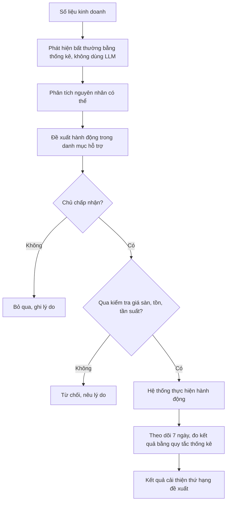

# 6. Đặc tả nghiệp vụ AI

Chương này tổng hợp kiến trúc nghiệp vụ AI trên toàn hệ thống. Các UC AI chi tiết vẫn nằm ở chương 5 (5.8, 5.26 và UC đọc ảnh ở 5.10).

## 6.1. Vai trò của AI trong sản phẩm

AI giải quyết ba việc mà quy tắc cố định làm kém: (1) **hiểu câu chữ tự nhiên** của khách và chủ để chuyển thành thao tác tìm kiếm hoặc truy vấn số liệu; (2) **diễn đạt** số liệu hệ thống đã tính thành câu dễ đọc (tóm tắt tuần, giải thích gợi ý, so sánh deal); (3) **hỗ trợ soạn thảo và đọc ảnh** (mô tả món, phản hồi khiếu nại, bản nháp khiếu nại, đọc nhãn hạn dùng). AI **không** là nguồn của bất kỳ con số kinh doanh, giá, tồn, hạn dùng hoặc thông tin an toàn thực phẩm nào, và **không** thực hiện hành động thay đổi dữ liệu quan trọng nếu chưa có xác nhận của người dùng và kiểm tra quy tắc của hệ thống. Lõi nghiệp vụ chạy đầy đủ khi AI tắt hoặc lỗi.

## 6.2. Danh mục năng lực AI

Bảng liệt kê các UC thuộc nhóm AI hoặc dùng mô hình ngôn ngữ. Cột *Loại*: **AI sinh ngôn ngữ** = có gọi mô hình ngôn ngữ; **Thống kê hoặc quy tắc** = nằm trong nhóm chức năng AI nhưng không gọi mô hình ngôn ngữ.

| Mã UC | Năng lực | Vai trò | Loại | Hạn mức (theo ma trận) | Gói |
|---|---|---|---|---|---|
| R1-082 | Tìm deal bằng câu hỏi tự nhiên | Khách | AI sinh ngôn ngữ | 30 lượt/ngày (hạn mức vận hành AI, không phải gói) | GOI-KH |
| R1-083 | Trò chuyện với trợ lý Cứu Món | Khách | AI sinh ngôn ngữ | 30 lượt/ngày (hạn mức vận hành AI, không phải gói) | GOI-KH |
| R1-084 | Gợi ý deal cá nhân hóa kèm lý do | Khách | AI sinh ngôn ngữ | 100 lượt giải thích/ngày (không tính vào hạn mức 30 lượt hỏi/ngày) | GOI-KH |
| R1-085 | Xem lý do gợi ý và điều chỉnh sở thích | Khách | AI sinh ngôn ngữ | Không tính hạn mức | GOI-KH |
| R1-086 | Tóm tắt và so sánh deal giúp lựa chọn | Khách | AI sinh ngôn ngữ | 30 lượt/ngày (hạn mức vận hành AI, không phải gói) | GOI-KH |
| R1-087 | Hỏi về thành phần và dị ứng của món | Khách | AI sinh ngôn ngữ | 30 lượt/ngày (hạn mức vận hành AI, không phải gói) | GOI-KH |
| R1-088 | Hướng dẫn nhận hàng và theo dõi đơn qua trợ lý | Khách | AI sinh ngôn ngữ | 30 lượt/ngày (hạn mức vận hành AI, không phải gói) | GOI-KH |
| R1-089 | Soạn khiếu nại từ ảnh và mô tả của khách | Khách | AI sinh ngôn ngữ | 10 lượt/ngày (hạn mức vận hành AI, không phải gói) | GOI-KH |
| R1-090 | Chuyển cuộc trò chuyện cho người hỗ trợ khi AI không đủ khả năng | Khách | AI sinh ngôn ngữ | Không tính hạn mức | GOI-KH |
| R1-091 | Xem và xóa lịch sử trò chuyện với trợ lý | Khách | AI sinh ngôn ngữ | Không tính hạn mức | GOI-KH |
| R1-092 | Đánh giá chất lượng câu trả lời và gợi ý của AI | Khách | AI sinh ngôn ngữ | Không tính hạn mức | GOI-KH |
| R1-093 | Nhận thông báo deal vào giờ khách hay mua | Khách | Thống kê hoặc quy tắc | Không tính hạn mức | GOI-KH |
| R1-094 | Tóm tắt đánh giá của cửa hàng | Khách | AI sinh ngôn ngữ | Không tính hạn mức | GOI-KH |
| R2-021 | Gợi ý thông tin món từ ảnh bằng AI | Chủ | AI sinh ngôn ngữ | Cơ bản 20, Pro 300 lượt/tháng | Mọi gói |
| R2-108 | Hỏi đáp dữ liệu kinh doanh bằng ngôn ngữ tự nhiên | Chủ | AI sinh ngôn ngữ | Cơ bản 10, Pro 300 lượt hỏi/tháng (dùng chung với trò chuyện trợ lý) | Mọi gói |
| R2-109 | Trò chuyện với trợ lý cửa hàng nhiều lượt | Chủ | AI sinh ngôn ngữ | Cơ bản 10, Pro 300 lượt hỏi/tháng (dùng chung với hỏi đáp dữ liệu) | Mọi gói |
| R2-110 | Xem và xóa lịch sử trò chuyện với trợ lý | Chủ | AI sinh ngôn ngữ | Không giới hạn riêng | Mọi gói |
| R2-111 | Tóm tắt và giải thích báo cáo tuần | Chủ | AI sinh ngôn ngữ | Pro: 1 bản tóm tắt/tuần (tạo theo lịch) | Chỉ Pro / dùng thử |
| R2-112 | Phát hiện biến động bất thường của doanh thu, đơn và hao hụt | Chủ | Thống kê hoặc quy tắc | Không giới hạn riêng | Chỉ Pro / dùng thử |
| R2-113 | Phân tích nguyên nhân có thể của một biến động | Chủ | AI sinh ngôn ngữ | Pro: 300 lượt hỏi/tháng (dùng chung hạn mức hỏi đáp dữ liệu) | Chỉ Pro / dùng thử |
| R2-114 | Đề xuất hành động cải thiện kinh doanh | Chủ | AI sinh ngôn ngữ | Pro: 20 thẻ đề xuất/tháng | Chỉ Pro / dùng thử |
| R2-115 | Theo dõi thực hiện và đo kết quả của đề xuất | Chủ | AI sinh ngôn ngữ | Không giới hạn riêng | Chỉ Pro / dùng thử |
| R2-116 | Giải thích vì sao hệ thống đề xuất số lượng hoặc giá này | Chủ | AI sinh ngôn ngữ | Pro: 300 lượt hỏi/tháng (dùng chung hạn mức hỏi đáp dữ liệu) | Chỉ Pro / dùng thử |
| R2-117 | Soạn mô tả món và nội dung thông báo | Chủ | AI sinh ngôn ngữ | Cơ bản 10, Pro 200 lượt soạn/tháng (dùng chung với gợi ý phản hồi) | Mọi gói |
| R2-118 | Gợi ý phản hồi khiếu nại và đánh giá của khách | Chủ | AI sinh ngôn ngữ | Cơ bản 10, Pro 200 lượt soạn/tháng (dùng chung với soạn nội dung) | Mọi gói |
| R2-119 | Kiểm tra ảnh món trước khi đăng | Chủ | AI sinh ngôn ngữ | Cơ bản 20, Pro 300 lượt/tháng (dùng chung hạn mức AI đọc ảnh) | Mọi gói |
| R2-120 | Đọc hạn dùng từ ảnh nhãn | Chủ | AI sinh ngôn ngữ | Cơ bản 20, Pro 300 lượt/tháng (dùng chung hạn mức AI đọc ảnh) | Mọi gói |
| R2-121 | Gợi ý tặng phần không bán được cho nơi nhận hỗ trợ | Chủ | Thống kê hoặc quy tắc | Không giới hạn riêng | Mọi gói |
| R2-122 | Bật tắt từng tính năng AI và cấu hình giọng điệu | Chủ | Thống kê hoặc quy tắc | Không giới hạn riêng | Mọi gói |
| R2-123 | Xem mức dùng và hạn mức AI | Chủ | Thống kê hoặc quy tắc | Không giới hạn riêng | Mọi gói |
| R2-124 | Xem nhật ký AI để truy vết | Chủ | Thống kê hoặc quy tắc | Không giới hạn riêng | Mọi gói |
| R2-125 | Đánh giá chất lượng kết quả của AI | Chủ | AI sinh ngôn ngữ | Không giới hạn riêng | Mọi gói |
| R2-126 | Đề xuất ưu đãi hoặc chiến dịch phù hợp | Chủ | AI sinh ngôn ngữ | Pro: 20 đề xuất/tháng | Chỉ Pro / dùng thử |

Tổng: Khách 13 UC (12 sinh ngôn ngữ, 1 thống kê hoặc quy tắc); Chủ 20 UC (15 sinh ngôn ngữ, 5 thống kê hoặc quy tắc).

## 6.3. Quy trình xử lý AI

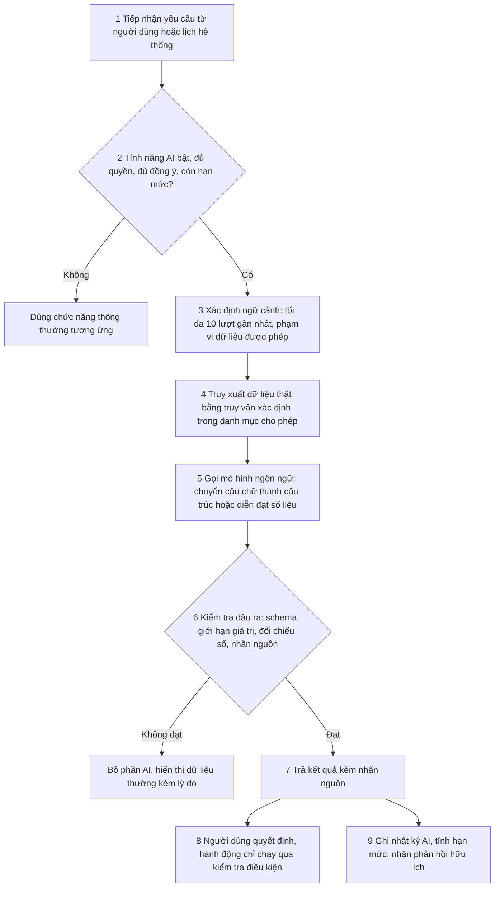

Thời gian chờ mô hình là 10 giây; quá hạn hoặc hết hạn mức thì chuyển phương án dự phòng đã định nghĩa trong từng UC.

## 6.4. Nguồn dữ liệu và quyền truy cập

| Đối tượng dùng AI | Dữ liệu được phép | Dữ liệu bị cấm |
|---|---|---|
| Khách | Câu hỏi của khách, suất và cửa hàng công khai, đơn của chính khách khi cần, đánh giá công khai, thành phần và dị ứng cửa hàng khai báo, hồ sơ ăn uống và lịch sử nếu khách bật cá nhân hóa | Dữ liệu khách khác, đơn của người khác, dữ liệu nội bộ của cửa hàng, thông tin cá nhân của người khác |
| Chủ và Quản lý | Số liệu của cửa hàng mình qua danh mục truy vấn ràng buộc theo mã cửa hàng, báo cáo, dự báo, quyết định giá, khiếu nại và đánh giá của cửa hàng, ảnh món do chủ tải | Dữ liệu cửa hàng khác, dữ liệu cá nhân nhận dạng khách, SQL tự do |
| Nhân viên | Chỉ trong phạm vi quyền của nhóm | Dữ liệu ngoài quyền |
| Hệ thống (tác vụ lịch) | Dữ liệu tổng hợp của cửa hàng (bất thường, tóm tắt tuần) hoặc đánh giá công khai (tóm tắt đánh giá) | Bất kỳ dữ liệu ngoài phạm vi của tác vụ |

Nguyên tắc ngăn rò rỉ: mọi truy vấn do AI khởi tạo bị ràng buộc theo mã người dùng hoặc mã cửa hàng ở lớp hệ thống chứ không do mô hình quyết định; khóa dịch vụ AI chỉ nằm ở máy chủ; nhật ký AI không chứa dữ liệu nhận dạng khách; ảnh khiếu nại chỉ dùng cho khiếu nại đó, không dùng huấn luyện. *[Tổng hợp từ các UC AI]*

## 6.5. Phân biệt AI và logic hệ thống

Excel quy định câu chuẩn cho mọi UC AI: *số liệu và dữ liệu lấy từ hệ thống; phần diễn đạt do mô hình ngôn ngữ sinh; quyết định do người dùng; hành động chỉ do hệ thống thực hiện sau khi kiểm tra điều kiện.* Bảng sau cụ thể hóa theo UC tiêu biểu.

| Loại công việc | Ai thực hiện | Ví dụ UC |
|---|---|---|
| Diễn đạt, chuyển câu chữ thành cấu trúc | Mô hình ngôn ngữ | R1-082 (câu hỏi thành bộ lọc JSON); R2-111 |
| Quy tắc nghiệp vụ | Hệ thống bằng quy tắc xác định | Giá sàn, tồn, tần suất ở R2-114; khóa đặt, giới hạn thông báo |
| Phép tính và truy vấn dữ liệu | Hệ thống bằng truy vấn hoặc thống kê | R2-112; điểm gợi ý ở R1-084; dự báo ở R2-036 |
| Quyết định | Người dùng | Sửa bộ lọc, đặt đơn, gửi khiếu nại, chấp nhận hay bỏ qua thẻ đề xuất |
| Hành động thay đổi dữ liệu | Hệ thống, chỉ sau khi người dùng xác nhận và kiểm tra điều kiện | Áp dụng giá, tạo ưu đãi, gửi chiến dịch, tạo khiếu nại; AI không tự thực hiện |

## 6.6. Xử lý kết quả không đáng tin cậy

| Tình huống | Xử lý (theo các UC) |
|---|---|
| Thiếu dữ liệu để trả lời | Nói rõ chưa có thông tin hoặc chưa hỗ trợ chỉ số; hỏi lại khi câu hỏi mơ hồ; không đoán |
| Mô hình trả cấu trúc sai schema hoặc ngoài giá trị cho phép | Bỏ phần lỗi, báo phần đã hiểu, không chạy truy vấn không hợp lệ |
| Số liệu trong câu diễn đạt không khớp dữ liệu nguồn | Bỏ phần diễn đạt, chỉ hiện bảng hoặc số liệu của hệ thống |
| Thông tin thành phần hoặc dị ứng không có trong khai báo cửa hàng | Hiện Chưa có thông tin và nút hỏi cửa hàng; không khẳng định món an toàn |
| Hành động đề xuất không còn thỏa điều kiện khi chấp nhận | Từ chối và nêu lý do; thẻ hết hiệu lực sau 7 ngày |
| Ảnh không đọc được | Bỏ gợi ý, người dùng nhập tay; hạn dùng đọc từ ảnh bắt buộc chủ xác nhận |
| Nội dung độc hại hoặc cố lấy dữ liệu người khác | Từ chối; chuyển hỗ trợ nếu thuộc chủ đề nhạy cảm (thanh toán, an toàn thực phẩm) |

## 6.7. Lỗi dịch vụ và hạn mức

| Tình huống | Xử lý |
|---|---|
| Timeout (10 giây) hoặc lỗi dịch vụ AI | Mỗi UC có phương án dự phòng không AI: bộ lọc thủ công, danh sách theo khoảng cách, bảng so sánh không tóm tắt, báo cáo dựng sẵn, nhập tay; chức năng lõi không bị chặn |
| Hết hạn mức AI | Từ chối lượt, hiển thị lượt còn lại và thời điểm đặt lại, gợi ý nâng cấp (chủ); dùng phương án dự phòng |
| Hủy yêu cầu | Người dùng rời màn hình thì kết quả đến sau bị bỏ; lượt đã tính vào hạn mức chỉ khi mô hình đã được gọi *[Đề xuất hoàn thiện]* |
| Thử lại | Không tự thử lại vô hạn; thao tác của người dùng gửi lại là lượt mới; phản hồi chất lượng lưu cục bộ và gửi lại khi có mạng |
| Gói hết hạn | Năng lực AI chỉ Pro bị khóa, dữ liệu AI đã tạo chỉ xem; hạn mức AI quay về mức Cơ bản |

## 6.8. Theo dõi và đánh giá hiệu quả

Excel khai báo các chỉ số đo được cho từng UC AI (ví dụ tỷ lệ truy vấn thành công, độ chính xác số liệu trên bộ kiểm thử, tỷ lệ bấm vào gợi ý, tỷ lệ chuyển hỗ trợ, tỷ lệ hữu ích). Tài liệu **không** đặt ngưỡng cam kết cho các chỉ số này; ngưỡng cần được Product Owner quyết định sau khi có dữ liệu thực tế (chương 13). Nguồn đo: nhật ký AI (mã yêu cầu, tính năng, phạm vi dữ liệu, mô hình, độ trễ, kết quả, phản hồi) và UC đánh giá chất lượng kết quả AI (R1-092, R2-125).

## 6.9. Quyền riêng tư và kiểm soát

- Cá nhân hóa, ghi nhớ ngữ cảnh AI và nhận ưu đãi mặc định tắt cho đến khi khách bật (R1-017).
- Dữ liệu ăn uống và dị ứng là dữ liệu nhạy cảm, chỉ lưu khi khách đồng ý, xóa được bất kỳ lúc nào (R1-016).
- Lịch sử hội thoại giữ tối đa 90 ngày; xóa hội thoại là xóa vật lý nội dung và giữ bản ghi thống kê ẩn danh; phần đã chia sẻ cho yêu cầu hỗ trợ đang mở không xóa (R1-091, R2-110).
- Nhật ký AI của cửa hàng giữ 90 ngày, chỉ đọc, chỉ Chủ và Quản lý xem, không chứa dữ liệu nhận dạng khách (R2-124).
- Tóm tắt hội thoại chỉ gửi cho người hỗ trợ khi khách đồng ý.
- Chủ bật tắt được từng tính năng AI và chọn giọng điệu (R2-122).

# 7. Mô hình dữ liệu và trạng thái nghiệp vụ

## 7.1. Danh mục thực thể nghiệp vụ

Thiết kế dưới đây ở mức **logic**, tổng hợp từ các trường dữ liệu trong Excel; không khẳng định kiểu dữ liệu hay khóa ngoại vật lý.

| Thực thể | Mục đích | Thuộc tính quan trọng | Quan hệ | Nguồn tạo | Vai trò thao tác | Vòng đời |
|---|---|---|---|---|---|---|
| Tài khoản khách | Danh tính khách | Họ tên, email/SĐT, mật khẩu băm, trạng thái, cờ đồng ý | 1-n Đơn, Phiên, Địa điểm, Ưu đãi nhận | Đăng ký (R1-001) | Khách | Chờ xác minh, Hoạt động, Chờ xóa, Đã ẩn danh |
| Tài khoản người dùng cửa hàng | Chủ và nhân viên | Email, nhóm quyền, trạng thái | n-1 Cửa hàng | Đăng ký chủ; mời nhân viên | Chủ, hệ thống | Đã mời, Hoạt động, Tạm khóa, Đã gỡ |
| Cửa hàng | Đơn vị bán | Tên, địa chỉ, tọa độ, giờ mở cửa, trạng thái, gói, giá sàn | 1-n Món, Suất, Nhân viên | Đăng ký chủ | Chủ | Chờ xác minh, Hoạt động, Tạm ngưng |
| Món | Sản phẩm gốc | Tên, loại, giá gốc, hạn dùng chuẩn, thành phần, dị ứng, trọng lượng | n-1 Cửa hàng; 1-n Suất | Chủ, CSV, AI gợi ý | Chủ, Quản lý | Đang dùng, Đã lưu trữ |
| Suất | Đợt bán một món | Số lượng, tồn còn, giá gốc, giá bán, giá sàn, khung nhận | n-1 Món; 1-n Đơn, Đề xuất giá | Chủ, hệ thống | Chủ, Quản lý, hệ thống | Nháp, Đang mở, Hết suất, Đã đóng, Đã hủy |
| Đơn | Giao dịch mua | Suất, số lượng, giá chốt, ưu đãi, tổng tiền, giờ hẹn, ghi chú, mốc thời gian | n-1 Khách, Suất; 1-n Giao dịch; 0-1 Khiếu nại, Đánh giá, Mã nhận hộ | Khách giữ suất | Khách, Cửa hàng, hệ thống | Chờ thanh toán, Đã thanh toán, Đã nhận, Hết hạn giữ, Hết hạn nhận, Đã hủy, Đã hoàn tiền |
| Giao dịch thanh toán và hoàn tiền | Ghi tiền vào ra | Mã giao dịch (duy nhất), số tiền, loại, trạng thái | n-1 Đơn | Thanh toán, hoàn tiền | Hệ thống | Chờ, Hoàn thành, Thất bại, Chờ xác nhận |
| Token QR và mã nhận hộ | Xác nhận nhận hàng | jti, hết hạn, trạng thái dùng | 1-1 Đơn | Sau thanh toán | Hệ thống, khách | Chưa dùng, Đã dùng, Thu hồi, Hết hạn |
| Khiếu nại | Phản ánh chất lượng | Loại, mô tả, ảnh, hạn phản hồi, số tiền hoàn | 1-1 Đơn | Khách | Khách, Cửa hàng, hệ thống | Chờ cửa hàng, Đã chấp nhận, Bị từ chối, Đã đóng |
| Đánh giá | Điểm và nhận xét | Số sao, nhận xét, phản hồi, cờ ẩn | 1-1 Đơn | Khách | Khách, Cửa hàng | Hiển thị, Ẩn, Bị báo cáo |
| Yêu cầu hỗ trợ | Hỗ trợ người | Loại, nội dung, tệp, trạng thái | n-1 Khách hoặc Cửa hàng | Khách, Chủ, chuyển tiếp AI | Người gửi, bên hỗ trợ | Mở, Đang xử lý, Đã trả lời, Đã đóng |
| Bộ đếm không đến nhận và khóa đặt | Chống lạm dụng | Số lần 30 ngày, ngày hết khóa | n-1 Khách | Hệ thống | Hệ thống | Cuốn chiếu 30 ngày |
| Khuyến nghị dự báo và số thực tế | Quyết định số lượng | Món, ngày, khuyến nghị, khoảng, độ tin cậy, số chủ chọn, số thực tế | n-1 Món | Hệ thống, chủ | Chủ, Quản lý, Nhân viên quầy (nhập số) | Tạo hằng ngày, khóa nhập sau 48 giờ |
| Sự kiện đặc biệt | Hiệu chỉnh nhu cầu | Ngày, loại, mức ảnh hưởng | n-1 Cửa hàng | Chủ | Chủ, Quản lý | Hiệu lực theo ngày |
| Đề xuất giá và quyết định giá | Đổi giá có truy vết | Giá cũ, giá đề xuất, thành phần điểm, nguồn quyết định | n-1 Suất | Hệ thống | Chủ, Quản lý, hệ thống | Chờ duyệt, Đã duyệt, Đã từ chối, Hết hiệu lực, Tự áp dụng |
| Ưu đãi, ví ưu đãi, chiến dịch | Kích cầu | Giá trị, điều kiện, hạn, lượt, đối tượng | n-n Khách; n-1 Cửa hàng | Chủ | Chủ, Quản lý, Khách (nhận) | Nháp, Đang chạy, Tạm dừng, Kết thúc |
| Gói, hóa đơn gói, hạn mức | Doanh thu và giới hạn | Gói, ngày bắt đầu và hết, mã giao dịch, mức đã dùng | 1-1 Cửa hàng | Chủ, hệ thống | Chủ, hệ thống | Dùng thử, Cơ bản, Pro, Sẽ hết hạn |
| Sao kê tuần | Đối soát bất biến | Kỳ, tổng thu, hoa hồng, hoàn tiền, thuê bao, thực nhận | n-1 Cửa hàng | Tác vụ chốt | Hệ thống; chủ xem | Tạm tính, Đã chốt (bất biến) |
| Thông báo | Thông tin sự kiện | Loại, nội dung, trạng thái đọc | n-1 Người nhận | Hệ thống | Hệ thống; người nhận đánh dấu | Giữ 90 ngày |
| Nhật ký hoạt động cửa hàng | Truy vết | Thời gian, hành động, giá trị cũ mới, IP | n-1 Cửa hàng | Hệ thống | Hệ thống; chủ xem | Giữ 12 tháng, chỉ đọc |
| Nhật ký AI, hội thoại AI, thẻ đề xuất | Truy vết và quản trị AI | Mã yêu cầu, tính năng, phạm vi, độ trễ, phản hồi, hội thoại | n-1 Người dùng hoặc Cửa hàng | Hệ thống | Hệ thống; chủ và khách xem phần của mình | Giữ 90 ngày; xóa theo yêu cầu |

## 7.2. Quan hệ dữ liệu

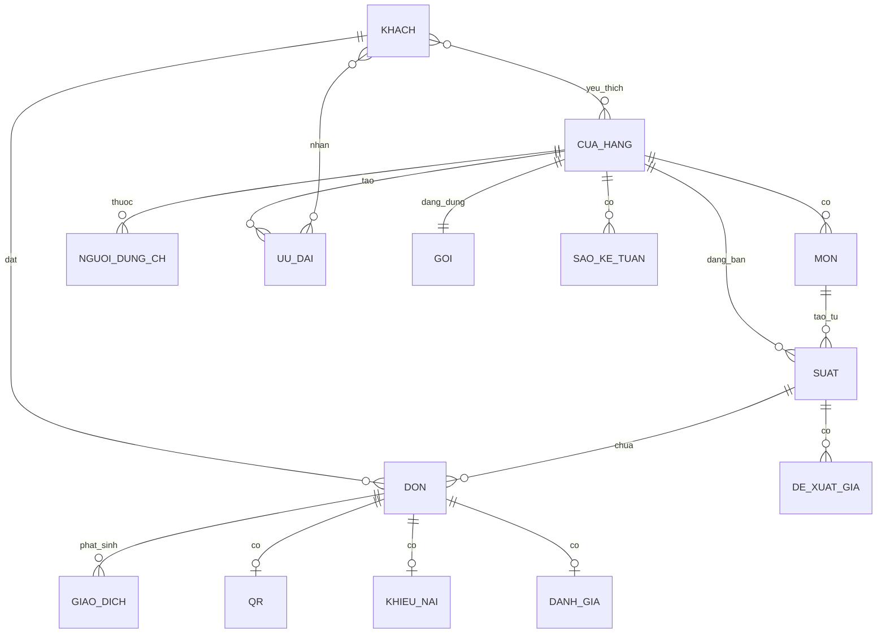

## 7.3. Vòng đời và trạng thái

### 7.3.1. Đơn hàng

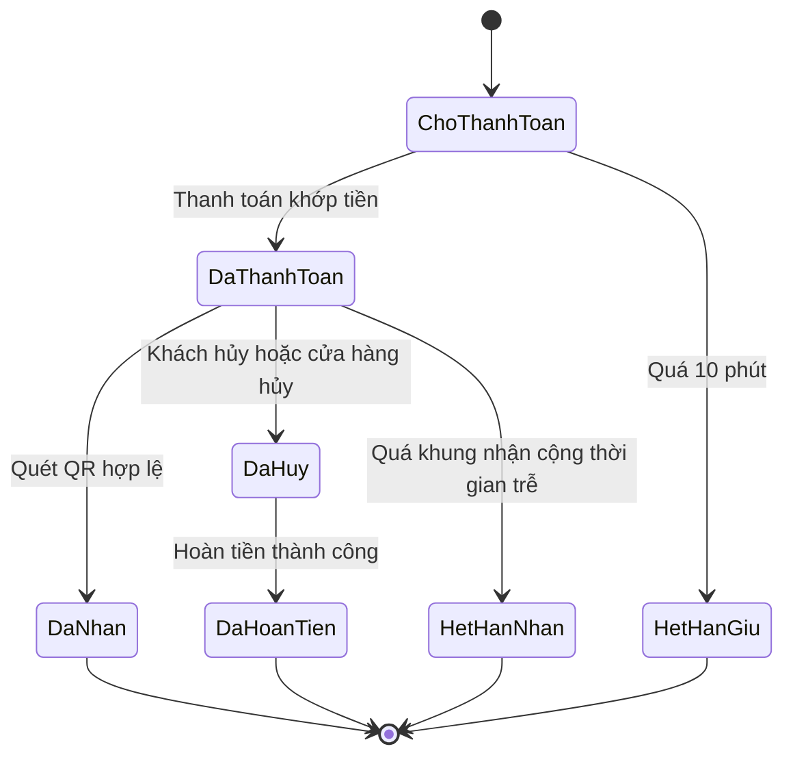

| Trạng thái | Ý nghĩa | Chuyển đến khi | Vai trò chuyển | Hành động bị cấm |
|---|---|---|---|---|
| Chờ thanh toán | Đã trừ tồn, giữ 10 phút | Giữ suất thành công | Khách | Quét QR, hủy có hoàn tiền, khiếu nại |
| Đã thanh toán | Tiền đã vào, QR hiệu lực | Xác nhận thanh toán khớp tiền | Hệ thống (xác nhận cổng) | Thanh toán lại, sửa ghi chú |
| Đã nhận | Cửa hàng quét QR | QR hợp lệ trong khung nhận cộng trễ | Cửa hàng | Hủy đơn, quét lại |
| Hết hạn giữ | Quá 10 phút chưa thanh toán | Tác vụ nhả suất | Hệ thống | Thanh toán (tiền đến sau thì hoàn tự động) |
| Hết hạn nhận | Quá khung nhận cộng trễ chưa nhận | Tác vụ quá hạn | Hệ thống | Quét QR |
| Đã hủy | Hủy bởi khách (trước khung nhận 60 phút), cửa hàng, hoặc hủy suất | Thao tác hủy | Khách, Cửa hàng, hệ thống | Quét QR, khiếu nại |
| Đã hoàn tiền | Lệnh hoàn thành công | Hoàn tiền | Hệ thống | Mọi thao tác thay đổi |

### 7.3.2. Suất

| Trạng thái | Chuyển đến khi | Hành động bị cấm |
|---|---|---|
| Nháp | Chủ tạo | Hiển thị cho khách |
| Đang mở | Đăng bán, trong khung nhận | Tạo đơn khi tồn bằng 0 |
| Hết suất | Tồn bằng 0 | Giữ suất (tự về Đang mở nếu có suất được nhả) |
| Đã đóng | Đóng sớm hoặc hết khung nhận | Giữ suất, sửa |
| Đã hủy | Chủ hủy, đơn liên quan bị hủy và hoàn tiền | Mọi thao tác |

### 7.3.3. Khiếu nại

| Trạng thái | Chuyển đến khi | Vai trò | Ghi chú |
|---|---|---|---|
| Chờ cửa hàng | Khách gửi trong 24 giờ sau nhận | Khách | Cho phép bổ sung 2 lần, rút, gia hạn phản hồi 1 lần |
| Đã chấp nhận | Cửa hàng chấp nhận hoặc quá hạn phản hồi | Cửa hàng, hệ thống | Hoàn tiền, không hoa hồng phần hoàn |
| Bị từ chối | Cửa hàng từ chối kèm lý do | Cửa hàng | Khách không mở lại |
| Đã đóng | Khách rút | Khách | Không mở lại |

### 7.3.4. Tài khoản khách, cửa hàng, gói

Xem sơ đồ ở 5.1.8 (tài khoản khách), 5.9.8 (cửa hàng và gói) và bảng quy tắc vòng đời gói VC-01 đến VC-11 ở chương 8.4.

### 7.3.5. Đề xuất giá, yêu cầu hỗ trợ, chiến dịch

Đề xuất giá: xem 5.13.8. Yêu cầu hỗ trợ: Mở, Đang xử lý, Đã trả lời, Đã đóng, không mở lại sau Đã đóng. Ưu đãi và chiến dịch: Nháp, Đang chạy, Tạm dừng, Kết thúc, Đã hủy hoặc đổi lịch (trạng thái cụ thể của chiến dịch là *[Tổng hợp]* từ R2-093).

## 7.4. Tính toàn vẹn dữ liệu

- **Duy nhất:** email/SĐT khách, email chủ và nhân viên (một email thuộc một cửa hàng), mã giao dịch thanh toán và mã giao dịch hoàn tiền (mỗi mã một lần), khóa idempotency, token QR dùng một lần, mỗi đơn một khiếu nại mở và một đánh giá.
- **Không xóa vật lý dữ liệu giao dịch:** món lưu trữ không xóa; đánh giá ẩn không xóa; tài khoản khách được ẩn danh hóa chứ không xóa đơn; dữ liệu chốt bất biến.
- **Xóa vật lý được:** địa điểm quen thuộc, cảnh báo deal, bộ lọc đã lưu, lịch sử trò chuyện (giữ thống kê ẩn danh), vì không phải dữ liệu giao dịch.
- **Tham chiếu:** suất phải tham chiếu món của cùng cửa hàng; đơn tham chiếu suất; hoàn tiền tham chiếu giao dịch gốc.
- **Đồng bộ:** thay đổi tồn và trạng thái đơn trong cùng giao dịch; cập nhật điểm đánh giá khi đánh giá đổi; app khách thấy trạng thái đơn mới sau khi cửa hàng quét QR.
- **Giữ dữ liệu:** thông báo 90 ngày; nhật ký hoạt động 12 tháng; lịch sử và nhật ký AI 90 ngày; lịch sử xem deal 30 ngày; suất lưu hết hạn dọn sau 7 ngày.

# 8. Gói dịch vụ, quyền lợi và hạn mức

Nguồn: sheet `03_Service_Packages` Phần A (danh mục gói), Phần B (ma trận gói - tính năng), Phần C (quy tắc vòng đời). Tất cả giá, hoa hồng và hạn mức là **tham số cấu hình dạng giả định**, chưa có giá hoặc chính sách chính thức.

## 8.1. Danh mục gói và đối tượng áp dụng

| Mã gói | Tên | Đối tượng | Giá | Chu kỳ | Hiệu lực | Trạng thái |
|---|---|---|---|---|---|---|
| GOI-CB | Cơ bản | Chủ cửa hàng | 0 VND | Không có | Không giới hạn thời gian | Đang kinh doanh |
| GOI-DT | Pro dùng thử | Chủ cửa hàng mới | 0 VND | Không có | 1 tháng kể từ khi xác minh email | Đang kinh doanh |
| GOI-PRO | Pro | Chủ cửa hàng | 300.000 VND/tháng (giả định minh họa, chưa có giá chính thức, tham số cấu hình) | Theo tháng, trả trước | 30 ngày kể từ ngày kích hoạt | Đang kinh doanh (giả thuyết, cần kiểm chứng giá) |
| GOI-KH | Khách hàng | Khách hàng | 0 VND | Không có | Không giới hạn thời gian | Đang kinh doanh |

## 8.2. Quyền lợi và giới hạn

**GOI-CB - Cơ bản.** Quyền lợi cốt lõi: Đăng suất, tồn kho trong ngày, QR nhận hàng, đơn hàng, khiếu nại, đánh giá, đối soát tuần, báo cáo hao hụt 7 ngày gần nhất. Giới hạn: Tối đa 20 suất mở mỗi ngày; nhập CSV 100 dòng/lần; AI đọc ảnh 20 lần/tháng; AI hỏi đáp 10 lượt/tháng; AI soạn nội dung 10 lượt/tháng; 1 nhân viên; 2 ưu đãi đang chạy; 4 chiến dịch/tháng; xuất báo cáo 3 lần/tháng; xuất đơn 5 lần/tháng. Không có dự báo, định giá động, phân nhóm khách, mô phỏng, phân tích và đề xuất bằng AI.

**GOI-DT - Pro dùng thử.** Quyền lợi cốt lõi: Toàn bộ quyền lợi gói Pro. Giới hạn: Mỗi cửa hàng dùng thử một lần. Hạn mức như gói Pro.

**GOI-PRO - Pro.** Quyền lợi cốt lõi: Mọi quyền lợi Cơ bản và dự báo số lượng, định giá động, chế độ giá tự động, báo cáo hao hụt đầy đủ, hạn mức cao hơn. Giới hạn: Tối đa 100 suất mở mỗi ngày; nhập CSV 500 dòng/lần; AI đọc ảnh 300 lần/tháng; AI hỏi đáp 300 lượt/tháng; AI soạn nội dung 200 lượt/tháng; 5 nhân viên; 10 ưu đãi đang chạy; 30 chiến dịch/tháng; xuất báo cáo 30 lần/tháng; xuất đơn 60 lần/tháng.

**GOI-KH - Khách hàng.** Quyền lợi cốt lõi: Toàn bộ tính năng vai Khách; khách không trả phí app, chỉ trả tiền hàng. Giới hạn: Không có hạn mức gói; áp dụng giới hạn vận hành (tối đa 5 suất mỗi đơn, 50 cửa hàng yêu thích; trợ lý AI 30 lượt/ngày, soạn khiếu nại 10 lượt/ngày).

### 8.2.1. Phân biệt ba lớp quyền

Quyền thực tế của một thao tác = quyền theo vai trò và nhóm quyền AND quyền theo gói và hạn mức AND trạng thái tài khoản và cửa hàng. Ví dụ: Quản lý (đủ quyền vai trò) trên cửa hàng gói Cơ bản (không có quyền gói) không dùng được dự báo; Chủ trên cửa hàng Tạm ngưng không tạo được suất dù đủ quyền và đủ gói.

## 8.3. Ma trận tính năng bị ảnh hưởng bởi gói

### 8.3.1. Tính năng có hạn mức

| Mã UC | Tính năng | Cơ bản | Pro / dùng thử | Chu kỳ đặt lại | Khi hết hạn mức |
|---|---|---|---|---|---|
| R2-021 | Gợi ý thông tin món từ ảnh bằng AI | 20 lượt/tháng | 300 lượt/tháng | Hằng tháng | Từ chối thao tác, hiện số lượt còn lại và thời điểm đặt lại; gợi ý nâng cấp. |
| R2-025 | Nhập danh mục món từ CSV | 100 dòng/lần nhập | 500 dòng/lần nhập | Mỗi lần nhập | Từ chối thao tác, hiện số lượt còn lại và thời điểm đặt lại; gợi ý nâng cấp. |
| R2-028 | Tạo suất | 20 suất mở/ngày | 100 suất mở/ngày | Hằng ngày | Từ chối thao tác, hiện số lượt còn lại và thời điểm đặt lại; gợi ý nâng cấp. |
| R2-050 | Lọc, tìm và xuất đơn | 5 lần xuất/tháng | 60 lần xuất/tháng | Hằng tháng | Từ chối thao tác, hiện số lượt còn lại và thời điểm đặt lại; gợi ý nâng cấp. |
| R2-062 | Xem báo cáo hao hụt và thu hồi theo kỳ | 7 ngày gần nhất được xem | 365 ngày gần nhất được xem | Cuốn chiếu | Từ chối thao tác, hiện số lượt còn lại và thời điểm đặt lại; gợi ý nâng cấp. |
| R2-064 | Xuất báo cáo CSV hoặc PDF | 3 lần xuất/tháng | 30 lần xuất/tháng | Hằng tháng | Từ chối thao tác, hiện số lượt còn lại và thời điểm đặt lại; gợi ý nâng cấp. |
| R2-076 | Mời nhân viên vào cửa hàng | 1 nhân viên đang hoạt động | 5 nhân viên đang hoạt động | Không đặt lại (tồn tại) | Từ chối thao tác, hiện số lượt còn lại và thời điểm đặt lại; gợi ý nâng cấp. |
| R2-088 | Tạo ưu đãi cho khách | 2 ưu đãi đang chạy cùng lúc | 10 ưu đãi đang chạy cùng lúc | Không đặt lại (tồn tại) | Từ chối thao tác, hiện số lượt còn lại và thời điểm đặt lại; gợi ý nâng cấp. |
| R2-092 | Tạo chiến dịch thông báo đến khách yêu thích | 4 chiến dịch/tháng | 30 chiến dịch/tháng | Hằng tháng | Từ chối thao tác, hiện số lượt còn lại và thời điểm đặt lại; gợi ý nâng cấp. |
| R2-108 | [AI] Hỏi đáp dữ liệu kinh doanh bằng ngôn ngữ tự nhiên | 10 lượt hỏi/tháng (dùng chung với trò chuyện trợ lý) | 300 lượt hỏi/tháng (dùng chung với trò chuyện trợ lý) | Hằng tháng | Từ chối thao tác, hiện số lượt còn lại và thời điểm đặt lại; gợi ý nâng cấp. |
| R2-109 | [AI] Trò chuyện với trợ lý cửa hàng nhiều lượt | 10 lượt hỏi/tháng (dùng chung với hỏi đáp dữ liệu) | 300 lượt hỏi/tháng (dùng chung với hỏi đáp dữ liệu) | Hằng tháng | Từ chối thao tác, hiện số lượt còn lại và thời điểm đặt lại; gợi ý nâng cấp. |
| R2-117 | [AI] Soạn mô tả món và nội dung thông báo | 10 lượt soạn/tháng (dùng chung với gợi ý phản hồi) | 200 lượt soạn/tháng (dùng chung với gợi ý phản hồi) | Hằng tháng | Từ chối thao tác, hiện số lượt còn lại và thời điểm đặt lại; gợi ý nâng cấp. |
| R2-118 | [AI] Gợi ý phản hồi khiếu nại và đánh giá của khách | 10 lượt soạn/tháng (dùng chung với soạn nội dung) | 200 lượt soạn/tháng (dùng chung với soạn nội dung) | Hằng tháng | Từ chối thao tác, hiện số lượt còn lại và thời điểm đặt lại; gợi ý nâng cấp. |
| R2-119 | [AI] Kiểm tra ảnh món trước khi đăng | 20 lượt/tháng (dùng chung hạn mức AI đọc ảnh) | 300 lượt/tháng (dùng chung hạn mức AI đọc ảnh) | Hằng tháng | Từ chối thao tác, hiện số lượt còn lại và thời điểm đặt lại; gợi ý nâng cấp. |
| R2-120 | [AI] Đọc hạn dùng từ ảnh nhãn | 20 lượt/tháng (dùng chung hạn mức AI đọc ảnh) | 300 lượt/tháng (dùng chung hạn mức AI đọc ảnh) | Hằng tháng | Từ chối thao tác, hiện số lượt còn lại và thời điểm đặt lại; gợi ý nâng cấp. |

Có 15 UC có hạn mức số. Bốn nhóm hạn mức dùng chung: AI hỏi đáp (hỏi đáp dữ liệu và trò chuyện trợ lý), AI soạn nội dung (soạn mô tả - thông báo và gợi ý phản hồi), AI đọc ảnh (đọc ảnh món, kiểm tra ảnh, đọc hạn dùng) và xuất (báo cáo hoặc đơn). Việc các UC dùng chung một nhóm hạn mức được ghi trong cột đơn vị của ma trận.

### 8.3.2. Tính năng chỉ gói Pro hoặc dùng thử

| Mã UC | Tính năng | Hạn mức trong Pro |
|---|---|---|
| R2-008 | Chọn chế độ định giá: duyệt tay hoặc tự động | Không giới hạn riêng |
| R2-013 | Gia hạn gói Pro | Không giới hạn riêng |
| R2-014 | Hủy gói Pro | Không giới hạn riêng |
| R2-036 | Xem dự báo số lượng nên làm cho ngày mai | Không giới hạn riêng |
| R2-037 | Xem giải thích dự báo | Không giới hạn riêng |
| R2-038 | Chấp nhận hoặc ghi đè số lượng khuyến nghị | Không giới hạn riêng |
| R2-039 | Nhập số thực tế cuối ngày | Không giới hạn riêng |
| R2-040 | Khai báo sự kiện đặc biệt | Không giới hạn riêng |
| R2-041 | Xem độ chính xác dự báo | Không giới hạn riêng |
| R2-042 | Xem độ tin cậy dự báo và dự phòng khi dự báo kém | Không giới hạn riêng |
| R2-043 | Xem dự báo xu hướng nhu cầu cho tuần tới | Không giới hạn riêng |
| R2-044 | Xem đề xuất giá giảm theo giờ | Không giới hạn riêng |
| R2-045 | Xem giải thích đề xuất giá | Không giới hạn riêng |
| R2-046 | Duyệt đề xuất giá | Không giới hạn riêng |
| R2-047 | Từ chối đề xuất hoặc đặt giá thủ công | Không giới hạn riêng |
| R2-048 | Xem lịch sử quyết định giá | Không giới hạn riêng |
| R2-070 | Xem phân bố bán hàng theo giờ | Không giới hạn riêng |
| R2-071 | Đo hiệu quả đề xuất giá | Không giới hạn riêng |
| R2-084 | Xem phân nhóm khách theo quy tắc | Không giới hạn riêng |
| R2-094 | Xem hiệu quả chiến dịch thông báo | Không giới hạn riêng |
| R2-104 | Chạy mô phỏng chính sách giá trên dữ liệu lịch sử | Không giới hạn riêng |
| R2-105 | Xem và so sánh kết quả mô phỏng | Không giới hạn riêng |
| R2-111 | [AI] Tóm tắt và giải thích báo cáo tuần | 1 bản tóm tắt/tuần (tạo theo lịch) (hằng tuần) |
| R2-112 | Phát hiện biến động bất thường của doanh thu, đơn và hao hụt | Không giới hạn riêng |
| R2-113 | [AI] Phân tích nguyên nhân có thể của một biến động | 300 lượt hỏi/tháng (dùng chung hạn mức hỏi đáp dữ liệu) (hằng tháng) |
| R2-114 | [AI] Đề xuất hành động cải thiện kinh doanh | 20 thẻ đề xuất/tháng (hằng tháng) |
| R2-115 | [AI] Theo dõi thực hiện và đo kết quả của đề xuất | Không giới hạn riêng |
| R2-116 | [AI] Giải thích vì sao hệ thống đề xuất số lượng hoặc giá này | 300 lượt hỏi/tháng (dùng chung hạn mức hỏi đáp dữ liệu) (hằng tháng) |
| R2-126 | [AI] Đề xuất ưu đãi hoặc chiến dịch phù hợp | 20 đề xuất/tháng (hằng tháng) |

Có 29 UC chỉ dành cho Pro hoặc dùng thử. Điều kiện mở khóa: nâng cấp Pro hoặc đang trong 1 tháng dùng thử. Cơ bản: tính năng ẩn hoặc khóa kèm gợi ý nâng cấp. Hai lưu ý: (1) R2-008 vẫn mở ở Cơ bản để xem chế độ Duyệt tay mặc định, ma trận chỉ khóa lựa chọn chế độ Tự động; (2) R2-013 Gia hạn và R2-014 Hủy gói Pro chỉ có ý nghĩa khi cửa hàng đang có Pro hoặc dùng thử, nên ma trận ghi Không cho Cơ bản.

### 8.3.3. Các tính năng không phụ thuộc gói

Có 81 UC của vai Chủ dùng được ở cả hai gói không hạn mức riêng. Toàn bộ 94 UC của vai Khách thuộc GOI-KH và không phụ thuộc gói trả phí; riêng nhóm AI của khách có hạn mức vận hành 30 lượt mỗi ngày (soạn khiếu nại 10 lượt).

## 8.4. Vòng đời gói: nâng cấp, hạ cấp, gia hạn, hết hạn, hủy, thanh toán thất bại

| Mã | Tình huống | Điều kiện kích hoạt | Quy tắc xử lý | Thời điểm hiệu lực | Ảnh hưởng quyền lợi | Thông báo | Ngoại lệ |
|---|---|---|---|---|---|---|---|
| VC-01 | Đăng ký gói lần đầu | Chủ đăng ký và xác minh email | Cửa hàng vào gói Cơ bản và tự kích hoạt gói Pro dùng thử 1 tháng, một lần cho mỗi cửa hàng. | Ngay khi xác minh email | Mở quyền Pro trong thời gian dùng thử. | Email và thông báo web: ngày hết dùng thử. | Email đã dùng thử ở cửa hàng khác: chỉ vào Cơ bản. |
| VC-02 | Kích hoạt gói trả phí | Thanh toán gói Pro thành công | Kỳ 30 ngày bắt đầu tại thời điểm hệ thống xác nhận thanh toán; nếu đang dùng thử thì bắt đầu ngay, thời gian dùng thử còn lại không cộng thêm. | Ngay khi xác nhận thanh toán | Mở quyền Pro đến cuối kỳ. | Thông báo kích hoạt kèm ngày hết hạn. | Thanh toán chưa xác định: xem VC-07. |
| VC-03 | Gia hạn | Chủ thanh toán gói Pro trước hoặc sau ngày hết hạn | Không tự động gia hạn trong MVP. Gia hạn trước hạn: kỳ mới nối tiếp kỳ cũ. Gia hạn sau hạn: kỳ mới bắt đầu từ lúc thanh toán. | Khi xác nhận thanh toán | Giữ quyền Pro liên tục nếu gia hạn trước hạn. | Nhắc trước hạn 7 ngày và 1 ngày. | Không gia hạn: xem VC-06. |
| VC-04 | Gia hạn thất bại | Thanh toán lỗi hoặc bị từ chối | Không đổi trạng thái gói; cho thử lại trước hạn; sau hạn chuyển theo VC-06. | Tức thì | Quyền lợi giữ đến hết kỳ hiện tại. | Thông báo thanh toán thất bại và hướng dẫn thử lại. | Lỗi cổng nhiều lần: đưa vào đối soát thủ công. |
| VC-05 | Nâng cấp, hạ cấp | Chủ chọn gói khác | Nâng cấp Cơ bản lên Pro có hiệu lực ngay. Hạ cấp Pro về Cơ bản có hiệu lực cuối kỳ đã trả; không hoàn phí phần còn lại. | Nâng cấp: ngay. Hạ cấp: cuối kỳ | Khi hạ cấp, các suất vượt hạn mức Cơ bản không bị xóa nhưng không tạo thêm được đến khi dưới hạn mức. | Thông báo xác nhận và ngày hiệu lực. | Đang có đề xuất giá chờ duyệt khi hạ cấp: tự hết hiệu lực. |
| VC-06 | Gói hết hạn | Quá ngày hết hạn mà chưa gia hạn | Tự chuyển về gói Cơ bản. | 00:00 ngày kế tiếp ngày hết hạn | Tính năng Pro bị khóa; dữ liệu cũ chỉ xem; chế độ giá tự động tắt; suất đang mở và đơn đã nhận giữ nguyên. | Thông báo gói đã hết hạn. | Không có. |
| VC-07 | Giao dịch chưa xác định kết quả | Cổng trả về trạng thái chờ hoặc không phản hồi | Giao dịch ở trạng thái Chờ xác nhận tối đa 24 giờ, tự truy vấn lại mỗi 15 phút; không cấp quyền lợi cho đến khi xác nhận thành công. | Khi xác nhận thành công | Chưa mở quyền Pro trong thời gian chờ. | Thông báo đang xử lý, sau đó thông báo kết quả. | Quá 24 giờ chưa xác nhận: đóng giao dịch là Thất bại và hoàn tiền nếu tiền đã vào. |
| VC-08 | Hủy gói | Chủ chọn hủy gói Pro | Hủy chỉ tắt gia hạn; quyền lợi giữ đến hết kỳ đã trả; không hoàn phí phần còn lại. | Quyền lợi dừng cuối kỳ | Theo VC-06 khi hết kỳ. | Thông báo xác nhận hủy và ngày dừng quyền. | Hủy trong kỳ dùng thử: dừng ngay khi chủ yêu cầu. |
| VC-09 | Hoàn tiền phí gói | Lỗi hệ thống làm gói không được kích hoạt hoặc thanh toán trùng | Hoàn đủ số tiền bị trừ sai; thanh toán đúng và đã sử dụng quyền lợi không hoàn. | Sau khi đối soát xác nhận | Nếu hoàn toàn bộ kỳ thì thu hồi quyền Pro của kỳ đó. | Thông báo hoàn tiền. | Chính sách hoàn tiền cuối cùng cần đối chiếu quy định tiêu dùng (chưa tra cứu); mặc định như trên. |
| VC-10 | Đối soát và chống ghi nhận trùng | Mỗi giao dịch thanh toán gói | Mỗi mã giao dịch của cổng chỉ ghi nhận một lần (khóa duy nhất); đối soát hằng ngày giữa cổng và sổ giao dịch; chênh lệch gắn cờ. | Hằng ngày | Thanh toán trùng: giữ một, hoàn phần còn lại theo VC-09. | Không gửi cho chủ trừ khi có hoàn tiền. | Số tiền sai: chuyển đối soát thủ công. |
| VC-11 | Quyền lợi phát sinh trước khi hết hạn | Gói về Cơ bản khi còn dữ liệu Pro | Giữ nguyên các suất đã mở, đơn, sao kê và lịch sử quyết định giá; không tạo mới dự báo hoặc đề xuất giá; báo cáo hao hụt giới hạn theo 7 ngày gần nhất nhưng sao kê đối soát vẫn xem toàn bộ. | Từ lúc hết hạn | Dữ liệu không bị xóa; mở lại khi nâng cấp. | Không có. | Không có. |

**Quy tắc tiêu thụ hạn mức.** Mỗi lần UC có hạn mức thực hiện thành công ghi một bản ghi sử dụng; số đã dùng được tính từ nhật ký sử dụng (R2-016). Thao tác thất bại do validation không tiêu thụ hạn mức *[Đề xuất hoàn thiện]*; riêng lượt AI tính khi mô hình đã được gọi. Hạn mức kiểu tồn tại (nhân viên, ưu đãi đang chạy) không đặt lại theo chu kỳ mà kiểm tra theo số đang có.

**Ảnh hưởng đến dữ liệu khi đổi gói.** Hạ về Cơ bản không xóa suất, đơn, sao kê, lịch sử giá; suất vượt hạn mức Cơ bản không bị xóa nhưng không tạo thêm đến khi xuống dưới hạn mức; đề xuất giá chờ duyệt tự hết hiệu lực; chế độ giá Tự động tắt; báo cáo hao hụt giới hạn 7 ngày gần nhất nhưng sao kê đối soát vẫn xem toàn bộ.

## 8.5. Nghiệp vụ AI chịu ảnh hưởng bởi hạn mức và chi phí

Chi phí gọi mô hình được kiểm soát bằng hạn mức theo gói (chủ) và theo ngày (khách). Năng lực AI cần dữ liệu lịch sử và chạy theo lịch (bất thường, nguyên nhân, đề xuất, theo dõi, tóm tắt tuần, đề xuất ưu đãi) chỉ dành cho Pro. Chi tiết từng UC ở bảng 6.2.

## 8.6. Thanh toán và hoàn tiền chưa được Excel xác định đầy đủ

Excel xác định: MVP thanh toán gói qua VietQR hoặc giả lập, không tự gia hạn, hạ gói không hoàn phí phần còn lại, mỗi mã giao dịch một lần, thanh toán chưa xác định chờ tối đa 24 giờ. Chưa xác định: giá chính thức, thuế, hóa đơn điện tử, hoàn phí khi hủy giữa kỳ, chính sách hoàn tiền theo quy định bảo vệ người tiêu dùng. Phương án đề xuất (VC-09) được giữ nhưng **không phải chính sách đã phê duyệt**; xem chương 13.

# 9. Quy tắc hệ thống và các yêu cầu phi chức năng

Chỉ ghi những yêu cầu có căn cứ trong Excel hoặc là đề xuất cần Product Owner thống nhất. Không có cam kết về thời gian phản hồi hay số người dùng đồng thời.

## 9.1. Bảo mật và phân quyền

| Yêu cầu | Căn cứ | Nhãn |
|---|---|---|
| Mật khẩu từ 8 ký tự gồm chữ và số, lưu dạng băm, không lưu bản rõ | R1-001 | Xác định |
| Khóa đăng nhập 15 phút sau 5 lần sai; thông báo lỗi chung, không tiết lộ định danh có tồn tại | R1-003, R2-002 | Xác định |
| Token truy cập ngắn hạn và refresh token theo thiết bị; thu hồi khi đổi mật khẩu, đăng xuất, đăng xuất từ xa | R1-004, R1-014 | Xác định |
| Xác thực hai bước bằng OTP, thiết bị tin cậy 30 ngày | R1-013 | Xác định |
| OTP 6 chữ số hết hạn 5 phút, dùng một lần; liên kết đặt lại mật khẩu của chủ hết hạn 30 phút, dùng một lần | R1-002, R2-004 | Xác định |
| Rate limit: 5 lần đăng ký mỗi giờ mỗi thiết bị hoặc IP, 3 yêu cầu đặt lại mật khẩu mỗi giờ | R1-001, R1-008, R2-001 | Xác định |
| Chỉ vai đúng kênh đăng nhập: tài khoản Chủ bị từ chối trên app, tài khoản Khách bị từ chối trên web | R1-003, R2-002 | Xác định |
| Phạm vi dữ liệu theo chủ sở hữu; cửa hàng không thấy SĐT, email khách | R2-049 | Xác định |
| Thao tác nhạy cảm (gói, thanh toán, nhân viên, quy tắc, xuất toàn bộ) chỉ Chủ | R2-078 | Xác định |
| QR là token ký, dùng một lần, không chứa dữ liệu cá nhân | R1-057 | Xác định |
| Chống tấn công prompt và lấy dữ liệu người khác qua AI: truy vấn ràng buộc theo mã chủ sở hữu ở lớp hệ thống | Chương 6.4 | Tổng hợp |

## 9.2. Nhật ký và truy vết

| Nghiệp vụ cần lưu vết | Thông tin ghi nhận | Thời gian giữ | UC |
|---|---|---|---|
| Thay đổi định danh, bảo mật tài khoản khách | Thời điểm, loại thay đổi | Theo nhật ký bảo mật | R1-006, R1-013 |
| Đồng ý điều khoản, vị trí, ưu đãi, cá nhân hóa | Thời điểm, phiên bản, giá trị | Lịch sử đồng ý | R1-012, R1-017 |
| Hoạt động cửa hàng: đổi giá, hủy suất, điều chỉnh tồn, xuất dữ liệu, đổi hồ sơ | Thời gian, hành động, đối tượng, giá trị cũ mới, IP | 12 tháng, chỉ đọc | R2-075 |
| Lịch sử thay đổi suất, cấu hình, quyết định giá | Người, thời điểm, giá trị | Theo UC | R2-035, R2-102, R2-048 |
| Giao dịch thanh toán, hoàn tiền | Mã giao dịch, số tiền, loại, trạng thái, thời gian | Không xóa | R1-077 |
| Hoạt động của từng nhân viên | Người, hành động, thời gian | 12 tháng, chỉ đọc | R2-081 |
| Lượt AI | Mã yêu cầu, tính năng, phạm vi dữ liệu, mô hình, độ trễ, kết quả, phản hồi | 90 ngày, chỉ đọc | R2-124 |

## 9.3. Xử lý lỗi và tính nhất quán

- Thao tác thay đổi tiền hoặc tồn thất bại thì giữ nguyên dữ liệu (ví dụ giữ suất thất bại thì tồn không đổi).
- Thao tác lặp (mạng chập chờn) trả cùng kết quả nhờ khóa idempotency và mã giao dịch duy nhất.
- Dịch vụ ngoài lỗi: FCM lỗi thì thông báo vẫn nằm trong app; cổng thanh toán lỗi thì giữ đơn đến hết hạn giữ và cho thử lại; geocode lỗi thì yêu cầu ghim vị trí tay; bản đồ lỗi thì quay lại danh sách; AI lỗi thì dùng phương án dự phòng.
- Tác vụ nền lỗi thì thử lại, cảnh báo nhật ký nếu quá 3 lần (nhả suất); lệnh hoàn tiền lỗi thử lại tối đa 3 lần rồi đưa vào đối soát thủ công.
- Chênh lệch giao dịch và đơn trong đối soát tuần được gắn cờ chờ rà soát, không chặn chốt kỳ.

## 9.4. Hiệu năng và khả năng mở rộng

Excel chỉ nêu các ràng buộc sau: phân trang 20 phần tử, cursor ổn định; tác vụ nhả suất chạy mỗi phút; thời gian chờ AI 10 giây; thời gian thử lại kiểm tra thanh toán 1 lần mỗi phút; yêu cầu xuất dữ liệu xử lý bất đồng bộ; mô phỏng chạy bất đồng bộ qua hàng đợi. **Chưa có** ngưỡng thời gian phản hồi, số người dùng đồng thời hay quy mô dữ liệu; đây là việc cần Product Owner thống nhất trước khi thiết kế hệ thống (chương 13).

## 9.5. Khả năng sử dụng và khả năng tiếp cận

Yêu cầu có căn cứ: thông báo lỗi tại từng trường; màn hình trống kèm lối đi tiếp (không có deal, chưa có đơn); khi không có quyền vị trí vẫn dùng bằng địa chỉ nhập tay; QR sáng màn hình tối đa và có mã dự phòng khi camera lỗi; khách có thể sửa bộ lọc mà AI đã hiểu; không dùng thông báo thúc giục hay chuỗi ngày bắt buộc; nội dung trợ giúp theo ngôn ngữ của khách. Yêu cầu tiếp cận chi tiết (cỡ chữ, trình đọc màn hình, tương phản) chưa có trong Excel.

## 9.6. Yêu cầu riêng đối với AI

- **An toàn:** AI không quyết định giá, tồn, hạn dùng; không khẳng định an toàn thực phẩm hay dị ứng ngoài khai báo của cửa hàng; không thực hiện hành động quan trọng.
- **Độ tin cậy:** kiểm tra schema, giới hạn giá trị và đối chiếu số trước khi hiển thị; nhãn nguồn trên mọi kết quả.
- **Quyền truy cập dữ liệu:** xem 6.4.
- **Giới hạn sử dụng:** hạn mức theo gói và theo ngày (chương 8).
- **Khả năng vận hành khi AI lỗi:** mọi UC AI có phương án dự phòng; lõi chạy độc lập.
- **Truy vết và đánh giá:** nhật ký AI, phản hồi hữu ích, chỉ số theo UC (6.8).

# 10. Thông báo và các sự kiện nghiệp vụ

Chỉ liệt kê sự kiện có căn cứ trong Excel. Cột *Chống gửi trùng* nêu quy tắc chống trùng nếu Excel có; ô - nghĩa là Excel chưa nêu (mặc định mỗi sự kiện gửi một lần cho mỗi đối tượng *[Đề xuất hoàn thiện]*). Xử lý gửi thất bại chung: lưu thông báo trong app hoặc web để người nhận vẫn thấy.

| STT | Sự kiện | Điều kiện phát sinh | Người nhận | Nội dung, mục đích | Thời điểm | Chống gửi trùng | Thao tác tiếp theo | UC |
|---|---|---|---|---|---|---|---|---|
| 1 | Đơn mới đã thanh toán | Đơn chuyển Đã thanh toán | Cửa hàng (web) | Chuẩn bị hàng | Ngay | - | Xem chi tiết đơn | R1-041 |
| 2 | Đơn hết hạn giữ | Đơn quá 10 phút | Khách | Đơn hết hạn, có thể đặt lại | Khi tác vụ chạy (mỗi phút) | Mỗi đơn xử lý một lần | Đặt lại món | R1-042 |
| 3 | Hoàn tiền tự động thanh toán muộn | Xác nhận thanh toán đến sau hết hạn giữ | Khách | Thông báo hoàn tiền | Ngay khi tạo lệnh hoàn | Mỗi mã giao dịch một lệnh hoàn | Xem lịch sử thanh toán | R1-047 |
| 4 | Nhắc giờ nhận | Đơn Đã thanh toán chưa nhận | Khách | Nhắc nhận hàng | Trước khung nhận 30 phút | Một lần mỗi đơn; không gửi cho đơn đã hủy | Mở QR | R1-075 |
| 5 | Khách báo sắp đến | Khách bấm Sắp đến | Cửa hàng (web) | Chuẩn bị | Ngay | Một lần mỗi đơn | Xem đơn | R1-060 |
| 6 | Đã nhận hàng | Quét QR thành công | Khách | Cập nhật trạng thái, mời đánh giá | Ngay | Đánh dấu nguyên tử nên một lần | Đánh giá | R1-058 |
| 7 | Đơn hết hạn nhận | Quá khung nhận cộng trễ | Khách | Cảnh báo và cập nhật bộ đếm | Khi tác vụ chạy | Mỗi đơn một lần | Xem trạng thái khóa đặt | R1-059 |
| 8 | Đơn bị cửa hàng hủy hoặc suất bị hủy | Cửa hàng hủy đơn hoặc hủy suất | Khách | Thông báo hủy và hoàn tiền | Ngay | - | Xem lịch sử thanh toán | R2-053, R2-033 |
| 9 | Khách hủy đơn | Khách hủy đơn Đã thanh toán | Cửa hàng | Đơn hủy, tồn cộng trả | Ngay | - | Xem đơn | R1-043 |
| 10 | Khiếu nại mới | Khách gửi khiếu nại | Cửa hàng | Phản hồi trong 48 giờ | Ngay | - | Chấp nhận hoặc từ chối | R1-061 |
| 11 | Bổ sung bằng chứng | Khách bổ sung | Cửa hàng | Xem thêm bằng chứng | Ngay | Tối đa 2 lần mỗi khiếu nại | Xử lý khiếu nại | R1-068 |
| 12 | Kết quả khiếu nại | Cửa hàng chấp nhận, từ chối hoặc hệ thống tự hoàn | Khách và cửa hàng (khi tự hoàn) | Kết quả và số tiền hoàn | Ngay | - | Xem tiến trình khiếu nại | R2-055, R2-056, R2-060 |
| 13 | Đề xuất giá chờ duyệt | Hệ thống tạo đề xuất | Cửa hàng (web) | Duyệt trong 15 phút | Khi tính đề xuất | - | Duyệt hoặc từ chối | R2-044 |
| 14 | Nhắc nhập số cuối ngày | Cuối ngày chưa nhập số thực tế | Cửa hàng (web) | Nhập số thực tế | Cuối ngày (cấu hình nhắc việc) | - | Nhập số thực tế | R2-096, R2-039 |
| 15 | Deal mới theo cảnh báo hoặc khu vực | Suất mới khớp cảnh báo hoặc vùng đăng ký | Khách | Thông báo deal | Khi có suất khớp, không gửi 22:00-07:00 | Tối đa 3 thông báo deal mỗi ngày; mỗi suất một lần cho mỗi cảnh báo | Xem chi tiết deal | R1-030, R1-031 |
| 16 | Thông báo giờ khách hay mua | Đủ 5 đơn Đã nhận và bật cá nhân hóa | Khách | Deal đúng khung giờ quen | Khung giờ học được, mặc định 11:00 và 17:00 | Tối đa 3 mỗi ngày | Xem deal | R1-093 |
| 17 | Chiến dịch của cửa hàng | Chủ tạo chiến dịch đến lịch gửi | Khách yêu thích đã đồng ý nhận ưu đãi | Ưu đãi hoặc deal mới | Theo lịch; không gửi 22:00-07:00 | Tối đa 1 chiến dịch mỗi ngày mỗi cửa hàng; 2 thông báo mỗi ngày mỗi khách | Nhận ưu đãi | R2-092 |
| 18 | Sao kê tuần đã chốt | Tác vụ chốt đối soát | Chủ | Xem sao kê | Cuối tuần | Mỗi kỳ một sao kê | Xem hoặc tải sao kê | R2-066 |
| 19 | Nhắc hết hạn gói Pro | Gói Pro sắp hết hạn | Chủ | Gia hạn | Trước hạn 7 ngày và 1 ngày | - | Gia hạn gói | VC-03 (sheet 03) |
| 20 | Kết quả gói | Kích hoạt, hết dùng thử, hết hạn, hủy, thanh toán thất bại, đang xử lý | Chủ | Trạng thái gói | Theo VC-01 đến VC-08 | - | Nâng cấp, gia hạn | VC-01 đến VC-08 (sheet 03) |
| 21 | Cảnh báo bất thường | Chỉ số lệch đường cơ sở | Chủ và Quản lý | Xem biến động | Theo lịch | Tối đa 1 cảnh báo mỗi chỉ số mỗi ngày | Xem nguyên nhân | R2-112 |
| 22 | Thẻ đề xuất hành động | AI tạo thẻ | Chủ | Chấp nhận hoặc bỏ qua | Theo lịch | Hiệu lực 7 ngày | Chấp nhận | R2-114 |
| 23 | Phản hồi hỗ trợ | Bên xử lý trả lời | Khách hoặc Chủ | Cập nhật yêu cầu hỗ trợ | Khi có phản hồi | - | Trả lời hoặc đóng | R1-071 |
| 24 | Yêu cầu xuất dữ liệu sẵn sàng | Tệp đã tạo | Khách | Tải tệp | Khi xử lý xong | Liên kết hết hạn 24 giờ | Tải về | R1-018 |

Thông báo giao dịch (trạng thái đơn, nhắc giờ nhận) không tắt được; các nhóm khác tắt bật theo cài đặt R1-010.

# 11. Yêu cầu tích hợp và phụ thuộc

Chỉ liệt kê các dịch vụ ngoài được nhắc trong Excel. Tài liệu không chọn nhà cung cấp cụ thể ngoài những gì Excel nêu.

| Tích hợp | Mục tiêu | Dữ liệu trao đổi | Thời điểm gọi | Điều kiện gọi | Kết quả mong đợi | Xử lý lỗi, thử lại | Ảnh hưởng quy trình |
|---|---|---|---|---|---|---|---|
| Dịch vụ AI (Gemini) | Chuyển câu chữ thành cấu trúc, diễn đạt số liệu, đọc ảnh | Đầu vào trong phạm vi được phép; không gửi khóa; kết quả có cấu trúc | Khi UC AI chạy | Tính năng bật, đủ đồng ý, còn hạn mức | Đầu ra qua kiểm tra schema và đối chiếu số | Timeout 10 giây, dùng phương án dự phòng; không tự thử lại vô hạn | Chỉ ảnh hưởng UC AI; lõi không bị chặn |
| Cổng thanh toán VietQR hoặc giả lập | Thu tiền đơn và phí gói | Mã đơn, số tiền, phương thức, mã giao dịch | Khi khách thanh toán; khi kiểm tra lại trạng thái chưa xác định | Đơn Chờ thanh toán còn trong 10 phút; kiểm tra lại tối đa 1 lần mỗi phút | Xác nhận khớp tiền | Lỗi cổng: giữ đơn đến hết hạn giữ, cho thử lại; sai tiền: đối soát thủ công; quá 24 giờ: Thất bại và hoàn nếu tiền đã vào | Quyết định đơn Đã thanh toán, hoàn tiền |
| Dịch vụ hoàn tiền | Trả tiền cho khách | Mã giao dịch gốc, số tiền | Hủy đơn, hủy suất, khiếu nại, thanh toán muộn | Mỗi mã giao dịch một lệnh hoàn | Giao dịch hoàn Hoàn thành | Thử lại tối đa 3 lần rồi đưa vào đối soát thủ công | Trạng thái Đã hoàn tiền |
| Dịch vụ đẩy thông báo FCM | Gửi push | FCM token theo thiết bị, nội dung | Theo sự kiện ở chương 10 | Nhóm thông báo bật, token còn hiệu lực | Thiết bị nhận push | Lỗi: giữ thông báo trong app | Không chặn nghiệp vụ |
| Gửi OTP và email | Xác minh, đặt lại mật khẩu, mời nhân viên, thông báo gói | Mã OTP, liên kết, định danh | Đăng ký, đặt lại, bật 2FA, đổi định danh, mời | Giới hạn gửi lại 3 lần mỗi giờ | Người dùng nhận mã | Chưa nêu trong Excel: đề xuất thông báo lỗi và cho gửi lại | Chặn xác minh tài khoản nếu không nhận |
| Bản đồ (Maps Compose) và ứng dụng bản đồ ngoài | Hiển thị ghim, chỉ đường | Tọa độ cửa hàng | Xem bản đồ deal, chỉ đường | Có kết nối | Bản đồ và chỉ đường | Bản đồ lỗi: quay lại danh sách; không có ứng dụng bản đồ: hiển thị địa chỉ để sao chép | Không chặn đặt hàng |
| Geocode địa chỉ | Đổi địa chỉ cửa hàng thành tọa độ | Địa chỉ | Đăng ký cửa hàng, đổi địa chỉ | Địa chỉ nhập hợp lệ | Tọa độ | Không geocode được: yêu cầu sửa hoặc ghim tay | Chặn kích hoạt cửa hàng cho đến khi có tọa độ |
| Dữ liệu không gian (truy vấn bán kính) | Tìm suất trong bán kính | Vị trí, bán kính, tọa độ cửa hàng | Xem danh sách deal | Khách có vị trí hoặc địa chỉ | Danh sách theo khoảng cách | Không có vị trí: yêu cầu nhập địa chỉ | Nền của khám phá deal |
| Nguồn thời tiết và sự kiện cho hiệu chỉnh dự báo | Hiệu chỉnh dự báo | Chưa nêu nguồn thời tiết; sự kiện do chủ khai báo | Tính dự báo hằng ngày | Gói Pro | Hệ số hiệu chỉnh | Thiếu dữ liệu thời tiết thì chỉ dùng trung bình theo thứ (đề xuất) | Giảm độ chính xác nhưng không chặn |

Nguồn dữ liệu thời tiết được nhắc trong quy tắc dự báo nhưng Excel không chỉ ra nhà cung cấp; tài liệu không chọn nhà cung cấp (chương 13).

# 12. Tiêu chí nghiệm thu nghiệp vụ

Chương này tổng hợp tiêu chí ở mức phân hệ. Tiêu chí chi tiết của từng UC nằm trong mục *Tiêu chí nghiệm thu* của chương 5.

## 12.1. Tài khoản và hồ sơ (Khách)

1. Given khách chưa có tài khoản, When đăng ký với email chưa dùng, mật khẩu hợp lệ và đồng ý điều khoản, Then tài khoản ở trạng thái Chờ xác minh, hệ thống gửi OTP và chưa cho đặt đơn.
2. Given OTP đã sai 5 lần, When nhập lại, Then xác minh bị khóa 15 phút và hiển thị thời gian còn lại.
3. Given khách còn đơn Đã thanh toán chưa kết thúc, When yêu cầu xóa tài khoản, Then bị từ chối và liệt kê đơn.

## 12.2. Khám phá deal (Khách)

1. Given suất Đang mở ở cửa hàng trong bán kính 2 km và cửa hàng đang hoạt động, When khách mở danh sách, Then suất hiển thị với số còn đã trừ suất đang giữ.
2. Given khách đã có 10 cảnh báo bật, When tạo cảnh báo thứ 11, Then bị từ chối.
3. Given khu vực không có deal, When khách mở danh sách, Then hiển thị màn hình trống kèm gợi ý tăng bán kính hoặc đăng ký thông báo.

## 12.3. Đặt hàng và thanh toán (Khách)

1. Given suất còn 2 và hai khách giữ cùng lúc mỗi người 2, When cả hai gửi yêu cầu, Then đúng một đơn được tạo, người còn lại nhận thông báo Đã hết và tồn không âm.
2. Given khách gửi lặp yêu cầu giữ suất với cùng khóa idempotency, When server xử lý, Then trả lại cùng một đơn và tồn chỉ trừ một lần.
3. Given đơn đã Hết hạn giữ, When xác nhận thanh toán đến, Then đơn giữ trạng thái Hết hạn giữ và khách được hoàn 100% tự động.
4. Given đơn Đã thanh toán và còn 59 phút trước khung nhận, When khách hủy, Then bị từ chối và hướng dẫn khiếu nại; khi còn 60 phút trở lên thì được hoàn 100% và QR vô hiệu.

## 12.4. Nhận hàng (Khách)

1. Given đơn Đã thanh toán, When cửa hàng quét QR trong khung nhận, Then đơn Đã nhận và khách nhận thông báo.
2. Given đơn đã Đã nhận, When quét lại cùng QR, Then bị từ chối với lý do QR đã dùng.
3. Given đơn quá khung nhận cộng 15 phút trễ chưa nhận, When tác vụ chạy, Then đơn Hết hạn nhận và bộ đếm không đến nhận tăng 1.

## 12.5. Hậu mãi (Khách)

1. Given đơn Đã nhận 23 giờ trước, When khách gửi khiếu nại hợp lệ, Then khiếu nại ở Chờ cửa hàng và cửa hàng nhận thông báo; sau 24 giờ thì bị từ chối.
2. Given khiếu nại đã được xử lý, When khách rút, Then bị từ chối.
3. Given khách đã đánh giá đơn, When gửi đánh giá thứ hai cho cùng đơn, Then bị từ chối.

## 12.6. Thông báo và tác động (Khách)

1. Given khách tắt nhóm thông báo deal mới, When có deal khớp, Then không gửi push nhưng thông báo giao dịch vẫn gửi.
2. Given khách có 3 đơn Đã nhận, When xem thống kê, Then số đơn và tiền tiết kiệm tính đúng từ đơn Đã nhận; món chưa khai báo trọng lượng không cộng vào kg và có ghi chú.

## 12.7. Ưu đãi và tác động (Khách)

1. Given khách chưa đồng ý nhận ưu đãi, When nhận ưu đãi từ chiến dịch, Then bị từ chối.
2. Given ưu đãi hết lượt, When khách nhận, Then báo rõ lý do hết lượt.

## 12.8. Trợ lý AI cho khách hàng (Khách)

1. Given khách hỏi bánh ngọt dưới 30 nghìn gần chỗ làm, When AI trả bộ lọc, Then bộ lọc qua kiểm tra schema, danh sách lấy từ cơ sở dữ liệu và hiển thị bộ lọc đã hiểu để khách sửa.
2. Given cửa hàng chưa khai báo thành phần của món, When khách hỏi có chứa hạt không, Then trợ lý trả Chưa có thông tin và nút hỏi cửa hàng, không khẳng định an toàn.
3. Given khách đã dùng 30 lượt trong ngày, When hỏi thêm, Then bị từ chối và tìm kiếm thông thường vẫn hoạt động.

## 12.9. Tài khoản và cửa hàng (Chủ)

1. Given cửa hàng vừa xác minh email, When xem gói, Then là gói Cơ bản kèm 1 tháng dùng thử Pro và chỉ dùng thử một lần.
2. Given cửa hàng còn đơn Đã thanh toán chưa xử lý, When tạm ngưng không chọn hủy hoàn tiền, Then bị từ chối và liệt kê đơn.
3. Given gói Pro hết hạn, When truy cập dự báo, Then bị khóa, dữ liệu cũ chỉ xem và chế độ giá Tự động tắt.

## 12.10. Danh mục món (Chủ)

1. Given CSV 101 dòng ở gói Cơ bản, When nhập, Then bị từ chối theo hạn mức 100 dòng mỗi lần.
2. Given AI lỗi hoặc quá 10 giây khi gợi ý từ ảnh, When chủ tạo món, Then biểu mẫu để chủ nhập tay và giá, tồn, hạn dùng không do AI điền.

## 12.11. Suất và tồn kho trong ngày (Chủ)

1. Given gói Cơ bản đã có 20 suất mở trong ngày, When tạo suất thứ 21, Then bị từ chối kèm gợi ý nâng cấp.
2. Given giá bán thấp hơn giá sàn, When tạo suất, Then bị từ chối.
3. Given chủ hủy suất có đơn Đã thanh toán, When xác nhận, Then các đơn bị hủy, hoàn 100% và khách nhận thông báo.

## 12.12. Dự báo số lượng (Pro) (Chủ)

1. Given cửa hàng có dưới 14 ngày dữ liệu, When xem dự báo, Then dùng số hôm qua kèm nhãn Chưa đủ dữ liệu và độ tin cậy Thấp.
2. Given cửa hàng gói Cơ bản, When truy cập dự báo, Then tính năng ẩn và gợi ý nâng cấp.
3. Given Gemini không khả dụng, When tính dự báo, Then dự báo vẫn chạy bằng lõi xác định.

## 12.13. Định giá động (Pro) (Chủ)

1. Given đề xuất giá đã tạo 16 phút trước, When chủ duyệt, Then bị từ chối và yêu cầu tính lại.
2. Given đã đổi giá 3 lần trong suất, When hệ thống tính đề xuất, Then không tạo đề xuất mới cho suất đó.
3. Given chủ đặt giá thủ công thấp hơn giá sàn, When lưu, Then bị từ chối.

## 12.14. Đơn hàng và nhận hàng (Chủ)

1. Given nhân viên quầy, When mở đơn của cửa hàng, Then chỉ thấy đơn trong ngày với tên khách rút gọn và không có SĐT.
2. Given đơn Đã nhận, When chủ hủy đơn, Then bị từ chối.

## 12.15. Khiếu nại và đánh giá (Chủ)

1. Given khiếu nại Chờ cửa hàng quá 48 giờ không gia hạn, When tác vụ chạy, Then khiếu nại Đã chấp nhận, hoàn 100% không hoa hồng và hai bên nhận thông báo.
2. Given chủ đã gia hạn một lần, When đề nghị gia hạn lần hai, Then bị từ chối.
3. Given chủ từ chối khiếu nại không có lý do, When gửi, Then không cho gửi.

## 12.16. Báo cáo và đối soát (Chủ)

1. Given kỳ tuần kết thúc, When tác vụ chốt chạy, Then sao kê bất biến được tạo và chủ nhận thông báo; chênh lệch giao dịch được gắn cờ nhưng không chặn chốt.
2. Given gói Cơ bản, When xem báo cáo hao hụt 30 ngày, Then chỉ hiển thị 7 ngày gần nhất.
3. Given món chưa khai báo trọng lượng, When xem kg cứu được, Then phần có dữ liệu được tính và có nhãn.

## 12.17. Thông báo và nhật ký (Chủ)

1. Given thông báo cũ hơn 90 ngày, When xem danh sách, Then không còn hiển thị.
2. Given nhật ký hoạt động, When chủ cố sửa hoặc xóa, Then không có thao tác sửa xóa.

## 12.18. Nhân viên và phân quyền (Chủ)

1. Given gói Cơ bản đã có 1 nhân viên, When mời nhân viên thứ hai, Then bị từ chối và gợi ý nâng cấp.
2. Given Quản lý, When mở gói và thanh toán, Then không có quyền.
3. Given liên kết mời đã dùng hoặc quá 72 giờ, When mở, Then không kích hoạt được.

## 12.19. Khách hàng của cửa hàng (Chủ)

1. Given cửa hàng có dưới 20 khách, When xem phân nhóm, Then hiển thị thông báo chưa đủ dữ liệu.
2. Given chủ xem danh sách khách, When mở chi tiết, Then không có SĐT, email.

## 12.20. Ưu đãi và chiến dịch (Chủ)

1. Given ưu đãi làm giá thấp hơn giá sàn, When tạo, Then bị từ chối.
2. Given cửa hàng đã gửi một chiến dịch trong ngày, When tạo chiến dịch thứ hai cùng ngày, Then bị từ chối.
3. Given túi bất ngờ không khai báo dị ứng, When tạo, Then bị từ chối.

## 12.21. Công việc và lịch (Chủ)

1. Given việc đã hoàn thành, When tải lại bảng việc, Then việc tự biến mất.
2. Given nhân viên quầy, When xem bảng việc, Then chỉ thấy việc thuộc quyền.

## 12.22. Chất lượng dữ liệu (Chủ)

1. Given món thiếu thành phần, When quét chất lượng dữ liệu, Then có cảnh báo cho món đó.
2. Given cập nhật hàng loạt, When áp dụng, Then thay đổi ghi nhật ký.

## 12.23. Cấu hình và quy tắc kinh doanh (Chủ)

1. Given Quản lý, When thay đổi quy tắc kinh doanh hoặc xuất toàn bộ dữ liệu, Then bị từ chối vì chỉ Chủ có quyền.
2. Given Chủ đổi quy tắc, When lưu, Then lịch sử ghi giá trị cũ và mới.

## 12.24. Mô phỏng chính sách (Chủ)

1. Given dưới 14 ngày dữ liệu, When chạy mô phỏng, Then bị từ chối và nêu số ngày còn thiếu.
2. Given kết quả mô phỏng, When hiển thị, Then ghi rõ là ước lượng dựa trên giả định.

## 12.25. Hỗ trợ nền tảng (Chủ)

1. Given yêu cầu hỗ trợ Đã đóng, When gửi thêm, Then không gửi được; chỉ tạo yêu cầu mới có tham chiếu.

## 12.26. Trợ lý AI và phân tích (Chủ)

1. Given câu hỏi sinh đặc tả truy vấn ngoài danh mục cho phép, When chạy, Then không chạy và hiển thị lý do; không có SQL tự do.
2. Given thẻ đề xuất giảm giá làm giá thấp hơn giá sàn khi chủ chấp nhận, When hệ thống kiểm tra, Then từ chối và nêu lý do.
3. Given dưới 28 ngày dữ liệu, When chạy phát hiện bất thường, Then không phát cảnh báo và hiện nhãn.
4. Given gói Cơ bản đã dùng 10 lượt hỏi trong tháng, When hỏi thêm, Then bị từ chối kèm thời điểm đặt lại.

## 12.27. Tiêu chí xuyên suốt

1. Given bất kỳ UC thay đổi dữ liệu thất bại, When xem lại dữ liệu, Then dữ liệu giữ nguyên trạng thái trước thao tác.
2. Given người dùng thao tác dữ liệu không thuộc phạm vi của mình, When gửi yêu cầu, Then bị từ chối.
3. Given dịch vụ AI ngừng, When chạy toàn bộ luồng đặt hàng, nhận hàng, khiếu nại, đối soát, Then các luồng này hoàn thành bình thường.
4. Given cửa hàng ở gói Cơ bản, When mở bất kỳ UC thuộc danh sách Pro, Then bị khóa (khớp ma trận gói); Given hết hạn mức, Then xử lý đúng cột *Xử lý khi hết hạn mức*.
5. Given mỗi mã UC trong Excel, When đối chiếu với mục 5.x.6, Then có đúng một mục đặc tả và có mặt trong bảng truy vết 4.3.

# 13. Giả định, phụ thuộc và các quyết định đã chốt

Mục này ghi các điểm Excel chưa xác định. Mỗi điểm có một **quyết định chốt** được áp dụng thống nhất trong toàn tài liệu và không chờ kiểm định thêm.

| STT | Nội dung chưa xác định | Quyết định chốt | Ảnh hưởng nếu đổi | Phần liên quan |
| --- | --- | --- | --- | --- |
| 1 | Giá gói Pro (300.000 VND mỗi tháng) và trạng thái kinh doanh | Dùng 300.000 VND mỗi tháng làm tham số cấu hình, không ghi cứng trong nghiệp vụ | Doanh thu, thông điệp nâng cấp | Chương 8; R2-011 đến R2-015 |
| 2 | Hoa hồng 10% đơn Cứu Món | Dùng 10% làm tham số cấu hình, áp ở mọi gói, tính trên giá sau ưu đãi | Công thức đối soát, tiền thực nhận | R2-063, R2-066, R2-067 |
| 3 | Hoàn tiền phí gói và hoàn tiền theo quy định bảo vệ người tiêu dùng | Áp VC-09 (hoàn khi lỗi hệ thống hoặc thanh toán trùng), hủy đơn trước khung nhận 60 phút hoàn 100%, hủy gói không hoàn phần còn lại | Điều khoản, hạn hủy, hoàn phí giữa kỳ | Chương 8.4; R1-043; R2-014 |
| 4 | Quy định về dữ liệu cá nhân, dữ liệu dị ứng, quảng cáo thông báo, an toàn thực phẩm, hóa đơn | Giữ nguyên cơ chế trong Excel: đồng ý rõ ràng, xóa và ẩn danh hóa, thành phần do cửa hàng khai báo, lời nhắc xác nhận với cửa hàng khi dị ứng | Thời gian lưu, nội dung đồng ý, lời nhắc dị ứng | R1-011 đến R1-018; R1-087; R2-091 |
| 5 | Biên nhận so với hóa đơn | Chỉ phát hành biên nhận trong MVP, không phát hành hóa đơn thuế | Có thể phải tích hợp hóa đơn điện tử | R1-054 |
| 6 | Thanh toán thật qua cổng của tổ chức tín dụng | Dùng VietQR hoặc giả lập trong MVP | Tích hợp, đối soát, thời gian xử lý | Chương 11; R1-041; R2-013 |
| 7 | Phạm vi nhóm Quản lý với đối soát, sao kê và nhật ký AI | Quản lý được xem sao kê, đối soát và nhật ký AI; không xem gói, thanh toán, nhân viên, quy tắc kinh doanh, xuất dữ liệu toàn bộ | Ma trận quyền ở 3.3 | R2-063, R2-067, R2-124, R2-077 |
| 8 | Ngưỡng hiệu năng, số người dùng đồng thời, quy mô dữ liệu | Không cam kết ngưỡng trong BRD; đo ở giai đoạn thử nghiệm rồi mới đặt | Kiến trúc, chi phí | Chương 9.4 |
| 9 | Ngưỡng chất lượng AI (tỷ lệ hữu ích, độ chính xác số liệu) | Chỉ thu chỉ số, chưa đặt ngưỡng nghiệm thu; đặt ngưỡng sau khi có dữ liệu thực | Tiêu chí nghiệm thu AI | Chương 6.8 |
| 10 | Nguồn dữ liệu thời tiết cho hiệu chỉnh dự báo | Chưa dùng hiệu chỉnh thời tiết; dự báo dùng trung bình theo thứ và sự kiện chủ khai báo đến khi có nguồn được chọn | Độ chính xác dự báo | R2-036; chương 11 |
| 11 | Trọng lượng món khi tính kg thực phẩm cứu được | Chỉ tính phần có khai báo, ghi nhãn Ước tính, món thiếu thì không cộng | Con số tác động công khai | R1-076; R2-062; R2-073 |
| 12 | Quy trình xử lý báo cáo vi phạm và yêu cầu hỗ trợ nền tảng | Chỉ đặc tả phía khách và cửa hàng gửi và theo dõi; xử lý phía nền tảng làm thủ công ngoài hệ thống | Thêm vai trò và UC quản trị | R1-069 đến R1-072; R2-058; R2-106 |
| 13 | Tính lượt AI khi người dùng hủy giữa chừng hoặc mô hình lỗi | Tính lượt khi mô hình đã được gọi; lỗi trước khi gọi mô hình thì không tính | Chi phí và cảm nhận người dùng | Chương 6.7, 8.4 |

# 14. Phụ lục

## 14.1. Danh mục mã UC

| Mục | Phân hệ | Mã UC |
|---|---|---|
| 5.1 | Tài khoản và hồ sơ | R1-001 đến R1-019 (19 UC) |
| 5.2 | Khám phá deal | R1-020 đến R1-039 (20 UC) |
| 5.3 | Đặt hàng và thanh toán | R1-040 đến R1-056 (17 UC) |
| 5.4 | Nhận hàng | R1-057 đến R1-060 (4 UC) |
| 5.5 | Hậu mãi | R1-061 đến R1-072 (12 UC) |
| 5.6 | Thông báo và tác động | R1-073 đến R1-077 (5 UC) |
| 5.7 | Ưu đãi và tác động | R1-078 đến R1-081 (4 UC) |
| 5.8 | Trợ lý AI cho khách hàng | R1-082 đến R1-094 (13 UC) |
| 5.9 | Tài khoản và cửa hàng | R2-001 đến R2-016 (16 UC) |
| 5.10 | Danh mục món | R2-017 đến R2-025 (9 UC) |
| 5.11 | Suất và tồn kho trong ngày | R2-026 đến R2-035 (10 UC) |
| 5.12 | Dự báo số lượng (Pro) | R2-036 đến R2-043 (8 UC) |
| 5.13 | Định giá động (Pro) | R2-044 đến R2-048 (5 UC) |
| 5.14 | Đơn hàng và nhận hàng | R2-049 đến R2-053 (5 UC) |
| 5.15 | Khiếu nại và đánh giá | R2-054 đến R2-060 (7 UC) |
| 5.16 | Báo cáo và đối soát | R2-061 đến R2-073 (13 UC) |
| 5.17 | Thông báo và nhật ký | R2-074 đến R2-075 (2 UC) |
| 5.18 | Nhân viên và phân quyền | R2-076 đến R2-081 (6 UC) |
| 5.19 | Khách hàng của cửa hàng | R2-082 đến R2-087 (6 UC) |
| 5.20 | Ưu đãi và chiến dịch | R2-088 đến R2-094 (7 UC) |
| 5.21 | Công việc và lịch | R2-095 đến R2-098 (4 UC) |
| 5.22 | Chất lượng dữ liệu | R2-099 đến R2-100 (2 UC) |
| 5.23 | Cấu hình và quy tắc kinh doanh | R2-101 đến R2-103 (3 UC) |
| 5.24 | Mô phỏng chính sách | R2-104 đến R2-105 (2 UC) |
| 5.25 | Hỗ trợ nền tảng | R2-106 đến R2-107 (2 UC) |
| 5.26 | Trợ lý AI và phân tích | R2-108 đến R2-126 (19 UC) |

Danh sách đầy đủ có tên từng UC ở bảng 4.1; truy vết tới Excel ở 4.3.

## 14.2. Danh mục mã quy tắc nghiệp vụ

| Mã BR | Mục | Quy tắc | UC |
|---|---|---|---|
| BR-001 | 5.1.7 | Mỗi email hoặc SĐT chỉ thuộc một tài khoản, so sánh không phân biệt hoa thường; vai mặc định là Khách và không được tự chọn vai. | R1-001, R1-006 |
| BR-002 | 5.1.7 | OTP dài 6 chữ số, hết hạn sau 5 phút, dùng một lần; sai quá 5 lần khóa 15 phút; gửi lại tối đa 3 lần mỗi giờ. | R1-002, R1-008, R1-013 |
| BR-003 | 5.1.7 | Sau khi đổi hoặc đặt lại mật khẩu, mọi refresh token khác bị thu hồi; đăng xuất chỉ thu hồi phiên của thiết bị hiện tại. | R1-007, R1-008, R1-004, R1-014 |
| BR-004 | 5.1.7 | Vị trí chính xác chỉ dùng để truy vấn deal, không lưu lịch sử vị trí; từ chối quyền vị trí vẫn dùng được bằng địa chỉ nhập tay. | R1-009, R1-012, R1-015 |
| BR-005 | 5.1.7 | Dữ liệu ăn uống và dị ứng là dữ liệu nhạy cảm: chỉ lưu khi khách đồng ý, xóa được bất kỳ lúc nào, chỉ dùng để cảnh báo. | R1-016 |
| BR-006 | 5.1.7 | Các đồng ý ưu đãi, cá nhân hóa và ghi nhớ ngữ cảnh AI mặc định tắt; tắt cờ nào thì tính năng phụ thuộc cờ đó ngừng dùng dữ liệu tương ứng ngay. | R1-017 |
| BR-007 | 5.1.7 | Xóa tài khoản bị chặn khi còn đơn Đã thanh toán chưa kết thúc hoặc khiếu nại đang mở; ẩn danh hóa xóa họ tên, định danh, ảnh, FCM token và giữ đơn với mã khách đã băm. | R1-011, R1-019 |
| BR-008 | 5.2.7 | Chỉ hiển thị suất ở trạng thái Đang mở, còn tồn, chưa hết khung nhận và thuộc cửa hàng đang hoạt động; số suất còn là số có thể đặt. | R1-020, R1-021, R1-026, R1-027 |
| BR-009 | 5.2.7 | Bộ lọc kết hợp theo AND; giá trị ngoài khoảng cho phép được đưa về biên; phân trang bằng cursor ổn định, không lặp deal giữa các trang. | R1-023, R1-025, R1-024 |
| BR-010 | 5.2.7 | Thông báo deal bị giới hạn 3 thông báo mỗi ngày cho mỗi khách, không gửi trong khung 22:00 đến 07:00 và mỗi suất chỉ thông báo một lần cho mỗi cảnh báo. | R1-030, R1-031 |
| BR-011 | 5.2.7 | Các giới hạn lưu trữ: 50 cửa hàng yêu thích, 50 deal lưu, 10 bộ lọc lưu, 10 cảnh báo bật; vượt thì từ chối với thông báo nhẹ. | R1-028, R1-034, R1-033, R1-031 |
| BR-012 | 5.2.7 | Khi so sánh, mọi số liệu lấy từ hệ thống; suất hết trong lúc xem bị đánh dấu và loại khỏi bảng; chỉ cho phép 2 đến 3 deal. | R1-036 |
| BR-013 | 5.2.7 | Liên kết chia sẻ không chứa dữ liệu cá nhân và hết hiệu lực khi suất hết hạn; chỉ đường chỉ truyền tọa độ cửa hàng, không truyền vị trí của khách. | R1-037, R1-038 |
| BR-014 | 5.3.7 | Trừ tồn bằng một câu UPDATE có điều kiện còn_tồn >= số_lượng trong cùng giao dịch; không bán vượt tồn; thất bại thì tồn giữ nguyên. | R1-040 |
| BR-015 | 5.3.7 | Mỗi yêu cầu thay đổi dữ liệu tiền hoặc tồn mang khóa idempotency: gửi lặp trả lại cùng kết quả, xác nhận thanh toán lặp không tạo hai lần. | R1-040, R1-041, R1-047 |
| BR-016 | 5.3.7 | Giá chốt vào đơn tại thời điểm giữ suất; số tiền thanh toán phải khớp chính xác đơn giá chốt nhân số lượng; sai tiền đưa vào đối soát thủ công. | R1-040, R1-041 |
| BR-017 | 5.3.7 | Thời gian giữ suất là 10 phút; hết hạn thì cộng trả tồn trong cùng giao dịch với đổi trạng thái, mỗi đơn xử lý một lần. | R1-042, R1-055 |
| BR-018 | 5.3.7 | Hủy đơn đã thanh toán chỉ khi còn tối thiểu 60 phút trước khung nhận (tham số), hoàn 100%, cộng trả tồn, vô hiệu QR ngay. | R1-043 |
| BR-019 | 5.3.7 | Mỗi đơn tối đa một ưu đãi, không làm giá thấp hơn giá sàn; điều kiện ưu đãi kiểm tra trên server tại thời điểm giữ suất; hủy hoặc hết hạn giữ thì trả lượt ưu đãi. | R1-053 |
| BR-020 | 5.3.7 | Khách bị khóa đặt hoặc chưa xác minh hoặc chưa đồng ý điều khoản hiện hành thì không giữ được suất; khóa 7 ngày sau 3 lần không đến nhận trong 30 ngày, đơn do lỗi cửa hàng không bị tính. | R1-048, R1-040 |
| BR-021 | 5.3.7 | Mã nhận hộ: mỗi đơn tối đa một mã hiệu lực, tạo mã mới thu hồi mã cũ, không tạo cho đơn chưa thanh toán, đã nhận hoặc đã hủy. | R1-052 |
| BR-022 | 5.4.7 | QR chỉ hiển thị khi đơn Đã thanh toán và chưa hết khung nhận; token dùng một lần và không chứa dữ liệu cá nhân. | R1-057 |
| BR-023 | 5.4.7 | Chỉ cửa hàng sở hữu đơn được xác nhận; đánh dấu nguyên tử nên chỉ một lần quét thành công; cho phép trễ tối đa 15 phút (cấu hình). | R1-058 |
| BR-024 | 5.4.7 | Đơn quá hạn nhận không hoàn tiền mặc định, tiền ghi nhận doanh thu cửa hàng trừ hoa hồng, và tính một lần không đến nhận cho khách; riêng lỗi của cửa hàng thì khách được hoàn đủ qua khiếu nại. | R1-059 |
| BR-025 | 5.4.7 | Báo Sắp đến chỉ một lần cho mỗi đơn, chỉ trong khung nhận, không đổi quyền lợi hay thời hạn của đơn. | R1-060 |
| BR-026 | 5.5.7 | Chỉ gửi khiếu nại khi đơn Đã nhận và trong 24 giờ kể từ giờ nhận; mỗi đơn một khiếu nại đang mở; chủ cửa hàng chịu trách nhiệm chất lượng. | R1-061 |
| BR-027 | 5.5.7 | Bổ sung bằng chứng chỉ khi Chờ cửa hàng, tối đa 2 lần, không đặt lại hạn phản hồi của cửa hàng; rút khiếu nại chỉ khi Chờ cửa hàng và không mở lại. | R1-068, R1-063 |
| BR-028 | 5.5.7 | Mỗi đơn một đánh giá, chỉ khi đơn Đã nhận; sửa trong 24 giờ; ẩn đánh giá không xóa vật lý và không tính vào điểm trung bình. | R1-064, R1-065, R1-066 |
| BR-029 | 5.5.7 | Một khách chỉ báo cáo một lần cho cùng đối tượng; báo cáo không tự ẩn nội dung ngoài ngưỡng tham số; yêu cầu hỗ trợ đóng rồi không mở lại, chỉ tạo mới có tham chiếu. | R1-069, R1-071 |
| BR-030 | 5.5.7 | Mỗi khách tối đa 5 yêu cầu hỗ trợ mở đồng thời; tóm tắt hội thoại AI chỉ gửi kèm khi khách đồng ý. | R1-070 |
| BR-031 | 5.6.7 | Thông báo giao dịch (trạng thái đơn, nhắc giờ nhận của đơn đang hoạt động) không tắt được; nhóm khác tắt bật theo cài đặt. | R1-010, R1-075 |
| BR-032 | 5.6.7 | Thông báo giữ 90 ngày, chỉ chủ sở hữu thấy; nhắc giờ nhận gửi đúng một lần cho mỗi đơn và không gửi cho đơn đã hủy. | R1-073, R1-075 |
| BR-033 | 5.6.7 | Số liệu tác động chỉ tính đơn Đã nhận; món chưa khai báo trọng lượng không tính và có ghi chú. | R1-076 |
| BR-034 | 5.7.7 | Chỉ nhận ưu đãi khi khách đồng ý nhận ưu đãi; mỗi khách nhận một lần cho mỗi chiến dịch; hết lượt thì từ chối. | R1-079 |
| BR-035 | 5.7.7 | Cột mốc tính từ đơn Đã nhận, không có thông báo thúc giục hay chuỗi ngày bắt buộc. | R1-081 |
| BR-036 | 5.8.7 | Bộ lọc do mô hình trả về phải qua kiểm tra schema và giới hạn giá trị; mọi giá, tồn, giờ nhận lấy từ cơ sở dữ liệu. | R1-082 |
| BR-037 | 5.8.7 | Trợ lý chỉ truy cập dữ liệu của chính khách và dữ liệu công khai của deal; không đặt, hủy, hoàn tiền; chỉ đưa liên kết để khách tự thao tác. | R1-083, R1-088 |
| BR-038 | 5.8.7 | Câu trả lời về thành phần và dị ứng chỉ lấy từ trường cửa hàng khai báo, thiếu thì nói chưa có thông tin; luôn kèm lời nhắc xác nhận trực tiếp với cửa hàng nếu dị ứng nghiêm trọng. | R1-087 |
| BR-039 | 5.8.7 | Điểm gợi ý tính bằng công thức xác định, AI không đổi thứ hạng; chỉ chạy khi khách bật cá nhân hóa; dưới 3 đơn dùng gợi ý chung. | R1-084, R1-085 |
| BR-040 | 5.8.7 | Mọi con số trong tóm tắt phải khớp dữ liệu bảng, kiểm tra đối chiếu trước khi hiển thị; không khớp thì bỏ phần tóm tắt. | R1-086, R1-094 |
| BR-041 | 5.8.7 | Bản nháp khiếu nại chỉ là nháp; khách xác nhận mới tạo khiếu nại; AI không kết luận lỗi thuộc cửa hàng; ảnh chỉ dùng cho khiếu nại đó. | R1-089 |
| BR-042 | 5.8.7 | Chuyển tiếp người hỗ trợ khi khách yêu cầu, khi trợ lý từ chối hai lần liên tiếp hoặc chủ đề nhạy cảm (thanh toán, an toàn thực phẩm); tóm tắt chỉ gửi khi khách đồng ý. | R1-090 |
| BR-043 | 5.8.7 | Thông báo giờ hay mua là thống kê xác định (cần ít nhất 5 đơn Đã nhận), không dùng mô hình ngôn ngữ; thiếu dữ liệu dùng 11:00 và 17:00. | R1-093 |
| BR-044 | 5.9.7 | Cửa hàng chỉ hoạt động sau khi xác minh email; địa chỉ phải geocode được; chủ tự chịu trách nhiệm chất lượng và hạn dùng hàng đăng bán. | R2-001 |
| BR-045 | 5.9.7 | Chỉ vai Chủ (và nhân viên được mời) vào web quản trị, vai Khách bị từ chối; sai mật khẩu 5 lần khóa 15 phút; chỉ truy cập dữ liệu cửa hàng của mình. | R2-002, R2-003, R2-004 |
| BR-046 | 5.9.7 | Giá sàn mặc định không thấp hơn giá vốn chủ khai báo nếu có; khung nhận phải nằm trong giờ mở cửa; chế độ giá mặc định Duyệt tay, Tự động chỉ ở Pro và luôn tôn trọng giá sàn. | R2-007, R2-008 |
| BR-047 | 5.9.7 | Tạm ngưng đóng các suất đang mở và ẩn khỏi bản đồ; suất đóng thủ công không tạo hao hụt giả; mở lại chỉ khi gói còn hiệu lực hoặc đã về Cơ bản. | R2-009, R2-010 |
| BR-048 | 5.9.7 | Mỗi cửa hàng dùng thử Pro một lần; hạ gói có hiệu lực cuối kỳ; hủy Pro giữ quyền đến hết kỳ đã trả và không hoàn phí phần còn lại; phí và hoa hồng là tham số cấu hình. | R2-011, R2-012, R2-014 |
| BR-049 | 5.9.7 | Gia hạn trước hạn nối tiếp kỳ cũ, sau hạn bắt đầu từ lúc thanh toán; mỗi mã giao dịch chỉ ghi nhận một lần; hóa đơn gói bất biến. | R2-013, R2-015 |
| BR-050 | 5.9.7 | Số liệu hạn mức tính từ nhật ký sử dụng và đặt lại theo chu kỳ riêng của từng hạn mức. | R2-016 |
| BR-051 | 5.10.7 | Món chỉ lưu trữ không xóa; món đã lưu trữ ẩn mặc định và không chọn được khi tạo suất; khôi phục đưa về Đang dùng. | R2-023, R2-024, R2-017 |
| BR-052 | 5.10.7 | AI không quyết định giá, tồn, hạn dùng; lỗi hoặc quá 10 giây thì bỏ qua và chủ nhập tay; dinh dưỡng gắn nhãn Ước tính. | R2-021 |
| BR-053 | 5.10.7 | Nhập CSV bị giới hạn số dòng theo gói; dòng lỗi báo theo dòng và không chặn các dòng hợp lệ (theo Validation của UC). | R2-025 |
| BR-054 | 5.11.7 | Giá bán không thấp hơn giá sàn và không cao hơn giá gốc; số suất mở trong ngày bị giới hạn theo gói. | R2-028, R2-029 |
| BR-055 | 5.11.7 | Chỉnh sửa suất chỉ khi chưa bán hết và không ảnh hưởng đơn đã giữ hoặc đã thanh toán (đơn giữ giá cũ). | R2-030 |
| BR-056 | 5.11.7 | Mọi điều chỉnh tồn bắt buộc có lý do và được ghi lịch sử; không cho tồn âm. | R2-031, R2-035 |
| BR-057 | 5.11.7 | Hủy suất làm các đơn liên quan bị hủy và hoàn tiền 100%, thông báo cho khách. | R2-033 |
| BR-058 | 5.11.7 | Tác vụ tự đóng suất chạy theo khung nhận và không tạo hao hụt giả. | R2-034 |
| BR-059 | 5.12.7 | Chỉ gói Pro hoặc dùng thử Pro; gói Cơ bản ẩn và gợi ý nâng cấp; hết Pro thì dữ liệu cũ chỉ xem. | R2-036 |
| BR-060 | 5.12.7 | Dự báo cần tối thiểu 14 ngày dữ liệu (28 ngày cho xu hướng tuần); thiếu thì dùng số hôm qua có nhãn. | R2-036, R2-043 |
| BR-061 | 5.12.7 | Lõi dự báo là mô hình xác định, không dùng mô hình ngôn ngữ và vẫn chạy khi Gemini lỗi; mỗi quyết định lưu thành phần điểm. | R2-037, R2-042 |
| BR-062 | 5.12.7 | Số thực tế nhập được đến 48 giờ sau, sau đó khóa; không âm và không nhỏ hơn số đã bán qua app. | R2-039 |
| BR-063 | 5.12.7 | Không chồng hai sự kiện cùng loại trong cùng một ngày. | R2-040 |
| BR-064 | 5.13.7 | Giá đề xuất không thấp hơn giá sàn, không cao hơn giá hiện tại, làm tròn bội 500, tối đa 3 lần đổi giá trong một suất. | R2-044 |
| BR-065 | 5.13.7 | Đề xuất hết hiệu lực sau 15 phút; duyệt cập nhật giá nguyên tử; đơn đã giữ hoặc đã thanh toán giữ giá cũ. | R2-046 |
| BR-066 | 5.13.7 | Giá thủ công là bội 500, không thấp hơn giá sàn, không cao hơn giá hiện tại (và không cao hơn giá gốc); ghi nhật ký. | R2-047 |
| BR-067 | 5.13.7 | Lõi định giá chạy khi Gemini lỗi; không đủ dữ liệu thì dùng lịch giảm cố định theo giờ do chủ đặt. | R2-044, R2-045 |
| BR-068 | 5.14.7 | Chỉ thấy đơn của cửa hàng mình; họ tên khách che thành chữ cái đầu, không hiển thị SĐT; tệp xuất không chứa dữ liệu cá nhân và mỗi lần xuất ghi nhật ký. | R2-049, R2-050, R2-051 |
| BR-069 | 5.14.7 | Quét QR hợp lệ khi đơn thuộc cửa hàng, Đã thanh toán, trong khung nhận cộng 15 phút trễ; đánh dấu nguyên tử một lần. | R2-052 |
| BR-070 | 5.14.7 | Hủy đơn của cửa hàng chỉ khi chưa nhận, hoàn 100% không hoa hồng, tồn cộng trả nếu còn trong khung nhận, bắt buộc có lý do. | R2-053 |
| BR-071 | 5.15.7 | Phản hồi khiếu nại trong 48 giờ; quá hạn tự động hoàn đủ 100% tổng đơn không thu hoa hồng (tham số); khiếu nại đã xử lý không bị tác động. | R2-055, R2-060 |
| BR-072 | 5.15.7 | Số tiền hoàn lớn hơn 0 và không vượt tổng đơn; từ chối cần lý do 10-300 ký tự và khách không mở lại trong MVP. | R2-055, R2-056 |
| BR-073 | 5.15.7 | Gia hạn chỉ khi chưa quá hạn 48 giờ và mỗi khiếu nại một lần. | R2-059 |
| BR-074 | 5.15.7 | Mỗi đánh giá một phản hồi, sửa trong 24 giờ; báo cáo trùng được gộp. | R2-057, R2-058 |
| BR-075 | 5.16.7 | Sau khi chốt, sao kê bất biến; sai sót xử lý bằng bút toán điều chỉnh ở kỳ sau; hoa hồng và phí là tham số cấu hình. | R2-066, R2-067, R2-063 |
| BR-076 | 5.16.7 | Hao hụt bằng tổng suất trừ suất đã nhận; kg ước tính chỉ từ trọng lượng cửa hàng khai báo, thiếu thì không tính và có nhãn. | R2-062, R2-073 |
| BR-077 | 5.16.7 | Xuất báo cáo bị giới hạn lượt theo gói và ghi nhật ký; báo cáo hao hụt Cơ bản chỉ 7 ngày gần nhất. | R2-064, R2-062 |
| BR-078 | 5.16.7 | Báo cáo hiệu quả giá là so sánh quan sát trước và sau, không phải thí nghiệm có đối chứng; so sánh hai kỳ yêu cầu cùng độ dài. | R2-071, R2-072 |
| BR-079 | 5.16.7 | Trang tác động công khai không chứa dữ liệu khách và ghi rõ là ước tính. | R2-073 |
| BR-080 | 5.17.7 | Thông báo chỉ của chính người nhận và giữ 90 ngày; nhật ký hoạt động chỉ đọc, không xóa, giữ 12 tháng. | R2-074, R2-075 |
| BR-081 | 5.18.7 | Chỉ tài khoản Chủ mời, đổi quyền, khóa hoặc gỡ nhân viên; liên kết mời dùng một lần; số nhân viên tối đa theo gói. | R2-076, R2-078, R2-079, R2-080 |
| BR-082 | 5.18.7 | Quản lý xem danh sách nhân viên nhưng không xem được thông tin gói và thanh toán. | R2-077 |
| BR-083 | 5.19.7 | Cửa hàng chỉ thấy dữ liệu khách ẩn danh hoặc rút gọn; phân nhóm là thống kê quy tắc tính lại hằng ngày, chỉ xem số lượng và danh sách ẩn danh. | R2-084, R2-082 |
| BR-084 | 5.20.7 | Ưu đãi không làm giá bán thấp hơn giá sàn; giảm phần trăm tối đa 50, giảm tiền tối đa 50% giá bán. | R2-088 |
| BR-085 | 5.20.7 | Túi bất ngờ bắt buộc khai báo thành phần và dị ứng có thể có; không hoàn tiền vì nội dung khác kỳ vọng nhưng vẫn khiếu nại được khi hàng không đạt chất lượng. | R2-091 |
| BR-086 | 5.20.7 | Chiến dịch chỉ gửi cho khách đã đồng ý nhận ưu đãi, tối đa 2 thông báo mỗi ngày cho mỗi khách từ mọi cửa hàng, không gửi 22:00-07:00, nội dung qua bộ lọc từ ngữ vi phạm. | R2-092, R2-093 |
| BR-087 | 5.21.7 | Việc cần làm sinh từ dữ liệu, không do AI tạo; việc hoàn thành tự biến mất; nhân viên chỉ thấy việc thuộc quyền. | R2-095 |
| BR-088 | 5.22.7 | Cảnh báo dữ liệu tính bằng quy tắc, không do AI; cập nhật hàng loạt phải xem trước và ghi nhật ký. | R2-099, R2-100 |
| BR-089 | 5.23.7 | Chỉ Chủ được cấu hình quy tắc và xuất dữ liệu toàn bộ; mọi thay đổi ghi lịch sử; xuất dữ liệu ghi nhật ký. | R2-101, R2-102, R2-103 |
| BR-090 | 5.24.7 | Mô phỏng dùng cùng lõi như chạy thật, cần tối thiểu 14 ngày dữ liệu, chạy bất đồng bộ; kết quả ghi rõ là ước lượng, không phải cam kết. | R2-104, R2-105 |
| BR-091 | 5.25.7 | Chỉ chủ và bên xử lý thấy yêu cầu; yêu cầu đã đóng không mở lại. | R2-106, R2-107 |
| BR-092 | 5.26.7 | Đặc tả truy vấn phải thuộc danh mục cho phép và ràng buộc theo mã cửa hàng; không sinh SQL tự do; câu hỏi chưa có chỉ số thì nói rõ chưa hỗ trợ. | R2-108, R2-109 |
| BR-093 | 5.26.7 | Mọi con số hiển thị lấy từ kết quả truy vấn kèm kỳ và định nghĩa chỉ số; nhân viên chỉ hỏi được trong phạm vi quyền của mình. | R2-108, R2-111 |
| BR-094 | 5.26.7 | Hành động do AI đề xuất thuộc danh mục hệ thống hỗ trợ; AI không tạo hành động mới; hành động thay đổi dữ liệu chỉ thực hiện sau khi chủ chấp nhận và qua kiểm tra giá sàn, tồn, tần suất; thẻ có hạn hiệu lực 7 ngày. | R2-114, R2-126 |
| BR-095 | 5.26.7 | Kết luận đo kết quả do quy tắc thống kê xác định, ghi rõ không phải thí nghiệm có đối chứng; thiếu dữ liệu thì Chưa kết luận hoặc gia hạn theo dõi 7 ngày. | R2-115 |
| BR-096 | 5.26.7 | Phát hiện bất thường cần 28 ngày dữ liệu, tối đa 1 cảnh báo mỗi chỉ số mỗi ngày, loại ngày nghỉ và sự kiện khỏi đường cơ sở; không dùng mô hình ngôn ngữ. | R2-112 |
| BR-097 | 5.26.7 | Kiểm tra ảnh và đọc hạn dùng chỉ hỗ trợ: chủ xác nhận trước khi dùng; hạn dùng đọc được phải được chủ xác nhận thủ công. | R2-119, R2-120 |
| BR-098 | 5.26.7 | Gợi ý tặng phần không bán được là quy tắc, không dùng mô hình ngôn ngữ; chỉ gợi ý khi còn tối thiểu 3 suất và còn dưới 30 phút; suất Tặng không tính là bán và không tính hoa hồng. | R2-121 |
| BR-099 | 5.26.7 | Nhật ký AI chỉ đọc, giữ 90 ngày, chỉ Chủ và Quản lý xem, không chứa dữ liệu nhận dạng khách; chủ bật tắt được từng tính năng AI. | R2-124, R2-122, R2-123 |

## 14.3. Danh mục trạng thái quan trọng

| Đối tượng | Trạng thái |
|---|---|
| Đơn | Chờ thanh toán, Đã thanh toán, Đã nhận, Hết hạn giữ, Hết hạn nhận, Đã hủy, Đã hoàn tiền |
| Suất | Nháp, Đang mở, Hết suất, Đã đóng, Đã hủy |
| Khiếu nại | Chờ cửa hàng, Đã chấp nhận, Bị từ chối, Đã đóng |
| Tài khoản khách | Chờ xác minh, Hoạt động, Chờ xóa, Đã ẩn danh |
| Cửa hàng | Chờ xác minh, Hoạt động, Tạm ngưng |
| Yêu cầu hỗ trợ | Mở, Đang xử lý, Đã trả lời, Đã đóng |
| Đề xuất giá | Chờ duyệt, Đã duyệt, Đã từ chối, Hết hiệu lực, Tự áp dụng |
| Giao dịch thanh toán | Chờ xác nhận, Hoàn thành, Thất bại; hoàn tiền: Chờ, Hoàn thành, Lỗi |
| Gói | Dùng thử, Cơ bản, Pro, Sẽ hết hạn |
| Nhân viên | Đã mời, Hoạt động, Tạm khóa, Đã gỡ |

## 14.4. Danh mục thuật ngữ

Xem mục 1.6.

## 14.5. Bảng truy vết Excel - BRD

Xem mục 4.3 (220 dòng, mỗi mã UC một dòng).

## 14.6. Sơ đồ nghiệp vụ tổng quan

Xem sơ đồ 2.1 (kiến trúc nghiệp vụ), 2.3 (quan hệ phân hệ), 6.3 (quy trình AI), 7.3.1 (vòng đời đơn) và các sơ đồ 5.x.8.

