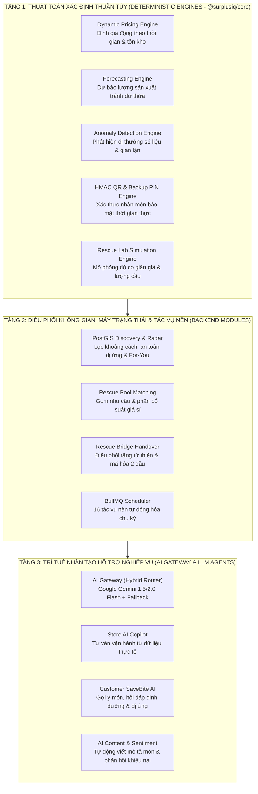
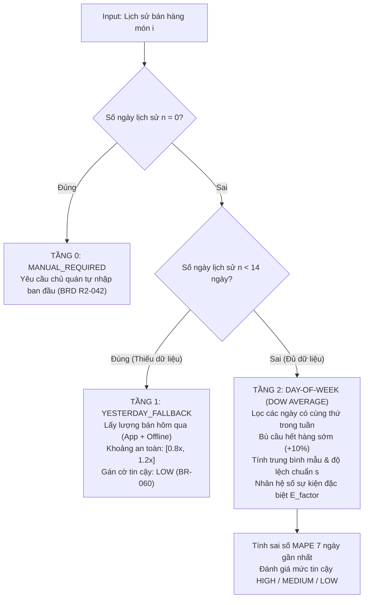
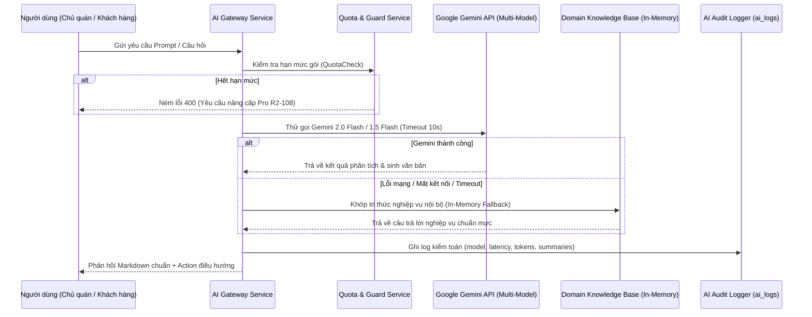
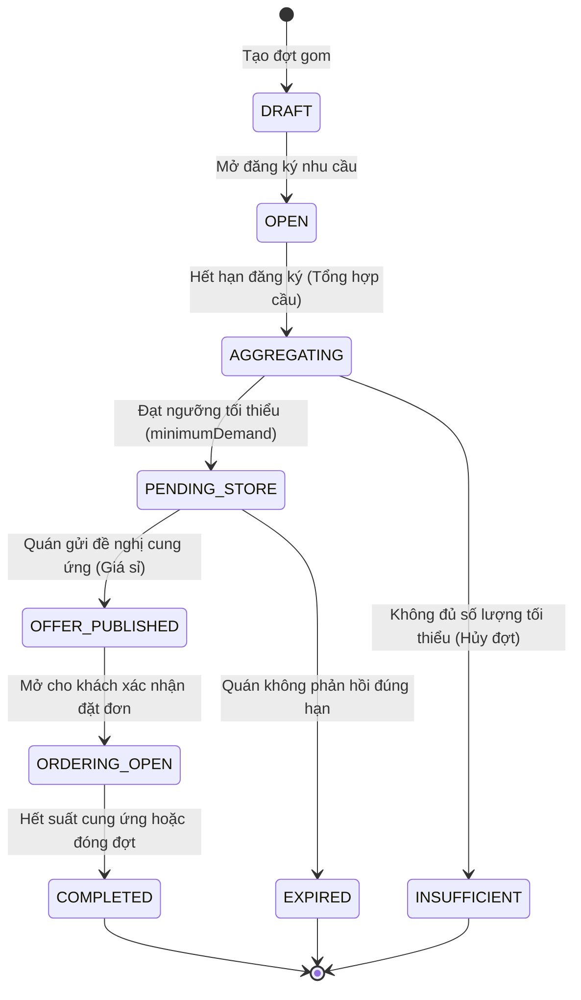

# TỔNG HỢP TOÀN BỘ LUỒNG NGHIỆP VỤ & THUẬT TOÁN HỆ THỐNG SURPLUSIQ

> **Tài liệu Kỹ thuật Kiến trúc & Thuật toán Cốt lõi (Core Algorithms & Business Logic Specification)**  
> **Phiên bản:** 2.0 (Cập nhật theo kiến trúc Monorepo NestJS + Core Engine + AI Gateway)  
> **Dự án:** SurplusIQ - Nền tảng Công nghệ Giải cứu Thực phẩm & Tối ưu Dòng đời Suất ăn

---

## MỤC LỤC TỔNG QUAN

1. [Tổng quan Kiến trúc & Hệ sinh thái Thuật toán SurplusIQ](#1-tổng-quan-kiến-trúc--hệ-sinh-thái-thuật-toán-surplusiq)
2. [Thuật toán Định giá Động Thời gian thực (Dynamic Pricing Engine)](#2-thuật-toán-định-giá-động-thời-gian-thực-dynamic-pricing-engine)
3. [Thuật toán Dự báo Sản xuất & Nhu cầu (Forecasting Engine)](#3-thuật-toán-dự-báo-sản-xuất--nhu-cầu-forecasting-engine)
4. [Thuật toán Phát hiện Bất thường & Kiểm soát Gian lận (Anomaly Detection Engine)](#4-thuật-toán-phát-hiện-bất-thường--kiểm-soát-gian-lận-anomaly-detection-engine)
5. [Hệ sinh thái Trí tuệ Nhân tạo AI (AI Gateway & Intelligent Agents)](#5-hệ-sinh-thái-trí-tuệ-nhân-tạo-ai-ai-gateway--intelligent-agents)
6. [Thuật toán Khám phá, Radar Vị trí & Cá nhân hóa (Discovery, Radar & For-You Engine)](#6-thuật-toán-khám-phá-radar-vị-trí--cá-nhân-hóa-discovery-radar--for-you-engine)
7. [Thuật toán Mô phỏng Kinh tế học Vi mô Rescue Lab (Microeconomic Simulation Engine)](#7-thuật-toán-mô-phỏng-kinh-tế-học-vi-mô-rescue-lab-microeconomic-simulation-engine)
8. [Thuật toán Gom Nhu cầu & Ghép cặp Cứu trợ (Rescue Pool Engine)](#8-thuật-toán-gom-nhu-cầu--ghép-cặp-cứu-trợ-rescue-pool-engine)
9. [Thuật toán Điều phối Từ thiện & Bàn giao Mã hóa (Rescue Bridge Engine)](#9-thuật-toán-điều-phối-từ-thiện--bàn-giao-mã-hóa-rescue-bridge-engine)
10. [Thuật toán Bảo mật Vé Nhận hàng QR & PIN Dự phòng (HMAC Token & Anti-Fraud Engine)](#10-thuật-toán-bảo-mật-vé-nhận-hàng-qr--pin-dự-phòng-hmac-token--anti-fraud-engine)
11. [Thuật toán Điểm thưởng Xanh & Tác động Giảm phát thải CO2 (Eco-Metrics Engine)](#11-thuật-toán-điểm-thưởng-xanh--tác-động-giảm-phát-thải-co2-eco-metrics-engine)
12. [Hệ thống Máy điều phối Tác vụ Nền Định kỳ (BullMQ Scheduler Engine)](#12-hệ-thống-máy-điều-phối-tác-vụ-nền-định-kỳ-bullmq-scheduler-engine)

---

## 1. TỔNG QUAN KIẾN TRÚC & HỆ SINH THÁI THUẬT TOÁN SURPLUSIQ

SurplusIQ giải quyết bài toán cốt lõi: **"Thực phẩm cận hạn giảm giá trị theo từng phút, nếu không có cơ chế điều phối tốc độ cao thì sẽ trở thành rác thải gây lãng phí tài chính và ô nhiễm môi trường."**

Để giải quyết bài toán này ở quy mô lớn, kiến trúc SurplusIQ tách biệt rõ hai tầng xử lý:



- **Tính nguyên tử & Bất biến (Purity & Determinism):** Các engine cốt lõi trong `@surplusiq/core` là **Pure Functions** (không I/O, không gọi `Date.now()`, nhận input $\rightarrow$ trả output xác định $100\%$, dễ dàng unit test tuyệt đối).
- **Phân tách trách nhiệm AI vs Toán học:** AI (LLM) **tuyệt đối không được phép tự bịa số liệu doanh thu, tồn kho hay số tiền**. Số liệu luôn do các công thức toán học và truy vấn cơ sở dữ liệu tính toán chính xác, sau đó AI chỉ đóng vai trò phân tích ngữ nghĩa, giải thích và tương tác ngôn ngữ tự nhiên.

---

## 2. THUẬT TOÁN ĐỊNH GIÁ ĐỘNG THỜI GIAN THỰC (DYNAMIC PRICING ENGINE)

### 2.1. Mục tiêu & Cơ sở Nghiệp vụ
- **Mã quy chuẩn:** BRD 5.13, R2-044 $\rightarrow$ R2-048, BR-064 $\rightarrow$ BR-066.
- **Vị trí mã nguồn:** `packages/core/src/pricing/engine.ts` và `apps/backend/src/modules/decisions`.
- **Mục tiêu:** Tự động đề xuất giảm giá suất ăn khi thời gian nhận hàng trôi dần về cuối khung giờ (pickup window) và áp lực tồn kho còn nhiều, nhằm đảm bảo tỷ lệ giải cứu tối đa mà không bán phá giá dưới giá sàn.

### 2.2. Công thức Toán học Chi tiết

#### Bước 1: Tính toán Giá sàn an toàn (Hard Floor Price)
$$p_{\text{floor}} = \max\left(p_{\text{customFloor}}, \text{round500}(p_{\text{original}} \times r_{\text{floor}})\right)$$
- $p_{\text{original}}$: Giá niêm yết ban đầu của món ăn.
- $r_{\text{floor}}$: Tỷ lệ giá sàn an toàn (mặc định $0.4 = 40\%$ theo BR-064 để bảo vệ thương hiệu quán).
- $\text{round500}(x)$: Hàm làm tròn về bội số gần nhất của $500\text{ VND}$.

#### Bước 2: Tính tỷ lệ thời gian trôi qua và áp lực tồn kho
- **Tỷ lệ thời gian trôi qua ($\tau$):**
$$\tau = \min\left(1.0, \max\left(0.0, \frac{t_{\text{now}} - t_{\text{start}}}{t_{\text{end}} - t_{\text{start}}}\right)\right)$$
- **Tỷ lệ tồn kho còn lại ($\sigma_{\text{stock}}$):**
$$\sigma_{\text{stock}} = \min\left(1.0, \max\left(0.0, \frac{q_{\text{remaining}}}{q_{\text{initial}}}\right)\right)$$

#### Bước 3: Hàm suy giảm phi tuyến (Non-linear Markdown Decay)
Biên độ giảm tối đa khả dĩ:
$$\Delta_{\text{max}} = p_{\text{current}} - p_{\text{floor}}$$

Hệ số giảm giá kết hợp yếu tố thời gian và áp lực tồn kho:
$$\text{Discount} = \Delta_{\text{max}} \times \tau^{1.2} \times \left(0.5 + 0.5 \times \sigma_{\text{stock}}\right)$$

*Giải thích số mũ $1.2$:* Đường cong thời gian lũy thừa $1.2$ là đường cong dốc dần về cuối. Khi mới mở bán, giá giảm chậm; càng sát giờ đóng cửa ($t_{\text{end}}$), tốc độ đề xuất giảm càng nhanh để kích cầu tức thì.

#### Bước 4: Làm tròn tiền tệ và bước nhảy tối thiểu
$$p_{\text{proposed}} = \text{round500}(p_{\text{current}} - \text{Discount})$$

Nếu thời gian đã trôi qua $\ge 25\%$ ($\tau \ge 0.25$) mà mức giảm tính toán nhỏ hơn $500\text{đ}$ dẫn đến giá không đổi, thuật toán chủ động trừ 1 bước nhảy $500\text{đ}$:
$$\text{Nếu } p_{\text{proposed}} \ge p_{\text{current}} \text{ và } \tau \ge 0.25 \implies p_{\text{proposed}} = \max(p_{\text{floor}}, p_{\text{current}} - 500)$$

Kẹp giá trị tuyệt đối trong khoảng an toàn:
$$p_{\text{final}} = \max(p_{\text{floor}}, \min(p_{\text{current}}, p_{\text{proposed}}))$$

### 2.3. Ma trận Ràng buộc & Guards
| Mã vi phạm | Điều kiện kích hoạt | Hành vi của Engine |
| :--- | :--- | :--- |
| `OUTSIDE_WINDOW` | $t_{\text{now}} < t_{\text{start}}$ hoặc $t_{\text{now}} > t_{\text{end}}$ | Từ chối đề xuất (`canPropose = false`), giữ nguyên giá hiện tại |
| `MAX_CHANGES_REACHED` | `priceChangeCount >= 3` | Từ chối đổi giá (giới hạn tối đa 3 lần/ngày theo BR-064 để tránh quấy rầy khách hàng) |
| `ALREADY_AT_FLOOR` | $p_{\text{current}} \le p_{\text{floor}}$ | Từ chối giảm thêm, giữ ở giá sàn |
| `OUT_OF_STOCK` | $q_{\text{remaining}} \le 0$ | Dừng định giá động |

---

## 3. THUẬT TOÁN DỰ BÁO SẢN XUẤT & NHU CẦU (FORECASTING ENGINE)

### 3.1. Mục tiêu & Cơ sở Nghiệp vụ
- **Mã quy chuẩn:** BRD 5.12, R2-036 $\rightarrow$ R2-043, BR-060, BR-063.
- **Vị trí mã nguồn:** `packages/core/src/forecasting/engine.ts`.
- **Mục tiêu:** Giúp chủ quán biết chính xác ngày mai cần nấu/nướng bao nhiêu suất ăn cho từng món nhằm giảm thiểu lượng dư thừa đổ bỏ cuối ngày.

### 3.2. Cấu trúc Phân tầng Dữ liệu (Tiered Logic)



### 3.3. Công thức Toán học Chi tiết cho Tầng 2 ($\ge 14$ ngày)

#### Bước 1: Bù cầu khi hết hàng sớm (Uncensoring Demand)
Nếu một ngày trong quá khứ bị hết hàng trước giờ đóng cửa (`stockoutEarly = true`), nhu cầu thực tế của khách hàng cao hơn số lượng bán được. Thuật toán bù thêm $10\%$:
$$y_k^* = \begin{cases} (y_{\text{app}} + y_{\text{offline}}) \times 1.1 & \text{nếu } \text{stockoutEarly} = \text{true} \\ y_{\text{app}} + y_{\text{offline}} & \text{ngược lại} \end{cases}$$

#### Bước 2: Tính Trung bình Mẫu ($\mu_{\text{DOW}}$) & Độ lệch chuẩn ($s$)
$$\mu_{\text{DOW}} = \frac{1}{m} \sum_{k=1}^m y_k^*$$
$$s = \sqrt{\frac{1}{m - 1} \sum_{k=1}^m \left(y_k^* - \mu_{\text{DOW}}\right)^2}$$
*(Nếu mẫu $m = 1$, ước lượng phương sai $s = 0.15 \times \mu_{\text{DOW}}$).*

#### Bước 3: Áp dụng Hệ số Sự kiện Đặc biệt ($E_{\text{factor}}$ - BR-063)
$$E_{\text{factor}} = \begin{cases} 
0.0 & \text{nếu quán đóng cửa (CLOSED)} \\
1.30 & \text{nếu ngày Lễ / Tết / Hội hè} \\
1.15 & \text{nếu có sự kiện Siêu Sale / Payday} \\
0.85 & \text{nếu sự kiện vắng khách / đối thủ khai trương} \\
1.00 & \text{ngày bình thường}
\end{cases}$$

#### Bước 4: Khoảng Khuyến nghị Tin cậy $80\%$ (Confidence Interval)
Sử dụng phân phối chuẩn với hệ số $Z_{0.80} \approx 1.28$:
$$\text{Margin} = 1.28 \times s \times E_{\text{factor}}$$
$$\text{Recommended} = \max\left(1, \text{round}\left(\mu_{\text{DOW}} \times E_{\text{factor}}\right)\right)$$
$$\text{Low} = \max\left(1, \text{round}\left(\mu_{\text{DOW}} \times E_{\text{factor}} - \text{Margin}\right)\right)$$
$$\text{High} = \max\left(\text{Recommended}, \text{round}\left(\mu_{\text{DOW}} \times E_{\text{factor}} + \text{Margin}\right)\right)$$

#### Bước 5: Đánh giá Sai số Bằng MAPE (Mean Absolute Percentage Error)
$$\text{MAPE} = \frac{1}{7} \sum_{t=1}^7 \left|\frac{\text{Actual}_t - \text{Forecast}_t}{\text{Actual}_t}\right| \times 100\%$$
- **Độ tin cậy CAO (HIGH):** $m \ge 3$ tuần cùng thứ và $\text{MAPE} < 15\%$.
- **Độ tin cậy TRUNG BÌNH (MEDIUM):** $m \ge 2$ tuần cùng thứ và $15\% \le \text{MAPE} \le 25\%$.
- **Độ tin cậy THẤP (LOW):** $\text{MAPE} > 25\%$ hoặc lịch sử khuyết thiếu.

> **Quy tắc Nghiệp vụ Bắt buộc (Chương 13 #10):** Tuyệt đối **KHÔNG** đưa yếu tố thời tiết vào mô hình dự báo để tránh sai lệch dự báo giả định tại thị trường F&B Việt Nam.

---

## 4. THUẬT TOÁN PHÁT HIỆN BẤT THƯỜNG & KIỂM SOÁT GIAN LẬN (ANOMALY DETECTION ENGINE)

### 4.1. Mục tiêu & Cơ sở Nghiệp vụ
- **Mã quy chuẩn:** BRD 5.14, R2-099, R2-112, BR-096.
- **Vị trí mã nguồn:** `packages/core/src/anomaly/engine.ts`.
- **Mục tiêu:** Tự động phát hiện các đột biến bất thường (như doanh thu sụt giảm đột ngột, tỷ lệ khách bùng đơn tăng vọt, lượng thức ăn vứt bỏ bất thường hoặc hành vi gian lận gom hàng).

### 4.2. Tại sao dùng MAD (Median Absolute Deviation) thay cho Độ lệch chuẩn ($\sigma$)?
Dữ liệu doanh thu và hủy đơn F&B thường có các giá trị ngoại lai cực đoan (Outliers). Độ lệch chuẩn $\sigma$ và trung bình cộng $\mu$ rất nhạy cảm với ngoại lai, khiến ngưỡng phát hiện bị méo mó.  
**SurplusIQ áp dụng thống kê phi tham số vững chắc (Robust Statistics):**
1. **Trung vị (Median - $\tilde{X}$):** Giá trị ở giữa dãy số đã sắp xếp.
2. **Độ lệch tuyệt đối trung vị (MAD):**
$$\text{MAD} = \text{Median}\left(|x_i - \text{Median}(X)|\right)$$

### 4.3. Ngưỡng Phát hiện Bất thường
Với hệ số nhạy cảm chuẩn $k = 2.5$ (theo chuẩn BR-096):
$$\text{Ngưỡng Dưới (Lower Bound)} = \max\left(0, \text{Median} - 2.5 \times \text{MAD}\right)$$
$$\text{Ngưỡng Trên (Upper Bound)} = \text{Median} + 2.5 \times \text{MAD}$$

Nếu giá trị thực tế của ngày quan sát $x_{\text{target}} \notin [\text{Lower Bound}, \text{Upper Bound}]$, hệ thống kích hoạt cảnh báo bất thường:
- **Đột biến Cao (`SPIKE`):** $x_{\text{target}} > \text{Upper Bound}$ (VD: Bùng nổ đơn bất thường nghi ngờ bot gom đơn).
- **Sụt giảm Sâu (`DROP`):** $x_{\text{target}} < \text{Lower Bound}$ (VD: Doanh thu rơi tự do báo hiệu sự cố thanh toán hoặc quán bị phản ánh tiêu cực).

### 4.4. 4 Chỉ số Cốt lõi được Giám sát Liên tục
1. `REVENUE`: Doanh thu gộp trong ngày (đ).
2. `WASTE_QUANTITY`: Số suất ăn dư thừa không cứu được phải tiêu hủy (suất).
3. `ORDERS_COUNT`: Tổng số lượng đơn hàng phát sinh (đơn).
4. `NOSHOW_RATE`: Tỷ lệ khách đặt nhưng không đến nhận đơn (`PICKUP_EXPIRED`) (%).

---

## 5. HỆ SINH THÁI TRÍ TUỆ NHÂN TẠO AI (AI GATEWAY & INTELLIGENT AGENTS)

### 5.1. Kiến trúc Hybrid Router AI
Vị trí mã nguồn: `apps/backend/src/modules/ai/ai-gateway.service.ts`.

Hệ thống AI của SurplusIQ được xây dựng theo mô hình **Zero-Downtime Hybrid Architecture**:


### 5.2. Danh mục 7 Tác nhân AI Chuyên biệt (AI Agents)

#### ① Store AI Copilot (Trợ lý Điều hành Cửa hàng - R2-108..R2-110)
- **Đặc điểm:** Tích hợp bộ tri thức nghiệp vụ vận hành quán ăn `STORE_GUIDE_KNOWLEDGE_PROMPT`.
- **Nguyên tắc bất di bất dịch:** Cung cấp số liệu doanh thu 7 ngày thực tế do backend tính toán đưa vào Prompt context (`factsText`). Tuyệt đối **cấm AI tự bịa số liệu tài chính**. Hướng dẫn chủ quán thao tác từng bước: `[Tên màn hình] ➔ [Nút bấm] ➔ [Lưu ý]`.

#### ② Customer SaveBite AI (Trợ lý Tiết kiệm Thực phẩm Khách hàng)
- **Đặc điểm:** Tích hợp bộ tri thức khách hàng `CUSTOMER_GUIDE_KNOWLEDGE_PROMPT`.
- **Chức năng:** Gợi ý các món ăn gần vị trí đang có giá hời, phân tích thành phần món ăn, cảnh báo chất gây dị ứng và giải thích các chính sách hoàn tiền, hủy đơn.

#### ③ AI Describe Item & Smart Tagging (Sinh Mô tả Món ăn - R2-021)
- **Input:** Tên món, danh mục, nguyên liệu, hương vị đặc trưng.
- **Output:** Đoạn mô tả món ăn thơm ngon, khơi gợi vị giác, tối ưu hóa hiển thị trên ứng dụng và tự động đề xuất 3-5 hashtag danh mục chuẩn.

#### ④ AI Review Reply Drafter (Dự thảo Phản hồi Đánh giá - R2-078)
- **Hỗ trợ 3 giọng điệu cảm xúc:**
  + `FRIENDLY` (Thân thiện, gần gũi, cảm ơn chân thành).
  + `FORMAL` (Trang trọng, chuẩn mực nhà hàng cao cấp).
  + `APOLOGETIC` (Cầu thị, xin lỗi chân thành khi khách đánh giá 1-2 sao, cam kết cải thiện chất lượng phục vụ).

#### ⑤ AI Complaint Resolution Drafter (Dự thảo Xử lý Khiếu nại - R2-082)
- **Quy trình:** Đọc lý do khiếu nại của khách, ảnh chụp bằng chứng món ăn hỏng/thiếu $\rightarrow$ AI phân tích mức độ nghiêm trọng $\rightarrow$ Dự thảo thư trả lời lịch thiệp và đề xuất tỷ lệ hoàn tiền phù hợp ($50\%$, $100\%$ hoặc đổi suất mới).

#### ⑥ AI Sentiment Analysis (Phân tích Cảm xúc Đa chiều)
- **Chức năng:** Quét toàn bộ nhận xét khách hàng trong tuần $\rightarrow$ Phân loại cảm xúc (Tích cực / Tiêu cực / Trung tính), chấm điểm Sentiment Score ($0 \rightarrow 100$) và trích xuất các từ khóa khen/chê nổi bật (ví dụ: "đồ ăn nóng hổi", "quá mặn", "đóng gói lỏng lẻo").

#### ⑦ AI Smart Combo Suggester (Gợi ý Tổ hợp Món Bổ trợ)
- **Chức năng:** Phân tích các món tồn dư trong kho của quán để đề xuất tạo các gói Combo cứu trợ (ví dụ: "Cơm thố + Canh rong biển + Trà tắc") với mức giá giảm hấp dẫn, kích thích khách mua trọn gói.

---

## 6. THUẬT TOÁN KHÁM PHÁ, RADAR VỊ TRÍ & CÁ NHÂN HÓA (DISCOVERY, RADAR & FOR-YOU ENGINE)

### 6.1. Truy vấn Không gian Địa lý PostGIS
Vị trí mã nguồn: `apps/backend/src/modules/discovery/discovery.service.ts`.

Hệ thống sử dụng hệ tọa độ chuẩn **WGS 84 (SRID 4326)** và kiểu dữ liệu PostGIS `geography` để tính toán khoảng cách thực tế trên mặt cầu Trái Đất:
```sql
-- Lọc cửa hàng trong bán kính R mét
s.location IS NOT NULL 
AND ST_DWithin(
    s.location::geography, 
    ST_SetSRID(ST_MakePoint(:lng, :lat), 4326)::geography, 
    :radiusMeters
)

-- Tính khoảng cách chính xác theo mét
ROUND(ST_Distance(
    s.location::geography, 
    ST_SetSRID(ST_MakePoint(:lng, :lat), 4326)::geography
)) AS distance_meters
```

### 6.2. Thuật toán Xếp hạng Radar (Radar Ranking Score - KC15, BR-C05-03)
Khi khách hàng quét Radar tìm món xung quanh, điểm số của mỗi suất ăn được chấm theo công thức:

$$\text{Score}_{\text{Radar}} = S_{\text{distance}} \times W_d + S_{\text{time}} \times W_t + S_{\text{stock}} \times 15 + S_{\text{discount}} \times 10$$

Trong đó:
- **Điểm khoảng cách ($S_{\text{distance}}$):**
  $$S_{\text{distance}} = \max\left(0, 1 - \frac{\text{distanceMeters}}{R_{\text{max}}}\right)$$
- **Điểm thời gian nhận còn lại ($S_{\text{time}}$):**
  $$S_{\text{time}} = \min\left(1.0, \frac{\text{minutesLeft}}{120}\right)$$
- **Điểm khẩn cấp tồn kho ($S_{\text{stock}}$):**
  $$S_{\text{stock}} = \min\left(1.0, \frac{\text{remainingQuantity}}{5}\right)$$
- **Điểm ưu đãi ($S_{\text{discount}}$):**
  $$S_{\text{discount}} = \frac{\% \text{giảm giá}}{100}$$

*Trọng số linh hoạt ($W_d, W_t$):*
- Chế độ thường: $W_d = 40, W_t = 35$.
- Chế độ "Ưu tiên nhận kịp" (`prioritizeInTime = true`): Ẩn ngay các suất còn dưới $15$ phút, đảo trọng số $W_t = 45, W_d = 30$.
- **Quy tắc An toàn Thực phẩm Tuyệt đối:** Suất ăn chứa chất gây dị ứng trong hồ sơ của khách (`excludeAllergens`) bị **LOẠI BỎ HOÀN TOÀN ($100\%$)**, tuyệt đối không dùng cơ chế trừ điểm.

### 6.3. Thuật toán Cá nhân hóa "Gợi ý Dành Cho Bạn" (For-You Engine - K21)
Điểm số cá nhân hóa được cộng dồn từ điểm Radar nền và các hành vi thực tế của khách trong $30 - 90$ ngày qua:
$$\text{Score}_{\text{ForYou}} = \text{Score}_{\text{Radar}} + \text{Bonus}_{\text{favorite}} + \text{Bonus}_{\text{category}} + \text{Bonus}_{\text{time}} + \text{Bonus}_{\text{view}}$$

- **Cửa hàng yêu thích ($\text{Bonus}_{\text{favorite}}$):** $+25$ điểm nếu quán nằm trong danh sách yêu thích của khách.
- **Danh mục quen thuộc ($\text{Bonus}_{\text{category}}$):** $+\min(20, \text{số đơn đã mua} \times 7)$ điểm cho món ăn thuộc nhóm khách hàng thường xuyên đặt trong 90 ngày qua.
- **Khung giờ thói quen ($\text{Bonus}_{\text{time}}$):** $+10$ điểm nếu giờ nhận hàng trùng với thói quen lấy hàng thường lệ ($\pm 2$ tiếng).
- **Món vừa xem ($\text{Bonus}_{\text{view}}$):** $+8$ điểm nếu khách vừa xem món hoặc xem quán trong 30 ngày qua.

### 6.4. Thuật toán Gợi ý Giỏ hàng Tối ưu (Rescue Basket Engine - CM-C01)
Giải bài toán tối ưu tổ hợp (Knapsack-like Heuristic):
- **Ràng buộc cứng:**
  1. $\sum \text{currentPrice} \le \text{budgetMax}$ (Không vượt ngân sách khách đặt).
  2. $\sum \text{quantity} \ge \text{peopleCount}$ (Đủ số phần cho số lượng người ăn).
  3. Giao thoa khung giờ nhận hàng hợp lệ.
  4. Lọc bỏ toàn bộ món chứa dị ứng của tất cả thành viên.
- **Hàm mục tiêu:** Tối đa hóa tỷ lệ giảm giá và ưu tiên gom các món từ **cùng 1 cửa hàng** để khách chỉ cần di chuyển 1 lần nhận hàng.

---

## 7. THUẬT TOÁN MÔ PHỎNG KINH TẾ HỌC VI MÔ RESCUE LAB (MICROECONOMIC SIMULATION ENGINE)

### 7.1. Mục tiêu & Cơ sở Nghiệp vụ
- **Mã quy chuẩn:** CM-B04, BR-B04-01 $\rightarrow$ BR-B04-09.
- **Vị trí mã nguồn:** `apps/backend/src/modules/rescue-lab/rescue-lab.engine.ts`.
- **Mục tiêu:** Cho phép chủ quán "thử nghiệm giả định" (What-if scenario analysis) trên dữ liệu lịch sử $14 - 90$ ngày: *"Nếu tôi giảm giá thêm $15\%$ và đưa lên thêm $20\%$ số suất thì doanh thu thu hồi và tỷ lệ bán sẽ biến động ra sao?"*

### 7.2. Mô hình Kinh tế học Vi mô Cốt lõi
Thuật toán dựa trên lý thuyết kinh tế học về **Độ co giãn của Cầu theo Giá (Price Elasticity of Demand - $\epsilon$):**

#### Bước 1: Giá giả định mới ($p_1$)
$$p_1 = p_{\text{orig\_avg}} \times (1 - \text{discountRatio})$$

#### Bước 2: Hệ số co giãn lượng cầu ($f$)
$$f = \left(\frac{p_1}{p_0}\right)^{-\epsilon}$$
*(Với $p_0$ là giá thực thu bình quân kỳ nền, mặc định $\epsilon = 1.5$). Khi giá giảm ($p_1 < p_0$), hệ số $f > 1.0$, nghĩa là lượng cầu tăng lên.*

#### Bước 3: Ước lượng Số suất cung ứng & Số suất bán được
$$q_{\text{offered}}^{\text{sim}} = \text{round}\left(q_{\text{offered}}^{\text{base}} \times \left(1 + \frac{\text{volumeChangePct}}{100}\right)\right)$$
$$q_{\text{sold}}^{\text{sim}} = \min\left(q_{\text{offered}}^{\text{sim}}, \text{round}\left(q_{\text{sold}}^{\text{base}} \times f\right)\right)$$
$$\text{Revenue}^{\text{sim}} = \text{round}\left(q_{\text{sold}}^{\text{sim}} \times p_1\right)$$
$$\text{Surplus}^{\text{sim}} = q_{\text{offered}}^{\text{sim}} - q_{\text{sold}}^{\text{sim}}$$
$$\text{SellThroughRate}^{\text{sim}} = \frac{q_{\text{sold}}^{\text{sim}}}{q_{\text{offered}}^{\text{sim}}}$$

### 7.3. Bộ Cảnh báo Chất lượng Dữ liệu (Data Quality Guards)
1. **Cảnh báo Cầu bị che khuất (`CENSORED_DEMAND`):** Nếu tỷ lệ bán lịch sử $\ge 98\%$, quán thường xuyên cháy hàng sớm $\implies$ Không quan sát được lượng cầu vượt thực tế.
2. **Cảnh báo Ngoại suy Quá mức (`EXTRAPOLATION_WARNING`):** Nếu giá mô phỏng lệch quá $\pm 30\%$ so với vùng giá lịch sử $\implies$ Ngoại suy nằm ngoài vùng tin cậy của mô hình.
3. **Mẫu quá nhỏ (`LOW_SAMPLE_WARNING`):** Số suất bán được kỳ nền $< 30$ suất.

---

## 8. THUẬT TOÁN GOM NHU CẦU & GHÉP CẶP CỨU TRỢ (RESCUE POOL ENGINE)

### 8.1. Mục tiêu & Cơ sở Nghiệp vụ
- **Mã quy chuẩn:** CM-B02, CM-C02, BR-B02-01 $\rightarrow$ BR-B02-10.
- **Vị trí mã nguồn:** `apps/backend/src/modules/rescue-pool/rescue-pool.service.ts`.
- **Mục tiêu:** Gom các nhu cầu nhỏ lẻ của nhiều khách hàng trong cùng khu vực (`serviceArea`) để tạo ra một "đơn gom sỉ", giúp quán ăn có thể giải cứu số lượng lớn thực phẩm cùng lúc với chi phí tối ưu.

### 8.2. Máy Trạng thái Đợt Gom (Finite State Machine)



### 8.3. Thuật toán Phân bổ Nguồn cung (Supply Allocation)
Khi số lượng khách đăng ký vượt quá số lượng cung ứng tối đa của quán ($D_{\text{total}} > S_{\text{max}}$), thuật toán phân bổ theo tiêu chí:
1. **Thời gian đăng ký sớm (FIFO - First In First Out):** Khách đăng ký trước được giữ suất ưu tiên.
2. **Khớp mức ngân sách:** Khách có $\text{targetBudgetMax} \ge \text{offeredPrice}$ mới được chuyển sang trạng thái tạo đơn.
3. **Nguyên tắc Guard-rail:** Giai đoạn đăng ký nhu cầu **tuyệt đối không giữ tồn kho, không trừ tiền, không tạo đơn**. Đơn hàng chỉ chính thức phát sinh khi khách hàng bấm xác nhận đề nghị cung ứng (`confirmOffer`).

---

## 9. THUẬT TOÁN ĐIỀU PHỐI TỪ THIỆN & BÀN GIAO MÃ HÓA (RESCUE BRIDGE ENGINE)

### 9.1. Mục tiêu & Cơ sở Nghiệp vụ
- **Mã quy chuẩn:** CM-B03, BR-B03-01 $\rightarrow$ BR-B03-12.
- **Vị trí mã nguồn:** `apps/backend/src/modules/rescue-bridge/rescue-bridge.service.ts`.
- **Mục tiêu:** Khi thực phẩm không bán hết qua ứng dụng thương mại, hệ thống tự động kết nối và chuyển giao sang các tổ chức từ thiện, bếp ăn 0 đồng hoặc ngân hàng thực phẩm uy tín.

### 9.2. Cơ chế Xác nhận Bàn giao Mù Hai chiều (Double-blind Handover Code)
Để ngăn chặn tình trạng khai khống số lượng suất ăn từ thiện nhằm trục lợi hoặc gian lận thuế:
1. Hệ thống sinh mã xác thực ngẫu nhiên an toàn $6$ ký tự (`handover_code`) bằng hàm băm mật mã:
$$\text{TokenHash} = \text{SHA256}(\text{RandomBytes}(32))$$
2. Mã này chỉ hiển thị trên ứng dụng của Tổ chức Tiếp nhận (Recipient Organization).
3. Khi nhân viên từ thiện đến quán lấy đồ, họ cung cấp mã cho chủ quán. Chủ quán nhập mã vào hệ thống $\rightarrow$ Hệ thống băm mã và so khớp bằng hàm so sánh an toàn:
$$\text{hashToken}(\text{inputCode}) == \text{storedHash}$$
4. Cả hai bên ký biên bản điện tử xác nhận: Số lượng thực tế, tình trạng cảm quan, nhiệt độ bảo quản và cam kết tuân thủ luật bảo vệ người quyên góp thực phẩm (Good Samaritan Food Donation Laws).

---

## 10. THUẬT TOÁN BẢO MẬT VÉ NHẬN HÀNG QR & PIN DỰ PHÒNG (HMAC TOKEN & ANTI-FRAUD ENGINE)

### 10.1. Mục tiêu & Cơ sở Nghiệp vụ
- **Mã quy chuẩn:** BR-022, Chương 9.1.
- **Vị trí mã nguồn:** `packages/core/src/tokens/qr-token.ts` và `backup-pin.ts`.
- **Mục tiêu:** Tạo mã vé nhận hàng QR động và mã PIN 6 số an toàn, bảo vệ tuyệt đối thông tin cá nhân khách hàng tại quầy và chống hoàn toàn các cuộc tấn công gian lận vé.

### 10.2. Cấu trúc Payload Chữ ký số HMAC-SHA256
Vé nhận hàng QR **tuyệt đối KHÔNG chứa PII** (không có số điện thoại, tên, email hay thẻ ngân hàng):
$$\text{DataString} = \text{jti} \parallel \text{orderId} \parallel \text{storeId} \parallel \text{exp}$$
$$\text{Signature} = \text{HMAC-SHA256}(\text{DataString}, \text{SecretKey})$$
$$\text{QR Token} = \text{Base64URL}\left(\text{JSON}\left(\{\text{jti}, \text{orderId}, \text{storeId}, \text{exp}, \text{sig}: \text{Signature}\}\right)\right)$$

### 10.3. Cơ chế Chống Tấn công Dò Thời gian (Anti-Timing Attack)
Tại quầy thu ngân, việc kiểm tra chữ ký số không dùng toán tử so sánh chuỗi thông thường `==` (vì dễ bị tấn công đo thời gian CPU so khớp từng byte). Hệ thống sử dụng hàm so sánh thời gian bất biến:
```typescript
crypto.timingSafeEqual(sigBuf, expectedBuf);
```

### 10.4. Thuật toán Mã PIN Dự phòng 6 Số (Backup PIN Engine)
Khi màn hình điện thoại khách bị nứt, vỡ camera hoặc không có 4G/Wifi:
- Sinh mã PIN $6$ ký tự từ chữ số và chữ in hoa không gây nhầm lẫn: Loại bỏ các ký tự dễ lẫn như `0`, `O`, `1`, `I`.
- **Cơ chế chống Brute-force:** Khóa mã PIN nếu nhập sai quá $5$ lần liên tiếp.

---

## 11. THUẬT TOÁN ĐIỂM THƯỞNG XANH & TÁC ĐỘNG GIẢM PHÁT THẢI CO2 (ECO-METRICS ENGINE)

### 11.1. Công thức Tích lũy Điểm thưởng (Rescue Rewards Ledger)
Vị trí mã nguồn: `apps/backend/src/modules/rewards/rewards.service.ts`.
- Sử dụng mô hình **Sổ cái Bất biến (Append-Only Ledger)**: Không bao giờ sửa hoặc xóa dòng tiền/điểm. Mọi giao dịch hoàn tiền hoặc hủy đơn đều ghi nhận bằng một bút toán đối ứng âm (`REVERSE`).
- Công thức tích điểm khi nhận hàng thành công:
$$\text{Points} = \left\lfloor \frac{\text{totalAmount}}{10.000} \right\rfloor$$
*(Mỗi $10.000\text{ VND}$ thanh toán tích lũy $1$ điểm thưởng Rescue Point).*

### 11.2. Công thức Khoa học Tính Tác động Môi trường (CO2 Offset Metric)
Theo nghiên cứu chuẩn của Tổ chức Lương thực và Nông nghiệp Liên Hợp Quốc (FAO) và Chương trình Môi trường UNEP:
- Mỗi suất ăn giải cứu thành công tương đương trung bình $\approx 0.8\text{ - }1.0\text{ kg}$ thực phẩm không bị phân hủy tại bãi rác.
- Cứ mỗi $1\text{ kg}$ thực phẩm tránh lãng phí giúp giảm phát thải tương đương $2.5\text{ kg } CO_2$ ra khí quyển:

$$\text{CO2 Saved (kg)} = \text{TotalRescuedMeals} \times 2.5\text{ kg } CO_2$$

Chỉ số này được hiển thị trực tiếp trên huy hiệu vinh danh của Khách hàng và Báo cáo Trách nhiệm Xã hội (ESG) của Chủ cửa hàng.

---

## 12. HỆ THỐNG MÁY ĐIỀU PHỐI TÁC VỤ NỀN ĐỊNH KỲ (BULLMQ SCHEDULER ENGINE)

Vị trí mã nguồn: `apps/backend/src/modules/jobs/bullmq.scheduler.ts` và `jobs.service.ts`.

Hệ thống điều phối $16$ tác vụ tự động hóa chạy nền định kỳ để đảm bảo tính toàn vẹn dữ liệu:

| Chu kỳ | Tên Tác vụ (Job Name) | Logic Xử lý Cốt lõi |
| :--- | :--- | :--- |
| **Mỗi 60 giây** | `orders.release-holds` | Nhả các suất ăn mà khách bấm thanh toán nhưng không chuyển khoản sau $10$ phút (hoàn trả tồn kho). |
| **Mỗi 60 giây** | `orders.pickup-expire` | Quét các đơn đã thanh toán nhưng khách không đến lấy sau khi hết khung nhận $\rightarrow$ Chuyển sang `PICKUP_EXPIRED`. |
| **Mỗi 60 giây** | `offers.auto-close` | Tự động đóng các suất bán đã hết giờ nhận hàng (`pickup_end < NOW()`). |
| **Mỗi 60 giây** | `notifications.pickup-reminder` | Gửi thông báo nhắc khách đến lấy đồ trước giờ kết thúc $30$ phút. |
| **Mỗi 60 giây** | `rescue-pool.deadlines` | Đóng đăng ký, tổng hợp nhu cầu, hủy các đợt gom không đủ người. |
| **Mỗi 60 giây** | `rescue-bridge.deadlines` | Xử lý các đợt tặng từ thiện quá hạn bàn giao. |
| **Mỗi 60 giây** | `campaigns.dispatch` | Quét và phát các chiến dịch thông báo ưu đãi đến giờ hẹn. |
| **Mỗi 5 phút** | `complaints.auto-accept` | Tự động chấp thuận khiếu nại và hoàn tiền cho khách nếu quán không phản hồi sau $48$ giờ. |
| **Mỗi 5 phút** | `rescue-timeline.recalc` | Tính toán lại mức độ nguy cơ của các lô thực phẩm đang mở bán. |
| **Mỗi 15 phút** | `decisions.price-proposals` | Kích hoạt Dynamic Pricing Engine tính toán đề xuất giảm giá mới cho các suất tồn nhiều. |
| **Mỗi 15 phút** | `payments.recheck` | Đối soát lại các giao dịch thanh toán VietQR đang treo trạng thái chờ. |
| **22:00 Hàng ngày** | `forecast.daily` | Kích hoạt Forecasting Engine tính toán lượng sản xuất cho tất cả các món vào ngày mai. |
| **00:00 Hàng ngày** | `subscriptions.lifecycle` | Kiểm tra thời hạn gói dịch vụ Pro của quán, hạ cấp về Free nếu hết hạn. |
| **00:05 Thứ Hai** | `statements.close-week` | Chốt kỳ sao kê đối soát tuần, tính phí hoa hồng sàn và khóa bất biến sổ sách tài chính. |
| **02:30 Hàng ngày** | `retention.cleanup` | Dọn dẹp dữ liệu log tạm thời đã quá hạn lưu trữ. |
| **03:00 Hàng ngày** | `accounts.anonymize` | Ẩn danh hóa vĩnh viễn thông tin cá nhân của các tài khoản yêu cầu xóa sau 7 ngày chờ. |

---

## TỔNG KẾT

Tất cả các thuật toán trên kết hợp tạo thành một **cỗ máy tối ưu hóa dòng đời thực phẩm khép kín**:
1. **Dự báo chính xác trước khi nấu** (Forecasting Engine).
2. **Định giá linh hoạt trong lúc bán** (Dynamic Pricing Engine & PostGIS Radar).
3. **Gom nhu cầu sỉ khi tồn nhiều** (Rescue Pool Engine).
4. **Bàn giao từ thiện khi cận hạn** (Rescue Bridge Engine).
5. **Giám sát gian lận và tính toán tác động môi trường minh bạch** (HMAC Tokens, MAD Anomaly Detection, CO2 Offset Metrics).
6. **Hỗ trợ thông minh 24/7 bằng Trí tuệ Nhân tạo** (Hybrid AI Gateway & Copilot).
