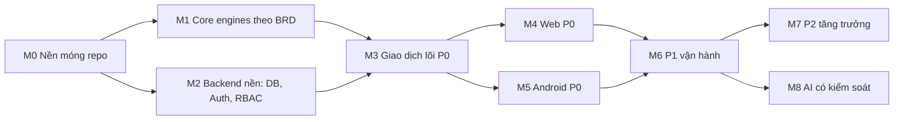

> **Nguồn sự thật nghiệp vụ:**
> - [BRD_Full_SurplusIQ.md](../BRD_Full_SurplusIQ.md) v1.0 (220 UC, 99 quy tắc BR-001..BR-099, 13 quyết định chốt ở chương 13).
> - [01_features_khach_hang.md](../01_features_khach_hang.md): Đặc tả chi tiết 94 tính năng App Khách hàng (R1-001 đến R1-094).
> - [02_features_chu_cua_hang.md](../02_features_chu_cua_hang.md): Đặc tả chi tiết 126 tính năng Web Quản trị Tiệm bánh (R2-001 đến R2-126).
> - [03_service_packages.md](../03_service_packages.md): Ma trận 4 gói dịch vụ (`GOI-CB`, `GOI-DT`, `GOI-PRO`, `GOI-KH`) và 11 quy tắc vòng đời gói (`VC-01` đến `VC-11`).
> **Quy trình bắt buộc:** [rule.md](../../rule.md) — nhánh chức năng từ `development`, commit `type(scope): ...`, merge `--no-ff`.
> **Nguyên tắc viết plan:** mọi con số trong plan phải trích được về một mã BR / UC / VC / mục chương 13. Chỗ nào BRD không nói, plan ghi rõ nhãn **[Đề xuất kỹ thuật]**.

## Mục lục bộ plan

| File | Nội dung |
|---|---|
| `00_TONG_QUAN_LO_TRINH.md` | Hiện trạng code, phân kỳ, mốc, DoD, ma trận bao phủ R1 (94 UC), R2 (126 UC), VC (11 quy tắc) (file này) |
| [01_BACKEND_VA_CSDL.md](01_BACKEND_VA_CSDL.md) | Bảng tham số, schema chi tiết hỗ trợ R1/R2, máy trạng thái, danh mục API, tác vụ nền, phân quyền & hạn mức gói |
| [02_CORE_PACKAGE.md](02_CORE_PACKAGE.md) | Đặc tả lại các engine theo BR, hàm thuần mới (hạn mức, đối soát, phân nhóm, bất thường) |
| [03_WEB_ADMIN_DASHBOARD.md](03_WEB_ADMIN_DASHBOARD.md) | Màn hình web theo 126 UC R2, quyền 3 vai trò (Owner/Manager/Counter), khóa gói Pro/Cơ bản |
| [04_ANDROID_KHACH_HANG.md](04_ANDROID_KHACH_HANG.md) | Màn hình app theo 94 UC R1, luồng giữ suất 10p – thanh toán – QR offline – khiếu nại – AI |
| [05_KIEM_THU_VA_BENCHMARK.md](05_KIEM_THU_VA_BENCHMARK.md) | Ma trận kiểm thử từ chương 12, kiểm thử đồng thời chống bán vượt tồn, sửa bộ mô phỏng |
| [06_BACKLOG_TASKS.md](06_BACKLOG_TASKS.md) | Backlog từng task M0-M8: nhánh, commit mẫu, mã UC/BR phụ thuộc, tiêu chí xong |

---

## 1. Hiện trạng mã nguồn (đã đọc từng file, 12/10/2026)

| Thành phần | Có gì | Vấn đề phát hiện | Mức độ |
|---|---|---|---|
| Root | `package.json` workspaces, script infra/dev | Không có ESLint, Prettier, commitlint, script `lint`/`test` | Chặn M0 |
| `packages/core` | `ForecastingEngine`, `DynamicPricingEngine`, `QrTokenEngine`, `types` | Xem bảng 1.1 — lệch BRD ở nhiều điểm; không có test | Cao |
| `apps/backend` | `main.ts` (Swagger, ValidationPipe, prefix `api/v1`), `app.module.ts`, `orders.service.ts`, `offers.service.ts` | `app.module.ts` import 4 file **không tồn tại** (`stores/store.entity`, `offers/offer.entity`, `orders/order.entity`, `decisions/decision.entity`) ⇒ **không build được**. Không có controller, module, auth, migration. `synchronize: true`. CORS `*` kèm `credentials: true`. Script `test: jest` nhưng không cài jest | Chặn |
| `apps/backend` — `OrdersService.createOrder` | Transaction + `pessimistic_write` | Tạo đơn thẳng `PAID` (bỏ Chờ thanh toán 10 phút, BR-017); không idempotency (BR-015); không kiểm tra khóa đặt (BR-020), tối đa 5 suất/đơn; QR hạn cứng 3 giờ thay vì theo khung nhận + 15 phút (BR-023); secret fallback hard-code trong code | Cao |
| `apps/backend` — `OrdersService.claimOrder` | Verify HMAC, check cửa hàng | Đọc rồi ghi không nguyên tử ⇒ hai lần quét đồng thời đều thành công (vi phạm BR-023/BR-069); không kiểm tra khung nhận; không có mã dự phòng | Cao |
| `apps/backend` — `OffersService` | Gọi pricing engine, áp giá thẳng | Áp giá không qua trạng thái đề xuất (Chờ duyệt / hết hạn 15 phút, BR-065); không đếm số lần đổi giá; không kiểm tra gói Pro | Cao |
| `apps/web` | `App.tsx` một màn hình | Toàn bộ dữ liệu mock, số liệu tác động gõ cứng (`-28.5%`, `124.5 kg`, `310 kg CO2e`) — trái BR-033/BR-076 (chỉ hiển thị số tính được). Không router, không API client | Trung bình |
| `apps/android` | Theme, `BuyerDealListScreen`, `QrPickupScreen` | Giao diện tĩnh, QR là icon giả, không ViewModel/network | Trung bình |
| `apps/simulation` | So sánh 4 chế độ A/B/C/D | `Math.random()` không seed ⇒ kết quả không tái lập; lịch sử giả cố định; chế độ D dùng `estimatedSellOutProbability` (con số tự đặt trong engine) làm tỷ lệ bán ⇒ kết quả mang tính vòng lặp | Trung bình |
| `docker/` | Postgres PostGIS + Redis | Chưa kiểm tra lại trong lần này | — |

### 1.1. Lệch giữa `packages/core` hiện tại và BRD

| Engine | Code hiện tại | BRD yêu cầu | Căn cứ |
|---|---|---|---|
| Pricing | Giá sàn mặc định `0.35` | Mặc định 40% giá gốc, chủ cấu hình | 1.6, R2-007 |
| Pricing | Làm tròn bội 1.000 | Bội **500** | BR-064, BR-066 |
| Pricing | Không chặn trên | Không cao hơn giá hiện tại và giá gốc | BR-064 |
| Pricing | Không đếm lần đổi | Tối đa 3 lần đổi giá / suất | BR-064, 12.13.2 |
| Pricing | `estimatedSellOutProbability` công thức tự đặt | BRD không định nghĩa chỉ số này ⇒ bỏ hoặc gắn nhãn [Đề xuất] | 6.5 |
| Forecast | Có hệ số thời tiết | **Chưa dùng thời tiết** đến khi chọn nguồn | Chương 13 #10 |
| Forecast | Không có lịch sử ⇒ mặc định 20 | < 14 ngày ⇒ dùng **số hôm qua**, nhãn "Chưa đủ dữ liệu", độ tin cậy Thấp | BR-060, 12.12.1 |
| Forecast | `confidenceScore` 0..1 | Độ tin cậy **Thấp / Vừa / Cao** | R2-042 |
| Forecast | Ngày lễ +25%, sự kiện +15% gõ cứng | Sự kiện do chủ khai báo kèm mức ảnh hưởng | R2-040, 7.1 |
| QR | Payload chứa `buyerId` | Token **không chứa dữ liệu cá nhân** | BR-022 |
| QR | Không `jti`, không mã dự phòng | jti dùng một lần + mã dự phòng 6 ký tự | 7.1, 1.6 |
| Types | `OrderStatus = PENDING/PAID/CLAIMED/CANCELLED` | 7 trạng thái đơn | 14.3 |
| Types | `OfferStatus = ACTIVE/SOLD_OUT/EXPIRED/DONATED` | Nháp, Đang mở, Hết suất, Đã đóng, Đã hủy | 14.3 |

### 1.2. Các điểm bản plan trước viết sai — đã sửa trong bản này

| Bản cũ | Đúng theo BRD | Căn cứ |
|---|---|---|
| Khóa đặt 14 ngày | **7 ngày** sau 3 lần không đến nhận / 30 ngày | BR-020 |
| Làm tròn giá bội 1.000 | Bội 500 | BR-064 |
| Dự báo cold-start < 7 ngày | < 14 ngày (28 ngày cho xu hướng tuần) | BR-060 |
| Tối thiểu 30 phút giữa hai lần đổi giá | Không có trong BRD — bỏ. Có: đề xuất hết hiệu lực sau 15 phút | BR-065 |
| Giá sàn cấu hình 30–70% | Không có trong BRD. Có: không thấp hơn giá vốn nếu khai báo | BR-046 |
| Công thức pricing mũ 1.2 / 0.5, WMA α=0.85 | Không có trong BRD — chuyển thành [Đề xuất kỹ thuật], phải có test và giải thích được | 5.12, 5.13 |
| "Kỳ vọng chế độ D giảm > 60% hao hụt" | Số bịa — bỏ. Mô phỏng chỉ báo cáo kết quả đo, ghi rõ là ước lượng | BR-090, chương 13 #8 |
| Chế độ C = định giá động | Code hiện tại: C = dự báo, D = dự báo + định giá ⇒ plan bám theo code | `apps/simulation` |
| Dùng Zod để kiểm tra đầu ra AI | Zod chưa có trong dependencies ⇒ đề xuất dùng `class-validator` sẵn có, hoặc thêm Zod có ghi rõ | `apps/backend/package.json` |
| "19 thực thể" | BRD 7.1 liệt kê 21 nhóm thực thể; schema vật lý ~45 bảng | 7.1 |

---

## 2. Phân kỳ phạm vi (P0 / P1 / P2) bao phủ 220 Use Cases (94 R1 + 126 R2)

> **Cơ sở phân kỳ:** Dựa trên chuỗi phụ thuộc nghiệp vụ và tài liệu đặc tả [01_features_khach_hang.md](../01_features_khach_hang.md), [02_features_chu_cua_hang.md](../02_features_chu_cua_hang.md), [03_service_packages.md](../03_service_packages.md).

### P0 — Vòng giao dịch lõi (Demo End-to-End không lỗi) — 52 UC
Mục tiêu: Đăng ký/Xác thực → Chủ tạo suất → Khách tìm deal & giữ suất 10p → Thanh toán giả lập → Sinh QR HMAC & PIN 6 số → Quét nhận hàng tại quầy → Đối soát tuần 10% hoa hồng.

| Phân hệ | Danh mục Use Cases cụ thể |
|---|---|
| **App Khách hàng (R1)** (24 UC) | • **Tài khoản**: `R1-001` (Đăng ký), `R1-002` (Xác minh OTP 6 số), `R1-003` (Đăng nhập), `R1-004` (Đăng xuất), `R1-009` (Bán kính vị trí). • **Khám phá deal**: `R1-020` (Danh sách gần), `R1-023` (Lọc), `R1-024` (Sắp xếp), `R1-025` (Cursor pagination 20), `R1-026` (Chi tiết deal), `R1-027` (Chi tiết quán). • **Đặt & Thanh toán**: `R1-040` (Giữ suất 10p trừ tồn nguyên tử), `R1-041` (VietQR/Cổng giả lập), `R1-042` (Nhả suất BullMQ 10p), `R1-043` (Hủy đơn trước 60p), `R1-044` (Đơn của tôi), `R1-046` (Chi tiết đơn & mã thanh toán), `R1-047` (Tự hoàn tiền khi trả muộn sau 10p), `R1-048` (Xem trạng thái khóa đặt 7 ngày noshow), `R1-055` (Tiếp tục thanh toán đơn đang giữ), `R1-056` (Kiểm tra lại trạng thái thanh toán cổng). • **Nhận hàng**: `R1-057` (Xem mã QR HMAC & PIN dự phòng 6 số), `R1-058` (Xác nhận nhận hàng chủ quét QR), `R1-059` (Tự động noshow khi quá hạn nhận + 15p trễ). |
| **Web Cửa hàng (R2)** (28 UC) | • **Cửa hàng & Gói**: `R2-001` (Đăng ký web & kích hoạt dùng thử Pro), `R2-002` (Đăng nhập), `R2-003` (Đăng xuất), `R2-005` (Hồ sơ quán), `R2-006` (Sửa hồ sơ), `R2-007` (Khung giờ & giá sàn 40%), `R2-011` (Xem gói & quyền lợi dùng thử), `R2-016` (Xem hạn mức gói). • **Danh mục món**: `R2-017` (Danh sách món), `R2-018` (Tìm/lọc/sắp xếp món), `R2-019` (Chi tiết món), `R2-020` (Tạo món mới giá sàn), `R2-022` (Sửa món), `R2-023` (Lưu trữ món), `R2-024` (Khôi phục món). • **Suất bán & Tồn**: `R2-026` (Suất trong ngày), `R2-027` (Lọc suất), `R2-028` (Tạo suất bội 500đ, giá sàn 40%, max 20 CB / 100 Pro), `R2-030` (Sửa suất chưa bán hết), `R2-031` (Điều chỉnh tồn có lý do), `R2-032` (Đóng suất sớm), `R2-033` (Hủy suất hoàn tiền), `R2-034` (Tự động đóng hết giờ nhận BullMQ), `R2-035` (Lịch sử thay đổi suất). • **Đơn & Quét quầy**: `R2-049` (Danh sách đơn thực tế), `R2-051` (Chi tiết đơn), `R2-052` (Quét QR camera / nhập PIN 6 số), `R2-053` (Hủy đơn do cửa hàng hoàn 100%). |

### P1 — Vận hành thực tế & Tính năng Pro (Core Thống kê thuần) — 98 UC
Mục tiêu: Đủ để mở rộng chạy thí điểm tại các tiệm bánh thật với đầy đủ quy trình hậu mãi, nhân viên, dự báo WMA, định giá động, phân quyền 3 lớp và quản lý gói theo 11 quy tắc VC.

| Phân hệ | Danh mục Use Cases cụ thể |
|---|---|
| **App Khách hàng (R1)** (38 UC) | • **Hồ sơ & Bảo mật**: `R1-005` (Xem hồ sơ), `R1-006` (Sửa hồ sơ), `R1-007` (Đổi mật khẩu), `R1-008` (Quên mật khẩu OTP), `R1-010` (Bật/tắt nhóm thông báo), `R1-013` (2FA thiết bị lạ), `R1-014` (Đăng xuất từ xa), `R1-015` (Lưu 5 địa điểm). • **Khám phá nâng cao**: `R1-021` (Bản đồ Google Maps Compose), `R1-022` (Tìm kiếm từ khóa tiếng Việt), `R1-028`/`R1-029` (Yêu thích max 50), `R1-038` (Chỉ đường bản đồ ngoài). • **Đơn & Nhận nâng cao**: `R1-045` (Lọc & tìm đơn), `R1-049` (Chọn giờ hẹn nhận 15p), `R1-050` (Gửi ghi chú khi đặt), `R1-051` (Đặt lại món cũ), `R1-054` (Tải biên nhận PDF), `R1-060` (Báo quán là sắp đến). • **Đánh giá & Khiếu nại**: `R1-061` (Gửi khiếu nại trong 24h kèm max 3 ảnh), `R1-062` (Tiến độ khiếu nại 48h), `R1-063` (Rút khiếu nại), `R1-064` (Đánh giá 1-5 sao), `R1-065` (Sửa đánh giá trong 24h), `R1-067` (Lịch sử khiếu nại), `R1-068` (Bổ sung bằng chứng max 2 lần), `R1-069` (Báo cáo vi phạm). • **Hỗ trợ & Thông báo**: `R1-070` (Gửi yêu cầu hỗ trợ người thật max 5), `R1-071` (Trao đổi luồng hỗ trợ), `R1-072` (FAQ & hướng dẫn), `R1-073` (Xem thông báo 90 ngày), `R1-074` (Đánh dấu đã đọc), `R1-075` (Tự động nhắc giờ nhận trước 30p), `R1-077` (Lịch sử thanh toán & hoàn tiền). • **Ưu đãi**: `R1-078` (Xem ví ưu đãi), `R1-079` (Nhận ưu đãi từ cửa hàng), `R1-080` (Lịch sử dùng ưu đãi). |
| **Web Cửa hàng (R2)** (60 UC) | • **Tài khoản, Gói & Vòng đời**: `R2-004` (Đổi/quên MK link 30p), `R2-008` (Chế độ giá duyệt tay/tự động Pro), `R2-009` (Tạm ngưng), `R2-010` (Mở lại quán), `R2-012` (Nâng/hạ gói), `R2-013` (Gia hạn Pro), `R2-014` (Hủy Pro), `R2-015` (Xem hóa đơn bất biến), `VC-01..VC-11` (11 quy tắc vòng đời gói Pro/Basic). • **Nhập CSV & Nhân bản**: `R2-025` (Nhập CSV 100 CB / 500 Pro dòng), `R2-029` (Nhân bản suất hôm qua). • **Dự báo Pro (Thống kê thuần)**: `R2-036` (Dự báo số lượng ngày mai), `R2-037` (Giải thích template), `R2-038` (Chấp nhận/ghi đè), `R2-039` (Nhập số thực tế 48h), `R2-040` (Khai báo sự kiện), `R2-041` (Độ chính xác MAE), `R2-042` (Độ tin cậy & fallback < 14 ngày), `R2-043` (Xu hướng 7 ngày ≥ 28 ngày). • **Định giá động Pro**: `R2-044` (Đề xuất giá theo giờ), `R2-045` (Giải thích template), `R2-046` (Duyệt giá 15p), `R2-047` (Từ chối/đặt giá thủ công), `R2-048` (Lịch sử quyết định giá). • **Đơn & Hậu mãi**: `R2-050` (Lọc/tìm/xuất CSV đơn), `R2-054` (Danh sách & chi tiết khiếu nại), `R2-055` (Chấp nhận hoàn tiền), `R2-056` (Từ chối khiếu nại kèm lý do 10-300 ký tự), `R2-057` (Phản hồi đánh giá trong 24h), `R2-058` (Báo cáo đánh giá vi phạm), `R2-059` (Gia hạn thời gian phản hồi khiếu nại 24h), `R2-060` (Tự động hoàn tiền quá hạn phản hồi 48h BullMQ). • **Báo cáo & Đối soát tuần**: `R2-061` (Dashboard hôm nay), `R2-062` (Báo cáo hao hụt 7d CB / 365d Pro), `R2-063` (Đối soát doanh thu & hoa hồng 10%), `R2-064` (Xuất báo cáo CSV/PDF), `R2-066` (Chốt đối soát tuần BullMQ thứ Hai 00:05), `R2-067` (Xem sao kê tuần đã chốt), `R2-068` (Doanh thu & đơn theo kỳ), `R2-069` (Báo cáo theo món), `R2-070` (Bản đồ nhiệt giờ & thứ), `R2-071` (Đo hiệu quả giá), `R2-072` (So sánh 2 kỳ), `R2-073` (Báo cáo tác động môi trường). • **Thông báo, Nhật ký & Vận hành**: `R2-074` (Xem thông báo 90 ngày), `R2-075` (Nhật ký hoạt động 12 tháng), `R2-095` (Bảng việc cần làm hôm nay), `R2-096` (Cấu hình nhắc việc), `R2-097` (Khai báo ngày nghỉ & giờ mở cửa đặc biệt), `R2-098` (Lịch hẹn nhận hàng mốc 15p), `R2-101` (Quy tắc kinh doanh quán), `R2-102` (Lịch sử cấu hình), `R2-106` (Gửi hỗ trợ nền tảng), `R2-107` (Trao đổi hỗ trợ), `R2-121` (Gợi ý tặng từ thiện suất ế thuần quy tắc). • **Nhân viên (3 vai trò Owner/Manager/Counter)**: `R2-076` (Mời nhân viên 72h, max 1 CB / 5 Pro), `R2-077` (Danh sách NV), `R2-078` (Đổi nhóm quyền), `R2-079` (Tạm khóa NV), `R2-080` (Gỡ NV), `R2-081` (Giám sát hoạt động NV). |

### P2 — Tăng trưởng, Sống xanh & Trợ lý AI (Lớp bổ trợ) — 70 UC
Mục tiêu: Đột phá trải nghiệm người dùng với Trợ lý AI có kiểm soát (Gemini fallback an toàn), phân nhóm khách, phát hiện bất thường và mạng lưới thiện nguyện.

| Phân hệ | Danh mục Use Cases cụ thể |
|---|---|
| **App Khách hàng (R1)** (32 UC) | • **Quyền riêng tư & Ăn uống**: `R1-011` (Yêu cầu xóa tài khoản chờ 7 ngày), `R1-012` (Quản lý đồng ý điều khoản & vị trí), `R1-016` (Hồ sơ ăn uống & cảnh báo dị ứng), `R1-017` (Cờ đồng ý ưu đãi/cá nhân hóa/AI), `R1-018` (Xuất dữ liệu cá nhân JSON/CSV), `R1-019` (Hủy yêu cầu xóa trong 7 ngày). • **Tiện ích deal thông minh**: `R1-030` (Thông báo khu vực max 3/ngày), `R1-031`/`R1-032` (Cảnh báo deal theo điều kiện max 10), `R1-033` (Lưu 10 bộ lọc), `R1-034` (Lưu 50 deal xem sau), `R1-035` (Xem lịch sử 20 deal 30 ngày), `R1-036` (So sánh 2-3 deal), `R1-037` (Chia sẻ link deal), `R1-039` (Xem deal vị trí khác), `R1-052` (Tạo mã nhận hộ 8 ký tự), `R1-053` (Áp dụng ưu đãi vào đơn). • **Đánh giá & Tác động**: `R1-066` (Ẩn đánh giá công khai), `R1-076` (Thống kê cá nhân kg thực phẩm cứu được), `R1-081` (Xem huy hiệu & chia sẻ ảnh thành tích). • **Trợ lý AI Khách hàng (13 UC)**: `R1-082` ([AI] Tìm deal bằng câu hỏi tự nhiên), `R1-083` ([AI] Trò chuyện với trợ lý Cứu Món), `R1-084` ([AI] Gợi ý deal cá nhân hóa có lý do), `R1-085` ([AI] Xem lý do gợi ý & chỉnh sở thích), `R1-086` ([AI] Tóm tắt & so sánh deal), `R1-087` ([AI] Hỏi thành phần & dị ứng), `R1-088` ([AI] Hướng dẫn nhận hàng theo dõi đơn), `R1-089` ([AI] Soạn khiếu nại từ ảnh 10 lượt/ngày), `R1-090` ([AI] Chuyển tiếp người hỗ trợ), `R1-091` ([AI] Xem & xóa lịch sử chat AI 90 ngày), `R1-092` ([AI] Đánh giá chất lượng câu trả lời AI), `R1-093` (Nhận thông báo giờ hay mua - thống kê), `R1-094` ([AI] Tóm tắt đánh giá quán ≥ 10 đánh giá). |
| **Web Cửa hàng (R2)** (38 UC) | • **Khách hàng & Phân nhóm**: `R2-082` (Danh sách khách ẩn danh), `R2-083` (Lịch sử mua 1 khách), `R2-084` (Phân nhóm 4 tệp quy tắc ≥ 20 khách: Mới, Thân thiết, Nguy cơ rời, Hay noshow), `R2-085` (Ghi chú nội bộ về khách), `R2-086` (Số khách yêu thích quán), `R2-087` (Khách thường không đến nhận). • **Ưu đãi, Túi bất ngờ & Chiến dịch**: `R2-088` (Tạo ưu đãi max 2 CB / 10 Pro), `R2-089` (Hiệu quả ưu đãi), `R2-090` (Sửa/dừng/kết thúc ưu đãi), `R2-091` (Tạo túi bất ngờ giá ≤ 60%), `R2-092` (Tạo chiến dịch thông báo max 4 CB / 30 Pro), `R2-093` (Hủy/đổi lịch chiến dịch), `R2-094` (Hiệu quả chiến dịch). • **Dữ liệu & Mô phỏng & Demo**: `R2-065` (Chế độ demo tua nhanh 1 ngày = 2 phút), `R2-099` (Cảnh báo dữ liệu thiếu/bất thường), `R2-100` (Cập nhật hàng loạt món max 100 món), `R2-103` (Xuất toàn bộ data CSV/JSON), `R2-104` (Mô phỏng chính sách giá trên dữ liệu 14-90 ngày), `R2-105` (Xem & so sánh kết quả mô phỏng). • **Trợ lý AI Chủ tiệm (19 UC)**: `R2-021` ([AI] Đọc ảnh món gợi ý tên/dinh dưỡng), `R2-108` ([AI] Hỏi đáp dữ liệu kinh doanh 10 CB / 300 Pro), `R2-109` ([AI] Trò chuyện trợ lý nhiều lượt), `R2-110` ([AI] Xem/xóa lịch sử chat AI 90 ngày), `R2-111` ([AI] Tóm tắt báo cáo tuần Pro 1/tuần), `R2-112` (Phát hiện biến động MAD > 2.5 không dùng LLM), `R2-113` ([AI] Phân tích nguyên nhân biến động), `R2-114` ([AI] Đề xuất hành động 20 thẻ/tháng), `R2-115` ([AI] Đo kết quả đề xuất 7 ngày), `R2-116` ([AI] Giải thích đề xuất số lượng/giá), `R2-117` ([AI] Soạn mô tả món & thông báo 10 CB / 200 Pro), `R2-118` ([AI] Gợi ý phản hồi khiếu nại/đánh giá), `R2-119` ([AI] Kiểm tra ảnh món trước khi đăng), `R2-120` ([AI] Đọc hạn dùng từ nhãn ảnh OCR), `R2-122` (Cấu hình bật tắt AI & giọng điệu), `R2-123` (Xem mức dùng & hạn mức AI), `R2-124` (Xem nhật ký AI 90 ngày), `R2-125` ([AI] Đánh giá chất lượng kết quả AI), `R2-126` ([AI] Đề xuất ưu đãi/chiến dịch 20/tháng). |

> **Tổng cộng**: 52 (P0) + 98 (P1) + 70 (P2) = **220 Use Cases** hoàn chỉnh. Mọi tính năng đều hoạt động độc lập ngay cả khi ngắt kết nối Gemini AI.

---

## 3. Mốc triển khai và phụ thuộc

| Mốc | Nội dung | Tiêu chí thoát mốc (đo được) |
|---|---|---|
| **M0** | ESLint flat config, Prettier, commitlint + husky, Jest/Vitest, CI lint+build+test, sửa backend build | `npm run lint`, `npm run build`, `npm run test` pass ở root; commit sai format bị hook chặn |
| **M1** | Viết lại 3 engine + thêm `quota`, `reconciliation`, `segmentation`, `anomaly` (hàm thuần) | Mọi BR liên quan ở 02 có ít nhất một test; coverage `packages/core` ≥ 90% dòng **[Đề xuất]** |
| **M2** | Migration (tắt `synchronize`), Auth khách + chủ, refresh token theo thiết bị, RBAC 3 lớp, audit log, idempotency | Test e2e: khách bị từ chối trên web, chủ bị từ chối trên app (9.1); Quản lý không vào được gói (12.18.2) |
| **M3** | Suất, giữ suất, thanh toán giả lập, nhả suất, QR, quét, hết hạn nhận, khóa đặt, hủy, hoàn tiền, chốt sao kê | Pass toàn bộ kịch bản 12.3, 12.4, 12.11, 12.14, 12.16.1 + kiểm thử đồng thời ở 05 |
| **M4** | Web P0: đăng nhập, danh mục, suất, đơn, quét QR, sao kê | Chủ làm trọn luồng trên web với backend thật, không dữ liệu mock |
| **M5** | Android P0: đăng ký/OTP, danh sách deal theo vị trí, giữ suất, thanh toán, QR | Khách làm trọn luồng trên thiết bị/emulator với backend thật |
| **M6** | P1 vận hành | Pass các mục 12.1, 12.5, 12.6, 12.9, 12.10, 12.12, 12.13, 12.15, 12.17, 12.18, 12.21, 12.23 |
| **M7** | P2 phi AI | Pass 12.7, 12.19, 12.20, 12.22, 12.24, 12.25 |
| **M8** | AI có kiểm soát | Pass 12.8, 12.26, 12.27.3 (tắt AI vẫn chạy đủ luồng) |

> BRD không cho số liệu năng lực đội và ngưỡng hiệu năng (chương 13 #8), nên plan **không đặt ngày**. Ước lượng theo task nằm ở [06_BACKLOG_TASKS.md](06_BACKLOG_TASKS.md) dưới dạng cỡ S/M/L.

---

## 4. Definition of Done (áp cho mọi task)

1. Làm trên nhánh `feature/<scope>-...` hoặc `fix/<scope>-...` tách từ `development` mới nhất.
2. Commit theo `type(scope): mô tả` (`feat|update|fix|refactor|test|docs|chore`, scope `back|web|app|core|simulation|infra|docs`).
3. `npm run lint` 0 error, `npm run build` pass, test liên quan pass.
4. Mỗi quy tắc BR/VC mà task chạm tới có test tương ứng; tên test chứa mã BR/VC (ví dụ `BR-014: không bán vượt tồn`, `VC-06: hạ cấp về Basic lúc 00:00`).
5. Không có secret trong code; tham số nghiệp vụ đọc từ bảng cấu hình (xem 01 §1), không hard-code.
6. Không dùng `any`, không `catch {}` rỗng nuốt lỗi tiền/tồn.
7. Trước khi tạo PR/merge: `git fetch origin && git merge origin/development`, chạy lại lint + test; merge vào `development` dùng `--no-ff`.
8. Cập nhật trạng thái task trong `06_BACKLOG_TASKS.md`.

---

## 5. Câu hỏi cần PO / nhóm chốt trước khi code

| # | Câu hỏi | Ảnh hưởng | Đề xuất mặc định |
|---|---|---|---|
| Q1 | Đồng ý phân kỳ P0/P1/P2 ở §2? | Thứ tự làm | Như §2 |
| Q2 | Trừ tồn: giữ `SELECT … FOR UPDATE` (code hiện tại, ARCHITECTURE.md) hay đổi sang **UPDATE có điều kiện** đúng nguyên văn BR-014? | Cách code `OrdersService` | UPDATE có điều kiện + CHECK `remaining_quantity >= 0` — một câu lệnh, không giữ khóa qua round-trip; xem 01 §4 |
| Q3 | Android có trong phạm vi demo đầu không, hay demo bằng web + Swagger trước? | M5 có chạy song song M4 không | Song song nếu có người làm Kotlin |
| Q4 | OTP/email trong môi trường dev: dùng mailbox giả (Mailpit trong docker) hay log ra console? | M2 | Mailpit |
| Q5 | Thanh toán giả lập: webhook giả gọi tay qua endpoint dev, hay tự xác nhận sau N giây? | M3 | Endpoint dev `POST /dev/payments/:id/confirm`, chỉ bật khi `NODE_ENV=development` |
| Q6 | Lưu ảnh (món, khiếu nại): local disk hay S3-compatible (MinIO)? | M3/M6 | MinIO trong docker |
