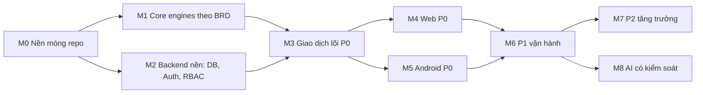

# 00 — TỔNG QUAN LỘ TRÌNH TRIỂN KHAI SURPLUSIQ

> **Nguồn sự thật nghiệp vụ:** [BRD_Full_SurplusIQ.md](../BRD_Full_SurplusIQ.md) v1.0 (220 UC, 99 quy tắc BR-001..BR-099, 11 quy tắc vòng đời gói VC-01..VC-11, 13 quyết định chốt ở chương 13).
> **Quy trình bắt buộc:** [rule.md](../../rule.md) — nhánh chức năng, commit `type(scope): ...`, ESLint pass, pull `main` trước khi push.
> **Nguyên tắc viết plan:** mọi con số trong plan phải trích được về một mã BR / UC / VC / mục chương 13. Chỗ nào BRD không nói, plan ghi rõ nhãn **[Đề xuất kỹ thuật]**.

## Mục lục bộ plan

| File | Nội dung |
|---|---|
| `00_TONG_QUAN_LO_TRINH.md` | Hiện trạng code, phân kỳ, mốc, DoD, câu hỏi mở (file này) |
| [01_BACKEND_VA_CSDL.md](01_BACKEND_VA_CSDL.md) | Bảng tham số, schema chi tiết, máy trạng thái, danh mục API, tác vụ nền, phân quyền |
| [02_CORE_PACKAGE.md](02_CORE_PACKAGE.md) | Đặc tả lại các engine theo BR, hàm thuần mới (hạn mức, đối soát, phân nhóm, bất thường) |
| [03_WEB_ADMIN_DASHBOARD.md](03_WEB_ADMIN_DASHBOARD.md) | Màn hình web theo UC, quyền, khóa gói, trạng thái rỗng/lỗi |
| [04_ANDROID_KHACH_HANG.md](04_ANDROID_KHACH_HANG.md) | Màn hình app theo UC, luồng giữ suất – thanh toán – QR |
| [05_KIEM_THU_VA_BENCHMARK.md](05_KIEM_THU_VA_BENCHMARK.md) | Ma trận kiểm thử từ chương 12, kiểm thử đồng thời, sửa bộ mô phỏng |
| [06_BACKLOG_TASKS.md](06_BACKLOG_TASKS.md) | Backlog từng task: nhánh, commit mẫu, phụ thuộc, tiêu chí xong |

---

## 1. Hiện trạng mã nguồn (đã đọc từng file, 12/10/2026)

| Thành phần | Có gì | Vấn đề phát hiện | Mức độ |
|---|---|---|---|
| Root | `package.json` workspaces, script infra/dev | Không có ESLint, Prettier, commitlint, script `lint`/`test` | Chặn M0 |
| `packages/core` | `ForecastingEngine`, `DynamicPricingEngine`, `QrTokenEngine`, `types` | Xem bảng 1.1 — lệch BRD ở nhiều điểm; không có test | Cao |
| `apps/backend` | `main.ts` (Swagger, ValidationPipe, prefix `api/v1`), `app.module.ts`, `orders.service.ts`, `offers.service.ts` | `app.module.ts` import 4 file **không tồn tại** (`stores/store.entity`, `offers/offer.entity`, `orders/order.entity`, `decisions/decision.entity`) ⇒ **không build được**. Không có controller, module, auth, migration. `synchronize: true`. CORS `*` kèm `credentials: true`. Script `test: jest` nhưng không cài jest | Chặn |
| `apps/backend` — `OrdersService.createOrder` | Transaction + `pessimistic_write` | Tạo đơn thẳng `PAID` (bỏ Chờ thanh toán 10 phút, BR-017); không idempotency (BR-015); không kiểm tra khóa đặt (BR-020), tối đa 5 suất/đơn; QR hạn cứng 3 giờ thay vì theo khung nhận + 15 phút (BR-023); secret fallback hard-code trong code | Cao |
| `apps/backend` — `OrdersService.claimOrder` | Verify HMAC, check cửa hàng | Đọc rồi ghi không nguyên tử ⇒ hai lần quét đồng thời đều thành công (vi phạm BR-023/BR-069); không kiểm tra khung nhận; không có mã dự phòng | Cao |
| `apps/backend` — `OffersService` | Gọi pricing engine, áp giá thẳng | Áp giá không qua trạng thái đề xuất (Chờ duyệt / hết hạn 15 phút, BR-065); không đếm số lần đổi giá; không kiểm tra gói Pro | Cao |
| `apps/web` | `App.tsx` một màn hình | Toàn bộ dữ liệu mock, số liệu tác động gõ cứng (`-28.5%`, `124.5 kg`, `310 kg CO2e`) — trái BR-033/BR-076 (chỉ hiển thị số tính được). Không router, không API client | Trung bình |
| `apps/android` | Theme, `BuyerDealListScreen`, `QrPickupScreen` | Giao diện tĩnh, QR là icon giả, không ViewModel/network | Trung bình |
| `apps/simulation` | So sánh 4 chế độ A/B/C/D | `Math.random()` không seed ⇒ kết quả không tái lập; lịch sử giả cố định; chế độ D dùng `estimatedSellOutProbability` (con số tự đặt trong engine) làm tỷ lệ bán ⇒ kết quả mang tính vòng lặp | Trung bình |
| `docker/` | Postgres PostGIS + Redis | Chưa kiểm tra lại trong lần này | — |

### 1.1. Lệch giữa `packages/core` hiện tại và BRD

| Engine | Code hiện tại | BRD yêu cầu | Căn cứ |
|---|---|---|---|
| Pricing | Giá sàn mặc định `0.35` | Mặc định 40% giá gốc, chủ cấu hình | 1.6, R2-007 |
| Pricing | Làm tròn bội 1.000 | Bội **500** | BR-064, BR-066 |
| Pricing | Không chặn trên | Không cao hơn giá hiện tại và giá gốc | BR-064 |
| Pricing | Không đếm lần đổi | Tối đa 3 lần đổi giá / suất | BR-064, 12.13.2 |
| Pricing | `estimatedSellOutProbability` công thức tự đặt | BRD không định nghĩa chỉ số này ⇒ bỏ hoặc gắn nhãn [Đề xuất] | 6.5 |
| Forecast | Có hệ số thời tiết | **Chưa dùng thời tiết** đến khi chọn nguồn | Chương 13 #10 |
| Forecast | Không có lịch sử ⇒ mặc định 20 | < 14 ngày ⇒ dùng **số hôm qua**, nhãn "Chưa đủ dữ liệu", độ tin cậy Thấp | BR-060, 12.12.1 |
| Forecast | `confidenceScore` 0..1 | Độ tin cậy **Thấp / Vừa / Cao** | R2-042 |
| Forecast | Ngày lễ +25%, sự kiện +15% gõ cứng | Sự kiện do chủ khai báo kèm mức ảnh hưởng | R2-040, 7.1 |
| QR | Payload chứa `buyerId` | Token **không chứa dữ liệu cá nhân** | BR-022 |
| QR | Không `jti`, không mã dự phòng | jti dùng một lần + mã dự phòng 6 ký tự | 7.1, 1.6 |
| Types | `OrderStatus = PENDING/PAID/CLAIMED/CANCELLED` | 7 trạng thái đơn | 14.3 |
| Types | `OfferStatus = ACTIVE/SOLD_OUT/EXPIRED/DONATED` | Nháp, Đang mở, Hết suất, Đã đóng, Đã hủy | 14.3 |

### 1.2. Các điểm bản plan trước viết sai — đã sửa trong bản này

| Bản cũ | Đúng theo BRD | Căn cứ |
|---|---|---|
| Khóa đặt 14 ngày | **7 ngày** sau 3 lần không đến nhận / 30 ngày | BR-020 |
| Làm tròn giá bội 1.000 | Bội 500 | BR-064 |
| Dự báo cold-start < 7 ngày | < 14 ngày (28 ngày cho xu hướng tuần) | BR-060 |
| Tối thiểu 30 phút giữa hai lần đổi giá | Không có trong BRD — bỏ. Có: đề xuất hết hiệu lực sau 15 phút | BR-065 |
| Giá sàn cấu hình 30–70% | Không có trong BRD. Có: không thấp hơn giá vốn nếu khai báo | BR-046 |
| Công thức pricing mũ 1.2 / 0.5, WMA α=0.85 | Không có trong BRD — chuyển thành [Đề xuất kỹ thuật], phải có test và giải thích được | 5.12, 5.13 |
| "Kỳ vọng chế độ D giảm > 60% hao hụt" | Số bịa — bỏ. Mô phỏng chỉ báo cáo kết quả đo, ghi rõ là ước lượng | BR-090, chương 13 #8 |
| Chế độ C = định giá động | Code hiện tại: C = dự báo, D = dự báo + định giá ⇒ plan bám theo code | `apps/simulation` |
| Dùng Zod để kiểm tra đầu ra AI | Zod chưa có trong dependencies ⇒ đề xuất dùng `class-validator` sẵn có, hoặc thêm Zod có ghi rõ | `apps/backend/package.json` |
| "19 thực thể" | BRD 7.1 liệt kê 21 nhóm thực thể; schema vật lý ~45 bảng | 7.1 |

---

## 2. Phân kỳ phạm vi (P0 / P1 / P2)

> **[Đề xuất kỹ thuật]** BRD không có độ ưu tiên UC. Phân kỳ dưới đây dựa trên chuỗi phụ thuộc ở 4.2: không có P0 thì không UC nào khác chạy được. Cần PO xác nhận (câu hỏi Q1).

### P0 — Vòng giao dịch lõi (demo được end-to-end)
Mục tiêu: chủ đăng suất → khách giữ suất → thanh toán giả lập → QR → chủ quét → đối soát tuần.

| Phân hệ | UC |
|---|---|
| 5.1 Tài khoản khách | R1-001, 002, 003, 004, 009 |
| 5.2 Khám phá deal | R1-020, 023, 024, 025, 026, 027 |
| 5.3 Đặt hàng | R1-040, 041, 042, 043, 044, 046, 047, 048, 055 |
| 5.4 Nhận hàng | R1-057, 058, 059 |
| 5.9 Tài khoản cửa hàng | R2-001, 002, 003, 005, 006, 007, 011 (xem gói), 016 |
| 5.10 Danh mục | R2-017, 019, 020, 022, 023, 024 |
| 5.11 Suất | R2-026, 028, 030, 031, 032, 033, 034, 035 |
| 5.14 Đơn cửa hàng | R2-049, 051, 052, 053 |
| 5.16 Đối soát | R2-061, 063, 066, 067 |
| 5.17 Nhật ký | R2-075 |
| **Tổng** | **50 UC** |

### P1 — Đủ để vận hành thật với cửa hàng thí điểm
Hậu mãi (R1-061..068, R2-054..060), thông báo (R1-073..077, R2-074), nhân viên & phân quyền (R2-076..081), gói & vòng đời (R2-008..015, VC-01..11), dự báo (R2-036..043), định giá động (R2-044..048), báo cáo (R2-062, 064, 065, 068, 069), tài khoản khách còn lại (R1-005..008, 010..019), deal còn lại (R1-021, 022, 028, 029), đặt hàng còn lại (R1-045, 049, 050, 054, 056), R1-060, CSV R2-025, R2-018, R2-027, R2-029, R2-050, lịch & việc (R2-095..098), cấu hình (R2-101..103).

### P2 — Tăng trưởng & AI
Ưu đãi/chiến dịch (R1-078..081, R2-088..094, R1-053), khách của cửa hàng (R2-082..087), deal nâng cao (R1-030..039), R1-051, 052, R1-069..072, R2-070..073, chất lượng dữ liệu (R2-099..100), mô phỏng (R2-104..105), hỗ trợ (R2-106..107), toàn bộ AI (R1-082..094, R2-021, R2-108..126).

> AI để cuối là có chủ đích: BRD yêu cầu lõi chạy đầy đủ khi AI tắt (2.4, 12.27.3), nên AI là lớp thêm vào, không phải nền.

---

## 3. Mốc triển khai và phụ thuộc

| Mốc | Nội dung | Tiêu chí thoát mốc (đo được) |
|---|---|---|
| **M0** | ESLint flat config, Prettier, commitlint + husky, Jest/Vitest, CI lint+build+test, sửa backend build | `npm run lint`, `npm run build`, `npm run test` pass ở root; commit sai format bị hook chặn |
| **M1** | Viết lại 3 engine + thêm `quota`, `reconciliation`, `segmentation`, `anomaly` (hàm thuần) | Mọi BR liên quan ở 02 có ít nhất một test; coverage `packages/core` ≥ 90% dòng **[Đề xuất]** |
| **M2** | Migration (tắt `synchronize`), Auth khách + chủ, refresh token theo thiết bị, RBAC 3 lớp, audit log, idempotency | Test e2e: khách bị từ chối trên web, chủ bị từ chối trên app (9.1); Quản lý không vào được gói (12.18.2) |
| **M3** | Suất, giữ suất, thanh toán giả lập, nhả suất, QR, quét, hết hạn nhận, khóa đặt, hủy, hoàn tiền, chốt sao kê | Pass toàn bộ kịch bản 12.3, 12.4, 12.11, 12.14, 12.16.1 + kiểm thử đồng thời ở 05 |
| **M4** | Web P0: đăng nhập, danh mục, suất, đơn, quét QR, sao kê | Chủ làm trọn luồng trên web với backend thật, không dữ liệu mock |
| **M5** | Android P0: đăng ký/OTP, danh sách deal theo vị trí, giữ suất, thanh toán, QR | Khách làm trọn luồng trên thiết bị/emulator với backend thật |
| **M6** | P1 | Pass các mục 12.1, 12.5, 12.6, 12.9, 12.10, 12.12, 12.13, 12.15, 12.17, 12.18, 12.21, 12.23 |
| **M7** | P2 phi AI | Pass 12.7, 12.19, 12.20, 12.22, 12.24, 12.25 |
| **M8** | AI | Pass 12.8, 12.26, 12.27.3 (tắt AI vẫn chạy đủ luồng) |

> BRD không cho số liệu năng lực đội và ngưỡng hiệu năng (chương 13 #8), nên plan **không đặt ngày**. Ước lượng theo task nằm ở [06_BACKLOG_TASKS.md](06_BACKLOG_TASKS.md) dưới dạng cỡ S/M/L.

---

## 4. Definition of Done (áp cho mọi task)

1. Làm trên nhánh `feature/<scope>-...` hoặc `fix/<scope>-...` tách từ `main` mới nhất.
2. Commit theo `type(scope): mô tả` (`feat|update|fix|refactor|test|docs|chore`, scope `back|web|app|core|simulation|infra|docs`).
3. `npm run lint` 0 error, `npm run build` pass, test liên quan pass.
4. Mỗi quy tắc BR mà task chạm tới có test tương ứng; tên test chứa mã BR (ví dụ `BR-014: không bán vượt tồn`).
5. Không có secret trong code; tham số nghiệp vụ đọc từ bảng cấu hình (xem 01 §1), không hard-code.
6. Không dùng `any`, không `catch {}` rỗng nuốt lỗi tiền/tồn.
7. Trước khi push: `git fetch origin && git merge origin/main`, chạy lại lint + test.
8. Cập nhật trạng thái task trong `06_BACKLOG_TASKS.md`.

---

## 5. Câu hỏi cần PO / nhóm chốt trước khi code

| # | Câu hỏi | Ảnh hưởng | Đề xuất mặc định |
|---|---|---|---|
| Q1 | Đồng ý phân kỳ P0/P1/P2 ở §2? | Thứ tự làm | Như §2 |
| Q2 | Trừ tồn: giữ `SELECT … FOR UPDATE` (code hiện tại, ARCHITECTURE.md) hay đổi sang **UPDATE có điều kiện** đúng nguyên văn BR-014? | Cách code `OrdersService` | UPDATE có điều kiện + CHECK `remaining_quantity >= 0` — một câu lệnh, không giữ khóa qua round-trip; xem 01 §4 |
| Q3 | Android có trong phạm vi demo đầu không, hay demo bằng web + Swagger trước? | M5 có chạy song song M4 không | Song song nếu có người làm Kotlin |
| Q4 | OTP/email trong môi trường dev: dùng mailbox giả (Mailpit trong docker) hay log ra console? | M2 | Mailpit |
| Q5 | Thanh toán giả lập: webhook giả gọi tay qua endpoint dev, hay tự xác nhận sau N giây? | M3 | Endpoint dev `POST /dev/payments/:id/confirm`, chỉ bật khi `NODE_ENV=development` |
| Q6 | Lưu ảnh (món, khiếu nại): local disk hay S3-compatible (MinIO)? | M3/M6 | MinIO trong docker |
