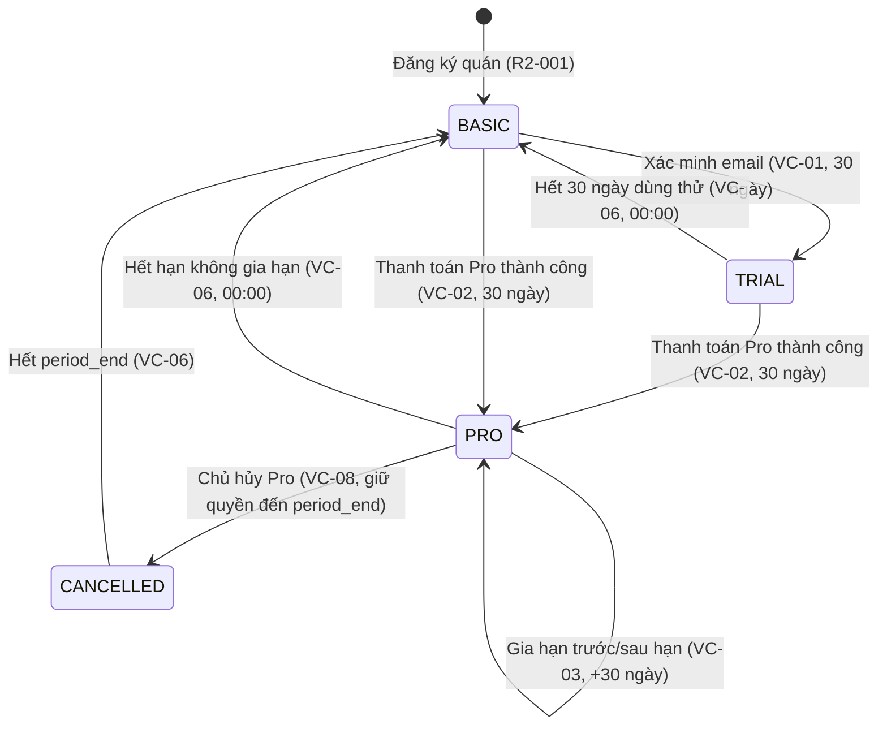

# 01 — BACKEND & CƠ SỞ DỮ LIỆU (`apps/backend`)

> Stack giữ nguyên theo `apps/backend/package.json`: NestJS 10, TypeORM 0.3, PostgreSQL 16 + PostGIS, BullMQ + ioredis, class-validator, passport-jwt, Swagger.
> Nhánh: `feature/back-<ten>`; commit: `feat(back): ...`.

---

## 1. Bảng tham số cấu hình (không hard-code trong code)

Lưu ở bảng `platform_settings` (mặc định nền tảng) và `store_settings` (giá trị riêng cửa hàng trong biên cho phép, R2-101). Code đọc qua `SettingsService` có cache Redis.

| Khóa | Giá trị | Phạm vi | Căn cứ |
|---|---|---|---|
| `order.hold_minutes` | 10 | Nền tảng | BR-017 |
| `order.max_qty_per_order` | 5 | Cửa hàng (≤ 5) | 3.2.1, R2-101 |
| `order.cancel_min_minutes_before_pickup` | 60 | Nền tảng | BR-018 |
| `pickup.late_grace_minutes` | 15 | Cửa hàng | BR-023 |
| `pickup.reminder_minutes_before` | 30 | Nền tảng | R1-075 |
| `noshow.threshold` / `noshow.window_days` / `noshow.lock_days` | 3 / 30 / 7 | Nền tảng | BR-020 |
| `price.floor_ratio_default` | 0.40 | Cửa hàng (≥ giá vốn nếu có) | 1.6, BR-046 |
| `price.rounding_step` | 500 | Nền tảng | BR-064 |
| `price.max_changes_per_offer` | 3 | Nền tảng | BR-064 |
| `price.proposal_ttl_minutes` | 15 | Nền tảng | BR-065 |
| `commission.rate` | 0.10 (trên giá sau ưu đãi) | Nền tảng | Ch.13 #2 |
| `complaint.window_hours` / `response_hours` / `extension_hours` | 24 / 48 / 24 | Nền tảng | BR-026, BR-071, BR-073 |
| `complaint.max_images` / `max_evidence_additions` | 3 / 2 | Nền tảng | R1-061, BR-027 |
| `complaint.reject_reason_len` | 10–300 | Nền tảng | BR-072 |
| `review.edit_hours` | 24 | Nền tảng | BR-028 |
| `otp.length` / `ttl_minutes` / `max_wrong` / `lock_minutes` / `resend_per_hour` | 6 / 5 / 5 / 15 / 3 | Nền tảng | BR-002 |
| `auth.login_max_wrong` / `lock_minutes` | 5 / 15 | Nền tảng | 9.1 |
| `auth.register_per_hour` / `reset_per_hour` | 5 / 3 | Nền tảng | 9.1 |
| `auth.trusted_device_days` | 30 | Nền tảng | R1-013 |
| `auth.owner_reset_link_minutes` | 30 | Nền tảng | 9.1 |
| `staff.invite_link_hours` | 72 | Nền tảng | 12.18.3 |
| `account.delete_grace_days` | 7 | Nền tảng | R1-019 |
| `payment.pending_max_hours` / `recheck_minutes` | 24 / 15 | Nền tảng | VC-07 |
| `payment.customer_recheck_min_interval_seconds` | 60 | Nền tảng | Ch.11 |
| `refund.max_retries` | 3 | Nền tảng | 9.3 |
| `limits.favorites` / `saved_deals` / `saved_filters` / `deal_alerts` / `saved_places` / `open_support` | 50 / 50 / 10 / 10 / 5 / 5 | Nền tảng | BR-011, R1-015, BR-030 |
| `notify.deal_per_day` / `quiet_start` / `quiet_end` | 3 / 22:00 / 07:00 | Nền tảng | BR-010 |
| `campaign.per_store_per_day` / `per_customer_per_day` | 1 / 2 | Nền tảng | BR-086 |
| `pagination.page_size` | 20 | Nền tảng | 9.4 |
| `retention.notifications_days` / `audit_months` / `ai_log_days` / `view_history_days` | 90 / 12 / 90 / 30 | Nền tảng | 7.4 |
| `forecast.min_days` / `trend_min_days` / `actual_lock_hours` / `compute_deadline` | 14 / 28 / 48 / 22:00 | Nền tảng | BR-060, BR-062, R2-036 |
| `anomaly.min_days` | 28 | Nền tảng | BR-096 |
| `segment.min_customers` | 20 | Nền tảng | 12.19.1 |
| `simulation.min_days` | 14 | Nền tảng | BR-090 |
| `donation.min_remaining` / `minutes_before_end` | 3 / 30 | Nền tảng | BR-098 |
| `promo.max_percent` / `max_amount_ratio` | 50 / 0.5 | Nền tảng | BR-084 |
| `ai.timeout_seconds` / `context_turns` | 10 / 10 | Nền tảng | 6.3 |
| `ai.customer_daily` | 30 | Nền tảng (GOI-KH) | R1-082, 083, 086, 087, 088 |
| `ai.customer_complaint_draft_daily` | 10 | Nền tảng (GOI-KH) | R1-089 |
| `limits.favorites` / `saved_deals` / `saved_filters` / `deal_alerts` / `saved_places` | 50 / 50 / 10 / 10 / 5 | Nền tảng (GOI-KH) | R1-028, R1-034, R1-033, R1-031, R1-015 |
| `export.link_hours` | 24 | Nền tảng | Ch.10 #24 |
| `demo.day_duration_seconds` | 120 (1 ngày = 2 phút) | Nền tảng | R2-065 |
| `plan.trial_months` / `pro_price_vnd` / `pro_period_days` | 1 / 300000 / 30 | Nền tảng | VC-01, VC-02, Ch.13 #1 |

Hạn mức theo gói cửa hàng (bảng `plan_quotas`, seed từ `03_service_packages.md`):

| `quota_key` | Cơ bản (`GOI-CB`) | Pro (`GOI-PRO`) / Dùng thử (`GOI-DT`) | Chu kỳ | Dùng chung bởi UC |
|---|---|---|---|---|
| `offers_open_daily` | 20 | 100 | Ngày | R2-028 |
| `csv_rows_per_import` | 100 | 500 | Mỗi lần | R2-025 |
| `ai_image_monthly` | 20 | 300 | Tháng | R2-021, R2-119, R2-120 |
| `ai_qa_monthly` | 10 | 300 | Tháng | R2-108, R2-109, R2-113, R2-116 |
| `ai_compose_monthly` | 10 | 200 | Tháng | R2-117, R2-118 |
| `staff_active` | 1 | 5 | Tồn tại | R2-076 |
| `promotions_running` | 2 | 10 | Tồn tại | R2-088 |
| `campaigns_monthly` | 4 | 30 | Tháng | R2-092 |
| `export_report_monthly` | 3 | 30 | Tháng | R2-064 |
| `export_orders_monthly` | 5 | 60 | Tháng | R2-050 |
| `waste_report_days` | 7 | 365 | Cuốn chiếu | R2-062 |
| `ai_action_cards_monthly` | — (Khóa) | 20 | Tháng | R2-114 |
| `ai_promo_suggest_monthly` | — (Khóa) | 20 | Tháng | R2-126 |
| `dynamic_pricing_mode` | Chỉ MANUAL | MANUAL + AUTO | Cấu hình | R2-008, R2-044..048 |
| `forecast_engine` | — (Khóa) | WMA + Trend 7 ngày | Tính năng | R2-036..043 |
| `customer_segmentation` | — (Khóa) | 4 nhóm quy tắc | Tính năng | R2-084 |
| `time_machine_history_days` | — (Khóa) | 30 ngày tua ngược | Tính năng | R2-088 (Mô phỏng/Lịch sử) |

---

## 2. Schema vật lý

Quy ước: PK `uuid`; mọi bảng có `created_at`, `updated_at timestamptz`; tiền là `integer` VND (không float); enum dùng Postgres enum; xóa mềm bằng cột trạng thái, **không** `DELETE` dữ liệu giao dịch (7.4). Migration TypeORM, tắt `synchronize`.

### 2.1. Danh tính & phiên (M2)

| Bảng | Cột chính | Ràng buộc / index |
|---|---|---|
| `users` | `id, email citext NULL, phone NULL, password_hash, role enum(CUSTOMER, STORE_USER), status enum(PENDING_VERIFY, ACTIVE, PENDING_DELETE, ANONYMIZED, LOCKED), failed_login_count, locked_until, two_factor_enabled, delete_requested_at` | UNIQUE(email), UNIQUE(phone); CHECK email hoặc phone not null (BR-001) |
| `customer_profiles` | `user_id PK/FK, full_name, avatar_url, search_radius_km, last_lat, last_lng` **không lưu lịch sử vị trí** (BR-004) | — |
| `dietary_profiles` | `user_id, allergens text[], excluded_items text[]` | Chỉ tạo khi có consent (BR-005, R1-016) |
| `consents` | `user_id, type enum(TERMS, LOCATION, PROMOTION, PERSONALIZATION, AI_MEMORY), version, granted bool, granted_at` | Lịch sử, chỉ INSERT (9.2, R1-012, R1-017) |
| `refresh_tokens` | `id, user_id, device_id, device_name, ip, token_hash, expires_at, revoked_at, last_used_at` | Index (user_id, revoked_at) — R1-014 |
| `otp_codes` | `id, target, purpose enum(VERIFY, RESET, TWO_FA, CHANGE_ID), code_hash, expires_at, used_at, wrong_count` | Index (target, purpose) — BR-002, R1-002 |
| `trusted_devices` | `user_id, device_id, expires_at` | R1-013 |
| `saved_places` | `user_id, label varchar(30), location geography(Point), radius_km numeric NULL` | ≤ 5 / user (R1-015) |
| `saved_filters` | `id, user_id, name varchar(30), criteria jsonb, created_at` | ≤ 10 / user, tên không trùng (R1-033) |
| `deal_alerts` | `id, user_id, criteria jsonb, is_active bool, triggered_count int, last_triggered_at timestamptz` | ≤ 10 cảnh báo bật / user (R1-031, R1-032) |
| `saved_deals` | `user_id, offer_id, saved_at` | ≤ 50 / user, tự dọn sau 7 ngày nếu hết hạn (R1-034) |
| `view_history` | `user_id, offer_id, viewed_at` | Max 20 deals, xóa sau 30 ngày, chỉ lưu khi bật cá nhân hóa (R1-035) |
| `fcm_tokens` | `user_id, device_id, token, enabled` | Xóa khi đăng xuất / ẩn danh |

### 2.2. Cửa hàng, nhân sự, gói (M2, M6)

| Bảng | Cột chính | Ràng buộc |
|---|---|---|
| `stores` | `id, owner_user_id, name, address, location geography(Point,4326) NULL, phone, logo_url, open_hours jsonb, status enum(PENDING_VERIFY, ACTIVE, SUSPENDED), trial_used bool` | GIST(location); không ACTIVE khi location NULL (BR-044) |
| `store_settings` | `store_id PK, default_pickup_start, default_pickup_end, floor_ratio, cost_price_ratio NULL, pricing_mode enum(MANUAL, AUTO), late_grace_minutes, max_qty_per_order, fixed_discount_schedule jsonb` | `AUTO` chỉ khi gói Pro (BR-046); `fixed_discount_schedule` cho fallback BR-067 |
| `store_settings_history` | `store_id, actor_id, key, old_value, new_value` | Chỉ INSERT — R2-102 |
| `store_members` | `id, store_id, user_id, permission enum(OWNER, MANAGER, COUNTER), status enum(INVITED, ACTIVE, LOCKED, REMOVED), last_active_at` | UNIQUE(user_id) — một email thuộc một cửa hàng (7.4, R2-076..080) |
| `staff_invites` | `id, store_id, email, permission, token_hash, expires_at, used_at` | 72h, dùng một lần (R2-076) |
| `store_closures` | `store_id, date, type enum(CLOSED, SPECIAL_HOURS), open_hours jsonb` | R2-097 |
| `subscriptions` | `store_id PK, plan enum(BASIC, TRIAL, PRO), period_start timestamptz, period_end timestamptz, cancel_at_period_end bool, downgrade_at_period_end bool, trial_used bool, status enum(ACTIVE, PENDING_PAYMENT, EXPIRED, CANCELLED)` | VC-01..VC-11 |
| `subscription_invoices` | `id, store_id, period_start, period_end, amount, payment_txn_id, status enum(PAID, PENDING, FAILED, REFUNDED)` | Bất biến sau khi tạo (BR-049, VC-02, VC-10) |
| `customer_segments` | `store_id, customer_id, segment enum(NEW, LOYAL, AT_RISK, FREQUENT_NOSHOW), computed_at` | Chạy theo lịch hằng ngày, quy tắc thuần ≥ 20 khách (R2-084) |
| `customer_notes` | `store_id, customer_id, note varchar(200), updated_at` | Nội bộ cửa hàng, cấm SĐT/email PII (R2-085) |
| `usage_logs` | `id, store_id NULL, user_id NULL, quota_key, units, ref_id, created_at` | Index (store_id, quota_key, created_at) — nguồn đếm hạn mức (BR-050) |

### 2.3. Danh mục & suất (M3)

| Bảng | Cột chính | Ràng buộc |
|---|---|---|
| `items` | `id, store_id, name, category, original_price, cost_price NULL, standard_shelf_life_hours, ingredients text, allergens text[], weight_grams NULL, image_url, description, nutrition_estimate jsonb NULL, status enum(ACTIVE, ARCHIVED)` | Không DELETE (BR-051, R2-017..024) |
| `offers` | `id, store_id, item_id, kind enum(REGULAR, SURPRISE_BAG), total_quantity, remaining_quantity, sold_quantity, original_price, current_price, floor_price, pickup_start, pickup_end, expires_at, status enum(DRAFT, OPEN, SOLD_OUT, CLOSED, CANCELLED), price_change_count smallint` | CHECK `remaining_quantity >= 0`; CHECK `floor_price <= current_price <= original_price`; CHECK `price_change_count <= 3`; index (status, pickup_end); index (store_id, pickup_start) |
| `offer_events` | `offer_id, actor_id NULL, type enum(CREATED, OPENED, EDITED, STOCK_ADJUSTED, PRICE_CHANGED, CLOSED, CANCELLED, AUTO_CLOSED), payload jsonb, reason` | Chỉ INSERT — R2-035, BR-056 |
| `surprise_bag_items` | `offer_id, item_id, quantity` | Túi bất ngờ R2-091; bắt buộc dị ứng (BR-085) |

### 2.4. Đơn, thanh toán, nhận hàng (M3)

| Bảng | Cột chính | Ràng buộc |
|---|---|---|
| `orders` | `id, code (ngắn, hiển thị), customer_id, store_id, offer_id, quantity, unit_price (giá chốt), promotion_id NULL, discount_amount, total_amount, status enum(PENDING_PAYMENT, PAID, PICKED_UP, HOLD_EXPIRED, PICKUP_EXPIRED, CANCELLED, REFUNDED), hold_expires_at, pickup_slot timestamptz NULL, note varchar(200), arriving_notified_at, paid_at, picked_up_at, picked_up_by, cancelled_at, cancel_reason, cancelled_by enum(CUSTOMER, STORE, SYSTEM)` | CHECK quantity 1..5; index (status, hold_expires_at); index (status, offer_id); index (store_id, created_at) |
| `idempotency_keys` | `scope, key, user_id, request_hash, response jsonb, status_code, created_at` | PK(scope, user_id, key); TTL dọn sau 24h **[Đề xuất]** |
| `payment_transactions` | `id, order_id NULL, store_id NULL, kind enum(ORDER_PAYMENT, ORDER_REFUND, SUBSCRIPTION_PAYMENT, SUBSCRIPTION_REFUND), amount, method enum(VIETQR, SIMULATED), gateway_txn_id, parent_txn_id NULL, status enum(PENDING_CONFIRM, SUCCEEDED, FAILED, MANUAL_REVIEW), retry_count, last_checked_at` | UNIQUE(gateway_txn_id) (BR-015, VC-10); UNIQUE(parent_txn_id) WHERE kind like '%REFUND' — mỗi giao dịch gốc một lệnh hoàn (ch.10 #3) |
| `pickup_tokens` | `id (= jti), order_id, backup_code char(6), expires_at, status enum(UNUSED, USED, REVOKED, EXPIRED), used_at` | UNIQUE(order_id) WHERE status='UNUSED'; UNIQUE(store-scoped backup_code, ngày) **[Đề xuất]** (R1-057, R2-052) |
| `proxy_pickup_codes` | `id, order_id, code char(8), status enum(UNUSED, USED, REVOKED), expires_at` | Mỗi đơn ≤ 1 mã hiệu lực (BR-021, R1-052) |
| `noshow_records` | `customer_id, order_id, occurred_at, excluded bool` | Đếm cuốn chiếu 30 ngày; `excluded` cho lỗi cửa hàng (BR-020, R1-048, R1-059) |
| `order_locks` | `customer_id PK, locked_until` | Khóa đặt 7 ngày (BR-020) |

### 2.5. Hậu mãi (M6)

`complaints (order_id, customer_id, store_id, category, description, status enum(PENDING_STORE, ACCEPTED, REJECTED, CLOSED), response_due_at, extended bool, refund_amount, reject_reason, auto_accepted bool)` — UNIQUE(order_id) WHERE status='PENDING_STORE' (R1-061..068, R2-054..060).
`complaint_attachments (complaint_id, url, added_round 0..2)`.
`reviews (order_id UNIQUE, customer_id, store_id, rating 1..5, comment, status enum(VISIBLE, HIDDEN, REPORTED), store_reply, store_reply_at)`; `stores.rating_avg/rating_count` cập nhật trong cùng transaction (7.4, R1-064..066, R2-057..058).
`violation_reports (reporter_id, target_type, target_id)` — UNIQUE(reporter_id, target_type, target_id) (BR-029, R1-069, R2-058).
`support_tickets`, `support_messages` — trạng thái OPEN, IN_PROGRESS, ANSWERED, CLOSED (R1-070..071, R2-106..107).

### 2.6. Dự báo, giá, đối soát (M6)

| Bảng | Cột chính |
|---|---|
| `daily_actuals` | `store_id, item_id, date, produced, sold_offline, sold_app (tự tính), stockout_at NULL, locked_at` — UNIQUE(store_id,item_id,date) (R2-039) |
| `special_events` | `store_id, date, type, impact_factor` — UNIQUE(store_id, date, type) (BR-063, R2-040) |
| `forecasts` | `store_id, item_id, target_date, recommended, low, high, confidence enum(LOW, MEDIUM, HIGH), method enum(DOW_AVG, YESTERDAY_FALLBACK), components jsonb, chosen_quantity NULL, override_reason NULL` (R2-036..038, R2-041..043) |
| `price_proposals` | `offer_id, old_price, proposed_price, components jsonb, status enum(PENDING, APPROVED, REJECTED, EXPIRED, AUTO_APPLIED), expires_at, decided_by NULL, decided_at` (R2-044..048) |
| `weekly_statements` | `store_id, week_start (thứ Hai), week_end, gross, commission, refunds, subscription_fee, adjustments, net_payable, status enum(DRAFT, LOCKED), flags jsonb` — UNIQUE(store_id, week_start); trigger chặn UPDATE khi LOCKED (BR-075, R2-063, R2-066, R2-067) |
| `statement_lines` | `statement_id, order_id, type, amount, commission` |

### 2.7. Tăng trưởng, phát hiện bất thường, trợ lý AI (M6–M8)

| Bảng | Cột chính | Ràng buộc / ghi chú |
|---|---|---|
| `promotions` | `id, store_id, name, type enum(PERCENT, FIXED), value, target enum(ALL, FAVORITES, LOYAL, AT_RISK), max_uses, used_count, start_at, end_at, min_order_amount, status enum(DRAFT, ACTIVE, PAUSED, ENDED)` | Max 2 CB / 10 Pro chạy đồng thời (R2-088..090) |
| `promotion_wallet` | `customer_id, promotion_id, claimed_at, used_at, order_id NULL` | UNIQUE(customer_id, promotion_id) (R1-078..080) |
| `campaigns` | `id, store_id, title, content, target, scheduled_at, status enum(DRAFT, SCHEDULED, SENT, CANCELLED)` | Max 4 CB / 30 Pro/tháng (R2-092..094) |
| `campaign_deliveries`| `campaign_id, customer_id, sent_at, opened_at, clicked_at, converted_order_id NULL` | Đánh giá hiệu quả chiến dịch (R2-094) |
| `anomalies` | `id, store_id, metric, date, expected_value, actual_value, mad_score numeric, status enum(OPEN, RESOLVED, DISMISSED), feedback` | Ngưỡng MAD > 2.5, tối thiểu 28 ngày dữ liệu (R2-112) |
| `action_cards` | `id, store_id, action_type, payload jsonb, reason_text, expected_outcome, status enum(PENDING, ACCEPTED, REJECTED, EXPIRED), expires_at (7 ngày), result_evaluation enum(POSITIVE, INCONCLUSIVE, NEGATIVE) NULL` | Pro: 20 thẻ/tháng (R2-114, R2-115) |
| `donation_records` | `id, store_id, recipient_info jsonb, offer_id, quantity, donated_at, note` | Quy tắc xác định, không tính phí/hoa hồng (R2-121) |
| `ai_conversations` | `id, user_id, store_id NULL, role enum(CUSTOMER, STORE), title, status enum(ACTIVE, CLOSED), created_at` | Giữ max 90 ngày (R1-091, R2-110) |
| `ai_messages` | `id, conversation_id, sender enum(USER, ASSISTANT), content, tools_called jsonb NULL, context_tokens int, created_at` | Giới hạn 10 lượt ngữ cảnh gần nhất (R1-083, R2-109) |
| `ai_logs` | `id, user_id NULL, store_id NULL, feature_code, model, latency_ms, input_summary, output_summary, error_code NULL, created_at` | Lưu 90 ngày để kiểm toán chất lượng (R1-092, R2-124) |
| `ai_feedback` | `id, log_id, rating enum(HELPFUL, UNHELPFUL), reason, notes, created_at` | Người dùng đánh giá kết quả AI (R1-092, R2-125) |

---

## 3. Máy trạng thái (cài trong service, test từng cạnh)

### 3.1. Đơn hàng (Orders)

| Từ | Đến | Ai / tác vụ | Điều kiện | Tác động phụ |
|---|---|---|---|---|
| — | PENDING_PAYMENT | Khách R1-040 | Offer OPEN, đủ tồn, khách ACTIVE, không bị khóa, đã đồng ý điều khoản hiện hành, qty ≤ max | Trừ tồn; nếu tồn = 0 ⇒ offer SOLD_OUT |
| PENDING_PAYMENT | PAID | Xác nhận thanh toán khớp tiền | `now ≤ hold_expires_at`, số tiền = total_amount | Sinh pickup token; thông báo cửa hàng (ch.10 #1) |
| PENDING_PAYMENT | HOLD_EXPIRED | Job nhả suất | `now > hold_expires_at` (10 phút) | Cộng trả tồn cùng transaction; offer SOLD_OUT ⇒ OPEN nếu còn khung; trả lượt ưu đãi (BR-019, R1-042) |
| HOLD_EXPIRED | (giữ nguyên) | Tiền đến muộn | — | Tạo lệnh hoàn 100% tự động (R1-047) |
| PAID | PICKED_UP | Cửa hàng quét | Thuộc cửa hàng, trong `[pickup_start, pickup_end + grace]` | Token USED; mở khiếu nại/đánh giá (R1-058, R2-052) |
| PAID | CANCELLED | Khách R1-043 | `pickup_start − now ≥ 60'` | Hoàn 100%, cộng trả tồn, token REVOKED |
| PAID | CANCELLED | Cửa hàng R2-053 / hủy suất R2-033 | Có lý do | Hoàn 100% không hoa hồng; cộng tồn nếu còn khung |
| PAID | PICKUP_EXPIRED | Job | `now > pickup_end + grace` (15 phút trễ) | +1 noshow; ≥ 3/30 ngày ⇒ khóa 7 ngày; doanh thu ghi cho cửa hàng trừ hoa hồng (BR-020, BR-024, R1-059) |
| CANCELLED | REFUNDED | Hoàn tiền thành công | — | — |

Mọi chuyển trạng thái viết dưới dạng `UPDATE orders SET status=:to … WHERE id=:id AND status=:from` và kiểm tra `affected = 1`; `affected = 0` ⇒ trả lỗi `ORDER_STATE_CONFLICT`.

### 3.2. Suất bán (Offers)

| Từ | Đến | Tác nhân / Sự kiện | Điều kiện |
|---|---|---|---|
| DRAFT | OPEN | Chủ mở bán (R2-028) | Giá ≥ giá sàn, khung nhận hợp lệ, trong hạn mức ngày |
| OPEN | SOLD_OUT | Khách giữ suất hết tồn (R1-040) | `remaining_quantity = 0` |
| SOLD_OUT | OPEN | Nhả suất hủy/hết hạn giữ (R1-042, R1-043) | `remaining_quantity > 0` và `now < pickup_end` |
| OPEN / SOLD_OUT | CLOSED | Hết giờ nhận (R2-034 BullMQ) / Chủ đóng sớm (R2-032) | `now >= pickup_end` hoặc đóng thủ công |
| OPEN / SOLD_OUT | CANCELLED | Chủ hủy suất (R2-033) | Hủy toàn bộ đơn đã thanh toán & hoàn tiền 100% |

### 3.3. Vòng đời gói dịch vụ (Subscriptions — VC-01 đến VC-11)



| Quy tắc | Tình huống | Chuyển trạng thái & Xử lý |
|---|---|---|
| **VC-01** | Đăng ký & xác minh email | `BASIC` $\rightarrow$ `TRIAL`: Kích hoạt 30 ngày trải nghiệm toàn bộ tính năng Pro (dùng thử 1 lần/cửa hàng). |
| **VC-02** | Kích hoạt trả phí | `TRIAL` hoặc `BASIC` $\rightarrow$ `PRO`: Kỳ 30 ngày bắt đầu tại thời điểm xác nhận thanh toán 300.000đ; thời gian dùng thử còn lại không cộng dồn. |
| **VC-03** | Gia hạn gói Pro | `PRO` $\rightarrow$ `PRO`: Không tự động gia hạn MVP. Gia hạn trước hạn: kỳ mới nối tiếp `period_end` cũ (+30 ngày). Gia hạn sau hạn: tính từ thời điểm thanh toán. Nhắc trước 7 ngày và 1 ngày. |
| **VC-04** | Gia hạn thất bại | Thanh toán lỗi: giữ nguyên gói đến hết hạn; sau hạn chuyển theo VC-06. |
| **VC-05** | Nâng cấp / Hạ cấp | Nâng cấp Pro: hiệu lực ngay. Hạ cấp về Basic: có hiệu lực vào cuối kỳ (`downgrade_at_period_end = true`), không hoàn tiền phần còn lại. |
| **VC-06** | Tự động về Basic | Lúc 00:00 ngày kế tiếp ngày hết hạn: chuyển về `BASIC`. Tắt `pricing_mode = AUTO` (chuyển sang MANUAL), hủy các đề xuất giá chờ duyệt, khóa nhân viên ngoài hạn mức (chỉ giữ 1 nhân viên kích hoạt đầu tiên), tính năng Pro chuyển sang chế độ CHỈ XEM. |
| **VC-07** | Giao dịch chờ xác nhận | Giao dịch treo: Polling cổng mỗi 15 phút tối đa 24 giờ. Chưa cấp quyền Pro khi chưa xác nhận. Quá 24 giờ: đánh dấu FAILED, nếu tiền vào muộn thì hoàn 100%. |
| **VC-08** | Hủy gói | Đánh dấu `cancel_at_period_end = true`. Quyền lợi Pro giữ nguyên đến hết kỳ đã thanh toán. Hủy trong kỳ dùng thử: dừng ngay lập tức. |
| **VC-09** | Hoàn tiền phí gói | Chỉ hoàn tiền khi lỗi kỹ thuật nền tảng khiến gói không kích hoạt hoặc trừ tiền trùng; gói đã sử dụng bình thường không hoàn tiền. |
| **VC-10** | Idempotency & Đối soát | Khóa duy nhất `gateway_txn_id` trên `payment_transactions`. Giao dịch trùng giữ 1, hoàn phần thừa. |
| **VC-11** | Bảo toàn dữ liệu khi hạ gói | Lịch sử dự báo, quyết định giá, sao kê đối soát và nhật ký hoạt động được bảo toàn nguyên vẹn (chỉ xem), không bị xóa. Báo cáo hao hụt giới hạn hiển thị 7 ngày gần nhất theo hạn mức Basic. |KED |
| PAID | CANCELLED | Cửa hàng R2-053 / hủy suất R2-033 | Có lý do | Hoàn 100% không hoa hồng; cộng tồn nếu còn khung |
| PAID | PICKUP_EXPIRED | Job | `now > pickup_end + grace` | +1 noshow; ≥ 3/30 ngày ⇒ khóa 7 ngày; doanh thu ghi cho cửa hàng trừ hoa hồng (BR-024) |
| CANCELLED | REFUNDED | Hoàn tiền thành công | — | — |

Mọi chuyển trạng thái viết dưới dạng `UPDATE orders SET status=:to … WHERE id=:id AND status=:from` và kiểm tra `affected = 1`; `affected = 0` ⇒ trả lỗi `ORDER_STATE_CONFLICT`. Đây là cách đảm bảo "một lần duy nhất" cho quét QR, nhả suất, hủy.

### 3.2. Suất, khiếu nại, đề xuất giá, gói
Bám đúng 7.3.2, 7.3.3, 5.13.8, VC-01..VC-11. Mỗi máy trạng thái có một file `*.state.ts` export bảng chuyển hợp lệ và một hàm `assertTransition(from, to)` dùng chung.

---

## 4. Thiết kế chống bán vượt tồn (quyết định Q2)

**Đề xuất:** đúng nguyên văn BR-014 — một câu UPDATE có điều kiện trong transaction:

```sql
UPDATE offers
SET remaining_quantity = remaining_quantity - $qty,
    status = CASE WHEN remaining_quantity - $qty = 0 THEN 'SOLD_OUT' ELSE status END
WHERE id = $offerId AND status = 'OPEN' AND remaining_quantity >= $qty
  AND now() < pickup_end
RETURNING remaining_quantity, current_price, floor_price;
```

- 0 dòng trả về ⇒ `OFFER_UNAVAILABLE` (400), không tạo đơn, tồn giữ nguyên (9.3).
- Cùng transaction: INSERT `orders` với `unit_price = current_price` vừa RETURNING (giá chốt, BR-016), lưu `idempotency_keys`.
- Lớp chặn cuối: CHECK `remaining_quantity >= 0` ở DB.

**So với code hiện tại (`SELECT … FOR UPDATE` rồi `save`):** cả hai đều đúng. Cách UPDATE có điều kiện ít round-trip hơn và không giữ khóa hàng trong lúc code Node xử lý; khi 100 người tranh 1 suất, các transaction không phải xếp hàng chờ khóa rồi mới đọc. Nếu nhóm muốn giữ `FOR UPDATE` thì vẫn bắt buộc thêm CHECK constraint và idempotency.

**Idempotency (BR-015):** header `Idempotency-Key` bắt buộc cho `POST /orders`, `POST /orders/:id/pay`, `POST /orders/:id/cancel`, mọi endpoint hoàn tiền. Interceptor: tra `(scope, user, key)` → nếu có và `request_hash` khớp ⇒ trả response đã lưu; khác hash ⇒ 422 `IDEMPOTENCY_KEY_REUSED`.

---

## 5. Danh mục API (prefix `/api/v1`)

Ký hiệu quyền: `C` khách, `O` Chủ, `M` Quản lý, `S` Nhân viên quầy; gói `PRO` = chỉ Pro/Dùng thử; `Q:key` = tiêu thụ hạn mức.

### 5.1. Auth — P0/P1

| Method & path | UC | Quyền | Ghi chú |
|---|---|---|---|
| `POST /auth/customer/register` | R1-001 | public | Rate 5/giờ/IP+thiết bị |
| `POST /auth/customer/verify-otp` | R1-002 | public | BR-002 |
| `POST /auth/customer/resend-otp` | R1-002 | public | 3/giờ |
| `POST /auth/customer/login` | R1-003 | public | Từ chối tài khoản STORE_USER (9.1) |
| `POST /auth/store/register` | R2-001 | public | Tạo user + store + subscription BASIC |
| `POST /auth/store/verify-email` | R2-001, VC-01 | public | Kích hoạt TRIAL nếu chưa dùng |
| `POST /auth/store/login` | R2-002 | public | Từ chối CUSTOMER |
| `POST /auth/refresh` · `POST /auth/logout` | R1-004, R2-003 | đã đăng nhập | Thu hồi token thiết bị hiện tại |
| `POST /auth/password/change` · `/forgot` · `/reset` | R1-007, R1-008, R2-004 | | Thu hồi refresh token khác (BR-003) |
| `GET /me/sessions` · `DELETE /me/sessions/:id` | R1-014 | C | |
| `POST /me/2fa/enable` · `/disable` | R1-013 | C | |

### 5.2. Khách — hồ sơ & deal

| Method & path | UC | Ghi chú |
|---|---|---|
| `GET/PATCH /me/profile` | R1-005, R1-006 | Trả kèm `noshow_count_30d`, trạng thái khóa |
| `PUT /me/location-preference` | R1-009 | Bán kính; không lưu lịch sử (BR-004) |
| `GET/PUT /me/consents` | R1-012, R1-017 | Ghi lịch sử |
| `GET/PUT/DELETE /me/dietary-profile` | R1-016 | |
| `PUT /me/notification-settings` | R1-010 | Nhóm giao dịch không tắt được |
| `POST /me/delete-request` · `DELETE /me/delete-request` | R1-011, R1-019 | BR-007 |
| `POST /me/data-export` | R1-018 | Bất đồng bộ, link 24h |
| `CRUD /me/places` | R1-015 | ≤ 5 |
| `GET /deals?lat&lng&radius&category&minPrice&maxPrice&minDiscount&pickupFrom&pickupTo&sort&cursor` | R1-020, 023, 024, 025 | `ST_DWithin`, cursor `(distance, id)`; trả `allergen_warning` nếu khớp hồ sơ |
| `GET /deals/:offerId` | R1-026 | |
| `GET /stores/:id` | R1-027 | Ẩn nếu SUSPENDED |
| `GET /deals/map?bbox=` | R1-021 | P1 |
| `GET /deals/search?q=` | R1-022 | P1 |
| `POST/DELETE /me/favorites/:storeId` | R1-028, 029 | P1 |

### 5.3. Khách — đơn

| Method & path | UC | Ghi chú |
|---|---|---|
| `POST /orders` `{offerId, quantity, pickupSlot?, note?, promotionId?}` | R1-040, 049, 050, 053 | Idempotency; trả `holdExpiresAt`, `totalAmount`, `paymentInstruction` |
| `POST /orders/:id/payments` | R1-041 | Tạo giao dịch PENDING_CONFIRM, trả nội dung VietQR / link giả lập |
| `POST /orders/:id/payments/recheck` | R1-056 | ≥ 60 giây giữa hai lần |
| `GET /orders?status&from&to&q&cursor` | R1-044, 045 | |
| `GET /orders/:id` | R1-046 | Có `pickupToken` chỉ khi PAID và chưa hết khung (BR-022) |
| `POST /orders/:id/cancel` | R1-043 | |
| `POST /orders/:id/arriving` | R1-060 | Một lần, trong khung (BR-025) |
| `POST /orders/:id/proxy-code` | R1-052 | P2 |
| `GET /orders/:id/receipt.pdf` | R1-054 | P1 |
| `GET /me/order-lock` | R1-048 | |
| `GET /me/transactions` | R1-077 | P1 |
| `POST /payments/webhook` | R1-041 | Xác thực chữ ký cổng; idempotent theo `gateway_txn_id` |
| `POST /dev/payments/:txnId/confirm` | — | Chỉ `NODE_ENV=development` (Q5) |

### 5.4. Cửa hàng — P0

| Method & path | UC | Quyền | Gói |
|---|---|---|---|
| `GET/PATCH /store` | R2-005, 006 | O (M xem) | |
| `GET/PUT /store/settings` | R2-007, 008, 101 | O | `pricing_mode=AUTO` ⇒ PRO |
| `GET /store/subscription` · `GET /store/quotas` | R2-011, 016 | O | |
| `POST /store/subscription/upgrade` · `/renew` | R2-012, 013, VC-02, VC-03 | O | Tạo giao dịch 300.000đ |
| `POST /store/subscription/downgrade` · `/cancel` | R2-012, 014, VC-05, VC-08 | O | Hiệu lực cuối kỳ |
| `GET /store/subscription/invoices` · `/:id.pdf` | R2-015 | O | Bất biến |
| `GET /store/items` · `POST` · `GET/PATCH /:id` · `POST /:id/archive` · `/restore` | R2-017..024 | O, M | |
| `POST /store/items/import-csv` | R2-025 | O, M | `Q:csv_rows_per_import` |
| `GET /store/offers?date&status&itemId` | R2-026, 027 | O, M | |
| `POST /store/offers` | R2-028 | O, M | `Q:offers_open_daily` khi mở bán |
| `PATCH /store/offers/:id` | R2-030 | O, M | |
| `POST /store/offers/:id/adjust-stock` `{delta, reason}` | R2-031 | O, M | |
| `POST /store/offers/:id/open` · `/close` · `/cancel` | R2-028, 032, 033 | O, M | |
| `GET /store/offers/:id/history` | R2-035 | O, M | |
| `GET /store/orders?date&status&itemId&q` | R2-049, 050 | O, M; S chỉ hôm nay | |
| `GET /store/orders/:id` | R2-051 | O, M, S | Tên khách che chữ cái đầu (BR-068) |
| `POST /store/pickups/verify` `{token}` hoặc `{backupCode}` | R2-052, R1-058 | O, M, S | |
| `POST /store/orders/:id/cancel` `{reason}` | R2-053 | O, M | |
| `GET /store/dashboard/today` | R2-061 | O, M | |
| `GET /store/reconciliation?from&to` | R2-063 | O, M (Ch.13 #7) | |
| `GET /store/statements` · `/:id` · `/:id.pdf` | R2-067 | O, M | |
| `GET /store/audit-logs` | R2-075 | O | |

API P1/P2 (dự báo, giá, khiếu nại, nhân viên, khách, ưu đãi, chiến dịch, AI) liệt kê đầy đủ trong [06_BACKLOG_TASKS.md](06_BACKLOG_TASKS.md) theo từng task.

### 5.5. Mã lỗi chuẩn
Body lỗi: `{ code, message, details? }`. Danh mục tối thiểu: `AUTH_INVALID_CREDENTIALS`, `AUTH_LOCKED`, `AUTH_WRONG_CHANNEL`, `OTP_INVALID`, `OTP_LOCKED`, `FORBIDDEN_ROLE`, `FORBIDDEN_PLAN`, `QUOTA_EXCEEDED` (kèm `remaining`, `resetsAt` — 8.3.1), `STORE_SUSPENDED`, `OFFER_UNAVAILABLE`, `OFFER_PRICE_BELOW_FLOOR`, `ORDER_LOCKED_NOSHOW` (kèm `lockedUntil`), `ORDER_STATE_CONFLICT`, `ORDER_CANCEL_TOO_LATE`, `PAYMENT_AMOUNT_MISMATCH`, `PICKUP_TOKEN_USED`, `PICKUP_TOKEN_EXPIRED`, `PICKUP_WRONG_STORE`, `PICKUP_OUTSIDE_WINDOW`, `IDEMPOTENCY_KEY_REUSED`, `PRICE_PROPOSAL_EXPIRED`, `PRICE_CHANGE_LIMIT`.

---

## 6. Phân quyền 3 lớp (2.4, 8.2.1)

Thứ tự guard trên mỗi route: `JwtAuthGuard` → `ChannelGuard` (CUSTOMER chỉ route khách, STORE_USER chỉ route `/store`) → `StorePermissionGuard(@Permissions('OWNER','MANAGER'))` → `PlanGuard(@RequiresPlan('PRO'))` → `StoreStatusGuard` (chặn ghi khi SUSPENDED) → trong service: `QuotaService.consume(key)`.

- `store_id` **luôn lấy từ token**, không nhận từ body/param ⇒ không thể đọc cửa hàng khác (12.27.2).
- `QuotaService.consume` chạy trong cùng transaction với thao tác; thao tác lỗi validation ⇒ không ghi `usage_logs` (8.4). Riêng AI: ghi khi đã gọi mô hình (Ch.13 #13).
- Hạn mức kiểu "tồn tại" (`staff_active`, `promotions_running`) đếm bản ghi đang hoạt động, không dùng `usage_logs`.

---

## 7. Tác vụ nền (BullMQ)

| Queue / job | Lịch | Việc | Đảm bảo một lần | UC / BR |
|---|---|---|---|---|
| `orders.release-holds` | Mỗi phút | PENDING_PAYMENT quá hạn ⇒ HOLD_EXPIRED + trả tồn | UPDATE có điều kiện trạng thái; lỗi > 3 lần ghi cảnh báo | R1-042, BR-017 |
| `payments.recheck` | Mỗi 15 phút | Giao dịch PENDING_CONFIRM: hỏi lại cổng; > 24h ⇒ FAILED + hoàn nếu tiền đã vào | `gateway_txn_id` duy nhất | VC-07 |
| `payments.late-refund` | Sự kiện | Tiền đến khi đơn HOLD_EXPIRED ⇒ hoàn | UNIQUE parent_txn_id | R1-047 |
| `refunds.execute` | Sự kiện + retry backoff | Gọi hoàn; 3 lần lỗi ⇒ MANUAL_REVIEW | | 9.3 |
| `offers.auto-close` | Mỗi phút | OPEN/SOLD_OUT quá `pickup_end` ⇒ CLOSED, ghi `offer_events` | | R2-034, BR-058 |
| `orders.pickup-expire` | Mỗi phút **[Đề xuất]** | PAID quá `pickup_end + grace` ⇒ PICKUP_EXPIRED, noshow, khóa | | R1-059, BR-020/024 |
| `notify.pickup-reminder` | Mỗi phút | Đơn PAID còn 30' tới khung, chưa nhắc | cờ `reminded_at` | R1-075 |
| `complaints.auto-accept` | Mỗi 5 phút **[Đề xuất]** | PENDING_STORE quá `response_due_at` ⇒ ACCEPTED + hoàn 100% | | R2-060 |
| `statements.close-week` | Thứ Hai 00:05 **[Đề xuất giờ]** | Chốt tuần trước, LOCKED, thông báo | UNIQUE(store, week_start) | R2-066 |
| `forecast.daily` | Trước 22:00 | Tính dự báo ngày mai cho cửa hàng Pro | UNIQUE(store,item,date) | R2-036 |
| `price.proposals` | Mỗi 15 phút **[Đề xuất]** | Tạo đề xuất; AUTO ⇒ áp luôn; hết 15' ⇒ EXPIRED | | R2-044, BR-065 |
| `subscription.lifecycle` | 00:00 hằng ngày | Hết hạn ⇒ BASIC, tắt AUTO, hủy đề xuất chờ; nhắc 7 ngày / 1 ngày | | VC-03, VC-06 |
| `retention.cleanup` | Hằng đêm | Xóa thông báo > 90 ngày, AI log > 90 ngày, view history > 30 ngày | | 7.4 |
| `account.anonymize` | Hằng đêm | PENDING_DELETE quá 7 ngày ⇒ ANONYMIZED | | BR-007 |

**Thời gian giả lập (R2-065):** mọi service lấy giờ qua `ClockService` (không gọi `new Date()` trực tiếp). Chế độ demo của một cửa hàng dùng `VirtualClock` tua 1 ngày trong 120 giây trên dữ liệu mẫu tách riêng (`stores.is_demo = true`), không đụng dữ liệu thật.

---

## 8. Bảo mật & vận hành

- Secret (`JWT_SECRET`, `QR_HMAC_SECRET`, `PAYMENT_WEBHOOK_SECRET`, `GEMINI_API_KEY`) bắt buộc qua env; app **từ chối khởi động** nếu thiếu (bỏ fallback hard-code hiện tại).
- CORS: whitelist origin web từ env; bỏ `origin: '*'` khi `credentials: true`.
- Mật khẩu: bcrypt/argon2 **[Đề xuất: argon2id]**; cần thêm dependency.
- Log: không ghi token, OTP, mật khẩu, SĐT/email khách vào log.
- Migration chạy bằng `npm run migration:run`; seed dữ liệu demo bằng `npm run seed:demo`.
